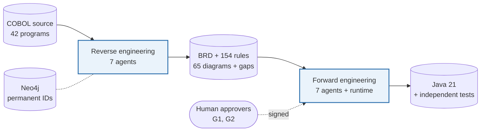
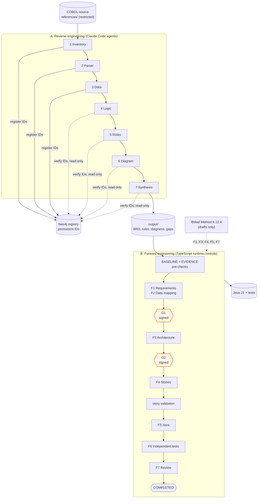
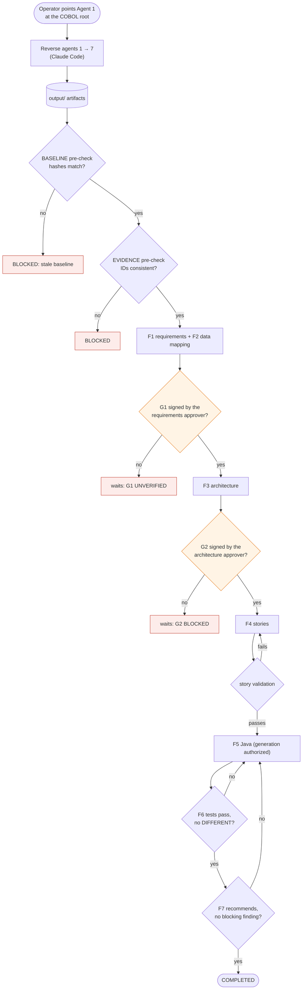
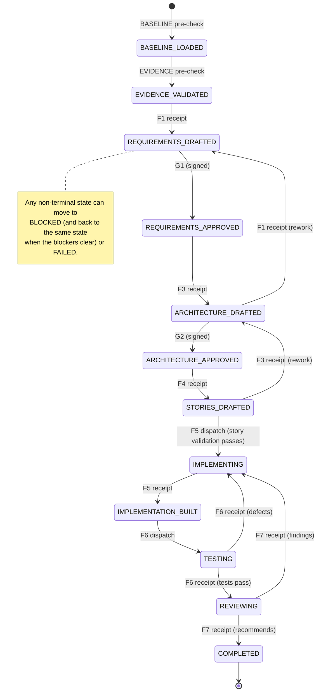
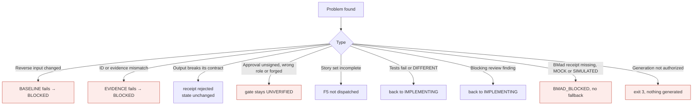
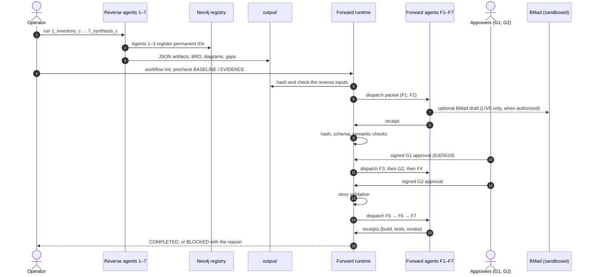
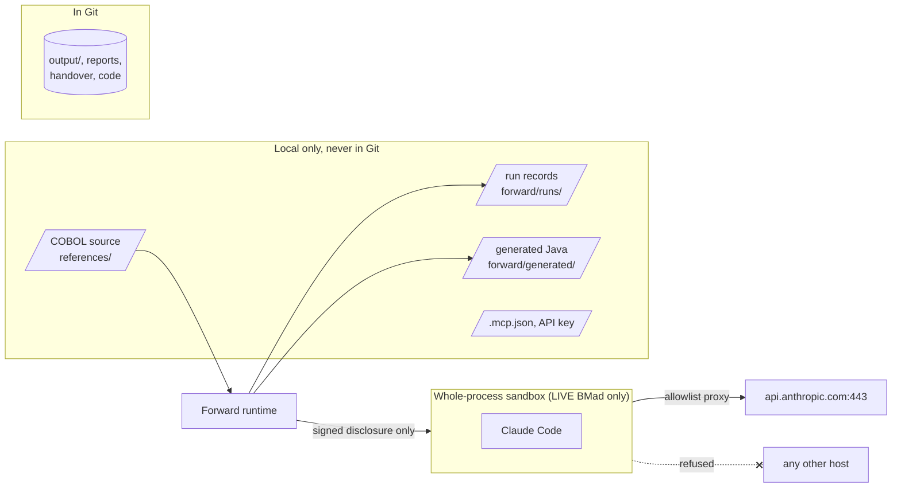
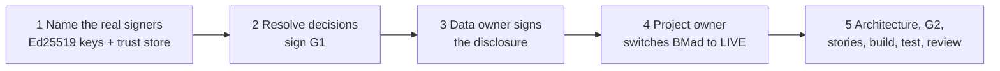

<div align="center">

# REVFORGE — Evidence-Governed COBOL-to-Java Modernization Harness

**REVFORGE reverse-engineers a legacy COBOL application into a traceable Business Requirements Document, then forward-engineers it to Java 21 under signed human gates. Each claim traces back to a COBOL source line:**

`inventory` → `parse` → `model the data` → `trace the logic` → `mine the rules` → `draw the diagrams` → `write the BRD` → `requirements` → **G1** → `architecture` → **G2** → `stories` → `Java` → `independent tests` → `review`


-E67E22?style=for-the-badge)


**[Summary](#1-summary)** ·
**[Architecture](#2-how-revforge-is-built)** ·
**[Workflow](#4-the-end-to-end-workflow)** ·
**[Gates](#7-gates-and-automated-checks)** ·
**[BMad](#8-bmad)** ·
**[Run it](#13-how-to-run-revforge)** ·
**[Results](#14-validation-results)** ·
**[Known problems](#15-known-problems)** ·
**[Glossary](#18-glossary)**

Author: **Vighnasree Vara**

</div>

> [!IMPORTANT]
> **Legacy COBOL-to-Java behavioural equivalence has not been established.** *COMPLETE*, *compiles* and *passes source-derived tests* do not mean "equivalent to the legacy COBOL program". No legacy COBOL run is available to compare against.

> [!CAUTION]
> Do not commit the restricted COBOL source (`references/`), generated Java (`forward/generated/`), workflow run records (`forward/runs/`) or credentials (`.mcp.json`, `.claude/settings.local.json`, `.env`). They are git-ignored, and the integrity checks fail if one of them is tracked.
> Do not send source to an AI provider without a signed disclosure authorization from the data owner. Every authorization fails closed.

---

REVFORGE modernizes a legacy COBOL application under strict evidence rules:

- every claim traces back to a source line, through a **permanent source ID**;
- every unknown becomes a recorded **gap**, never guessed behaviour;
- nothing is called verified unless a recorded result supports it;
- no agent output can pass a gate, approve anything or authorize Java generation. Only signed human approvals and the runtime's own checks can.

Fourteen Claude Code agents do the work: seven for reverse engineering and seven for forward engineering. A deterministic TypeScript runtime controls the forward half.

This README is the **one place that explains all of REVFORGE**: the design, every agent, the gates, BMad, the dashboards, the runbook, the validation results and the known problems. The figures come from repository files or from commands run on the repository; the source of each table is named.

| If you are… | Read |
|---|---|
| A client, manager or reviewer | [1](#1-summary), [3](#3-design-rules), [4](#4-the-end-to-end-workflow), [14](#14-validation-results), [16](#16-from-prototype-to-the-real-project), [17](#17-key-points) |
| A developer who joins the project | All sections, in order. Keep [13](#13-how-to-run-revforge) and [15](#15-known-problems) open while you work |
| An operator who runs the pipeline | [13](#13-how-to-run-revforge), then [5](#5-reverse-engineering) or [6](#6-forward-engineering) |
| An approver (G1 or G2 signer) | [7](#7-gates-and-automated-checks), [11](#11-security-and-authorization), [16](#16-from-prototype-to-the-real-project) |
| A business analyst who reads the BRD | [1](#1-summary), [5](#5-reverse-engineering), [15](#15-known-problems) |

---

## Table of contents

1. 🧭 [Summary](#1-summary)
   - 1.1 [The problem](#11-the-problem) · 1.2 [What REVFORGE produces](#12-what-revforge-produces) · 1.3 [Current status](#13-current-status) · 1.4 [Why REVFORGE is strict about evidence](#14-why-revforge-is-strict-about-evidence)
2. 🏗️ [How REVFORGE is built](#2-how-revforge-is-built)
   - 2.1 [Three layers](#21-three-layers) · 2.2 [Architecture](#22-architecture) · 2.3 [Responsibility matrix](#23-responsibility-matrix) · 2.4 [Technology stack](#24-technology-stack) · 2.5 [Repository layout](#25-repository-layout)
3. 🛡️ [Design rules](#3-design-rules)
4. 🔄 [The end-to-end workflow](#4-the-end-to-end-workflow)
   - 4.1 [Full flow](#41-full-flow) · 4.2 [Lineage of one rule](#42-lineage-of-one-rule) · 4.3 [Workflow states](#43-workflow-states) · 4.4 [Errors and fail-closed behaviour](#44-errors-and-fail-closed-behaviour) · 4.5 [Who does which step](#45-who-does-which-step)
5. 🔍 [Reverse engineering](#5-reverse-engineering)
   - 5.1 [The seven reverse agents](#51-the-seven-reverse-agents) · 5.2 [Permanent source IDs](#52-permanent-source-ids) · 5.3 [Results](#53-results) · 5.4 [Comparison with the Udara reference](#54-comparison-with-the-udara-reference)
6. ⚙️ [Forward engineering](#6-forward-engineering)
   - 6.1 [The seven forward agents](#61-the-seven-forward-agents) · 6.2 [The orchestrator](#62-the-orchestrator) · 6.3 [Converter and Java 21 runtime](#63-converter-and-java-21-runtime) · 6.4 [Engineering quality gates](#64-engineering-quality-gates)
7. 🚦 [Gates and automated checks](#7-gates-and-automated-checks)
   - 7.1 [Steps and pass conditions](#71-steps-and-pass-conditions) · 7.2 [Gate numbering](#72-gate-numbering)
8. 🤖 [BMad](#8-bmad)
9. 📊 [Dashboards](#9-dashboards)
10. 🧪 [Synthetic demonstration](#10-synthetic-demonstration)
11. 🔒 [Security and authorization](#11-security-and-authorization)
12. 🗂️ [Data and file map](#12-data-and-file-map)
13. ▶️ [How to run REVFORGE](#13-how-to-run-revforge)
    - 13.1 [Prerequisites](#131-prerequisites) · 13.2 [Setup](#132-setup) · 13.3 [Run reverse engineering](#133-run-reverse-engineering) · 13.4 [Forward commands](#134-forward-commands) · 13.5 [Run the demonstration](#135-run-the-demonstration) · 13.6 [Run the dashboards](#136-run-the-dashboards) · 13.7 [Run the tests](#137-run-the-tests) · 13.8 [Configuration and environment variables](#138-configuration-and-environment-variables) · 13.9 [Fault diagnosis](#139-fault-diagnosis)
14. ✅ [Validation results](#14-validation-results)
15. ⚠️ [Known problems](#15-known-problems)
16. 🛣️ [From prototype to the real project](#16-from-prototype-to-the-real-project)
17. 📌 [Key points](#17-key-points)
18. 📖 [Glossary](#18-glossary)
19. 📚 [Further documentation](#19-further-documentation)
20. 🕘 [Recent changes](#20-recent-changes)
21. 📄 [License](#21-license)

---

## 1. Summary

### 1.1 The problem

An organisation runs a COBOL application that is decades old. Its documentation is missing or out of date, and the people who wrote it are not available. Before the organisation can move it to Java, someone must answer three questions:

- What does the system do?
- Which business rules does it enforce?
- Does the new Java do exactly the same?

A direct automatic translation answers none of them reliably. REVFORGE answers them in two halves, and it records what it cannot answer.

| Item | Value |
|---|---|
| Input | A COBOL codebase (programs, copybooks, JCL). REVFORGE only reads it |
| Sample system | A portfolio management system: 42 programs, 25 copybooks, 15 JCL jobs |
| Reverse output | `output/`: BRD, business-rule catalogue, data dictionary, logic, 65 Mermaid diagrams, gaps register |
| Forward output | requirements, architecture, stories, Java 21, independent tests, review, all with signed approvals |
| Agents | **14** Claude Code agents with **28** skills (7 + 14 reverse, 7 + 14 forward) |
| Controller | A deterministic TypeScript runtime for the forward half. No agent can move the workflow |
| Identity | A Neo4j registry gives each file, paragraph, statement, record and field a permanent ID |
| Human decisions | **2** signed gates: G1 (requirements) and G2 (architecture). Everything else is automatic |
| Equivalence with COBOL | **Not established.** No legacy COBOL run exists to compare against |



### 1.2 What REVFORGE produces

| Deliverable | Detail | Where |
|---|---|---|
| **Business Requirements Document** | 16,208 lines, 9 chapters and 3 appendices, 65 embedded diagrams, 4,719 permanent-ID references | [`output/final_report/brd.md`](output/final_report/brd.md) |
| **Executive summary** | the BRD in short form | [`output/final_report/brd_summary.md`](output/final_report/brd_summary.md) |
| **Business-rule catalogue** | 154 rules, each with a confidence, an SME flag and its source lines | [`output/rules/rules_artifact.json`](output/rules/rules_artifact.json) |
| **Gaps register** | 217 reverse gaps, ranked by severity | [`output/final_report/gaps_register.md`](output/final_report/gaps_register.md) |
| **Diagrams** | 65 Mermaid diagrams: 15 component, 3 ERD, 2 sequence, 45 process flow | [`output/diagram/diagrams/`](output/diagram/diagrams/) |
| **Java 21** | Java for 41 of 42 programs (local conversions, git-ignored) and a hand-written Java 21 runtime library | `forward/generated/` (local), [`forward/runtime/java/`](forward/runtime/java/) |
| **Master gap register** | 569 open records in 23 root-cause groups and 5 remediation phases | [`forward/reports/STEP-23-MASTER-GAP-REGISTER.md`](forward/reports/STEP-23-MASTER-GAP-REGISTER.md) |
| **Dashboards** | a client dashboard prototype and the Modernization Command Center | [section 9](#9-dashboards) |
| **Handover package** | architecture, runbook, security, testing, limitations | [`forward/handover/`](forward/handover/) |

### 1.3 Current status

**The engineering handover is complete; the modernization is not.**

| Classification | Meaning |
|---|---|
| **Engineering handover complete** | documentation, reports, dashboards, provenance and the supported reproducibility checks are complete |
| **Conditional engineering closure** | 569 gaps, external dependencies (DB2, CICS, platform), 108 business decisions and the BMad prerequisites remain |
| **Not production-ready** | no production replacement criteria exist; 39 programs are partial and 1 is missing |
| **Legacy COBOL equivalence not established** | no legacy COBOL execution has been compared with the Java |

| Measure | Value |
|---|---|
| COBOL programs | 42: **41 with Java** (historical local conversions, not BMad-governed); 2 COMPLETE under harness criteria; 39 PARTIAL; 1 MISSING |
| Business rules | 154: **67 Java-verified** by source-derived tests; 15 verified up to a downstream gap; 40 unreachable; 32 blocked |
| Open gap records | **569**, all OPEN, in 23 root-cause groups and 5 remediation phases |
| Governed workflow | BASELINE and EVIDENCE pre-checks **PASS**; G1 **UNVERIFIED** (no trust store configured); G2 **BLOCKED** |
| BMad | mandatory and enforced; **never run live**, so the real run is `BMAD_BLOCKED` |
| COBOL-equivalent programs or rules | **0** |

### 1.4 Why REVFORGE is strict about evidence

A person who reads a specification cannot see a business rule that a tool invented. A missing rule is visible as a gap; an invented one is not. So REVFORGE prefers a visible gap to a confident guess:

> A pipeline that **misses** a rule fails *visibly*: the gap is in the register.
> A pipeline that **invents** a rule fails *invisibly*: nobody can tell.

That is why each rule carries a confidence (*confirmed*, *high*, *medium*, *low*), why each diagram edge is labelled *confirmed*, *inferred* or *uncertain*, and why the forward runtime, not an agent, decides whether a step passed.

---

## 2. How REVFORGE is built

### 2.1 Three layers

| Layer | What it is | Status |
|---|---|---|
| **A. [Reverse engineering](reverse/README.md)** (`reverse/`, `output/`) | Seven Claude Code agents and their 14 skills exchange JSON artifacts. They produce a BRD, 154 business rules, 65 Mermaid diagrams and a gaps register. Each element carries a permanent source ID from a Neo4j registry, accessed over MCP | complete for the sample system |
| **B. [Forward engineering](forward/README.md)** (`forward/`) | Seven agents and their 14 skills under a deterministic TypeScript orchestrator; a COBOL-to-Java converter with a hand-written Java 21 runtime; two engineering quality gates; two automated pre-checks and two signed human gates (G1, G2); mandatory BMad | Java for 41 of 42 programs, from historical local conversions only; pre-checks PASS, G1 UNVERIFIED, G2 BLOCKED; BMad LIVE blocked |
| **C. [Governance demonstration](forward/demo/gates/README.md)** (`forward/demo/gates/`) | An isolated synthetic run of the whole two-gate workflow on one small program | 9/9 demo steps pass in CI; changes nothing in the real project |

**How the layers connect:**

- Reverse writes artifacts to `output/`. Forward reads them from there and never writes back.
- The baseline manifest binds each reverse artifact by SHA-256. The BASELINE pre-check hashes them again.
- Permanent source IDs are carried through requirements, architecture, stories, Java and tests.

### 2.2 Architecture



### 2.3 Responsibility matrix

| Capability | 1 | 2 | 3 | 4 | 5 | 6 | 7 | F1 | F2 | F3 | F4 | F5 | F6 | F7 | Runtime |
|---|:-:|:-:|:-:|:-:|:-:|:-:|:-:|:-:|:-:|:-:|:-:|:-:|:-:|:-:|:-:|
| Read the COBOL source | ● | ● | ● | ○ | | | | | ○ | | | | | | |
| Register permanent IDs (Neo4j) | ● | ● | ● | | | | | | | | | | | | |
| Business rules | | | | ○ | ● | ○ | ○ | ○ | | | | | | | |
| BRD and gaps register | | | | | | | ● | ○ | ○ | | | | | | |
| Requirements and decision register | | | | | | | | ● | ○ | | | | | | |
| Data contracts and file semantics | | | ○ | | | | | | ● | ○ | | | | | |
| Architecture and ADRs | | | | | | | | | | ● | ○ | | | | |
| Stories and sprint readiness | | | | | | | | | | | ● | | | | ○ |
| Java implementation | | | | | | | | | | | | ● | | | |
| Independent tests and equivalence | | | | | | | | | | | | | ● | | |
| Review and end-to-end trace audit | | | | | | | | | | | | | | ● | |
| Pass a pre-check or gate, change state | | | | | | | | | | | | | | | ● |

● owns · ○ uses. No agent has the last column: only the runtime can change the workflow state.

### 2.4 Technology stack

| Part | Technology |
|---|---|
| Agents and skills | Claude Code agent and skill definitions (Markdown) |
| Identity registry | Neo4j, through the Neo4j Cypher MCP server (`mcp-neo4j-cypher`) |
| Forward runtime and CLI | TypeScript 5.6.3 on Node.js 20+, Ajv 8.20.0 for JSON Schema contracts |
| Java | Java 21 (JDK 21), with a hand-written runtime library of 20 source files |
| Signatures | Ed25519 signed approvals, verified against a trust store |
| AI drafting method | BMad Method 6.12.4 (pinned), run inside a whole-process sandbox |
| Command Center dashboard | React 19, TypeScript, Vite 6, Tailwind CSS 3, Mermaid 11, Vitest 3 |
| Client dashboard prototype | one HTML file: Tailwind CSS and Lucide icons from a CDN, plain JavaScript |
| Tests | `node:test` (forward), Vitest (dashboard), Java `RuntimeTests` |
| CI | GitHub Actions, four jobs |

### 2.5 Repository layout

```
reverse/                 Reverse engineering
  agents/  skills/       canonical definitions: 7 agents (1_inventory_c … 7_synthesis_c), 14 skills
  docs/                  design notes for the permanent-ID enhancements (Agents 1–3)
output/                  Reverse artifacts: inventory, parser, data, logic, rules, diagram, final_report (BRD)
forward/                 Forward engineering
  agents/  skills/       canonical definitions: 7 agents (F1–F7), 14 skills
  runtime/               TypeScript orchestrator and CLI, converter, Java 21 runtime library
  config/ contracts/     configuration and JSON Schema contracts
  integrations/bmad/     pinned BMad release, isolated executor, sandbox and egress proxy
  verification/          evidence and semantic checks
  dashboard/             read-only Modernization Command Center
  dashboard-prototype/   client dashboard prototype (one HTML file)
  demo/gates/            synthetic two-gate demonstration
  tests/                 test suites
  reports/  handover/    engineering reports and evidence, final handover package
  docs/                  operations guides
.claude/agents/          generated, git-ignored: discovery copies of all 14 agents (npm run setup)
.claude/skills/          generated, git-ignored: discovery copies of all 28 skills (npm run setup)
.github/workflows/       CI
CLAUDE.md                project rules, including the dashboard layout rules
licenses/  LICENSE  THIRD_PARTY_NOTICES.md
```

**One source of truth for agents and skills.** The only tracked definitions are in `reverse/agents`, `reverse/skills`, `forward/agents` and `forward/skills`. Edit them there. Claude Code discovers agents and skills only under `.claude/`, so `npm run setup` generates byte-identical, git-ignored copies there (plain copies, no symlinks). `sync-agents --check` fails on a missing, edited or unregistered copy; CI runs it.

**Why `output/` is at the root.** Historical evidence pins the reverse artifacts by path: the workflow baseline, the source-integrity records, the CI integrity checks and the dashboard evidence. Moving them would mean rewriting those records, which is not allowed. See [reverse/README.md](reverse/README.md#why-the-artifacts-stay-in-output).

---

## 3. Design rules

**3.1 Evidence or a gap, never a guess.** A missing paragraph, copybook or external program becomes a documented gap. No agent fills it with invented logic.

**3.2 Each element has a permanent identity.** Agents 1–3 register System, File, Path, Section, Paragraph, Statement, Record and Field IDs in Neo4j. Later agents reuse and verify them, and never create or repair them.

**3.3 Confidence is data, and it is never hidden.** Each rule has a confidence and an SME-review flag. Each diagram edge is *confirmed*, *inferred* or *uncertain*. Runtime-only CICS transfers and recursion are never drawn as confirmed flow.

**3.4 The runtime decides, not the agents.** Each agent works from a dispatch packet and returns a receipt. The runtime hashes each output, validates it against its JSON Schema contract and runs semantic checks. Only then does it accept the receipt. An agent's own claim can never move the workflow.

**3.5 Two human decisions, everything else automatic.** People sign G1 (requirements) and G2 (architecture). The pre-checks, story validation, build, tests and review are checked by the runtime.

**3.6 Everything fails closed.** An unsigned, expired or mismatched approval or authorization authorizes nothing. A stale baseline fails the BASELINE pre-check. No tool in the repository can mark a record as signed.

**3.7 Least privilege.** No agent may write to the reverse outputs, the agent definitions, `.claude/`, the COBOL source, the runtime, the contracts or the configuration. F5 writes only inside the authorized Java target directory.

**3.8 History is never rewritten.** Dated reports, handover records and earlier workflow records keep their original content and numbering. The runtime reads older records through a mapping.

**3.9 Independence of testing and review.** F6 designs its fixtures from the source and the approved requirements, never from the generated Java. F7 must be a different agent from F5.

**3.10 Words mean what they say.** *Compiles*, *COMPLETE* and *passes tests* are kept separate from *equivalent*. Equivalence needs a trusted COBOL run, and none exists.

---

## 4. The end-to-end workflow

### 4.1 Full flow



The real workflow is at the **WAIT1** box today: both pre-checks pass and G1 is UNVERIFIED, because no trust store with real signers is configured.

### 4.2 Lineage of one rule

Rule **BR-001** from [`output/rules/rules_artifact.json`](output/rules/rules_artifact.json), traced from source to BRD:

```
COBOL program BCHCTL00, paragraph 0000-MAIN, line 61
  → Agent 1  file_id      SYS-PORTFOLIO-001-FIL-0042    path_id SYS-PORTFOLIO-001-PATH-0042
  → Agent 2  paragraph_id SYS-PORTFOLIO-001-FIL-0042-PAR-0001
             statement_id SYS-PORTFOLIO-001-FIL-0042-STMT-000001
  → Agent 3  field_id     SYS-PORTFOLIO-001-FIL-0042-FLD-000011 (LS-FUNCTION)
             88-levels    FUNC-INIT, FUNC-CHEK, FUNC-UPDT, FUNC-TERM (FLD-000012 … FLD-000015)
  → Agent 5  BR-001 "Route batch control requests by function code" · ROUTING · confirmed
  → Agent 6  output/diagram/diagrams/flow_BCHCTL00.mmd
  → Agent 7  output/final_report/brd.md (cited 9 times)
  → Forward  requirements, architecture, stories, Java and tests carry the same IDs;
             F7 audits the chain end to end
```

### 4.3 Workflow states

The forward state machine is in [`forward/runtime/src/orchestrator/states.ts`](forward/runtime/src/orchestrator/states.ts). Each transition names the evidence it needs.



State is stored in an atomic `state.json` with a checkpoint digest, a hash-chained `audit.jsonl` and an operation lock (`orchestrator/store.ts`).

### 4.4 Errors and fail-closed behaviour



Nothing is repaired downstream. The cause is corrected and the step runs again; earlier records stay as they are.

### 4.5 Who does which step



---

## 5. Reverse engineering

Full detail: [reverse/README.md](reverse/README.md).

### 5.1 The seven reverse agents

| # | Agent | Skills (in order) | Writes | Identity role |
|---|---|---|---|---|
| 1 | `1_inventory_c` | file-walker, dependency-graph | `output/inventory/` | registers System, File and Path IDs |
| 2 | `2_parser_c` | cobol-ast-parser, section-mapper | `output/parser/` | registers Section, Paragraph and Statement IDs and the control-flow edges |
| 3 | `3_data_c` | record-layout-parser, data-dictionary-builder | `output/data/` | registers Record and Field IDs; copybook expansion and REDEFINES |
| 4 | `4_logic_c` | control-flow-tracer, pseudocode-generator | `output/logic/` | reuses IDs, verified read-only |
| 5 | `5_rules_c` | condition-classifier, rule-tagger | `output/rules/` | reuses IDs, verified read-only |
| 6 | `6_diagram_c` | component-mapper, sequence-builder | `output/diagram/` | reuses IDs, verified read-only |
| 7 | `7_synthesis_c` | gap-detector, section-assembler | `output/final_report/` | reuses IDs, verified read-only |

The agents run in this order and pass JSON artifacts to each other. Neo4j is used only for identity.

### 5.2 Permanent source IDs

IDs are stable across runs and readable: `SYS-PORTFOLIO-001` (system) → `…-FIL-0042` (file) → `…-PAR-0001` (paragraph) → `…-STMT-000001` (statement), and `…-FLD-000011` (field). 873 IDs cited in the BRD and 1,568 in the diagram index were verified against Neo4j; none was invalid.

### 5.3 Results

Results on the sample portfolio system (source: [reverse/README.md](reverse/README.md#results-on-the-sample-portfolio-system)):

| Measure | Value |
|---|---|
| Programs / copybooks / JCL jobs | 42 / 25 / 15 |
| Records / fields / 88-level conditions | 231 / 1,009 / 259 |
| Paragraphs / statements | 402 / 1,936 |
| Business rules | 154: 36 confirmed, 25 high, 79 medium, 14 low confidence; 50 flagged for SME review |
| Reverse gaps | 217: 6 critical, 86 high, 50 medium, 75 low |
| Mermaid diagrams | 65: 15 component, 3 ERD, 2 sequence, 45 process flow |
| BRD | 16,208 lines: executive summary, system overview, inventory, data model, rules catalogue, process descriptions, component architecture, error handling, gaps register; appendices for the data dictionary, pseudocode and diagram index |

### 5.4 Comparison with the Udara reference

REVFORGE's reverse agents are derived from the Udara reference harness (Apache-2.0). The same measures were taken on both output folders: the reference's `output/` and REVFORGE's `output/`.

| Measure | Udara reference | REVFORGE | Difference |
|---|---:|---:|---:|
| COBOL programs inventoried | 38 | 42 | +4 |
| Output files | 203 | 534 | +331 |
| Business rules | 90 (79 medium, 11 high) | 154 (36 confirmed, 25 high, 79 medium, 14 low) | +64 |
| Rules flagged for SME review | none | 50 | new |
| Permanent Neo4j IDs | none | 140 section · 402 paragraph · 1,936 statement, plus System, File, Path, Record and Field IDs | new |
| BRD lines | 1,787 | 16,208 | +14,421 |
| Diagrams in the BRD | 8 | 65 | +57 |
| Permanent-ID references in the BRD | 0 | 4,719 | +4,719 |
| Confirmed / inferred / uncertain labels | 13 | 607 | +594 |
| Gaps in the register | 14 | 217 | +203 |

More gaps found means fewer hidden ones. The client dashboard has the per-folder breakdown.

---

## 6. Forward engineering

Full detail: [forward/README.md](forward/README.md) and [forward/handover/FORWARD-ENGINEERING.md](forward/handover/FORWARD-ENGINEERING.md).

### 6.1 The seven forward agents

| Agent | Role | Skills | Feeds |
|---|---|---|---|
| F1 Requirements Analyst | source-grounded requirements and the decision register | `fe-source-grounded-requirements`, `fe-uncertainty-decision-register` | G1 |
| F2 Data Mapping Specialist | copybook layout contracts and COBOL runtime and file semantics | `fe-copybook-layout-contract`, `fe-cobol-runtime-file-semantics` | G1 |
| F3 Java Architect | Java architecture spine and legacy-compatibility ADRs | `fe-java-architecture-spine`, `fe-legacy-compatibility-adr` | G2 |
| F4 Development Planner | evidence-backed stories and sprint readiness | `fe-evidence-backed-stories`, `fe-sprint-readiness` | story validation |
| F5 Java Developer | implementation inside the authorized Java target only | `fe-java-batch-implementation`, `fe-compiler-repair` | F6 |
| F6 Independent Tester | independent fixtures and legacy-equivalence testing | `fe-independent-fixture-design`, `fe-legacy-java-equivalence` | F7 |
| F7 Independent Reviewer | adversarial review and end-to-end trace audit | `fe-adversarial-code-review`, `fe-end-to-end-trace-audit` | COMPLETED |

### 6.2 The orchestrator

[`forward/runtime/src/orchestrator/`](forward/runtime/src/orchestrator/) is the single deterministic controller.

| Module | Responsibility |
|---|---|
| `states.ts` | workflow states and guarded transitions |
| `gates.ts` | BASELINE and EVIDENCE pre-checks, G1 and G2 evaluation; each result records its inputs with SHA-256 and its baseline |
| `orchestrator.ts` | `init`, pre-checks, gates, story validation, `advance`, dispatch packets, receipts, `status`, `resume` |
| `permissions.ts` | least-privilege write scopes for each agent |
| `store.ts` | atomic `state.json`, hash-chained `audit.jsonl`, operation lock |
| `ledger.ts`, `skills.ts`, `agents.ts`, `mirror.ts`, `reverse.ts` | unit coverage ledger, skill and agent registries, `.claude/` synchronization |

Outputs are validated against the JSON Schema contracts in [`forward/contracts/`](forward/contracts/) and the semantic checks in [`forward/verification/src/`](forward/verification/src/). Signed approvals are handled in `runtime/src/approval/` and `runtime/src/design/`.

### 6.3 Converter and Java 21 runtime

| Part | Where | What it is |
|---|---|---|
| Converter | [`forward/runtime/src/pilot/`](forward/runtime/src/pilot/) | COBOL front end, Java back end, application conversion and JCL integration |
| Java runtime | [`forward/runtime/java/`](forward/runtime/java/) | a hand-written Java 21 library for COBOL semantics: fields and storage, numeric operations, editing, 88-level conditions, files, run units and `CALL`. Its own tests (`RuntimeTests`, 34/34) run in CI |
| Pilot sandboxes | [`forward/pilot/`](forward/pilot/) | synthetic conversion fixtures, local generation authorizations, the demo's Java sandbox |

The converter never runs on its own authority. Each conversion needs a program-scoped local authorization bound to the source SHA-256 and the output directory. Generated Java is git-ignored.

**Three kinds of Java. Keep them apart:**

| | What it is | Governed by G1/G2 and BMad? | Status |
|---|---|---|---|
| **Historical local conversions** | Java for 41 of 42 programs, from the converter under program-scoped local authorizations | **No**: `LOCAL_LGA_NOT_BMAD_GOVERNED` | 2 COMPLETE (PORTREAD, PROGNAME), 39 PARTIAL, 1 MISSING (POSUPDT, empty source) |
| **Governed workflow** | the real two-gate workflow over the whole application | Yes | no Java generated yet: G1 UNVERIFIED, G2 BLOCKED |
| **Synthetic demonstration** | one synthetic program, end to end | demo steps only; BMad SIMULATED | 9/9 steps PASS |

### 6.4 Engineering quality gates

| Gate | Decides |
|---|---|
| `SOURCE_READINESS` | whether one program's source is understood well enough to convert: closure of paragraphs, copybooks and calls, and known hazards |
| `CONVERSION_VALIDATION` | whether a conversion output is what its label says: compiled, tested, traced statement by statement, with no fabricated behaviour |

Both are in [`forward/runtime/src/pilot/gates.ts`](forward/runtime/src/pilot/gates.ts). They **never authorize generation and never mean equivalence**.

---

## 7. Gates and automated checks

### 7.1 Steps and pass conditions

The governed workflow has **two gates**, each a signed human decision. The runtime checks everything else.

| Step | Kind | Who | Passes only when |
|---|---|---|---|
| `BASELINE` | automated pre-check | runtime | each reverse input matches its SHA-256 in the baseline manifest |
| `EVIDENCE` | automated pre-check | runtime | permanent IDs, run-local IDs, plan outputs and evidence packets are consistent with the reverse inputs; grouped gaps are kept |
| **G1** | **gate**: approved requirements | **requirements approver** | requirements are complete and a signed approval verifies against the trust store |
| **G2** | **gate**: approved architecture | **architecture approver** | a signed approval of the validated F3 architecture |
| Story validation | automated | runtime | the stories cover the requirements, add no unsupported behaviour, use approved components in dependency order, have concrete acceptance criteria, test expectations and data contracts, no open blocker, and a complete trace |
| F6 result | automated | runtime | tests ran and passed, and no requirement is `DIFFERENT` |
| F7 result | automated | runtime | the review recommends acceptance and no finding is blocking; the run moves to `COMPLETED` |

A gate passes only on the current baseline, and only after its prerequisite has passed. There is no human acceptance gate after F7. `generation.java_generation_allowed` is `false` in [`forward/config/forward.config.json`](forward/config/forward.config.json).

### 7.2 Gate numbering

G1 is the requirements approval and G2 the architecture approval. They were called G2 and G3 before 2026-11-09, and the workflow had nine gates (G0–G8) before 2026-11-08:

| Today | Before 2026-11-09 | Before 2026-11-08 |
|---|---|---|
| BASELINE pre-check | BASELINE pre-check | G0 |
| EVIDENCE pre-check | EVIDENCE pre-check | G1 |
| **G1** requirements | G2 | G2 |
| **G2** architecture | G3 | G3 |
| story validation | story validation | G4 |
| F5–F7 result checks | F5–F7 result checks | G5–G8 |

New workflows record `gate_scheme: 2`. Older workflow records keep their original names; the runtime reads them through a mapping and never rewrites them. `workflow g3` still works as a deprecated alias for `workflow g2`. Dated reports and the handover package keep the numbering of their date.

---

## 8. BMad

BMad Method 6.12.4 is the AI method the forward agents work through to draft standard project documents. REVFORGE governs it strictly: BMad never approves anything, its output is an optional draft for the next agent, and every result is checked before it counts.

| Forward step | BMad workflow | Produces |
|---|---|---|
| F1 Requirements | `bmad-prd` | product requirements document (PRD) |
| F3 Architecture | `bmad-architecture` | architecture document |
| F4 Planning | `bmad-create-epics-and-stories`, `bmad-sprint-planning` | epics and stories, sprint plan |
| F5 Build | `bmad-build` | implementation |
| F7 Review | `bmad-code-review` | code review |

F2 (data mapping) and F6 (independent testing) stay outside BMad on purpose: F2 has no BMad counterpart, and F6 must be independent of the implementation.

**Status:**

- **Mandatory, enforced, not yet run live.** A governed run needs a verified LIVE BMad receipt for each stage. Failed, invalid, MOCK and SIMULATED receipts never count. There is no LIVE receipt yet, so the real run is `BMAD_BLOCKED`. The 41 Java programs come from the local deterministic converter and are recorded as not BMad-governed.
- **Locked route to the AI provider: built and verified.** LIVE runs execute Claude Code inside a whole-process sandbox ([`sandbox.sh`](forward/integrations/bmad/isolation/sandbox.sh)) that reaches only `api.anthropic.com:443` through an allowlist proxy ([`egress-proxy.mjs`](forward/integrations/bmad/isolation/egress-proxy.mjs)). `bmad executor egress-test` proves this (provider reachable, everything else refused, the key file invisible) and records `egress-test-report.json`. The preflight accepts the route only while that report is current. LIVE stays off: `live_execution.requested` is `false`.
- **Synthetic MOCK run: done, at no cost.** BMad was run through the runtime on the synthetic project in MOCK mode (no AI provider called). PRD, architecture and epics-and-stories ran with sealed packets. Sprint planning stopped, because a mock cannot supply real upstream results. Build and review were refused: there is no generation authorization, no build and no independent F6 test yet. The verdict stayed `BMAD_BLOCKED`, as intended.

Details: [forward/handover/BMAD-GOVERNANCE.md](forward/handover/BMAD-GOVERNANCE.md) and [forward/docs/BMAD-INTEGRATION-OPERATIONS.md](forward/docs/BMAD-INTEGRATION-OPERATIONS.md).

---

## 9. Dashboards

**Client dashboard prototype.** [`forward/dashboard-prototype/`](forward/dashboard-prototype/README.md) is the approved, plain-language dashboard for non-technical clients. Open `index.html` in a browser; it needs no build.

| Section | What it shows |
|---|---|
| Home | Run the live pipeline demo, the headline figures, a guide to each page |
| The problem | why old COBOL systems with missing documentation are a business risk |
| Architecture | the reverse and forward halves as one system diagram |
| How it works | the five steps and what each of the fourteen agents does |
| Agent pipeline | the run as it happens: live flow, timeline, events, run history |
| Reverse engineering | the seven reverse agents, each with its brief, output and hand-off |
| Reverse outputs | what the reverse agents produced, and the files per agent |
| Forward engineering | the pre-checks, F1–F7 and the two approvals, live; the **BMad** tab shows the stages, the synthetic signers and the MOCK run |
| Forward outputs | what was delivered, achieved and still pending, with the gaps and actions |
| Udara vs REVFORGE | the same measures on both reverse outputs |

The demo run is simulated and labelled as such. Its figures are a snapshot of this repository. The layout rules it follows are in [`CLAUDE.md`](CLAUDE.md).

**Modernization Command Center.** [`forward/dashboard/`](forward/dashboard/) is the read-only Command Center (React, TypeScript, Vite) with 12 sections: executive overview, reverse vs forward, programs, business rules, master gap register, dependency analysis, root cause and roadmap, diagrams, BMad governance, testing and readiness, handover and evidence, evidence validation.

Its evidence pipeline copies only files committed at `HEAD`, with their SHA-256, and loads a file only when its hash matches the manifest. Missing or altered evidence is shown as *unavailable*, never replaced. The hash check proves the served copies match the local manifest; it does not authenticate the repository or a deployment.

---

## 10. Synthetic demonstration

[`forward/demo/gates/`](forward/demo/gates/README.md) runs the whole two-gate workflow on one small **synthetic** COBOL program, in nine steps: the BASELINE and EVIDENCE pre-checks, G1, G2, and the automated STORIES, BUILD, VERIFY, REVIEW and COMPLETE steps. It reuses the real converter, Java runtime and gate machinery.

Expected result: nine `DEMO PASS` rows and the verdict `SYNTHETIC_DEMO_COMPLETED`. Each negative-path test injects one defect and must be stopped at the right step with exit code 1:

- an altered source hash;
- a forged, missing or wrong-role approval;
- a compilation failure;
- Java that differs from the independent oracle;
- tampered evidence.

**Isolation.** Each record says `environment: SYNTHETIC_INTERVIEW_DEMO`, `production_authorization: NOT_GRANTED`, `real_bmad_execution: NOT_EXECUTED` and `legacy_equivalence: NOT_ESTABLISHED`. Approvals are signed with an ephemeral key that the real trust store does not accept. The demonstration writes nothing to the real workflow, configuration or evidence. A [sample report](forward/demo/gates/sample-run/DEMO-REPORT.md) is committed.

---

## 11. Security and authorization



| Authorization | Contract | Status |
|---|---|---|
| G1 and G2 human approvals | Ed25519-signed statements, verified against `REVFORGE_APPROVAL_TRUST_STORE` | no trust store configured; none recorded |
| Business decision resolutions | signed resolutions (`workflow decisions resolve`) | none recorded |
| Java generation through the workflow | `generation.java_generation_allowed` + G2 PASS + BMad stages | `false` |
| Historical local generation | program-scoped `LGA-*` records bound to source hashes | 41 programs; `LOCAL_LGA_NOT_BMAD_GOVERNED` |
| Disclosure to the AI provider (BMad) | `ai-disclosure-authorization`, signed by the data owner, with limits on cost, files, bytes and runs | not signed |
| Source export for independent verification | `signed-source-export-authorization` | none recorded; never run live |

Every authorization fails closed. No tool in the repository can mark a record as signed. No source has been sent to an external service.

**Not in Git:** the restricted COBOL source (see `THIRD_PARTY_NOTICES.md`), generated Java, workflow run records, the BMad executor installation, credentials (`.mcp.json`; a template is in `.mcp.json.example`), local settings and dashboard build output. The integrity audit checks that none of these is tracked.

The client dashboard prototype loads Tailwind CSS and Lucide icons from public CDNs. The Command Center runs under a Content-Security-Policy with same-origin requests only, no telemetry and no CDNs.

Detail: [forward/handover/SECURITY-AND-AUTHORIZATION.md](forward/handover/SECURITY-AND-AUTHORIZATION.md).

---

## 12. Data and file map

| Path | Contents | Written by | In Git |
|---|---|---|---|
| `output/inventory/` | file inventory, dependency graph, System/File/Path IDs | Agent 1 | yes |
| `output/parser/` | one structure file per program, combined parser artifact | Agent 2 | yes |
| `output/data/` | record layouts, field catalogue, data dictionary | Agent 3 | yes |
| `output/logic/` | pseudocode and execution traces per program | Agent 4 | yes |
| `output/rules/` | `rules_artifact.json`: 154 business rules | Agent 5 | yes |
| `output/diagram/` | 65 Mermaid diagrams and the diagram index | Agent 6 | yes |
| `output/final_report/` | `brd.md`, `brd_summary.md`, `gaps_register.md` and `.json` | Agent 7 | yes |
| `forward/config/forward.config.json` | reverse artifact paths, generation policy, BMad governance | people | yes |
| `forward/contracts/` | JSON Schema contracts | people | yes |
| `forward/reports/` | engineering reports and machine evidence ([catalog](forward/reports/README.md)) | runtime and tools | yes |
| `forward/handover/` | final handover package | people | yes |
| `forward/runs/` | workflow state, audit log, approvals, packets, receipts | runtime | **no** |
| `forward/generated/` | generated Java | converter, F5 | **no** |
| `references/` | restricted COBOL source and reference material | — | **no** |

---

## 13. How to run REVFORGE

### 13.1 Prerequisites

| Purpose | Needs |
|---|---|
| Forward runtime, demo, tests | Node.js 20 or later, JDK 21 (`REVFORGE_JAVA_HOME`), Python 3 |
| Reverse engineering | [Claude Code](https://claude.com/claude-code), a Neo4j instance (Aura or self-hosted), the Neo4j Cypher MCP server (`mcp-neo4j-cypher`) |
| Source readiness and conversion | the authorized COBOL source root (`REVFORGE_COBOL_SOURCE_ROOT`) |
| LIVE BMad (not enabled) | WSL2 Linux with `bash`, `socat`, `ip`, Node.js and Claude Code; signed authorizations; a provider key file |

**Three environments:**

| Environment | Contains | Can run |
|---|---|---|
| **Pure Git checkout** | committed code, reports, reverse artifacts, dashboards | forward build, doctor, agent sync check, policy tests, Java runtime tests, dashboards, the synthetic demonstration, CI |
| **Developer environment** | the checkout plus the COBOL source root, local run records, generated Java, BMad staging and executor | the full forward test suite, `pilot integrate` / `validate` / `readiness`, the source-integrity audit |
| **Fully authorized modernization environment** | the above plus DB2, CICS, platform services, a legacy COBOL runtime, signed authorizations and isolated BMad infrastructure | governed BMad runs, G1 and G2 with real signers, the automated build, test and review steps, equivalence testing. **This environment does not exist yet** |

### 13.2 Setup

After cloning, install the Claude Code discovery copies of the agents and skills (generated, not committed):

```bash
cd forward
npm ci
npm run setup     # build, install all 42 definitions into .claude/, verify (Windows and Linux)
```

Claude Code then finds all 14 agents and 28 skills in `.claude/agents/` and `.claude/skills/`. Start or restart Claude Code in the repository root after setup.

### 13.3 Run reverse engineering

1. Copy `.mcp.json.example` to `.mcp.json` and enter your Neo4j connection details. The file is git-ignored; never commit it.
2. Open Claude Code in the repository root.
3. Point `1_inventory_c` at the COBOL root, then run `1_inventory_c` to `7_synthesis_c` in order.
4. The artifacts appear in `output/`. Check the BRD in `output/final_report/brd.md`.

The sample COBOL source is restricted and not redistributed.

### 13.4 Forward commands

```bash
cd forward
node dist/runtime/src/cli.js doctor                  # environment, inputs, .claude/ drift
node dist/runtime/src/cli.js sync-agents --check     # forward and reverse definitions vs .claude/
node dist/runtime/src/cli.js validate                # reverse artifacts and cross-references
node dist/runtime/src/cli.js plan --all              # dispatch plan over the reverse units
node dist/runtime/src/cli.js workflow status         # the real workflow (needs local run records)
node dist/runtime/src/cli.js workflow precheck --check all   # BASELINE and EVIDENCE
node dist/runtime/src/cli.js workflow stories validate       # automated story validation
node dist/runtime/src/cli.js pilot readiness         # SOURCE_READINESS (needs the COBOL source)
node dist/runtime/src/cli.js pilot validate          # CONVERSION_VALIDATION
node dist/runtime/src/cli.js bmad doctor             # staged BMad release
node dist/runtime/src/cli.js bmad executor egress-test   # prove the sandbox reaches only the AI provider (WSL2)
```

Other command groups: `agents`, `skills`, `trust`, `decisions`, `approval`, `remediation`, `provider`, `verification`, `demo`.

**Exit codes:** 0 success · 1 check failed · 2 usage · 3 generation refused · 4 configuration.

### 13.5 Run the demonstration

```bash
cd forward
npm run demo:gates    # nine DEMO PASS rows and SYNTHETIC_DEMO_COMPLETED
npm run demo:test     # happy path and negative paths
```

### 13.6 Run the dashboards

```bash
# Client dashboard prototype: open in a browser, no build
forward/dashboard-prototype/index.html

# Modernization Command Center
cd forward/dashboard
npm ci
npm run dev        # http://127.0.0.1:5180 (copies the committed evidence first)
npm test           # frontend tests
npm run build      # production build into dist/
npm run smoke      # after build: CSP, evidence hashes, routes in headless Edge or Chrome
```

### 13.7 Run the tests

```bash
cd forward
npm test           # builds, then runs every node:test suite
```

The forward suites are in [`forward/tests/`](forward/tests/README.md), organized by functionality (28 test files). On a pure checkout, tests that need the restricted COBOL source or generated Java skip themselves; in the developer environment every suite runs.

**CI.** [`.github/workflows/revforge-ci.yml`](.github/workflows/revforge-ci.yml) runs four jobs on each push and pull request:

1. **Forward engineering (pure checkout):** `npm run setup`, doctor, `sync-agents --check`, tests and the Java runtime tests.
2. **Dashboard:** evidence copy, typecheck, tests, metric validation, build, browser smoke test.
3. **Synthetic two-gate (G1, G2) workflow demonstration.**
4. **Repository and report integrity.**

Source-dependent checks are reported as not run, never as passed.

### 13.8 Configuration and environment variables

| Variable or setting | Purpose |
|---|---|
| `REVFORGE_JAVA_HOME` | JDK 21 used for compilation and Java tests |
| `REVFORGE_COBOL_SOURCE_ROOT` (or `cobol_source.root`, or `--source-root`) | the authorized COBOL source root. Without it, readiness is never reported as ready |
| `REVFORGE_APPROVAL_TRUST_STORE` | the trust store of approvers' public keys for G1 and G2 |
| `REVFORGE_COBC` | an optional COBOL compiler (`cobc`); without one, no COBOL is compiled or run |
| `REVFORGE_BMAD_INTEGRATION_DIR` | an alternative BMad integration directory |
| `forward/config/forward.config.json` | reverse artifact paths, `generation.java_generation_allowed` (`false`), `bmad_governance.mandatory` (`true`), `live_execution.requested` (`false`), `bmad.provider_credential_file` (`null`) |
| `.mcp.json` | Neo4j connection for the reverse agents (git-ignored; template in `.mcp.json.example`) |

### 13.9 Fault diagnosis

| Symptom | Cause | Action |
|---|---|---|
| Claude Code does not list the agents | the `.claude/` copies are not installed | `cd forward && npm run setup`, then restart Claude Code |
| `sync-agents --check` exits 1 | a copy in `.claude/` was edited, or a definition changed | `node dist/runtime/src/cli.js sync-agents` |
| doctor shows `WARN` for the COBOL source | `REVFORGE_COBOL_SOURCE_ROOT` not set | expected on a pure checkout; set it in the developer environment |
| doctor warns `reverse_harness_untouched` | an uncommitted change under `output/` | commit or revert it; the harness treats any change there as a change to the reverse harness |
| BASELINE pre-check fails | a reverse artifact's bytes differ from the manifest (for example, line endings) | restore the committed bytes; never edit the manifest |
| G1 stays UNVERIFIED | no trust store, or an unsigned or wrong-role approval | configure the trust store and have the named approver sign |
| A command exits 3 | Java generation is not authorized | expected; generation needs G2 PASS and an authorization |
| `bmad governance` returns `BMAD_BLOCKED` | no verified LIVE BMad receipt | expected until BMad runs LIVE ([section 16](#16-from-prototype-to-the-real-project)) |
| A Java test times out under heavy load | a `javac`/`java` subprocess hit the 300 s limit | run the suite on its own; the limit is not raised |

Full runbook: [forward/handover/INSTALLATION-AND-RUNBOOK.md](forward/handover/INSTALLATION-AND-RUNBOOK.md).

---

## 14. Validation results

| Validation | Result | Source |
|---|---|---|
| Forward `npm test`, developer environment (2026-11-10) | **484/484 passed**, 0 failed, 0 skipped, 132 suites (6 min) | `cd forward && npm test` |
| CI on the latest merged pull request (#8) | **4/4 jobs pass** | GitHub Actions |
| Synthetic demonstration | **9/9** `DEMO PASS`, `SYNTHETIC_DEMO_COMPLETED` | CI job 3 |
| Java `RuntimeTests` | **34/34** | CI job 1 and STEP-25 |
| `pilot integrate` (STEP-25) | 41 programs and 15 jobs integrated, 120 Java files compiled. Program tests: 1,388 pass, 532 blocked as expected, 0 fail. Scenarios: 69 pass, 141 blocked, 0 fail. Integration tests: 3 pass, 36 blocked, 0 fail | [TESTING-AND-VERIFICATION.md](forward/handover/TESTING-AND-VERIFICATION.md) |
| `pilot validate` (STEP-25) | **41/42** pass; POSUPDT fails (empty source) | same |
| `pilot readiness` (STEP-25) | **6/42** pass: PORTADD, PORTREAD, PORTTEST, PORTUPDT, PORTVALD, PROGNAME | same |
| Dashboard (STEP-25) | tests **40/40**, smoke **20/20**, 137 evidence files intact | same |
| Permanent IDs | 873 in the BRD and 1,568 in the diagram index verified against Neo4j; 0 invalid | [reverse/README.md](reverse/README.md) |
| Legacy COBOL equivalence | **not established** for all 42 programs and 154 rules | [KNOWN-LIMITATIONS.md](forward/handover/KNOWN-LIMITATIONS.md) |

**What each kind of test proves:**

| Kind | Proves | Does not prove |
|---|---|---|
| Structural mapping | a Java element exists at the same permanent identity | that it behaves the same |
| Source-derived tests | the Java gives the results the COBOL source says it should, on those inputs | equivalence with the legacy runtime |
| Engineering gates | the source is understood well enough to convert; the output is complete and labelled | equivalence; they never authorize generation |
| Legacy equivalence (F6) | the same inputs give the same outputs in COBOL and Java | **not achieved:** no COBOL runtime or captured runs |

---

## 15. Known problems

Read these before you use REVFORGE output or extend the harness. The 569 records in `forward/reports/step-23/master-gap-register.json` give the detail.

| # | Area | Problem | Impact and action |
|---|---|---|---|
| 1 | Equivalence | No COBOL compiler or captured legacy runs. Equivalence is `NOT_ESTABLISHED` for all 42 programs and 154 rules | Capture legacy runs or provide a COBOL runtime, then run F6 equivalence |
| 2 | Missing source | 267 SOURCE_MISSING records: missing COPY members (50), PERFORMed paragraphs missing (93), names declared nowhere (121), POSUPDT empty source (3) | The COBOL maintainer supplies the missing members |
| 3 | Source defects | 21 records: invalid statements (7), SELECT without FD (13), unresolvable control flow (1) | The COBOL maintainer corrects them; one needs an owner decision |
| 4 | DB2 and CICS | 75 records need DB2 and a precompiler; 44 need a CICS environment | DB2 and CICS administrators provide the environments |
| 5 | Business decisions | 108 records need a signed SME decision: rule interpretation (82), suspected logic defects (19), dead code (3), recursive PERFORM (2), data conversions (2) | A business SME resolves them before G1 |
| 6 | Java coverage | 39 of 42 programs PARTIAL, POSUPDT MISSING; 599 statements at explicit gaps; 12 JCL jobs not tested end to end | Close the gaps, then run the governed workflow |
| 7 | Human gates | No trust store and no real signers: G1 UNVERIFIED, G2 BLOCKED | Name the signers and configure the trust store ([section 16](#16-from-prototype-to-the-real-project)) |
| 8 | BMad | 0 LIVE runs; the disclosure authorization is not signed; LIVE is switched off | Follow [section 16](#16-from-prototype-to-the-real-project); budget for provider calls |
| 9 | Unsupported semantics | 6 records the analysis or converter cannot support; 4 record layouts not determinable | The Java team and data architect decide |
| 10 | Ownership | Owners are roles, not people; 28 records need an owner decision | The project owner names people |
| 11 | Production | No production replacement criteria, cut-over plan, performance or operational acceptance | Define them before any production use |
| 12 | Restricted source | Readiness, conversion and the source-integrity checks need the restricted COBOL source; a pure checkout cannot run them | Use the developer environment |
| 13 | Recorded results | Reports and the Command Center show results recorded at a commit; the client dashboard figures are a snapshot | Re-run the checks for current figures |
| 14 | Test load | Under heavy machine load, a `javac`/`java` subprocess has timed out at 300 s twice; each suite then passed alone | Run on a less loaded machine |
| 15 | Dashboard checks | Mermaid rendering was browser-checked for sample diagrams; no WCAG audit tool or screen reader was used | Run an accessibility audit before client release |

Detail: [forward/handover/KNOWN-LIMITATIONS.md](forward/handover/KNOWN-LIMITATIONS.md).

---

## 16. From prototype to the real project

Everything technical is in place. What remains needs people, and a budget for the AI calls:



1. **Name the real signers**: requirements approver, architecture approver, business SME, technical authority, data owner, project owner. Each creates their own Ed25519 key, and an administrator adds the public keys to the trust store. Some roles must be different people.
2. **Resolve the business decisions** and the blocking findings. Then the requirements approver **signs G1**.
3. **The data owner signs the disclosure authorization** that allows the selected files to be sent to the AI provider, with limits on cost, files, bytes and runs.
4. **The project owner switches BMad to LIVE** (`live_execution.requested`) and sets `bmad.provider_credential_file`. The first stages then run for real.
5. **Forward engineering continues:** architecture and **G2**, stories, build (with generation authorized), independent testing and review.

The client dashboard shows the same steps, with synthetic signers each marked "replace with a real person".

---

## 17. Key points

1. **Two halves, one chain of evidence.** Seven reverse agents write the BRD; seven forward agents turn it into Java. Permanent IDs connect every step.
2. **Each element has a permanent identity.** A rule, a diagram node, a requirement and a Java class trace back to the exact COBOL statement.
3. **A visible gap is better than an invented rule.** 217 reverse gaps and 569 master gap records are recorded, not hidden.
4. **The runtime decides, not the agents.** No agent can pass a step, approve or authorize generation.
5. **Two human gates.** G1 approves the requirements and G2 the architecture, with Ed25519 signatures. Everything else is automatic.
6. **Everything fails closed.** Unsigned, expired or mismatched records authorize nothing.
7. **BMad is mandatory but drafts only.** It has never run live; the synthetic MOCK run shows the rules stopping it correctly.
8. **Words mean what they say.** Compiles, COMPLETE and passes tests are not *equivalent*. Equivalence is not established.
9. **What remains needs people.** Real signers, business decisions, a data-owner disclosure and a budget for the AI calls.

---

## 18. Glossary

| Term | Meaning |
|---|---|
| **88-level condition** | a COBOL condition name attached to a field value, for example `FUNC-INIT` |
| **ADR** | Architecture Decision Record. F3 writes one for each point where the Java design touches legacy behaviour |
| **Agent** | a Claude Code agent defined in `reverse/agents/` or `forward/agents/`, with two skills |
| **Approval** | an Ed25519-signed statement by a named role, verified against the trust store |
| **Artifact** | a JSON or Markdown file that an agent writes, for example `rules_artifact.json` |
| **BASELINE pre-check** | the automated check that each reverse input still matches its SHA-256 |
| **BMad** | BMad Method 6.12.4, the AI drafting method that the forward agents work through |
| **`BMAD_BLOCKED`** | the verdict when a governed run has no verified LIVE BMad receipt |
| **BRD** | Business Requirements Document, `output/final_report/brd.md` |
| **Confidence** | how sure a rule is: *confirmed*, *high*, *medium* or *low* |
| **Dispatch packet** | the runtime's instructions and inputs for one agent run |
| **Egress proxy** | the allowlist proxy that lets the sandbox reach only `api.anthropic.com:443` |
| **Equivalence** | the same inputs give the same outputs in COBOL and Java. Not established |
| **EVIDENCE pre-check** | the automated check that IDs, plan outputs and evidence packets are consistent with the reverse inputs |
| **Evidence class** | the label of a rule or edge: *confirmed*, *inferred* or *uncertain* |
| **G1** | the requirements gate: a signed approval by the requirements approver |
| **G2** | the architecture gate: a signed approval by the architecture approver |
| **Gap** | an open matter that cannot be resolved from the evidence, recorded with its severity and owner role |
| **`gate_scheme: 2`** | the marker of a workflow that uses the current G1/G2 numbering |
| **LGA** | local generation authorization: a program-scoped permission to run the converter |
| **LIVE / MOCK / SIMULATED** | a real BMad run / a run without the AI provider / a demo stand-in. Only LIVE counts |
| **Permanent source ID** | a stable Neo4j ID for a system, file, path, section, paragraph, statement, record or field |
| **Receipt** | an agent's record of its outputs. The runtime accepts it only after its checks pass |
| **Reverse gap / master gap** | a gap in the reverse register (217) / a record in the forward master gap register (569) |
| **SME** | subject-matter expert: the business person who resolves rule interpretation |
| **Story validation** | the automated check of the F4 story set before F5 can start |
| **Trust store** | the list of approvers' public keys (`REVFORGE_APPROVAL_TRUST_STORE`) |
| **Udara reference** | the Apache-2.0 harness that the reverse agents are derived from |

---

## 19. Further documentation

| Topic | Document |
|---|---|
| Reverse engineering | [reverse/README.md](reverse/README.md) |
| Forward engineering | [forward/README.md](forward/README.md), [in depth](forward/handover/FORWARD-ENGINEERING.md) |
| Architecture (diagrams) | [forward/handover/ARCHITECTURE.md](forward/handover/ARCHITECTURE.md) |
| BMad governance | [forward/handover/BMAD-GOVERNANCE.md](forward/handover/BMAD-GOVERNANCE.md), [integration and provider egress](forward/docs/BMAD-INTEGRATION-OPERATIONS.md) |
| Approvals and trust | [HUMAN-APPROVAL-OPERATIONS.md](forward/docs/HUMAN-APPROVAL-OPERATIONS.md), [TRUST-CONFIGURATION-GUIDE.md](forward/docs/TRUST-CONFIGURATION-GUIDE.md), [DESIGN-APPROVAL-OPERATIONS.md](forward/docs/DESIGN-APPROVAL-OPERATIONS.md) |
| Business decisions | [HUMAN-DECISION-OPERATIONS.md](forward/docs/HUMAN-DECISION-OPERATIONS.md) |
| AI disclosure | [CLAUDE-DISCLOSURE-AUTHORIZATION.md](forward/docs/CLAUDE-DISCLOSURE-AUTHORIZATION.md) |
| Client dashboard prototype | [forward/dashboard-prototype/README.md](forward/dashboard-prototype/README.md) |
| Command Center | [forward/handover/DASHBOARD-OPERATIONS.md](forward/handover/DASHBOARD-OPERATIONS.md) |
| Dashboard layout rules | [CLAUDE.md](CLAUDE.md) |
| Security and authorization | [forward/handover/SECURITY-AND-AUTHORIZATION.md](forward/handover/SECURITY-AND-AUTHORIZATION.md) |
| Source traceability | [forward/handover/SOURCE-TRACEABILITY.md](forward/handover/SOURCE-TRACEABILITY.md) |
| Testing and verification | [forward/handover/TESTING-AND-VERIFICATION.md](forward/handover/TESTING-AND-VERIFICATION.md), [test catalog](forward/tests/README.md) |
| Known limitations | [forward/handover/KNOWN-LIMITATIONS.md](forward/handover/KNOWN-LIMITATIONS.md) |
| Installation and runbook | [forward/handover/INSTALLATION-AND-RUNBOOK.md](forward/handover/INSTALLATION-AND-RUNBOOK.md) |
| Reports and development history | [forward/reports/README.md](forward/reports/README.md) |
| Final handover assessment | [forward/reports/STEP-25-FINAL-HANDOVER-ASSESSMENT.md](forward/reports/STEP-25-FINAL-HANDOVER-ASSESSMENT.md) |

---

## 20. Recent changes

| Pull request | Change |
|---|---|
| [#4](https://github.com/vighnasreevara/REVFORGE-Harness/pull/4) | Only two human gates remain. The former G0/G1 became automated pre-checks, G4 became automated story validation, and G5–G8 became result checks. Also added: the client dashboard prototype and the dashboard layout rules |
| [#5](https://github.com/vighnasreevara/REVFORGE-Harness/pull/5) | The two gates are numbered G1 and G2 everywhere; older records keep working |
| [#6](https://github.com/vighnasreevara/REVFORGE-Harness/pull/6) | The verified provider-egress component for LIVE BMad runs, with its self-test |
| [#7](https://github.com/vighnasreevara/REVFORGE-Harness/pull/7) | Client dashboard: the BMad tab and the synthetic MOCK run |
| [#8](https://github.com/vighnasreevara/REVFORGE-Harness/pull/8) | README updates: dashboards, BMad, the path to the real project |
| this change | The README is rewritten as the one complete guide to REVFORGE |

---

## 21. License

- **This project:** [MIT](LICENSE) © 2026 Vighnasree Vara.
- **Third-party portions:** the reverse agent and skill definitions (`reverse/agents/`, `reverse/skills/` and the copies generated from them in `.claude/`) are derived from an Apache-2.0-licensed project and keep that license. See [`THIRD_PARTY_NOTICES.md`](THIRD_PARTY_NOTICES.md) and [`licenses/APACHE-2.0-upstream-harness.txt`](licenses/APACHE-2.0-upstream-harness.txt).
