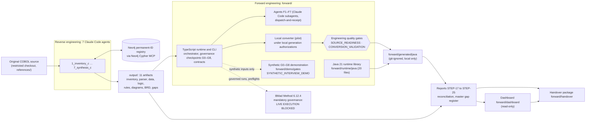
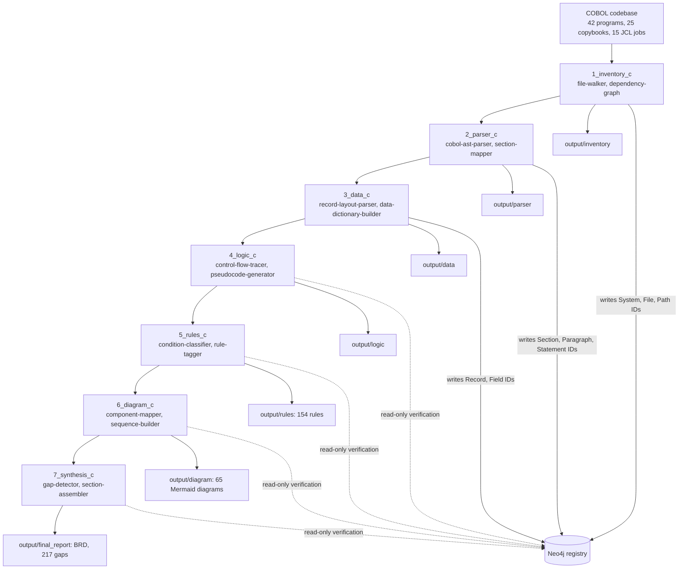
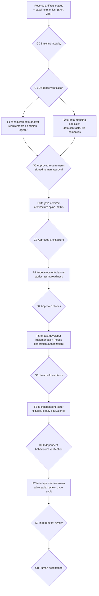
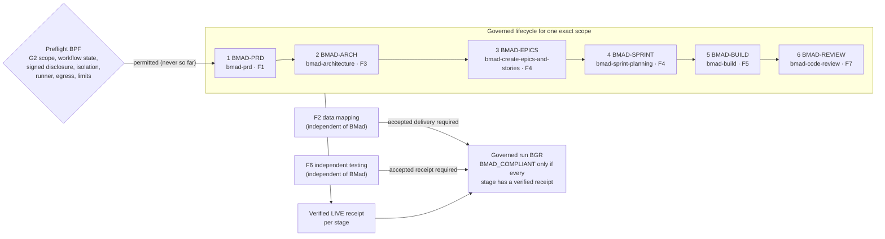
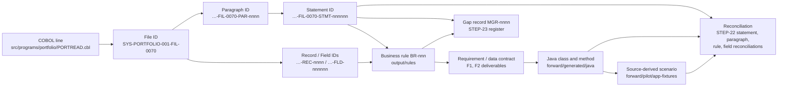
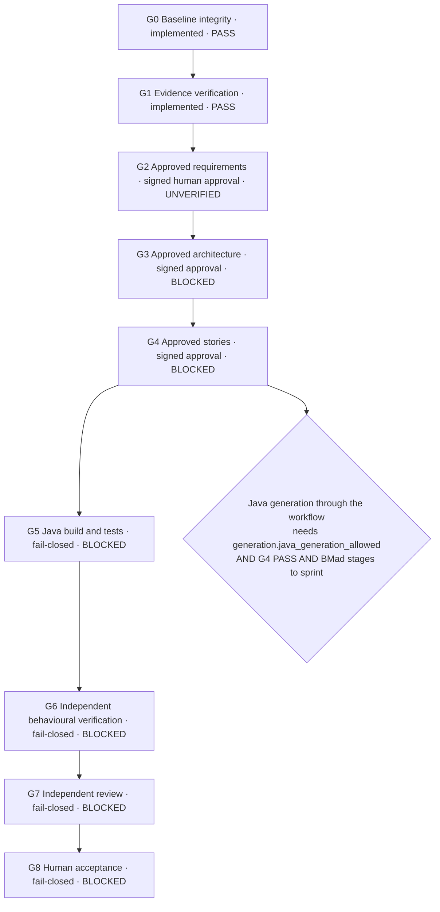
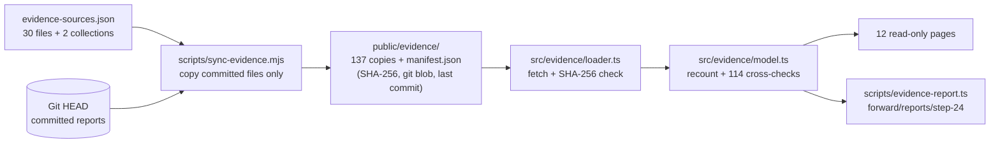
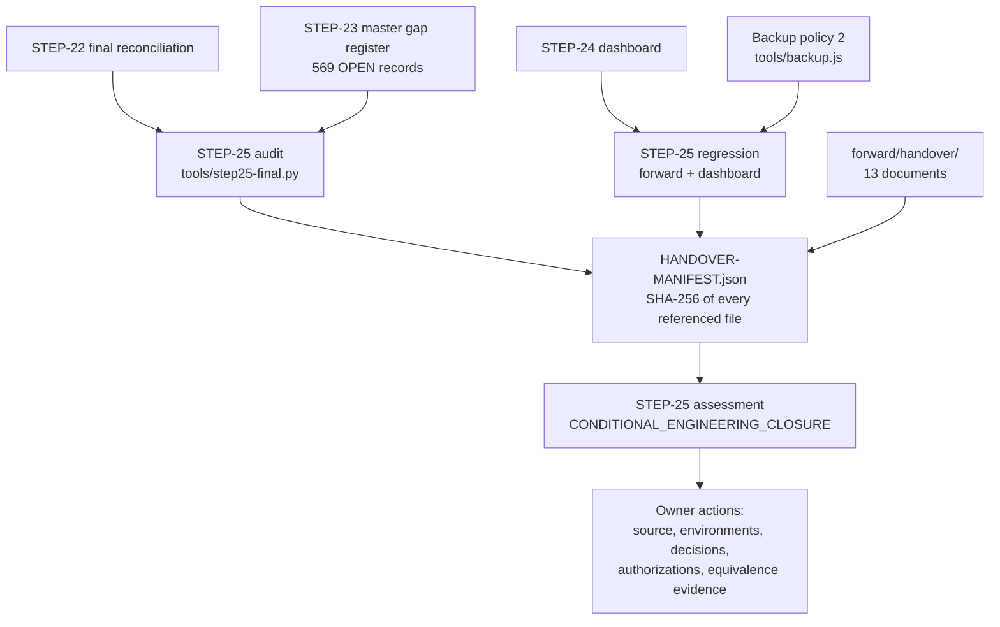
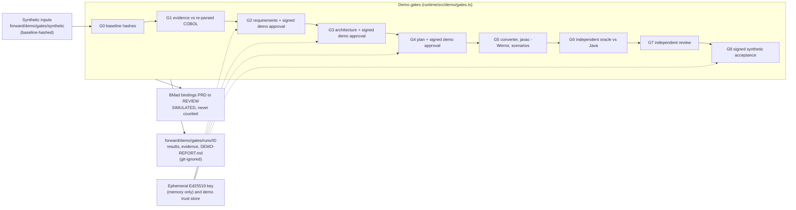

# REVFORGE architecture

This document describes the system as it is implemented in the repository at the handover baseline. Every component named here exists in the repository. Where something is designed but not operational, for example a live BMad run, the text says so.

Contents:
1. [End-to-end architecture](#1-end-to-end-architecture)
2. [Reverse engineering agent flow](#2-reverse-engineering-agent-flow)
3. [Forward engineering F1–F7 flow](#3-forward-engineering-f1f7-flow)
4. [BMad lifecycle integration](#4-bmad-lifecycle-integration)
5. [Source provenance and permanent IDs](#5-source-provenance-and-permanent-ids)
6. [Verification and approval gates](#6-verification-and-approval-gates)
7. [Dashboard evidence pipeline](#7-dashboard-evidence-pipeline)
8. [Final handover flow](#8-final-handover-flow)
9. [Technology stack](#9-technology-stack)
10. [Synthetic end-to-end gate demonstration](#10-synthetic-end-to-end-gate-demonstration)

---

## 1. End-to-end architecture

The arrow from the runtime to BMad is dotted because no BMad workflow has executed. The runtime records governed runs and preflights, all of which stopped as `BMAD_BLOCKED` before launch.

Two separate families of gates appear here (see [section 6](#6-verification-and-approval-gates)):
- **Engineering quality gates.** `SOURCE_READINESS` and `CONVERSION_VALIDATION` judge each local conversion.
- **Governance checkpoints.** G0–G8 govern the workflow.

The synthetic demonstration (dotted, [section 10](#10-synthetic-end-to-end-gate-demonstration)) exercises G0–G8 on synthetic inputs only, and writes nothing into the real workflow.

---

## 2. Reverse engineering agent flow

Agents pass JSON artifacts to each other. Neo4j is used only for identity: Agents 1–3 register permanent IDs, and Agents 4–7 reuse them and verify them read-only. The agent definitions are in `.claude/agents/1_inventory_c.agent.md` … `7_synthesis_c.agent.md` and their skills in `.claude/skills/`.

---

## 3. Forward engineering F1–F7 flow

Each agent runs as a Claude Code subagent on a dispatch packet prepared by the runtime (`workflow prepare` / `workflow batches`). It writes its deliverables and a `receipt.json`, which the operator records with `workflow record`. The runtime validates every output against its JSON Schema contract and decides gates and state transitions; no agent output can pass a gate.

**Recorded state:** G0 and G1 pass; G2 is `UNVERIFIED` (not approved; 417 blocking findings for PORTREAD); G3–G8 are `BLOCKED`. The 41 existing Java programs come from the local converter under historical local generation authorizations (`LGA-*`). They are classified `LOCAL_LGA_NOT_BMAD_GOVERNED` and did not pass through G2–G8.

---

## 4. BMad lifecycle integration

Bindings are in `forward/integrations/bmad/bindings.json`, and the release pin in `release.pin.json`. **Recorded state:** 4 governed runs and 13 preflights, none permitted; BGR-0004 for `programs:PORTREAD` is `BMAD_BLOCKED` at BMAD-PRD, and the other five stages were not attempted. There are 0 receipts. F2 is `ACCEPTED`; F6 is `MISSING`.

---

## 5. Source provenance and permanent IDs

Permanent IDs are created once by reverse Agents 1–3 and never repaired or re-created. `BR-`, `GAP-` and `MGR-` IDs are catalogue IDs bound to the recorded artifact hashes.

---

## 6. Verification and approval gates

REVFORGE has two distinct kinds of gates:

| Kind | Gates | Question | Authorizes generation? |
|---|---|---|---|
| **Engineering quality gates** | `SOURCE_READINESS`, `CONVERSION_VALIDATION` (`runtime/src/pilot/gates.ts`) | Is this program's source understood well enough to convert? Is this conversion output verified as labelled? | No |
| **Governance checkpoints** | G0–G8 (`runtime/src/orchestrator/gates.ts`, approval and design modules) | Has the governed workflow reached each stage with verified evidence and signed human approvals? | Only G4 PASS, together with the configuration flag and BMad stages up to sprint |

### 6.1 Engineering quality gates

- **SOURCE_READINESS** (`pilot readiness`): 6 of 42 programs pass.
- **CONVERSION_VALIDATION** (`pilot validate`): 41 of 42 programs pass.

Neither authorizes generation, and neither is equivalence.

### 6.2 Governance checkpoints G0–G8 (real workflow status)

Signed approvals use Ed25519 and are verified against a configured trust store (`REVFORGE_APPROVAL_TRUST_STORE`), which is not configured in this environment. A synthetic run of all nine checkpoints is described in [section 10](#10-synthetic-end-to-end-gate-demonstration); it does not change any status above.

---

## 7. Dashboard evidence pipeline

Missing, malformed or altered evidence becomes an *evidence unavailable* state. It is never replaced by zero or by sample data.

---

## 8. Final handover flow

---

## 9. Technology stack

The table lists only technologies that are in use, and only the roles the repository evidence shows.

| Technology | Role in REVFORGE | Where |
|---|---|---|
| Claude Code | Runs the 7 reverse agents and the F1–F7 forward subagents (agent and skill definitions in `.claude/`). It would also host BMad workflows, but that is not authorized. | `.claude/agents`, `.claude/skills`, `forward/agents`, `forward/skills` |
| Neo4j + Neo4j Cypher MCP server | Permanent-ID registry for the reverse run (4,957 nodes and 5,929 relationships in the recorded run). The forward runtime never contacts Neo4j. | `.mcp.json.example` (credentials stay in the git-ignored `.mcp.json`) |
| TypeScript 5.6 / Node.js 20+ | Forward runtime, CLI, orchestrator, gates, converter, verification, BMad governance | `forward/runtime/src`, `forward/verification/src` |
| JSON Schema + Ajv 8 | Contracts for every input, deliverable, receipt and record | `forward/contracts` |
| COBOL structural analysis | Reverse parsing by the agent skills (`cobol-ast-parser`, `section-mapper`) and a deterministic COBOL reader and converter in the runtime (`runtime/src/pilot/cobol-app.ts`, `verification/src/cobol-source.ts`) | as named |
| Java 21 | Target language. Hand-written runtime library with COBOL data semantics, plus the runtime and integration test harness; generated programs compile with `javac -Werror` | `forward/runtime/java/revforge/cobol` |
| BMad Method 6.12.4 | Mandatory governance model for new governed forward development: 6 bound workflows, preflights, governed runs. Staged and pinned, not installed in the repository, never executed. | `forward/integrations/bmad` |
| OpenAI API client (`openai` 7.35) | Optional independent verification (Pass A/Pass B). Never run live: network disabled, no key, no authorization. | `forward/runtime/src`, `docs/OPENAI-VERIFICATION-OPERATIONS.md` |
| Python 3 | Report and reconciliation generators (`forward/tools/*.py`) | `forward/tools` |
| React 19, TypeScript, Vite 6, Tailwind 3 | Read-only dashboard | `forward/dashboard` |
| Recharts 3 | Dashboard distribution charts (with table views) | `forward/dashboard/src/components/charts.tsx` |
| Cytoscape.js 3 | Dependency-graph neighbourhoods | `forward/dashboard/src/components/GraphCanvas.tsx` |
| Mermaid 11 | Reverse diagrams (`output/diagram/diagrams/*.mmd`), rendered in the dashboard in strict mode; also these architecture diagrams | as named |

---

## 10. Synthetic end-to-end gate demonstration

`npm run demo:gates` (in `forward/`) runs all nine governance checkpoints on one small synthetic COBOL program, `forward/demo/gates/synthetic/source/DEMOORD1.cbl`. The run is in the separate environment `SYNTHETIC_INTERVIEW_DEMO`. Every demo gate executes its checks; a gate never passes without evaluating them, and the run stops at the first gate that does not pass.

**Reused production components:**
- the STEP-17 converter (`parseApp`, `emitApp`);
- the Java runtime library and `TestMain`;
- the canonical JSON digest;
- the Ed25519 verifier (`loadTrustStore`, `verifySignature`), pointed at a per-run demo trust store;
- the BMad receipt counter (`receiptCounts`), which refuses the SIMULATED records;
- the contract registry, with new `demo/*` contracts.

**Separate from the real workflow:**
- The demo has its own state file, run directory and trust store. It never calls the real orchestrator, and never writes a real gate result, approval, receipt or authorization.
- Its G4 is demo planning approval, never Java generation authorization: `generation.java_generation_allowed` stays `false`.
- Its G6 compares the Java with an independent oracle written from the requirements. No COBOL runtime is executed, so legacy equivalence stays `NOT_ESTABLISHED`.
- The engineering quality gates `SOURCE_READINESS` and `CONVERSION_VALIDATION` are not used or changed by the demonstration.

Negative paths are covered by `forward/tests/synthetic-gate-demonstration.test.ts`, which the CI job *Synthetic G0–G8 gate demonstration* runs. The operating notes are in `forward/demo/gates/README.md`.
