# Business Requirements Document
## Portfolio Management System

**Document type:** Reverse-engineered Business Requirements Document
**Generated by:** COBOL Reverse Engineering Pipeline (REVFORGE harness)
**Generation date:** 2026-10-30
**Pipeline version:** agents 1–7 @1.0
**Repository analysed:** D:/PROJECTS/REVFORGE-Harness/references/upstream-harness (system ID `SYS-PORTFOLIO-001`, display name "Portfolio Management System (reference-harness sample)")

---

> **Important:** This document was generated by automated static analysis
> of COBOL source code. All content is derived from the source files as
> they exist at the time of analysis. Business rule confidence levels are
> indicated throughout. Items marked ⚠ require subject matter expert
> review before the document can be considered authoritative.
>
> **Gaps identified:** 217 (6 critical, 86 high)
> See Chapter 9 — Gaps and assumptions register.

> **How to read the evidence labels.** Every finding carries one of three labels.
> *Confirmed* — a business rule rated confirmed or high with complete evidence, or a structural fact resolved by the inventory, parser or data agents.
> *Inferred* — a medium-confidence rule, a heuristic relationship or an interpretation stated by an agent.
> *Uncertain* — low confidence, partial evidence, unresolved references, run-time-only behaviour, or anything flagged for subject matter expert (SME) review. An uncertain rule is an extracted candidate requiring validation, never a verified requirement.

> **Traceability.** Statements cite the permanent source identifiers registered by the pipeline: File ID (`SYS-PORTFOLIO-001-FIL-nnnn`), Path ID, Paragraph ID (`…-PAR-nnnn`), Statement ID (`…-STMT-nnnnnn`), Record ID (`…-REC-nnnn`) and Field ID (`…-FLD-nnnnnn`). These were copied from the analysis artifacts and checked read-only against the source registry; none was created for this document. BR-, RS-, EH-, GAP- and ASM- numbers are catalogue numbers of this run.

> **Diagrams.** The 65 Mermaid diagrams are embedded verbatim from their `.mmd` files in `output/diagram/diagrams/`. The diagram files passed a structural check, but **their visual rendering has not been verified** (GAP-092).

---

## Table of contents

1. Executive summary
2. System overview
3. System inventory
4. Data model and definitions
5. Business rules catalogue
6. Process descriptions
7. Component architecture
8. Error handling and recovery
9. Gaps and assumptions register
- Appendix A — Full data dictionary
- Appendix B — Program pseudocode reference
- Appendix C — Diagram index

---

## 1. Executive summary

**System purpose.** The Portfolio Management System maintains investment portfolios and their supporting batch and online services. Batch programs add, update, delete and list portfolio master records, validate portfolio transactions (buy, sell, transfer, fee), load transaction history into the DB2 database, and produce position, audit, statistics and return-code reports. A batch-control layer sequences jobs, checks their dependencies, records checkpoints and decides whether a failed job is restarted, bypassed or terminated. Online (CICS) programs let a user inquire on a portfolio's positions and an account's transaction history, behind a security check that validates the user, checks authorisation and records access. Shared services handle DB2 connections, commits, error logging and audit-trail writing. The business domain — investment portfolio administration — is inferred from program narratives, file names and field names (for example portfolio, position, transaction, client type, investment type).

**Scale and complexity.** The repository holds 83 files: 42 COBOL programs (7,149 source lines), 20 copybooks, 5 DB2 definition files, 15 JCL batch jobs and 1 screen map set (inventory and parser artifacts). By the program entry types recorded during logic analysis, 20 programs are batch main programs (of which 4 are templates and 3 are test tools), 13 are batch subprograms, 8 are online (CICS) programs or subprograms and 1 (POSUPDT) has no content. The pipeline registered 402 paragraphs and 1,936 statements, 231 data records, 1,346 fields and 65 data entities, and extracted **154 business rules** in 14 rule sets: 36 confirmed, 25 high, 79 medium and 14 low confidence, with 50 flagged for SME review. Programs access indexed (VSAM) and sequential files and the DB2 tables POSHIST, ERRLOG, RTNCODES, AUTHFILE, AUDITLOG, PORTFOLIO and a session statistics table.

**Key findings.** The best-evidenced rules govern batch control and recovery: request routing by function code (BR-001, BR-008, BR-023), dependency checks before a process starts (BR-014), and the restart/bypass/terminate recovery decision with its maximum restart count (BR-028 to BR-030). Portfolio master validation is well defined in PORTMSTR (ID format "PORT" plus five digits, BR-093; name required, BR-094) and transaction validation in PORTTRAN (type, quantity, price and amount, BR-105 to BR-110). The programs with the most decision points (branch counts from the logic analysis) are PRCSEQ00 (25), PORTTRAN (24), RCVPRC00 (22) and PORTMSTR (15). No program uses GO TO or ALTER; ten programs (mostly online) use ranged calls ("PERFORM … THRU"), and three online programs register run-time CICS error handlers. The most widely shared copybooks are ERRHAND (19 programs), SQLCA (14), RTNCODE (9) and PORTFLIO (6). A notable finding is that PORTTRAN validates and counts transactions but never applies them: its position-update logic is unreachable (GAP-093).

**Gaps and limitations.** The register lists 217 gaps: 6 critical, 86 high, 50 medium and 75 low. The critical gaps are an empty program source (POSUPDT, GAP-001), a self-including DB2 copybook (SQLCA, GAP-002) and four copybooks referenced but not in the repository (PORTREC, SQLPOS and DB2STAT twice; GAP-003 to GAP-006). Fourteen programs perform paragraphs that are not present in the source (88 unresolvable paths, GAP-010 to GAP-023), so the reporting, utility, test and batch-control programs are only partly documented. Chapter 9 contains the full register; SME review of the critical and high items is recommended before this document is used for modernisation or test planning.

---

## 2. System overview

### 2.1 System context

The system is **mixed batch and online**. Batch programs run under 15 JCL jobs (Section 2.4) or are called as subprograms by other batch programs; online programs run under CICS and call each other with CICS LINK (a CICS call that passes a communication area and returns). *Confirmed* (inventory and logic artifacts).

External elements that the analysed code depends on but that are not in the repository (from unresolved references, *uncertain*): the routine DELAY (called by DB2CONN, GAP-007), the runtime routine ILBOABN0 (UTLMON00, GAP-008), the Language Environment service CEE3ABD (ERRHANDL, GAP-009), the copybooks PORTREC and DB2STAT and the DB2 member SQLPOS (GAP-003 to GAP-006), and the IBM utility IDCAMS (run by job PORTDEF to define the VSAM file). Several subprograms have no caller in the repository (CKPRST, RTNCDE00, PORTVALD, RCVPRC00, PRCSEQ00) and are presumably called from outside the analysed code (ASM-008).

Data stores, as described by the logic narratives (*confirmed* where a file is opened in the code): indexed portfolio master file (PORTFOLIO-FILE / PORTFILE), batch-control file, process-sequence file, position master, transaction history, transaction input, delete and update request files, audit and error-log files, report files, test and utility control files; DB2 tables POSHIST, ERRLOG, RTNCODES, AUTHFILE, AUDITLOG and PORTFOLIO; and the CICS file POSFILE.

### 2.2 Program inventory summary

Type is the Agent 4 entry type (ASM-001); the inventory subtype is "unknown" for all programs. **Complexity** shows "—": the logic agent records a complexity score per paragraph, not per program, and this document does not aggregate or estimate a program score; the number of decision points (branches) from the logic analysis is shown instead as an indicator. Rule counts come from `rules_by_program` and include declared value-domain rules (BR-135 to BR-154).

| Program | File ID | Type | Description (first sentence of the logic narrative, condensed) | Rules | Branches | Complexity |
|---|---|---|---|---|---|---|
| BCHCTL00 | SYS-PORTFOLIO-001-FIL-0042 | Batch subprogram | Batch-control subprogram meant to manage a job's record in the batch control file. | 3 | 2 | — |
| CKPRST | SYS-PORTFOLIO-001-FIL-0043 | Batch subprogram | Checkpoint/restart subprogram whose four services are empty stubs. | 4 | 1 | — |
| HISTLD00 | SYS-PORTFOLIO-001-FIL-0044 | Batch | Loads transaction-history records into the DB2 table POSHIST. | 6 | 9 | — |
| POSUPDT | SYS-PORTFOLIO-001-FIL-0045 | — | No executable content (1-byte source, GAP-001). | 0 | 0 | — |
| PRCSEQ00 | SYS-PORTFOLIO-001-FIL-0046 | Batch subprogram | Batch process-sequence manager (build sequence, next process, status, terminate). | 20 | 25 | — |
| RCVPRC00 | SYS-PORTFOLIO-001-FIL-0047 | Batch subprogram | Batch process-recovery subprogram (restart, bypass or terminate failed processes). | 16 | 22 | — |
| RPTAUD00 | SYS-PORTFOLIO-001-FIL-0048 | Batch | System audit report generator (report body missing from source). | 3 | 3 | — |
| RPTPOS00 | SYS-PORTFOLIO-001-FIL-0049 | Batch | Daily Position Report. | 3 | 5 | — |
| RPTSTA00 | SYS-PORTFOLIO-001-FIL-0050 | Batch | System statistics and performance report (logic missing from source). | 0 | 7 | — |
| RTNANA00 | SYS-PORTFOLIO-001-FIL-0051 | Batch | Return Code Analysis Report from DB2 table RTNCODES. | 3 | 2 | — |
| RTNCDE00 | SYS-PORTFOLIO-001-FIL-0052 | Batch subprogram | Standard return-code service (set, get, log, analyse). | 4 | 5 | — |
| AUDPROC | SYS-PORTFOLIO-001-FIL-0053 | Batch subprogram | Common audit-trail subroutine writing one audit record per call. | 3 | 2 | — |
| DB2CMT | SYS-PORTFOLIO-001-FIL-0054 | Batch subprogram | DB2 commit controller (commit, rollback, savepoint, statistics). | 3 | 6 | — |
| DB2CONN | SYS-PORTFOLIO-001-FIL-0055 | Batch subprogram | DB2 connection manager (connect with retries, disconnect, status). | 5 | 7 | — |
| DB2ERR | SYS-PORTFOLIO-001-FIL-0056 | Batch subprogram | DB2 error service (log to ERRLOG, diagnose, retrieve). | 5 | 8 | — |
| DB2STAT | SYS-PORTFOLIO-001-FIL-0057 | Batch subprogram | DB2 statistics collector for a calling program. | 2 | 6 | — |
| ERRPROC | SYS-PORTFOLIO-001-FIL-0058 | Batch subprogram | Common error-recording subroutine writing to the error log. | 0 | 2 | — |
| CURSMGR | SYS-PORTFOLIO-001-FIL-0059 | Online subprogram | Online DB2 cursor manager (declare, open; fetch and close missing). | 2 | 4 | — |
| DB2ONLN | SYS-PORTFOLIO-001-FIL-0060 | Online subprogram | Online DB2 connection manager with a 100-connection pool limit. | 3 | 5 | — |
| DB2RECV | SYS-PORTFOLIO-001-FIL-0061 | Online subprogram | Online DB2 recovery manager (reconnect, rollback, cursor recovery). | 7 | 6 | — |
| ERRHNDL | SYS-PORTFOLIO-001-FIL-0062 | Online subprogram | Centralised online error handler (log, format, decide action). | 2 | 3 | — |
| INQHIST | SYS-PORTFOLIO-001-FIL-0063 | Online | Retrieves and displays an account's transaction history. | 2 | 5 | — |
| INQONLN | SYS-PORTFOLIO-001-FIL-0064 | Online | Drives the portfolio inquiry dialogue with a security check. | 5 | 5 | — |
| INQPORT | SYS-PORTFOLIO-001-FIL-0065 | Online | Portfolio position inquiry. | 2 | 2 | — |
| SECMGR | SYS-PORTFOLIO-001-FIL-0066 | Online subprogram | Security service (validate user, authorise, audit access). | 3 | 6 | — |
| PORTADD | SYS-PORTFOLIO-001-FIL-0067 | Batch | Creates new portfolio master records from an input file. | 7 | 4 | — |
| PORTDEL | SYS-PORTFOLIO-001-FIL-0068 | Batch | Deletes portfolio master records on request, with audit trail. | 7 | 5 | — |
| PORTMSTR | SYS-PORTFOLIO-001-FIL-0069 | Batch subprogram | Maintains the portfolio master file (create, read, update, delete). | 9 | 15 | — |
| PORTREAD | SYS-PORTFOLIO-001-FIL-0070 | Batch | Lists the contents of the portfolio master file. | 4 | 2 | — |
| PORTTEST | SYS-PORTFOLIO-001-FIL-0071 | Batch (test tool) | Writes up to 100 synthetic portfolio records. | 5 | 2 | — |
| PORTTRAN | SYS-PORTFOLIO-001-FIL-0072 | Batch | Validates portfolio transactions (position update unreachable). | 17 | 24 | — |
| PORTUPDT | SYS-PORTFOLIO-001-FIL-0073 | Batch | Applies maintenance transactions to portfolio master records. | 4 | 5 | — |
| PORTVALD | SYS-PORTFOLIO-001-FIL-0074 | Batch subprogram | Validates one portfolio data element per call. | 6 | 6 | — |
| TSTGEN00 | SYS-PORTFOLIO-001-FIL-0075 | Batch (test tool) | Configuration-driven test-data generator. | 5 | 7 | — |
| TSTVAL00 | SYS-PORTFOLIO-001-FIL-0076 | Batch (test tool) | Test-validation driver. | 2 | 6 | — |
| UTLMNT00 | SYS-PORTFOLIO-001-FIL-0077 | Batch | File-maintenance utility driven by a control file. | 2 | 6 | — |
| UTLMON00 | SYS-PORTFOLIO-001-FIL-0078 | Batch | System-monitoring utility. | 2 | 6 | — |
| UTLVAL00 | SYS-PORTFOLIO-001-FIL-0079 | Batch | Data-validation utility driven by a control file. | 3 | 6 | — |
| DB2HNDL | SYS-PORTFOLIO-001-FIL-0080 | Batch (template) | Template demonstrating standard DB2 access. | 0 | 3 | — |
| ERRHANDL | SYS-PORTFOLIO-001-FIL-0081 | Batch (template) | Template demonstrating a standard error-handling pattern. | 3 | 3 | — |
| FILEHNDL | SYS-PORTFOLIO-001-FIL-0082 | Batch (template) | Template demonstrating file open/process/close checking. | 0 | 7 | — |
| PROGNAME | SYS-PORTFOLIO-001-FIL-0083 | Batch (template) | Standard program skeleton template. | 0 | 0 | — |

### 2.3 System component diagram

**Figure 2.1 — System component overview**

```mermaid
---
title: System component overview
---
flowchart TD
  %% Showing top 20 of 42 programs by connectivity
  %% Generated by 6_diagram agent - component-mapper skill
  %% Connectivity = program-to-program edges (STATIC_CALL, CICS_LINK) from inventory call_graph; COPY edges are shown only in focused diagrams
  %% Batch-job (JCL) edges: component_overview_jobs_portfolio.mmd and component_overview_jobs_reporting.mmd
  %% Unresolved references (resolved false): component_unresolved_references.mmd
  %% Edges: solid = confirmed; -.-> ? = unsupported (none in this diagram)

  classDef batch   fill:#dbeafe,stroke:#3b82f6,color:#1e3a5f
  classDef online  fill:#d1fae5,stroke:#10b981,color:#064e3b
  classDef datastore fill:#fef3c7,stroke:#f59e0b,color:#451a03
  classDef external fill:#f3f4f6,stroke:#9ca3af,color:#374151,stroke-dasharray:5 5
  classDef jcl     fill:#ede9fe,stroke:#7c3aed,color:#2e1065
  classDef deadCode fill:#fee2e2,stroke:#ef4444,color:#450a0a
  classDef unclassified fill:#f3f4f6,stroke:#6b7280,color:#111827

  %% REVFORGE-ID ERRPROC file_id=SYS-PORTFOLIO-001-FIL-0058 path_id=SYS-PORTFOLIO-001-PATH-0058
  %% REVFORGE-ID INQONLN file_id=SYS-PORTFOLIO-001-FIL-0064 path_id=SYS-PORTFOLIO-001-PATH-0064
  %% REVFORGE-ID INQHIST file_id=SYS-PORTFOLIO-001-FIL-0063 path_id=SYS-PORTFOLIO-001-PATH-0063
  %% REVFORGE-ID DB2RECV file_id=SYS-PORTFOLIO-001-FIL-0061 path_id=SYS-PORTFOLIO-001-PATH-0061
  %% REVFORGE-ID DB2ERR file_id=SYS-PORTFOLIO-001-FIL-0056 path_id=SYS-PORTFOLIO-001-PATH-0056
  %% REVFORGE-ID DB2CMT file_id=SYS-PORTFOLIO-001-FIL-0054 path_id=SYS-PORTFOLIO-001-PATH-0054
  %% REVFORGE-ID DB2CONN file_id=SYS-PORTFOLIO-001-FIL-0055 path_id=SYS-PORTFOLIO-001-PATH-0055
  %% REVFORGE-ID PORTMSTR file_id=SYS-PORTFOLIO-001-FIL-0069 path_id=SYS-PORTFOLIO-001-PATH-0069
  %% REVFORGE-ID PORTTRAN file_id=SYS-PORTFOLIO-001-FIL-0072 path_id=SYS-PORTFOLIO-001-PATH-0072
  %% REVFORGE-ID AUDPROC file_id=SYS-PORTFOLIO-001-FIL-0053 path_id=SYS-PORTFOLIO-001-PATH-0053
  %% REVFORGE-ID DB2ONLN file_id=SYS-PORTFOLIO-001-FIL-0060 path_id=SYS-PORTFOLIO-001-PATH-0060
  %% REVFORGE-ID ERRHNDL file_id=SYS-PORTFOLIO-001-FIL-0062 path_id=SYS-PORTFOLIO-001-PATH-0062
  %% REVFORGE-ID BCHCTL00 file_id=SYS-PORTFOLIO-001-FIL-0042 path_id=SYS-PORTFOLIO-001-PATH-0042
  %% REVFORGE-ID HISTLD00 file_id=SYS-PORTFOLIO-001-FIL-0044 path_id=SYS-PORTFOLIO-001-PATH-0044
  %% REVFORGE-ID PRCSEQ00 file_id=SYS-PORTFOLIO-001-FIL-0046 path_id=SYS-PORTFOLIO-001-PATH-0046
  %% REVFORGE-ID RCVPRC00 file_id=SYS-PORTFOLIO-001-FIL-0047 path_id=SYS-PORTFOLIO-001-PATH-0047
  %% REVFORGE-ID DB2STAT file_id=SYS-PORTFOLIO-001-FIL-0057 path_id=SYS-PORTFOLIO-001-PATH-0057
  %% REVFORGE-ID CURSMGR file_id=SYS-PORTFOLIO-001-FIL-0059 path_id=SYS-PORTFOLIO-001-PATH-0059
  %% REVFORGE-ID SECMGR file_id=SYS-PORTFOLIO-001-FIL-0066 path_id=SYS-PORTFOLIO-001-PATH-0066
  %% REVFORGE-ID INQPORT file_id=SYS-PORTFOLIO-001-FIL-0065 path_id=SYS-PORTFOLIO-001-PATH-0065
  %% REVFORGE-ID OMITTED summary node (no permanent ID)

  subgraph BATCH["Batch programs"]
    HISTLD00["History load to DB2 (HISTLD00)<br/>6 rules"]:::batch
    RCVPRC00["Process recovery (RCVPRC00)<br/>16 rules"]:::batch
    PORTMSTR["Portfolio master maintenance (PORTMSTR)<br/>9 rules"]:::batch
    PORTTRAN["Portfolio transaction processor (PORTTRAN)<br/>17 rules, 4 low ⚠"]:::batch
  end

  subgraph ONLINE["Online (CICS) programs"]
    CURSMGR("DB2 cursor manager (CURSMGR)<br/>2 rules"):::online
    DB2ONLN("Online DB2 connection manager (DB2ONLN)<br/>3 rules"):::online
    SECMGR("Online security service (SECMGR)<br/>3 rules"):::online
    INQPORT("Portfolio position inquiry (INQPORT)<br/>2 rules"):::online
  end

  subgraph OTHER["Other programs (type not recorded)"]
    ERRPROC["Common error logger (ERRPROC)<br/>0 rules"]:::unclassified
    INQONLN["Portfolio inquiry dialogue (INQONLN)<br/>5 rules"]:::unclassified
    INQHIST["Transaction history inquiry (INQHIST)<br/>2 rules"]:::unclassified
    DB2RECV["Online DB2 recovery manager (DB2RECV)<br/>7 rules, 1 low ⚠"]:::unclassified
    DB2ERR["DB2 error handler (DB2ERR)<br/>5 rules"]:::unclassified
    DB2CMT["DB2 commit controller (DB2CMT)<br/>3 rules, 1 low ⚠"]:::unclassified
    DB2CONN["DB2 connection manager (DB2CONN)<br/>5 rules"]:::unclassified
    AUDPROC["Audit trail writer (AUDPROC)<br/>3 rules"]:::unclassified
    ERRHNDL["Online error handler (ERRHNDL)<br/>2 rules"]:::unclassified
    BCHCTL00["Batch control (BCHCTL00)<br/>3 rules, 1 low ⚠"]:::unclassified
    PRCSEQ00["Process sequence manager (PRCSEQ00)<br/>20 rules"]:::unclassified
    DB2STAT["DB2 statistics collector (DB2STAT)<br/>2 rules"]:::unclassified
  end

  OMITTED["... and 22 more programs (see detail diagrams)"]:::external

  BCHCTL00 -->|calls| ERRPROC
  HISTLD00 -->|calls| ERRPROC
  PRCSEQ00 -->|calls| ERRPROC
  RCVPRC00 -->|calls, 2 call sites| ERRPROC
  DB2CMT -->|calls| ERRPROC
  DB2CMT -->|calls| DB2ERR
  DB2CONN -->|calls| ERRPROC
  DB2ERR -->|calls| ERRPROC
  DB2STAT -->|calls| ERRPROC
  PORTMSTR -->|calls| ERRPROC
  PORTMSTR -->|calls| AUDPROC
  PORTTRAN -->|calls| AUDPROC
  PORTTRAN -->|calls| ERRPROC
  INQONLN -->|CICS LINK| INQPORT
  INQONLN -->|CICS LINK| INQHIST
  INQONLN -->|CICS LINK| ERRHNDL
  INQONLN -->|CICS LINK, 3 call sites| SECMGR
  INQHIST -->|CICS LINK| DB2ONLN
  INQHIST -->|CICS LINK| DB2RECV
  INQHIST -->|CICS LINK, 4 call sites| CURSMGR
  DB2RECV -->|CICS LINK| DB2ONLN
  DB2RECV -->|CICS LINK| ERRHNDL

  %% Notes:
  %% PORTMSTR -> ERRPROC call site (STMT-000043) lies in paragraph 2100-HANDLE-VSAM-ERROR, confirmed dead code by Agent 4
  %% PORTTRAN -> AUDPROC call site (STMT-000055) lies in paragraph 2310-WRITE-AUDIT-RECORD, unreachable (dead code) per Agent 4
  %% Program types: inventory and parser subtype are 'unknown' for all programs; types come from the Agent 4 entry_type.
  %% entry_type values other than online_main / online_subprogram / batch_main / batch_subprogram are shown as 'type not recorded'
  %% Omitted programs (lower connectivity; JCL, unresolved and isolated programs are in the detail diagrams): CKPRST, POSUPDT, RPTAUD00, RPTPOS00, RPTSTA00, RTNANA00, RTNCDE00, PORTADD, PORTDEL, PORTREAD, PORTTEST, PORTUPDT, PORTVALD, TSTGEN00, TSTVAL00, UTLMNT00, UTLMON00, UTLVAL00, DB2HNDL, ERRHANDL, FILEHNDL, PROGNAME
```

*This diagram shows the top 20 of the 42 programs by program-to-program connectivity (static calls and CICS LINKs), plus one summary node for the 22 programs left out; jobs, unresolved references and isolated programs are shown in Figures 2.2 to 2.5. Node badges count every rule in `rules_by_program`, including declared value domains.* Limitations (display): only the top 20 programs are drawn; twelve programs whose entry type is outside the diagram's type list are labelled "type not recorded"; two resolved calls (PORTMSTR to ERRPROC, PORTTRAN to AUDPROC) have their call sites in dead code. Mermaid rendering not verified (GAP-092).

**Figure 2.2 — Batch jobs: portfolio maintenance**

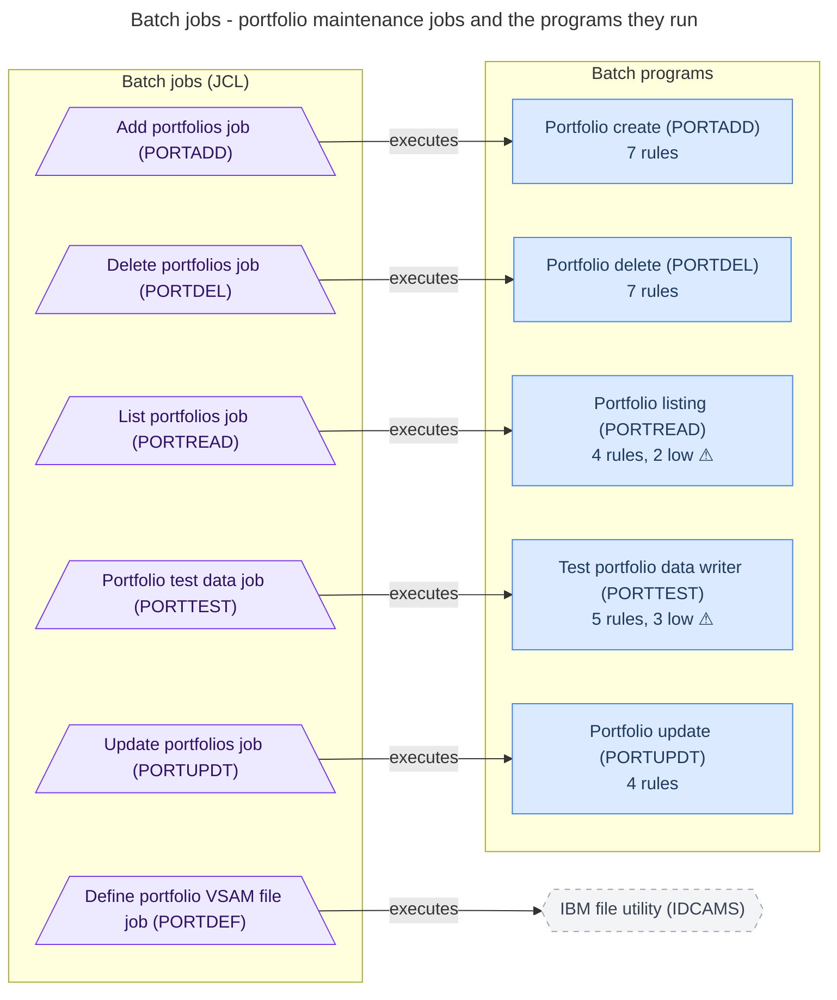

*The six portfolio JCL jobs and the program or utility each job step runs. Job steps have no COBOL statement, so they carry no Statement ID; the PORTDEF job runs the IBM utility IDCAMS, which has no permanent ID.*

**Figure 2.3 — Batch jobs: reporting, test and utility**

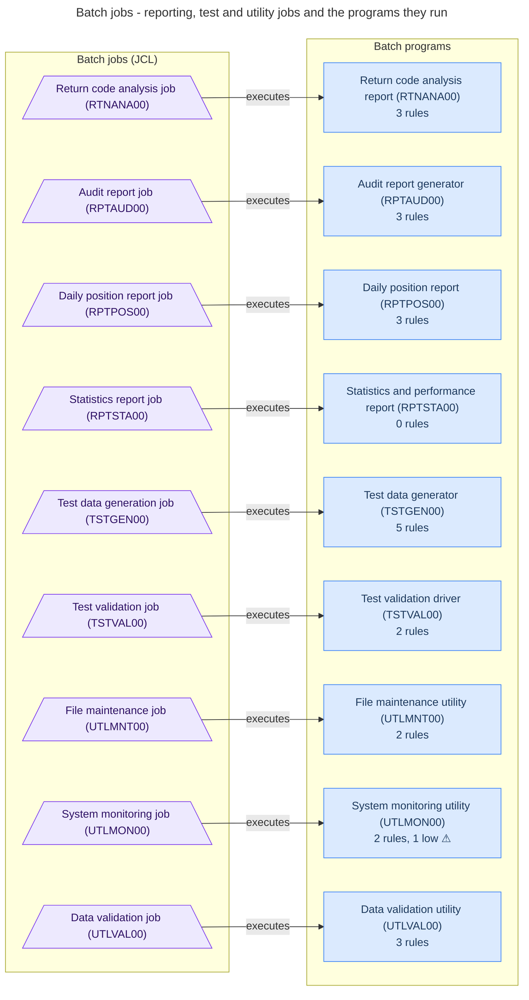

*The nine reporting, test and utility jobs and the program each step runs. Several of these programs perform paragraphs that are not in the source, so the jobs' full processing is not traceable (GAP-012 to GAP-021).*

**Figure 2.4 — Unresolved references**

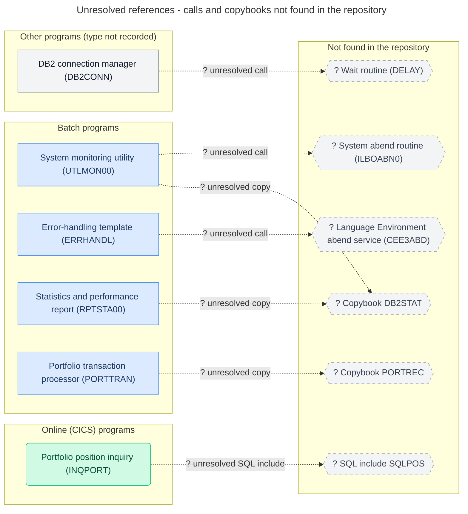

*Every reference whose target is not in the repository: three calls (DELAY, ILBOABN0, CEE3ABD), three copy statements (PORTREC, DB2STAT twice) and one DB2 include (SQLPOS), drawn as dashed "?" edges. This diagram is incomplete by nature: the targets' content cannot be traced (source gap; GAP-104, GAP-003 to GAP-009).*

**Figure 2.5 — Programs with no call or job connection**

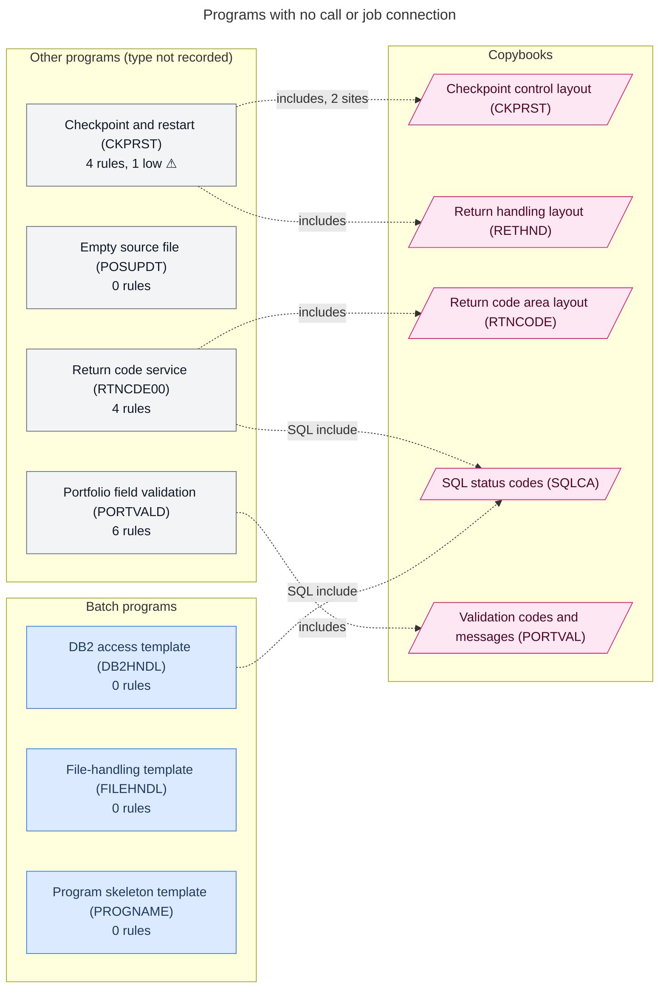

*The seven programs with no call, LINK or job connection, with their copybook includes. POSUPDT is empty (GAP-001); CKPRST, RTNCDE00 and PORTVALD have no caller in the repository although they are written as called subprograms.*

### 2.4 JCL batch jobs

| Job name | JCL File ID | Steps | Programs executed | Purpose (from the program narrative) |
|---|---|---|---|---|
| RTNANA00 | SYS-PORTFOLIO-001-FIL-0026 | 1 (RTNANA) | RTNANA00 | Return code analysis report |
| RPTAUD00 | SYS-PORTFOLIO-001-FIL-0027 | 1 (STEP01) | RPTAUD00 | System audit report |
| RPTPOS00 | SYS-PORTFOLIO-001-FIL-0028 | 1 (STEP01) | RPTPOS00 | Daily position report |
| RPTSTA00 | SYS-PORTFOLIO-001-FIL-0029 | 1 (STEP01) | RPTSTA00 | Statistics and performance report |
| PORTADD | SYS-PORTFOLIO-001-FIL-0030 | 1 (STEP1) | PORTADD | Add portfolio master records |
| PORTDEF | SYS-PORTFOLIO-001-FIL-0031 | 1 (DEFVSAM) | IDCAMS (utility) | Define the VSAM file |
| PORTDEL | SYS-PORTFOLIO-001-FIL-0032 | 1 (STEP1) | PORTDEL | Delete portfolio master records |
| PORTREAD | SYS-PORTFOLIO-001-FIL-0033 | 1 (STEP1) | PORTREAD | List the portfolio master file |
| PORTTEST | SYS-PORTFOLIO-001-FIL-0034 | 1 (STEP1) | PORTTEST | Generate synthetic portfolio records |
| PORTUPDT | SYS-PORTFOLIO-001-FIL-0035 | 1 (STEP1) | PORTUPDT | Apply portfolio maintenance |
| TSTGEN00 | SYS-PORTFOLIO-001-FIL-0036 | 1 (STEP01) | TSTGEN00 | Generate test data |
| TSTVAL00 | SYS-PORTFOLIO-001-FIL-0037 | 1 (STEP01) | TSTVAL00 | Validate test results |
| UTLMNT00 | SYS-PORTFOLIO-001-FIL-0038 | 1 (STEP01) | UTLMNT00 | File maintenance |
| UTLMON00 | SYS-PORTFOLIO-001-FIL-0039 | 1 (STEP01) | UTLMON00 | System monitoring |
| UTLVAL00 | SYS-PORTFOLIO-001-FIL-0040 | 1 (STEP01) | UTLVAL00 | Data validation |

No JCL job runs HISTLD00, PORTTRAN or the batch-control subprograms; how they are scheduled is not in the repository (*uncertain*).

---

## 3. System inventory

### 3.1 Programs

Paths, line counts, paragraph and statement counts and parse status come from the inventory and parser artifacts (*confirmed*); logic status comes from the logic artifact. "Partial" means some performed paragraphs or names could not be resolved (see Chapter 9).

| Program | File ID / Path ID | Path | Lines | Paragraphs | Statements | Parse status | Logic status |
|---|---|---|---|---|---|---|---|
| BCHCTL00 | FIL-0042 / PATH-0042 | src/programs/batch/BCHCTL00.cbl | 127 | 6 | 30 | partial | partial |
| CKPRST | FIL-0043 / PATH-0043 | src/programs/batch/CKPRST.cbl | 57 | 5 | 6 | success | partial |
| HISTLD00 | FIL-0044 / PATH-0044 | src/programs/batch/HISTLD00.cbl | 233 | 16 | 77 | partial | partial |
| POSUPDT | FIL-0045 / PATH-0045 | src/programs/batch/POSUPDT.cbl | 1 | 0 | 0 | empty | empty |
| PRCSEQ00 | FIL-0046 / PATH-0046 | src/programs/batch/PRCSEQ00.cbl | 345 | 19 | 118 | success | partial |
| RCVPRC00 | FIL-0047 / PATH-0047 | src/programs/batch/RCVPRC00.cbl | 302 | 18 | 105 | success | success |
| RPTAUD00 | FIL-0048 / PATH-0048 | src/programs/batch/RPTAUD00.cbl | 147 | 10 | 36 | partial | partial |
| RPTPOS00 | FIL-0049 / PATH-0049 | src/programs/batch/RPTPOS00.cbl | 160 | 11 | 46 | partial | partial |
| RPTSTA00 | FIL-0050 / PATH-0050 | src/programs/batch/RPTSTA00.cbl | 185 | 12 | 49 | partial | partial |
| RTNANA00 | FIL-0051 / PATH-0051 | src/programs/batch/RTNANA00.cbl | 210 | 13 | 49 | success | partial |
| RTNCDE00 | FIL-0052 / PATH-0052 | src/programs/batch/RTNCDE00.cbl | 141 | 11 | 40 | success | partial |
| AUDPROC | FIL-0053 / PATH-0053 | src/programs/common/AUDPROC.cbl | 96 | 4 | 27 | success | success |
| DB2CMT | FIL-0054 / PATH-0054 | src/programs/common/DB2CMT.cbl | 170 | 10 | 56 | success | partial |
| DB2CONN | FIL-0055 / PATH-0055 | src/programs/common/DB2CONN.cbl | 154 | 6 | 46 | success | partial |
| DB2ERR | FIL-0056 / PATH-0056 | src/programs/common/DB2ERR.cbl | 200 | 7 | 63 | success | partial |
| DB2STAT | FIL-0057 / PATH-0057 | src/programs/common/DB2STAT.cbl | 228 | 9 | 66 | success | partial |
| ERRPROC | FIL-0058 / PATH-0058 | src/programs/common/ERRPROC.cbl | 107 | 6 | 33 | success | success |
| CURSMGR | FIL-0059 / PATH-0059 | src/programs/online/CURSMGR.cbl | 91 | 5 | 20 | partial | partial |
| DB2ONLN | FIL-0060 / PATH-0060 | src/programs/online/DB2ONLN.cbl | 120 | 11 | 38 | success | partial |
| DB2RECV | FIL-0061 / PATH-0061 | src/programs/online/DB2RECV.cbl | 145 | 11 | 45 | success | partial |
| ERRHNDL | FIL-0062 / PATH-0062 | src/programs/online/ERRHNDL.cbl | 118 | 9 | 32 | success | partial |
| INQHIST | FIL-0063 / PATH-0063 | src/programs/online/INQHIST.cbl | 193 | 13 | 44 | success | partial |
| INQONLN | FIL-0064 / PATH-0064 | src/programs/online/INQONLN.cbl | 171 | 13 | 45 | success | partial |
| INQPORT | FIL-0065 / PATH-0065 | src/programs/online/INQPORT.cbl | 110 | 11 | 25 | success | partial |
| SECMGR | FIL-0066 / PATH-0066 | src/programs/online/SECMGR.cbl | 135 | 7 | 33 | success | partial |
| PORTADD | FIL-0067 / PATH-0067 | src/programs/portfolio/PORTADD.cbl | 148 | 5 | 33 | success | success |
| PORTDEL | FIL-0068 / PATH-0068 | src/programs/portfolio/PORTDEL.cbl | 194 | 7 | 43 | success | success |
| PORTMSTR | FIL-0069 / PATH-0069 | src/programs/portfolio/PORTMSTR.cbl | 288 | 11 | 99 | success | partial |
| PORTREAD | FIL-0070 / PATH-0070 | src/programs/portfolio/PORTREAD.cbl | 111 | 5 | 24 | success | success |
| PORTTEST | FIL-0071 / PATH-0071 | src/programs/portfolio/PORTTEST.cbl | 119 | 8 | 32 | success | success |
| PORTTRAN | FIL-0072 / PATH-0072 | src/programs/portfolio/PORTTRAN.cbl | 317 | 16 | 116 | success | partial |
| PORTUPDT | FIL-0073 / PATH-0073 | src/programs/portfolio/PORTUPDT.cbl | 160 | 6 | 34 | success | success |
| PORTVALD | FIL-0074 / PATH-0074 | src/programs/portfolio/PORTVALD.cbl | 120 | 5 | 39 | success | success |
| TSTGEN00 | FIL-0075 / PATH-0075 | src/programs/test/TSTGEN00.cbl | 216 | 13 | 53 | partial | partial |
| TSTVAL00 | FIL-0076 / PATH-0076 | src/programs/test/TSTVAL00.cbl | 225 | 10 | 53 | partial | partial |
| UTLMNT00 | FIL-0077 / PATH-0077 | src/programs/utility/UTLMNT00.cbl | 182 | 12 | 51 | partial | partial |
| UTLMON00 | FIL-0078 / PATH-0078 | src/programs/utility/UTLMON00.cbl | 221 | 12 | 52 | partial | partial |
| UTLVAL00 | FIL-0079 / PATH-0079 | src/programs/utility/UTLVAL00.cbl | 190 | 12 | 47 | partial | partial |
| DB2HNDL | FIL-0080 / PATH-0080 | src/templates/database/db2-handling.cbl | 246 | 11 | 42 | partial | partial |
| ERRHANDL | FIL-0081 / PATH-0081 | src/templates/error/error-handling.cbl | 187 | 11 | 46 | success | partial |
| FILEHNDL | FIL-0082 / PATH-0082 | src/templates/program/file-handling.cbl | 189 | 10 | 35 | partial | partial |
| PROGNAME | FIL-0083 / PATH-0083 | src/templates/program/standard-program.cbl | 90 | 5 | 8 | success | success |

(File and Path IDs are abbreviated; the full form is `SYS-PORTFOLIO-001-FIL-00nn` / `SYS-PORTFOLIO-001-PATH-00nn`.)

### 3.2 Copybooks and DB2 definition files

A copybook is a shared COBOL data definition file included into programs. Copybooks used by 5 or more programs are marked **shared infrastructure**.

| Copybook | File ID | Path | Used by | Note |
|---|---|---|---|---|
| BCHCON | SYS-PORTFOLIO-001-FIL-0001 | src/copybook/batch/BCHCON.cpy | BCHCTL00, HISTLD00, PRCSEQ00, RCVPRC00 | Batch control constants |
| BCHCTL | SYS-PORTFOLIO-001-FIL-0002 | src/copybook/batch/BCHCTL.cpy | BCHCTL00, HISTLD00, PRCSEQ00, RCVPRC00, RPTSTA00 | **Shared infrastructure** — batch control record |
| CKPRST | SYS-PORTFOLIO-001-FIL-0003 | src/copybook/batch/CKPRST.cpy | CKPRST | Shares its name with program CKPRST |
| PRCSEQ | SYS-PORTFOLIO-001-FIL-0004 | src/copybook/batch/PRCSEQ.cpy | PRCSEQ00, RCVPRC00 | Process sequence record |
| AUDITLOG | SYS-PORTFOLIO-001-FIL-0005 | src/copybook/common/AUDITLOG.cpy | AUDPROC, PORTTRAN, RPTAUD00 | Audit record |
| COMMON | SYS-PORTFOLIO-001-FIL-0006 | src/copybook/common/COMMON.cpy | — | Not referenced by any program |
| ERRHAND | SYS-PORTFOLIO-001-FIL-0007 | src/copybook/common/ERRHAND.cpy | 19 programs (BCHCTL00, DB2CMT, DB2CONN, DB2ERR, DB2STAT, ERRPROC, HISTLD00, PORTTEST, PORTTRAN, PRCSEQ00, RCVPRC00, RPTAUD00, RPTPOS00, RPTSTA00, TSTGEN00, TSTVAL00, UTLMNT00, UTLMON00, UTLVAL00) | **Shared infrastructure** — batch error categories, codes and message |
| HISTREC | SYS-PORTFOLIO-001-FIL-0008 | src/copybook/common/HISTREC.cpy | HISTLD00 | History record |
| PORTFLIO | SYS-PORTFOLIO-001-FIL-0009 | src/copybook/common/PORTFLIO.cpy | PORTADD, PORTDEL, PORTREAD, PORTTEST, PORTUPDT, TSTGEN00 | **Shared infrastructure** — portfolio master record |
| PORTVAL | SYS-PORTFOLIO-001-FIL-0010 | src/copybook/common/PORTVAL.cpy | PORTVALD | Validation constants and messages |
| POSREC | SYS-PORTFOLIO-001-FIL-0011 | src/copybook/common/POSREC.cpy | INQPORT, RPTPOS00, UTLVAL00 | Position record |
| RETHND | SYS-PORTFOLIO-001-FIL-0012 | src/copybook/common/RETHND.cpy | CKPRST | Return handling |
| RTNCODE | SYS-PORTFOLIO-001-FIL-0013 | src/copybook/common/RTNCODE.cpy | 9 programs (RPTAUD00, RPTPOS00, RPTSTA00, RTNCDE00, TSTGEN00, TSTVAL00, UTLMNT00, UTLMON00, UTLVAL00) | **Shared infrastructure** — return code area |
| TRNREC | SYS-PORTFOLIO-001-FIL-0014 | src/copybook/common/TRNREC.cpy | PORTTRAN, RPTPOS00, TSTGEN00, UTLVAL00 | Transaction record |
| DBPROC | SYS-PORTFOLIO-001-FIL-0015 | src/copybook/db2/DBPROC.cpy | DB2CMT, DB2CONN, DB2ERR, DB2STAT, HISTLD00 | **Shared infrastructure** — also contains procedure code (GAP-011) |
| DBTBLS | SYS-PORTFOLIO-001-FIL-0016 | src/copybook/db2/DBTBLS.cpy | DB2ERR, HISTLD00 | POSHIST and ERRLOG table records |
| SQLCA | SYS-PORTFOLIO-001-FIL-0017 | src/copybook/db2/SQLCA.cpy | 14 programs | **Shared infrastructure** — includes itself (GAP-002) |
| DB2REQ | SYS-PORTFOLIO-001-FIL-0018 | src/copybook/online/DB2REQ.cpy | DB2RECV | DB2 request area |
| ERRHND | SYS-PORTFOLIO-001-FIL-0019 | src/copybook/online/ERRHND.cpy | DB2ONLN, DB2RECV, ERRHNDL, INQONLN, SECMGR | **Shared infrastructure** — online error area |
| INQCOM | SYS-PORTFOLIO-001-FIL-0020 | src/copybook/online/INQCOM.cpy | INQHIST, INQONLN, INQPORT | Inquiry communication area |
| ERRLOG.sql | SYS-PORTFOLIO-001-FIL-0021 | src/database/db2/ERRLOG.sql | — | DB2 definition, not referenced by COPY/INCLUDE |
| PORTPLAN.sql | SYS-PORTFOLIO-001-FIL-0022 | src/database/db2/PORTPLAN.sql | — | DB2 definition, not referenced |
| POSHIST.sql | SYS-PORTFOLIO-001-FIL-0023 | src/database/db2/POSHIST.sql | — | DB2 definition, not referenced |
| RTNCODES.sql | SYS-PORTFOLIO-001-FIL-0024 | src/database/db2/RTNCODES.sql | — | DB2 definition, not referenced |
| db2-definitions.sql | SYS-PORTFOLIO-001-FIL-0025 | src/database/db2/db2-definitions.sql | — | DB2 definition, not referenced |

Referenced but missing (source gaps): PORTREC (PORTTRAN, GAP-003), SQLPOS (INQPORT, GAP-004), DB2STAT as a copybook (RPTSTA00 and UTLMON00, GAP-005 and GAP-006).

### 3.3 Files and datasets

No JCL dataset list is recorded in the inventory, so this table is derived from the file opens and accesses described in the logic narratives (Agent 4). Access is as described there (*confirmed* where Agent 4 recorded the open mode; otherwise *inferred* from the narrative).

| File / table | Access | Used by programs | Description |
|---|---|---|---|
| PORTFOLIO-FILE / PORTFILE (indexed, key PORT-ID / PORT-KEY) | Read/Write | PORTADD (update), PORTDEL (update), PORTUPDT (update), PORTREAD (input), PORTMSTR (update), PORTTRAN (update; writes in dead code) | Portfolio master |
| INPUT-FILE | Read | PORTADD | New portfolio records |
| DELETE-FILE | Read | PORTDEL | Deletion requests (portfolio ID, account, reason) |
| UPDATE-FILE | Read | PORTUPDT | Maintenance transactions |
| TRANSACTION-FILE | Read | PORTTRAN | Portfolio transactions (TRNREC layout) |
| AUDIT-FILE | Write (append) / Read | AUDPROC (extend), PORTDEL (write), RPTAUD00 (read, no FD) | Audit trail |
| ERROR-LOG / ERROR-FILE | Write (append) / Read | ERRPROC (extend), RPTAUD00 (read, no FD) | Error log |
| BATCH-CONTROL-FILE (indexed, key BCT-KEY) | Read/Write | HISTLD00 (I-O), PRCSEQ00 (I-O), RCVPRC00 (I-O); BCHCTL00 (no I/O in source) | Batch control records |
| PROCESS-SEQ-FILE (indexed, key PSR-KEY) | Read | PRCSEQ00, RCVPRC00 | Process definitions and dependencies |
| TRANSACTION-HISTORY (indexed) | Read | HISTLD00, RPTPOS00, UTLVAL00 | Transaction history |
| POSITION-MASTER (indexed) | Read | RPTPOS00, UTLVAL00 | Positions |
| REPORT-FILE | Write | RPTAUD00, RPTPOS00, RPTSTA00, RTNANA00, UTLMNT00 | 132-byte reports |
| DB2-STATS, BATCH-STATS | Read | RPTSTA00 (both), UTLMON00 (DB2-STATS) | Statistics input (layout missing, GAP-005/006) |
| TEST-FILE | Write | PORTTEST | Synthetic portfolios |
| TEST-CONFIG, RANDOM-SEED, PORTFOLIO-OUT, TRANSACTION-OUT | Read / Write | TSTGEN00 | Test generation |
| TEST-CASES, EXPECTED-RESULTS, ACTUAL-RESULTS, TEST-REPORT | Read / Write | TSTVAL00 | Test validation |
| CONTROL-FILE, ARCHIVE-FILE | Read / Write | UTLMNT00 | File maintenance |
| MONITOR-CONFIG, MONITOR-LOG, ALERT-FILE | Read / Write | UTLMON00 | Monitoring |
| VALIDATION-CONTROL, ERROR-REPORT | Read / Write | UTLVAL00 | Data validation |
| POSFILE (CICS file) | Read | INQPORT | Online position file |
| DB2 POSHIST | Insert / Select | HISTLD00 (insert), INQHIST via CURSMGR (cursor) | Position/transaction history |
| DB2 ERRLOG | Insert / Select | DB2ERR, ERRHNDL | Error log table |
| DB2 RTNCODES | Insert / Select | RTNCDE00, RTNANA00 | Logged return codes |
| DB2 AUTHFILE, AUDITLOG | Select / Insert | SECMGR | Authorisation and access audit |
| DB2 SESSION.DBSTATS | Declare / Insert / Update / Select | DB2STAT | Per-program run statistics |
| DB2 PORTFOLIO | Insert / Select / Update / Delete | DB2HNDL (template) | Template example table |

### 3.4 CICS transactions

Content unavailable — the repository contains no CICS resource definitions (CSD), so transaction IDs cannot be listed. The inventory records one BMS map set, INQSET (`SYS-PORTFOLIO-001-FIL-0041`, `src/maps/INQSET.bms`). The logic narratives name the maps the online programs use: INQMAP (inquiry input) and INQMNU (menu) in INQONLN, POSMAP (positions) in INQPORT and HISMAP (history) in INQHIST, all in map set INQSET. INQONLN abends the task with code IERR when the error handler requests it. *Confirmed* from the narratives; transaction codes *unknown*.

---

## 4. Data model and definitions

### 4.1 Entity-relationship diagrams

**Figure 4.1 — Entity relationship diagram (main)**

```mermaid
---
title: Data model - entity relationship diagram
---
erDiagram
  %% Generated by 6_diagram agent - component-mapper skill
  %% Showing 19 of 89 record entities (16 of 65 data_model entities plus 3 program holder records referenced by relationships)
  %% Kept: entities with at least one relationship and entities used by 3 or more programs; 8 of 29 relationships
  %% Detail diagrams: erd_db2_work_areas.mmd (SQLCA / DB2REQ expansions), erd_online_commareas.mmd (ERRHND / INQCOM expansions)
  %% Omitted by the 20-entity cap: ERRHAND records Err categories, Err return codes, Err vsam statuses, Err vsam msgs (used by 19 programs; ERR_MESSAGE kept)
  %% Omitted isolated low-usage entities (no relationship, fewer than 3 programs): 41 entities, e.g. Checkpoint control, Process sequence record, History record, report and test file records
  %% Relationship labels: COPY_EXPANSION is rendered one-to-one as 'expands copy'; low confidence is marked (unconfirmed)
  %% Holder records (copy holders) have no fields of their own; their layout is the expanded copybook record

  %% REVFORGE-ID BATCH_CONTROL_CONSTANTS record_id=SYS-PORTFOLIO-001-FIL-0001-REC-0001 file_id=SYS-PORTFOLIO-001-FIL-0001
  %% REVFORGE-ID BATCH_CONTROL_RECORD record_id=SYS-PORTFOLIO-001-FIL-0002-REC-0001 file_id=SYS-PORTFOLIO-001-FIL-0002
  %% REVFORGE-ID AUDIT_RECORD record_id=SYS-PORTFOLIO-001-FIL-0005-REC-0001 file_id=SYS-PORTFOLIO-001-FIL-0005
  %% REVFORGE-ID ERROR_HANDLING_COMMON record_id=SYS-PORTFOLIO-001-FIL-0006-REC-0005 file_id=SYS-PORTFOLIO-001-FIL-0006
  %% REVFORGE-ID ERR_MESSAGE record_id=SYS-PORTFOLIO-001-FIL-0007-REC-0003 file_id=SYS-PORTFOLIO-001-FIL-0007
  %% REVFORGE-ID PORT_RECORD record_id=SYS-PORTFOLIO-001-FIL-0009-REC-0001 file_id=SYS-PORTFOLIO-001-FIL-0009
  %% REVFORGE-ID POSITION_RECORD record_id=SYS-PORTFOLIO-001-FIL-0011-REC-0001 file_id=SYS-PORTFOLIO-001-FIL-0011
  %% REVFORGE-ID RETURN_HANDLING record_id=SYS-PORTFOLIO-001-FIL-0012-REC-0001 file_id=SYS-PORTFOLIO-001-FIL-0012
  %% REVFORGE-ID RETURN_CODE_AREA record_id=SYS-PORTFOLIO-001-FIL-0013-REC-0001 file_id=SYS-PORTFOLIO-001-FIL-0013
  %% REVFORGE-ID TRANSACTION_RECORD record_id=SYS-PORTFOLIO-001-FIL-0014-REC-0001 file_id=SYS-PORTFOLIO-001-FIL-0014
  %% REVFORGE-ID DB2_ERROR_HANDLING record_id=SYS-PORTFOLIO-001-FIL-0015-REC-0001 file_id=SYS-PORTFOLIO-001-FIL-0015
  %% REVFORGE-ID POSHIST_RECORD record_id=SYS-PORTFOLIO-001-FIL-0016-REC-0001 file_id=SYS-PORTFOLIO-001-FIL-0016
  %% REVFORGE-ID ERRLOG_RECORD record_id=SYS-PORTFOLIO-001-FIL-0016-REC-0002 file_id=SYS-PORTFOLIO-001-FIL-0016
  %% REVFORGE-ID PORTFOLIO_RECORD_PORTMSTR record_id=SYS-PORTFOLIO-001-FIL-0069-REC-0001 file_id=SYS-PORTFOLIO-001-FIL-0069
  %% REVFORGE-ID PORTFOLIO_RECORD_TSTGEN00 record_id=SYS-PORTFOLIO-001-FIL-0075-REC-0002 file_id=SYS-PORTFOLIO-001-FIL-0075
  %% REVFORGE-ID TRANSACTION_RECORD_TSTGEN00 record_id=SYS-PORTFOLIO-001-FIL-0075-REC-0003 file_id=SYS-PORTFOLIO-001-FIL-0075
  %% REVFORGE-ID RC_REQUEST_AREA_RTNCDE00 record_id=SYS-PORTFOLIO-001-FIL-0052-REC-0003 file_id=SYS-PORTFOLIO-001-FIL-0052
  %% REVFORGE-ID WS_ERRLOG_REC_DB2ERR record_id=SYS-PORTFOLIO-001-FIL-0056-REC-0001 file_id=SYS-PORTFOLIO-001-FIL-0056
  %% REVFORGE-ID WS_POSITION_RECORD_INQPORT record_id=SYS-PORTFOLIO-001-FIL-0065-REC-0002 file_id=SYS-PORTFOLIO-001-FIL-0065

  BATCH_CONTROL_CONSTANTS {
    group bct_stat_values PK "implied - no key field recorded"
  }

  BATCH_CONTROL_RECORD {
    int bct_sequence_no PK
    int bct_return_code PK
  }

  AUDIT_RECORD {
    string aud_user_id PK
    string aud_system_id PK
    string aud_account_no PK
    string aud_portfolio_id PK
  }

  ERROR_HANDLING_COMMON {
    string error_code PK
  }

  ERR_MESSAGE {
    string err_code PK
  }

  PORT_RECORD {
    string port_id PK
    string port_account_no PK
  }

  POSITION_RECORD {
    string pos_portfolio_id PK
    string pos_investment_id PK
  }

  RETURN_HANDLING {
    int reason_code PK
    string function_id PK
    int return_code PK
    string module_id PK
    string system_code PK
    string error_code PK, FK
  }

  RETURN_CODE_AREA {
    int rc_response_code PK
    string rc_program_id PK
    int rc_min_code PK
    int rc_max_code PK
    int rc_current_code PK
    int rc_new_code PK
    int rc_highest_code PK
  }

  TRANSACTION_RECORD {
    string trn_sequence_no PK
    string trn_portfolio_id PK
    string trn_investment_id PK
  }

  DB2_ERROR_HANDLING {
    group db2_error_message PK "implied - no key field recorded"
  }

  POSHIST_RECORD {
    string ph_account_no PK
    string ph_program_id PK
    string ph_portfolio_id PK
    string ph_user_id PK
    string ph_security_id PK
  }

  ERRLOG_RECORD {
    string el_program_id PK
    string el_user_id PK
    string el_error_code PK
  }

  PORTFOLIO_RECORD_PORTMSTR {
    string port_id PK
  }

  ERROR_HANDLING_COMMON ||--o{ RETURN_HANDLING : "shares error code"
  PORT_RECORD |o--o{ PORTFOLIO_RECORD_PORTMSTR : "same portfolio ID name (unconfirmed)"
  PORTFOLIO_RECORD_TSTGEN00 ||--|| PORT_RECORD : "expands copy"
  TRANSACTION_RECORD_TSTGEN00 ||--|| TRANSACTION_RECORD : "expands copy"
  RC_REQUEST_AREA_RTNCDE00 ||--|| RETURN_CODE_AREA : "expands copy"
  WS_ERRLOG_REC_DB2ERR ||--|| POSHIST_RECORD : "expands copy"
  WS_ERRLOG_REC_DB2ERR ||--|| ERRLOG_RECORD : "expands copy"
  WS_POSITION_RECORD_INQPORT ||--|| POSITION_RECORD : "expands copy"

  %% Entities with no relationship in this diagram (kept because used by 3 or more programs): BATCH_CONTROL_CONSTANTS, BATCH_CONTROL_RECORD, AUDIT_RECORD, ERR_MESSAGE, DB2_ERROR_HANDLING
```

*This diagram shows 16 of the 65 data entities (those with a relationship or used by three or more programs) plus 3 program holder records that relationships refer to, and 8 of the 29 relationships. The relationship REL-002 is low confidence and marked unconfirmed (GAP-091).* Limitations (display): 41 isolated low-usage entities and 4 ERRHAND constant records are omitted by the 20-entity limit; two entities with no key field show their first field as an implied key; cardinalities are assumed, not measured (ASM-005). Mermaid rendering not verified.

**Figure 4.2 — DB2 work areas**

```mermaid
---
title: Data model detail - DB2 work areas expanding the SQL status and DB2 request copybooks
---
erDiagram
  %% Generated by 6_diagram agent - component-mapper skill
  %% Detail diagram split from the main ERD (MAX_NODES_PER_DIAGRAM = 20): 11 entities, 9 relationships
  %% Relationship type COPY_EXPANSION is rendered one-to-one as 'expands copy' (all confidence high)
  %% Holder records have no fields of their own; their layout is the expanded copybook record

  %% REVFORGE-ID SQL_STATUS_CODES record_id=SYS-PORTFOLIO-001-FIL-0017-REC-0001 file_id=SYS-PORTFOLIO-001-FIL-0017
  %% REVFORGE-ID DB2_REQUEST_AREA record_id=SYS-PORTFOLIO-001-FIL-0018-REC-0001 file_id=SYS-PORTFOLIO-001-FIL-0018
  %% REVFORGE-ID WS_DB2_AREA_RTNANA00 record_id=SYS-PORTFOLIO-001-FIL-0051-REC-0003 file_id=SYS-PORTFOLIO-001-FIL-0051
  %% REVFORGE-ID WS_DB2_AREA_RTNCDE00 record_id=SYS-PORTFOLIO-001-FIL-0052-REC-0002 file_id=SYS-PORTFOLIO-001-FIL-0052
  %% REVFORGE-ID WS_DB2_AREA_CURSMGR record_id=SYS-PORTFOLIO-001-FIL-0059-REC-0001 file_id=SYS-PORTFOLIO-001-FIL-0059
  %% REVFORGE-ID WS_DB2_AREA_DB2ONLN record_id=SYS-PORTFOLIO-001-FIL-0060-REC-0001 file_id=SYS-PORTFOLIO-001-FIL-0060
  %% REVFORGE-ID WS_DB2_AREA_DB2RECV record_id=SYS-PORTFOLIO-001-FIL-0061-REC-0001 file_id=SYS-PORTFOLIO-001-FIL-0061
  %% REVFORGE-ID WS_DB2_REQUEST_DB2RECV record_id=SYS-PORTFOLIO-001-FIL-0061-REC-0004 file_id=SYS-PORTFOLIO-001-FIL-0061
  %% REVFORGE-ID WS_DB2_AREA_ERRHNDL record_id=SYS-PORTFOLIO-001-FIL-0062-REC-0002 file_id=SYS-PORTFOLIO-001-FIL-0062
  %% REVFORGE-ID WS_DB2_AREA_INQHIST record_id=SYS-PORTFOLIO-001-FIL-0063-REC-0002 file_id=SYS-PORTFOLIO-001-FIL-0063
  %% REVFORGE-ID WS_DB2_AREA_SECMGR record_id=SYS-PORTFOLIO-001-FIL-0066-REC-0001 file_id=SYS-PORTFOLIO-001-FIL-0066

  SQL_STATUS_CODES {
    string sql_dup_key PK
  }

  DB2_REQUEST_AREA {
    int db2_response_code PK
  }

  WS_DB2_AREA_RTNANA00 ||--|| SQL_STATUS_CODES : "expands copy"
  WS_DB2_AREA_RTNCDE00 ||--|| SQL_STATUS_CODES : "expands copy"
  WS_DB2_AREA_CURSMGR ||--|| SQL_STATUS_CODES : "expands copy"
  WS_DB2_AREA_DB2ONLN ||--|| SQL_STATUS_CODES : "expands copy"
  WS_DB2_AREA_DB2RECV ||--|| SQL_STATUS_CODES : "expands copy"
  WS_DB2_REQUEST_DB2RECV ||--|| DB2_REQUEST_AREA : "expands copy"
  WS_DB2_AREA_ERRHNDL ||--|| SQL_STATUS_CODES : "expands copy"
  WS_DB2_AREA_INQHIST ||--|| SQL_STATUS_CODES : "expands copy"
  WS_DB2_AREA_SECMGR ||--|| SQL_STATUS_CODES : "expands copy"
```

*The SQL status codes (SQLCA) and DB2 request area (DB2REQ) copybook records and the nine program work areas that expand (include) them. Holder records are program working-storage areas and have no fields of their own in the diagram.*

**Figure 4.3 — Online communication and error areas**

```mermaid
---
title: Data model detail - online communication and error areas
---
erDiagram
  %% Generated by 6_diagram agent - component-mapper skill
  %% Detail diagram split from the main ERD (MAX_NODES_PER_DIAGRAM = 20): 14 entities, 12 relationships
  %% Relationship type COPY_EXPANSION is rendered one-to-one as 'expands copy' (all confidence high)
  %% Holder records have no fields of their own; their layout is the expanded copybook record

  %% REVFORGE-ID ERROR_HANDLING_ONLINE record_id=SYS-PORTFOLIO-001-FIL-0019-REC-0001 file_id=SYS-PORTFOLIO-001-FIL-0019
  %% REVFORGE-ID INQCOM_AREA record_id=SYS-PORTFOLIO-001-FIL-0020-REC-0001 file_id=SYS-PORTFOLIO-001-FIL-0020
  %% REVFORGE-ID WS_ERROR_AREA_DB2ONLN record_id=SYS-PORTFOLIO-001-FIL-0060-REC-0003 file_id=SYS-PORTFOLIO-001-FIL-0060
  %% REVFORGE-ID WS_ERROR_AREA_DB2RECV record_id=SYS-PORTFOLIO-001-FIL-0061-REC-0003 file_id=SYS-PORTFOLIO-001-FIL-0061
  %% REVFORGE-ID WS_ERROR_AREA_ERRHNDL record_id=SYS-PORTFOLIO-001-FIL-0062-REC-0001 file_id=SYS-PORTFOLIO-001-FIL-0062
  %% REVFORGE-ID DFHCOMMAREA_ERRHNDL record_id=SYS-PORTFOLIO-001-FIL-0062-REC-0004 file_id=SYS-PORTFOLIO-001-FIL-0062
  %% REVFORGE-ID WS_COMMAREA_INQHIST record_id=SYS-PORTFOLIO-001-FIL-0063-REC-0001 file_id=SYS-PORTFOLIO-001-FIL-0063
  %% REVFORGE-ID DFHCOMMAREA_INQHIST record_id=SYS-PORTFOLIO-001-FIL-0063-REC-0008 file_id=SYS-PORTFOLIO-001-FIL-0063
  %% REVFORGE-ID WS_COMMAREA_INQONLN record_id=SYS-PORTFOLIO-001-FIL-0064-REC-0001 file_id=SYS-PORTFOLIO-001-FIL-0064
  %% REVFORGE-ID WS_ERROR_AREA_INQONLN record_id=SYS-PORTFOLIO-001-FIL-0064-REC-0003 file_id=SYS-PORTFOLIO-001-FIL-0064
  %% REVFORGE-ID DFHCOMMAREA_INQONLN record_id=SYS-PORTFOLIO-001-FIL-0064-REC-0005 file_id=SYS-PORTFOLIO-001-FIL-0064
  %% REVFORGE-ID WS_COMMAREA_INQPORT record_id=SYS-PORTFOLIO-001-FIL-0065-REC-0001 file_id=SYS-PORTFOLIO-001-FIL-0065
  %% REVFORGE-ID DFHCOMMAREA_INQPORT record_id=SYS-PORTFOLIO-001-FIL-0065-REC-0006 file_id=SYS-PORTFOLIO-001-FIL-0065
  %% REVFORGE-ID WS_ERROR_AREA_SECMGR record_id=SYS-PORTFOLIO-001-FIL-0066-REC-0003 file_id=SYS-PORTFOLIO-001-FIL-0066

  ERROR_HANDLING_ONLINE {
    string err_trace_id PK
  }

  INQCOM_AREA {
    string inqcom_account_no PK
    int inqcom_response_code PK
  }

  WS_ERROR_AREA_DB2ONLN ||--|| ERROR_HANDLING_ONLINE : "expands copy"
  WS_ERROR_AREA_DB2RECV ||--|| ERROR_HANDLING_ONLINE : "expands copy"
  WS_ERROR_AREA_ERRHNDL ||--|| ERROR_HANDLING_ONLINE : "expands copy"
  DFHCOMMAREA_ERRHNDL ||--|| ERROR_HANDLING_ONLINE : "expands copy"
  WS_ERROR_AREA_INQONLN ||--|| ERROR_HANDLING_ONLINE : "expands copy"
  WS_ERROR_AREA_SECMGR ||--|| ERROR_HANDLING_ONLINE : "expands copy"
  WS_COMMAREA_INQHIST ||--|| INQCOM_AREA : "expands copy"
  DFHCOMMAREA_INQHIST ||--|| INQCOM_AREA : "expands copy"
  WS_COMMAREA_INQONLN ||--|| INQCOM_AREA : "expands copy"
  DFHCOMMAREA_INQONLN ||--|| INQCOM_AREA : "expands copy"
  WS_COMMAREA_INQPORT ||--|| INQCOM_AREA : "expands copy"
  DFHCOMMAREA_INQPORT ||--|| INQCOM_AREA : "expands copy"

  %% ERRHNDL copies ERRHND into both WS-ERROR-AREA and DFHCOMMAREA; Agent 4 notes the unqualified names cannot be attributed to one copy (SME review)
```

*The online error area (ERRHND) and inquiry communication area (INQCOM) records and the twelve program areas that include them. ERRHNDL copies ERRHND twice (GAP-058); the INQCOM fields qualified by WS-COMMAREA in INQHIST and INQPORT do not resolve (GAP-026, GAP-027).*

### 4.2 Entity descriptions

The data agent identified 65 entities (one per record that is a copybook record or a program file record). It records a display name, size, key fields and using programs, but **no business description**; the "Role" column below is taken from the logic narratives where they describe the record, otherwise "No description available" (flag for SME review). Field-level detail for every record is in Appendix A. *Confirmed* structure; roles *inferred*.

| Entity (display name) | Primary Record ID | Source | Fields | Bytes | Key fields | Used by | Role |
|---|---|---|---|---|---|---|---|
| Batch control constants | SYS-PORTFOLIO-001-FIL-0001-REC-0001 | BCHCON.cpy | 32 | 186 | — | RCVPRC00, HISTLD00, PRCSEQ00, BCHCTL00 | Status values, return-code thresholds, maximum restarts |
| Batch control record | SYS-PORTFOLIO-001-FIL-0002-REC-0001 | BCHCTL.cpy | 18 | 381 | BCT-SEQUENCE-NO, BCT-RETURN-CODE | RPTSTA00, RCVPRC00, HISTLD00, PRCSEQ00, BCHCTL00 | One record per job and process date: status, return code, restart count, times |
| Checkpoint control | SYS-PORTFOLIO-001-FIL-0003-REC-0001 | CKPRST.cpy | 18 | 424 | CK-LAST-KEY, CK-PROGRAM-ID | CKPRST | Checkpoint parameters (status, phase, restart mode) |
| Checkpoint record | SYS-PORTFOLIO-001-FIL-0003-REC-0002 | CKPRST.cpy | 3 | 416 | CKR-PROGRAM-ID | CKPRST | No description available |
| Process sequence record | SYS-PORTFOLIO-001-FIL-0004-REC-0001 | PRCSEQ.cpy | 26 | 380 | PSR-PROCESS-ID, PSR-DEP-ID | RCVPRC00, PRCSEQ00 | Process definition: type, frequency, restartable flag, up to 10 dependencies |
| Standard sequences | SYS-PORTFOLIO-001-FIL-0004-REC-0002 | PRCSEQ.cpy | 9 | 72 | — | RCVPRC00, PRCSEQ00 | No description available |
| Audit record | SYS-PORTFOLIO-001-FIL-0005-REC-0001 | AUDITLOG.cpy | 13 | 392 | AUD-USER-ID, AUD-SYSTEM-ID, AUD-ACCOUNT-NO, AUD-PORTFOLIO-ID | RPTAUD00, PORTTRAN, AUDPROC | Audit trail record (type, action, status, before/after images) |
| Return codes | SYS-PORTFOLIO-001-FIL-0006-REC-0001 | COMMON.cpy | 5 | 20 | — | — | Not used by any program |
| Status codes | SYS-PORTFOLIO-001-FIL-0006-REC-0002 | COMMON.cpy | 6 | 6 | — | — | Not used by any program |
| Transaction types | SYS-PORTFOLIO-001-FIL-0006-REC-0003 | COMMON.cpy | 4 | 8 | — | — | Not used by any program |
| Common datetime | SYS-PORTFOLIO-001-FIL-0006-REC-0004 | COMMON.cpy | 7 | 16 | — | — | Not used by any program |
| Error handling (COMMON) | SYS-PORTFOLIO-001-FIL-0006-REC-0005 | COMMON.cpy | 4 | 100 | ERROR-CODE | — | Not used by any program |
| Audit fields | SYS-PORTFOLIO-001-FIL-0006-REC-0006 | COMMON.cpy | 4 | 50 | — | — | Not used by any program |
| Currency codes | SYS-PORTFOLIO-001-FIL-0006-REC-0007 | COMMON.cpy | 5 | 15 | — | — | Not used by any program |
| Err categories | SYS-PORTFOLIO-001-FIL-0007-REC-0001 | ERRHAND.cpy | 4 | 8 | — | 19 programs | Batch error categories |
| Err return codes | SYS-PORTFOLIO-001-FIL-0007-REC-0002 | ERRHAND.cpy | 5 | 10 | — | 19 programs | Batch error return codes |
| Err message | SYS-PORTFOLIO-001-FIL-0007-REC-0003 | ERRHAND.cpy | 8 | 370 | ERR-CODE | 19 programs | Error message passed to ERRPROC (370 bytes; see GAP-076) |
| Err vsam statuses | SYS-PORTFOLIO-001-FIL-0007-REC-0004 | ERRHAND.cpy | 4 | 8 | — | 19 programs | VSAM status values |
| Err vsam msgs | SYS-PORTFOLIO-001-FIL-0007-REC-0005 | ERRHAND.cpy | 3 | 240 | — | 19 programs | VSAM status messages |
| History record | SYS-PORTFOLIO-001-FIL-0008-REC-0001 | HISTREC.cpy | 12 | 917 | HIST-REASON-CODE, HIST-ACTION-CODE, HIST-SEQ-NO, HIST-PORTFOLIO-ID | HISTLD00 | History record (HISTLD00 actually moves undeclared TH-* fields, GAP-029) |
| Port record | SYS-PORTFOLIO-001-FIL-0009-REC-0001 | PORTFLIO.cpy | 12 | 148 | PORT-ID, PORT-ACCOUNT-NO | TSTGEN00, PORTDEL, PORTTEST, PORTUPDT, PORTREAD, PORTADD | Portfolio master record: key, client, portfolio and financial information |
| Val return codes | SYS-PORTFOLIO-001-FIL-0010-REC-0001 | PORTVAL.cpy | 5 | 20 | VAL-INVALID-ID | PORTVALD | Validation result codes 0-4 |
| Val error messages | SYS-PORTFOLIO-001-FIL-0010-REC-0002 | PORTVAL.cpy | 4 | 200 | VAL-ERR-ID | PORTVALD | Validation messages |
| Val constants | SYS-PORTFOLIO-001-FIL-0010-REC-0003 | PORTVAL.cpy | 3 | 34 | — | PORTVALD | Minimum/maximum amount, prefix |
| Val work areas | SYS-PORTFOLIO-001-FIL-0010-REC-0004 | PORTVAL.cpy | 4 | 79 | VAL-ERROR-CODE, VAL-TEMP-NUM | PORTVALD | Validation work fields |
| Position record | SYS-PORTFOLIO-001-FIL-0011-REC-0001 | POSREC.cpy | 11 | 138 | POS-INVESTMENT-ID, POS-PORTFOLIO-ID | RPTPOS00, UTLVAL00, INQPORT | Position of an investment in a portfolio |
| Return handling | SYS-PORTFOLIO-001-FIL-0012-REC-0001 | RETHND.cpy | 15 | 218 | REASON-CODE, FUNCTION-ID, RETURN-CODE, MODULE-ID, SYSTEM-CODE, ERROR-CODE | CKPRST | Return status area |
| Std error codes | SYS-PORTFOLIO-001-FIL-0012-REC-0002 | RETHND.cpy | 10 | 40 | — | CKPRST | No description available |
| Return code area | SYS-PORTFOLIO-001-FIL-0013-REC-0001 | RTNCODE.cpy | 16 | 165 | RC-RESPONSE-CODE, RC-PROGRAM-ID, RC-MIN-CODE, RC-MAX-CODE, RC-CURRENT-CODE, RC-NEW-CODE, RC-HIGHEST-CODE | 9 programs | Return-code service request area |
| Transaction record | SYS-PORTFOLIO-001-FIL-0014-REC-0001 | TRNREC.cpy | 14 | 152 | TRN-SEQUENCE-NO, TRN-PORTFOLIO-ID, TRN-INVESTMENT-ID | TSTGEN00, RPTPOS00, UTLVAL00, PORTTRAN | Portfolio transaction (type, quantity, price, amount, status) |
| Db2 error handling | SYS-PORTFOLIO-001-FIL-0015-REC-0001 | DBPROC.cpy | 10 | 118 | — | DB2CMT, DB2ERR, DB2STAT, DB2CONN, HISTLD00 | DB2 error work area |
| Poshist record | SYS-PORTFOLIO-001-FIL-0016-REC-0001 | DBTBLS.cpy | 18 | 166 | PH-ACCOUNT-NO, PH-PROGRAM-ID, PH-PORTFOLIO-ID, PH-USER-ID, PH-SECURITY-ID | DB2ERR, HISTLD00 | Host structure of DB2 table POSHIST |
| Errlog record | SYS-PORTFOLIO-001-FIL-0016-REC-0002 | DBTBLS.cpy | 10 | 771 | EL-PROGRAM-ID, EL-USER-ID, EL-ERROR-CODE | DB2ERR, HISTLD00 | Host structure of DB2 table ERRLOG |
| Sql status codes | SYS-PORTFOLIO-001-FIL-0017-REC-0001 | SQLCA.cpy | 7 | 35 | SQL-DUP-KEY | 14 programs | SQL status constants (not the standard SQLCA, GAP-002) |
| Db2 request area | SYS-PORTFOLIO-001-FIL-0018-REC-0001 | DB2REQ.cpy | 5 | 105 | DB2-RESPONSE-CODE | DB2RECV | DB2 connection request (type C/D/S) |
| Error handling (ERRHND) | SYS-PORTFOLIO-001-FIL-0019-REC-0001 | ERRHND.cpy | 10 | 174 | ERR-TRACE-ID | INQONLN, SECMGR, DB2ONLN, ERRHNDL, DB2RECV | Online error area (severity, action, trace ID) |
| Inqcom area | SYS-PORTFOLIO-001-FIL-0020-REC-0001 | INQCOM.cpy | 4 | 98 | INQCOM-ACCOUNT-NO, INQCOM-RESPONSE-CODE | INQONLN, INQHIST, INQPORT | Inquiry communication area |
| Report record (RPTAUD00) | SYS-PORTFOLIO-001-FIL-0048-REC-0001 | RPTAUD00 file | 0 | 132 | — | RPTAUD00 | Report line |
| Report record (RPTPOS00) | SYS-PORTFOLIO-001-FIL-0049-REC-0001 | RPTPOS00 file | 0 | 132 | — | RPTPOS00 | Report line |
| Report record (RPTSTA00) | SYS-PORTFOLIO-001-FIL-0050-REC-0001 | RPTSTA00 file | 0 | 132 | — | RPTSTA00 | Report line |
| Report record (RTNANA00) | SYS-PORTFOLIO-001-FIL-0051-REC-0001 | RTNANA00 file | 0 | 133 | — | RTNANA00 | Report line |
| Error log record | SYS-PORTFOLIO-001-FIL-0058-REC-0001 | ERRPROC file | 1 | 400 | — | ERRPROC | Error-log line |
| Delete record | SYS-PORTFOLIO-001-FIL-0068-REC-0001 | PORTDEL file | 4 | 80 | DEL-REASON-CODE, DEL-ACCT-NO, DEL-ID | PORTDEL | Deletion request |
| Audit record (PORTDEL) | SYS-PORTFOLIO-001-FIL-0068-REC-0002 | PORTDEL file | 6 | 80 | AUD-KEY | PORTDEL | Deletion audit record |
| Portfolio record (PORTMSTR) | SYS-PORTFOLIO-001-FIL-0069-REC-0001 | PORTMSTR file | 6 | 103 | PORT-ID | PORTMSTR | Portfolio master (declared 100 bytes, GAP-090) |
| Update record | SYS-PORTFOLIO-001-FIL-0073-REC-0001 | PORTUPDT file | 4 | 69 | UPDT-ID, UPDT-ACCT-NO | PORTUPDT | Maintenance transaction (action S/N/V, new value) |
| Config record (TSTGEN00) | SYS-PORTFOLIO-001-FIL-0075-REC-0001 | TSTGEN00 file | 3 | 80 | — | TSTGEN00 | Test configuration (type, volume) |
| Portfolio record (TSTGEN00) | SYS-PORTFOLIO-001-FIL-0075-REC-0002 | TSTGEN00 file | 0 | 148 | — | TSTGEN00 | Expands PORTFLIO |
| Transaction record (TSTGEN00) | SYS-PORTFOLIO-001-FIL-0075-REC-0003 | TSTGEN00 file | 0 | 152 | — | TSTGEN00 | Expands TRNREC |
| Seed record | SYS-PORTFOLIO-001-FIL-0075-REC-0004 | TSTGEN00 file | 0 | 9 | — | TSTGEN00 | Random seed |
| Test case record | SYS-PORTFOLIO-001-FIL-0076-REC-0001 | TSTVAL00 file | 4 | 170 | TEST-ID | TSTVAL00 | Test case (type) |
| Expected record | SYS-PORTFOLIO-001-FIL-0076-REC-0002 | TSTVAL00 file | 0 | 200 | — | TSTVAL00 | Expected result |
| Actual record | SYS-PORTFOLIO-001-FIL-0076-REC-0003 | TSTVAL00 file | 0 | 200 | — | TSTVAL00 | Actual result |
| Report record (TSTVAL00) | SYS-PORTFOLIO-001-FIL-0076-REC-0004 | TSTVAL00 file | 0 | 132 | — | TSTVAL00 | Test report line |
| Control record (UTLMNT00) | SYS-PORTFOLIO-001-FIL-0077-REC-0001 | UTLMNT00 file | 3 | 152 | — | UTLMNT00 | Maintenance function and file name |
| Archive record | SYS-PORTFOLIO-001-FIL-0077-REC-0002 | UTLMNT00 file | 0 | 32760 | — | UTLMNT00 | Archive output |
| Report record (UTLMNT00) | SYS-PORTFOLIO-001-FIL-0077-REC-0003 | UTLMNT00 file | 0 | 132 | — | UTLMNT00 | Report line |
| Config record (UTLMON00) | SYS-PORTFOLIO-001-FIL-0078-REC-0001 | UTLMON00 file | 5 | 91 | — | UTLMON00 | Resource, threshold, alert level and action |
| Log record | SYS-PORTFOLIO-001-FIL-0078-REC-0002 | UTLMON00 file | 5 | 77 | — | UTLMON00 | Monitoring log line |
| Alert record | SYS-PORTFOLIO-001-FIL-0078-REC-0003 | UTLMON00 file | 4 | 126 | — | UTLMON00 | Alert line |
| Validation record | SYS-PORTFOLIO-001-FIL-0079-REC-0001 | UTLVAL00 file | 2 | 80 | — | UTLVAL00 | Validation type |
| Error record (UTLVAL00) | SYS-PORTFOLIO-001-FIL-0079-REC-0002 | UTLVAL00 file | 0 | 132 | — | UTLVAL00 | Error report line |
| Vsam record | SYS-PORTFOLIO-001-FIL-0082-REC-0001 | FILEHNDL file | 2 | 100 | VSAM-RECORD-KEY | FILEHNDL | Template record |
| Input record | SYS-PORTFOLIO-001-FIL-0082-REC-0002 | FILEHNDL file | 0 | 80 | — | FILEHNDL | Template record |
| Output record | SYS-PORTFOLIO-001-FIL-0082-REC-0003 | FILEHNDL file | 0 | 80 | — | FILEHNDL | Template record |

Code values of key status and type fields are documented as declared value domains in rule set RS-014 (Chapter 5): checkpoint status, phase and restart mode (BR-135 to BR-137), process type, frequency, active days, month-end and holiday flags (BR-138 to BR-142), audit record type, action and status (BR-143 to BR-145), history record type and action (BR-146, BR-147), client type and portfolio status (BR-148, BR-149), position status (BR-150), transaction status (BR-151), DB2 request type (BR-152), batch-control process mode (BR-153) and deletion reason (BR-154).

### 4.3 REDEFINES and alternative layouts

Content unavailable — the data artifact records 0 REDEFINES groups (no storage area is described in two alternative ways). It does record 5 repeating tables (OCCURS); two of them carry bounds risks (GAP-060).

### 4.4 Data relationships

The data agent detected 29 candidate relationships: 27 copy expansions (a program record includes a copybook record — *confirmed* structural fact), 1 shared key and 1 naming-convention link.

| ID | Type | From record | To record | Via | Confidence | Label |
|---|---|---|---|---|---|---|
| REL-001 | Shared key | SYS-PORTFOLIO-001-FIL-0006-REC-0005 (COMMON error handling) | SYS-PORTFOLIO-001-FIL-0012-REC-0001 (Return handling) | ERROR-CODE | high | *Inferred* (same type and length; COMMON is unused) |
| REL-002 | Naming convention | SYS-PORTFOLIO-001-FIL-0009-REC-0001 (Port record) | SYS-PORTFOLIO-001-FIL-0069-REC-0001 (PORTMSTR portfolio record) | PORT-ID | low | *Uncertain* — unconfirmed (GAP-091) |
| REL-003 | Copy expansion | SYS-PORTFOLIO-001-FIL-0075-REC-0002 | SYS-PORTFOLIO-001-FIL-0009-REC-0001 | PORT-RECORD | high | Confirmed |
| REL-004 | Copy expansion | SYS-PORTFOLIO-001-FIL-0075-REC-0003 | SYS-PORTFOLIO-001-FIL-0014-REC-0001 | TRANSACTION-RECORD | high | Confirmed |
| REL-005 | Copy expansion | SYS-PORTFOLIO-001-FIL-0051-REC-0003 | SYS-PORTFOLIO-001-FIL-0017-REC-0001 | SQL-STATUS-CODES | high | Confirmed |
| REL-006 | Copy expansion | SYS-PORTFOLIO-001-FIL-0052-REC-0002 | SYS-PORTFOLIO-001-FIL-0017-REC-0001 | SQL-STATUS-CODES | high | Confirmed |
| REL-007 | Copy expansion | SYS-PORTFOLIO-001-FIL-0052-REC-0003 | SYS-PORTFOLIO-001-FIL-0013-REC-0001 | RETURN-CODE-AREA | high | Confirmed |
| REL-008 | Copy expansion | SYS-PORTFOLIO-001-FIL-0056-REC-0001 | SYS-PORTFOLIO-001-FIL-0016-REC-0001 | POSHIST-RECORD | high | Confirmed |
| REL-009 | Copy expansion | SYS-PORTFOLIO-001-FIL-0056-REC-0001 | SYS-PORTFOLIO-001-FIL-0016-REC-0002 | ERRLOG-RECORD | high | Confirmed |
| REL-010 | Copy expansion | SYS-PORTFOLIO-001-FIL-0059-REC-0001 | SYS-PORTFOLIO-001-FIL-0017-REC-0001 | SQL-STATUS-CODES | high | Confirmed |
| REL-011 | Copy expansion | SYS-PORTFOLIO-001-FIL-0060-REC-0001 | SYS-PORTFOLIO-001-FIL-0017-REC-0001 | SQL-STATUS-CODES | high | Confirmed |
| REL-012 | Copy expansion | SYS-PORTFOLIO-001-FIL-0060-REC-0003 | SYS-PORTFOLIO-001-FIL-0019-REC-0001 | ERROR-HANDLING | high | Confirmed |
| REL-013 | Copy expansion | SYS-PORTFOLIO-001-FIL-0061-REC-0001 | SYS-PORTFOLIO-001-FIL-0017-REC-0001 | SQL-STATUS-CODES | high | Confirmed |
| REL-014 | Copy expansion | SYS-PORTFOLIO-001-FIL-0061-REC-0003 | SYS-PORTFOLIO-001-FIL-0019-REC-0001 | ERROR-HANDLING | high | Confirmed |
| REL-015 | Copy expansion | SYS-PORTFOLIO-001-FIL-0061-REC-0004 | SYS-PORTFOLIO-001-FIL-0018-REC-0001 | DB2-REQUEST-AREA | high | Confirmed |
| REL-016 | Copy expansion | SYS-PORTFOLIO-001-FIL-0062-REC-0001 | SYS-PORTFOLIO-001-FIL-0019-REC-0001 | ERROR-HANDLING | high | Confirmed |
| REL-017 | Copy expansion | SYS-PORTFOLIO-001-FIL-0062-REC-0002 | SYS-PORTFOLIO-001-FIL-0017-REC-0001 | SQL-STATUS-CODES | high | Confirmed |
| REL-018 | Copy expansion | SYS-PORTFOLIO-001-FIL-0062-REC-0004 | SYS-PORTFOLIO-001-FIL-0019-REC-0001 | ERROR-HANDLING | high | Confirmed |
| REL-019 | Copy expansion | SYS-PORTFOLIO-001-FIL-0063-REC-0001 | SYS-PORTFOLIO-001-FIL-0020-REC-0001 | INQCOM-AREA | high | Confirmed |
| REL-020 | Copy expansion | SYS-PORTFOLIO-001-FIL-0063-REC-0002 | SYS-PORTFOLIO-001-FIL-0017-REC-0001 | SQL-STATUS-CODES | high | Confirmed |
| REL-021 | Copy expansion | SYS-PORTFOLIO-001-FIL-0063-REC-0008 | SYS-PORTFOLIO-001-FIL-0020-REC-0001 | INQCOM-AREA | high | Confirmed |
| REL-022 | Copy expansion | SYS-PORTFOLIO-001-FIL-0064-REC-0001 | SYS-PORTFOLIO-001-FIL-0020-REC-0001 | INQCOM-AREA | high | Confirmed |
| REL-023 | Copy expansion | SYS-PORTFOLIO-001-FIL-0064-REC-0003 | SYS-PORTFOLIO-001-FIL-0019-REC-0001 | ERROR-HANDLING | high | Confirmed |
| REL-024 | Copy expansion | SYS-PORTFOLIO-001-FIL-0064-REC-0005 | SYS-PORTFOLIO-001-FIL-0020-REC-0001 | INQCOM-AREA | high | Confirmed |
| REL-025 | Copy expansion | SYS-PORTFOLIO-001-FIL-0065-REC-0001 | SYS-PORTFOLIO-001-FIL-0020-REC-0001 | INQCOM-AREA | high | Confirmed |
| REL-026 | Copy expansion | SYS-PORTFOLIO-001-FIL-0065-REC-0002 | SYS-PORTFOLIO-001-FIL-0011-REC-0001 | POSITION-RECORD | high | Confirmed |
| REL-027 | Copy expansion | SYS-PORTFOLIO-001-FIL-0065-REC-0006 | SYS-PORTFOLIO-001-FIL-0020-REC-0001 | INQCOM-AREA | high | Confirmed |
| REL-028 | Copy expansion | SYS-PORTFOLIO-001-FIL-0066-REC-0001 | SYS-PORTFOLIO-001-FIL-0017-REC-0001 | SQL-STATUS-CODES | high | Confirmed |
| REL-029 | Copy expansion | SYS-PORTFOLIO-001-FIL-0066-REC-0003 | SYS-PORTFOLIO-001-FIL-0019-REC-0001 | ERROR-HANDLING | high | Confirmed |

The data agent also records duplicate record names across programs (for example WS-COMMAREA, DFHCOMMAREA, WS-ERROR-AREA); they are distinguished by their permanent Record IDs and are not gaps.

---

## 5. Business rules catalogue

### 5.1 Overview

Agent 5 extracted **154 business rules** from 193 promoted conditions (7 duplicate rules merged, ASM-006) and grouped them into 14 rule sets. Rules BR-135 to BR-154 are declared value domains (lists of permitted codes defined as condition names in copybooks and programs) rather than executable checks (ASM-002). Every rule is shown below with its rule-set, category, confidence and evidence label; rules flagged for SME review carry a boxed warning with the note copied from the rules artifact. Rule text (name, description, condition, outcomes and notes) is taken from the rules artifact without adding behaviour; COBOL names appear in parentheses or code style.

| Category | Rules | | Confidence | Rules |
|---|---|---|---|---|
| Validation | 51 | | Confirmed ✓ | 36 |
| Calculation | 35 | | High ✓ | 25 |
| Routing | 30 | | Medium ⚠ | 79 |
| Limit check | 15 | | Low ⚠ | 14 |
| Compliance | 12 | | SME review required | 50 |
| Error handling | 11 | | Partial-evidence source | 38 |

Evidence labels: confirmed/high with no SME flag → *Confirmed*; medium with no SME flag → *Inferred*; low, or any rule with an SME flag → *Uncertain*. Four rules (BR-111 to BR-114) describe code that never executes (GAP-093).

### 5.2 Rules by rule set

### RS-001 — Transaction routing rules

*Rules that select a processing path from a function, command or request code in the batch and online service programs.*

**Programs:** BCHCTL00, PRCSEQ00, RCVPRC00, RTNCDE00, DB2CMT, DB2CONN, DB2ERR, DB2STAT, DB2ONLN, INQONLN, INQPORT, PORTMSTR | **Rules in set:** 12

#### BR-001 — Route batch control requests by function code

**Category:** Routing | **Confidence:** Confirmed ✓ | **Evidence:** *Confirmed* | **Programs:** BCHCTL00

The batch control subprogram selects its processing path from the caller's function code: 'INIT' sets process mode I and initialises the batch, 'CHEK' sets mode C and checks prerequisites, 'UPDT' sets mode U and updates status, and 'TERM' sets mode F and terminates the batch. Any other function code is rejected with the error text 'Invalid function code' and return code 8.

**Condition:** function code (`LS-FUNCTION`, `SYS-PORTFOLIO-001-FIL-0042-FLD-000011`) is INIT / CHEK / UPDT / TERM / other.

**Outcomes:** INIT → mode 'I', initialise · CHEK → mode 'C', check prerequisites · UPDT → mode 'U', update status · TERM → mode 'F', terminate · other → 'Invalid function code', return code 8 via the error routine.

**Source:** BCHCTL00 (`SYS-PORTFOLIO-001-FIL-0042`), paragraph 0000-MAIN (`SYS-PORTFOLIO-001-FIL-0042-PAR-0001`), line 61, statement `SYS-PORTFOLIO-001-FIL-0042-STMT-000001`. Note: the four called steps perform paragraphs that are not in the source (GAP-010).

#### BR-008 — Route process sequence requests by function code

**Category:** Routing | **Confidence:** Confirmed ✓ | **Evidence:** *Confirmed* | **Programs:** PRCSEQ00

The process-sequence manager selects its path from the caller's function code: 'INIT' builds the process sequence and creates READY control records, 'NEXT' finds the next process to run, 'STAT' checks status, and 'TERM' terminates the sequence. Any other code is rejected with 'Invalid function code' and return code 8.

**Condition:** function code (`LS-FUNCTION`, `SYS-PORTFOLIO-001-FIL-0046-FLD-000013`) is INIT / NEXT / STAT / TERM / other.

**Outcomes:** INIT → build sequence · NEXT → get next process · STAT → check status · TERM → terminate sequence · other → 'Invalid function code', return code 8.

**Source:** PRCSEQ00 (`SYS-PORTFOLIO-001-FIL-0046`), paragraph 0000-MAIN (`SYS-PORTFOLIO-001-FIL-0046-PAR-0001`), line 76, statement `SYS-PORTFOLIO-001-FIL-0046-STMT-000001`.

#### BR-023 — Route batch recovery requests by function code

**Category:** Routing | **Confidence:** Confirmed ✓ | **Evidence:** *Confirmed* | **Programs:** RCVPRC00

The recovery subprogram selects its path from the caller's function code: 'INIT' opens files, validates the request and sets the recovery mode, 'RECV' performs the recovery, and 'TERM' terminates recovery. Any other code is rejected with 'Invalid function code'.

**Condition:** function code (`LS-FUNCTION`, `SYS-PORTFOLIO-001-FIL-0047-FLD-000012`) is INIT / RECV / TERM / other.

**Source:** RCVPRC00 (`SYS-PORTFOLIO-001-FIL-0047`), 0000-MAIN (`SYS-PORTFOLIO-001-FIL-0047-PAR-0001`), line 72, statement `SYS-PORTFOLIO-001-FIL-0047-STMT-000001`.

#### BR-038 — Route return code service requests by request type

**Category:** Routing | **Confidence:** Confirmed ✓ | **Evidence:** *Confirmed* | **Programs:** RTNCDE00

The return-code service selects its action from the request type: 'I' initialises (resets codes, status SUCCESS, response 0), 'S' sets a new return code, 'G' returns the current and highest codes and status, 'L' logs the code to the RTNCODES table, and 'A' analyses logged codes over a time window. Any other request type performs nothing and leaves the response code unchanged.

**Condition:** request type (`RC-REQUEST-TYPE`, `SYS-PORTFOLIO-001-FIL-0013-FLD-000001`) is I / S / G / L / A (no default).

**Source:** RTNCDE00 (`SYS-PORTFOLIO-001-FIL-0052`), unnamed first paragraph (`SYS-PORTFOLIO-001-FIL-0052-PAR-0001`), line 33, statement `SYS-PORTFOLIO-001-FIL-0052-STMT-000001`.

#### BR-042 — Route DB2 commit control requests by function code

**Category:** Routing | **Confidence:** Confirmed ✓ | **Evidence:** *Confirmed* | **Programs:** DB2CMT

The commit controller selects its action from the caller's function code: 'INIT' clears the commit statistics, 'CMIT' commits, 'RBAK' rolls back, 'SAVE' creates a savepoint, 'REST' rolls back to the savepoint and 'STAT' displays the counters. Any other code is rejected with return code 12 and reported through ERRPROC.

**Condition:** function code (`LS-FUNCTION`, `SYS-PORTFOLIO-001-FIL-0054-FLD-000004`).

**Source:** DB2CMT (`SYS-PORTFOLIO-001-FIL-0054`), 0000-MAIN (`SYS-PORTFOLIO-001-FIL-0054-PAR-0001`), line 54, statement `SYS-PORTFOLIO-001-FIL-0054-STMT-000001`.

#### BR-045 — Route DB2 connection requests by function code

**Category:** Routing | **Confidence:** Confirmed ✓ | **Evidence:** *Confirmed* | **Programs:** DB2CONN

The batch DB2 connection manager selects its action from the caller's function code: 'CONN' connects (with retries), 'DISC' disconnects and 'STAT' checks the connection. Any other code is rejected with 'Invalid function code', return code 12 and a call to ERRPROC.

**Condition:** function code (`LS-FUNCTION`, `SYS-PORTFOLIO-001-FIL-0055-FLD-000003`).

**Source:** DB2CONN (`SYS-PORTFOLIO-001-FIL-0055`), 0000-MAIN (`SYS-PORTFOLIO-001-FIL-0055-PAR-0001`), line 48, statement `SYS-PORTFOLIO-001-FIL-0055-STMT-000001`.

#### BR-050 — Route DB2 error service requests by function code

**Category:** Routing | **Confidence:** Confirmed ✓ | **Evidence:** *Confirmed* | **Programs:** DB2ERR

The DB2 error service selects its action from the caller's function code: 'LOG ' records the error in the ERRLOG table with a severity, 'DIAG' diagnoses the error, and 'RETR' retrieves the latest logged error. Any other code is rejected with return code 12 and a call to ERRPROC.

**Condition:** function code (`LS-FUNCTION`, `SYS-PORTFOLIO-001-FIL-0056-FLD-000006`).

**Source:** DB2ERR (`SYS-PORTFOLIO-001-FIL-0056`), 0000-MAIN (`SYS-PORTFOLIO-001-FIL-0056-PAR-0001`), line 57, statement `SYS-PORTFOLIO-001-FIL-0056-STMT-000001`.

#### BR-055 — Route DB2 statistics requests by function code

**Category:** Routing | **Confidence:** Confirmed ✓ | **Evidence:** *Confirmed* | **Programs:** DB2STAT

The DB2 statistics collector selects its action from the caller's function code: 'INIT' records the start time and creates a zeroed statistics row, 'UPDT' updates the statistics, 'TERM' records end time, computes elapsed and CPU time and displays them, and 'DISP' displays the statistics. Any other code is rejected with return code 12 and a call to ERRPROC.

**Condition:** function code (`LS-FUNCTION`, `SYS-PORTFOLIO-001-FIL-0057-FLD-000012`).

**Source:** DB2STAT (`SYS-PORTFOLIO-001-FIL-0057`), 0000-MAIN (`SYS-PORTFOLIO-001-FIL-0057-PAR-0001`), line 59, statement `SYS-PORTFOLIO-001-FIL-0057-STMT-000001`.

#### BR-059 — Route online DB2 connection requests by request type

**Category:** Routing | **Confidence:** Confirmed ✓ | **Evidence:** *Confirmed* | **Programs:** DB2ONLN

The online DB2 connection manager selects its action from the request type: 'C' connects, 'D' disconnects and 'S' checks status. Any other request type does nothing and leaves the response code unchanged.

**Condition:** request type (`DB2-REQUEST-TYPE`, `SYS-PORTFOLIO-001-FIL-0060-FLD-000005`).

**Source:** DB2ONLN (`SYS-PORTFOLIO-001-FIL-0060`), unnamed first paragraph (`SYS-PORTFOLIO-001-FIL-0060-PAR-0001`), line 40, statement `SYS-PORTFOLIO-001-FIL-0060-STMT-000001`.

#### BR-072 — Route inquiry dialogue by function code

**Category:** Routing | **Confidence:** Medium ⚠ | **Evidence:** *Uncertain* | **Programs:** INQONLN | **Gap:** GAP-156

The online inquiry program selects the dialogue step from the function code: 'MENU' displays the inquiry menu (map INQMNU), 'INQP' runs a portfolio (position) inquiry through INQPORT, 'INQH' runs a history inquiry through INQHIST, and 'EXIT' ends the session. Any other code goes to the error routine. The function-code field is not declared in the program; the values match the inquiry communication-area conditions only by value (INQCOM-MENU `SYS-PORTFOLIO-001-FIL-0020-FLD-000002`, INQCOM-PORTFOLIO `-FLD-000003`, INQCOM-HISTORY `-FLD-000004`, INQCOM-EXIT `-FLD-000005`).

**Source:** INQONLN (`SYS-PORTFOLIO-001-FIL-0064`), P100-PROCESS-REQUEST (`SYS-PORTFOLIO-001-FIL-0064-PAR-0002`), line 62, statement `SYS-PORTFOLIO-001-FIL-0064-STMT-000006` (evidence partial).

> ⚠ **SME review required**
> Subject WS-COMMAREA-FUNCTION is not declared in INQONLN or its copybooks (field_id_unresolved); the literal values match the INQCOM-FUNCTION 88-levels only by value, not by Field ID; capped at medium per partial evidence. (See GAP-035.)
> This rule has been extracted from the code but its business purpose is not fully clear from static analysis alone.

#### BR-077 — Route position inquiry result by position-found indicator

**Category:** Routing | **Confidence:** Medium ⚠ | **Evidence:** *Uncertain* | **Programs:** INQPORT | **Gap:** GAP-158

When the position record for the requested account is found, the system formats and sends the position display (map POSMAP). Otherwise it returns 'Position not found for account' to the caller. The account key used for the read is not declared in the program.

**Condition:** `POSITION-EXISTS` (`SYS-PORTFOLIO-001-FIL-0065-FLD-000003`, on `SYS-PORTFOLIO-001-FIL-0065-FLD-000002`).

**Source:** INQPORT (`SYS-PORTFOLIO-001-FIL-0065`), unnamed first paragraph (`SYS-PORTFOLIO-001-FIL-0065-PAR-0001`), line 47, statement `SYS-PORTFOLIO-001-FIL-0065-STMT-000003` (evidence partial).

> ⚠ **SME review required**
> INQCOM-ERROR-MSG OF WS-COMMAREA does not resolve (field_id_unresolved; candidate SYS-PORTFOLIO-001-FIL-0020-FLD-000008) and the read key WS-COMMAREA-ACCOUNT-NO is not declared; capped at medium per partial evidence. (See GAP-027, GAP-036.)
> This rule has been extracted from the code but its business purpose is not fully clear from static analysis alone.

#### BR-090 — Route portfolio master maintenance by command code

**Category:** Routing | **Confidence:** Confirmed ✓ | **Evidence:** *Confirmed* | **Programs:** PORTMSTR

The portfolio master program selects the maintenance action from the caller's command: 'C' creates a portfolio, 'R' reads one, 'U' updates one and 'D' deletes one. Any other command is rejected with 'Invalid command' and return code 8.

**Condition:** command (`LS-COMMAND`, `SYS-PORTFOLIO-001-FIL-0069-FLD-000023`; conditions `-FLD-000024` to `-FLD-000027`).

**Source:** PORTMSTR (`SYS-PORTFOLIO-001-FIL-0069`), 0000-MAIN (`SYS-PORTFOLIO-001-FIL-0069-PAR-0001`), line 86, statement `SYS-PORTFOLIO-001-FIL-0069-STMT-000002`.


### RS-002 — Transaction validation rules

*Rules that validate portfolio transactions (portfolio, type, quantity, price, amount) and the designed but unreachable position-update logic of PORTTRAN.*

**Programs:** PORTTRAN | **Rules in set:** 10

#### BR-104 — Require all transaction validation checks to pass, stopping at the first failure

**Category:** Validation | **Confidence:** High ✓ | **Evidence:** *Confirmed* | **Programs:** PORTTRAN

Each transaction is checked in order: portfolio, then transaction type, then amounts; each later check runs only when no error text has been set by the earlier one. When all checks pass the transaction is counted as processed; no position update is applied because the position-update paragraph is never performed (GAP-093). Otherwise the error routine adds 1 to the error count and reports the error through ERRPROC. Merged rule (M7: three identical tests after successive checks).

**Condition:** error text (`ERR-TEXT`, `SYS-PORTFOLIO-001-FIL-0007-FLD-000017`) blank after each check.

**Sources:** PORTTRAN (`SYS-PORTFOLIO-001-FIL-0072`), 2100-VALIDATE-TRANSACTION (`SYS-PORTFOLIO-001-FIL-0072-PAR-0004`), lines 113, 106, 109, statements `SYS-PORTFOLIO-001-FIL-0072-STMT-000016`, `-000014`, `-000015`.

#### BR-105 — Require portfolio ID on a transaction

**Category:** Validation | **Confidence:** Confirmed ✓ | **Evidence:** *Confirmed* | **Programs:** PORTTRAN

When the transaction's portfolio ID is blank, the system sets the error 'Portfolio ID is required' and skips the remaining portfolio check.

**Condition:** transaction portfolio ID (`TRN-PORTFOLIO-ID`, `SYS-PORTFOLIO-001-FIL-0014-FLD-000004`) blank.

**Source:** PORTTRAN, 2110-CHECK-PORTFOLIO (`SYS-PORTFOLIO-001-FIL-0072-PAR-0005`), line 121, statement `SYS-PORTFOLIO-001-FIL-0072-STMT-000017`.

#### BR-106 — Require the transaction's portfolio to exist on the portfolio master

**Category:** Validation | **Confidence:** Medium ⚠ | **Evidence:** *Uncertain* | **Programs:** PORTTRAN | **Gap:** GAP-177

The system reads the portfolio master by the transaction's portfolio ID; when no record exists it sets the error 'Invalid Portfolio ID' followed by the ID. Otherwise the portfolio record is loaded and no error is set.

**Condition:** keyed read of the portfolio file by PORT-ID (no Field ID — copybook PORTREC missing) finds no record.

**Source:** PORTTRAN, 2110-CHECK-PORTFOLIO (`SYS-PORTFOLIO-001-FIL-0072-PAR-0005`), line 127, statement `SYS-PORTFOLIO-001-FIL-0072-STMT-000019` (evidence partial).

> ⚠ **SME review required**
> Key field PORT-ID comes from COPY PORTREC, which is not in the copybook registry (field_id_unresolved); capped at medium per partial evidence. (See GAP-003.)
> This rule has been extracted from the code but its business purpose is not fully clear from static analysis alone.

#### BR-107 — Validate transaction type is buy, sell, transfer or fee

**Category:** Validation | **Confidence:** Confirmed ✓ | **Evidence:** *Confirmed* | **Programs:** PORTTRAN

When the transaction type is 'BU' (buy), 'SL' (sell), 'TR' (transfer) or 'FE' (fee), the transaction is accepted. Otherwise, the system sets the error 'Invalid Transaction Type' followed by the type. The accepted values match the transaction record's condition names.

| Code | Meaning | Condition name (Field ID) |
|---|---|---|
| BU | Buy | TRN-TYPE-BUY (`SYS-PORTFOLIO-001-FIL-0014-FLD-000009`) |
| SL | Sell | TRN-TYPE-SELL (`SYS-PORTFOLIO-001-FIL-0014-FLD-000010`) |
| TR | Transfer | TRN-TYPE-TRANS (`SYS-PORTFOLIO-001-FIL-0014-FLD-000011`) |
| FE | Fee | TRN-TYPE-FEE (`SYS-PORTFOLIO-001-FIL-0014-FLD-000012`) |

**Source:** PORTTRAN, 2120-CHECK-TRANSACTION-TYPE (`SYS-PORTFOLIO-001-FIL-0072-PAR-0006`), line 137, statement `SYS-PORTFOLIO-001-FIL-0072-STMT-000020`; type field `SYS-PORTFOLIO-001-FIL-0014-FLD-000008`.

#### BR-108 — Require transaction quantity greater than zero

**Category:** Validation | **Confidence:** Confirmed ✓ | **Evidence:** *Confirmed* | **Programs:** PORTTRAN

When the transaction quantity is zero or negative, the system sets the error 'Quantity must be greater than zero' and skips the remaining amount checks. This applies to every transaction type.

**Condition:** quantity (`TRN-QUANTITY`, `SYS-PORTFOLIO-001-FIL-0014-FLD-000013`) ≤ 0.

**Source:** PORTTRAN, 2130-CHECK-AMOUNTS (`SYS-PORTFOLIO-001-FIL-0072-PAR-0007`), line 152, statement `SYS-PORTFOLIO-001-FIL-0072-STMT-000021`.

#### BR-109 — Require transaction price greater than zero except for transfers

**Category:** Validation | **Confidence:** Confirmed ✓ | **Evidence:** *Confirmed* | **Programs:** PORTTRAN

When the transaction price is zero or negative and the transaction is not a transfer ('TR'), the system sets the error 'Price must be greater than zero' and skips the amount check. Transfers may have a zero price.

**Condition:** price (`TRN-PRICE`, `SYS-PORTFOLIO-001-FIL-0014-FLD-000014`) ≤ 0 and type ≠ 'TR'.

**Source:** PORTTRAN, 2130-CHECK-AMOUNTS (`SYS-PORTFOLIO-001-FIL-0072-PAR-0007`), line 157, statement `SYS-PORTFOLIO-001-FIL-0072-STMT-000022`.

#### BR-110 — Require transaction amount greater than zero except for transfers

**Category:** Validation | **Confidence:** Confirmed ✓ | **Evidence:** *Confirmed* | **Programs:** PORTTRAN

When the transaction amount is zero or negative and the transaction is not a transfer ('TR'), the system sets the error 'Amount must be greater than zero'. Transfers may have a zero amount.

**Condition:** amount (`TRN-AMOUNT`, `SYS-PORTFOLIO-001-FIL-0014-FLD-000015`) ≤ 0 and type ≠ 'TR'.

**Source:** PORTTRAN, 2130-CHECK-AMOUNTS (`SYS-PORTFOLIO-001-FIL-0072-PAR-0007`), line 162, statement `SYS-PORTFOLIO-001-FIL-0072-STMT-000023`.

#### BR-111 — Route position update by transaction type (unreachable code)

**Category:** Routing | **Confidence:** Low ⚠ — SME review required | **Evidence:** *Uncertain* (dead code) | **Programs:** PORTTRAN | **Gap:** GAP-178

*Extracted candidate requiring validation — this code never executes.* The code contains a routing of transactions to buy, sell, transfer and fee processing ('TR' would report 'Transfer processing not implemented'), but the paragraph containing it is never performed, so no position update is applied by this program. This is not a confirmed business outcome.

**Source:** PORTTRAN (`SYS-PORTFOLIO-001-FIL-0072`), 2200-UPDATE-POSITIONS (`SYS-PORTFOLIO-001-FIL-0072-PAR-0008`), line 168, statement `SYS-PORTFOLIO-001-FIL-0072-STMT-000024` (evidence partial); type field `SYS-PORTFOLIO-001-FIL-0014-FLD-000008`.

> ⚠ **SME review required**
> Confirmed dead code: 2200-UPDATE-POSITIONS is never performed (no PERFORM, GO TO or THRU reference), so this routing never executes on any path (program_partial). It documents designed, not actual, behaviour. SME should confirm whether position updates are expected to happen elsewhere. (See GAP-093.)
> This rule has been extracted from the code but its business purpose is not fully clear from static analysis alone.

#### BR-112 — Restrict sale quantity to units held (unreachable code)

**Category:** Limit check | **Confidence:** Low ⚠ — SME review required | **Evidence:** *Uncertain* (dead code) | **Programs:** PORTTRAN | **Gap:** GAP-179

*Extracted candidate requiring validation — this code never executes.* The code contains a check that a sale is rejected with 'Insufficient units for sale' when the units held are fewer than the quantity sold, but the paragraph is never executed, so the check is not applied by this program.

**Source:** PORTTRAN, 2220-PROCESS-SELL (`SYS-PORTFOLIO-001-FIL-0072-PAR-0010`), line 210, statement `SYS-PORTFOLIO-001-FIL-0072-STMT-000033` (evidence partial); quantity `SYS-PORTFOLIO-001-FIL-0014-FLD-000013`; units held PORT-TOTAL-UNITS has no Field ID.

> ⚠ **SME review required**
> Confirmed dead code (2220-PROCESS-SELL is reachable only from the dead 2200-UPDATE-POSITIONS); PORT-TOTAL-UNITS comes from the unresolved COPY PORTREC (field_id_unresolved). The no-short-selling check never executes; SME should confirm whether it is enforced elsewhere.
> This rule has been extracted from the code but its business purpose is not fully clear from static analysis alone.

#### BR-115 — Calculate transaction read, processed and error counts per transaction

**Category:** Calculation | **Confidence:** Medium ⚠ | **Evidence:** *Inferred* | **Programs:** PORTTRAN | **Gap:** GAP-182

For each transaction read the system adds 1 to the read count; a transaction that passes validation adds 1 to the processed count; any error passed to the error routine adds 1 to the error count. The error count is the one that caps the run at 100 errors (BR-004).

**Source:** PORTTRAN, 2000-PROCESS-TRANSACTIONS / 2100-VALIDATE-TRANSACTION / 9000-ERROR-ROUTINE (`SYS-PORTFOLIO-001-FIL-0072-PAR-0003`), line 97, statements `SYS-PORTFOLIO-001-FIL-0072-STMT-000071`, `-000076`, `-000061`; error count `SYS-PORTFOLIO-001-FIL-0072-FLD-000005`.


### RS-003 — Portfolio master validation rules

*Rules that validate, add, update, delete and look up portfolio master records, including field-level validation services.*

**Programs:** PORTADD, PORTDEL, PORTMSTR, PORTUPDT, PORTVALD | **Rules in set:** 22

#### BR-081 — Require portfolio ID, client name and active status on new portfolios

**Category:** Validation | **Confidence:** Confirmed ✓ | **Evidence:** *Confirmed* | **Programs:** PORTADD

When an input portfolio record has a blank portfolio ID, a blank client name, or a status other than active ('A'), the system counts it as an error, displays 'Invalid record data' with the portfolio ID and does not add it. Otherwise the record is dated and written to the portfolio file.

**Condition:** portfolio ID (`PORT-ID`, `SYS-PORTFOLIO-001-FIL-0009-FLD-000002`) blank, or client name (`SYS-PORTFOLIO-001-FIL-0009-FLD-000005`) blank, or status (`SYS-PORTFOLIO-001-FIL-0009-FLD-000013`) not active (`PORT-ACTIVE`, `SYS-PORTFOLIO-001-FIL-0009-FLD-000014`).

**Source:** PORTADD (`SYS-PORTFOLIO-001-FIL-0067`), 2100-VALIDATE-AND-ADD (`SYS-PORTFOLIO-001-FIL-0067-PAR-0004`), line 114, statement `SYS-PORTFOLIO-001-FIL-0067-STMT-000011`.

#### BR-082 — Reject duplicate portfolio keys on batch add

**Category:** Validation | **Confidence:** Medium ⚠ | **Evidence:** *Uncertain* | **Programs:** PORTADD | **Gap:** GAP-160

After writing a new portfolio record, when the write succeeds the system adds 1 to the added count; when the portfolio key already exists (file status '22') it adds 1 to the duplicate count and displays 'Duplicate record' with the portfolio ID; any other result adds 1 to the error count and displays 'Write error'.

**Condition:** file status (`SYS-PORTFOLIO-001-FIL-0067-FLD-000004`): success '00' (`-FLD-000005`), duplicate '22' (`-FLD-000006`), other.

**Source:** PORTADD, 2100-VALIDATE-AND-ADD (`SYS-PORTFOLIO-001-FIL-0067-PAR-0004`), line 127, statement `SYS-PORTFOLIO-001-FIL-0067-STMT-000015` (evidence partial).

> ⚠ **SME review required**
> WRITE PORT-RECORD (STMT-000014) is flagged ambiguous upstream (statement_ambiguous): the record name is declared under both FDs; capped at medium per partial evidence. (See GAP-059.)
> This rule has been extracted from the code but its business purpose is not fully clear from static analysis alone.

#### BR-084 — Calculate portfolio add outcome counters per input record

**Category:** Calculation | **Confidence:** Medium ⚠ | **Evidence:** *Inferred* | **Programs:** PORTADD | **Gap:** GAP-161

For each input record exactly one counter is incremented by 1: added, duplicate, or error (validation failures count as errors).

**Calculation:** added (`SYS-PORTFOLIO-001-FIL-0067-FLD-000014`), duplicate (`-FLD-000016`), error (`-FLD-000015`) counters.

**Source:** PORTADD (`SYS-PORTFOLIO-001-FIL-0067`), 2100-VALIDATE-AND-ADD (`SYS-PORTFOLIO-001-FIL-0067-PAR-0004`), line 129, statement `SYS-PORTFOLIO-001-FIL-0067-STMT-000033`.

#### BR-085 — Report portfolio add run totals at termination

**Category:** Calculation | **Confidence:** Medium ⚠ | **Evidence:** *Inferred* | **Programs:** PORTADD | **Gap:** GAP-162

At the end of the run the system displays the accumulated totals of portfolios added, duplicates and errors. The totals do not affect the program's return code.

**Source:** PORTADD, 2100-VALIDATE-AND-ADD / 3000-TERMINATE (`SYS-PORTFOLIO-001-FIL-0067-PAR-0004`; termination paragraph `SYS-PORTFOLIO-001-FIL-0067-PAR-0005`), line 139, statement `SYS-PORTFOLIO-001-FIL-0067-STMT-000033`.

#### BR-086 — Require portfolio to exist before applying a deletion request

**Category:** Validation | **Confidence:** Medium ⚠ | **Evidence:** *Inferred* | **Programs:** PORTDEL | **Gap:** GAP-163

After reading the portfolio master by key, when the portfolio is found the system deletes it; when it is not found (file status '23') the system adds 1 to the not-found count and displays a not-found message; any other result is counted as an error with a read-error message.

**Condition:** file status (`SYS-PORTFOLIO-001-FIL-0068-FLD-000018`): success (`-FLD-000019`), not found (`-FLD-000020`), other.

**Source:** PORTDEL (`SYS-PORTFOLIO-001-FIL-0068`), 2100-PROCESS-DELETE (`SYS-PORTFOLIO-001-FIL-0068-PAR-0004`), line 144, statement `SYS-PORTFOLIO-001-FIL-0068-STMT-000013`.

#### BR-088 — Calculate portfolio deletion outcome counters per request

**Category:** Calculation | **Confidence:** Medium ⚠ | **Evidence:** *Inferred* | **Programs:** PORTDEL | **Gap:** GAP-164

For each deletion request exactly one counter is incremented by 1: deleted, not found, or error.

**Source:** PORTDEL, 2100-PROCESS-DELETE / 2200-DELETE-RECORD (`SYS-PORTFOLIO-001-FIL-0068-PAR-0005`), line 160, statement `SYS-PORTFOLIO-001-FIL-0068-STMT-000041`.

#### BR-089 — Report portfolio deletion run totals at termination

**Category:** Calculation | **Confidence:** Medium ⚠ | **Evidence:** *Inferred* | **Programs:** PORTDEL | **Gap:** GAP-165

At the end of the run the system displays the accumulated totals of portfolios deleted, not found and in error. Record-level errors do not change the return code.

**Source:** PORTDEL, 2200-DELETE-RECORD / 3000-TERMINATE (`SYS-PORTFOLIO-001-FIL-0068-PAR-0005`; termination `SYS-PORTFOLIO-001-FIL-0068-PAR-0007`), line 160, statement `SYS-PORTFOLIO-001-FIL-0068-STMT-000041`.

#### BR-091 — Require portfolio validation to pass before create or update

**Category:** Validation | **Confidence:** Medium ⚠ | **Evidence:** *Inferred* | **Programs:** PORTMSTR | **Gap:** GAP-166

After the portfolio validation rules (BR-093, BR-094, BR-095) run, when the return code is not success the system stops with the error routine (return code 8) and the record is neither written (create) nor rewritten (update). Otherwise the record is written or rewritten. Merged rule (M5: create and update).

**Condition:** return code (`SYS-PORTFOLIO-001-FIL-0069-FLD-000022`) ≠ success (`SYS-PORTFOLIO-001-FIL-0069-FLD-000008`).

**Sources:** PORTMSTR (`SYS-PORTFOLIO-001-FIL-0069`), 2000-CREATE-PORTFOLIO (`SYS-PORTFOLIO-001-FIL-0069-PAR-0003`), line 122, statement `SYS-PORTFOLIO-001-FIL-0069-STMT-000011`; 4000-UPDATE-PORTFOLIO (`SYS-PORTFOLIO-001-FIL-0069-PAR-0006`), line 190, statement `SYS-PORTFOLIO-001-FIL-0069-STMT-000024`.

#### BR-092 — Reject creation of a portfolio ID that already exists

**Category:** Validation | **Confidence:** Medium ⚠ | **Evidence:** *Inferred* | **Programs:** PORTMSTR | **Gap:** GAP-167

After writing a new portfolio, when the file reports a duplicate key (status '22') the system reports 'Portfolio ID already exists' and stops with return code 8.

**Condition:** `PORT-DUP-KEY` (`SYS-PORTFOLIO-001-FIL-0069-FLD-000015`, on `SYS-PORTFOLIO-001-FIL-0069-FLD-000011`).

**Source:** PORTMSTR, 2000-CREATE-PORTFOLIO (`SYS-PORTFOLIO-001-FIL-0069-PAR-0003`), line 127, statement `SYS-PORTFOLIO-001-FIL-0069-STMT-000013`.

#### BR-093 — Validate portfolio ID format is PORT followed by five digits

**Category:** Validation | **Confidence:** Confirmed ✓ | **Evidence:** *Confirmed* | **Programs:** PORTMSTR

When the first four characters of the portfolio ID are not 'PORT' or characters 5 to 9 are not numeric, the system reports 'Invalid Portfolio ID format', sets the error return code and stops validating. (Related to the PORTVALD checks BR-119 and BR-120, which test 4 suffix characters rather than 5; not merged.)

**Condition:** portfolio ID (`PORT-ID`, `SYS-PORTFOLIO-001-FIL-0069-FLD-000001`) positions 1–4 ≠ 'PORT' or positions 5–9 not numeric.

**Source:** PORTMSTR (`SYS-PORTFOLIO-001-FIL-0069`), 2100-VALIDATE-PORTFOLIO (`SYS-PORTFOLIO-001-FIL-0069-PAR-0004`), line 142, statement `SYS-PORTFOLIO-001-FIL-0069-STMT-000015`.

#### BR-094 — Require portfolio name

**Category:** Validation | **Confidence:** Confirmed ✓ | **Evidence:** *Confirmed* | **Programs:** PORTMSTR

When the portfolio name is blank, the system reports 'Portfolio Name is required', sets the error return code and stops validating.

**Condition:** portfolio name (`PORT-NAME`, `SYS-PORTFOLIO-001-FIL-0069-FLD-000002`) blank.

**Source:** PORTMSTR, 2100-VALIDATE-PORTFOLIO (`SYS-PORTFOLIO-001-FIL-0069-PAR-0004`), line 149, statement `SYS-PORTFOLIO-001-FIL-0069-STMT-000016`.

#### BR-095 — Validate portfolio status is active, inactive or closed

**Category:** Validation | **Confidence:** Confirmed ✓ (SME flag) | **Evidence:** *Uncertain* (SME review required) | **Programs:** PORTMSTR | **Gap:** GAP-168

When the portfolio status is not one of 'A', 'I' or 'C', the system reports 'Invalid Portfolio Status', sets the error return code and stops validating. This set differs from the status domain declared in copybook PORTFLIO (A, C, S — BR-149).

**Condition:** not `VALID-STATUS` (`SYS-PORTFOLIO-001-FIL-0069-FLD-000017`, on `SYS-PORTFOLIO-001-FIL-0069-FLD-000016`; values A, I, C).

**Source:** PORTMSTR, 2100-VALIDATE-PORTFOLIO (`SYS-PORTFOLIO-001-FIL-0069-PAR-0004`), line 156, statement `SYS-PORTFOLIO-001-FIL-0069-STMT-000018`.

> ⚠ **SME review required**
> The valid set here is A, I, C (88-level VALID-STATUS in PORTMSTR), while copybook PORTFLIO's PORT-STATUS domain used by PORTADD is A, C, S. SME should confirm which status domain is authoritative and what 'I' and 'S' mean. (See GAP-091.)
> The code evidence is complete, but the business meaning conflicts across programs.

#### BR-096 — Require portfolio to exist when reading

**Category:** Validation | **Confidence:** Medium ⚠ | **Evidence:** *Inferred* | **Programs:** PORTMSTR | **Gap:** GAP-169

After a keyed read, when the portfolio is found the system returns the record to the caller; when it is not found (status '23') it reports 'Portfolio not found' with return code 8; any other result is reported as 'Error reading Portfolio'.

**Condition:** portfolio file status (`SYS-PORTFOLIO-001-FIL-0069-FLD-000011`): success (`-FLD-000012`), not found (`-FLD-000014`), other.

**Source:** PORTMSTR, 3000-READ-PORTFOLIO (`SYS-PORTFOLIO-001-FIL-0069-PAR-0005`), line 171, statement `SYS-PORTFOLIO-001-FIL-0069-STMT-000021`.

#### BR-097 — Reject update or deletion of a portfolio that does not exist

**Category:** Validation | **Confidence:** Medium ⚠ | **Evidence:** *Inferred* | **Programs:** PORTMSTR | **Gap:** GAP-170

After a rewrite (update) or delete, when the file reports record not found (status '23') the system stops with return code 8 and the message 'Portfolio not found for update' or 'Portfolio not found for deletion'. Merged rule (M6: update and delete).

**Sources:** PORTMSTR, 4000-UPDATE-PORTFOLIO (`SYS-PORTFOLIO-001-FIL-0069-PAR-0006`), line 196, statement `SYS-PORTFOLIO-001-FIL-0069-STMT-000026`; 5000-DELETE-PORTFOLIO (`SYS-PORTFOLIO-001-FIL-0069-PAR-0007`), line 217, statement `SYS-PORTFOLIO-001-FIL-0069-STMT-000031`.

#### BR-116 — Require portfolio to exist before applying an update transaction

**Category:** Validation | **Confidence:** Medium ⚠ | **Evidence:** *Inferred* | **Programs:** PORTUPDT | **Gap:** GAP-183

After reading the portfolio master by the update key, when the portfolio is found the system applies the update. Otherwise it adds 1 to the error count and displays a record-not-found message.

**Condition:** read success (`SYS-PORTFOLIO-001-FIL-0073-FLD-000013`, on `SYS-PORTFOLIO-001-FIL-0073-FLD-000012`).

**Source:** PORTUPDT (`SYS-PORTFOLIO-001-FIL-0073`), 2100-PROCESS-UPDATE (`SYS-PORTFOLIO-001-FIL-0073-PAR-0004`), line 123, statement `SYS-PORTFOLIO-001-FIL-0073-STMT-000012`.

#### BR-117 — Route portfolio maintenance update by action code

**Category:** Routing | **Confidence:** Confirmed ✓ | **Evidence:** *Confirmed* | **Programs:** PORTUPDT

The update transaction's action code selects which portfolio field is replaced with the new value: 'S' replaces the status, 'N' replaces the client name, and 'V' replaces the total value. With any other action code no field is changed, but the record is still rewritten and counted as updated (GAP-077). The new status value is not validated here.

**Condition:** action (`UPDT-ACTION`, `SYS-PORTFOLIO-001-FIL-0073-FLD-000004`): S (`-FLD-000005`), N (`-FLD-000007`), V (`-FLD-000006`).

**Source:** PORTUPDT, 2200-APPLY-UPDATE (`SYS-PORTFOLIO-001-FIL-0073-PAR-0005`), line 132, statement `SYS-PORTFOLIO-001-FIL-0073-STMT-000013`.

#### BR-118 — Route portfolio field validation requests by validation type

**Category:** Routing | **Confidence:** Confirmed ✓ | **Evidence:** *Confirmed* | **Programs:** PORTVALD

The validation service selects the check from the validation type: 'I' validates a portfolio ID, 'A' an account number, 'T' an investment type and 'M' an amount. Any other type is rejected with the invalid-ID return code and the message 'Invalid validation type'.

**Condition:** validation type (`LS-VALIDATE-TYPE`, `SYS-PORTFOLIO-001-FIL-0074-FLD-000001`; conditions `-FLD-000002` to `-FLD-000005`).

**Source:** PORTVALD (`SYS-PORTFOLIO-001-FIL-0074`), 0000-MAIN (`SYS-PORTFOLIO-001-FIL-0074-PAR-0001`), line 35, statement `SYS-PORTFOLIO-001-FIL-0074-STMT-000002`.

#### BR-119 — Validate portfolio ID starts with the PORT prefix

**Category:** Validation | **Confidence:** Confirmed ✓ | **Evidence:** *Confirmed* | **Programs:** PORTVALD

When the first four characters of the value are not the portfolio ID prefix ('PORT' per the upstream narrative), the system returns the invalid-ID return code with an error message and stops.

**Condition:** input value (`SYS-PORTFOLIO-001-FIL-0074-FLD-000006`) positions 1–4 ≠ prefix (`VAL-ID-PREFIX`, `SYS-PORTFOLIO-001-FIL-0010-FLD-000012`).

**Source:** PORTVALD, 1000-VALIDATE-ID (`SYS-PORTFOLIO-001-FIL-0074-PAR-0002`), line 56, statement `SYS-PORTFOLIO-001-FIL-0074-STMT-000004`.

#### BR-120 — Validate portfolio ID numeric suffix

**Category:** Validation | **Confidence:** Medium ⚠ | **Evidence:** *Uncertain* | **Programs:** PORTVALD | **Gap:** GAP-184

The service copies characters 5 to 8 of the value into a work field and, when the work field is not numeric, returns the invalid-ID return code with an error message. As written the work field always contains trailing spaces, so this check rejects every ID.

**Condition:** work field (`VAL-NUMERIC-CHECK`, `SYS-PORTFOLIO-001-FIL-0010-FLD-000013`) not numeric.

**Source:** PORTVALD, 1000-VALIDATE-ID (`SYS-PORTFOLIO-001-FIL-0074-PAR-0002`), line 63, statement `SYS-PORTFOLIO-001-FIL-0074-STMT-000006` (review flag).

> ⚠ **SME review required**
> Logic review (review_flag, STMT-000006): characters 5-8 are moved into a 10-character work field, which then holds 4 characters plus spaces, so the NUMERIC test is always true and as written no portfolio ID can pass. SME should confirm the intended suffix length and whether this defect is known. (See GAP-078.)
> This rule has been extracted from the code but its business purpose is not fully clear from static analysis alone.

#### BR-121 — Validate account number is numeric and not zero

**Category:** Validation | **Confidence:** Medium ⚠ | **Evidence:** *Uncertain* | **Programs:** PORTVALD | **Gap:** GAP-185

When the value is not numeric or is all zeros, the service returns the invalid-account return code with an error message. Because the whole 50-character field is tested, an account number shorter than the field is rejected.

**Source:** PORTVALD, 2000-VALIDATE-ACCOUNT (`SYS-PORTFOLIO-001-FIL-0074-PAR-0003`), line 77, statement `SYS-PORTFOLIO-001-FIL-0074-STMT-000009` (review flag); field `SYS-PORTFOLIO-001-FIL-0074-FLD-000006`.

> ⚠ **SME review required**
> Logic review (review_flag, STMT-000009): the NUMERIC test covers the whole 50-character input field, so a 10-digit account number followed by spaces is rejected. SME should confirm the intended account-number length.
> This rule has been extracted from the code but its business purpose is not fully clear from static analysis alone.

#### BR-122 — Validate investment type is a valid investment type

**Category:** Validation | **Confidence:** Confirmed ✓ | **Evidence:** *Confirmed* | **Programs:** PORTVALD

When the value is not 'STK' (stock), 'BND' (bond), 'MMF' (money-market fund) or 'ETF', the service returns the invalid-type return code with an error message.

**Source:** PORTVALD, 3000-VALIDATE-TYPE (`SYS-PORTFOLIO-001-FIL-0074-PAR-0004`), line 92, statement `SYS-PORTFOLIO-001-FIL-0074-STMT-000012`; field `SYS-PORTFOLIO-001-FIL-0074-FLD-000006`.

#### BR-123 — Enforce amount within the minimum and maximum allowed

**Category:** Limit check | **Confidence:** Medium ⚠ | **Evidence:** *Uncertain* | **Programs:** PORTVALD | **Gap:** GAP-186

When the amount is below the minimum amount or above the maximum amount, the service returns the invalid-amount return code with an error message. As declared, the limits span the whole numeric range of the field, so no valid number is rejected.

**Condition:** amount (`SYS-PORTFOLIO-001-FIL-0010-FLD-000014`) < minimum (`-FLD-000010`) or > maximum (`-FLD-000011`).

**Source:** PORTVALD, 4000-VALIDATE-AMOUNT (`SYS-PORTFOLIO-001-FIL-0074-PAR-0005`), line 111, statement `SYS-PORTFOLIO-001-FIL-0074-STMT-000016` (review flag).

> ⚠ **SME review required**
> Logic review (review_flag): per upstream review the minimum and maximum constants equal the full S9(13)V99 range, so the test cannot be true for a valid numeric value; SME should confirm the intended limits.
> This rule has been extracted from the code but its business purpose is not fully clear from static analysis alone.


### RS-004 — Batch process sequencing and dependency rules

*Rules that build the batch process sequence, select the next ready process and enforce process dependencies before a process starts.*

**Programs:** PRCSEQ00, BCHCTL00 | **Rules in set:** 11

#### BR-002 — Require batch prerequisites to be satisfied

**Category:** Validation | **Confidence:** Medium ⚠ | **Evidence:** *Uncertain* | **Programs:** BCHCTL00 | **Gap:** GAP-124

When the prerequisites-satisfied indicator (`WS-PREREQ-MET` = 'Y') is on, the system returns code 0 to the caller. Otherwise, the system returns warning code 4. The indicator is set only in paragraph 2200-CHECK-DEPENDENCIES, which is not present in the source, so the criteria for "satisfied" are not documented.

**Condition:** prerequisites satisfied (`PREREQS-SATISFIED`, `SYS-PORTFOLIO-001-FIL-0042-FLD-000004`, on field `SYS-PORTFOLIO-001-FIL-0042-FLD-000003`). **Outcomes:** true → return code 0 (success); false → return code 4 (warning).

**Source:** BCHCTL00 (`SYS-PORTFOLIO-001-FIL-0042`), 2000-CHECK-PREREQUISITES (`SYS-PORTFOLIO-001-FIL-0042-PAR-0003`), line 93, statement `SYS-PORTFOLIO-001-FIL-0042-STMT-000010` (evidence partial).

> ⚠ **SME review required**
> How prerequisites are judged cannot be traced: WS-PREREQ-MET is set only by PERFORM 2200-CHECK-DEPENDENCIES — paragraph not present in the source; PERFORM 2100-READ-CONTROL-RECORD — paragraph not present in the source; program logic_status partial.
> This rule has been extracted from the code but its business purpose is not fully clear from static analysis alone.

#### BR-009 — Require all dependency checks to pass before starting a process

**Category:** Validation | **Confidence:** High ✓ | **Evidence:** *Confirmed* | **Programs:** PRCSEQ00

When the return code is still zero after all dependency checks, the system marks the selected process ACTIVE with its start time. Otherwise the process is not started and the non-zero return code is returned to the caller. The return code is not reset on entry, so a non-zero code from an earlier call also blocks the start.

**Condition:** return code (`LS-RETURN-CODE`, `SYS-PORTFOLIO-001-FIL-0046-FLD-000021`) = 0. **Outcomes:** true → mark process ACTIVE with start time; false → process not started, return code returned.

**Source:** PRCSEQ00 (`SYS-PORTFOLIO-001-FIL-0046`), 2000-GET-NEXT-PROCESS (`SYS-PORTFOLIO-001-FIL-0046-PAR-0003`), line 103, statement `SYS-PORTFOLIO-001-FIL-0046-STMT-000009`.

#### BR-010 — Check process definition type matches the requested sequence type

**Category:** Validation | **Confidence:** High ✓ | **Evidence:** *Confirmed* | **Programs:** PRCSEQ00

While building the process sequence, when a process definition's type equals the sequence type requested by the caller, the system adds the process to the in-memory sequence with status READY. Otherwise the definition is skipped.

**Condition:** process type (`PSR-TYPE`, `SYS-PORTFOLIO-001-FIL-0004-FLD-000006`) = requested sequence type (`LS-SEQUENCE-TYPE`, `SYS-PORTFOLIO-001-FIL-0046-FLD-000019`). **Outcomes:** true → add to sequence with status READY; false → skip.

**Source:** PRCSEQ00, 1200-BUILD-SEQUENCE (`SYS-PORTFOLIO-001-FIL-0046-PAR-0008`), line 173, statement `SYS-PORTFOLIO-001-FIL-0046-STMT-000103`.

#### BR-011 — Select the first READY process in sequence order

**Category:** Routing | **Confidence:** High ✓ | **Evidence:** *Confirmed* | **Programs:** PRCSEQ00

The system scans the sequence table in load order and, at the first process whose status equals READY ('R'), returns that process ID as the next process and stops scanning. Otherwise it continues with the next table entry.

**Condition:** process status (`WS-PROC-STATUS`, `SYS-PORTFOLIO-001-FIL-0046-FLD-000011`) = READY (`BCT-STAT-READY` 'R', `SYS-PORTFOLIO-001-FIL-0001-FLD-000002`). **Outcomes:** true → return this process ID and stop; false → next entry.

**Source:** PRCSEQ00, 2100-FIND-NEXT-READY (`SYS-PORTFOLIO-001-FIL-0046-PAR-0011`), line 209, statement `SYS-PORTFOLIO-001-FIL-0046-STMT-000079`.

#### BR-012 — Route no-ready-process outcome when the sequence is exhausted

**Category:** Routing | **Confidence:** Medium ⚠ | **Evidence:** *Inferred* | **Programs:** PRCSEQ00 | **Gap:** GAP-128

When the scan passes the last process in the table without finding a READY process, the system clears the next-process ID. The caller paragraph still performs the dependency check with the blank process ID, which then fails the dependency read.

**Condition:** table index (`WS-SEQUENCE-IX`, `SYS-PORTFOLIO-001-FIL-0046-FLD-000004`) > process count (`WS-PROCESS-COUNT`, `SYS-PORTFOLIO-001-FIL-0046-FLD-000005`). **Outcome:** true → next-process ID set to spaces (no READY process). Validation recommended.

**Source:** PRCSEQ00, 2100-FIND-NEXT-READY (`SYS-PORTFOLIO-001-FIL-0046-PAR-0011`), line 216, statement `SYS-PORTFOLIO-001-FIL-0046-STMT-000034`.

#### BR-013 — Reject process start at the first failed dependency check

**Category:** Validation | **Confidence:** Medium ⚠ | **Evidence:** *Uncertain* | **Programs:** PRCSEQ00 | **Gap:** GAP-129

While checking the selected process's dependencies one by one, when a check leaves a non-zero return code the system stops checking further dependencies. Otherwise it checks the next dependency. The loop subscript is not declared in the program.

**Condition:** return code (`SYS-PORTFOLIO-001-FIL-0046-FLD-000021`) not zero. **Outcomes:** true → stop checking; false → next dependency.

**Source:** PRCSEQ00, 2200-CHECK-DEPENDENCIES (`SYS-PORTFOLIO-001-FIL-0046-PAR-0012`), line 233, statement `SYS-PORTFOLIO-001-FIL-0046-STMT-000084` (evidence partial).

> ⚠ **SME review required**
> Dependency loop subscript WS-SUB is not declared in PRCSEQ00 or its copybooks (field_id_unresolved). (See GAP-030.)
> This rule has been extracted from the code but its business purpose is not fully clear from static analysis alone.

#### BR-014 — Check dependency job is done

**Category:** Validation | **Confidence:** Confirmed ✓ | **Evidence:** *Confirmed* | **Programs:** PRCSEQ00

For each dependency of the selected process, when the dependency job's batch-control status is not DONE ('D'), the system applies the hard/soft dependency rule (BR-015). Otherwise, the system checks the completed job's return code against the dependency's allowed maximum (BR-016).

**Condition:** not DONE (`BCT-STATUS`, `SYS-PORTFOLIO-001-FIL-0002-FLD-000006`; condition `BCT-STATUS-DONE`, `SYS-PORTFOLIO-001-FIL-0002-FLD-000010`).

**Source:** PRCSEQ00, 2210-CHECK-DEP-STATUS (`SYS-PORTFOLIO-001-FIL-0046-PAR-0013`), line 249, statement `SYS-PORTFOLIO-001-FIL-0046-STMT-000041`.

#### BR-015 — Reject process start while a hard dependency is not done

**Category:** Validation | **Confidence:** Medium ⚠ | **Evidence:** *Uncertain* | **Programs:** PRCSEQ00 | **Gap:** GAP-130

When a dependency job is not yet DONE and the dependency type is hard ('H'), the system sets warning return code 4 so the process may not start yet. A soft dependency that is not yet done does not block the process.

**Condition:** hard dependency (`PSR-DEP-HARD`, `SYS-PORTFOLIO-001-FIL-0004-FLD-000023`, on `PSR-DEP-TYPE`, `SYS-PORTFOLIO-001-FIL-0004-FLD-000022`). **Outcomes:** true → return code 4 (process may not start yet); false → soft dependency ignored.

**Source:** PRCSEQ00, 2210-CHECK-DEP-STATUS (`SYS-PORTFOLIO-001-FIL-0046-PAR-0013`), line 250, statement `SYS-PORTFOLIO-001-FIL-0046-STMT-000088` (evidence partial).

> ⚠ **SME review required**
> Dependency table subscript WS-SUB is not declared in scope (field_id_unresolved); capped at medium per partial evidence.
> This rule has been extracted from the code but its business purpose is not fully clear from static analysis alone.

#### BR-016 — Enforce dependency return code does not exceed the allowed maximum

**Category:** Limit check | **Confidence:** Medium ⚠ | **Evidence:** *Uncertain* | **Programs:** PRCSEQ00 | **Gap:** GAP-131

When a dependency job has finished and its return code is greater than the maximum return code allowed for that dependency, the system sets error return code 8 and the process may not start. Otherwise the dependency is satisfied.

**Condition:** job return code (`BCT-RETURN-CODE`, `SYS-PORTFOLIO-001-FIL-0002-FLD-000024`) > allowed maximum (`PSR-DEP-RC`, `SYS-PORTFOLIO-001-FIL-0004-FLD-000025`). **Outcomes:** true → return code 8, process may not start; false → dependency satisfied.

**Source:** PRCSEQ00, 2210-CHECK-DEP-STATUS (`SYS-PORTFOLIO-001-FIL-0046-PAR-0013`), line 254, statement `SYS-PORTFOLIO-001-FIL-0046-STMT-000087` (evidence partial).

> ⚠ **SME review required**
> Dependency table subscript WS-SUB is not declared in scope (field_id_unresolved); capped at medium per partial evidence.
> This rule has been extracted from the code but its business purpose is not fully clear from static analysis alone.

#### BR-017 — Check sequence table entry matches the control record job name

**Category:** Validation | **Confidence:** Medium ⚠ | **Evidence:** *Inferred* | **Programs:** PRCSEQ00 | **Gap:** GAP-132

When refreshing status, the system looks up the sequence table entry whose process ID equals the batch-control job name and copies the control record's status and return code into that entry, then stops the lookup.

**Condition:** table process ID (`WS-PROC-ID`, `SYS-PORTFOLIO-001-FIL-0046-FLD-000009`) = job name (`BCT-JOB-NAME`, `SYS-PORTFOLIO-001-FIL-0002-FLD-000002`). **Outcomes:** true → copy status and return code, stop; false → next entry.

**Source:** PRCSEQ00, 3200-UPDATE-SEQUENCE-TABLE (`SYS-PORTFOLIO-001-FIL-0046-PAR-0016`), line 295, statement `SYS-PORTFOLIO-001-FIL-0046-STMT-000095`.

#### BR-022 — Derive process sequence number from load order

**Category:** Calculation | **Confidence:** Medium ⚠ | **Evidence:** *Inferred* | **Programs:** PRCSEQ00 | **Gap:** GAP-135

For each matching process definition the system adds 1 to the process count, stores the process ID with sequence number equal to that count and sets its status to READY. The accumulated process count bounds every later table scan and the creation of READY control records. No check is made against the 100-entry table limit (GAP-060).

**Calculation:** process count (`WS-PROCESS-COUNT`, `SYS-PORTFOLIO-001-FIL-0046-FLD-000005`) + 1 per matching definition; sequence number = load order; initial status READY.

**Source:** PRCSEQ00, 1210-ADD-TO-SEQUENCE (`SYS-PORTFOLIO-001-FIL-0046-PAR-0009`), line 180, statement `SYS-PORTFOLIO-001-FIL-0046-STMT-000027`.


### RS-005 — Batch recovery and restart rules

*Rules that validate recovery requests and decide whether a failed batch process is restarted, bypassed or terminated.*

**Programs:** RCVPRC00 | **Rules in set:** 10

#### BR-024 — Route recovery by recovery mode

**Category:** Routing | **Confidence:** Confirmed ✓ | **Evidence:** *Confirmed* | **Programs:** RCVPRC00

The system selects the recovery scope from the recovery mode set at initialisation: 'P' recovers one process, 'S' recovers every control record for the requested process date, and 'A' recovers every control record on file. Any other mode performs no recovery (there is no default branch).

**Condition:** recovery mode (`WS-RECOVERY-MODE`, `SYS-PORTFOLIO-001-FIL-0047-FLD-000004`) P / S / A.

**Source:** RCVPRC00, 2000-PROCESS-RECOVERY (`SYS-PORTFOLIO-001-FIL-0047-PAR-0003`), line 95, statement `SYS-PORTFOLIO-001-FIL-0047-STMT-000007`.

#### BR-025 — Require process date on a recovery request

**Category:** Validation | **Confidence:** High ✓ | **Evidence:** *Confirmed* | **Programs:** RCVPRC00

When the recovery request's process date is blank, the system reports 'Process date required' through the error routine (return code 8). Processing then continues.

**Condition:** process date (`LS-PROCESS-DATE`, `SYS-PORTFOLIO-001-FIL-0047-FLD-000016`) blank.

**Source:** RCVPRC00, 1200-VALIDATE-REQUEST (`SYS-PORTFOLIO-001-FIL-0047-PAR-0007`), line 133, statement `SYS-PORTFOLIO-001-FIL-0047-STMT-000017`.

#### BR-026 — Validate recovery type is a valid recovery type

**Category:** Validation | **Confidence:** Confirmed ✓ | **Evidence:** *Confirmed* | **Programs:** RCVPRC00

When the requested recovery type is 'P' (process), 'S' (sequence) or 'A' (all), the request is accepted. Otherwise, the system reports 'Invalid recovery type' through the error routine.

**Condition:** recovery type (`LS-RECOVERY-TYPE`, `SYS-PORTFOLIO-001-FIL-0047-FLD-000018`) in P, S, A.

**Source:** RCVPRC00, 1200-VALIDATE-REQUEST (`SYS-PORTFOLIO-001-FIL-0047-PAR-0007`), line 138, statement `SYS-PORTFOLIO-001-FIL-0047-STMT-000018`.

#### BR-027 — Require process ID for single-process recovery

**Category:** Validation | **Confidence:** Confirmed ✓ | **Evidence:** *Confirmed* | **Programs:** RCVPRC00

When the recovery mode is process recovery ('P') and no process ID is supplied, the system reports 'Process ID required for process recovery' through the error routine.

**Condition:** process-recovery mode (`SYS-PORTFOLIO-001-FIL-0047-FLD-000005`) and process ID (`LS-PROCESS-ID`, `SYS-PORTFOLIO-001-FIL-0047-FLD-000017`) blank.

**Source:** RCVPRC00, 1300-SET-RECOVERY-MODE (`SYS-PORTFOLIO-001-FIL-0047-PAR-0008`), line 152, statement `SYS-PORTFOLIO-001-FIL-0047-STMT-000020`.

#### BR-028 — Check process definition is restartable

**Category:** Validation | **Confidence:** Confirmed ✓ | **Evidence:** *Confirmed* | **Programs:** RCVPRC00

When the failed process's definition is marked restartable (`PSR-RESTART` = 'Y'), the system chooses the restart action. Otherwise it applies the maximum-restart limit (BR-029). The restart limit is therefore applied only to non-restartable processes.

**Condition:** restartable (`PSR-RESTARTABLE`, `SYS-PORTFOLIO-001-FIL-0004-FLD-000031`, on `SYS-PORTFOLIO-001-FIL-0004-FLD-000030`). **Outcomes:** true → action 'R' (restart); false → BR-029.

**Source:** RCVPRC00, 2110-DETERMINE-ACTION (`SYS-PORTFOLIO-001-FIL-0047-PAR-0010`), line 182, statement `SYS-PORTFOLIO-001-FIL-0047-STMT-000028`.

#### BR-029 — Enforce maximum restart count for non-restartable processes

**Category:** Limit check | **Confidence:** Confirmed ✓ | **Evidence:** *Confirmed* | **Programs:** RCVPRC00

When a non-restartable process has been restarted more times than the maximum allowed (`BCT-MAX-RESTARTS`; value 3 per the upstream narrative, ASM-003), the system chooses the terminate action (status Error, return code 8). Otherwise it chooses the bypass action (status Done, return code 4).

**Condition:** restart count (`BCT-RESTART-COUNT`, `SYS-PORTFOLIO-001-FIL-0002-FLD-000027`) > maximum (`SYS-PORTFOLIO-001-FIL-0001-FLD-000015`). **Outcomes:** true → terminate ('T'); false → bypass ('B').

**Source:** RCVPRC00, 2110-DETERMINE-ACTION (`SYS-PORTFOLIO-001-FIL-0047-PAR-0010`), line 185, statement `SYS-PORTFOLIO-001-FIL-0047-STMT-000077`.

#### BR-030 — Dispatch recovery action restart, bypass or terminate

**Category:** Routing | **Confidence:** Confirmed ✓ | **Evidence:** *Confirmed* | **Programs:** RCVPRC00

The system executes the recovery action decided earlier: restart sets the process status to READY, adds 1 to the restart count and records the attempt time; bypass sets status DONE with warning return code 4 and the message 'Process bypassed by recovery'; terminate sets status ERROR with return code 8 and the message 'Process terminated by recovery'. Each action rewrites the batch control record.

**Condition:** recovery action (`WS-RECOVERY-ACTION`, `SYS-PORTFOLIO-001-FIL-0047-FLD-000008`) R / B / T (no default).

**Source:** RCVPRC00, 2120-EXECUTE-RECOVERY (`SYS-PORTFOLIO-001-FIL-0047-PAR-0011`), line 194, statement `SYS-PORTFOLIO-001-FIL-0047-STMT-000029`.

#### BR-031 — Select control records for the requested process date in sequence recovery

**Category:** Validation | **Confidence:** High ✓ | **Evidence:** *Confirmed* | **Programs:** RCVPRC00

While browsing the batch control file, when a control record's process date equals the requested process date, the system recovers that process. Otherwise the record is skipped.

**Condition:** control-record process date (`SYS-PORTFOLIO-001-FIL-0002-FLD-000003`) = requested date (`SYS-PORTFOLIO-001-FIL-0047-FLD-000016`).

**Source:** RCVPRC00, 2200-RECOVER-SEQUENCE (`SYS-PORTFOLIO-001-FIL-0047-PAR-0015`), line 256, statement `SYS-PORTFOLIO-001-FIL-0047-STMT-000101`.

#### BR-032 — Select recovery completion message by return code

**Category:** Routing | **Confidence:** Medium ⚠ | **Evidence:** *Inferred* | **Programs:** RCVPRC00 | **Gap:** GAP-136

When recovery ends with return code zero, the system reports 'Recovery completed successfully'. Otherwise it reports 'Recovery completed with errors'. The message is passed to the shared error-processing program ERRPROC.

**Condition:** return code (`SYS-PORTFOLIO-001-FIL-0047-FLD-000020`) = 0.

**Source:** RCVPRC00, 3100-UPDATE-FINAL-STATUS (`SYS-PORTFOLIO-001-FIL-0047-PAR-0017`), line 284, statement `SYS-PORTFOLIO-001-FIL-0047-STMT-000050`.

#### BR-033 — Calculate persisted restart count on each restart

**Category:** Calculation | **Confidence:** High ✓ | **Evidence:** *Confirmed* | **Programs:** RCVPRC00

Each time recovery restarts a process, the system sets its status to READY, adds 1 to the restart count stored in the batch control record and records the attempt timestamp. The accumulated count is compared with the maximum restarts on later recoveries (BR-029).

**Calculation:** restart count (`SYS-PORTFOLIO-001-FIL-0002-FLD-000027`) + 1.

**Source:** RCVPRC00, 2121-RESTART-PROCESS (`SYS-PORTFOLIO-001-FIL-0047-PAR-0012`), line 204, statement `SYS-PORTFOLIO-001-FIL-0047-STMT-000031`.


### RS-006 — Commit, checkpoint and error-threshold rules

*Rules that bound batch runs by error count, commit work at an interval, write checkpoints and route checkpoint requests.*

**Programs:** HISTLD00, PORTTRAN, DB2CMT, CKPRST | **Rules in set:** 6

#### BR-003 — Route checkpoint requests by entry point

**Category:** Routing | **Confidence:** Low ⚠ — SME review required | **Evidence:** *Uncertain* | **Programs:** CKPRST | **Gap:** GAP-125

*Extracted candidate requiring validation.* The checkpoint/restart subprogram tests four entry-point conditions (initialise, take checkpoint, commit checkpoint, restart) and performs a matching paragraph; each of those paragraphs contains no executable statements, and when no condition is true nothing is performed. The field and values behind the conditions are not declared, so the business purpose cannot be confirmed from the code.

**Condition:** ENTRY-POINT-INIT / -TAKE / -COMMIT / -RESTART (no default; field unknown, no Field ID). **Outcomes:** each → an empty stub paragraph; no match → nothing performed.

**Source:** CKPRST (`SYS-PORTFOLIO-001-FIL-0043`), unnamed first paragraph (`SYS-PORTFOLIO-001-FIL-0043-PAR-0001`), line 29, statement `SYS-PORTFOLIO-001-FIL-0043-STMT-000001` (evidence partial).

> ⚠ **SME review required**
> The four condition names ENTRY-POINT-INIT / -TAKE / -COMMIT / -RESTART are declared nowhere in the program or its copybooks (field_id_unresolved), so the selector field and its values are unknown; every routed paragraph is an empty stub; program logic_status partial and would not compile as written. (See GAP-028.)
> This rule has been extracted from the code but its business purpose is not fully clear from static analysis alone.

#### BR-004 — Cap run error count at 100 before stopping the processing loop

**Category:** Limit check | **Confidence:** High ✓ | **Evidence:** *Confirmed* | **Programs:** HISTLD00, PORTTRAN

The main processing loop repeats until the input is exhausted or the run's error count exceeds 100; once more than 100 errors have been counted the loop stops and the program proceeds to termination. In HISTLD00 the counted errors are non-duplicate DB2 insert failures during the history load; in PORTTRAN every error passed to the error routine (including open errors) is counted.

**Condition:** end of file, or error count (`WS-ERROR-COUNT`) > 100. **Outcomes:** true → stop the loop and terminate; false → process the next record.

**Sources:** HISTLD00 (`SYS-PORTFOLIO-001-FIL-0044`), 0000-MAIN (`SYS-PORTFOLIO-001-FIL-0044-PAR-0001`), line 70, statement `SYS-PORTFOLIO-001-FIL-0044-STMT-000002`, counter `SYS-PORTFOLIO-001-FIL-0044-FLD-000005`; PORTTRAN (`SYS-PORTFOLIO-001-FIL-0072`), 0000-MAIN (`SYS-PORTFOLIO-001-FIL-0072-PAR-0001`), line 64, statement `SYS-PORTFOLIO-001-FIL-0072-STMT-000065`. Merged rule (merge M1): each program declares its own counter.

#### BR-005 — Enforce commit and checkpoint every 1000 loaded history records

**Category:** Limit check | **Confidence:** High ✓ | **Evidence:** *Confirmed* | **Programs:** HISTLD00

When the number of records loaded since the last commit reaches the commit threshold (1000, a constant), the system commits the DB2 unit of work, resets the commit counter to zero and writes a checkpoint to the batch control record. Otherwise loading continues without committing.

**Condition:** commit count (`WS-COMMIT-COUNT`, `SYS-PORTFOLIO-001-FIL-0044-FLD-000006`) ≥ threshold (1000; threshold field has no Field ID). **Outcomes:** true → commit, reset counter, checkpoint; false → continue.

**Source:** HISTLD00, 2300-CHECK-COMMIT (`SYS-PORTFOLIO-001-FIL-0044-PAR-0010`), line 180, statement `SYS-PORTFOLIO-001-FIL-0044-STMT-000043`.

#### BR-006 — Calculate history load counters per record

**Category:** Calculation | **Confidence:** Medium ⚠ | **Evidence:** *Inferred* | **Programs:** HISTLD00 | **Gap:** GAP-126

For each history record read the system adds 1 to records read; for each successful insert into POSHIST it adds 1 to records written; for each insert failure other than a duplicate key it adds 1 to the error count. Duplicate-key rows are counted in neither written nor errors.

**Calculation:** records read (`SYS-PORTFOLIO-001-FIL-0044-FLD-000003`), records written (`SYS-PORTFOLIO-001-FIL-0044-FLD-000004`), error count (`SYS-PORTFOLIO-001-FIL-0044-FLD-000005`), each +1 per qualifying event.

**Source:** HISTLD00, 2100-READ-HISTORY / 2200-LOAD-TO-DB2 (`SYS-PORTFOLIO-001-FIL-0044-PAR-0009`), line 138, statements `SYS-PORTFOLIO-001-FIL-0044-STMT-000067`, `-000069`, `-000075`.

#### BR-007 — Derive checkpoint totals in the batch control record

**Category:** Calculation | **Confidence:** Medium ⚠ | **Evidence:** *Uncertain* | **Programs:** HISTLD00 | **Gap:** GAP-127

At every commit the running totals of records read and records written are copied into the batch control record and the record is rewritten; the commit counter then restarts at zero. The two target fields are not declared in the batch control record layout.

**Calculation:** BCT-RECORDS-READ ← records read; BCT-RECORDS-WRITTEN ← records written (both without Field ID); commit count (`SYS-PORTFOLIO-001-FIL-0044-FLD-000006`) reset.

**Source:** HISTLD00, 2310-UPDATE-CHECKPOINT (`SYS-PORTFOLIO-001-FIL-0044-PAR-0011`), line 192, statement `SYS-PORTFOLIO-001-FIL-0044-STMT-000044` (evidence partial).

> ⚠ **SME review required**
> Target fields BCT-RECORDS-READ and BCT-RECORDS-WRITTEN are not declared in BATCH-CONTROL-RECORD or elsewhere (field_id_unresolved); SME should confirm where the checkpoint totals are stored. (See GAP-029.)
> This rule has been extracted from the code but its business purpose is not fully clear from static analysis alone.

#### BR-043 — Enforce commit when records processed reach the commit frequency or commit is forced

**Category:** Limit check | **Confidence:** Confirmed ✓ | **Evidence:** *Confirmed* | **Programs:** DB2CMT

When the caller's count of records processed is greater than or equal to the caller-supplied commit frequency, or the caller sets the force-commit indicator ('Y'), the system issues a DB2 COMMIT. Otherwise no commit is issued and this call does not set the return code.

**Condition:** records processed (`SYS-PORTFOLIO-001-FIL-0054-FLD-000013`) ≥ commit frequency (`SYS-PORTFOLIO-001-FIL-0054-FLD-000014`) or force commit (`SYS-PORTFOLIO-001-FIL-0054-FLD-000016`).

**Source:** DB2CMT (`SYS-PORTFOLIO-001-FIL-0054`), 2000-COMMIT (`SYS-PORTFOLIO-001-FIL-0054-PAR-0003`), line 81, statement `SYS-PORTFOLIO-001-FIL-0054-STMT-000005`.


### RS-007 — DB2 connection and recovery rules

*Rules that limit DB2 connection retries and pooled connections and route DB2 cursor and recovery requests.*

**Programs:** DB2CONN, DB2ONLN, DB2RECV, CURSMGR | **Rules in set:** 11

#### BR-046 — Cap DB2 connection attempts at the maximum retries

**Category:** Limit check | **Confidence:** High ✓ | **Evidence:** *Confirmed* | **Programs:** DB2CONN

The system repeats the DB2 CONNECT until the connection succeeds or the number of failed attempts reaches the maximum retries (3, a constant). When the cap is reached without a connection, the last connection error leaves return code 12.

**Condition:** connected (`SYS-PORTFOLIO-001-FIL-0055-FLD-000001`) or retry count ≥ 3 (retry fields have no Field ID; Agent 5 notes an orphan condition parent).

**Source:** DB2CONN (`SYS-PORTFOLIO-001-FIL-0055`), 1000-CONNECT (`SYS-PORTFOLIO-001-FIL-0055-PAR-0002`), line 69, statement `SYS-PORTFOLIO-001-FIL-0055-STMT-000007`.

#### BR-047 — Allow a wait before the next DB2 connection attempt while retries remain

**Category:** Limit check | **Confidence:** Medium ⚠ | **Evidence:** *Uncertain* | **Programs:** DB2CONN | **Gap:** GAP-142

When a connection attempt has failed, fewer than the maximum retries (3) have been used and the program is still not connected, the system calls the external DELAY routine before trying again. What DELAY does is unknown — the routine is not present in the source (GAP-007).

**Source:** DB2CONN, 1000-CONNECT (`SYS-PORTFOLIO-001-FIL-0055-PAR-0002`), line 84, statement `SYS-PORTFOLIO-001-FIL-0055-STMT-000024` (evidence partial).

> ⚠ **SME review required**
> The wait is CALL 'DELAY' (STMT-000041), an external routine not present in the source registry (path_unresolvable); its behaviour and the wait length DB2-RETRY-WAIT cannot be traced.
> This rule has been extracted from the code but its business purpose is not fully clear from static analysis alone.

#### BR-048 — Require an active DB2 connection before disconnecting

**Category:** Validation | **Confidence:** High ✓ | **Evidence:** *Confirmed* | **Programs:** DB2CONN

When the saved connection state shows connected ('Y'), the system commits outstanding work and resets the DB2 connection. Otherwise nothing is done and the return code is not set. The connection state persists between calls.

**Condition:** connected (`WS-CONNECTED`, `SYS-PORTFOLIO-001-FIL-0055-FLD-000001`).

**Source:** DB2CONN, 2000-DISCONNECT (`SYS-PORTFOLIO-001-FIL-0055-PAR-0004`), line 110, statement `SYS-PORTFOLIO-001-FIL-0055-STMT-000011`.

#### BR-049 — Calculate DB2 connection retry count per failed attempt

**Category:** Calculation | **Confidence:** Medium ⚠ | **Evidence:** *Inferred* | **Programs:** DB2CONN | **Gap:** GAP-143

Each failed connection attempt adds 1 to the retry counter; successful attempts do not. The counter bounds the retry loop (BR-046).

**Source:** DB2CONN, 1000-CONNECT (`SYS-PORTFOLIO-001-FIL-0055-PAR-0002`), line 80, statement `SYS-PORTFOLIO-001-FIL-0055-STMT-000037`.

#### BR-057 — Route cursor requests by request type

**Category:** Routing | **Confidence:** Medium ⚠ | **Evidence:** *Uncertain* | **Programs:** CURSMGR | **Gap:** GAP-147

The cursor manager selects its action from the request type: 'D' declares the cursor and 'O' opens it. The 'F' (fetch) and 'C' (close) requests perform paragraphs that are not present in the source, so their behaviour is unknown. Any other request type does nothing and leaves the response code unset.

**Condition:** request type (`CURS-REQUEST-TYPE`, `SYS-PORTFOLIO-001-FIL-0059-FLD-000006`).

**Source:** CURSMGR (`SYS-PORTFOLIO-001-FIL-0059`), unnamed first paragraph (`SYS-PORTFOLIO-001-FIL-0059-PAR-0001`), line 44, statement `SYS-PORTFOLIO-001-FIL-0059-STMT-000001` (evidence partial).

> ⚠ **SME review required**
> Fetch and close outcomes are unknown: PERFORM P300-FETCH-DATA — paragraph not present in the source; PERFORM P400-CLOSE-CURSOR — paragraph not present in the source (truncated source). (See GAP-015.)
> This rule has been extracted from the code but its business purpose is not fully clear from static analysis alone.

#### BR-058 — Select cursor fetch array size by array-fetch indicator

**Category:** Validation | **Confidence:** High ✓ | **Evidence:** *Confirmed* | **Programs:** CURSMGR

When the caller requests array fetch (`CURS-ARRAY-FETCH` = 'Y'), the system sets the fetch array size to the maximum rows. Otherwise the fetch array size is 1.

**Condition:** `USE-ARRAY-FETCH` (`SYS-PORTFOLIO-001-FIL-0059-FLD-000014`, on `SYS-PORTFOLIO-001-FIL-0059-FLD-000013`).

**Source:** CURSMGR, P100-DECLARE-CURSOR (`SYS-PORTFOLIO-001-FIL-0059-PAR-0002`), line 64, statement `SYS-PORTFOLIO-001-FIL-0059-STMT-000004`.

#### BR-060 — Enforce maximum of 100 active online DB2 connections

**Category:** Limit check | **Confidence:** Confirmed ✓ | **Evidence:** *Confirmed* | **Programs:** DB2ONLN

When the number of active connections is below the maximum (100, a constant), the system establishes a new DB2 connection. Otherwise it rejects the request with 'Maximum connections reached' and response code -1. Whether the active count persists across CICS invocations cannot be determined from the code.

**Condition:** active connections (`SYS-PORTFOLIO-001-FIL-0060-FLD-000002`) < maximum (`SYS-PORTFOLIO-001-FIL-0060-FLD-000004`, 100).

**Source:** DB2ONLN, P100-PROCESS-CONNECT (`SYS-PORTFOLIO-001-FIL-0060-PAR-0002`), line 55, statement `SYS-PORTFOLIO-001-FIL-0060-STMT-000003`.

#### BR-061 — Calculate active online DB2 connection count

**Category:** Calculation | **Confidence:** Medium ⚠ | **Evidence:** *Inferred* | **Programs:** DB2ONLN | **Gap:** GAP-148

The system adds 1 to the active-connection count on each successful connect and subtracts 1 on each successful disconnect; a status request returns the count in the response code. This count is the one checked against the 100-connection ceiling (BR-060).

**Source:** DB2ONLN, P110-ESTABLISH-CONNECTION / P200-PROCESS-DISCONNECT (`SYS-PORTFOLIO-001-FIL-0060-PAR-0004`), line 70, statements `SYS-PORTFOLIO-001-FIL-0060-STMT-000027`, `-000034`.

#### BR-062 — Route DB2 recovery requests by recovery request type

**Category:** Routing | **Confidence:** Medium ⚠ | **Evidence:** *Uncertain* | **Programs:** DB2RECV | **Gap:** GAP-149

The online DB2 recovery program selects its action from the request type: 'C' recovers a lost connection (retrying through DB2ONLN), 'T' recovers a transaction by rolling it back, and the cursor request recovers a cursor failure through the error handler ERRHNDL. Any other type returns with the status unchanged. The cursor branch's condition name is ambiguous.

**Condition:** request type (`RECV-REQUEST-TYPE`, `SYS-PORTFOLIO-001-FIL-0061-FLD-000005`); conditions `-FLD-000006` (C), `-FLD-000007` (T); RECV-CURSOR has no Field ID.

**Source:** DB2RECV (`SYS-PORTFOLIO-001-FIL-0061`), unnamed first paragraph (`SYS-PORTFOLIO-001-FIL-0061-PAR-0001`), line 48, statement `SYS-PORTFOLIO-001-FIL-0061-STMT-000001` (evidence partial).

> ⚠ **SME review required**
> RECV-CURSOR is ambiguous (field_id_ambiguous): it matches both the 88-level FLD-000008 and the PIC X(18) field FLD-000013, so which one the cursor branch tests cannot be determined; capped at medium per partial evidence. (See GAP-056.)
> This rule has been extracted from the code but its business purpose is not fully clear from static analysis alone.

#### BR-063 — Cap DB2 reconnect attempts at 3 and declare recovery failed

**Category:** Limit check | **Confidence:** Confirmed ✓ | **Evidence:** *Confirmed* | **Programs:** DB2RECV

The system retries the reconnect (through DB2ONLN) while the retry count is below the maximum retries (3, a constant), leaving the loop early on success. When the retry count reaches the maximum, the system sets the recovery status to FAILED with response code -1. Merged rule (M3: loop condition and post-loop check).

**Condition:** retry count (`SYS-PORTFOLIO-001-FIL-0061-FLD-000001`) ≥ maximum (`SYS-PORTFOLIO-001-FIL-0061-FLD-000002`, 3).

**Sources:** DB2RECV, P100-RECOVER-CONNECTION (`SYS-PORTFOLIO-001-FIL-0061-PAR-0002`), line 78, statement `SYS-PORTFOLIO-001-FIL-0061-STMT-000005`; loop at line 65, statement `SYS-PORTFOLIO-001-FIL-0061-STMT-000004`.

#### BR-067 — Calculate DB2 reconnect retry count per failed attempt

**Category:** Calculation | **Confidence:** Medium ⚠ | **Evidence:** *Inferred* | **Programs:** DB2RECV | **Gap:** GAP-151

Each failed reconnect attempt, after the wait interval, adds 1 to the retry counter; the counter is cleared at the start of connection recovery and bounds the retry loop (BR-063).

**Source:** DB2RECV (`SYS-PORTFOLIO-001-FIL-0061`), P100-RECOVER-CONNECTION (`SYS-PORTFOLIO-001-FIL-0061-PAR-0002`), line 74, statement `SYS-PORTFOLIO-001-FIL-0061-STMT-000044`; counter `SYS-PORTFOLIO-001-FIL-0061-FLD-000001`.


### RS-008 — Error recovery rules

*Error handling rules with business effect: DB2 error severity and diagnosis, retry recommendations, recovery decisions and the central severity-to-action policy.*

**Programs:** DB2ERR, DB2RECV, ERRHNDL, INQHIST, INQONLN | **Rules in set:** 12

#### BR-051 — Handle DB2 error severity and retry recommendation by SQL code

**Category:** Error handling | **Confidence:** High ✓ | **Evidence:** *Confirmed* | **Programs:** DB2ERR

When logging a caller's DB2 error, the system classifies the caller-supplied SQL code. Any other code falls to the sign-based default (BR-052).

| SQL code | Meaning | Severity | Retry recommended |
|---|---|---|---|
| -911, -913 | Deadlock, timeout | 2 | Yes |
| -30081 | Connection error | 4 | No |
| -803 | Duplicate key | 1 | No |
| +100 | Not found | 1 | No |

**Condition:** caller SQL code (`LS-SQLCODE`, `SYS-PORTFOLIO-001-FIL-0056-FLD-000012`); constants `SYS-PORTFOLIO-001-FIL-0056-FLD-000001` to `-FLD-000005`; retry flags `-FLD-000018`, `-FLD-000019`.

**Source:** DB2ERR (`SYS-PORTFOLIO-001-FIL-0056`), 1100-SET-SEVERITY (`SYS-PORTFOLIO-001-FIL-0056-PAR-0003`), line 101, statement `SYS-PORTFOLIO-001-FIL-0056-STMT-000017`.

#### BR-052 — Handle unlisted DB2 error severity by SQL code sign

**Category:** Error handling | **Confidence:** Medium ⚠ | **Evidence:** *Inferred* | **Programs:** DB2ERR | **Gap:** GAP-144

When the caller's SQL code is none of the listed codes, a negative code gets severity 3 and any other code gets severity 1; neither is recommended for retry.

**Source:** DB2ERR, 1100-SET-SEVERITY (`SYS-PORTFOLIO-001-FIL-0056-PAR-0003`), line 116, statement `SYS-PORTFOLIO-001-FIL-0056-STMT-000031`.

#### BR-053 — Handle DB2 error diagnosis message and return code by SQL code

**Category:** Error handling | **Confidence:** High ✓ | **Evidence:** *Confirmed* | **Programs:** DB2ERR

When diagnosing a caller's DB2 error, the system returns a message and return code by SQL code. Other codes, including +100, use the sign-based default (BR-054); this differs from the severity rule BR-051, which lists +100 explicitly.

| SQL code | Message | Return code |
|---|---|---|
| -911 | 'Deadlock detected - retry transaction' | 4 |
| -913 | 'Timeout occurred - retry transaction' | 4 |
| -30081 | 'DB2 connection error - check availability' | 12 |
| -803 | 'Duplicate key violation' | 8 |
| other (incl. +100) | BR-054 | — |

**Source:** DB2ERR (`SYS-PORTFOLIO-001-FIL-0056`), 2000-DIAGNOSE-ERROR (`SYS-PORTFOLIO-001-FIL-0056-PAR-0005`), line 141, statement `SYS-PORTFOLIO-001-FIL-0056-STMT-000020`; subject `SYS-PORTFOLIO-001-FIL-0056-FLD-000012`.

#### BR-054 — Handle unlisted DB2 error diagnosis by SQL code sign

**Category:** Error handling | **Confidence:** Medium ⚠ | **Evidence:** *Inferred* | **Programs:** DB2ERR | **Gap:** GAP-145

When the caller's SQL code is none of the listed codes, a negative code is diagnosed as 'Unhandled DB2 error' with return code 12; any other code as 'DB2 warning condition' with return code 4. Same condition text as BR-052 but different outcomes; not merged.

**Source:** DB2ERR, 2000-DIAGNOSE-ERROR (`SYS-PORTFOLIO-001-FIL-0056-PAR-0005`), line 159, statement `SYS-PORTFOLIO-001-FIL-0056-STMT-000043`.

#### BR-064 — Handle lost DB2 connection by retrying with a wait interval

**Category:** Error handling | **Confidence:** High ✓ | **Evidence:** *Confirmed* | **Programs:** DB2RECV

When a reconnect attempt reports success, the system stops retrying. Otherwise it waits for the retry interval (CICS DELAY) and adds 1 to the retry count before the next attempt.

**Condition:** recovery success (`RECV-SUCCESS`, `SYS-PORTFOLIO-001-FIL-0061-FLD-000016`, on `SYS-PORTFOLIO-001-FIL-0061-FLD-000015`).

**Source:** DB2RECV (`SYS-PORTFOLIO-001-FIL-0061`), P100-RECOVER-CONNECTION (`SYS-PORTFOLIO-001-FIL-0061-PAR-0002`), line 69, statement `SYS-PORTFOLIO-001-FIL-0061-STMT-000029`.

#### BR-065 — Handle reconnect response by marking recovery success or retry

**Category:** Error handling | **Confidence:** Medium ⚠ | **Evidence:** *Uncertain* | **Programs:** DB2RECV | **Gap:** GAP-150

After asking DB2ONLN to reconnect, when the returned response code is zero the system marks recovery SUCCESS with response 0. Otherwise it marks RETRY and keeps the returned SQL code. The response-code field reference does not resolve to a declared field.

**Source:** DB2RECV, P110-ATTEMPT-RECONNECT (`SYS-PORTFOLIO-001-FIL-0061-PAR-0004`), line 93, statement `SYS-PORTFOLIO-001-FIL-0061-STMT-000009` (evidence partial).

> ⚠ **SME review required**
> Qualification DB2-RESPONSE-CODE OF WS-DB2-REQUEST does not resolve (field_id_unresolved; candidate SYS-PORTFOLIO-001-FIL-0018-FLD-000005): the copybook items belong to their own 01 level. (See GAP-025.)
> This rule has been extracted from the code but its business purpose is not fully clear from static analysis alone.

#### BR-066 — Handle cursor failure recovery by the error handler's advised action

**Category:** Error handling | **Confidence:** High ✓ | **Evidence:** *Confirmed* | **Programs:** DB2RECV

After passing a cursor failure to the central error handler ERRHNDL, when the handler advises continue (action 'C') the system marks the recovery as RETRY. Otherwise it marks it FAILED. In both cases the handler's message is returned.

**Condition:** `ERR-CONTINUE` (`SYS-PORTFOLIO-001-FIL-0019-FLD-000013`, on action `SYS-PORTFOLIO-001-FIL-0019-FLD-000011`).

**Source:** DB2RECV, P300-RECOVER-CURSOR (`SYS-PORTFOLIO-001-FIL-0061-PAR-0010`), line 137, statement `SYS-PORTFOLIO-001-FIL-0061-STMT-000022`.

#### BR-068 — Require an error trace ID and generate one when missing

**Category:** Validation | **Confidence:** Medium ⚠ | **Evidence:** *Uncertain* | **Programs:** ERRHNDL | **Gap:** GAP-152

When the caller supplies no trace ID, the central error handler generates one from a random number. Otherwise the caller's trace ID is kept.

**Condition:** trace ID (`ERR-TRACE-ID`, `SYS-PORTFOLIO-001-FIL-0019-FLD-000016`) blank.

**Source:** ERRHNDL (`SYS-PORTFOLIO-001-FIL-0062`), P100-INIT-ERROR-HANDLER (`SYS-PORTFOLIO-001-FIL-0062-PAR-0002`), line 57, statement `SYS-PORTFOLIO-001-FIL-0062-STMT-000008` (evidence partial).

> ⚠ **SME review required**
> Generation statement MOVE FUNCTION RANDOM TO ERR-TRACE-ID (STMT-000026) is flagged ambiguous (numeric RANDOM into an alphanumeric field); ERRHND is copied into both WS-ERROR-AREA and DFHCOMMAREA and the unqualified ERR-* names make the addressed copy undeterminable (program_partial).
> This rule has been extracted from the code but its business purpose is not fully clear from static analysis alone.

#### BR-069 — Handle error severity by selecting abend, continue or return action

**Category:** Error handling | **Confidence:** Medium ⚠ | **Evidence:** *Uncertain* | **Programs:** ERRHNDL | **Gap:** GAP-153

The central error handler decides the recovery action from the error severity. Online programs act on this advice (for example BR-066, BR-074).

| Severity | Action | Condition names (Field IDs) |
|---|---|---|
| F — fatal | A — abend | ERR-FATAL (`SYS-PORTFOLIO-001-FIL-0019-FLD-000007`) → ERR-ABEND (`…-FLD-000014`) |
| W — warning | C — continue | ERR-WARNING (`…-FLD-000008`) → ERR-CONTINUE (`…-FLD-000013`) |
| I — information | C — continue | ERR-INFO (`…-FLD-000009`) → ERR-CONTINUE |
| other | R — return | ERR-RETURN (`…-FLD-000012`) |

**Source:** ERRHNDL, P400-DETERMINE-ACTION (`SYS-PORTFOLIO-001-FIL-0062-PAR-0008`), line 105, statement `SYS-PORTFOLIO-001-FIL-0062-STMT-000023` (evidence partial); severity field `SYS-PORTFOLIO-001-FIL-0019-FLD-000006`.

> ⚠ **SME review required**
> ERRHND is copied into both WS-ERROR-AREA and DFHCOMMAREA; the unqualified ERR-* names make it undeterminable which copy is tested and set (program_partial); capped at medium per partial evidence. (See GAP-058.)
> This rule has been extracted from the code but its business purpose is not fully clear from static analysis alone.

#### BR-070 — Handle online DB2 connection failure by requesting DB2 recovery

**Category:** Error handling | **Confidence:** Medium ⚠ | **Evidence:** *Inferred* | **Programs:** INQHIST | **Gap:** GAP-154

When the connect request to DB2ONLN returns a non-zero response code, the history inquiry builds a connection-failure recovery request and passes control to the DB2 recovery program DB2RECV. Otherwise the connection is used and processing continues.

**Condition:** response code (`SYS-PORTFOLIO-001-FIL-0063-FLD-000013`) not zero.

**Source:** INQHIST (`SYS-PORTFOLIO-001-FIL-0063`), P150-DB2-CONNECT (`SYS-PORTFOLIO-001-FIL-0063-PAR-0004`), line 103, statement `SYS-PORTFOLIO-001-FIL-0063-STMT-000013`.

#### BR-071 — Handle DB2 recovery result in history inquiry

**Category:** Error handling | **Confidence:** Medium ⚠ | **Evidence:** *Uncertain* | **Programs:** INQHIST | **Gap:** GAP-155

After DB2RECV returns, when recovery reports success the program re-enters its own connection paragraph; what then happens cannot be traced because the call is recursive. Otherwise the program returns an error message to the caller's communication area and performs its error routine, after which processing continues.

**Condition:** `RECV-SUCCESS` (`SYS-PORTFOLIO-001-FIL-0063-FLD-000033`, on `SYS-PORTFOLIO-001-FIL-0063-FLD-000032`). **Outcomes:** true → unknown (recursive, GAP-016); false → error message, error routine, processing continues (GAP-069).

**Source:** INQHIST, P150-DB2-CONNECT (`SYS-PORTFOLIO-001-FIL-0063-PAR-0004`), line 113, statement `SYS-PORTFOLIO-001-FIL-0063-STMT-000036` (evidence partial).

> ⚠ **SME review required**
> The success outcome is unknown — PERFORM P150-DB2-CONNECT THRU P150-EXIT (recursive PERFORM of the active range, listed in unresolvable_paths; behaviour undefined, no retry limit). Field INQCOM-ERROR-MSG OF WS-COMMAREA does not resolve (field_id_unresolved; candidate SYS-PORTFOLIO-001-FIL-0020-FLD-000008).
> This rule has been extracted from the code but its business purpose is not fully clear from static analysis alone.

#### BR-074 — Handle fatal online errors by abending the task

**Category:** Error handling | **Confidence:** High ✓ | **Evidence:** *Confirmed* | **Programs:** INQONLN

After passing an error to the central error handler ERRHNDL, when the handler returns the abend action ('A', chosen for fatal severity), the inquiry program abends (abnormally ends) the CICS task with code 'IERR'. Otherwise the error routine returns normally.

**Condition:** `ERR-ABEND` (`SYS-PORTFOLIO-001-FIL-0019-FLD-000014`, on `SYS-PORTFOLIO-001-FIL-0019-FLD-000011`).

**Source:** INQONLN (`SYS-PORTFOLIO-001-FIL-0064`), P900-ERROR-ROUTINE (`SYS-PORTFOLIO-001-FIL-0064-PAR-0010`), line 131, statement `SYS-PORTFOLIO-001-FIL-0064-STMT-000022`.


### RS-009 — Return code and statistics calculation rules

*Rules that derive return codes and severities from counts and codes, and calculate run statistics.*

**Programs:** PRCSEQ00, RTNANA00, RTNCDE00, DB2CMT, DB2STAT, ERRHANDL | **Rules in set:** 15

#### BR-018 — Calculate count of active processes per sequence entry

**Category:** Calculation | **Confidence:** Medium ⚠ | **Evidence:** *Inferred* | **Programs:** PRCSEQ00 | **Gap:** GAP-133

For each process in the sequence table whose status is ACTIVE ('A'), the system adds 1 to the active-process count; the counter is cleared before the loop.

**Calculation:** active count (`WS-ACTIVE-COUNT`, `SYS-PORTFOLIO-001-FIL-0046-FLD-000006`) +1 when status (`SYS-PORTFOLIO-001-FIL-0046-FLD-000011`) = ACTIVE (`SYS-PORTFOLIO-001-FIL-0001-FLD-000003`).

**Source:** PRCSEQ00, 3300-CHECK-COMPLETION (`SYS-PORTFOLIO-001-FIL-0046-PAR-0017`), line 312, statement `SYS-PORTFOLIO-001-FIL-0046-STMT-000096`.

#### BR-019 — Calculate count of failed processes per sequence entry

**Category:** Calculation | **Confidence:** Medium ⚠ | **Evidence:** *Inferred* | **Programs:** PRCSEQ00 | **Gap:** GAP-134

For each process in the sequence table whose status is ERROR ('E'), the system adds 1 to the error count.

**Calculation:** error count (`WS-ERROR-COUNT`, `SYS-PORTFOLIO-001-FIL-0046-FLD-000007`) +1 when status = ERROR (`SYS-PORTFOLIO-001-FIL-0001-FLD-000006`).

**Source:** PRCSEQ00, 3300-CHECK-COMPLETION (`SYS-PORTFOLIO-001-FIL-0046-PAR-0017`), line 316, statement `SYS-PORTFOLIO-001-FIL-0046-STMT-000097`.

#### BR-020 — Derive sequence return code 8 when any process failed

**Category:** Calculation | **Confidence:** High ✓ | **Evidence:** *Confirmed* | **Programs:** PRCSEQ00

After counting process statuses, when the error count is greater than zero the system sets the sequence return code to 8. Otherwise it applies the active-process tier (BR-021).

**Condition:** error count (`SYS-PORTFOLIO-001-FIL-0046-FLD-000007`) > 0. **Outcomes:** true → return code 8; false → BR-021.

**Source:** PRCSEQ00, 4100-CHECK-FINAL-STATUS (`SYS-PORTFOLIO-001-FIL-0046-PAR-0018`), line 325, statement `SYS-PORTFOLIO-001-FIL-0046-STMT-000056`.

#### BR-021 — Derive sequence return code 4 when processes are still active

**Category:** Calculation | **Confidence:** High ✓ | **Evidence:** *Confirmed* | **Programs:** PRCSEQ00

When no process has failed and the active-process count is greater than zero, the system sets the sequence return code to 4. Otherwise it sets return code 0.

**Condition:** active count (`SYS-PORTFOLIO-001-FIL-0046-FLD-000006`) > 0. **Outcomes:** true → return code 4; false → return code 0.

**Source:** PRCSEQ00, 4100-CHECK-FINAL-STATUS (`SYS-PORTFOLIO-001-FIL-0046-PAR-0018`), line 328, statement `SYS-PORTFOLIO-001-FIL-0046-STMT-000098`.

#### BR-035 — Calculate return code counts by severity per program

**Category:** Calculation | **Confidence:** High ✓ | **Evidence:** *Confirmed* | **Programs:** RTNANA00

For the return-code analysis report the system reads the logged return codes grouped by program ID and, for each program, derives the total number of logged codes and the number with status S (success), W (warning), E (error) and F (severe), ordered by program ID.

**Calculation:** per program: total (`SYS-PORTFOLIO-001-FIL-0051-FLD-000047`), success, warning, error, severe counts (`…FLD-000049`, `…FLD-000051`, `…FLD-000053`, `…FLD-000055`, all `SYS-PORTFOLIO-001-FIL-0051-`) from DB2 table RTNCODES.

**Source:** RTNANA00 (`SYS-PORTFOLIO-001-FIL-0051`), P200-PROCESS-ANALYSIS (`SYS-PORTFOLIO-001-FIL-0051-PAR-0004`), line 125, statement `SYS-PORTFOLIO-001-FIL-0051-STMT-000011`.

#### BR-036 — Calculate grand totals of return code counts per fetched program row

**Category:** Calculation | **Confidence:** Medium ⚠ | **Evidence:** *Uncertain* | **Programs:** RTNANA00 | **Gap:** GAP-138

For each program row fetched successfully, the system adds the row's total, success, warning, error and severe counts to the matching grand totals. Rows not fetched successfully are skipped.

**Calculation:** grand totals (`SYS-PORTFOLIO-001-FIL-0051-FLD-000013` to `-FLD-000017`) += row counts.

**Source:** RTNANA00, P220-PROCESS-DETAIL (`SYS-PORTFOLIO-001-FIL-0051-PAR-0008`), line 182, statements `SYS-PORTFOLIO-001-FIL-0051-STMT-000045` to `-000049` (evidence partial).

> ⚠ **SME review required**
> FETCH statement SYS-PORTFOLIO-001-FIL-0051-STMT-000026 is flagged ambiguous upstream (statement_ambiguous): it fetches into numeric-edited fields (PIC ZZZ,ZZ9) that are then used as ADD operands; behaviour is compiler-dependent. (See GAP-084.)
> This rule has been extracted from the code but its business purpose is not fully clear from static analysis alone.

#### BR-037 — Derive return code analysis report totals line

**Category:** Calculation | **Confidence:** Medium ⚠ | **Evidence:** *Inferred* | **Programs:** RTNANA00 | **Gap:** GAP-139

After all program rows have been processed, the system writes a TOTALS line carrying the grand totals of logged codes and of success, warning, error and severe codes over all programs.

**Source:** RTNANA00, P300-GENERATE-REPORT (`SYS-PORTFOLIO-001-FIL-0051-PAR-0010`), line 192, statement `SYS-PORTFOLIO-001-FIL-0051-STMT-000031`.

#### BR-039 — Derive highest return code across calls

**Category:** Calculation | **Confidence:** High ✓ | **Evidence:** *Confirmed* | **Programs:** RTNCDE00

When a new return code is set and it is greater than the highest code recorded so far, the system records it as the new highest code. Otherwise the highest code is kept. In both cases the current code becomes the new code. The high-water mark is kept in the caller's area.

**Condition:** new code (`SYS-PORTFOLIO-001-FIL-0013-FLD-000011`) > highest code (`SYS-PORTFOLIO-001-FIL-0013-FLD-000010`).

**Source:** RTNCDE00 (`SYS-PORTFOLIO-001-FIL-0052`), P200-SET-RETURN-CODE (`SYS-PORTFOLIO-001-FIL-0052-PAR-0004`), line 64, statement `SYS-PORTFOLIO-001-FIL-0052-STMT-000010`.

#### BR-040 — Derive return code severity status from code range

**Category:** Calculation | **Confidence:** Confirmed ✓ | **Evidence:** *Confirmed* | **Programs:** RTNCDE00

When a new return code is set, the system classifies it: 0 is SUCCESS ('S'), 1 to 4 is WARNING ('W'), 5 to 8 is ERROR ('E'), and any other value is SEVERE ('F').

| Return code | Status | Condition name (Field ID) |
|---|---|---|
| 0 | S — success | RC-STATUS-SUCCESS (`SYS-PORTFOLIO-001-FIL-0013-FLD-000013`) |
| 1–4 | W — warning | RC-STATUS-WARNING (`SYS-PORTFOLIO-001-FIL-0013-FLD-000014`) |
| 5–8 | E — error | RC-STATUS-ERROR (`SYS-PORTFOLIO-001-FIL-0013-FLD-000015`) |
| other | F — severe | RC-STATUS-SEVERE (`SYS-PORTFOLIO-001-FIL-0013-FLD-000016`) |

**Source:** RTNCDE00, P200-SET-RETURN-CODE (`SYS-PORTFOLIO-001-FIL-0052-PAR-0004`), line 70, statement `SYS-PORTFOLIO-001-FIL-0052-STMT-000012`.

#### BR-041 — Calculate return code count, maximum and minimum for a program within a time window

**Category:** Calculation | **Confidence:** Medium ⚠ | **Evidence:** *Inferred* | **Programs:** RTNCDE00 | **Gap:** GAP-140

On an analyse request the system counts the logged return codes of one program between the caller's start and end timestamps and derives the highest and lowest logged code.

**Source:** RTNCDE00, P500-ANALYZE-CODES (`SYS-PORTFOLIO-001-FIL-0052-PAR-0010`), line 121, statement `SYS-PORTFOLIO-001-FIL-0052-STMT-000024` (DB2 column RETURN_CODE, no Field ID).

#### BR-044 — Calculate commit, rollback and savepoint statistics counters

**Category:** Calculation | **Confidence:** Low ⚠ — SME review required | **Evidence:** *Uncertain* | **Programs:** DB2CMT | **Gap:** GAP-141

*Extracted candidate requiring validation.* On each successful commit, rollback, savepoint creation or savepoint restore, the system adds 1 to the matching counter (restores add to the rollback counter). The counters accumulate across calls, are reset by an INIT request and are displayed by a STAT request.

**Source:** DB2CMT (`SYS-PORTFOLIO-001-FIL-0054`), 2100-ISSUE-COMMIT / 3000-ROLLBACK / 4000-SAVEPOINT / 5000-RESTORE (`SYS-PORTFOLIO-001-FIL-0054-PAR-0004`), line 93, statements `SYS-PORTFOLIO-001-FIL-0054-STMT-000037`, `-000043`, `-000049`, `-000055`.

> ⚠ **SME review required**
> Operational statistics counters with no business decision attached; business relevance unclear (signal 2). The counters have no Field IDs listed in the branch map. Savepoint restores are counted as rollbacks.
> This rule has been extracted from the code but its business purpose is not fully clear from static analysis alone.

#### BR-056 — Calculate elapsed time and apply 65 percent CPU time estimate

**Category:** Calculation | **Confidence:** Medium ⚠ | **Evidence:** *Uncertain* | **Programs:** DB2STAT | **Gap:** GAP-146

At termination the system computes elapsed time as the numeric value of the first 15 characters of the end timestamp minus that of the start timestamp. CPU time is not measured: it is set to 65% of the elapsed time.

**Calculation:** elapsed = end − start; CPU time = elapsed × 0.65 (fields without Field IDs).

**Source:** DB2STAT (`SYS-PORTFOLIO-001-FIL-0057`), 3100-CALC-TIMES (`SYS-PORTFOLIO-001-FIL-0057-PAR-0007`), line 181, statement `SYS-PORTFOLIO-001-FIL-0057-STMT-000027` (evidence partial).

> ⚠ **SME review required**
> The elapsed-time COMPUTE (STMT-000027) is flagged ambiguous upstream (statement_ambiguous): the second NUMVAL lacks the FUNCTION keyword. CPU time is an estimate, not a measurement; SME should confirm the 0.65 factor is intended.
> This rule has been extracted from the code but its business purpose is not fully clear from static analysis alone.

#### BR-132 — Derive program return code 12 when severe errors were counted

**Category:** Calculation | **Confidence:** Medium ⚠ | **Evidence:** *Uncertain* | **Programs:** ERRHANDL (template) | **Gap:** GAP-195

At the end of processing, when the severe-error count is greater than zero, the program sets return code 12. Otherwise the error tier (BR-133) applies.

**Condition:** severe count (`SYS-PORTFOLIO-001-FIL-0081-FLD-000020`) > 0.

**Source:** ERRHANDL (`SYS-PORTFOLIO-001-FIL-0081`), 8000-CHECK-FINAL-STATUS (`SYS-PORTFOLIO-001-FIL-0081-PAR-0005`), line 109, statement `SYS-PORTFOLIO-001-FIL-0081-STMT-000013` (evidence partial).

> ⚠ **SME review required**
> Template program. Whether control reaches 8000-CHECK-FINAL-STATUS depends on the preceding abend scenario: CALL 'CEE3ABD' (STMT-000040) is an external routine not in the registry (path_unresolvable). (See GAP-009.)
> This rule has been extracted from the code but its business purpose is not fully clear from static analysis alone.

#### BR-133 — Derive program return code 8 when errors were counted

**Category:** Calculation | **Confidence:** Medium ⚠ | **Evidence:** *Uncertain* | **Programs:** ERRHANDL (template) | **Gap:** GAP-196

When no severe errors were counted but the error count is greater than zero, the program sets return code 8. Otherwise the warning tier (BR-134) applies.

**Condition:** error count (`SYS-PORTFOLIO-001-FIL-0081-FLD-000019`) > 0.

**Source:** ERRHANDL, 8000-CHECK-FINAL-STATUS (`SYS-PORTFOLIO-001-FIL-0081-PAR-0005`), line 112, statement `SYS-PORTFOLIO-001-FIL-0081-STMT-000041` (evidence partial).

> ⚠ **SME review required**
> Template program; reachability depends on CALL 'CEE3ABD' (external routine not in the registry, path_unresolvable).
> This rule has been extracted from the code but its business purpose is not fully clear from static analysis alone.

#### BR-134 — Derive program return code 4 when only warnings were counted

**Category:** Calculation | **Confidence:** Medium ⚠ | **Evidence:** *Uncertain* | **Programs:** ERRHANDL (template) | **Gap:** GAP-197

When no severe errors and no errors were counted but the warning count is greater than zero, the program sets return code 4. Otherwise it sets return code 0.

**Condition:** warning count (`SYS-PORTFOLIO-001-FIL-0081-FLD-000018`) > 0.

**Source:** ERRHANDL, 8000-CHECK-FINAL-STATUS (`SYS-PORTFOLIO-001-FIL-0081-PAR-0005`), line 115, statement `SYS-PORTFOLIO-001-FIL-0081-STMT-000043` (evidence partial).

> ⚠ **SME review required**
> Template program; reachability depends on CALL 'CEE3ABD' (external routine not in the registry, path_unresolvable).
> This rule has been extracted from the code but its business purpose is not fully clear from static analysis alone.


### RS-010 — Authentication rules

*Rules that validate the requesting user, check resource authorisation, audit access and end online sessions when security fails.*

**Programs:** SECMGR, INQONLN | **Rules in set:** 6

#### BR-073 — Enforce compliance for inquiry access by ending the session when security fails

**Category:** Compliance | **Confidence:** Medium ⚠ | **Evidence:** *Uncertain* | **Programs:** INQONLN | **Gap:** GAP-157

After each inquiry function the program runs the security check; when the security response code is non-zero, the system reports the error through the error routine and returns control to CICS, ending the session.

**Condition:** security response code (`SYS-PORTFOLIO-001-FIL-0064-FLD-000009`) not zero.

**Source:** INQONLN (`SYS-PORTFOLIO-001-FIL-0064`), P100-PROCESS-REQUEST (`SYS-PORTFOLIO-001-FIL-0064-PAR-0002`), line 82, statement `SYS-PORTFOLIO-001-FIL-0064-STMT-000008` (evidence partial).

> ⚠ **SME review required**
> Error message target WS-ERROR-MESSAGE is not declared (field_id_unresolved); capped at medium per partial evidence.
> This rule has been extracted from the code but its business purpose is not fully clear from static analysis alone.

#### BR-075 — Require user validation before requesting inquiry authorisation

**Category:** Compliance | **Confidence:** High ✓ | **Evidence:** *Confirmed* | **Programs:** INQONLN

In the security check, when the user validation request to SECMGR succeeds (response 0), the system then requests authorisation for resource 'INQONLN' with access 'READ'. Otherwise authorisation is not requested and the non-zero response is returned to the dialogue (which ends the session, BR-073).

**Condition:** security response (`SYS-PORTFOLIO-001-FIL-0064-FLD-000009`) = 0.

**Source:** INQONLN (`SYS-PORTFOLIO-001-FIL-0064`), P050-SECURITY-CHECK (`SYS-PORTFOLIO-001-FIL-0064-PAR-0012`), line 151, statement `SYS-PORTFOLIO-001-FIL-0064-STMT-000028`.

#### BR-076 — Report successful inquiry authorisation to the access audit log

**Category:** Compliance | **Confidence:** High ✓ | **Evidence:** *Confirmed* | **Programs:** INQONLN

When the authorisation request to SECMGR succeeds (response 0), the system asks SECMGR to write an access audit record. Otherwise no audit record is written and the non-zero response is returned.

**Source:** INQONLN, P050-SECURITY-CHECK (`SYS-PORTFOLIO-001-FIL-0064-PAR-0012`), line 161, statement `SYS-PORTFOLIO-001-FIL-0064-STMT-000043`.

#### BR-078 — Route security requests by request type

**Category:** Routing | **Confidence:** Confirmed ✓ | **Evidence:** *Confirmed* | **Programs:** SECMGR

The security service selects its action from the request type: 'V' validates the user, 'A' checks authorisation and 'L' writes an access audit record. Any other request type does nothing and leaves the response code unchanged.

**Condition:** request type (`SEC-REQUEST-TYPE`, `SYS-PORTFOLIO-001-FIL-0066-FLD-000007`; conditions `-FLD-000008` to `-FLD-000010`).

**Source:** SECMGR (`SYS-PORTFOLIO-001-FIL-0066`), unnamed first paragraph (`SYS-PORTFOLIO-001-FIL-0066-PAR-0001`), line 42, statement `SYS-PORTFOLIO-001-FIL-0066-STMT-000001`.

#### BR-079 — Validate requesting user matches the signed-on user

**Category:** Compliance | **Confidence:** Confirmed ✓ | **Evidence:** *Confirmed* | **Programs:** SECMGR

When the user ID supplied in the security request equals the user ID signed on to CICS, the system confirms the user (response 0). Otherwise it reports that user validation failed (response 8).

**Condition:** request user ID (`SYS-PORTFOLIO-001-FIL-0066-FLD-000011`) = signed-on user ID (`SYS-PORTFOLIO-001-FIL-0066-FLD-000001`).

**Source:** SECMGR, P100-VALIDATE-USER (`SYS-PORTFOLIO-001-FIL-0066-PAR-0002`), line 63, statement `SYS-PORTFOLIO-001-FIL-0066-STMT-000021`.

#### BR-080 — Enforce compliance for resource access through the authorisation table

**Category:** Compliance | **Confidence:** Medium ⚠ | **Evidence:** *Uncertain* | **Programs:** SECMGR | **Gap:** GAP-159

The system counts the rows in the authorisation table AUTHFILE for the user, resource and access type; when the count is greater than zero, access is granted (response 0). Otherwise access is denied (response 8). The way the count is stored and compared is flagged for review.

**Source:** SECMGR, P200-CHECK-AUTH (`SYS-PORTFOLIO-001-FIL-0066-PAR-0004`), line 90, statement `SYS-PORTFOLIO-001-FIL-0066-STMT-000022` (evidence partial).

> ⚠ **SME review required**
> The count is selected INTO :WS-DB2-AREA (the group holding the SQLCA copy) and compared as a group > 0 (STMT-000006 statement_ambiguous, SME review upstream); WS-DB2-AREA has no Field ID (record-level item). (See GAP-070.)
> This rule has been extracted from the code but its business purpose is not fully clear from static analysis alone.


### RS-011 — Compliance reporting rules

*Rules that write audit-trail records for portfolio deletions and updates, and the unreachable transaction audit mapping.*

**Programs:** PORTDEL, PORTMSTR, PORTTRAN | **Rules in set:** 3

#### BR-087 — Report every successful portfolio deletion to the audit trail

**Category:** Compliance | **Confidence:** High ✓ | **Evidence:** *Confirmed* | **Programs:** PORTDEL

When a portfolio record is deleted successfully, the system adds 1 to the deleted count and writes an audit record with the timestamp, action 'DELETE', the portfolio key, the deletion reason code and the portfolio status. Otherwise it adds 1 to the error count and displays 'Delete failed for' with the key.

**Condition:** delete status success (`SYS-PORTFOLIO-001-FIL-0068-FLD-000019`, on `SYS-PORTFOLIO-001-FIL-0068-FLD-000018`).

**Source:** PORTDEL (`SYS-PORTFOLIO-001-FIL-0068`), 2200-DELETE-RECORD (`SYS-PORTFOLIO-001-FIL-0068-PAR-0005`), line 159, statement `SYS-PORTFOLIO-001-FIL-0068-STMT-000015`.

#### BR-098 — Report every successful portfolio update to the audit trail

**Category:** Compliance | **Confidence:** Medium ⚠ | **Evidence:** *Uncertain* | **Programs:** PORTMSTR | **Gap:** GAP-171

After a portfolio record is rewritten successfully, the system builds an audit request (type 'TRAN', action 'UPDATE', status 'SUCC', portfolio ID, account number, before and after images, text 'Portfolio updated successfully') and calls the audit program AUDPROC, which writes one audit record per update. The fields used to build the request are not declared in the program. The values match the audit copybook conditions by value only (AUD-TRANSACTION `SYS-PORTFOLIO-001-FIL-0005-FLD-000008`, AUD-UPDATE `-FLD-000013`, AUD-SUCCESS `-FLD-000021`).
**Source:** PORTMSTR (`SYS-PORTFOLIO-001-FIL-0069`), 2100-LOG-PORTFOLIO-UPDATE (`SYS-PORTFOLIO-001-FIL-0069-PAR-0011`), line 287, statement `SYS-PORTFOLIO-001-FIL-0069-STMT-000057` (evidence partial).

> ⚠ **SME review required**
> The audit-request field names (LS-AUDIT-REQUEST, USERID, TERMINAL-ID, PORT-ACCOUNT-NO, WS-BEFORE-IMAGE and others - 35 names) are not declared in PORTMSTR and there are no COPY statements (field_id_unresolved); program_partial: the program would not compile as written, so the audit record content cannot be confirmed. (See GAP-037.)
> This rule has been extracted from the code but its business purpose is not fully clear from static analysis alone.

#### BR-113 — Flag transaction audit action by transaction type (unreachable code)

**Category:** Compliance | **Confidence:** Low ⚠ — SME review required | **Evidence:** *Uncertain* (dead code) | **Programs:** PORTTRAN | **Gap:** GAP-180

*Extracted candidate requiring validation — this code never executes.* The code maps transaction types to audit actions — buy to 'CREATE', sell to 'DELETE', transfer and fee to 'UPDATE' (by value: AUD-CREATE `SYS-PORTFOLIO-001-FIL-0005-FLD-000012`, AUD-DELETE `-FLD-000014`, AUD-UPDATE `-FLD-000013`) — but the paragraph is never executed, so no transaction audit record is produced by this program.

**Source:** PORTTRAN (`SYS-PORTFOLIO-001-FIL-0072`), 2300-UPDATE-AUDIT-TRAIL (`SYS-PORTFOLIO-001-FIL-0072-PAR-0013`), line 257, statement `SYS-PORTFOLIO-001-FIL-0072-STMT-000048` (evidence partial).

> ⚠ **SME review required**
> Confirmed dead code (2300-UPDATE-AUDIT-TRAIL is transitively unreachable); no transaction audit record is written by this program. SME should confirm the intended audit mapping (buy=CREATE, sell=DELETE, transfer/fee=UPDATE).
> This rule has been extracted from the code but its business purpose is not fully clear from static analysis alone.


### RS-012 — Valuation and position calculation rules

*Rules that calculate position change, portfolio dates and (unreachable) position units and cost.*

**Programs:** RPTPOS00, PORTADD, PORTTRAN | **Rules in set:** 3

#### BR-034 — Calculate position percentage change against previous value

**Category:** Calculation | **Confidence:** Medium ⚠ | **Evidence:** *Uncertain* | **Programs:** RPTPOS00 | **Gap:** GAP-137

For each position record on the report the system computes change % = (current value − previous value) / previous value × 100 and writes it on the detail line. A previous value of zero is not guarded. The two value fields are not declared in the program's layouts.

**Calculation:** change % (`WS-POS-CHANGE-PCT`, no Field ID) = (POS-CURRENT-VALUE − POS-PREVIOUS-VALUE) / POS-PREVIOUS-VALUE × 100 (operands without Field IDs).

**Source:** RPTPOS00 (`SYS-PORTFOLIO-001-FIL-0049`), 2110-FORMAT-POSITION (`SYS-PORTFOLIO-001-FIL-0049-PAR-0007`), line 139, statement `SYS-PORTFOLIO-001-FIL-0049-STMT-000026` (evidence partial).

> ⚠ **SME review required**
> Operands POS-CURRENT-VALUE and POS-PREVIOUS-VALUE are not declared in POSREC or any layout in scope (field_id_unresolved), so their source and type are unknown; result field WS-POS-CHANGE-PCT has no Field ID; a zero previous value is not guarded (no ON SIZE ERROR). Transaction activity and summary totals come from 2210/2220/2310/2320/2330 - paragraphs not present in the source.
> This rule has been extracted from the code but its business purpose is not fully clear from static analysis alone.

#### BR-083 — Derive creation and last-maintenance dates for new portfolios

**Category:** Calculation | **Confidence:** High ✓ | **Evidence:** *Confirmed* | **Programs:** PORTADD

When a valid new portfolio is added, the system sets both its creation date and its last-maintenance date to the current date, overwriting any input values.

**Calculation:** creation date (`SYS-PORTFOLIO-001-FIL-0009-FLD-000011`) = last-maintenance date (`SYS-PORTFOLIO-001-FIL-0009-FLD-000012`) = today (`SYS-PORTFOLIO-001-FIL-0067-FLD-000018`).

**Source:** PORTADD (`SYS-PORTFOLIO-001-FIL-0067`), 2100-VALIDATE-AND-ADD (`SYS-PORTFOLIO-001-FIL-0067-PAR-0004`), line 122, statements `SYS-PORTFOLIO-001-FIL-0067-STMT-000012`, `-000013`.

#### BR-114 — Calculate position units and cost by transaction type (unreachable code)

**Category:** Calculation | **Confidence:** Low ⚠ — SME review required | **Evidence:** *Uncertain* (dead code) | **Programs:** PORTTRAN | **Gap:** GAP-181

*Extracted candidate requiring validation — this code never executes.* The code contains position arithmetic — a buy adds the quantity to total units and the amount to total cost, a sell subtracts both, and a fee subtracts the amount from total cost — but none of it is executed, so the portfolio position is not changed by this program.

**Source:** PORTTRAN (`SYS-PORTFOLIO-001-FIL-0072`), 2210-PROCESS-BUY (`SYS-PORTFOLIO-001-FIL-0072-PAR-0009`), 2220-PROCESS-SELL (`-PAR-0010`), 2240-PROCESS-FEE (`-PAR-0012`), line 182, statements `SYS-PORTFOLIO-001-FIL-0072-STMT-000028`, `-000029`, `-000034`, `-000035`, `-000041` (evidence partial); operands `SYS-PORTFOLIO-001-FIL-0014-FLD-000013`, `-FLD-000015`.

> ⚠ **SME review required**
> Confirmed dead code (2210/2220/2240 are transitively unreachable); PORT-TOTAL-UNITS and PORT-TOTAL-COST come from the unresolved COPY PORTREC (field_id_unresolved). No position arithmetic is applied on any executable path.
> This rule has been extracted from the code but its business purpose is not fully clear from static analysis alone.


### RS-013 — Utility and test-tool rules

*Rules in test generators, test drivers, listing, maintenance, monitoring and data-validation utilities; most delegate to paragraphs not present in the source.*

> ⚠ **SME review notice:** this rule set has no confirmed or high-confidence rule.

**Programs:** PORTREAD, PORTTEST, TSTGEN00, TSTVAL00, UTLMNT00, UTLMON00, UTLVAL00 | **Rules in set:** 13

#### BR-099 — Calculate portfolio listing record count per record read

**Category:** Calculation | **Confidence:** Low ⚠ — SME review required | **Evidence:** *Uncertain* | **Programs:** PORTREAD | **Gap:** GAP-172

*Extracted candidate requiring validation.* For each portfolio record read, the listing program adds 1 to the record count and displays the record.

**Source:** PORTREAD (`SYS-PORTFOLIO-001-FIL-0070`), 2000-PROCESS (`SYS-PORTFOLIO-001-FIL-0070-PAR-0003`), line 90, statement `SYS-PORTFOLIO-001-FIL-0070-STMT-000023`.

> ⚠ **SME review required**
> Listing counter with no business decision depending on it (signal 2); purpose beyond run reporting is unclear.
> This rule has been extracted from the code but its business purpose is not fully clear from static analysis alone.

#### BR-100 — Report total portfolio records listed at termination

**Category:** Calculation | **Confidence:** Low ⚠ — SME review required | **Evidence:** *Uncertain* | **Programs:** PORTREAD | **Gap:** GAP-173

*Extracted candidate requiring validation.* At the end of the run the listing program displays the total number of portfolio records read.

**Source:** PORTREAD, 2000-PROCESS / 3000-TERMINATE (`SYS-PORTFOLIO-001-FIL-0070-PAR-0003`), line 90, statement `SYS-PORTFOLIO-001-FIL-0070-STMT-000023`.

> ⚠ **SME review required**
> Listing total with no business decision depending on it (signal 2).
> This rule has been extracted from the code but its business purpose is not fully clear from static analysis alone.

#### BR-101 — Cap generated test portfolio records at 100

**Category:** Limit check | **Confidence:** Low ⚠ — SME review required | **Evidence:** *Uncertain* | **Programs:** PORTTEST | **Gap:** GAP-174

*Extracted candidate requiring validation.* The test-data generator keeps generating and writing test portfolio records until 100 have been written successfully (`WS-MAX-RECORDS`, a constant), then closes the file and displays the count.

**Condition:** record count (`SYS-PORTFOLIO-001-FIL-0071-FLD-000002`) ≥ maximum (`SYS-PORTFOLIO-001-FIL-0071-FLD-000003`, 100).

**Source:** PORTTEST (`SYS-PORTFOLIO-001-FIL-0071`), 0000-MAIN (`SYS-PORTFOLIO-001-FIL-0071-PAR-0001`), line 48, statement `SYS-PORTFOLIO-001-FIL-0071-STMT-000002`.

> ⚠ **SME review required**
> Test-data volume cap in a test utility, not a production business rule (signal 2); failed writes are not counted, so the loop may not end. (See GAP-075.)
> This rule has been extracted from the code but its business purpose is not fully clear from static analysis alone.

#### BR-102 — Derive test portfolio ID and account number from the record count

**Category:** Calculation | **Confidence:** Low ⚠ — SME review required | **Evidence:** *Uncertain* | **Programs:** PORTTEST | **Gap:** GAP-175

*Extracted candidate requiring validation.* For each generated test record the system sets the account number to the running record count plus 1,000,000,000 and builds the portfolio ID from 'PORT' followed by the record count.

**Source:** PORTTEST, 2100-GENERATE-KEY (`SYS-PORTFOLIO-001-FIL-0071-PAR-0004`), line 88, statement `SYS-PORTFOLIO-001-FIL-0071-STMT-000017` (evidence partial).

> ⚠ **SME review required**
> Test-data derivation (signal 2); COMPUTE into the alphanumeric PORT-ACCOUNT-NO (STMT-000017) and STRING of 9 characters into the 8-character PORT-ID without ON OVERFLOW (STMT-000015) are flagged ambiguous (statement_ambiguous). (See GAP-089.)
> This rule has been extracted from the code but its business purpose is not fully clear from static analysis alone.

#### BR-103 — Derive test portfolio total value and 10 percent cash balance

**Category:** Calculation | **Confidence:** Low ⚠ — SME review required | **Evidence:** *Uncertain* | **Programs:** PORTTEST | **Gap:** GAP-176

*Extracted candidate requiring validation.* For each generated test record the system sets a random total value below 1,000,000 and a cash balance equal to 10% of that total value.

**Source:** PORTTEST, 2400-GENERATE-FINANCIAL-INFO (`SYS-PORTFOLIO-001-FIL-0071-PAR-0007`), line 107, statements `SYS-PORTFOLIO-001-FIL-0071-STMT-000024`, `-000025`.

> ⚠ **SME review required**
> Test-data formula (signal 2); the 10% cash ratio is a test convention whose business meaning is unconfirmed; the COBOL target names are not listed in the branch map (pseudocode names total_value / cash_balance used).
> This rule has been extracted from the code but its business purpose is not fully clear from static analysis alone.

#### BR-124 — Route test data generation by configured test type

**Category:** Routing | **Confidence:** Medium ⚠ | **Evidence:** *Uncertain* | **Programs:** TSTGEN00 | **Gap:** GAP-187

The test-data generator selects a generator from the configured test type: 'PORTFOLIO', 'TRANSACTN', 'ERROR' or 'VOLUME'. What each generator produces is unknown because the paragraphs that build and write the records are not present in the source (GAP-017). Any other test type is reported as 'INVALID TEST TYPE' through the error handler.

**Condition:** test type (`CFG-TEST-TYPE`, `SYS-PORTFOLIO-001-FIL-0075-FLD-000001`; constants `-FLD-000008` to `-FLD-000011`).

**Source:** TSTGEN00 (`SYS-PORTFOLIO-001-FIL-0075`), 2100-GENERATE-TEST-DATA (`SYS-PORTFOLIO-001-FIL-0075-PAR-0007`), line 167, statement `SYS-PORTFOLIO-001-FIL-0075-STMT-000020` (evidence partial).

> ⚠ **SME review required**
> Every generator delegates to paragraphs not present in the source (path_unresolvable): 2210-GEN-PORT-DATA, 2220-WRITE-PORT-RECORD, 2310-GEN-TRAN-DATA, 2320-WRITE-TRAN-RECORD, 2410-GEN-DATA-ERRORS, 2420-GEN-PROCESS-ERRORS, 2510-GEN-LARGE-PORTFOLIO, 2520-GEN-LARGE-TRANSACTION; so no test record is shown to be written.
> This rule has been extracted from the code but its business purpose is not fully clear from static analysis alone.

#### BR-125 — Cap utility error count at 100 before ending with return code 12

**Category:** Limit check | **Confidence:** Medium ⚠ | **Evidence:** *Inferred* | **Programs:** TSTGEN00, UTLMNT00 | **Gap:** GAP-188

Each time the utility's error handler counts and displays an error, it checks whether more than 100 errors have occurred; when so, it sets return code 12 and ends the program. Otherwise control returns and processing continues. Merged rule (M2) across two programs.

**Sources:** TSTGEN00, 9999-ERROR-HANDLER (`SYS-PORTFOLIO-001-FIL-0075-PAR-0013`), line 213, statement `SYS-PORTFOLIO-001-FIL-0075-STMT-000030`, counter `SYS-PORTFOLIO-001-FIL-0075-FLD-000015`; UTLMNT00 (`SYS-PORTFOLIO-001-FIL-0077`), 9999-ERROR-HANDLER (`SYS-PORTFOLIO-001-FIL-0077-PAR-0012`), line 179, statement `SYS-PORTFOLIO-001-FIL-0077-STMT-000034`, counter `SYS-PORTFOLIO-001-FIL-0077-FLD-000017`.

#### BR-126 — Route test execution by test type

**Category:** Routing | **Confidence:** Medium ⚠ | **Evidence:** *Uncertain* | **Programs:** TSTVAL00 | **Gap:** GAP-189

The test-validation driver selects a test routine from the test type: 'FUNCTIONAL', 'INTEGRATE', 'PERFORM' or 'ERROR'. What each routine does is unknown because the routines and the result-validation, metrics and detail-writing paragraphs are not present in the source. Any other type is reported through the error handler with return code 12.

**Condition:** test type (`TEST-TYPE`, `SYS-PORTFOLIO-001-FIL-0076-FLD-000002`; constants `-FLD-000009` to `-FLD-000012`).

**Source:** TSTVAL00 (`SYS-PORTFOLIO-001-FIL-0076`), 2100-EXECUTE-TEST (`SYS-PORTFOLIO-001-FIL-0076-PAR-0007`), line 188, statement `SYS-PORTFOLIO-001-FIL-0076-STMT-000022` (evidence partial).

> ⚠ **SME review required**
> All routed test routines are paragraphs not present in the source (path_unresolvable): 2200-RUN-FUNCTIONAL-TEST, 2300-RUN-INTEGRATION-TEST, 2400-RUN-PERFORMANCE-TEST, 2500-RUN-ERROR-TEST, and the follow-on 2600-VALIDATE-RESULTS / 2700-UPDATE-METRICS / 2800-WRITE-TEST-DETAIL.
> This rule has been extracted from the code but its business purpose is not fully clear from static analysis alone.

#### BR-127 — Calculate test success rate percentage

**Category:** Calculation | **Confidence:** Medium ⚠ | **Evidence:** *Uncertain* | **Programs:** TSTVAL00 | **Gap:** GAP-190

At the end of the run the system computes the success rate as tests passed divided by total tests, times 100, and writes it on the summary line. The per-test counting that feeds the formula is in a paragraph not present in the source.

**Source:** TSTVAL00, 2900-WRITE-SUMMARY (`SYS-PORTFOLIO-001-FIL-0076-PAR-0008`), line 212, statement `SYS-PORTFOLIO-001-FIL-0076-STMT-000031` (evidence partial; operands without Field IDs).

> ⚠ **SME review required**
> The operands are updated only by PERFORM 2700-UPDATE-METRICS — paragraph not present in the source (path_unresolvable), so how passed and total tests are counted is unknown; division by zero is possible when no tests are counted (no ON SIZE ERROR). (See GAP-079.)
> This rule has been extracted from the code but its business purpose is not fully clear from static analysis alone.

#### BR-128 — Route file maintenance by maintenance function

**Category:** Routing | **Confidence:** Medium ⚠ | **Evidence:** *Uncertain* | **Programs:** UTLMNT00 | **Gap:** GAP-191

The file-maintenance utility selects a function from the control record: 'ARCHIVE', 'CLEANUP', 'REORG' or 'ANALYZE'. What each function does is unknown because all of its steps are paragraphs not present in the source. Any other function is reported through the error handler.

**Condition:** function (`CTL-FUNCTION`, `SYS-PORTFOLIO-001-FIL-0077-FLD-000001`; constants `-FLD-000011` to `-FLD-000014`).

**Source:** UTLMNT00 (`SYS-PORTFOLIO-001-FIL-0077`), 2100-PROCESS-FUNCTION (`SYS-PORTFOLIO-001-FIL-0077-PAR-0006`), line 133, statement `SYS-PORTFOLIO-001-FIL-0077-STMT-000015` (evidence partial).

> ⚠ **SME review required**
> All four functions delegate to 11 paragraphs not present in the source (path_unresolvable): 2210-OPEN-VSAM, 2220-ARCHIVE-RECORDS, 2230-CLOSE-VSAM, 2310-ANALYZE-SPACE, 2320-DELETE-OLD, 2330-UPDATE-CATALOG, 2410-EXPORT-DATA, 2420-DELETE-DEFINE, 2430-IMPORT-DATA, 2510-COLLECT-STATS, 2520-GENERATE-REPORT.
> This rule has been extracted from the code but its business purpose is not fully clear from static analysis alone.

#### BR-129 — Allow monitoring alert when a threshold is met

**Category:** Limit check | **Confidence:** Medium ⚠ | **Evidence:** *Uncertain* | **Programs:** UTLMON00 | **Gap:** GAP-192

When the threshold-met indicator is on ('Y'), the monitor formats and writes an alert. Which thresholds exist, how they are checked and what the alert contains are unknown because those paragraphs are not present in the source.

**Condition:** `THRESHOLD-MET` (`SYS-PORTFOLIO-001-FIL-0078-FLD-000033`, on `SYS-PORTFOLIO-001-FIL-0078-FLD-000032`).

**Source:** UTLMON00 (`SYS-PORTFOLIO-001-FIL-0078`), 2400-GENERATE-ALERTS (`SYS-PORTFOLIO-001-FIL-0078-PAR-0010`), line 207, statement `SYS-PORTFOLIO-001-FIL-0078-STMT-000035` (evidence partial).

> ⚠ **SME review required**
> The indicator THRESHOLD-MET is set only by the threshold-check paragraphs 2210-CHECK-UTILIZATION .. 2240-CHECK-ERRORS, and the alert is built by PERFORM 2410-FORMAT-ALERT and PERFORM 2420-WRITE-ALERT — all paragraphs not present in the source (path_unresolvable). The thresholds and alert content are unknown.
> This rule has been extracted from the code but its business purpose is not fully clear from static analysis alone.

#### BR-130 — Restrict monitoring cycles to before hour 23

**Category:** Limit check | **Confidence:** Low ⚠ — SME review required | **Evidence:** *Uncertain* | **Programs:** UTLMON00 | **Gap:** GAP-193

*Extracted candidate requiring validation.* The monitor repeats its monitoring cycle until the clock hour reads 23, then closes its files. Whether the hour is actually captured correctly is doubtful, and most of each cycle is performed by paragraphs not present in the source.

**Condition:** hour (`WS-HOUR`, `SYS-PORTFOLIO-001-FIL-0078-FLD-000046`) = 23.

**Source:** UTLMON00, 0000-MAIN (`SYS-PORTFOLIO-001-FIL-0078-PAR-0001`), line 130, statement `SYS-PORTFOLIO-001-FIL-0078-STMT-000002` (evidence partial).

> ⚠ **SME review required**
> Signal 2. The loop termination WS-HOUR = 23 is flagged ambiguous upstream (statement_ambiguous): ACCEPT FROM TIME into a group starting with WS-DATE may mean WS-HOUR never receives the hour; CALL 'ILBOABN0' is a system routine not in the registry (path_unresolvable). Most of the monitoring cycle is in paragraphs not present in the source. (See GAP-008, GAP-080.)
> This rule has been extracted from the code but its business purpose is not fully clear from static analysis alone.

#### BR-131 — Route data validation checks by validation type

**Category:** Routing | **Confidence:** Medium ⚠ | **Evidence:** *Uncertain* | **Programs:** UTLVAL00 | **Gap:** GAP-194

The data-validation utility selects a check from the validation type: 'INTEGRITY', 'XREF', 'FORMAT' or 'BALANCE'. What each check verifies is unknown because the check paragraphs are not present in the source. Any other type is counted as an error and written to the error report.

**Condition:** validation type (`VAL-TYPE`, `SYS-PORTFOLIO-001-FIL-0079-FLD-000001`; constants `-FLD-000007` to `-FLD-000010`).

**Source:** UTLVAL00 (`SYS-PORTFOLIO-001-FIL-0079`), 2100-PROCESS-VALIDATION (`SYS-PORTFOLIO-001-FIL-0079-PAR-0006`), line 149, statement `SYS-PORTFOLIO-001-FIL-0079-STMT-000017` (evidence partial).

> ⚠ **SME review required**
> The eight check paragraphs are not present in the source (path_unresolvable): 2210/2220 integrity, 2310/2320 cross-reference, 2410/2420 format, 2510-ACCUMULATE-POSITIONS / 2520-VERIFY-BALANCES; the actual validation rules are unknown.
> This rule has been extracted from the code but its business purpose is not fully clear from static analysis alone.


### RS-014 — Declared value domain rules

*Business value domains declared as 88-level condition names in copybooks and programs that are not themselves tested by a branch present in the source.* (An 88-level condition name is a COBOL name for a permitted value of a field.)

> ⚠ **SME review notice:** this rule set has no confirmed or high-confidence rule.

**Programs:** CKPRST, PRCSEQ00, RCVPRC00, AUDPROC, HISTLD00, PORTADD, PORTMSTR, PORTTRAN, DB2RECV, BCHCTL00, PORTDEL | **Rules in set:** 20

Each rule in this set is a *declared value domain*: a list of permitted codes written as condition names in a copybook. Unless stated, no executable statement present tests the domain (ASM-002). Evidence label for all medium rules here: *Inferred* (medium ⚠, validation recommended).

#### BR-135 — Validate checkpoint status is a declared checkpoint status

**Category:** Validation | **Confidence:** Medium ⚠ | **Evidence:** *Inferred* | **Programs:** CKPRST | **Gap:** GAP-198

The checkpoint record declares five checkpoint statuses. No executable statement present tests this domain (the CKPRST service paragraphs are empty stubs).

| Code | Meaning | Condition name (Field ID) |
|---|---|---|
| I | Initial | CK-INITIAL (`SYS-PORTFOLIO-001-FIL-0003-FLD-000006`) |
| A | Active | CK-ACTIVE (`…-FLD-000007`) |
| C | Complete | CK-COMPLETE (`…-FLD-000008`) |
| F | Failed | CK-FAILED (`…-FLD-000009`) |
| R | Restarted | CK-RESTARTED (`…-FLD-000010`) |

**Source:** copybook CKPRST (`SYS-PORTFOLIO-001-FIL-0003`, path `SYS-PORTFOLIO-001-PATH-0003`), line 12; field CK-STATUS (`SYS-PORTFOLIO-001-FIL-0003-FLD-000005`). No paragraph or statement ID (declaration).

#### BR-136 — Validate checkpoint phase is a declared processing phase

**Category:** Validation | **Confidence:** Medium ⚠ | **Evidence:** *Inferred* | **Programs:** CKPRST | **Gap:** GAP-199

The checkpoint record declares five processing phases: initialisation ('00', CK-PHASE-INIT `SYS-PORTFOLIO-001-FIL-0003-FLD-000020`), read ('10', `-FLD-000021`), process ('20', `-FLD-000022`), update ('30', `-FLD-000023`) and termination ('40', `-FLD-000024`). Not tested by executable code present.

**Source:** copybook CKPRST (`SYS-PORTFOLIO-001-FIL-0003`), line 28; field CK-PHASE (`SYS-PORTFOLIO-001-FIL-0003-FLD-000019`).

#### BR-137 — Validate checkpoint restart mode is normal, restart or recover

**Category:** Validation | **Confidence:** Medium ⚠ | **Evidence:** *Inferred* | **Programs:** CKPRST | **Gap:** GAP-200

The checkpoint record declares three restart modes: normal ('N', `SYS-PORTFOLIO-001-FIL-0003-FLD-000035`), restart ('R', `-FLD-000036`) and recover ('C', `-FLD-000037`). Not tested by executable code present.

**Source:** copybook CKPRST (`SYS-PORTFOLIO-001-FIL-0003`), line 45; field CK-RESTART-MODE (`SYS-PORTFOLIO-001-FIL-0003-FLD-000034`).

#### BR-138 — Validate process type is initialisation, processing, report or termination

**Category:** Validation | **Confidence:** Medium ⚠ | **Evidence:** *Inferred* | **Programs:** PRCSEQ00, RCVPRC00 | **Gap:** GAP-201

The process sequence record declares four process types: initialisation ('INI', `SYS-PORTFOLIO-001-FIL-0004-FLD-000007`), processing ('PRC', `-FLD-000008`), report ('RPT', `-FLD-000009`) and termination ('TRM', `-FLD-000010`). PRCSEQ00 selects process definitions by comparing this field with the requested sequence type (BR-010) rather than through these names.

**Source:** copybook PRCSEQ (`SYS-PORTFOLIO-001-FIL-0004`, path `SYS-PORTFOLIO-001-PATH-0004`), line 13; field PSR-TYPE (`SYS-PORTFOLIO-001-FIL-0004-FLD-000006`).

#### BR-139 — Validate process run frequency is daily, weekly or monthly

**Category:** Validation | **Confidence:** Medium ⚠ | **Evidence:** *Inferred* | **Programs:** PRCSEQ00, RCVPRC00 | **Gap:** GAP-202

The process sequence record declares three run frequencies: daily ('D', `SYS-PORTFOLIO-001-FIL-0004-FLD-000013`), weekly ('W', `-FLD-000014`) and monthly ('M', `-FLD-000015`). Not tested by executable code present.

**Source:** copybook PRCSEQ (`SYS-PORTFOLIO-001-FIL-0004`), line 19; field PSR-FREQ (`SYS-PORTFOLIO-001-FIL-0004-FLD-000012`).

#### BR-140 — Validate process active-day pattern is weekdays, weekend or all days

**Category:** Validation | **Confidence:** Medium ⚠ | **Evidence:** *Inferred* | **Programs:** PRCSEQ00, RCVPRC00 | **Gap:** GAP-203

The process sequence record declares three seven-day activity patterns (Monday to Sunday flags): weekdays ('YYYYYNN', `SYS-PORTFOLIO-001-FIL-0004-FLD-000035`), weekend ('NNNNNYY', `-FLD-000036`) and all days ('YYYYYYY', `-FLD-000037`). Not tested by executable code present.

**Source:** copybook PRCSEQ (`SYS-PORTFOLIO-001-FIL-0004`), line 41; field PSR-ACTIVE-DAYS (`SYS-PORTFOLIO-001-FIL-0004-FLD-000034`).

#### BR-141 — Flag month-end-only processes

**Category:** Validation | **Confidence:** Medium ⚠ | **Evidence:** *Inferred* | **Programs:** PRCSEQ00, RCVPRC00 | **Gap:** GAP-204

The process sequence record declares a last-day-of-month indicator ('Y', PSR-LAST-DAY `SYS-PORTFOLIO-001-FIL-0004-FLD-000039`) for processes that run at month end. Not tested by executable code present.

**Source:** copybook PRCSEQ (`SYS-PORTFOLIO-001-FIL-0004`), line 45; field PSR-MONTH-END (`SYS-PORTFOLIO-001-FIL-0004-FLD-000038`).

#### BR-142 — Validate process holiday-run indicator is skip or run

**Category:** Validation | **Confidence:** Medium ⚠ | **Evidence:** *Inferred* | **Programs:** PRCSEQ00, RCVPRC00 | **Gap:** GAP-205

The process sequence record declares whether a process skips holidays ('N', `SYS-PORTFOLIO-001-FIL-0004-FLD-000041`) or runs on holidays ('Y', `-FLD-000042`). Not tested by executable code present.

**Source:** copybook PRCSEQ (`SYS-PORTFOLIO-001-FIL-0004`), line 47; field PSR-HOLIDAY-RUN (`SYS-PORTFOLIO-001-FIL-0004-FLD-000040`).

#### BR-143 — Report audit record type as transaction, user action or system event

**Category:** Compliance | **Confidence:** Medium ⚠ | **Evidence:** *Inferred* | **Programs:** AUDPROC, PORTTRAN, RPTAUD00 | **Gap:** GAP-206

The audit log record declares three audit types: transaction ('TRAN', `SYS-PORTFOLIO-001-FIL-0005-FLD-000008`), user action ('USER', `-FLD-000009`) and system event ('SYST', `-FLD-000010`). Callers assign the value (PORTMSTR uses 'TRAN', BR-098); no program present tests it.

**Source:** copybook AUDITLOG (`SYS-PORTFOLIO-001-FIL-0005`, path `SYS-PORTFOLIO-001-PATH-0005`), line 15; field AUD-TYPE (`SYS-PORTFOLIO-001-FIL-0005-FLD-000007`).

#### BR-144 — Report audit action as a declared audit action

**Category:** Compliance | **Confidence:** Medium ⚠ | **Evidence:** *Inferred* | **Programs:** AUDPROC, PORTTRAN, RPTAUD00 | **Gap:** GAP-207

The audit log record declares eight audit actions: CREATE (`SYS-PORTFOLIO-001-FIL-0005-FLD-000012`), UPDATE (`-FLD-000013`), DELETE (`-FLD-000014`), INQUIRE (`-FLD-000015`), LOGIN (`-FLD-000016`), LOGOUT (`-FLD-000017`), STARTUP (`-FLD-000018`) and SHUTDOWN (`-FLD-000019`). PORTMSTR assigns 'UPDATE' (BR-098) and the unreachable PORTTRAN audit mapping would assign CREATE/DELETE/UPDATE (BR-113); no program present tests the value.

**Source:** copybook AUDITLOG (`SYS-PORTFOLIO-001-FIL-0005`), line 19; field AUD-ACTION (`SYS-PORTFOLIO-001-FIL-0005-FLD-000011`).

#### BR-145 — Report audit outcome status as success, failure or warning

**Category:** Compliance | **Confidence:** Medium ⚠ | **Evidence:** *Inferred* | **Programs:** AUDPROC, PORTTRAN, RPTAUD00 | **Gap:** GAP-208

The audit log record declares three outcome statuses: success ('SUCC', `SYS-PORTFOLIO-001-FIL-0005-FLD-000021`), failure ('FAIL', `-FLD-000022`) and warning ('WARN', `-FLD-000023`). Callers assign the value; no program present tests it.

**Source:** copybook AUDITLOG (`SYS-PORTFOLIO-001-FIL-0005`), line 28; field AUD-STATUS (`SYS-PORTFOLIO-001-FIL-0005-FLD-000020`).

#### BR-146 — Validate history record type is portfolio, position or transaction

**Category:** Validation | **Confidence:** Medium ⚠ | **Evidence:** *Inferred* | **Programs:** HISTLD00 | **Gap:** GAP-209

The history record declares three record types: portfolio ('PT', `SYS-PORTFOLIO-001-FIL-0008-FLD-000008`), position ('PS', `-FLD-000009`) and transaction ('TR', `-FLD-000010`). HISTLD00 does not test it.

**Source:** copybook HISTREC (`SYS-PORTFOLIO-001-FIL-0008`, path `SYS-PORTFOLIO-001-PATH-0008`), line 14; field HIST-RECORD-TYPE (`SYS-PORTFOLIO-001-FIL-0008-FLD-000007`).

#### BR-147 — Validate history action code is add, change or delete

**Category:** Validation | **Confidence:** Medium ⚠ | **Evidence:** *Inferred* | **Programs:** HISTLD00 | **Gap:** GAP-210

The history record declares three actions: add ('A', `SYS-PORTFOLIO-001-FIL-0008-FLD-000012`), change ('C', `-FLD-000013`) and delete ('D', `-FLD-000014`). No program present tests it.

**Source:** copybook HISTREC (`SYS-PORTFOLIO-001-FIL-0008`), line 18; field HIST-ACTION-CODE (`SYS-PORTFOLIO-001-FIL-0008-FLD-000011`).

#### BR-148 — Validate client type is individual, corporate or trust

**Category:** Validation | **Confidence:** Medium ⚠ | **Evidence:** *Inferred* | **Programs:** PORTADD, PORTDEL, PORTREAD, PORTTEST, PORTUPDT, TSTGEN00 | **Gap:** GAP-211

The portfolio record declares three client types: individual ('I', `SYS-PORTFOLIO-001-FIL-0009-FLD-000007`), corporate ('C', `-FLD-000008`) and trust ('T', `-FLD-000009`). No program present validates it (the test generator PORTTEST draws values from 'ICT').

**Source:** copybook PORTFLIO (`SYS-PORTFOLIO-001-FIL-0009`, path `SYS-PORTFOLIO-001-PATH-0009`), line 18; field PORT-CLIENT-TYPE (`SYS-PORTFOLIO-001-FIL-0009-FLD-000006`).

#### BR-149 — Validate portfolio status is active, closed or suspended

**Category:** Validation | **Confidence:** Medium ⚠ | **Evidence:** *Uncertain* | **Programs:** PORTADD, PORTDEL, PORTREAD, PORTTEST, PORTUPDT, TSTGEN00 | **Gap:** GAP-212

The portfolio record declares three statuses: active ('A', `SYS-PORTFOLIO-001-FIL-0009-FLD-000014`), closed ('C', `-FLD-000015`) and suspended ('S', `-FLD-000016`). PORTADD requires status 'A' on new portfolios (BR-081). PORTMSTR validates a different set (A, I, C; BR-095).

**Source:** copybook PORTFLIO (`SYS-PORTFOLIO-001-FIL-0009`), line 25; field PORT-STATUS (`SYS-PORTFOLIO-001-FIL-0009-FLD-000013`).

> ⚠ **SME review required**
> Inconsistent status domains: copybook PORTFLIO declares A (active) / C (closed) / S (suspended), while PORTMSTR validates A / I / C (BR-095). 'C' could mean closed in both, but 'S' and 'I' each exist in only one. SME should confirm the authoritative portfolio status set. (See GAP-091.)
> This rule has been extracted from the code but its business purpose is not fully clear from static analysis alone.

#### BR-150 — Validate position status is active, closed or pending

**Category:** Validation | **Confidence:** Medium ⚠ | **Evidence:** *Inferred* | **Programs:** INQPORT, RPTPOS00, UTLVAL00 | **Gap:** GAP-213

The position record declares three statuses: active ('A', `SYS-PORTFOLIO-001-FIL-0011-FLD-000011`), closed ('C', `-FLD-000012`) and pending ('P', `-FLD-000013`). No executable statement present tests it.

**Source:** copybook POSREC (`SYS-PORTFOLIO-001-FIL-0011`, path `SYS-PORTFOLIO-001-PATH-0011`), line 17; field POS-STATUS (`SYS-PORTFOLIO-001-FIL-0011-FLD-000010`).

#### BR-151 — Validate transaction status is pending, done, failed or reversed

**Category:** Validation | **Confidence:** Medium ⚠ | **Evidence:** *Inferred* | **Programs:** PORTTRAN, RPTPOS00, TSTGEN00, UTLVAL00 | **Gap:** GAP-214

The transaction record declares a four-step status lifecycle: pending ('P', `SYS-PORTFOLIO-001-FIL-0014-FLD-000018`), done ('D', `-FLD-000019`), failed ('F', `-FLD-000020`) and reversed ('R', `-FLD-000021`). No executable statement present sets or tests it.

**Source:** copybook TRNREC (`SYS-PORTFOLIO-001-FIL-0014`, path `SYS-PORTFOLIO-001-PATH-0014`), line 24; field TRN-STATUS (`SYS-PORTFOLIO-001-FIL-0014-FLD-000017`).

#### BR-152 — Route DB2 request type as connect, disconnect or status (shared copybook)

**Category:** Routing | **Confidence:** Low ⚠ — SME review required | **Evidence:** *Uncertain* | **Programs:** DB2RECV | **Gap:** GAP-215

*Extracted candidate requiring validation.* The DB2 request copybook declares three request types: connect ('C', `SYS-PORTFOLIO-001-FIL-0018-FLD-000002`), disconnect ('D', `-FLD-000003`) and status ('S', `-FLD-000004`). DB2RECV sets 'C' when asking for a reconnect; no program in scope tests it.

**Source:** copybook DB2REQ (`SYS-PORTFOLIO-001-FIL-0018`, path `SYS-PORTFOLIO-001-PATH-0018`), line 6; field DB2-REQUEST-TYPE (`SYS-PORTFOLIO-001-FIL-0018-FLD-000001`).

> ⚠ **SME review required**
> Signal 2: the shared copybook DB2REQ declares the same request types as DB2ONLN's own declaration (BR-059), but the only program in scope (DB2RECV) merely moves 'C' into it through an unresolved qualification (BR-065). Purpose of the shared copy is unclear.
> This rule has been extracted from the code but its business purpose is not fully clear from static analysis alone.

#### BR-153 — Select batch control process mode

**Category:** Routing | **Confidence:** Low ⚠ — SME review required | **Evidence:** *Uncertain* | **Programs:** BCHCTL00 | **Gap:** GAP-216

*Extracted candidate requiring validation.* The batch control program declares four process modes — initialise ('I', `SYS-PORTFOLIO-001-FIL-0042-FLD-000007`), check prerequisites ('C', `-FLD-000008`), update status ('U', `-FLD-000009`) and finalise ('F', `-FLD-000010`) — and sets the mode that matches the requested function (BR-001). No statement present tests the mode.

**Source:** BCHCTL00 (`SYS-PORTFOLIO-001-FIL-0042`, path `SYS-PORTFOLIO-001-PATH-0042`), line 42 (declaration; no paragraph); field WS-PROCESS-MODE (`SYS-PORTFOLIO-001-FIL-0042-FLD-000006`).

> ⚠ **SME review required**
> Signal 2: the process mode is set in every dispatch branch of BR-001 but never tested in the source present; it would be read only by paragraphs not present in the source, so its effect is unknown.
> This rule has been extracted from the code but its business purpose is not fully clear from static analysis alone.

#### BR-154 — Report portfolio deletion reason as closed, transferred or requested

**Category:** Compliance | **Confidence:** Medium ⚠ | **Evidence:** *Inferred* | **Programs:** PORTDEL | **Gap:** GAP-217

The deletion request declares three reasons: account closed ('01', `SYS-PORTFOLIO-001-FIL-0068-FLD-000005`), transferred ('02', `-FLD-000006`) and client requested ('03', `-FLD-000007`). The reason is copied into the deletion audit record (BR-087) but is not validated before the portfolio is deleted.

**Source:** PORTDEL (`SYS-PORTFOLIO-001-FIL-0068`, path `SYS-PORTFOLIO-001-PATH-0068`), line 50 (declaration); field DEL-REASON-CODE (`SYS-PORTFOLIO-001-FIL-0068-FLD-000004`).


### 5.3 Rule cross-reference

#### 5.3.1 Rules by program

Taken from `rules_artifact.rules_by_program`. Value-domain rules BR-135 to BR-154 are listed under every program whose scope includes the copybook (shared COBOL data definition file) that declares them. These rules are declared value lists, not executable checks in those programs (ASM-002). Programs with no rules have only error-handling entries (Chapter 8), are empty (POSUPDT), or contain only technical declarations (PROGNAME).

| Program | File ID | Rules |
|---|---|---|
| BCHCTL00 | SYS-PORTFOLIO-001-FIL-0042 | BR-001, BR-002, BR-153 |
| CKPRST | SYS-PORTFOLIO-001-FIL-0043 | BR-003, BR-135 to BR-137 |
| HISTLD00 | SYS-PORTFOLIO-001-FIL-0044 | BR-004 to BR-007, BR-146, BR-147 |
| POSUPDT | SYS-PORTFOLIO-001-FIL-0045 | none |
| PRCSEQ00 | SYS-PORTFOLIO-001-FIL-0046 | BR-008 to BR-022, BR-138 to BR-142 |
| RCVPRC00 | SYS-PORTFOLIO-001-FIL-0047 | BR-023 to BR-033, BR-138 to BR-142 |
| RPTAUD00 | SYS-PORTFOLIO-001-FIL-0048 | BR-143 to BR-145 |
| RPTPOS00 | SYS-PORTFOLIO-001-FIL-0049 | BR-034, BR-150, BR-151 |
| RPTSTA00 | SYS-PORTFOLIO-001-FIL-0050 | none |
| RTNANA00 | SYS-PORTFOLIO-001-FIL-0051 | BR-035 to BR-037 |
| RTNCDE00 | SYS-PORTFOLIO-001-FIL-0052 | BR-038 to BR-041 |
| AUDPROC | SYS-PORTFOLIO-001-FIL-0053 | BR-143 to BR-145 |
| DB2CMT | SYS-PORTFOLIO-001-FIL-0054 | BR-042 to BR-044 |
| DB2CONN | SYS-PORTFOLIO-001-FIL-0055 | BR-045 to BR-049 |
| DB2ERR | SYS-PORTFOLIO-001-FIL-0056 | BR-050 to BR-054 |
| DB2STAT | SYS-PORTFOLIO-001-FIL-0057 | BR-055, BR-056 |
| ERRPROC | SYS-PORTFOLIO-001-FIL-0058 | none |
| CURSMGR | SYS-PORTFOLIO-001-FIL-0059 | BR-057, BR-058 |
| DB2ONLN | SYS-PORTFOLIO-001-FIL-0060 | BR-059 to BR-061 |
| DB2RECV | SYS-PORTFOLIO-001-FIL-0061 | BR-062 to BR-067, BR-152 |
| ERRHNDL | SYS-PORTFOLIO-001-FIL-0062 | BR-068, BR-069 |
| INQHIST | SYS-PORTFOLIO-001-FIL-0063 | BR-070, BR-071 |
| INQONLN | SYS-PORTFOLIO-001-FIL-0064 | BR-072 to BR-076 |
| INQPORT | SYS-PORTFOLIO-001-FIL-0065 | BR-077, BR-150 |
| SECMGR | SYS-PORTFOLIO-001-FIL-0066 | BR-078 to BR-080 |
| PORTADD | SYS-PORTFOLIO-001-FIL-0067 | BR-081 to BR-085, BR-148, BR-149 |
| PORTDEL | SYS-PORTFOLIO-001-FIL-0068 | BR-086 to BR-089, BR-148, BR-149, BR-154 |
| PORTMSTR | SYS-PORTFOLIO-001-FIL-0069 | BR-090 to BR-098 |
| PORTREAD | SYS-PORTFOLIO-001-FIL-0070 | BR-099, BR-100, BR-148, BR-149 |
| PORTTEST | SYS-PORTFOLIO-001-FIL-0071 | BR-101 to BR-103, BR-148, BR-149 |
| PORTTRAN | SYS-PORTFOLIO-001-FIL-0072 | BR-004, BR-104 to BR-115, BR-143 to BR-145, BR-151 |
| PORTUPDT | SYS-PORTFOLIO-001-FIL-0073 | BR-116, BR-117, BR-148, BR-149 |
| PORTVALD | SYS-PORTFOLIO-001-FIL-0074 | BR-118 to BR-123 |
| TSTGEN00 | SYS-PORTFOLIO-001-FIL-0075 | BR-124, BR-125, BR-148, BR-149, BR-151 |
| TSTVAL00 | SYS-PORTFOLIO-001-FIL-0076 | BR-126, BR-127 |
| UTLMNT00 | SYS-PORTFOLIO-001-FIL-0077 | BR-125, BR-128 |
| UTLMON00 | SYS-PORTFOLIO-001-FIL-0078 | BR-129, BR-130 |
| UTLVAL00 | SYS-PORTFOLIO-001-FIL-0079 | BR-131, BR-150, BR-151 |
| DB2HNDL | SYS-PORTFOLIO-001-FIL-0080 | none |
| ERRHANDL | SYS-PORTFOLIO-001-FIL-0081 | BR-132 to BR-134 |
| FILEHNDL | SYS-PORTFOLIO-001-FIL-0082 | none |
| PROGNAME | SYS-PORTFOLIO-001-FIL-0083 | none |

Two rules are shared across programs because duplicate conditions were merged (ASM-006). BR-004 applies to both HISTLD00 and PORTTRAN, and BR-125 applies to both TSTGEN00 and UTLMNT00.

#### 5.3.2 Rules by declaring copybook

Taken from `rules_artifact.rules_by_file_id`. These copybooks declare the value domains of rule set RS-014.

| Copybook | File ID | Rules |
|---|---|---|
| CKPRST (checkpoint record) | SYS-PORTFOLIO-001-FIL-0003 | BR-135, BR-136, BR-137 |
| PRCSEQ (process sequence record) | SYS-PORTFOLIO-001-FIL-0004 | BR-138 to BR-142 |
| AUDITLOG (audit log record) | SYS-PORTFOLIO-001-FIL-0005 | BR-143, BR-144, BR-145 |
| HISTREC (history record) | SYS-PORTFOLIO-001-FIL-0008 | BR-146, BR-147 |
| PORTFLIO (portfolio record) | SYS-PORTFOLIO-001-FIL-0009 | BR-148, BR-149 |
| POSREC (position record) | SYS-PORTFOLIO-001-FIL-0011 | BR-150 |
| TRNREC (transaction record) | SYS-PORTFOLIO-001-FIL-0014 | BR-151 |
| DB2REQ (DB2 request area) | SYS-PORTFOLIO-001-FIL-0018 | BR-152 |

BR-153 (BCHCTL00) and BR-154 (PORTDEL) are value domains declared inside the programs themselves, not in a copybook.

---

## 6. Process descriptions

This chapter describes how the system's processes run, first as end-to-end dialogues that cross program boundaries (6.1) and then program by program (6.2). Every flow diagram was produced from the logic analysis. Where a diagram is incomplete or had to be condensed, its limitations are copied from the diagram artifact and linked to the gap register. A condensed diagram is a display limitation; it does not mean that business logic is missing. Visual rendering of every embedded diagram is unverified (GAP-092).

### 6.1 Key process flows

The diagram agent produced two sequence diagrams, both for the online inquiry dialogue started by INQONLN. No batch job starts a chain that crosses two program boundaries, so no batch sequence diagram exists (SEQ-INQONLN-HISTORY limitations).

#### 6.1.1 Account history inquiry

**Entry point:** INQONLN (online CICS transaction)
**Programs involved:** INQONLN, INQHIST, DB2ONLN, DB2RECV, CURSMGR, SECMGR
**Business rules applied:** BR-072, BR-070, BR-059, BR-060, BR-062, BR-063, BR-064, BR-071, BR-057, BR-073

**Figure 6.1 — Account history inquiry (online dialogue INQONLN)**

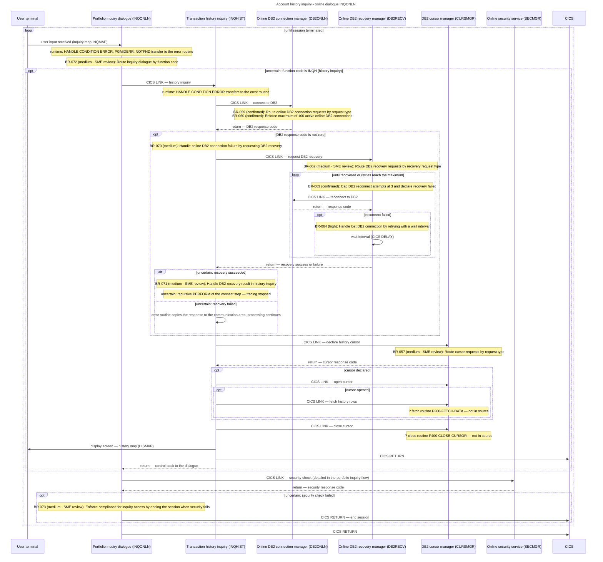

*The diagram shows the history branch of the inquiry dialogue. INQONLN passes control to the history program INQHIST, which opens a DB2 connection (recovering it if needed), reads history rows through the cursor manager, displays the history screen and returns; INQONLN then runs its security check. The diagram is incomplete (GAP-107).*

**Process narrative:**

The user starts the inquiry dialogue, and the dialogue program INQONLN selects the requested function from the function code entered (BR-072). The function code field is not declared in the program, so this routing is labelled *uncertain* (GAP-035, GAP-156). For the history function, INQONLN hands control to the history program INQHIST with a CICS link (a call between online programs that passes a shared communication area).

INQHIST first asks the online connection manager DB2ONLN to connect to the database. DB2ONLN selects its action from the request type (BR-059 ✓) and refuses new connections once 100 are active (BR-060 ✓). When the connection fails, INQHIST builds a connection-recovery request and passes control to the recovery program DB2RECV (BR-070 ⚠). DB2RECV selects its recovery action from the request type (BR-062 ⚠). It then retries the reconnect after a wait interval (BR-064 ✓), up to three attempts, after which recovery is declared failed (BR-063 ✓).

When recovery succeeds, INQHIST re-enters its own connection step. Because this re-entry is recursive, the analysis stopped tracing there, and no retry limit exists in the source (BR-071 ⚠, GAP-016, GAP-024 and GAP-069 in Chapter 9). When recovery fails, INQHIST returns an error message to the caller.

With a connection in place, INQHIST asks the cursor manager CURSMGR to declare and open a cursor (a database read position over a result set) on the history rows (BR-057 ⚠). The fetch and close routines of CURSMGR are not in the source, so how the history rows are actually read and the cursor closed cannot be described (GAP-015). INQHIST then sends the history screen and returns to INQONLN.

After each function, INQONLN runs the security check; when it fails, the session ends (BR-073 ⚠). The security check itself is drawn in Figure 6.2. The request type that INQHIST sends to DB2RECV is not recorded, so only the connection-recovery path is drawn.

#### 6.1.2 Portfolio position inquiry with security check

**Entry point:** INQONLN (online CICS transaction)
**Programs involved:** INQONLN, INQPORT, SECMGR, ERRHNDL
**Business rules applied:** BR-072, BR-077, BR-074, BR-075, BR-078, BR-079, BR-080, BR-076, BR-073

**Figure 6.2 — Portfolio position inquiry with security check (online dialogue INQONLN)**

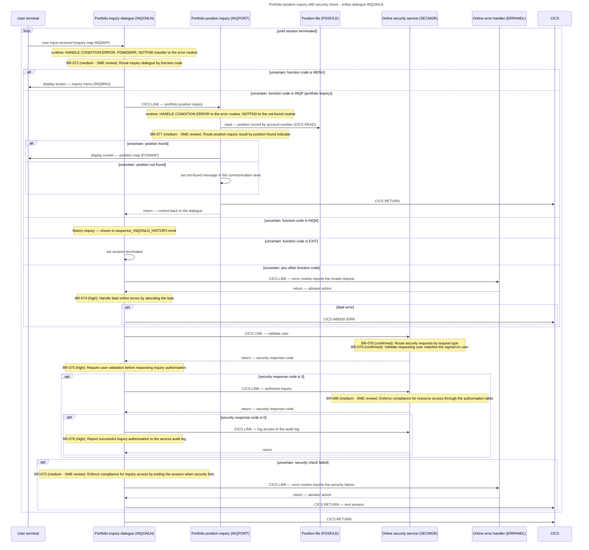

*The diagram shows the menu, portfolio inquiry, exit and invalid-function branches of the inquiry dialogue, the call to the central error handler and the three-step security check. A failed security check ends the session.*

**Process narrative:**

INQONLN routes the user's request by function code (BR-072 ⚠). The function code is undeclared, so this routing is *uncertain*. For a portfolio inquiry, INQONLN passes control to INQPORT, which reads the position file for the requested account. When the position is found, INQPORT displays the position screen; otherwise it returns "Position not found for account" (BR-077 ⚠). The account key used for the read is not declared, and INQPORT's database include member SQLPOS is missing from the repository (GAP-004, GAP-027, GAP-036).

Errors are passed to the central online error handler ERRHNDL. When ERRHNDL advises an abend (an abnormal end, chosen for fatal severity), INQONLN ends the CICS task with code 'IERR' (BR-074 ✓). CICS error handlers registered in INQONLN and INQPORT transfer control only at run time; they are drawn as notes, not as normal flow (GAP-054, GAP-055).

The security check runs in three steps through the security service SECMGR, which selects its action from the request type (BR-078 ✓). First, the user named in the request must be the user signed on to CICS (BR-079 ✓). Only a validated user is checked for authorisation for resource 'INQONLN' with read access (BR-075 ✓). Authorisation is granted when the authorisation table AUTHFILE holds at least one matching row (BR-080 ⚠); the way this count is stored and compared is flagged for SME review (GAP-070, GAP-159).

A successful authorisation is written to the access audit log (BR-076 ✓). When any security step fails, INQONLN reports the error and ends the session (BR-073 ⚠).

### 6.2 Per-program process flows

One sub-section per program, in inventory order: 42 programs and 45 flow diagrams, because PORTMSTR has one extra detail diagram and PORTTRAN has two. "Branches" is the number of decision points found by the logic analysis. Rule numbers refer to Chapter 5. Gap numbers refer to Chapter 9.

#### BCHCTL00 — Batch control subprogram

**Type:** Batch subprogram | **Branches:** 2 | **Business rules:** 3 (BR-001, BR-002, BR-153) | **File ID:** SYS-PORTFOLIO-001-FIL-0042

**Figure 6.3 — BCHCTL00 process flow**

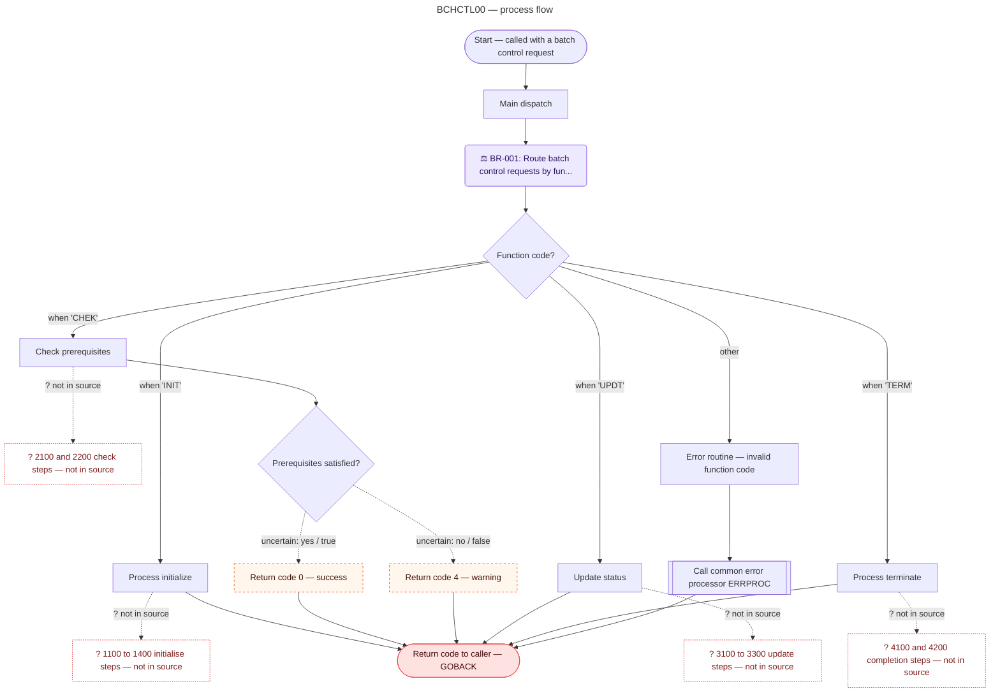

*BCHCTL00 selects initialise, check prerequisites, update status or finalise from the caller's function code (BR-001) and rejects any other code. Eleven of the paragraphs it performs are not in the source; the diagram shows them as "not in source" placeholders.*

> ⚠ **Diagram incomplete** (GAP-108). No file input/output on the batch control file can be traced. The prerequisite outcome depends on a flag set only by a missing paragraph and is drawn as uncertain (BR-002). See GAP-010.

#### CKPRST — Checkpoint/restart subprogram

**Type:** Batch subprogram | **Branches:** 1 | **Business rules:** 4 (BR-003, BR-135 to BR-137) | **File ID:** SYS-PORTFOLIO-001-FIL-0043

**Figure 6.4 — CKPRST process flow**

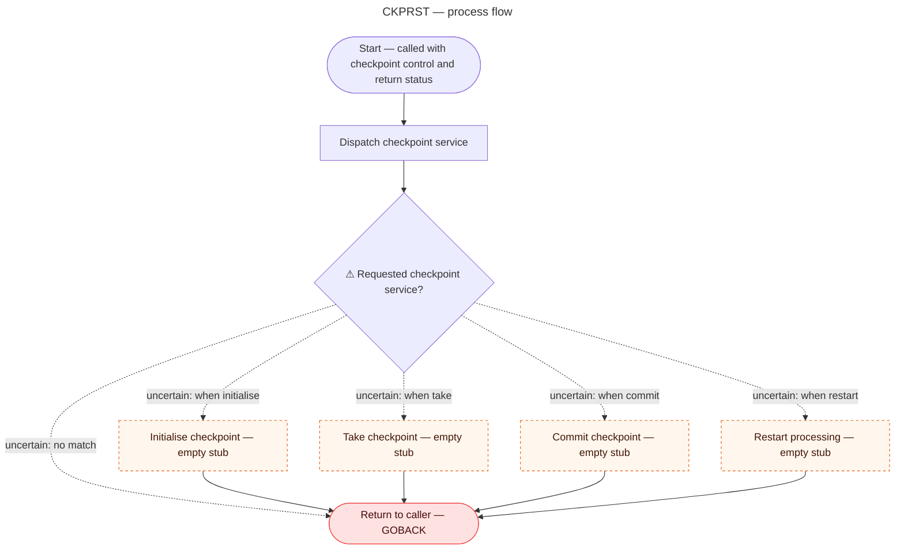

*CKPRST dispatches to four checkpoint services (initialise, take, commit, restart), but every service paragraph is an empty stub (BR-003 ⚠). The condition names that drive the dispatch are declared nowhere, so every dispatch outcome is drawn as uncertain (GAP-028, GAP-083).*

#### HISTLD00 — Transaction history loader

**Type:** Batch | **Branches:** 9 | **Business rules:** 6 (BR-004 to BR-007, BR-146, BR-147) | **File ID:** SYS-PORTFOLIO-001-FIL-0044

**Figure 6.5 — HISTLD00 process flow**

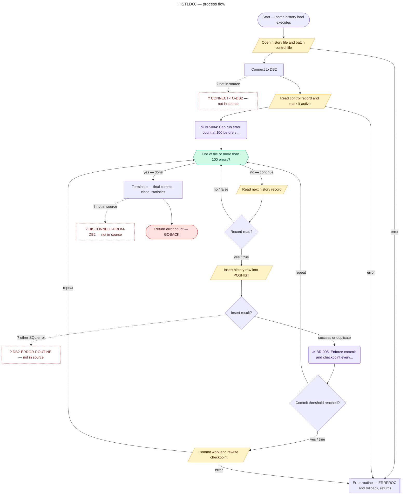

*HISTLD00 reads transaction-history records, inserts each into the DB2 table POSHIST, takes checkpoints in the batch control file and stops after more than 100 errors (BR-004). The DB2 connect, error and disconnect paragraphs are not in the source, so the flow after a DB2 error is not drawn.*

> ⚠ **Diagram incomplete and condensed** (GAP-109, GAP-099). Seven paragraphs are folded into step nodes to stay within the 20-node display limit; this is a display limitation, not missing logic. The history source fields and checkpoint counters are undeclared (GAP-029). See GAP-011.

#### POSUPDT — Empty program

**Type:** not recorded | **Branches:** 0 | **Business rules:** 0 | **File ID:** SYS-PORTFOLIO-001-FIL-0045

**Figure 6.6 — POSUPDT process flow**

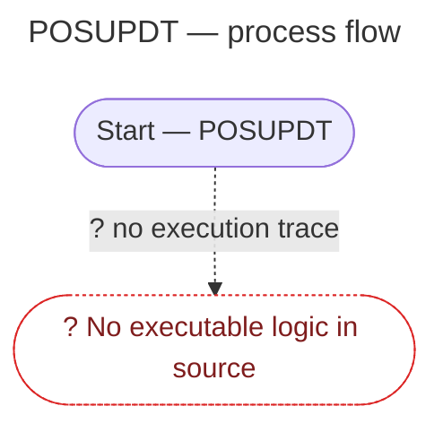

*The source file `src/programs/batch/POSUPDT.cbl` is 1 byte, so the diagram has only two placeholder nodes. The real source must be located (GAP-001, critical; GAP-110).*

#### PRCSEQ00 — Process sequence manager

**Type:** Batch subprogram | **Branches:** 25 | **Business rules:** 20 (BR-008 to BR-022, BR-138 to BR-142) | **File ID:** SYS-PORTFOLIO-001-FIL-0046

**Figure 6.7 — PRCSEQ00 process flow**

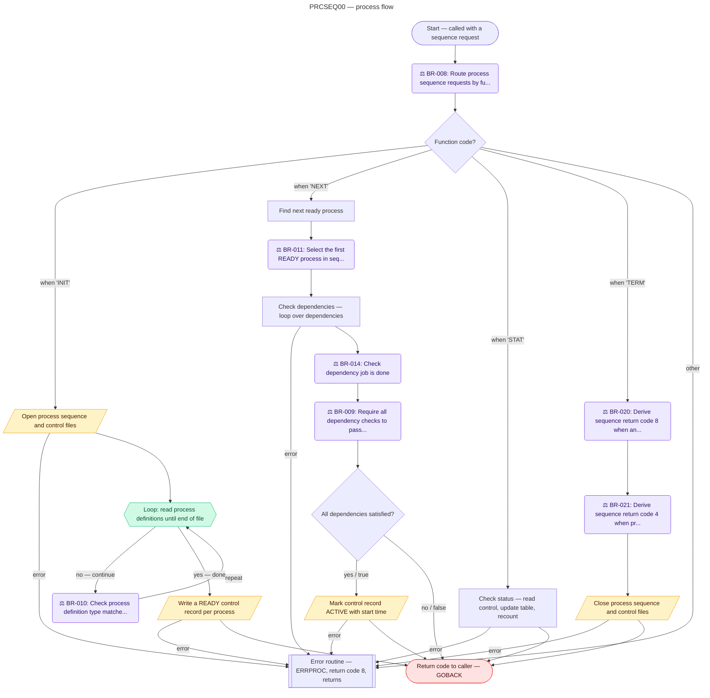

*PRCSEQ00 builds the day's process sequence from the process sequence file and creates control records. It then returns the next runnable process after checking its dependencies (BR-014), updates process status and terminates the sequence. The build loop ends only on file status '10' (GAP-060).*

> ℹ **Diagram condensed** (GAP-100). Ten paragraphs are folded into step and rule nodes to stay within 20 nodes; this is a display limitation. The dependency loop index is undeclared (GAP-030). The error routine returns to its caller; return edges are not drawn.

#### RCVPRC00 — Process recovery subprogram

**Type:** Batch subprogram | **Branches:** 22 | **Business rules:** 16 (BR-023 to BR-033, BR-138 to BR-142) | **File ID:** SYS-PORTFOLIO-001-FIL-0047

**Figure 6.8 — RCVPRC00 process flow**

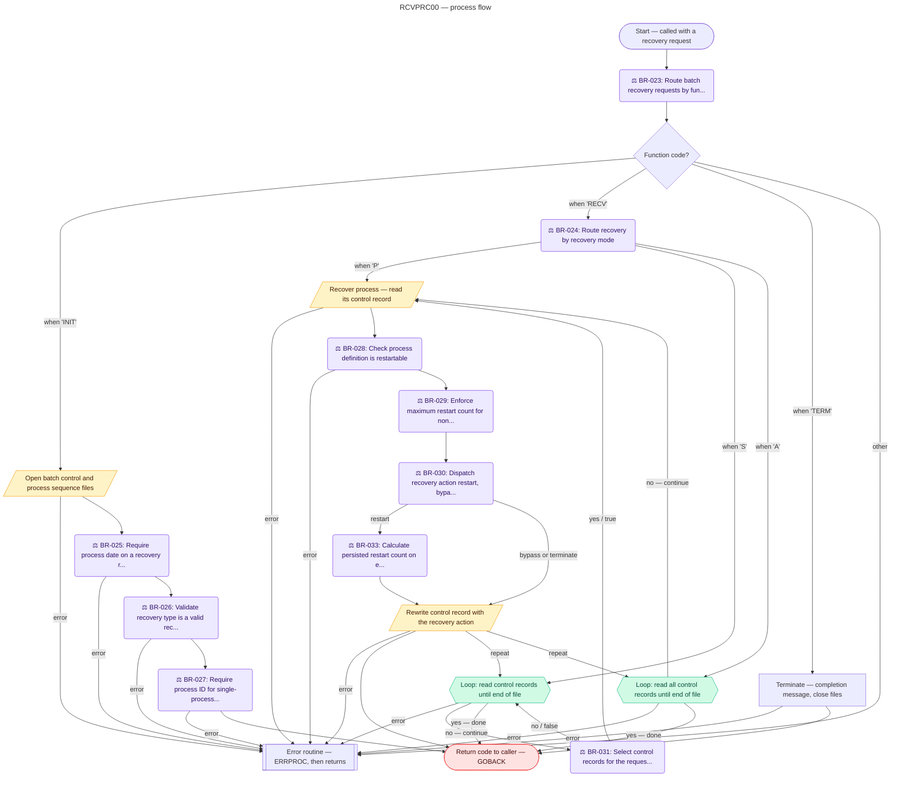

*RCVPRC00 recovers one failed process, a sequence or all processes (BR-023, BR-024). For each, it decides whether to restart, bypass or terminate within the maximum restart count (BR-028 to BR-030), and rewrites the batch control record.*

> ℹ **Diagram condensed** (GAP-101). Several paragraphs are represented by their rule and step nodes. The three rewrite steps are drawn as one step without a Statement ID. See also GAP-061.

#### RPTAUD00 — System audit report

**Type:** Batch | **Branches:** 3 | **Business rules:** 3 (BR-143 to BR-145, declared domains only) | **File ID:** SYS-PORTFOLIO-001-FIL-0048

**Figure 6.9 — RPTAUD00 process flow**

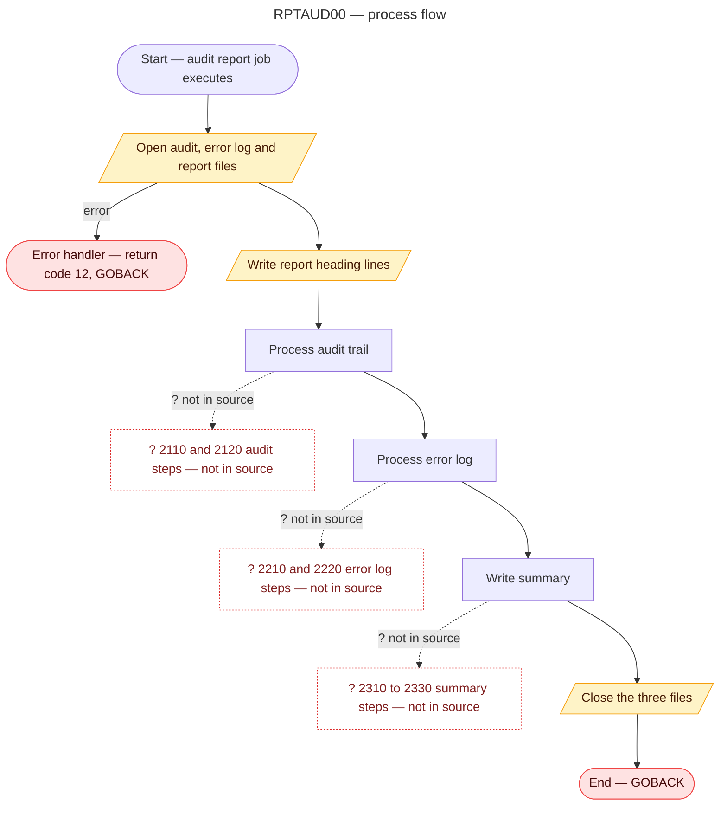

*RPTAUD00 opens the audit, error and report files and performs report steps, but seven of the paragraphs it performs are not in the source. No audit or error record is read anywhere in the code present.*

> ⚠ **Diagram incomplete** (GAP-111). See GAP-012, GAP-031 and GAP-062.

#### RPTPOS00 — Daily position report

**Type:** Batch | **Branches:** 5 | **Business rules:** 3 (BR-034, BR-150, BR-151) | **File ID:** SYS-PORTFOLIO-001-FIL-0049

**Figure 6.10 — RPTPOS00 process flow**

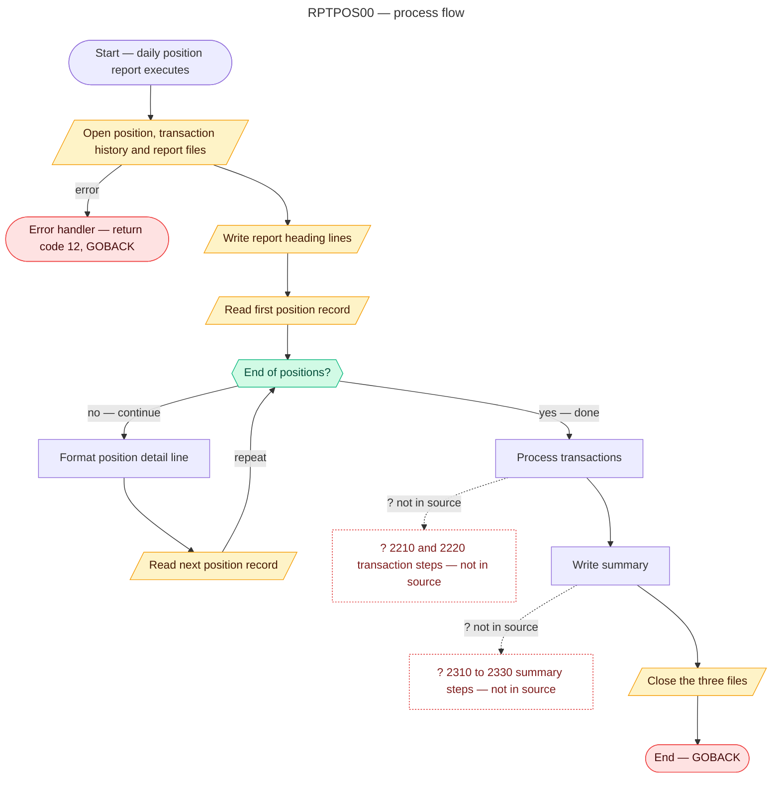

*RPTPOS00 reads the position master and writes the daily position report. Five paragraphs, including the transaction and summary steps, are not in the source and cannot be traced.*

> ⚠ **Diagram incomplete** (GAP-112). Several position fields used by the report are undeclared (GAP-032). See GAP-013.

#### RPTSTA00 — System statistics report

**Type:** Batch | **Branches:** 7 | **Business rules:** 0 | **File ID:** SYS-PORTFOLIO-001-FIL-0050

**Figure 6.11 — RPTSTA00 process flow**

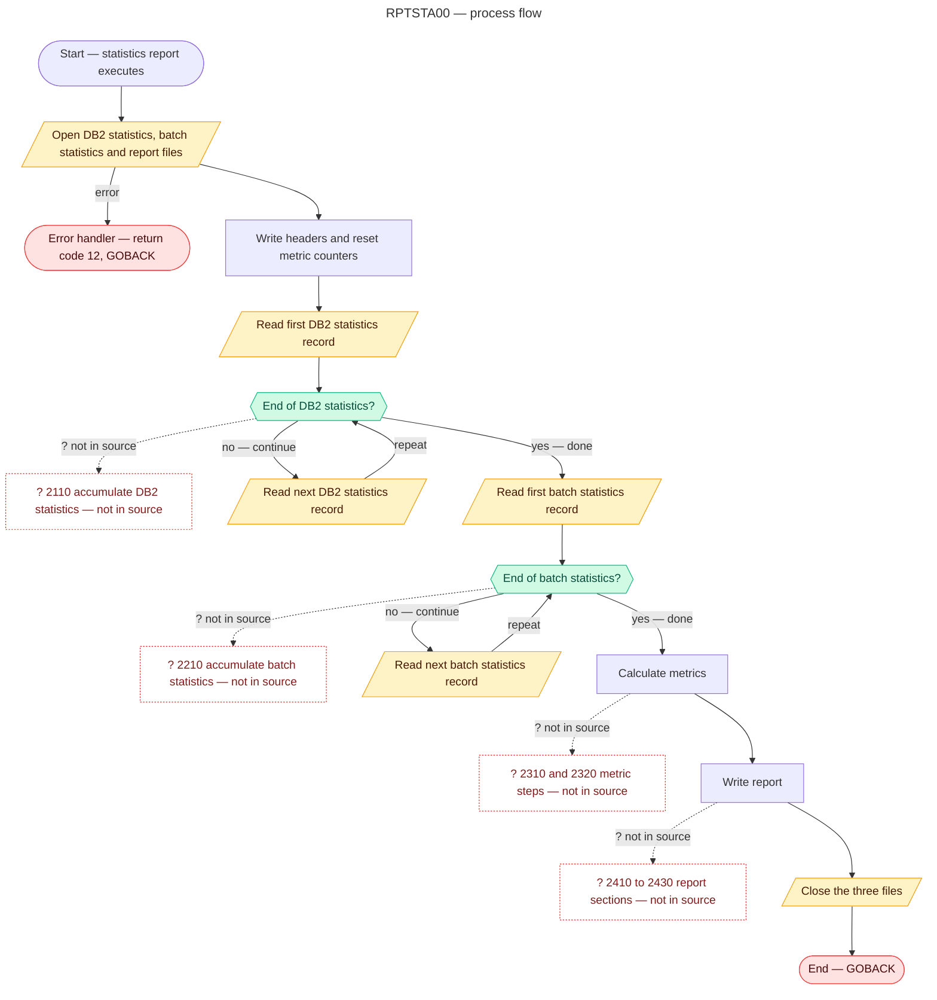

*RPTSTA00 reads DB2 and batch statistics files to produce a performance report. Statistics accumulation, metric calculation and report output are in seven paragraphs that are not in the source, and no business rule could be identified.*

> ⚠ **Diagram incomplete** (GAP-113). The DB2STAT copybook is missing (GAP-005, critical). See GAP-014, GAP-033 and GAP-063.

#### RTNANA00 — Return code analysis report

**Type:** Batch | **Branches:** 2 | **Business rules:** 3 (BR-035 to BR-037) | **File ID:** SYS-PORTFOLIO-001-FIL-0051

**Figure 6.12 — RTNANA00 process flow**

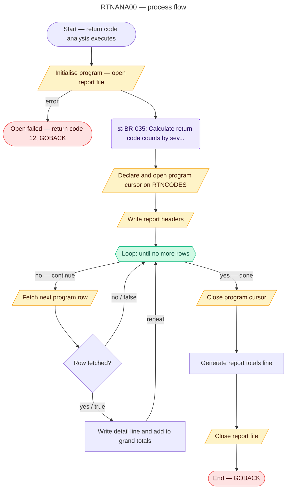

*RTNANA00 reads logged return codes from the DB2 table RTNCODES and writes an analysis report (BR-035 to BR-037). The fetch loop ends only on "no more rows" (SQL code 100), so a database error inside the loop is not handled (GAP-064).*

> ⚠ This program contains no GO TO statements but uses PERFORM THRU constructs (ranged calls that run a sequence of paragraphs); the diagram limitation records six such ranges, each drawn as one step. Some execution paths may not be fully captured in this diagram. See GAP-043 in Chapter 9 (also GAP-084).

#### RTNCDE00 — Return code service

**Type:** Batch subprogram | **Branches:** 5 | **Business rules:** 4 (BR-038 to BR-041) | **File ID:** SYS-PORTFOLIO-001-FIL-0052

**Figure 6.13 — RTNCDE00 process flow**

```mermaid
---
title: RTNCDE00 — process flow
---
flowchart TD
  %% Generated by 6_diagram agent — sequence-builder skill
  %% Program: RTNCDE00 (called subprogram) — 11 paragraphs, 4 business rules, logic_status partial
  %% Each dispatch target is a PERFORM ... THRU range (body plus EXIT-only paragraph); flagged unstructured by Agent 4
  %% Edges: solid = confirmed; -.-> runtime:/uncertain: = uncertain; -.-> ? = unsupported

  classDef rule       fill:#ede9fe,stroke:#7c3aed,color:#2e1065
  classDef io         fill:#fef3c7,stroke:#f59e0b,color:#451a03
  classDef terminal   fill:#fee2e2,stroke:#ef4444,color:#450a0a

  START(["Start — called with a return code request"])
  RULE_BR038("⚖ BR-038: Route return code service requests b..."):::rule
  DEC_REQ{"Request type?"}
  PARA_P100["Initialise return code area"]
  PARA_P200["Set return code"]
  RULE_BR039("⚖ BR-039: Derive highest return code across calls"):::rule
  RULE_BR040("⚖ BR-040: Derive return code severity status f..."):::rule
  PARA_P300["Get current and highest return codes"]
  IO_P400[/"Log return code to table RTNCODES"/]:::io
  DEC_LOG{"Insert succeeded?"}
  IO_P500[/"Summarise logged codes for a program"/]:::io
  DEC_ANA{"Select succeeded?"}
  SET_ERR["Response code 8"]
  TERMINAL(["Return to caller — GOBACK"]):::terminal

  %% REVFORGE-ID RULE_BR038 paragraph_id=SYS-PORTFOLIO-001-FIL-0052-PAR-0001 statement_id=SYS-PORTFOLIO-001-FIL-0052-STMT-000001
  %% REVFORGE-ID DEC_REQ paragraph_id=SYS-PORTFOLIO-001-FIL-0052-PAR-0001 statement_id=SYS-PORTFOLIO-001-FIL-0052-STMT-000001
  %% REVFORGE-ID PARA_P100 paragraph_id=SYS-PORTFOLIO-001-FIL-0052-PAR-0002 statement_id=SYS-PORTFOLIO-001-FIL-0052-STMT-000029
  %% REVFORGE-ID PARA_P200 paragraph_id=SYS-PORTFOLIO-001-FIL-0052-PAR-0004 statement_id=SYS-PORTFOLIO-001-FIL-0052-STMT-000031
  %% REVFORGE-ID RULE_BR039 paragraph_id=SYS-PORTFOLIO-001-FIL-0052-PAR-0004 statement_id=SYS-PORTFOLIO-001-FIL-0052-STMT-000010
  %% REVFORGE-ID RULE_BR040 paragraph_id=SYS-PORTFOLIO-001-FIL-0052-PAR-0004 statement_id=SYS-PORTFOLIO-001-FIL-0052-STMT-000012
  %% REVFORGE-ID PARA_P300 paragraph_id=SYS-PORTFOLIO-001-FIL-0052-PAR-0006 statement_id=SYS-PORTFOLIO-001-FIL-0052-STMT-000028
  %% REVFORGE-ID IO_P400 paragraph_id=SYS-PORTFOLIO-001-FIL-0052-PAR-0008 statement_id=SYS-PORTFOLIO-001-FIL-0052-STMT-000030
  %% REVFORGE-ID DEC_LOG paragraph_id=SYS-PORTFOLIO-001-FIL-0052-PAR-0008 statement_id=SYS-PORTFOLIO-001-FIL-0052-STMT-000022
  %% REVFORGE-ID IO_P500 paragraph_id=SYS-PORTFOLIO-001-FIL-0052-PAR-0010 statement_id=SYS-PORTFOLIO-001-FIL-0052-STMT-000027
  %% REVFORGE-ID DEC_ANA paragraph_id=SYS-PORTFOLIO-001-FIL-0052-PAR-0010 statement_id=SYS-PORTFOLIO-001-FIL-0052-STMT-000025
  %% REVFORGE-ID SET_ERR paragraph_id=SYS-PORTFOLIO-001-FIL-0052-PAR-0008 statement_id=SYS-PORTFOLIO-001-FIL-0052-STMT-000037
  %% REVFORGE-ID TERMINAL paragraph_id=SYS-PORTFOLIO-001-FIL-0052-PAR-0001 statement_id=SYS-PORTFOLIO-001-FIL-0052-STMT-000002

  START --> RULE_BR038
  RULE_BR038 --> DEC_REQ
  DEC_REQ -->|when 'I'| PARA_P100
  DEC_REQ -->|when 'S'| PARA_P200
  DEC_REQ -->|when 'G'| PARA_P300
  DEC_REQ -->|when 'L'| IO_P400
  DEC_REQ -->|when 'A'| IO_P500
  DEC_REQ -->|no match| TERMINAL
  PARA_P100 --> TERMINAL
  PARA_P200 --> RULE_BR039
  RULE_BR039 --> RULE_BR040
  RULE_BR040 --> TERMINAL
  PARA_P300 --> TERMINAL
  IO_P400 --> DEC_LOG
  DEC_LOG -->|yes / true| TERMINAL
  DEC_LOG -->|no / false| SET_ERR
  IO_P500 --> DEC_ANA
  DEC_ANA -->|yes / true| TERMINAL
  DEC_ANA -->|no / false| SET_ERR
  SET_ERR --> TERMINAL

  %% EVALUATE has no WHEN OTHER: an unrecognised request type performs nothing. SQLCODE has no Field ID.
  %% Medium and low confidence rules not shown inline:
  %% BR-041 (medium): Calculate return code count, maximum and minimum for a program within a time window — see paragraph P500-ANALYZE-CODES
```

*RTNCDE00 initialises, sets, gets, logs or analyses return codes by request type (BR-038). It keeps the highest code (BR-039) and classifies each code as success, warning, error or severe (BR-040).*

> ⚠ This program contains no GO TO statements but uses PERFORM THRU constructs; its five dispatch targets are ranged calls, each drawn as one step. Some execution paths may not be fully captured in this diagram. See GAP-044 in Chapter 9.

#### AUDPROC — Audit trail subroutine

**Type:** Batch subprogram | **Branches:** 2 | **Business rules:** 3 (BR-143 to BR-145, declared domains) | **File ID:** SYS-PORTFOLIO-001-FIL-0053

**Figure 6.14 — AUDPROC process flow**

```mermaid
---
title: AUDPROC — process flow
---
flowchart TD
  %% Generated by 6_diagram agent — sequence-builder skill
  %% Program: AUDPROC (called subprogram) — 4 paragraphs, 3 business rules, logic_status success
  %% Edges: solid = confirmed; -.-> runtime:/uncertain: = uncertain; -.-> ? = unsupported

  classDef io         fill:#fef3c7,stroke:#f59e0b,color:#451a03
  classDef terminal   fill:#fee2e2,stroke:#ef4444,color:#450a0a

  START(["Start — called with an audit request"])
  IO_OPEN[/"Open audit file in append mode"/]:::io
  DEC_OPEN{"Open succeeded?"}
  ERR_OPEN["Return code 8 — close audit file"]
  ERR_END(["Early return — GOBACK"]):::terminal
  PARA_BUILD["Build audit record from the request"]
  IO_WRITE[/"Write audit record"/]:::io
  DEC_WRITE{"Write succeeded?"}
  SET_RC0["Return code 0"]
  SET_RC8["Return code 8"]
  IO_CLOSE[/"Close audit file"/]:::io
  TERMINAL(["Return to caller — GOBACK"]):::terminal

  %% REVFORGE-ID IO_OPEN paragraph_id=SYS-PORTFOLIO-001-FIL-0053-PAR-0002 statement_id=SYS-PORTFOLIO-001-FIL-0053-STMT-000006
  %% REVFORGE-ID DEC_OPEN paragraph_id=SYS-PORTFOLIO-001-FIL-0053-PAR-0002 statement_id=SYS-PORTFOLIO-001-FIL-0053-STMT-000007
  %% REVFORGE-ID ERR_OPEN paragraph_id=SYS-PORTFOLIO-001-FIL-0053-PAR-0002 statement_id=SYS-PORTFOLIO-001-FIL-0053-STMT-000023
  %% REVFORGE-ID ERR_END paragraph_id=SYS-PORTFOLIO-001-FIL-0053-PAR-0002 statement_id=SYS-PORTFOLIO-001-FIL-0053-STMT-000024
  %% REVFORGE-ID PARA_BUILD paragraph_id=SYS-PORTFOLIO-001-FIL-0053-PAR-0003 statement_id=SYS-PORTFOLIO-001-FIL-0053-STMT-000010
  %% REVFORGE-ID IO_WRITE paragraph_id=SYS-PORTFOLIO-001-FIL-0053-PAR-0003 statement_id=SYS-PORTFOLIO-001-FIL-0053-STMT-000018
  %% REVFORGE-ID DEC_WRITE paragraph_id=SYS-PORTFOLIO-001-FIL-0053-PAR-0003 statement_id=SYS-PORTFOLIO-001-FIL-0053-STMT-000019
  %% REVFORGE-ID SET_RC0 paragraph_id=SYS-PORTFOLIO-001-FIL-0053-PAR-0003 statement_id=SYS-PORTFOLIO-001-FIL-0053-STMT-000025
  %% REVFORGE-ID SET_RC8 paragraph_id=SYS-PORTFOLIO-001-FIL-0053-PAR-0003 statement_id=SYS-PORTFOLIO-001-FIL-0053-STMT-000026
  %% REVFORGE-ID IO_CLOSE paragraph_id=SYS-PORTFOLIO-001-FIL-0053-PAR-0004 statement_id=SYS-PORTFOLIO-001-FIL-0053-STMT-000003
  %% REVFORGE-ID TERMINAL paragraph_id=SYS-PORTFOLIO-001-FIL-0053-PAR-0001 statement_id=SYS-PORTFOLIO-001-FIL-0053-STMT-000004

  START --> IO_OPEN
  IO_OPEN --> DEC_OPEN
  DEC_OPEN -->|no / false| ERR_OPEN
  ERR_OPEN --> ERR_END
  DEC_OPEN -->|yes / true| PARA_BUILD
  PARA_BUILD --> IO_WRITE
  IO_WRITE --> DEC_WRITE
  DEC_WRITE -->|yes / true| SET_RC0
  DEC_WRITE -->|no / false| SET_RC8
  SET_RC0 --> IO_CLOSE
  SET_RC8 --> IO_CLOSE
  IO_CLOSE --> TERMINAL

  %% Agent 4 warnings: on open failure the unopened file is closed (status not checked); the group move into the
  %% audit header overwrites the timestamp just moved (SME review).
  %% Medium and low confidence rules not shown inline:
  %% BR-143 (medium): Report audit record type as transaction, user action or system event — declared value domain (copybook AUDITLOG)
  %% BR-144 (medium): Report audit action as a declared audit action — declared value domain (copybook AUDITLOG)
  %% BR-145 (medium): Report audit outcome status as success, failure or warning — declared value domain (copybook AUDITLOG)
```

*AUDPROC opens the audit file and writes one audit record per call. Two review notes are carried as diagram comments: the unopened file is closed after a failed open, and the header move overwrites the audit timestamp (GAP-065).*

#### DB2CMT — DB2 commit controller

**Type:** Batch subprogram | **Branches:** 6 | **Business rules:** 3 (BR-042 to BR-044) | **File ID:** SYS-PORTFOLIO-001-FIL-0054

**Figure 6.15 — DB2CMT process flow**

```mermaid
---
title: DB2CMT — process flow
---
flowchart TD
  %% Generated by 6_diagram agent — sequence-builder skill
  %% Program: DB2CMT (called subprogram) — 10 paragraphs, 3 business rules, logic_status partial
  %% Edges: solid = confirmed; -.-> runtime:/uncertain: = uncertain; -.-> ? = unsupported

  classDef rule       fill:#ede9fe,stroke:#7c3aed,color:#2e1065
  classDef io         fill:#fef3c7,stroke:#f59e0b,color:#451a03
  classDef terminal   fill:#fee2e2,stroke:#ef4444,color:#450a0a

  START(["Start — called with a commit request"])
  RULE_BR042("⚖ BR-042: Route DB2 commit control requests by..."):::rule
  DEC_FUNC{"Function code?"}
  PARA_1000["Initialise — clear commit statistics"]
  RULE_BR043("⚖ BR-043: Enforce commit when records processed..."):::rule
  DEC_COMMIT{"Commit frequency reached or commit forced?"}
  IO_COMMIT[/"Issue COMMIT WORK"/]:::io
  IO_RBACK[/"Issue ROLLBACK WORK"/]:::io
  IO_SAVE[/"Create named savepoint"/]:::io
  IO_REST[/"Roll back to named savepoint"/]:::io
  DEC_SQL{"SQL statement succeeded?"}
  SET_OK["⚠ Count the operation — return code 0"]
  CALL_DB2ERR[["Log error — return code 8, call DB2ERR"]]
  PARA_6000["Display commit statistics"]
  CALL_ERRPROC[["Invalid function — return code 12, call ERRPROC"]]
  TERMINAL(["Return to caller — GOBACK"]):::terminal

  %% REVFORGE-ID RULE_BR042 paragraph_id=SYS-PORTFOLIO-001-FIL-0054-PAR-0001 statement_id=SYS-PORTFOLIO-001-FIL-0054-STMT-000001
  %% REVFORGE-ID DEC_FUNC paragraph_id=SYS-PORTFOLIO-001-FIL-0054-PAR-0001 statement_id=SYS-PORTFOLIO-001-FIL-0054-STMT-000001
  %% REVFORGE-ID PARA_1000 paragraph_id=SYS-PORTFOLIO-001-FIL-0054-PAR-0002 statement_id=SYS-PORTFOLIO-001-FIL-0054-STMT-000025
  %% REVFORGE-ID RULE_BR043 paragraph_id=SYS-PORTFOLIO-001-FIL-0054-PAR-0003 statement_id=SYS-PORTFOLIO-001-FIL-0054-STMT-000005
  %% REVFORGE-ID DEC_COMMIT paragraph_id=SYS-PORTFOLIO-001-FIL-0054-PAR-0003 statement_id=SYS-PORTFOLIO-001-FIL-0054-STMT-000005
  %% REVFORGE-ID IO_COMMIT paragraph_id=SYS-PORTFOLIO-001-FIL-0054-PAR-0004 statement_id=SYS-PORTFOLIO-001-FIL-0054-STMT-000006
  %% REVFORGE-ID IO_RBACK paragraph_id=SYS-PORTFOLIO-001-FIL-0054-PAR-0005 statement_id=SYS-PORTFOLIO-001-FIL-0054-STMT-000008
  %% REVFORGE-ID IO_SAVE paragraph_id=SYS-PORTFOLIO-001-FIL-0054-PAR-0006 statement_id=SYS-PORTFOLIO-001-FIL-0054-STMT-000011
  %% REVFORGE-ID IO_REST paragraph_id=SYS-PORTFOLIO-001-FIL-0054-PAR-0007 statement_id=SYS-PORTFOLIO-001-FIL-0054-STMT-000014
  %% REVFORGE-ID DEC_SQL paragraph_id=SYS-PORTFOLIO-001-FIL-0054-PAR-0004 statement_id=SYS-PORTFOLIO-001-FIL-0054-STMT-000007
  %% REVFORGE-ID SET_OK paragraph_id=SYS-PORTFOLIO-001-FIL-0054-PAR-0004 statement_id=SYS-PORTFOLIO-001-FIL-0054-STMT-000037
  %% REVFORGE-ID CALL_DB2ERR paragraph_id=SYS-PORTFOLIO-001-FIL-0054-PAR-0010 statement_id=SYS-PORTFOLIO-001-FIL-0054-STMT-000023
  %% REVFORGE-ID PARA_6000 paragraph_id=SYS-PORTFOLIO-001-FIL-0054-PAR-0008 statement_id=SYS-PORTFOLIO-001-FIL-0054-STMT-000029
  %% REVFORGE-ID CALL_ERRPROC paragraph_id=SYS-PORTFOLIO-001-FIL-0054-PAR-0009 statement_id=SYS-PORTFOLIO-001-FIL-0054-STMT-000022
  %% REVFORGE-ID TERMINAL paragraph_id=SYS-PORTFOLIO-001-FIL-0054-PAR-0001 statement_id=SYS-PORTFOLIO-001-FIL-0054-STMT-000002

  START --> RULE_BR042
  RULE_BR042 --> DEC_FUNC
  DEC_FUNC -->|when 'INIT'| PARA_1000
  DEC_FUNC -->|when 'CMIT'| RULE_BR043
  DEC_FUNC -->|when 'RBAK'| IO_RBACK
  DEC_FUNC -->|when 'SAVE'| IO_SAVE
  DEC_FUNC -->|when 'REST'| IO_REST
  DEC_FUNC -->|when 'STAT'| PARA_6000
  DEC_FUNC -->|other| CALL_ERRPROC
  PARA_1000 --> TERMINAL
  RULE_BR043 --> DEC_COMMIT
  DEC_COMMIT -->|yes / true| IO_COMMIT
  DEC_COMMIT -->|no / false| TERMINAL
  IO_COMMIT --> DEC_SQL
  IO_RBACK --> DEC_SQL
  IO_SAVE --> DEC_SQL
  IO_REST --> DEC_SQL
  DEC_SQL -->|yes / true| SET_OK
  DEC_SQL -->|no / false| CALL_DB2ERR
  SET_OK --> TERMINAL
  CALL_DB2ERR --> TERMINAL
  PARA_6000 --> TERMINAL
  CALL_ERRPROC --> TERMINAL

  %% DEC_SQL and SET_OK stand for the SQLCODE check after each of the four SQL statements (2100, 3000, 4000, 5000).
  %% When no commit is issued, and for STAT, no statement sets the return code (Agent 4). SQLCODE has no Field ID.
  %% Medium and low confidence rules not shown inline:
  %% ⚠ BR-044 (low): Calculate commit, rollback and savepoint statistics counters — see paragraphs 2100-ISSUE-COMMIT / 3000-ROLLBACK / 4000-SAVEPOINT / 5000-RESTORE · SME review
```

*DB2CMT commits, rolls back, sets and restores savepoints, or reports statistics on request (BR-042 to BR-044). It calls the DB2 error service DB2ERR when an SQL statement fails. When no commit is issued, and for the statistics request, the program does not set the return code (diagram limitation).*

#### DB2CONN — DB2 connection manager

**Type:** Batch subprogram | **Branches:** 7 | **Business rules:** 5 (BR-045 to BR-049) | **File ID:** SYS-PORTFOLIO-001-FIL-0055

**Figure 6.16 — DB2CONN process flow**

```mermaid
---
title: DB2CONN — process flow
---
flowchart TD
  %% Generated by 6_diagram agent — sequence-builder skill
  %% Program: DB2CONN (called subprogram) — 6 paragraphs, 5 business rules, logic_status partial
  %% Edges: solid = confirmed; -.-> runtime:/uncertain: = uncertain; -.-> ? = unsupported

  classDef rule       fill:#ede9fe,stroke:#7c3aed,color:#2e1065
  classDef io         fill:#fef3c7,stroke:#f59e0b,color:#451a03
  classDef terminal   fill:#fee2e2,stroke:#ef4444,color:#450a0a
  classDef loop       fill:#d1fae5,stroke:#10b981,color:#064e3b
  classDef runtime    fill:#fff7ed,stroke:#ea580c,color:#431407,stroke-dasharray:4 4
  classDef unresolved fill:#ffffff,stroke:#dc2626,color:#7f1d1d,stroke-dasharray:2 2

  START(["Start — called with a DB2 connection request"])
  RULE_BR045("⚖ BR-045: Route DB2 connection requests by fun..."):::rule
  DEC_FUNC{"Function code?"}
  RULE_BR046("⚖ BR-046: Cap DB2 connection attempts at the m..."):::rule
  LOOP_CONN{{"Connected or retries exhausted?"}}:::loop
  IO_CONNECT[/"SQL CONNECT to the requested database"/]:::io
  DEC_SQL{"Connect succeeded?"}
  SET_CONN["Mark connected — return code 0"]
  PARA_1100["Handle connect error — count retry, set code"]
  DEC_WAIT{"Retries remain and not connected?"}
  CALL_DELAY[["? DELAY external routine — not in source"]]:::unresolved
  RULE_BR048("⚖ BR-048: Require an active DB2 connection bef..."):::rule
  DEC_CONNECTED{"Connected?"}
  IO_DISC[/"Commit work and reset the connection"/]:::io
  IO_STAT[/"Probe connection — SELECT CURRENT SERVER"/]:::io
  DEC_STAT{"Connection answers?"}
  CALL_ERRPROC[["Invalid function — return code 12, call ERRPROC"]]
  TERMINAL(["Return to caller — GOBACK"]):::terminal

  %% REVFORGE-ID RULE_BR045 paragraph_id=SYS-PORTFOLIO-001-FIL-0055-PAR-0001 statement_id=SYS-PORTFOLIO-001-FIL-0055-STMT-000001
  %% REVFORGE-ID DEC_FUNC paragraph_id=SYS-PORTFOLIO-001-FIL-0055-PAR-0001 statement_id=SYS-PORTFOLIO-001-FIL-0055-STMT-000001
  %% REVFORGE-ID RULE_BR046 paragraph_id=SYS-PORTFOLIO-001-FIL-0055-PAR-0002 statement_id=SYS-PORTFOLIO-001-FIL-0055-STMT-000007
  %% REVFORGE-ID LOOP_CONN paragraph_id=SYS-PORTFOLIO-001-FIL-0055-PAR-0002 statement_id=SYS-PORTFOLIO-001-FIL-0055-STMT-000007
  %% REVFORGE-ID IO_CONNECT paragraph_id=SYS-PORTFOLIO-001-FIL-0055-PAR-0002 statement_id=null
  %% REVFORGE-ID DEC_SQL paragraph_id=SYS-PORTFOLIO-001-FIL-0055-PAR-0002 statement_id=SYS-PORTFOLIO-001-FIL-0055-STMT-000023
  %% REVFORGE-ID SET_CONN paragraph_id=SYS-PORTFOLIO-001-FIL-0055-PAR-0002 statement_id=SYS-PORTFOLIO-001-FIL-0055-STMT-000039
  %% REVFORGE-ID PARA_1100 paragraph_id=SYS-PORTFOLIO-001-FIL-0055-PAR-0003 statement_id=SYS-PORTFOLIO-001-FIL-0055-STMT-000038
  %% REVFORGE-ID DEC_WAIT paragraph_id=SYS-PORTFOLIO-001-FIL-0055-PAR-0002 statement_id=SYS-PORTFOLIO-001-FIL-0055-STMT-000024
  %% REVFORGE-ID CALL_DELAY paragraph_id=null statement_id=SYS-PORTFOLIO-001-FIL-0055-STMT-000041
  %% REVFORGE-ID RULE_BR048 paragraph_id=SYS-PORTFOLIO-001-FIL-0055-PAR-0004 statement_id=SYS-PORTFOLIO-001-FIL-0055-STMT-000011
  %% REVFORGE-ID DEC_CONNECTED paragraph_id=SYS-PORTFOLIO-001-FIL-0055-PAR-0004 statement_id=SYS-PORTFOLIO-001-FIL-0055-STMT-000011
  %% REVFORGE-ID IO_DISC paragraph_id=SYS-PORTFOLIO-001-FIL-0055-PAR-0004 statement_id=SYS-PORTFOLIO-001-FIL-0055-STMT-000028
  %% REVFORGE-ID IO_STAT paragraph_id=SYS-PORTFOLIO-001-FIL-0055-PAR-0005 statement_id=SYS-PORTFOLIO-001-FIL-0055-STMT-000019
  %% REVFORGE-ID DEC_STAT paragraph_id=SYS-PORTFOLIO-001-FIL-0055-PAR-0005 statement_id=SYS-PORTFOLIO-001-FIL-0055-STMT-000013
  %% REVFORGE-ID CALL_ERRPROC paragraph_id=SYS-PORTFOLIO-001-FIL-0055-PAR-0006 statement_id=SYS-PORTFOLIO-001-FIL-0055-STMT-000016
  %% REVFORGE-ID TERMINAL paragraph_id=SYS-PORTFOLIO-001-FIL-0055-PAR-0001 statement_id=SYS-PORTFOLIO-001-FIL-0055-STMT-000002

  START --> RULE_BR045
  RULE_BR045 --> DEC_FUNC
  DEC_FUNC -->|when 'CONN'| RULE_BR046
  RULE_BR046 --> LOOP_CONN
  LOOP_CONN -->|no — continue| IO_CONNECT
  IO_CONNECT --> DEC_SQL
  DEC_SQL -->|yes / true| SET_CONN
  DEC_SQL -->|no / false| PARA_1100
  SET_CONN --> DEC_WAIT
  PARA_1100 --> DEC_WAIT
  DEC_WAIT -.->|? call DELAY — not in registry| CALL_DELAY
  DEC_WAIT -.->|uncertain: repeat| LOOP_CONN
  LOOP_CONN -->|yes — done| TERMINAL
  DEC_FUNC -->|when 'DISC'| RULE_BR048
  RULE_BR048 --> DEC_CONNECTED
  DEC_CONNECTED -->|yes / true| IO_DISC
  DEC_CONNECTED -->|no / false| TERMINAL
  IO_DISC --> TERMINAL
  DEC_FUNC -->|when 'STAT'| IO_STAT
  IO_STAT --> DEC_STAT
  DEC_STAT -->|yes — return code 0| TERMINAL
  DEC_STAT -->|no — return code 4| TERMINAL
  DEC_FUNC -->|other| CALL_ERRPROC
  CALL_ERRPROC --> TERMINAL

  %% CALL DELAY: inventory edge DB2CONN to DELAY is resolved=false (not in the file registry); behaviour unknown.
  %% The disconnect result sets return code 0 or 8 (Agent 4). SQLCODE has no Field ID; the DISC request relies on state from a previous call.
  %% Medium and low confidence rules not shown inline:
  %% BR-047 (medium): Allow a wait before the next DB2 connection attempt while retries remain — see paragraph 1000-CONNECT · SME review
  %% BR-049 (medium): Calculate DB2 connection retry count per failed attempt — see paragraph 1000-CONNECT
```

*DB2CONN connects to DB2 with retries, disconnects and reports status (BR-045 to BR-049). Its wait between retries calls the routine DELAY, which is not in the repository; the diagram draws it as an unsupported edge.*

> ⚠ **Diagram incomplete** (GAP-114). The SQL connect step has no Statement ID. The disconnect request relies on connection state left by a previous call. See GAP-007.

#### DB2ERR — DB2 error service

**Type:** Batch subprogram | **Branches:** 8 | **Business rules:** 5 (BR-050 to BR-054) | **File ID:** SYS-PORTFOLIO-001-FIL-0056

**Figure 6.17 — DB2ERR process flow**

```mermaid
---
title: DB2ERR — process flow
---
flowchart TD
  %% Generated by 6_diagram agent — sequence-builder skill
  %% Program: DB2ERR (called subprogram) — 7 paragraphs, 5 business rules, logic_status partial
  %% Edges: solid = confirmed; -.-> runtime:/uncertain: = uncertain; -.-> ? = unsupported

  classDef rule       fill:#ede9fe,stroke:#7c3aed,color:#2e1065
  classDef io         fill:#fef3c7,stroke:#f59e0b,color:#451a03
  classDef terminal   fill:#fee2e2,stroke:#ef4444,color:#450a0a

  START(["Start — called with a DB2 error request"])
  RULE_BR050("⚖ BR-050: Route DB2 error service requests by ..."):::rule
  DEC_FUNC{"Function code?"}
  RULE_BR051("⚖ BR-051: Handle DB2 error severity and retry ..."):::rule
  DEC_SEV{"SQL code?"}
  SEV_RETRY["Severity 2 — retry recommended"]
  SEV4["Severity 4 — no retry"]
  SEV1["Severity 1 — no retry"]
  SEV_SIGN["Severity 3 if negative, otherwise 1"]
  IO_INSERT[/"Insert error into ERRLOG"/]:::io
  DEC_INS{"Insert succeeded?"}
  RULE_BR053("⚖ BR-053: Handle DB2 error diagnosis message a..."):::rule
  DEC_DIAG{"SQL code?"}
  IO_RETR[/"Select last logged error from ERRLOG"/]:::io
  DEC_RETR{"Error history found?"}
  CALL_ERRPROC[["Error routine — call ERRPROC"]]
  TERMINAL(["Return to caller — GOBACK"]):::terminal

  %% REVFORGE-ID RULE_BR050 paragraph_id=SYS-PORTFOLIO-001-FIL-0056-PAR-0001 statement_id=SYS-PORTFOLIO-001-FIL-0056-STMT-000001
  %% REVFORGE-ID DEC_FUNC paragraph_id=SYS-PORTFOLIO-001-FIL-0056-PAR-0001 statement_id=SYS-PORTFOLIO-001-FIL-0056-STMT-000001
  %% REVFORGE-ID RULE_BR051 paragraph_id=SYS-PORTFOLIO-001-FIL-0056-PAR-0003 statement_id=SYS-PORTFOLIO-001-FIL-0056-STMT-000017
  %% REVFORGE-ID DEC_SEV paragraph_id=SYS-PORTFOLIO-001-FIL-0056-PAR-0003 statement_id=SYS-PORTFOLIO-001-FIL-0056-STMT-000017
  %% REVFORGE-ID SEV_RETRY paragraph_id=SYS-PORTFOLIO-001-FIL-0056-PAR-0003 statement_id=SYS-PORTFOLIO-001-FIL-0056-STMT-000034
  %% REVFORGE-ID SEV4 paragraph_id=SYS-PORTFOLIO-001-FIL-0056-PAR-0003 statement_id=SYS-PORTFOLIO-001-FIL-0056-STMT-000032
  %% REVFORGE-ID SEV1 paragraph_id=SYS-PORTFOLIO-001-FIL-0056-PAR-0003 statement_id=SYS-PORTFOLIO-001-FIL-0056-STMT-000036
  %% REVFORGE-ID SEV_SIGN paragraph_id=SYS-PORTFOLIO-001-FIL-0056-PAR-0003 statement_id=SYS-PORTFOLIO-001-FIL-0056-STMT-000031
  %% REVFORGE-ID IO_INSERT paragraph_id=SYS-PORTFOLIO-001-FIL-0056-PAR-0004 statement_id=SYS-PORTFOLIO-001-FIL-0056-STMT-000018
  %% REVFORGE-ID DEC_INS paragraph_id=SYS-PORTFOLIO-001-FIL-0056-PAR-0004 statement_id=SYS-PORTFOLIO-001-FIL-0056-STMT-000019
  %% REVFORGE-ID RULE_BR053 paragraph_id=SYS-PORTFOLIO-001-FIL-0056-PAR-0005 statement_id=SYS-PORTFOLIO-001-FIL-0056-STMT-000020
  %% REVFORGE-ID DEC_DIAG paragraph_id=SYS-PORTFOLIO-001-FIL-0056-PAR-0005 statement_id=SYS-PORTFOLIO-001-FIL-0056-STMT-000020
  %% REVFORGE-ID IO_RETR paragraph_id=SYS-PORTFOLIO-001-FIL-0056-PAR-0006 statement_id=SYS-PORTFOLIO-001-FIL-0056-STMT-000021
  %% REVFORGE-ID DEC_RETR paragraph_id=SYS-PORTFOLIO-001-FIL-0056-PAR-0006 statement_id=SYS-PORTFOLIO-001-FIL-0056-STMT-000022
  %% REVFORGE-ID CALL_ERRPROC paragraph_id=SYS-PORTFOLIO-001-FIL-0056-PAR-0007 statement_id=SYS-PORTFOLIO-001-FIL-0056-STMT-000025
  %% REVFORGE-ID TERMINAL paragraph_id=SYS-PORTFOLIO-001-FIL-0056-PAR-0001 statement_id=SYS-PORTFOLIO-001-FIL-0056-STMT-000002

  START --> RULE_BR050
  RULE_BR050 --> DEC_FUNC
  DEC_FUNC -->|when 'LOG'| RULE_BR051
  RULE_BR051 --> DEC_SEV
  DEC_SEV -->|deadlock or timeout| SEV_RETRY
  DEC_SEV -->|connection error| SEV4
  DEC_SEV -->|duplicate key or not found| SEV1
  DEC_SEV -->|other| SEV_SIGN
  SEV_RETRY --> IO_INSERT
  SEV4 --> IO_INSERT
  SEV1 --> IO_INSERT
  SEV_SIGN --> IO_INSERT
  IO_INSERT --> DEC_INS
  DEC_INS -->|yes — return code 0| TERMINAL
  DEC_INS -->|no / false| CALL_ERRPROC
  DEC_FUNC -->|when 'DIAG'| RULE_BR053
  RULE_BR053 --> DEC_DIAG
  DEC_DIAG -->|deadlock or timeout — return code 4| TERMINAL
  DEC_DIAG -->|connection error — return code 12| TERMINAL
  DEC_DIAG -->|duplicate key — return code 8| TERMINAL
  DEC_DIAG -->|other — 12 if negative, else 4| TERMINAL
  DEC_FUNC -->|when 'RETR'| IO_RETR
  IO_RETR --> DEC_RETR
  DEC_RETR -->|yes — return logged message| TERMINAL
  DEC_RETR -->|no — return code 4| TERMINAL
  DEC_FUNC -->|other| CALL_ERRPROC
  CALL_ERRPROC --> TERMINAL

  %% SQLCODE has no Field ID (Agent 4). ACCEPT ... FROM TIME STAMP recorded as ambiguous (SME review).
  %% Medium and low confidence rules not shown inline:
  %% BR-052 (medium): Handle unlisted DB2 error severity by SQL code sign — see paragraph 1100-SET-SEVERITY
  %% BR-054 (medium): Handle unlisted DB2 error diagnosis by SQL code sign — see paragraph 2000-DIAGNOSE-ERROR
```

*DB2ERR logs a caller's DB2 error to the ERRLOG table with a severity and retry advice (BR-051, BR-052). It can also diagnose the error into a message and return code (BR-053, BR-054) or retrieve the latest logged error. Diagnosis outcomes are drawn as labelled edges to stay within 20 nodes (display limitation; see also GAP-086).*

#### DB2STAT — DB2 statistics collector

**Type:** Batch subprogram | **Branches:** 6 | **Business rules:** 2 (BR-055, BR-056) | **File ID:** SYS-PORTFOLIO-001-FIL-0057

**Figure 6.18 — DB2STAT process flow**

```mermaid
---
title: DB2STAT — process flow
---
flowchart TD
  %% Generated by 6_diagram agent — sequence-builder skill
  %% Program: DB2STAT (called subprogram) — 9 paragraphs, 2 business rules, logic_status partial
  %% Edges: solid = confirmed; -.-> runtime:/uncertain: = uncertain; -.-> ? = unsupported

  classDef rule       fill:#ede9fe,stroke:#7c3aed,color:#2e1065
  classDef io         fill:#fef3c7,stroke:#f59e0b,color:#451a03
  classDef terminal   fill:#fee2e2,stroke:#ef4444,color:#450a0a

  START(["Start — called with a statistics request"])
  RULE_BR055("⚖ BR-055: Route DB2 statistics requests by fun..."):::rule
  DEC_FUNC{"Function code?"}
  IO_CREATE[/"Declare session statistics table"/]:::io
  DEC_CREATE{"Declare failed other than already exists?"}
  IO_INSERT[/"Insert initial statistics row"/]:::io
  DEC_INS{"Insert succeeded?"}
  IO_UPDATE[/"Update row counts in statistics row"/]:::io
  DEC_UPD{"Update succeeded?"}
  PARA_3100["Calculate elapsed and estimated CPU time"]
  IO_TERM[/"Write end time, CPU and elapsed time"/]:::io
  DEC_TERM{"Update succeeded?"}
  IO_DISP[/"Read back and display statistics"/]:::io
  DEC_DISP{"Select succeeded?"}
  SET_RC0["Return code 0"]
  CALL_ERRPROC[["Error routine — return code 12, call ERRPROC"]]
  TERMINAL(["Return to caller — GOBACK"]):::terminal

  %% REVFORGE-ID RULE_BR055 paragraph_id=SYS-PORTFOLIO-001-FIL-0057-PAR-0001 statement_id=SYS-PORTFOLIO-001-FIL-0057-STMT-000001
  %% REVFORGE-ID DEC_FUNC paragraph_id=SYS-PORTFOLIO-001-FIL-0057-PAR-0001 statement_id=SYS-PORTFOLIO-001-FIL-0057-STMT-000001
  %% REVFORGE-ID IO_CREATE paragraph_id=SYS-PORTFOLIO-001-FIL-0057-PAR-0003 statement_id=SYS-PORTFOLIO-001-FIL-0057-STMT-000010
  %% REVFORGE-ID DEC_CREATE paragraph_id=SYS-PORTFOLIO-001-FIL-0057-PAR-0003 statement_id=SYS-PORTFOLIO-001-FIL-0057-STMT-000011
  %% REVFORGE-ID IO_INSERT paragraph_id=SYS-PORTFOLIO-001-FIL-0057-PAR-0004 statement_id=SYS-PORTFOLIO-001-FIL-0057-STMT-000012
  %% REVFORGE-ID DEC_INS paragraph_id=SYS-PORTFOLIO-001-FIL-0057-PAR-0004 statement_id=SYS-PORTFOLIO-001-FIL-0057-STMT-000013
  %% REVFORGE-ID IO_UPDATE paragraph_id=SYS-PORTFOLIO-001-FIL-0057-PAR-0005 statement_id=SYS-PORTFOLIO-001-FIL-0057-STMT-000020
  %% REVFORGE-ID DEC_UPD paragraph_id=SYS-PORTFOLIO-001-FIL-0057-PAR-0005 statement_id=SYS-PORTFOLIO-001-FIL-0057-STMT-000021
  %% REVFORGE-ID PARA_3100 paragraph_id=SYS-PORTFOLIO-001-FIL-0057-PAR-0007 statement_id=SYS-PORTFOLIO-001-FIL-0057-STMT-000024
  %% REVFORGE-ID IO_TERM paragraph_id=SYS-PORTFOLIO-001-FIL-0057-PAR-0006 statement_id=SYS-PORTFOLIO-001-FIL-0057-STMT-000025
  %% REVFORGE-ID DEC_TERM paragraph_id=SYS-PORTFOLIO-001-FIL-0057-PAR-0006 statement_id=SYS-PORTFOLIO-001-FIL-0057-STMT-000026
  %% REVFORGE-ID IO_DISP paragraph_id=SYS-PORTFOLIO-001-FIL-0057-PAR-0008 statement_id=SYS-PORTFOLIO-001-FIL-0057-STMT-000030
  %% REVFORGE-ID DEC_DISP paragraph_id=SYS-PORTFOLIO-001-FIL-0057-PAR-0008 statement_id=SYS-PORTFOLIO-001-FIL-0057-STMT-000031
  %% REVFORGE-ID SET_RC0 paragraph_id=SYS-PORTFOLIO-001-FIL-0057-PAR-0004 statement_id=SYS-PORTFOLIO-001-FIL-0057-STMT-000045
  %% REVFORGE-ID CALL_ERRPROC paragraph_id=SYS-PORTFOLIO-001-FIL-0057-PAR-0009 statement_id=SYS-PORTFOLIO-001-FIL-0057-STMT-000034
  %% REVFORGE-ID TERMINAL paragraph_id=SYS-PORTFOLIO-001-FIL-0057-PAR-0001 statement_id=SYS-PORTFOLIO-001-FIL-0057-STMT-000002

  START --> RULE_BR055
  RULE_BR055 --> DEC_FUNC
  DEC_FUNC -->|when 'INIT'| IO_CREATE
  IO_CREATE --> DEC_CREATE
  DEC_CREATE -->|yes / true| CALL_ERRPROC
  DEC_CREATE -->|no / false| IO_INSERT
  IO_INSERT --> DEC_INS
  DEC_INS -->|yes / true| SET_RC0
  DEC_INS -->|no / false| CALL_ERRPROC
  DEC_FUNC -->|when 'UPDT'| IO_UPDATE
  IO_UPDATE --> DEC_UPD
  DEC_UPD -->|yes / true| SET_RC0
  DEC_UPD -->|no / false| CALL_ERRPROC
  DEC_FUNC -->|when 'TERM'| PARA_3100
  PARA_3100 --> IO_TERM
  IO_TERM --> DEC_TERM
  DEC_TERM -->|yes / true| IO_DISP
  DEC_TERM -->|no / false| CALL_ERRPROC
  DEC_FUNC -->|when 'DISP'| IO_DISP
  IO_DISP --> DEC_DISP
  DEC_DISP -->|yes / true| SET_RC0
  DEC_DISP -->|no / false| CALL_ERRPROC
  DEC_FUNC -->|other| CALL_ERRPROC
  SET_RC0 --> TERMINAL
  CALL_ERRPROC --> TERMINAL
  CALL_ERRPROC -->|returns after declare failure| IO_INSERT

  %% After a failed declare the error routine returns and the insert still runs; its success resets the return code to 0 (Agent 4).
  %% Agent 4 warning: the SELECT host structure does not line up with the selected columns (recorded verbatim). SQLCODE has no Field ID.
  %% Medium and low confidence rules not shown inline:
  %% BR-056 (medium): Calculate elapsed time and apply 65 percent CPU time estimate — see paragraph 3100-CALC-TIMES · SME review
```

*DB2STAT creates, initialises, updates and displays a calling program's DB2 statistics (BR-055, BR-056). The selected columns do not line up with the receiving host structure (GAP-066, GAP-085).*

#### ERRPROC — Common error recorder

**Type:** Batch subprogram | **Branches:** 2 | **Business rules:** 0 | **File ID:** SYS-PORTFOLIO-001-FIL-0058

**Figure 6.19 — ERRPROC process flow**

```mermaid
---
title: ERRPROC — process flow
---
flowchart TD
  %% Generated by 6_diagram agent — sequence-builder skill
  %% Program: ERRPROC (called subprogram) — 6 paragraphs, 0 business rules, logic_status success
  %% Edges: solid = confirmed; -.-> runtime:/uncertain: = uncertain; -.-> ? = unsupported

  classDef io         fill:#fef3c7,stroke:#f59e0b,color:#451a03
  classDef terminal   fill:#fee2e2,stroke:#ef4444,color:#450a0a

  START(["Start — called with an error request"])
  IO_OPEN[/"Initialise — open error log for append"/]:::io
  DEC_OPEN{"Open failed?"}
  MSG_OPEN["Display open error — processing continues"]
  IO_WRITE[/"Write error log record"/]:::io
  DEC_WRITE{"Write failed?"}
  MSG_WRITE["Display write error — processing continues"]
  PARA_2200["Display formatted error block"]
  PARA_3000["Terminate"]
  TERMINAL(["Return to caller — GOBACK"]):::terminal

  %% REVFORGE-ID IO_OPEN paragraph_id=SYS-PORTFOLIO-001-FIL-0058-PAR-0002 statement_id=SYS-PORTFOLIO-001-FIL-0058-STMT-000001
  %% REVFORGE-ID DEC_OPEN paragraph_id=SYS-PORTFOLIO-001-FIL-0058-PAR-0002 statement_id=SYS-PORTFOLIO-001-FIL-0058-STMT-000008
  %% REVFORGE-ID MSG_OPEN paragraph_id=SYS-PORTFOLIO-001-FIL-0058-PAR-0002 statement_id=SYS-PORTFOLIO-001-FIL-0058-STMT-000032
  %% REVFORGE-ID IO_WRITE paragraph_id=SYS-PORTFOLIO-001-FIL-0058-PAR-0004 statement_id=SYS-PORTFOLIO-001-FIL-0058-STMT-000016
  %% REVFORGE-ID DEC_WRITE paragraph_id=SYS-PORTFOLIO-001-FIL-0058-PAR-0004 statement_id=SYS-PORTFOLIO-001-FIL-0058-STMT-000021
  %% REVFORGE-ID MSG_WRITE paragraph_id=SYS-PORTFOLIO-001-FIL-0058-PAR-0004 statement_id=SYS-PORTFOLIO-001-FIL-0058-STMT-000033
  %% REVFORGE-ID PARA_2200 paragraph_id=SYS-PORTFOLIO-001-FIL-0058-PAR-0005 statement_id=SYS-PORTFOLIO-001-FIL-0058-STMT-000017
  %% REVFORGE-ID PARA_3000 paragraph_id=SYS-PORTFOLIO-001-FIL-0058-PAR-0006 statement_id=SYS-PORTFOLIO-001-FIL-0058-STMT-000003
  %% REVFORGE-ID TERMINAL paragraph_id=SYS-PORTFOLIO-001-FIL-0058-PAR-0001 statement_id=SYS-PORTFOLIO-001-FIL-0058-STMT-000004

  START --> IO_OPEN
  IO_OPEN --> DEC_OPEN
  DEC_OPEN -->|yes / true| MSG_OPEN
  DEC_OPEN -->|no / false| IO_WRITE
  MSG_OPEN --> IO_WRITE
  IO_WRITE --> DEC_WRITE
  DEC_WRITE -->|yes / true| MSG_WRITE
  DEC_WRITE -->|no / false| PARA_2200
  MSG_WRITE --> PARA_2200
  PARA_2200 --> PARA_3000
  PARA_3000 --> TERMINAL

  %% Single linear path; the two file-status checks only display a message (Agent 4).
  %% No business rules were identified for this program by the Rules Agent.
```

*ERRPROC opens the error log and writes one error record per call. It is the most-called program in the system (ten callers, Chapter 7) but has no business rules of its own.*

#### CURSMGR — Online cursor manager

**Type:** Online subprogram | **Branches:** 4 | **Business rules:** 2 (BR-057, BR-058) | **File ID:** SYS-PORTFOLIO-001-FIL-0059

**Figure 6.20 — CURSMGR process flow**

```mermaid
---
title: CURSMGR — process flow
---
flowchart TD
  %% Generated by 6_diagram agent — sequence-builder skill
  %% Program: CURSMGR (online subprogram) — 5 paragraphs, 2 business rules, logic_status partial
  %% All four dispatch targets are PERFORM ... THRU ranges (flagged unstructured by Agent 4); the source is truncated after line 91
  %% Edges: solid = confirmed; -.-> runtime:/uncertain: = uncertain; -.-> ? = unsupported

  classDef rule       fill:#ede9fe,stroke:#7c3aed,color:#2e1065
  classDef terminal   fill:#fee2e2,stroke:#ef4444,color:#450a0a
  classDef runtime    fill:#fff7ed,stroke:#ea580c,color:#431407,stroke-dasharray:4 4
  classDef unresolved fill:#ffffff,stroke:#dc2626,color:#7f1d1d,stroke-dasharray:2 2

  START(["Start — called with a cursor request"])
  DEC_REQ{"Cursor request type?"}
  PARA_P100["Declare cursor"]:::runtime
  RULE_BR058("⚖ BR-058: Select cursor fetch array size by ar..."):::rule
  DEC_ARRAY{"Array fetch requested?"}
  SET_ARR["Array size — maximum rows"]
  SET_ONE["Array size — 1 row"]
  DEC_DSQL{"SQL error on declare?"}
  SET_DERR["Return SQL code as response code"]
  PARA_P200["Reset fetch counters and open cursor"]:::runtime
  DEC_OSQL{"Open succeeded?"}
  UNRES_P300["? P300-FETCH-DATA — not in source"]:::unresolved
  UNRES_P400["? P400-CLOSE-CURSOR — not in source"]:::unresolved
  TERMINAL(["Return to CICS — CICS RETURN"]):::terminal

  %% REVFORGE-ID DEC_REQ paragraph_id=SYS-PORTFOLIO-001-FIL-0059-PAR-0001 statement_id=SYS-PORTFOLIO-001-FIL-0059-STMT-000001
  %% REVFORGE-ID PARA_P100 paragraph_id=SYS-PORTFOLIO-001-FIL-0059-PAR-0002 statement_id=SYS-PORTFOLIO-001-FIL-0059-STMT-000014
  %% REVFORGE-ID RULE_BR058 paragraph_id=SYS-PORTFOLIO-001-FIL-0059-PAR-0002 statement_id=SYS-PORTFOLIO-001-FIL-0059-STMT-000004
  %% REVFORGE-ID DEC_ARRAY paragraph_id=SYS-PORTFOLIO-001-FIL-0059-PAR-0002 statement_id=SYS-PORTFOLIO-001-FIL-0059-STMT-000004
  %% REVFORGE-ID SET_ARR paragraph_id=SYS-PORTFOLIO-001-FIL-0059-PAR-0002 statement_id=SYS-PORTFOLIO-001-FIL-0059-STMT-000018
  %% REVFORGE-ID SET_ONE paragraph_id=SYS-PORTFOLIO-001-FIL-0059-PAR-0002 statement_id=SYS-PORTFOLIO-001-FIL-0059-STMT-000017
  %% REVFORGE-ID DEC_DSQL paragraph_id=SYS-PORTFOLIO-001-FIL-0059-PAR-0002 statement_id=SYS-PORTFOLIO-001-FIL-0059-STMT-000006
  %% REVFORGE-ID SET_DERR paragraph_id=SYS-PORTFOLIO-001-FIL-0059-PAR-0002 statement_id=SYS-PORTFOLIO-001-FIL-0059-STMT-000019
  %% REVFORGE-ID PARA_P200 paragraph_id=SYS-PORTFOLIO-001-FIL-0059-PAR-0004 statement_id=SYS-PORTFOLIO-001-FIL-0059-STMT-000016
  %% REVFORGE-ID DEC_OSQL paragraph_id=SYS-PORTFOLIO-001-FIL-0059-PAR-0004 statement_id=SYS-PORTFOLIO-001-FIL-0059-STMT-000011
  %% REVFORGE-ID UNRES_P300 paragraph_id=null statement_id=SYS-PORTFOLIO-001-FIL-0059-STMT-000015
  %% REVFORGE-ID UNRES_P400 paragraph_id=null statement_id=SYS-PORTFOLIO-001-FIL-0059-STMT-000013
  %% REVFORGE-ID TERMINAL paragraph_id=SYS-PORTFOLIO-001-FIL-0059-PAR-0001 statement_id=SYS-PORTFOLIO-001-FIL-0059-STMT-000002

  START --> DEC_REQ
  DEC_REQ -.->|uncertain: when 'D'| PARA_P100
  DEC_REQ -.->|uncertain: when 'O'| PARA_P200
  DEC_REQ -.->|? when 'F' — not in source| UNRES_P300
  DEC_REQ -.->|? when 'C' — not in source| UNRES_P400
  DEC_REQ -.->|uncertain: no match| TERMINAL
  PARA_P100 --> RULE_BR058
  RULE_BR058 --> DEC_ARRAY
  DEC_ARRAY -->|yes / true| SET_ARR
  DEC_ARRAY -->|no / false| SET_ONE
  SET_ARR --> DEC_DSQL
  SET_ONE --> DEC_DSQL
  DEC_DSQL -->|yes / true| SET_DERR
  DEC_DSQL -->|no / false| TERMINAL
  SET_DERR --> TERMINAL
  PARA_P200 --> DEC_OSQL
  DEC_OSQL -->|yes — response code 0| TERMINAL
  DEC_OSQL -->|no — response code from SQL code| TERMINAL

  %% EVALUATE has no WHEN OTHER: other request types perform no action. SQLCODE has no Field ID.
  %% Medium and low confidence rules not shown inline:
  %% BR-057 (medium): Route cursor requests by request type — see paragraph (UNNAMED) · SME review
```

*CURSMGR declares and opens a database cursor on request (BR-057 ⚠) and sets the fetch array size (BR-058 ✓). The source is truncated after line 91, so the fetch and close ranges are missing and the dispatch outcomes are drawn as uncertain.*

> ⚠ **Diagram incomplete** (GAP-115). See GAP-015.
>
> ⚠ This program contains no GO TO statements but uses PERFORM THRU constructs. Some execution paths may not be fully captured in this diagram. See GAP-045 in Chapter 9.

#### DB2ONLN — Online DB2 connection manager

**Type:** Online subprogram | **Branches:** 5 | **Business rules:** 3 (BR-059 to BR-061) | **File ID:** SYS-PORTFOLIO-001-FIL-0060

**Figure 6.21 — DB2ONLN process flow**

```mermaid
---
title: DB2ONLN — process flow
---
flowchart TD
  %% Generated by 6_diagram agent — sequence-builder skill
  %% Program: DB2ONLN (online subprogram) — 11 paragraphs, 3 business rules, logic_status partial
  %% All dispatch targets are PERFORM ... THRU ranges (nested 3 levels on the connect path); flagged unstructured by Agent 4
  %% Edges: solid = confirmed; -.-> runtime:/uncertain: = uncertain; -.-> ? = unsupported

  classDef rule       fill:#ede9fe,stroke:#7c3aed,color:#2e1065
  classDef io         fill:#fef3c7,stroke:#f59e0b,color:#451a03
  classDef terminal   fill:#fee2e2,stroke:#ef4444,color:#450a0a

  START(["Start — linked with a DB2 request"])
  RULE_BR059("⚖ BR-059: Route online DB2 connection requests..."):::rule
  DEC_REQ{"DB2 request type?"}
  RULE_BR060("⚖ BR-060: Enforce maximum of 100 active online..."):::rule
  DEC_POOL{"Active connections below maximum?"}
  SET_MAX["Maximum connections reached — response -1"]
  IO_CONN[/"SQL CONNECT to POSMVP"/]:::io
  DEC_CSQL{"Connect succeeded?"}
  PARA_P120["Count connection and generate token"]
  SET_CERR["Response -1 — return SQL code and message"]
  IO_DISC[/"SQL DISCONNECT"/]:::io
  DEC_DSQL{"Disconnect succeeded?"}
  IO_STAT[/"Query current server"/]:::io
  DEC_SSQL{"Query succeeded?"}
  SET_RESP["Return active connection count as response"]
  TERMINAL(["Return to CICS — CICS RETURN"]):::terminal

  %% REVFORGE-ID RULE_BR059 paragraph_id=SYS-PORTFOLIO-001-FIL-0060-PAR-0001 statement_id=SYS-PORTFOLIO-001-FIL-0060-STMT-000001
  %% REVFORGE-ID DEC_REQ paragraph_id=SYS-PORTFOLIO-001-FIL-0060-PAR-0001 statement_id=SYS-PORTFOLIO-001-FIL-0060-STMT-000001
  %% REVFORGE-ID RULE_BR060 paragraph_id=SYS-PORTFOLIO-001-FIL-0060-PAR-0002 statement_id=SYS-PORTFOLIO-001-FIL-0060-STMT-000003
  %% REVFORGE-ID DEC_POOL paragraph_id=SYS-PORTFOLIO-001-FIL-0060-PAR-0002 statement_id=SYS-PORTFOLIO-001-FIL-0060-STMT-000003
  %% REVFORGE-ID SET_MAX paragraph_id=SYS-PORTFOLIO-001-FIL-0060-PAR-0002 statement_id=SYS-PORTFOLIO-001-FIL-0060-STMT-000021
  %% REVFORGE-ID IO_CONN paragraph_id=SYS-PORTFOLIO-001-FIL-0060-PAR-0004 statement_id=SYS-PORTFOLIO-001-FIL-0060-STMT-000023
  %% REVFORGE-ID DEC_CSQL paragraph_id=SYS-PORTFOLIO-001-FIL-0060-PAR-0004 statement_id=SYS-PORTFOLIO-001-FIL-0060-STMT-000006
  %% REVFORGE-ID PARA_P120 paragraph_id=SYS-PORTFOLIO-001-FIL-0060-PAR-0006 statement_id=SYS-PORTFOLIO-001-FIL-0060-STMT-000030
  %% REVFORGE-ID SET_CERR paragraph_id=SYS-PORTFOLIO-001-FIL-0060-PAR-0004 statement_id=SYS-PORTFOLIO-001-FIL-0060-STMT-000024
  %% REVFORGE-ID IO_DISC paragraph_id=SYS-PORTFOLIO-001-FIL-0060-PAR-0008 statement_id=SYS-PORTFOLIO-001-FIL-0060-STMT-000019
  %% REVFORGE-ID DEC_DSQL paragraph_id=SYS-PORTFOLIO-001-FIL-0060-PAR-0008 statement_id=SYS-PORTFOLIO-001-FIL-0060-STMT-000012
  %% REVFORGE-ID IO_STAT paragraph_id=SYS-PORTFOLIO-001-FIL-0060-PAR-0010 statement_id=SYS-PORTFOLIO-001-FIL-0060-STMT-000020
  %% REVFORGE-ID DEC_SSQL paragraph_id=SYS-PORTFOLIO-001-FIL-0060-PAR-0010 statement_id=SYS-PORTFOLIO-001-FIL-0060-STMT-000015
  %% REVFORGE-ID SET_RESP paragraph_id=SYS-PORTFOLIO-001-FIL-0060-PAR-0010 statement_id=SYS-PORTFOLIO-001-FIL-0060-STMT-000016
  %% REVFORGE-ID TERMINAL paragraph_id=SYS-PORTFOLIO-001-FIL-0060-PAR-0001 statement_id=SYS-PORTFOLIO-001-FIL-0060-STMT-000002

  START --> RULE_BR059
  RULE_BR059 --> DEC_REQ
  DEC_REQ -->|when 'C'| RULE_BR060
  RULE_BR060 --> DEC_POOL
  DEC_POOL -->|yes / true| IO_CONN
  DEC_POOL -->|no / false| SET_MAX
  SET_MAX --> TERMINAL
  IO_CONN --> DEC_CSQL
  DEC_CSQL -->|yes / true| PARA_P120
  DEC_CSQL -->|no / false| SET_CERR
  PARA_P120 --> TERMINAL
  SET_CERR --> TERMINAL
  DEC_REQ -->|when 'D'| IO_DISC
  IO_DISC --> DEC_DSQL
  DEC_DSQL -->|yes — decrement active count| TERMINAL
  DEC_DSQL -->|no — response -1| TERMINAL
  DEC_REQ -->|when 'S'| IO_STAT
  IO_STAT --> DEC_SSQL
  DEC_SSQL -->|yes / true| SET_RESP
  DEC_SSQL -->|no / false| SET_RESP
  SET_RESP --> TERMINAL
  DEC_REQ -->|no match| TERMINAL

  %% Agent 4 review notes: the unconditional move of the active count overwrites the status result (P300);
  %% the token STRING uses the same field as sender and receiver (undefined result, SME review). SQLCODE and SQLERRMC have no Field IDs.
  %% Medium and low confidence rules not shown inline:
  %% BR-061 (medium): Calculate active online DB2 connection count — see paragraphs P110-ESTABLISH-CONNECTION / P200-PROCESS-DISCONNECT
```

*DB2ONLN connects, disconnects or reports status by request type (BR-059). It allows at most 100 active connections (BR-060) and keeps the active-connection count (BR-061). Two review notes are carried as comments: a response code overwritten in the status step and an overlapping text build in the token step (GAP-067).*

> ⚠ This program contains no GO TO statements but all its dispatch targets are PERFORM THRU ranges. Some execution paths may not be fully captured in this diagram. See GAP-046 in Chapter 9 (also GAP-087).

#### DB2RECV — Online DB2 recovery manager

**Type:** Online subprogram | **Branches:** 6 | **Business rules:** 7 (BR-062 to BR-067, BR-152) | **File ID:** SYS-PORTFOLIO-001-FIL-0061

**Figure 6.22 — DB2RECV process flow**

```mermaid
---
title: DB2RECV — process flow
---
flowchart TD
  %% Generated by 6_diagram agent — sequence-builder skill
  %% Program: DB2RECV (online linked program) — 11 paragraphs, 7 business rules, logic_status partial
  %% All transfers are PERFORM ... THRU ranges ending in -EXIT paragraphs; EXIT PERFORM leaves the retry loop early (flagged unstructured)
  %% Edges: solid = confirmed; -.-> runtime:/uncertain: = uncertain; -.-> ? = unsupported

  classDef rule       fill:#ede9fe,stroke:#7c3aed,color:#2e1065
  classDef io         fill:#fef3c7,stroke:#f59e0b,color:#451a03
  classDef terminal   fill:#fee2e2,stroke:#ef4444,color:#450a0a
  classDef loop       fill:#d1fae5,stroke:#10b981,color:#064e3b
  classDef runtime    fill:#fff7ed,stroke:#ea580c,color:#431407,stroke-dasharray:4 4

  START(["Start — linked with a recovery request"])
  DEC_REQ{"Recovery request type?"}
  RULE_BR063("⚖ BR-063: Cap DB2 reconnect attempts at 3 and ..."):::rule
  LOOP_RETRY{{"Retries exhausted?"}}:::loop
  LINK_DB2ONLN[["CICS LINK DB2ONLN — connect request"]]
  DEC_RESP{"Connect response code 0?"}
  RULE_BR064("⚖ BR-064: Handle lost DB2 connection by retryi..."):::rule
  DEC_SUCC{"Recovery succeeded?"}
  IO_WAIT[/"CICS DELAY — wait the retry interval"/]:::io
  DEC_MAX{"Retry count reached the maximum?"}
  SET_FAIL["Recovery failed — response code -1"]
  IO_RBACK[/"SQL ROLLBACK of the unit of work"/]:::runtime
  DEC_RB{"Rollback succeeded?"}
  LINK_ERRHNDL[["CICS LINK ERRHNDL — online error handler"]]:::runtime
  RULE_BR066("⚖ BR-066: Handle cursor failure recovery by th..."):::rule
  DEC_ACT{"Handler advises continue?"}
  TERMINAL(["Return to CICS — CICS RETURN"]):::terminal

  %% REVFORGE-ID DEC_REQ paragraph_id=SYS-PORTFOLIO-001-FIL-0061-PAR-0001 statement_id=SYS-PORTFOLIO-001-FIL-0061-STMT-000001
  %% REVFORGE-ID RULE_BR063 paragraph_id=SYS-PORTFOLIO-001-FIL-0061-PAR-0002 statement_id=SYS-PORTFOLIO-001-FIL-0061-STMT-000005
  %% REVFORGE-ID LOOP_RETRY paragraph_id=SYS-PORTFOLIO-001-FIL-0061-PAR-0002 statement_id=SYS-PORTFOLIO-001-FIL-0061-STMT-000004
  %% REVFORGE-ID LINK_DB2ONLN paragraph_id=SYS-PORTFOLIO-001-FIL-0061-PAR-0004 statement_id=SYS-PORTFOLIO-001-FIL-0061-STMT-000008
  %% REVFORGE-ID DEC_RESP paragraph_id=SYS-PORTFOLIO-001-FIL-0061-PAR-0004 statement_id=SYS-PORTFOLIO-001-FIL-0061-STMT-000009
  %% REVFORGE-ID RULE_BR064 paragraph_id=SYS-PORTFOLIO-001-FIL-0061-PAR-0002 statement_id=SYS-PORTFOLIO-001-FIL-0061-STMT-000029
  %% REVFORGE-ID DEC_SUCC paragraph_id=SYS-PORTFOLIO-001-FIL-0061-PAR-0002 statement_id=SYS-PORTFOLIO-001-FIL-0061-STMT-000029
  %% REVFORGE-ID IO_WAIT paragraph_id=SYS-PORTFOLIO-001-FIL-0061-PAR-0006 statement_id=SYS-PORTFOLIO-001-FIL-0061-STMT-000011
  %% REVFORGE-ID DEC_MAX paragraph_id=SYS-PORTFOLIO-001-FIL-0061-PAR-0002 statement_id=SYS-PORTFOLIO-001-FIL-0061-STMT-000005
  %% REVFORGE-ID SET_FAIL paragraph_id=SYS-PORTFOLIO-001-FIL-0061-PAR-0002 statement_id=SYS-PORTFOLIO-001-FIL-0061-STMT-000030
  %% REVFORGE-ID IO_RBACK paragraph_id=SYS-PORTFOLIO-001-FIL-0061-PAR-0008 statement_id=SYS-PORTFOLIO-001-FIL-0061-STMT-000027
  %% REVFORGE-ID DEC_RB paragraph_id=SYS-PORTFOLIO-001-FIL-0061-PAR-0008 statement_id=SYS-PORTFOLIO-001-FIL-0061-STMT-000014
  %% REVFORGE-ID LINK_ERRHNDL paragraph_id=SYS-PORTFOLIO-001-FIL-0061-PAR-0010 statement_id=SYS-PORTFOLIO-001-FIL-0061-STMT-000021
  %% REVFORGE-ID RULE_BR066 paragraph_id=SYS-PORTFOLIO-001-FIL-0061-PAR-0010 statement_id=SYS-PORTFOLIO-001-FIL-0061-STMT-000022
  %% REVFORGE-ID DEC_ACT paragraph_id=SYS-PORTFOLIO-001-FIL-0061-PAR-0010 statement_id=SYS-PORTFOLIO-001-FIL-0061-STMT-000022
  %% REVFORGE-ID TERMINAL paragraph_id=SYS-PORTFOLIO-001-FIL-0061-PAR-0001 statement_id=SYS-PORTFOLIO-001-FIL-0061-STMT-000002

  START --> DEC_REQ
  DEC_REQ -.->|uncertain: when 'C'| RULE_BR063
  RULE_BR063 --> LOOP_RETRY
  LOOP_RETRY -->|no — continue| LINK_DB2ONLN
  LINK_DB2ONLN --> DEC_RESP
  DEC_RESP -.->|uncertain: yes / true| RULE_BR064
  DEC_RESP -.->|uncertain: no / false| RULE_BR064
  RULE_BR064 --> DEC_SUCC
  DEC_SUCC -->|yes — leave loop early| DEC_MAX
  DEC_SUCC -->|no / false| IO_WAIT
  IO_WAIT -->|repeat| LOOP_RETRY
  LOOP_RETRY -->|yes — done| DEC_MAX
  DEC_MAX -->|yes / true| SET_FAIL
  DEC_MAX -->|no / false| TERMINAL
  SET_FAIL --> TERMINAL
  DEC_REQ -.->|uncertain: when 'T'| IO_RBACK
  IO_RBACK --> DEC_RB
  DEC_RB -->|yes — success, code 0| TERMINAL
  DEC_RB -->|no — failed, code -1| TERMINAL
  DEC_REQ -.->|uncertain: when cursor request| LINK_ERRHNDL
  LINK_ERRHNDL --> RULE_BR066
  RULE_BR066 --> DEC_ACT
  DEC_ACT -->|yes — status retry| TERMINAL
  DEC_ACT -->|no — status failed| TERMINAL
  DEC_REQ -.->|uncertain: no match| TERMINAL

  %% Dispatch outcomes are uncertain: BR-062 condition evidence partial and RECV-CURSOR is ambiguous (two candidate items, no Field ID).
  %% The connect response test uses an invalid qualification (DB2-RESPONSE-CODE OF WS-DB2-REQUEST); no Field ID; BR-065 evidence partial.
  %% Medium and low confidence rules not shown inline:
  %% BR-062 (medium): Route DB2 recovery requests by recovery request type — see paragraph (UNNAMED) · SME review
  %% BR-065 (medium): Handle reconnect response by marking recovery success or retry — see paragraph P110-ATTEMPT-RECONNECT · SME review
  %% BR-067 (medium): Calculate DB2 reconnect retry count per failed attempt — see paragraph P100-RECOVER-CONNECTION
  %% ⚠ BR-152 (low): Route DB2 request type as connect, disconnect or status (shared copybook) — declared value domain (copybook DB2REQ) · SME review
```

*DB2RECV recovers a lost connection with up to three timed retries (BR-063, BR-064). It rolls back a failed transaction, and it hands cursor failures to ERRHNDL (BR-066). Dispatch and reconnect-response outcomes are drawn as uncertain because three request field names do not resolve (BR-062, BR-065; GAP-025) and the cursor name is ambiguous (GAP-056).*

> ⚠ This program contains no GO TO statements but uses PERFORM THRU constructs and an early loop exit flagged as unstructured. Some execution paths may not be fully captured in this diagram. See GAP-047 in Chapter 9 (also GAP-068).

#### ERRHNDL — Central online error handler

**Type:** Online subprogram | **Branches:** 3 | **Business rules:** 2 (BR-068, BR-069) | **File ID:** SYS-PORTFOLIO-001-FIL-0062

**Figure 6.23 — ERRHNDL process flow**

```mermaid
---
title: ERRHNDL — process flow
---
flowchart TD
  %% Generated by 6_diagram agent — sequence-builder skill
  %% Program: ERRHNDL (online CICS program) — 9 paragraphs, 2 business rules, logic_status partial
  %% The four steps are PERFORM ... THRU ranges (body plus EXIT paragraph); flagged unstructured by Agent 4
  %% Edges: solid = confirmed; -.-> runtime:/uncertain: = uncertain; -.-> ? = unsupported

  classDef io         fill:#fef3c7,stroke:#f59e0b,color:#451a03
  classDef terminal   fill:#fee2e2,stroke:#ef4444,color:#450a0a
  classDef runtime    fill:#fff7ed,stroke:#ea580c,color:#431407,stroke-dasharray:4 4

  START(["Start — linked with an error commarea"])
  PARA_P100["Initialise — copy commarea, stamp date and time"]
  DEC_TRACE{"Trace ID missing?"}
  SET_TRACE["Generate a trace ID"]:::runtime
  IO_LOG[/"Insert error into ERRLOG"/]:::io
  DEC_LOG{"Insert failed?"}
  SET_FATAL["Replace message, escalate severity to fatal"]
  PARA_P300["Format the error message"]
  DEC_SEV{"Error severity?"}
  ACT_ABEND["Action — abend"]:::runtime
  ACT_CONT["Action — continue"]:::runtime
  ACT_RET["Action — return"]:::runtime
  TERMINAL(["Copy error area to commarea — CICS RETURN"]):::terminal

  %% REVFORGE-ID PARA_P100 paragraph_id=SYS-PORTFOLIO-001-FIL-0062-PAR-0002 statement_id=SYS-PORTFOLIO-001-FIL-0062-STMT-000001
  %% REVFORGE-ID DEC_TRACE paragraph_id=SYS-PORTFOLIO-001-FIL-0062-PAR-0002 statement_id=SYS-PORTFOLIO-001-FIL-0062-STMT-000008
  %% REVFORGE-ID SET_TRACE paragraph_id=SYS-PORTFOLIO-001-FIL-0062-PAR-0002 statement_id=SYS-PORTFOLIO-001-FIL-0062-STMT-000026
  %% REVFORGE-ID IO_LOG paragraph_id=SYS-PORTFOLIO-001-FIL-0062-PAR-0004 statement_id=SYS-PORTFOLIO-001-FIL-0062-STMT-000018
  %% REVFORGE-ID DEC_LOG paragraph_id=SYS-PORTFOLIO-001-FIL-0062-PAR-0004 statement_id=SYS-PORTFOLIO-001-FIL-0062-STMT-000019
  %% REVFORGE-ID SET_FATAL paragraph_id=SYS-PORTFOLIO-001-FIL-0062-PAR-0004 statement_id=SYS-PORTFOLIO-001-FIL-0062-STMT-000027
  %% REVFORGE-ID PARA_P300 paragraph_id=SYS-PORTFOLIO-001-FIL-0062-PAR-0006 statement_id=SYS-PORTFOLIO-001-FIL-0062-STMT-000003
  %% REVFORGE-ID DEC_SEV paragraph_id=SYS-PORTFOLIO-001-FIL-0062-PAR-0008 statement_id=SYS-PORTFOLIO-001-FIL-0062-STMT-000023
  %% REVFORGE-ID ACT_ABEND paragraph_id=SYS-PORTFOLIO-001-FIL-0062-PAR-0008 statement_id=SYS-PORTFOLIO-001-FIL-0062-STMT-000029
  %% REVFORGE-ID ACT_CONT paragraph_id=SYS-PORTFOLIO-001-FIL-0062-PAR-0008 statement_id=SYS-PORTFOLIO-001-FIL-0062-STMT-000031
  %% REVFORGE-ID ACT_RET paragraph_id=SYS-PORTFOLIO-001-FIL-0062-PAR-0008 statement_id=SYS-PORTFOLIO-001-FIL-0062-STMT-000032
  %% REVFORGE-ID TERMINAL paragraph_id=SYS-PORTFOLIO-001-FIL-0062-PAR-0001 statement_id=SYS-PORTFOLIO-001-FIL-0062-STMT-000005

  START --> PARA_P100
  PARA_P100 --> DEC_TRACE
  DEC_TRACE -.->|uncertain: yes / true| SET_TRACE
  DEC_TRACE -.->|uncertain: no / false| IO_LOG
  SET_TRACE --> IO_LOG
  IO_LOG --> DEC_LOG
  DEC_LOG -->|yes / true| SET_FATAL
  DEC_LOG -->|no / false| PARA_P300
  SET_FATAL --> PARA_P300
  PARA_P300 --> DEC_SEV
  DEC_SEV -.->|uncertain: when fatal| ACT_ABEND
  DEC_SEV -.->|uncertain: when warning or info| ACT_CONT
  DEC_SEV -.->|uncertain: other| ACT_RET
  ACT_ABEND --> TERMINAL
  ACT_CONT --> TERMINAL
  ACT_RET --> TERMINAL

  %% ERRHND is copied into both working storage and the commarea; which copy each ERR-* name addresses is not determinable (SME review).
  %% MOVE FUNCTION RANDOM to the trace ID and the overlapping STRING into the message are flagged ambiguous. SQLCODE has no Field ID.
  %% Medium and low confidence rules not shown inline:
  %% BR-068 (medium): Require an error trace ID and generate one when missing — see paragraph P100-INIT-ERROR-HANDLER · SME review
  %% BR-069 (medium): Handle error severity by selecting abend, continue or return action — see paragraph P400-DETERMINE-ACTION · SME review
```

*ERRHNDL ensures every error has a trace ID (BR-068), logs it, formats a message and advises an abend, continue or return action by severity (BR-069). The error area is copied twice, so references to it are ambiguous and both rules are drawn as uncertain (GAP-058).*

> ⚠ This program contains no GO TO statements but uses PERFORM THRU constructs. Some execution paths may not be fully captured in this diagram. See GAP-048 in Chapter 9 (also GAP-088, GAP-097).

#### INQHIST — Account history inquiry

**Type:** Online | **Branches:** 5 | **Business rules:** 2 (BR-070, BR-071) | **File ID:** SYS-PORTFOLIO-001-FIL-0063

**Figure 6.24 — INQHIST process flow**

```mermaid
---
title: INQHIST — process flow
---
flowchart TD
  %% Generated by 6_diagram agent — sequence-builder skill
  %% Program: INQHIST (online, CICS) — 13 paragraphs, 2 business rules (both medium, see footnote)
  %% Logic status: partial — recursive DB2 reconnect path stopped by Agent 4
  %% EXIT-only paragraphs of PERFORM THRU ranges are shown inside their range node
  %% Edges: solid = confirmed; -.-> runtime:/uncertain: = uncertain; -.-> ? = unsupported

  classDef rule       fill:#ede9fe,stroke:#7c3aed,color:#2e1065
  classDef io         fill:#fef3c7,stroke:#f59e0b,color:#451a03
  classDef terminal   fill:#fee2e2,stroke:#ef4444,color:#450a0a
  classDef deadCode   fill:#f3f4f6,stroke:#9ca3af,color:#9ca3af,stroke-dasharray:5 5
  classDef loop       fill:#d1fae5,stroke:#10b981,color:#064e3b
  classDef runtime    fill:#fff7ed,stroke:#ea580c,color:#431407,stroke-dasharray:4 4
  classDef recursion  fill:#fefce8,stroke:#ca8a04,color:#422006,stroke-dasharray:4 4
  classDef unresolved fill:#ffffff,stroke:#dc2626,color:#7f1d1d,stroke-dasharray:2 2

  START(["Start — history inquiry transaction"])
  PARA_P100["Initialise program"]
  REG_ERR["Register CICS error handler"]
  PARA_P150["Connect to DB2"]
  CALL_DB2ONLN[["Link to DB2 online connection (DB2ONLN)"]]
  DEC_CONN{"DB2 connection failed?"}
  CALL_DB2RECV[["Link to DB2 recovery (DB2RECV)"]]
  DEC_RECV{"Recovery succeeded?"}
  RECUR_P150["Retry DB2 connection (recursive)"]:::recursion
  PARA_P999["Error routine — return error to caller"]:::runtime
  PARA_P200["Retrieve account history"]
  CALL_DECL[["Declare history cursor (CURSMGR)"]]
  DEC_DECL{"Cursor declared?"}
  CALL_OPEN[["Open history cursor (CURSMGR)"]]
  DEC_OPEN{"Cursor opened?"}
  PARA_P250[["Fetch history rows (CURSMGR)"]]
  CALL_CLOSE[["Close history cursor (CURSMGR)"]]
  IO_SEND[/"Send history screen"/]:::io
  TERMINAL(["End — CICS RETURN"]):::terminal

  START --> PARA_P100
  PARA_P100 --> REG_ERR
  REG_ERR -.->|runtime: on ERROR| PARA_P999
  REG_ERR --> PARA_P150
  PARA_P150 --> CALL_DB2ONLN
  CALL_DB2ONLN --> DEC_CONN
  DEC_CONN -->|yes / true| CALL_DB2RECV
  DEC_CONN -->|no / false| PARA_P200
  CALL_DB2RECV --> DEC_RECV
  DEC_RECV -.->|uncertain: yes / true| RECUR_P150
  RECUR_P150 -.->|uncertain: recursive PERFORM — tracing stopped| RECUR_P150
  DEC_RECV -.->|uncertain: no / false| PARA_P999
  PARA_P999 --> PARA_P200
  PARA_P200 --> CALL_DECL
  CALL_DECL --> DEC_DECL
  DEC_DECL -->|yes / true| CALL_OPEN
  DEC_DECL -->|no / false| CALL_CLOSE
  CALL_OPEN --> DEC_OPEN
  DEC_OPEN -->|yes / true| PARA_P250
  DEC_OPEN -->|no / false| CALL_CLOSE
  PARA_P250 --> CALL_CLOSE
  CALL_CLOSE --> IO_SEND
  IO_SEND --> TERMINAL

  %% REVFORGE-ID START paragraph_id=SYS-PORTFOLIO-001-FIL-0063-PAR-0001 statement_id=null
  %% REVFORGE-ID PARA_P100 paragraph_id=SYS-PORTFOLIO-001-FIL-0063-PAR-0002 statement_id=SYS-PORTFOLIO-001-FIL-0063-STMT-000001
  %% REVFORGE-ID REG_ERR paragraph_id=SYS-PORTFOLIO-001-FIL-0063-PAR-0002 statement_id=SYS-PORTFOLIO-001-FIL-0063-STMT-000008
  %% REVFORGE-ID PARA_P150 paragraph_id=SYS-PORTFOLIO-001-FIL-0063-PAR-0004 statement_id=SYS-PORTFOLIO-001-FIL-0063-STMT-000009
  %% REVFORGE-ID CALL_DB2ONLN paragraph_id=SYS-PORTFOLIO-001-FIL-0063-PAR-0004 statement_id=SYS-PORTFOLIO-001-FIL-0063-STMT-000012
  %% REVFORGE-ID DEC_CONN paragraph_id=SYS-PORTFOLIO-001-FIL-0063-PAR-0004 statement_id=SYS-PORTFOLIO-001-FIL-0063-STMT-000013
  %% REVFORGE-ID CALL_DB2RECV paragraph_id=SYS-PORTFOLIO-001-FIL-0063-PAR-0004 statement_id=SYS-PORTFOLIO-001-FIL-0063-STMT-000035
  %% REVFORGE-ID DEC_RECV paragraph_id=SYS-PORTFOLIO-001-FIL-0063-PAR-0004 statement_id=SYS-PORTFOLIO-001-FIL-0063-STMT-000036
  %% REVFORGE-ID RECUR_P150 paragraph_id=SYS-PORTFOLIO-001-FIL-0063-PAR-0004 statement_id=SYS-PORTFOLIO-001-FIL-0063-STMT-000043
  %% REVFORGE-ID PARA_P999 paragraph_id=SYS-PORTFOLIO-001-FIL-0063-PAR-0012 statement_id=SYS-PORTFOLIO-001-FIL-0063-STMT-000042
  %% REVFORGE-ID PARA_P200 paragraph_id=SYS-PORTFOLIO-001-FIL-0063-PAR-0006 statement_id=SYS-PORTFOLIO-001-FIL-0063-STMT-000002
  %% REVFORGE-ID CALL_DECL paragraph_id=SYS-PORTFOLIO-001-FIL-0063-PAR-0006 statement_id=SYS-PORTFOLIO-001-FIL-0063-STMT-000018
  %% REVFORGE-ID DEC_DECL paragraph_id=SYS-PORTFOLIO-001-FIL-0063-PAR-0006 statement_id=SYS-PORTFOLIO-001-FIL-0063-STMT-000019
  %% REVFORGE-ID CALL_OPEN paragraph_id=SYS-PORTFOLIO-001-FIL-0063-PAR-0006 statement_id=SYS-PORTFOLIO-001-FIL-0063-STMT-000038
  %% REVFORGE-ID DEC_OPEN paragraph_id=SYS-PORTFOLIO-001-FIL-0063-PAR-0006 statement_id=SYS-PORTFOLIO-001-FIL-0063-STMT-000039
  %% REVFORGE-ID PARA_P250 paragraph_id=SYS-PORTFOLIO-001-FIL-0063-PAR-0008 statement_id=SYS-PORTFOLIO-001-FIL-0063-STMT-000024
  %% REVFORGE-ID CALL_CLOSE paragraph_id=SYS-PORTFOLIO-001-FIL-0063-PAR-0006 statement_id=SYS-PORTFOLIO-001-FIL-0063-STMT-000021
  %% REVFORGE-ID IO_SEND paragraph_id=SYS-PORTFOLIO-001-FIL-0063-PAR-0010 statement_id=SYS-PORTFOLIO-001-FIL-0063-STMT-000027
  %% REVFORGE-ID TERMINAL paragraph_id=SYS-PORTFOLIO-001-FIL-0063-PAR-0001 statement_id=SYS-PORTFOLIO-001-FIL-0063-STMT-000004

  %% Low-confidence rules not shown inline:
  %% BR-070 (medium): Handle online DB2 connection failure by requesting DB2 recovery — see paragraph P150-DB2-CONNECT
  %% BR-071 (medium): Handle DB2 recovery result in history inquiry — see paragraph P150-DB2-CONNECT · SME review
```

*INQHIST connects to DB2 (recovering the connection through DB2RECV when needed), reads the account's history through CURSMGR and displays it (see Figure 6.1). The retry after a successful recovery is a recursive call with no retry limit, and tracing stopped there (GAP-016, GAP-069). The CICS error handler path runs only at run time (GAP-053).*

> ⚠ This program contains no GO TO statements but uses PERFORM THRU constructs; the exit-only paragraphs of each range are folded into the range nodes. Some execution paths may not be fully captured in this diagram. See GAP-049 in Chapter 9 (also GAP-026, GAP-034).

#### INQONLN — Inquiry dialogue driver

**Type:** Online | **Branches:** 5 | **Business rules:** 5 (BR-072 to BR-076) | **File ID:** SYS-PORTFOLIO-001-FIL-0064

**Figure 6.25 — INQONLN process flow**

```mermaid
---
title: INQONLN — process flow
---
flowchart TD
  %% Generated by 6_diagram agent — sequence-builder skill
  %% Program: INQONLN (online, CICS) — 13 paragraphs, 5 business rules (3 inline, 2 in footnote)
  %% Logic status: partial — function code field WS-COMMAREA-FUNCTION has no Field ID
  %% EXIT-only paragraphs of PERFORM THRU ranges are shown inside their range node
  %% Rule callout nodes BR-074, BR-075, BR-076 carry the decision they document
  %% Edges: solid = confirmed; -.-> runtime:/uncertain: = uncertain; -.-> ? = unsupported

  classDef rule       fill:#ede9fe,stroke:#7c3aed,color:#2e1065
  classDef io         fill:#fef3c7,stroke:#f59e0b,color:#451a03
  classDef terminal   fill:#fee2e2,stroke:#ef4444,color:#450a0a
  classDef deadCode   fill:#f3f4f6,stroke:#9ca3af,color:#9ca3af,stroke-dasharray:5 5
  classDef loop       fill:#d1fae5,stroke:#10b981,color:#064e3b
  classDef runtime    fill:#fff7ed,stroke:#ea580c,color:#431407,stroke-dasharray:4 4
  classDef recursion  fill:#fefce8,stroke:#ca8a04,color:#422006,stroke-dasharray:4 4
  classDef unresolved fill:#ffffff,stroke:#dc2626,color:#7f1d1d,stroke-dasharray:2 2

  START(["Start — portfolio inquiry dialogue"])
  REG_ERR["Register CICS error handlers"]
  LOOP_CHECK{{"Session terminated?"}}:::loop
  IO_RECV[/"Receive inquiry screen"/]:::io
  DEC_FUNC{"Requested function?"}
  IO_MENU[/"Send menu screen"/]:::io
  CALL_INQPORT[["Link to portfolio inquiry (INQPORT)"]]
  CALL_INQHIST[["Link to history inquiry (INQHIST)"]]
  SET_END["Mark session terminated"]
  PARA_P900[["Error routine — link to ERRHNDL"]]:::runtime
  RULE_BR074("⚖ BR-074: Handle fatal online errors by abendi..."):::rule
  TERM_ABEND(["End — abend task"]):::terminal
  CALL_SEC_V[["Security check — validate user (SECMGR)"]]
  RULE_BR075("⚖ BR-075: Require user validation before reque..."):::rule
  CALL_SEC_A[["Request authorisation (SECMGR)"]]
  RULE_BR076("⚖ BR-076: Report successful inquiry authorisat..."):::rule
  CALL_SEC_L[["Log access (SECMGR)"]]
  DEC_SEC{"Security response not zero?"}
  TERM_RET(["End — CICS RETURN after security failure"]):::terminal
  TERMINAL(["End — CICS RETURN"]):::terminal

  START --> REG_ERR
  REG_ERR -.->|runtime: on ERROR, PGMIDERR or NOTFND| PARA_P900
  REG_ERR --> LOOP_CHECK
  LOOP_CHECK -->|no — continue| IO_RECV
  LOOP_CHECK -->|yes — done| TERMINAL
  IO_RECV --> DEC_FUNC
  DEC_FUNC -.->|uncertain: when 'MENU'| IO_MENU
  DEC_FUNC -.->|uncertain: when 'INQP'| CALL_INQPORT
  DEC_FUNC -.->|uncertain: when 'INQH'| CALL_INQHIST
  DEC_FUNC -.->|uncertain: when 'EXIT'| SET_END
  DEC_FUNC -.->|uncertain: other| PARA_P900
  IO_MENU --> CALL_SEC_V
  CALL_INQPORT --> CALL_SEC_V
  CALL_INQHIST --> CALL_SEC_V
  SET_END --> CALL_SEC_V
  PARA_P900 --> RULE_BR074
  RULE_BR074 -->|yes / true| TERM_ABEND
  RULE_BR074 -->|no — after invalid function| CALL_SEC_V
  RULE_BR074 -->|no — after security failure| TERM_RET
  CALL_SEC_V --> RULE_BR075
  RULE_BR075 -->|yes / true| CALL_SEC_A
  RULE_BR075 -->|no / false| DEC_SEC
  CALL_SEC_A --> RULE_BR076
  RULE_BR076 -->|yes / true| CALL_SEC_L
  RULE_BR076 -->|no / false| DEC_SEC
  CALL_SEC_L --> DEC_SEC
  DEC_SEC -.->|uncertain: yes / true| PARA_P900
  DEC_SEC -.->|uncertain: no — repeat| LOOP_CHECK

  %% REVFORGE-ID START paragraph_id=SYS-PORTFOLIO-001-FIL-0064-PAR-0001 statement_id=null
  %% REVFORGE-ID REG_ERR paragraph_id=SYS-PORTFOLIO-001-FIL-0064-PAR-0001 statement_id=SYS-PORTFOLIO-001-FIL-0064-STMT-000001
  %% REVFORGE-ID LOOP_CHECK paragraph_id=SYS-PORTFOLIO-001-FIL-0064-PAR-0001 statement_id=SYS-PORTFOLIO-001-FIL-0064-STMT-000002
  %% REVFORGE-ID IO_RECV paragraph_id=SYS-PORTFOLIO-001-FIL-0064-PAR-0002 statement_id=SYS-PORTFOLIO-001-FIL-0064-STMT-000005
  %% REVFORGE-ID DEC_FUNC paragraph_id=SYS-PORTFOLIO-001-FIL-0064-PAR-0002 statement_id=SYS-PORTFOLIO-001-FIL-0064-STMT-000006
  %% REVFORGE-ID IO_MENU paragraph_id=SYS-PORTFOLIO-001-FIL-0064-PAR-0004 statement_id=SYS-PORTFOLIO-001-FIL-0064-STMT-000010
  %% REVFORGE-ID CALL_INQPORT paragraph_id=SYS-PORTFOLIO-001-FIL-0064-PAR-0006 statement_id=SYS-PORTFOLIO-001-FIL-0064-STMT-000012
  %% REVFORGE-ID CALL_INQHIST paragraph_id=SYS-PORTFOLIO-001-FIL-0064-PAR-0008 statement_id=SYS-PORTFOLIO-001-FIL-0064-STMT-000014
  %% REVFORGE-ID SET_END paragraph_id=SYS-PORTFOLIO-001-FIL-0064-PAR-0002 statement_id=SYS-PORTFOLIO-001-FIL-0064-STMT-000030
  %% REVFORGE-ID PARA_P900 paragraph_id=SYS-PORTFOLIO-001-FIL-0064-PAR-0010 statement_id=SYS-PORTFOLIO-001-FIL-0064-STMT-000021
  %% REVFORGE-ID RULE_BR074 paragraph_id=SYS-PORTFOLIO-001-FIL-0064-PAR-0010 statement_id=SYS-PORTFOLIO-001-FIL-0064-STMT-000022
  %% REVFORGE-ID TERM_ABEND paragraph_id=SYS-PORTFOLIO-001-FIL-0064-PAR-0010 statement_id=SYS-PORTFOLIO-001-FIL-0064-STMT-000038
  %% REVFORGE-ID CALL_SEC_V paragraph_id=SYS-PORTFOLIO-001-FIL-0064-PAR-0012 statement_id=SYS-PORTFOLIO-001-FIL-0064-STMT-000027
  %% REVFORGE-ID RULE_BR075 paragraph_id=SYS-PORTFOLIO-001-FIL-0064-PAR-0012 statement_id=SYS-PORTFOLIO-001-FIL-0064-STMT-000028
  %% REVFORGE-ID CALL_SEC_A paragraph_id=SYS-PORTFOLIO-001-FIL-0064-PAR-0012 statement_id=SYS-PORTFOLIO-001-FIL-0064-STMT-000042
  %% REVFORGE-ID RULE_BR076 paragraph_id=SYS-PORTFOLIO-001-FIL-0064-PAR-0012 statement_id=SYS-PORTFOLIO-001-FIL-0064-STMT-000043
  %% REVFORGE-ID CALL_SEC_L paragraph_id=SYS-PORTFOLIO-001-FIL-0064-PAR-0012 statement_id=SYS-PORTFOLIO-001-FIL-0064-STMT-000045
  %% REVFORGE-ID DEC_SEC paragraph_id=SYS-PORTFOLIO-001-FIL-0064-PAR-0002 statement_id=SYS-PORTFOLIO-001-FIL-0064-STMT-000008
  %% REVFORGE-ID TERM_RET paragraph_id=SYS-PORTFOLIO-001-FIL-0064-PAR-0002 statement_id=SYS-PORTFOLIO-001-FIL-0064-STMT-000037
  %% REVFORGE-ID TERMINAL paragraph_id=SYS-PORTFOLIO-001-FIL-0064-PAR-0001 statement_id=SYS-PORTFOLIO-001-FIL-0064-STMT-000003

  %% Low-confidence rules not shown inline:
  %% BR-072 (medium): Route inquiry dialogue by function code — see paragraph P100-PROCESS-REQUEST · SME review
  %% BR-073 (medium): Enforce compliance for inquiry access by ending the session when security fails — see paragraph P100-PROCESS-REQUEST · SME review
```

*INQONLN routes the inquiry by function code (BR-072 ⚠), runs the security check after each function (BR-073, BR-075, BR-076) and abends the task on a fatal error (BR-074). The function code and the error message field are undeclared (GAP-035). The CICS error handler transfer runs only at run time (GAP-054).*

> ⚠ This program contains no GO TO statements but all its PERFORMs use THRU ranges. Some execution paths may not be fully captured in this diagram. See GAP-050 in Chapter 9.

#### INQPORT — Portfolio position inquiry

**Type:** Online | **Branches:** 2 | **Business rules:** 2 (BR-077, BR-150) | **File ID:** SYS-PORTFOLIO-001-FIL-0065

**Figure 6.26 — INQPORT process flow**

```mermaid
---
title: INQPORT — process flow
---
flowchart TD
  %% Generated by 6_diagram agent — sequence-builder skill
  %% Program: INQPORT (online, CICS) — 11 paragraphs, 2 business rules (both medium, see footnote)
  %% Logic status: partial — account key fields used for the read are not declared (no Field ID)
  %% EXIT-only paragraphs of PERFORM THRU ranges are shown inside their range node
  %% Edges: solid = confirmed; -.-> runtime:/uncertain: = uncertain; -.-> ? = unsupported

  classDef rule       fill:#ede9fe,stroke:#7c3aed,color:#2e1065
  classDef io         fill:#fef3c7,stroke:#f59e0b,color:#451a03
  classDef terminal   fill:#fee2e2,stroke:#ef4444,color:#450a0a
  classDef deadCode   fill:#f3f4f6,stroke:#9ca3af,color:#9ca3af,stroke-dasharray:5 5
  classDef loop       fill:#d1fae5,stroke:#10b981,color:#064e3b
  classDef runtime    fill:#fff7ed,stroke:#ea580c,color:#431407,stroke-dasharray:4 4
  classDef recursion  fill:#fefce8,stroke:#ca8a04,color:#422006,stroke-dasharray:4 4
  classDef unresolved fill:#ffffff,stroke:#dc2626,color:#7f1d1d,stroke-dasharray:2 2

  START(["Start — position inquiry request"])
  PARA_P100["Initialise program"]
  REG_ERR["Register CICS error and not-found handlers"]
  PARA_P999["Error routine — return access error"]:::runtime
  PARA_P200["Get position for account"]
  IO_READ[/"Read position file"/]:::io
  DEC_RESP{"Read successful?"}
  SET_FOUND["Mark position found"]
  SET_NOTFOUND["Mark position not found"]
  DEC_EXISTS{"Position found?"}
  IO_SEND[/"Send position screen"/]:::io
  PARA_P900["Return not-found message"]:::runtime
  TERMINAL(["End — CICS RETURN"]):::terminal

  START --> PARA_P100
  PARA_P100 --> REG_ERR
  REG_ERR -.->|runtime: on ERROR| PARA_P999
  REG_ERR -.->|runtime: on NOTFND| PARA_P900
  REG_ERR --> PARA_P200
  PARA_P200 --> IO_READ
  IO_READ --> DEC_RESP
  DEC_RESP -->|yes / true| SET_FOUND
  DEC_RESP -->|no / false| SET_NOTFOUND
  SET_FOUND --> DEC_EXISTS
  SET_NOTFOUND --> DEC_EXISTS
  DEC_EXISTS -.->|uncertain: yes / true| IO_SEND
  DEC_EXISTS -.->|uncertain: no / false| PARA_P900
  IO_SEND --> TERMINAL
  PARA_P900 --> TERMINAL

  %% REVFORGE-ID START paragraph_id=SYS-PORTFOLIO-001-FIL-0065-PAR-0001 statement_id=null
  %% REVFORGE-ID PARA_P100 paragraph_id=SYS-PORTFOLIO-001-FIL-0065-PAR-0002 statement_id=SYS-PORTFOLIO-001-FIL-0065-STMT-000001
  %% REVFORGE-ID REG_ERR paragraph_id=SYS-PORTFOLIO-001-FIL-0065-PAR-0002 statement_id=SYS-PORTFOLIO-001-FIL-0065-STMT-000007
  %% REVFORGE-ID PARA_P999 paragraph_id=SYS-PORTFOLIO-001-FIL-0065-PAR-0010 statement_id=SYS-PORTFOLIO-001-FIL-0065-STMT-000018
  %% REVFORGE-ID PARA_P200 paragraph_id=SYS-PORTFOLIO-001-FIL-0065-PAR-0004 statement_id=SYS-PORTFOLIO-001-FIL-0065-STMT-000002
  %% REVFORGE-ID IO_READ paragraph_id=SYS-PORTFOLIO-001-FIL-0065-PAR-0004 statement_id=SYS-PORTFOLIO-001-FIL-0065-STMT-000010
  %% REVFORGE-ID DEC_RESP paragraph_id=SYS-PORTFOLIO-001-FIL-0065-PAR-0004 statement_id=SYS-PORTFOLIO-001-FIL-0065-STMT-000011
  %% REVFORGE-ID SET_FOUND paragraph_id=SYS-PORTFOLIO-001-FIL-0065-PAR-0004 statement_id=SYS-PORTFOLIO-001-FIL-0065-STMT-000025
  %% REVFORGE-ID SET_NOTFOUND paragraph_id=SYS-PORTFOLIO-001-FIL-0065-PAR-0004 statement_id=SYS-PORTFOLIO-001-FIL-0065-STMT-000024
  %% REVFORGE-ID DEC_EXISTS paragraph_id=SYS-PORTFOLIO-001-FIL-0065-PAR-0001 statement_id=SYS-PORTFOLIO-001-FIL-0065-STMT-000003
  %% REVFORGE-ID IO_SEND paragraph_id=SYS-PORTFOLIO-001-FIL-0065-PAR-0006 statement_id=SYS-PORTFOLIO-001-FIL-0065-STMT-000013
  %% REVFORGE-ID PARA_P900 paragraph_id=SYS-PORTFOLIO-001-FIL-0065-PAR-0008 statement_id=SYS-PORTFOLIO-001-FIL-0065-STMT-000022
  %% REVFORGE-ID TERMINAL paragraph_id=SYS-PORTFOLIO-001-FIL-0065-PAR-0001 statement_id=SYS-PORTFOLIO-001-FIL-0065-STMT-000004

  %% Low-confidence rules not shown inline:
  %% BR-077 (medium): Route position inquiry result by position-found indicator — see paragraph (UNNAMED) main entry · SME review
  %% BR-150 (medium): Validate position status is active, closed or pending — declared value domain (88-level), not tied to a paragraph of this program
```

*INQPORT reads the position file for the account and either displays the position screen or returns "Position not found" (BR-077 ⚠). The read key names are undeclared or do not resolve (GAP-027, GAP-036). The database include member SQLPOS is missing (GAP-004, critical). The CICS error handlers run only at run time (GAP-055).*

> ⚠ This program contains no GO TO statements but uses PERFORM THRU constructs. Some execution paths may not be fully captured in this diagram. See GAP-051 in Chapter 9.

#### SECMGR — Security service

**Type:** Online subprogram | **Branches:** 6 | **Business rules:** 3 (BR-078 to BR-080) | **File ID:** SYS-PORTFOLIO-001-FIL-0066

**Figure 6.27 — SECMGR process flow**

```mermaid
---
title: SECMGR — process flow
---
flowchart TD
  %% Generated by 6_diagram agent — sequence-builder skill
  %% Program: SECMGR (online, CICS service) — 7 paragraphs, 3 business rules (2 inline, 1 in footnote)
  %% Logic status: partial — SQLCODE is not a registered field (no Field ID)
  %% EXIT-only paragraphs of PERFORM THRU ranges are shown inside their range node
  %% Rule callout nodes BR-078 and BR-079 carry the decision they document
  %% Edges: solid = confirmed; -.-> runtime:/uncertain: = uncertain; -.-> ? = unsupported

  classDef rule       fill:#ede9fe,stroke:#7c3aed,color:#2e1065
  classDef io         fill:#fef3c7,stroke:#f59e0b,color:#451a03
  classDef terminal   fill:#fee2e2,stroke:#ef4444,color:#450a0a
  classDef deadCode   fill:#f3f4f6,stroke:#9ca3af,color:#9ca3af,stroke-dasharray:5 5
  classDef loop       fill:#d1fae5,stroke:#10b981,color:#064e3b
  classDef runtime    fill:#fff7ed,stroke:#ea580c,color:#431407,stroke-dasharray:4 4
  classDef recursion  fill:#fefce8,stroke:#ca8a04,color:#422006,stroke-dasharray:4 4
  classDef unresolved fill:#ffffff,stroke:#dc2626,color:#7f1d1d,stroke-dasharray:2 2

  START(["Start — security request received"])
  RULE_BR078("⚖ BR-078: Route security requests by request type"):::rule
  IO_ASSIGN1[/"Get signed-on user from CICS"/]:::io
  DEC_ASSIGN{"CICS user lookup normal?"}
  RULE_BR079("⚖ BR-079: Validate requesting user matches the s..."):::rule
  SET_OK_V["Return user valid"]
  SET_DENY_V["Return validation failed (8)"]
  SET_TECH_V["Return technical failure (12)"]
  IO_SELECT[/"Count authorisation rows (AUTHFILE)"/]:::io
  DEC_SQL_A{"Authorisation query result?"}
  DEC_COUNT{"Authorisation row found?"}
  SET_GRANT["Grant access"]
  SET_DENY_A["Deny access (8)"]
  SET_TECH_A["Return technical failure (12)"]
  IO_ASSIGN2[/"Get user, terminal and transaction from CICS"/]:::io
  IO_INSERT[/"Insert access record (AUDITLOG)"/]:::io
  DEC_SQL_L{"Audit insert successful?"}
  TERMINAL(["End — CICS RETURN"]):::terminal

  START --> RULE_BR078
  RULE_BR078 -->|when 'V' — validate| IO_ASSIGN1
  RULE_BR078 -->|when 'A' — authorise| IO_SELECT
  RULE_BR078 -->|when 'L' — audit| IO_ASSIGN2
  RULE_BR078 -->|no match — nothing done| TERMINAL
  IO_ASSIGN1 --> DEC_ASSIGN
  DEC_ASSIGN -->|yes / true| RULE_BR079
  DEC_ASSIGN -->|no / false| SET_TECH_V
  RULE_BR079 -->|yes / true| SET_OK_V
  RULE_BR079 -->|no / false| SET_DENY_V
  SET_OK_V --> TERMINAL
  SET_DENY_V --> TERMINAL
  SET_TECH_V --> TERMINAL
  IO_SELECT --> DEC_SQL_A
  DEC_SQL_A -->|when 0| DEC_COUNT
  DEC_SQL_A -->|other — error| SET_TECH_A
  DEC_COUNT -.->|uncertain: yes / true| SET_GRANT
  DEC_COUNT -.->|uncertain: no / false| SET_DENY_A
  SET_GRANT --> TERMINAL
  SET_DENY_A --> TERMINAL
  SET_TECH_A --> TERMINAL
  IO_ASSIGN2 --> IO_INSERT
  IO_INSERT --> DEC_SQL_L
  DEC_SQL_L -->|yes — return success| TERMINAL
  DEC_SQL_L -->|no — return audit failure 12| TERMINAL

  %% REVFORGE-ID START paragraph_id=SYS-PORTFOLIO-001-FIL-0066-PAR-0001 statement_id=null
  %% REVFORGE-ID RULE_BR078 paragraph_id=SYS-PORTFOLIO-001-FIL-0066-PAR-0001 statement_id=SYS-PORTFOLIO-001-FIL-0066-STMT-000001
  %% REVFORGE-ID IO_ASSIGN1 paragraph_id=SYS-PORTFOLIO-001-FIL-0066-PAR-0002 statement_id=SYS-PORTFOLIO-001-FIL-0066-STMT-000003
  %% REVFORGE-ID DEC_ASSIGN paragraph_id=SYS-PORTFOLIO-001-FIL-0066-PAR-0002 statement_id=SYS-PORTFOLIO-001-FIL-0066-STMT-000004
  %% REVFORGE-ID RULE_BR079 paragraph_id=SYS-PORTFOLIO-001-FIL-0066-PAR-0002 statement_id=SYS-PORTFOLIO-001-FIL-0066-STMT-000021
  %% REVFORGE-ID SET_OK_V paragraph_id=SYS-PORTFOLIO-001-FIL-0066-PAR-0002 statement_id=SYS-PORTFOLIO-001-FIL-0066-STMT-000030
  %% REVFORGE-ID SET_DENY_V paragraph_id=SYS-PORTFOLIO-001-FIL-0066-PAR-0002 statement_id=SYS-PORTFOLIO-001-FIL-0066-STMT-000028
  %% REVFORGE-ID SET_TECH_V paragraph_id=SYS-PORTFOLIO-001-FIL-0066-PAR-0002 statement_id=SYS-PORTFOLIO-001-FIL-0066-STMT-000019
  %% REVFORGE-ID IO_SELECT paragraph_id=SYS-PORTFOLIO-001-FIL-0066-PAR-0004 statement_id=SYS-PORTFOLIO-001-FIL-0066-STMT-000006
  %% REVFORGE-ID DEC_SQL_A paragraph_id=SYS-PORTFOLIO-001-FIL-0066-PAR-0004 statement_id=SYS-PORTFOLIO-001-FIL-0066-STMT-000007
  %% REVFORGE-ID DEC_COUNT paragraph_id=SYS-PORTFOLIO-001-FIL-0066-PAR-0004 statement_id=SYS-PORTFOLIO-001-FIL-0066-STMT-000022
  %% REVFORGE-ID SET_GRANT paragraph_id=SYS-PORTFOLIO-001-FIL-0066-PAR-0004 statement_id=SYS-PORTFOLIO-001-FIL-0066-STMT-000033
  %% REVFORGE-ID SET_DENY_A paragraph_id=SYS-PORTFOLIO-001-FIL-0066-PAR-0004 statement_id=SYS-PORTFOLIO-001-FIL-0066-STMT-000031
  %% REVFORGE-ID SET_TECH_A paragraph_id=SYS-PORTFOLIO-001-FIL-0066-PAR-0004 statement_id=SYS-PORTFOLIO-001-FIL-0066-STMT-000023
  %% REVFORGE-ID IO_ASSIGN2 paragraph_id=SYS-PORTFOLIO-001-FIL-0066-PAR-0006 statement_id=SYS-PORTFOLIO-001-FIL-0066-STMT-000010
  %% REVFORGE-ID IO_INSERT paragraph_id=SYS-PORTFOLIO-001-FIL-0066-PAR-0006 statement_id=SYS-PORTFOLIO-001-FIL-0066-STMT-000013
  %% REVFORGE-ID DEC_SQL_L paragraph_id=SYS-PORTFOLIO-001-FIL-0066-PAR-0006 statement_id=SYS-PORTFOLIO-001-FIL-0066-STMT-000014
  %% REVFORGE-ID TERMINAL paragraph_id=SYS-PORTFOLIO-001-FIL-0066-PAR-0001 statement_id=SYS-PORTFOLIO-001-FIL-0066-STMT-000002

  %% Low-confidence rules not shown inline:
  %% BR-080 (medium): Enforce compliance for resource access through the authorisation table — see paragraph P200-CHECK-AUTH · SME review
```

*SECMGR validates the user, checks authorisation against AUTHFILE and writes access audit records (BR-078 to BR-080). The authorisation count is compared as text, so the grant/deny outcome is drawn as uncertain (GAP-070). The request dispatcher has no "otherwise" branch.*

> ⚠ This program contains no GO TO statements but uses PERFORM THRU constructs. Some execution paths may not be fully captured in this diagram. See GAP-052 in Chapter 9.

#### PORTADD — Portfolio creation

**Type:** Batch | **Branches:** 4 | **Business rules:** 7 (BR-081 to BR-085, BR-148, BR-149) | **File ID:** SYS-PORTFOLIO-001-FIL-0067

**Figure 6.28 — PORTADD process flow**

```mermaid
---
title: PORTADD — process flow
---
flowchart TD
  %% Generated by 6_diagram agent — sequence-builder skill
  %% Program: PORTADD (batch) — 5 paragraphs, 7 business rules (2 inline, 5 in footnote)
  %% Logic status: success
  %% Edges: solid = confirmed; -.-> runtime:/uncertain: = uncertain; -.-> ? = unsupported

  classDef rule       fill:#ede9fe,stroke:#7c3aed,color:#2e1065
  classDef io         fill:#fef3c7,stroke:#f59e0b,color:#451a03
  classDef terminal   fill:#fee2e2,stroke:#ef4444,color:#450a0a
  classDef deadCode   fill:#f3f4f6,stroke:#9ca3af,color:#9ca3af,stroke-dasharray:5 5
  classDef loop       fill:#d1fae5,stroke:#10b981,color:#064e3b
  classDef runtime    fill:#fff7ed,stroke:#ea580c,color:#431407,stroke-dasharray:4 4
  classDef recursion  fill:#fefce8,stroke:#ca8a04,color:#422006,stroke-dasharray:4 4
  classDef unresolved fill:#ffffff,stroke:#dc2626,color:#7f1d1d,stroke-dasharray:2 2

  START(["Start — batch portfolio add run"])
  PARA_1000["Initialise — open portfolio and input files"]
  DEC_OPEN{"Open failed?"}
  TERM_EARLY["Close files and set error code"]
  LOOP_CHECK{{"End of input file?"}}:::loop
  IO_READ[/"Read next input record"/]:::io
  RULE_BR081("⚖ BR-081: Require portfolio ID, client name and..."):::rule
  SET_REJECT["Count error and skip record"]
  RULE_BR083("⚖ BR-083: Derive creation and last-maintenance ..."):::rule
  IO_WRITE[/"Write portfolio master record"/]:::io
  DEC_WSTAT{"Write outcome?"}
  SET_ADDED["Count record added"]
  SET_DUP["Count duplicate key"]
  SET_WERR["Count write error"]
  PARA_3000["Close files, show totals, set return code"]
  TERMINAL(["End — GOBACK"]):::terminal

  START --> PARA_1000
  PARA_1000 --> DEC_OPEN
  DEC_OPEN -->|yes / true| TERM_EARLY
  DEC_OPEN -->|no / false| LOOP_CHECK
  TERM_EARLY -->|returns — loop still runs| LOOP_CHECK
  LOOP_CHECK -->|no — continue| IO_READ
  LOOP_CHECK -->|yes — done| PARA_3000
  IO_READ -.->|uncertain: at end| LOOP_CHECK
  IO_READ -.->|uncertain: record read| RULE_BR081
  RULE_BR081 -->|yes — invalid record| SET_REJECT
  RULE_BR081 -->|no — valid record| RULE_BR083
  SET_REJECT -->|repeat| LOOP_CHECK
  RULE_BR083 --> IO_WRITE
  IO_WRITE --> DEC_WSTAT
  DEC_WSTAT -.->|uncertain: when success| SET_ADDED
  DEC_WSTAT -.->|uncertain: when duplicate key| SET_DUP
  DEC_WSTAT -.->|uncertain: other| SET_WERR
  SET_ADDED -->|repeat| LOOP_CHECK
  SET_DUP -->|repeat| LOOP_CHECK
  SET_WERR -->|repeat| LOOP_CHECK
  PARA_3000 --> TERMINAL

  %% REVFORGE-ID START paragraph_id=SYS-PORTFOLIO-001-FIL-0067-PAR-0001 statement_id=null
  %% REVFORGE-ID PARA_1000 paragraph_id=SYS-PORTFOLIO-001-FIL-0067-PAR-0002 statement_id=SYS-PORTFOLIO-001-FIL-0067-STMT-000001
  %% REVFORGE-ID DEC_OPEN paragraph_id=SYS-PORTFOLIO-001-FIL-0067-PAR-0002 statement_id=SYS-PORTFOLIO-001-FIL-0067-STMT-000009
  %% REVFORGE-ID TERM_EARLY paragraph_id=SYS-PORTFOLIO-001-FIL-0067-PAR-0005 statement_id=SYS-PORTFOLIO-001-FIL-0067-STMT-000023
  %% REVFORGE-ID LOOP_CHECK paragraph_id=SYS-PORTFOLIO-001-FIL-0067-PAR-0001 statement_id=SYS-PORTFOLIO-001-FIL-0067-STMT-000002
  %% REVFORGE-ID IO_READ paragraph_id=SYS-PORTFOLIO-001-FIL-0067-PAR-0003 statement_id=SYS-PORTFOLIO-001-FIL-0067-STMT-000010
  %% REVFORGE-ID RULE_BR081 paragraph_id=SYS-PORTFOLIO-001-FIL-0067-PAR-0004 statement_id=SYS-PORTFOLIO-001-FIL-0067-STMT-000011
  %% REVFORGE-ID SET_REJECT paragraph_id=SYS-PORTFOLIO-001-FIL-0067-PAR-0004 statement_id=SYS-PORTFOLIO-001-FIL-0067-STMT-000026
  %% REVFORGE-ID RULE_BR083 paragraph_id=SYS-PORTFOLIO-001-FIL-0067-PAR-0004 statement_id=SYS-PORTFOLIO-001-FIL-0067-STMT-000012
  %% REVFORGE-ID IO_WRITE paragraph_id=SYS-PORTFOLIO-001-FIL-0067-PAR-0004 statement_id=SYS-PORTFOLIO-001-FIL-0067-STMT-000014
  %% REVFORGE-ID DEC_WSTAT paragraph_id=SYS-PORTFOLIO-001-FIL-0067-PAR-0004 statement_id=SYS-PORTFOLIO-001-FIL-0067-STMT-000015
  %% REVFORGE-ID SET_ADDED paragraph_id=SYS-PORTFOLIO-001-FIL-0067-PAR-0004 statement_id=SYS-PORTFOLIO-001-FIL-0067-STMT-000033
  %% REVFORGE-ID SET_DUP paragraph_id=SYS-PORTFOLIO-001-FIL-0067-PAR-0004 statement_id=SYS-PORTFOLIO-001-FIL-0067-STMT-000031
  %% REVFORGE-ID SET_WERR paragraph_id=SYS-PORTFOLIO-001-FIL-0067-PAR-0004 statement_id=SYS-PORTFOLIO-001-FIL-0067-STMT-000029
  %% REVFORGE-ID PARA_3000 paragraph_id=SYS-PORTFOLIO-001-FIL-0067-PAR-0005 statement_id=SYS-PORTFOLIO-001-FIL-0067-STMT-000003
  %% REVFORGE-ID TERMINAL paragraph_id=SYS-PORTFOLIO-001-FIL-0067-PAR-0001 statement_id=SYS-PORTFOLIO-001-FIL-0067-STMT-000004

  %% Low-confidence rules not shown inline:
  %% BR-082 (medium): Reject duplicate portfolio keys on batch add — see paragraph 2100-VALIDATE-AND-ADD · SME review
  %% BR-084 (medium): Calculate portfolio add outcome counters per input record — see paragraph 2100-VALIDATE-AND-ADD
  %% BR-085 (medium): Report portfolio add run totals at termination — see paragraphs 2100-VALIDATE-AND-ADD / 3000-TERMINATE
  %% BR-148 (medium): Validate client type is individual, corporate or trust — declared value domain (88-level), not tied to a paragraph of this program
  %% BR-149 (medium): Validate portfolio status is active, closed or suspended — declared value domain (88-level), not tied to a paragraph of this program · SME review
```

*PORTADD reads new-portfolio input records, applies the creation rules (BR-081 to BR-085) and writes portfolio master records. The record name is declared under both files and used without qualification, so the read and write outcome tests are drawn as uncertain (GAP-059). After an open failure the run continues (GAP-071).*

#### PORTDEL — Portfolio deletion

**Type:** Batch | **Branches:** 5 | **Business rules:** 7 (BR-086 to BR-089, BR-148, BR-149, BR-154) | **File ID:** SYS-PORTFOLIO-001-FIL-0068

**Figure 6.29 — PORTDEL process flow**

```mermaid
---
title: PORTDEL — process flow
---
flowchart TD
  %% Generated by 6_diagram agent — sequence-builder skill
  %% Program: PORTDEL (batch) — 7 paragraphs, 7 business rules (1 inline, 6 in footnote)
  %% Logic status: success
  %% Edges: solid = confirmed; -.-> runtime:/uncertain: = uncertain; -.-> ? = unsupported

  classDef rule       fill:#ede9fe,stroke:#7c3aed,color:#2e1065
  classDef io         fill:#fef3c7,stroke:#f59e0b,color:#451a03
  classDef terminal   fill:#fee2e2,stroke:#ef4444,color:#450a0a
  classDef deadCode   fill:#f3f4f6,stroke:#9ca3af,color:#9ca3af,stroke-dasharray:5 5
  classDef loop       fill:#d1fae5,stroke:#10b981,color:#064e3b
  classDef runtime    fill:#fff7ed,stroke:#ea580c,color:#431407,stroke-dasharray:4 4
  classDef recursion  fill:#fefce8,stroke:#ca8a04,color:#422006,stroke-dasharray:4 4
  classDef unresolved fill:#ffffff,stroke:#dc2626,color:#7f1d1d,stroke-dasharray:2 2

  START(["Start — batch portfolio deletion run"])
  PARA_1000["Initialise — open portfolio, request and audit files"]
  DEC_OPEN{"Any open failed?"}
  TERM_EARLY["Close files and set error code"]
  LOOP_CHECK{{"End of deletion requests?"}}:::loop
  IO_READ_REQ[/"Read next deletion request"/]:::io
  IO_READ_PORT[/"Read portfolio by key"/]:::io
  DEC_FOUND{"Portfolio lookup result?"}
  SET_NOTFND["Count not found"]
  SET_RERR["Count read error"]
  IO_DELETE[/"Delete portfolio record"/]:::io
  RULE_BR087("⚖ BR-087: Report every successful portfolio del..."):::rule
  SET_DELERR["Count delete failure"]
  IO_AUDIT[/"Write audit record"/]:::io
  DEC_AUD{"Audit write failed?"}
  SET_AUDERR["Report audit write error"]
  PARA_3000["Close files, show totals, set return code"]
  TERMINAL(["End — GOBACK"]):::terminal

  START --> PARA_1000
  PARA_1000 --> DEC_OPEN
  DEC_OPEN -->|yes / true| TERM_EARLY
  DEC_OPEN -->|no / false| LOOP_CHECK
  TERM_EARLY -->|returns — loop still runs| LOOP_CHECK
  LOOP_CHECK -->|no — continue| IO_READ_REQ
  LOOP_CHECK -->|yes — done| PARA_3000
  IO_READ_REQ -->|at end| LOOP_CHECK
  IO_READ_REQ -->|request read| IO_READ_PORT
  IO_READ_PORT --> DEC_FOUND
  DEC_FOUND -->|when found| IO_DELETE
  DEC_FOUND -->|when not found| SET_NOTFND
  DEC_FOUND -->|other — read error| SET_RERR
  IO_DELETE --> RULE_BR087
  RULE_BR087 -->|yes / true| IO_AUDIT
  RULE_BR087 -->|no / false| SET_DELERR
  IO_AUDIT --> DEC_AUD
  DEC_AUD -->|yes / true| SET_AUDERR
  DEC_AUD -->|no — repeat| LOOP_CHECK
  SET_AUDERR -->|repeat| LOOP_CHECK
  SET_NOTFND -->|repeat| LOOP_CHECK
  SET_RERR -->|repeat| LOOP_CHECK
  SET_DELERR -->|repeat| LOOP_CHECK
  PARA_3000 --> TERMINAL

  %% REVFORGE-ID START paragraph_id=SYS-PORTFOLIO-001-FIL-0068-PAR-0001 statement_id=null
  %% REVFORGE-ID PARA_1000 paragraph_id=SYS-PORTFOLIO-001-FIL-0068-PAR-0002 statement_id=SYS-PORTFOLIO-001-FIL-0068-STMT-000001
  %% REVFORGE-ID DEC_OPEN paragraph_id=SYS-PORTFOLIO-001-FIL-0068-PAR-0002 statement_id=SYS-PORTFOLIO-001-FIL-0068-STMT-000009
  %% REVFORGE-ID TERM_EARLY paragraph_id=SYS-PORTFOLIO-001-FIL-0068-PAR-0007 statement_id=SYS-PORTFOLIO-001-FIL-0068-STMT-000031
  %% REVFORGE-ID LOOP_CHECK paragraph_id=SYS-PORTFOLIO-001-FIL-0068-PAR-0001 statement_id=SYS-PORTFOLIO-001-FIL-0068-STMT-000002
  %% REVFORGE-ID IO_READ_REQ paragraph_id=SYS-PORTFOLIO-001-FIL-0068-PAR-0003 statement_id=SYS-PORTFOLIO-001-FIL-0068-STMT-000010
  %% REVFORGE-ID IO_READ_PORT paragraph_id=SYS-PORTFOLIO-001-FIL-0068-PAR-0004 statement_id=SYS-PORTFOLIO-001-FIL-0068-STMT-000012
  %% REVFORGE-ID DEC_FOUND paragraph_id=SYS-PORTFOLIO-001-FIL-0068-PAR-0004 statement_id=SYS-PORTFOLIO-001-FIL-0068-STMT-000013
  %% REVFORGE-ID SET_NOTFND paragraph_id=SYS-PORTFOLIO-001-FIL-0068-PAR-0004 statement_id=SYS-PORTFOLIO-001-FIL-0068-STMT-000036
  %% REVFORGE-ID SET_RERR paragraph_id=SYS-PORTFOLIO-001-FIL-0068-PAR-0004 statement_id=SYS-PORTFOLIO-001-FIL-0068-STMT-000034
  %% REVFORGE-ID IO_DELETE paragraph_id=SYS-PORTFOLIO-001-FIL-0068-PAR-0005 statement_id=SYS-PORTFOLIO-001-FIL-0068-STMT-000014
  %% REVFORGE-ID RULE_BR087 paragraph_id=SYS-PORTFOLIO-001-FIL-0068-PAR-0005 statement_id=SYS-PORTFOLIO-001-FIL-0068-STMT-000015
  %% REVFORGE-ID SET_DELERR paragraph_id=SYS-PORTFOLIO-001-FIL-0068-PAR-0005 statement_id=SYS-PORTFOLIO-001-FIL-0068-STMT-000039
  %% REVFORGE-ID IO_AUDIT paragraph_id=SYS-PORTFOLIO-001-FIL-0068-PAR-0006 statement_id=SYS-PORTFOLIO-001-FIL-0068-STMT-000022
  %% REVFORGE-ID DEC_AUD paragraph_id=SYS-PORTFOLIO-001-FIL-0068-PAR-0006 statement_id=SYS-PORTFOLIO-001-FIL-0068-STMT-000023
  %% REVFORGE-ID SET_AUDERR paragraph_id=SYS-PORTFOLIO-001-FIL-0068-PAR-0006 statement_id=SYS-PORTFOLIO-001-FIL-0068-STMT-000043
  %% REVFORGE-ID PARA_3000 paragraph_id=SYS-PORTFOLIO-001-FIL-0068-PAR-0007 statement_id=SYS-PORTFOLIO-001-FIL-0068-STMT-000003
  %% REVFORGE-ID TERMINAL paragraph_id=SYS-PORTFOLIO-001-FIL-0068-PAR-0001 statement_id=SYS-PORTFOLIO-001-FIL-0068-STMT-000004

  %% Low-confidence rules not shown inline:
  %% BR-086 (medium): Require portfolio to exist before applying a deletion request — see paragraph 2100-PROCESS-DELETE
  %% BR-088 (medium): Calculate portfolio deletion outcome counters per request — see paragraph 2200-DELETE-RECORD
  %% BR-089 (medium): Report portfolio deletion run totals at termination — see paragraphs 2200-DELETE-RECORD / 3000-TERMINATE
  %% BR-148 (medium): Validate client type is individual, corporate or trust — declared value domain (88-level), not tied to a paragraph of this program
  %% BR-149 (medium): Validate portfolio status is active, closed or suspended — declared value domain (88-level), not tied to a paragraph of this program · SME review
  %% BR-154 (medium): Report portfolio deletion reason as closed, transferred or requested — declared value domain (88-level), no paragraph
```

*PORTDEL deletes requested portfolios and writes a deletion audit record that carries the deletion reason (BR-086 to BR-089, BR-154). After an open failure the loop runs on closed files, and whether it ends depends on run-time file status (GAP-072, SME review).*

#### PORTMSTR — Portfolio master maintenance

**Type:** Batch subprogram | **Branches:** 15 | **Business rules:** 9 (BR-090 to BR-098) | **File ID:** SYS-PORTFOLIO-001-FIL-0069

**Figure 6.30 — PORTMSTR process flow**

```mermaid
---
title: PORTMSTR — process flow
---
flowchart TD
  %% Generated by 6_diagram agent — sequence-builder skill
  %% Program: PORTMSTR (batch subprogram) — 11 paragraphs, 9 business rules (1 inline here, 3 inline in the validation detail, 5 in footnote)
  %% Logic status: partial — 35 data names in 2100-HANDLE-VSAM-ERROR and 2100-LOG-PORTFOLIO-UPDATE are undeclared
  %% Overview diagram; 2100-VALIDATE-PORTFOLIO is detailed in flow_PORTMSTR_validation.mmd
  %% Edges: solid = confirmed; -.-> runtime:/uncertain: = uncertain; -.-> ? = unsupported

  classDef rule       fill:#ede9fe,stroke:#7c3aed,color:#2e1065
  classDef io         fill:#fef3c7,stroke:#f59e0b,color:#451a03
  classDef terminal   fill:#fee2e2,stroke:#ef4444,color:#450a0a
  classDef deadCode   fill:#f3f4f6,stroke:#9ca3af,color:#9ca3af,stroke-dasharray:5 5
  classDef loop       fill:#d1fae5,stroke:#10b981,color:#064e3b
  classDef runtime    fill:#fff7ed,stroke:#ea580c,color:#431407,stroke-dasharray:4 4
  classDef recursion  fill:#fefce8,stroke:#ca8a04,color:#422006,stroke-dasharray:4 4
  classDef unresolved fill:#ffffff,stroke:#dc2626,color:#7f1d1d,stroke-dasharray:2 2

  START(["Start — called with maintenance command"])
  PARA_1000[/"Open portfolio master file"/]:::io
  DEC_OPEN{"Open failed?"}
  RULE_BR090("⚖ BR-090: Route portfolio master maintenance by..."):::rule
  CALL_VAL_C[["Create — validate portfolio"]]
  DEC_C_VAL{"Validation passed?"}
  IO_WRITE[/"Write new portfolio"/]:::io
  IO_READ[/"Read portfolio by key"/]:::io
  CALL_VAL_U[["Update — validate portfolio"]]
  DEC_U_VAL{"Validation passed?"}
  IO_REWRITE[/"Rewrite portfolio"/]:::io
  CALL_AUDPROC[["Log portfolio update (AUDPROC)"]]
  IO_DELETE[/"Delete portfolio"/]:::io
  PARA_9000["Error — set code 8 and close file"]
  TERM_ERR(["End — GOBACK after error"]):::terminal
  PARA_6000["Close file and return result code"]
  TERMINAL(["End — GOBACK"]):::terminal
  PARA_DEAD["Unused VSAM error routine"]:::deadCode
  %% Dead code — no incoming references detected (2100-HANDLE-VSAM-ERROR)

  START --> PARA_1000
  PARA_1000 --> DEC_OPEN
  DEC_OPEN -->|yes / true| PARA_9000
  DEC_OPEN -->|no / false| RULE_BR090
  RULE_BR090 -->|when 'C' — create| CALL_VAL_C
  RULE_BR090 -->|when 'R' — read| IO_READ
  RULE_BR090 -->|when 'U' — update| CALL_VAL_U
  RULE_BR090 -->|when 'D' — delete| IO_DELETE
  RULE_BR090 -->|other — unknown command| PARA_9000
  CALL_VAL_C --> DEC_C_VAL
  DEC_C_VAL -->|yes / true| IO_WRITE
  DEC_C_VAL -->|no / false| PARA_9000
  IO_WRITE -->|success| PARA_6000
  IO_WRITE -->|error — duplicate key or write error| PARA_9000
  IO_READ -->|found| PARA_6000
  IO_READ -->|error — not found or read error| PARA_9000
  CALL_VAL_U --> DEC_U_VAL
  DEC_U_VAL -->|yes / true| IO_REWRITE
  DEC_U_VAL -->|no / false| PARA_9000
  IO_REWRITE -->|success| CALL_AUDPROC
  IO_REWRITE -->|error — not found or rewrite error| PARA_9000
  CALL_AUDPROC --> PARA_6000
  IO_DELETE -->|success| PARA_6000
  IO_DELETE -->|error — not found or delete error| PARA_9000
  PARA_9000 --> TERM_ERR
  PARA_6000 --> TERMINAL

  %% REVFORGE-ID START paragraph_id=SYS-PORTFOLIO-001-FIL-0069-PAR-0001 statement_id=null
  %% REVFORGE-ID PARA_1000 paragraph_id=SYS-PORTFOLIO-001-FIL-0069-PAR-0002 statement_id=SYS-PORTFOLIO-001-FIL-0069-STMT-000006
  %% REVFORGE-ID DEC_OPEN paragraph_id=SYS-PORTFOLIO-001-FIL-0069-PAR-0002 statement_id=SYS-PORTFOLIO-001-FIL-0069-STMT-000007
  %% REVFORGE-ID RULE_BR090 paragraph_id=SYS-PORTFOLIO-001-FIL-0069-PAR-0001 statement_id=SYS-PORTFOLIO-001-FIL-0069-STMT-000002
  %% REVFORGE-ID CALL_VAL_C paragraph_id=SYS-PORTFOLIO-001-FIL-0069-PAR-0003 statement_id=SYS-PORTFOLIO-001-FIL-0069-STMT-000010
  %% REVFORGE-ID DEC_C_VAL paragraph_id=SYS-PORTFOLIO-001-FIL-0069-PAR-0003 statement_id=SYS-PORTFOLIO-001-FIL-0069-STMT-000011
  %% REVFORGE-ID IO_WRITE paragraph_id=SYS-PORTFOLIO-001-FIL-0069-PAR-0003 statement_id=SYS-PORTFOLIO-001-FIL-0069-STMT-000012
  %% REVFORGE-ID IO_READ paragraph_id=SYS-PORTFOLIO-001-FIL-0069-PAR-0005 statement_id=SYS-PORTFOLIO-001-FIL-0069-STMT-000020
  %% REVFORGE-ID CALL_VAL_U paragraph_id=SYS-PORTFOLIO-001-FIL-0069-PAR-0006 statement_id=SYS-PORTFOLIO-001-FIL-0069-STMT-000023
  %% REVFORGE-ID DEC_U_VAL paragraph_id=SYS-PORTFOLIO-001-FIL-0069-PAR-0006 statement_id=SYS-PORTFOLIO-001-FIL-0069-STMT-000024
  %% REVFORGE-ID IO_REWRITE paragraph_id=SYS-PORTFOLIO-001-FIL-0069-PAR-0006 statement_id=SYS-PORTFOLIO-001-FIL-0069-STMT-000025
  %% REVFORGE-ID CALL_AUDPROC paragraph_id=SYS-PORTFOLIO-001-FIL-0069-PAR-0011 statement_id=SYS-PORTFOLIO-001-FIL-0069-STMT-000057
  %% REVFORGE-ID IO_DELETE paragraph_id=SYS-PORTFOLIO-001-FIL-0069-PAR-0007 statement_id=SYS-PORTFOLIO-001-FIL-0069-STMT-000030
  %% REVFORGE-ID PARA_9000 paragraph_id=SYS-PORTFOLIO-001-FIL-0069-PAR-0009 statement_id=SYS-PORTFOLIO-001-FIL-0069-STMT-000036
  %% REVFORGE-ID TERM_ERR paragraph_id=SYS-PORTFOLIO-001-FIL-0069-PAR-0009 statement_id=SYS-PORTFOLIO-001-FIL-0069-STMT-000037
  %% REVFORGE-ID PARA_6000 paragraph_id=SYS-PORTFOLIO-001-FIL-0069-PAR-0008 statement_id=SYS-PORTFOLIO-001-FIL-0069-STMT-000003
  %% REVFORGE-ID TERMINAL paragraph_id=SYS-PORTFOLIO-001-FIL-0069-PAR-0001 statement_id=SYS-PORTFOLIO-001-FIL-0069-STMT-000004
  %% REVFORGE-ID PARA_DEAD paragraph_id=SYS-PORTFOLIO-001-FIL-0069-PAR-0010 statement_id=null

  %% Low-confidence rules not shown inline:
  %% BR-091 (medium): Require portfolio validation to pass before create or update — see paragraphs 2000-CREATE-PORTFOLIO / 4000-UPDATE-PORTFOLIO
  %% BR-092 (medium): Reject creation of a portfolio ID that already exists — see paragraph 2000-CREATE-PORTFOLIO
  %% BR-096 (medium): Require portfolio to exist when reading — see paragraph 3000-READ-PORTFOLIO
  %% BR-097 (medium): Reject update or deletion of a portfolio that does not exist — see paragraphs 4000-UPDATE-PORTFOLIO / 5000-DELETE-PORTFOLIO
  %% BR-098 (medium): Report every successful portfolio update to the audit trail — see paragraph 2100-LOG-PORTFOLIO-UPDATE · SME review
```

*PORTMSTR creates, reads, updates and deletes portfolio master records on request (BR-090 to BR-098). Each request is validated first (Figure 6.31) and recorded in the audit trail through AUDPROC. The audit request uses undeclared names, so BR-098 rests on partial evidence (GAP-037); the error routine ends the run from inside a called step.*

> ℹ **Diagram condensed** (GAP-102). The file-status tests are folded into the success and error edges of each input/output node, and the validation paragraph is drawn in its own detail diagram. The node marked dead code is the file-error mapping paragraph, which is never performed (GAP-094). See also GAP-073, GAP-090, GAP-091.

**Figure 6.31 — PORTMSTR portfolio validation detail**

```mermaid
---
title: PORTMSTR — portfolio validation detail
---
flowchart TD
  %% Generated by 6_diagram agent — sequence-builder skill
  %% Program: PORTMSTR (batch subprogram) — detail of paragraph 2100-VALIDATE-PORTFOLIO, performed by create and update
  %% Overview: flow_PORTMSTR.mmd
  %% Edges: solid = confirmed; -.-> runtime:/uncertain: = uncertain; -.-> ? = unsupported

  classDef rule       fill:#ede9fe,stroke:#7c3aed,color:#2e1065
  classDef io         fill:#fef3c7,stroke:#f59e0b,color:#451a03
  classDef terminal   fill:#fee2e2,stroke:#ef4444,color:#450a0a
  classDef deadCode   fill:#f3f4f6,stroke:#9ca3af,color:#9ca3af,stroke-dasharray:5 5
  classDef loop       fill:#d1fae5,stroke:#10b981,color:#064e3b
  classDef runtime    fill:#fff7ed,stroke:#ea580c,color:#431407,stroke-dasharray:4 4
  classDef recursion  fill:#fefce8,stroke:#ca8a04,color:#422006,stroke-dasharray:4 4
  classDef unresolved fill:#ffffff,stroke:#dc2626,color:#7f1d1d,stroke-dasharray:2 2

  VSTART(["Validate portfolio — performed by create and update"])
  RULE_BR093("⚖ BR-093: Validate portfolio ID format is PORT ..."):::rule
  RULE_BR094("⚖ BR-094: Require portfolio name"):::rule
  RULE_BR095("⚖ BR-095: Validate portfolio status is active, ... · SME review"):::rule
  VFAIL(["Leave validation — error returned to caller"]):::terminal
  VPASS(["Leave validation — success"]):::terminal

  VSTART --> RULE_BR093
  RULE_BR093 -->|yes — invalid ID format| VFAIL
  RULE_BR093 -->|no / false| RULE_BR094
  RULE_BR094 -->|yes — name blank| VFAIL
  RULE_BR094 -->|no / false| RULE_BR095
  RULE_BR095 -->|yes — invalid status| VFAIL
  RULE_BR095 -->|no / false| VPASS

  %% REVFORGE-ID VSTART paragraph_id=SYS-PORTFOLIO-001-FIL-0069-PAR-0004 statement_id=null
  %% REVFORGE-ID RULE_BR093 paragraph_id=SYS-PORTFOLIO-001-FIL-0069-PAR-0004 statement_id=SYS-PORTFOLIO-001-FIL-0069-STMT-000015
  %% REVFORGE-ID RULE_BR094 paragraph_id=SYS-PORTFOLIO-001-FIL-0069-PAR-0004 statement_id=SYS-PORTFOLIO-001-FIL-0069-STMT-000016
  %% REVFORGE-ID RULE_BR095 paragraph_id=SYS-PORTFOLIO-001-FIL-0069-PAR-0004 statement_id=SYS-PORTFOLIO-001-FIL-0069-STMT-000018
  %% REVFORGE-ID VFAIL paragraph_id=SYS-PORTFOLIO-001-FIL-0069-PAR-0004 statement_id=null
  %% REVFORGE-ID VPASS paragraph_id=SYS-PORTFOLIO-001-FIL-0069-PAR-0004 statement_id=null

  %% Low-confidence rules not shown inline:
  %% BR-091 (medium): Require portfolio validation to pass before create or update — the gate is tested by the callers, see flow_PORTMSTR.mmd
```

*The detail diagram shows the portfolio validation checks: ID format "PORT" plus five digits (BR-093), name required (BR-094) and status in A/I/C (BR-095 ⚠, which conflicts with BR-149). Each failed check leaves the paragraph, and the caller tests the return code.*

#### PORTREAD — Portfolio listing

**Type:** Batch | **Branches:** 2 | **Business rules:** 4 (BR-099, BR-100, BR-148, BR-149) | **File ID:** SYS-PORTFOLIO-001-FIL-0070

**Figure 6.32 — PORTREAD process flow**

```mermaid
---
title: PORTREAD — process flow
---
flowchart TD
  %% Generated by 6_diagram agent — sequence-builder skill
  %% Program: PORTREAD (batch) — 5 paragraphs, 4 business rules (all low or medium, see footnote; low rules marked on their node)
  %% Logic status: success
  %% Edges: solid = confirmed; -.-> runtime:/uncertain: = uncertain; -.-> ? = unsupported

  classDef rule       fill:#ede9fe,stroke:#7c3aed,color:#2e1065
  classDef io         fill:#fef3c7,stroke:#f59e0b,color:#451a03
  classDef terminal   fill:#fee2e2,stroke:#ef4444,color:#450a0a
  classDef deadCode   fill:#f3f4f6,stroke:#9ca3af,color:#9ca3af,stroke-dasharray:5 5
  classDef loop       fill:#d1fae5,stroke:#10b981,color:#064e3b
  classDef runtime    fill:#fff7ed,stroke:#ea580c,color:#431407,stroke-dasharray:4 4
  classDef recursion  fill:#fefce8,stroke:#ca8a04,color:#422006,stroke-dasharray:4 4
  classDef unresolved fill:#ffffff,stroke:#dc2626,color:#7f1d1d,stroke-dasharray:2 2

  START(["Start — portfolio listing run"])
  PARA_1000[/"Open portfolio master file"/]:::io
  DEC_OPEN{"Open failed?"}
  TERM_EARLY["Close file and set error code"]
  LOOP_CHECK{{"End of portfolio file?"}}:::loop
  IO_READ[/"Read next portfolio record"/]:::io
  SET_COUNT["Add one to record count ⚠ BR-099"]
  PARA_2100["Display portfolio details"]
  PARA_3000["Close file, show total ⚠ BR-100"]
  TERMINAL(["End — GOBACK"]):::terminal

  START --> PARA_1000
  PARA_1000 --> DEC_OPEN
  DEC_OPEN -->|yes / true| TERM_EARLY
  DEC_OPEN -->|no / false| LOOP_CHECK
  TERM_EARLY -->|returns — loop still runs| LOOP_CHECK
  LOOP_CHECK -->|no — continue| IO_READ
  LOOP_CHECK -->|yes — done| PARA_3000
  IO_READ -->|at end| LOOP_CHECK
  IO_READ -->|record read| SET_COUNT
  SET_COUNT --> PARA_2100
  PARA_2100 -->|repeat| LOOP_CHECK
  PARA_3000 --> TERMINAL

  %% REVFORGE-ID START paragraph_id=SYS-PORTFOLIO-001-FIL-0070-PAR-0001 statement_id=null
  %% REVFORGE-ID PARA_1000 paragraph_id=SYS-PORTFOLIO-001-FIL-0070-PAR-0002 statement_id=SYS-PORTFOLIO-001-FIL-0070-STMT-000006
  %% REVFORGE-ID DEC_OPEN paragraph_id=SYS-PORTFOLIO-001-FIL-0070-PAR-0002 statement_id=SYS-PORTFOLIO-001-FIL-0070-STMT-000007
  %% REVFORGE-ID TERM_EARLY paragraph_id=SYS-PORTFOLIO-001-FIL-0070-PAR-0005 statement_id=SYS-PORTFOLIO-001-FIL-0070-STMT-000021
  %% REVFORGE-ID LOOP_CHECK paragraph_id=SYS-PORTFOLIO-001-FIL-0070-PAR-0001 statement_id=SYS-PORTFOLIO-001-FIL-0070-STMT-000002
  %% REVFORGE-ID IO_READ paragraph_id=SYS-PORTFOLIO-001-FIL-0070-PAR-0003 statement_id=SYS-PORTFOLIO-001-FIL-0070-STMT-000008
  %% REVFORGE-ID SET_COUNT paragraph_id=SYS-PORTFOLIO-001-FIL-0070-PAR-0003 statement_id=SYS-PORTFOLIO-001-FIL-0070-STMT-000023
  %% REVFORGE-ID PARA_2100 paragraph_id=SYS-PORTFOLIO-001-FIL-0070-PAR-0004 statement_id=SYS-PORTFOLIO-001-FIL-0070-STMT-000024
  %% REVFORGE-ID PARA_3000 paragraph_id=SYS-PORTFOLIO-001-FIL-0070-PAR-0005 statement_id=SYS-PORTFOLIO-001-FIL-0070-STMT-000003
  %% REVFORGE-ID TERMINAL paragraph_id=SYS-PORTFOLIO-001-FIL-0070-PAR-0001 statement_id=SYS-PORTFOLIO-001-FIL-0070-STMT-000004

  %% Low-confidence rules not shown inline:
  %% BR-099 (low) ⚠: Calculate portfolio listing record count per record read — see paragraph 2000-PROCESS · SME review
  %% BR-100 (low) ⚠: Report total portfolio records listed at termination — see paragraphs 2000-PROCESS / 3000-TERMINATE · SME review
  %% BR-148 (medium): Validate client type is individual, corporate or trust — declared value domain (88-level), not tied to a paragraph of this program
  %% BR-149 (medium): Validate portfolio status is active, closed or suspended — declared value domain (88-level), not tied to a paragraph of this program · SME review
```

*PORTREAD reads the portfolio master file sequentially and lists each record. Its two low-confidence rules (BR-099, BR-100 ⚠) are marked with a warning on their node. After an open failure the read loop still runs on an unopened file (GAP-074).*

#### PORTTEST — Test portfolio generator

**Type:** Batch (test tool) | **Branches:** 2 | **Business rules:** 5 (BR-101 to BR-103, BR-148, BR-149) | **File ID:** SYS-PORTFOLIO-001-FIL-0071

**Figure 6.33 — PORTTEST process flow**

```mermaid
---
title: PORTTEST — process flow
---
flowchart TD
  %% Generated by 6_diagram agent — sequence-builder skill
  %% Program: PORTTEST (batch test-data generator) — 8 paragraphs, 5 business rules (all low or medium, see footnote; low rules marked on their node)
  %% Logic status: success
  %% Edges: solid = confirmed; -.-> runtime:/uncertain: = uncertain; -.-> ? = unsupported

  classDef rule       fill:#ede9fe,stroke:#7c3aed,color:#2e1065
  classDef io         fill:#fef3c7,stroke:#f59e0b,color:#451a03
  classDef terminal   fill:#fee2e2,stroke:#ef4444,color:#450a0a
  classDef deadCode   fill:#f3f4f6,stroke:#9ca3af,color:#9ca3af,stroke-dasharray:5 5
  classDef loop       fill:#d1fae5,stroke:#10b981,color:#064e3b
  classDef runtime    fill:#fff7ed,stroke:#ea580c,color:#431407,stroke-dasharray:4 4
  classDef recursion  fill:#fefce8,stroke:#ca8a04,color:#422006,stroke-dasharray:4 4
  classDef unresolved fill:#ffffff,stroke:#dc2626,color:#7f1d1d,stroke-dasharray:2 2

  START(["Start — test portfolio generation run"])
  PARA_1000[/"Get today's date, open test file"/]:::io
  DEC_OPEN{"Open failed?"}
  TERM_EARLY["Close file and display count"]
  TERM_EARLY_END(["End — GOBACK after open failure"]):::terminal
  LOOP_CHECK{{"Maximum records written? ⚠ BR-101"}}:::loop
  PARA_2100["Build portfolio key ⚠ BR-102"]
  PARA_2200["Build client information"]
  PARA_2300["Build portfolio information"]
  PARA_2400["Build financial information ⚠ BR-103"]
  IO_WRITE[/"Write test portfolio record"/]:::io
  DEC_WRITE{"Write successful?"}
  SET_COUNT["Count record written"]
  SET_ERR["Display write error"]
  PARA_3000["Close file, display records generated"]
  TERMINAL(["End — GOBACK"]):::terminal

  START --> PARA_1000
  PARA_1000 --> DEC_OPEN
  DEC_OPEN -->|yes / true| TERM_EARLY
  TERM_EARLY --> TERM_EARLY_END
  DEC_OPEN -->|no / false| LOOP_CHECK
  LOOP_CHECK -->|no — continue| PARA_2100
  LOOP_CHECK -->|yes — done| PARA_3000
  PARA_2100 --> PARA_2200
  PARA_2200 --> PARA_2300
  PARA_2300 --> PARA_2400
  PARA_2400 --> IO_WRITE
  IO_WRITE --> DEC_WRITE
  DEC_WRITE -->|yes / true| SET_COUNT
  DEC_WRITE -->|no / false| SET_ERR
  SET_COUNT -->|repeat| LOOP_CHECK
  SET_ERR -->|repeat| LOOP_CHECK
  PARA_3000 --> TERMINAL

  %% REVFORGE-ID START paragraph_id=SYS-PORTFOLIO-001-FIL-0071-PAR-0001 statement_id=null
  %% REVFORGE-ID PARA_1000 paragraph_id=SYS-PORTFOLIO-001-FIL-0071-PAR-0002 statement_id=SYS-PORTFOLIO-001-FIL-0071-STMT-000006
  %% REVFORGE-ID DEC_OPEN paragraph_id=SYS-PORTFOLIO-001-FIL-0071-PAR-0002 statement_id=SYS-PORTFOLIO-001-FIL-0071-STMT-000007
  %% REVFORGE-ID TERM_EARLY paragraph_id=SYS-PORTFOLIO-001-FIL-0071-PAR-0008 statement_id=SYS-PORTFOLIO-001-FIL-0071-STMT-000029
  %% REVFORGE-ID TERM_EARLY_END paragraph_id=SYS-PORTFOLIO-001-FIL-0071-PAR-0002 statement_id=SYS-PORTFOLIO-001-FIL-0071-STMT-000030
  %% REVFORGE-ID LOOP_CHECK paragraph_id=SYS-PORTFOLIO-001-FIL-0071-PAR-0001 statement_id=SYS-PORTFOLIO-001-FIL-0071-STMT-000002
  %% REVFORGE-ID PARA_2100 paragraph_id=SYS-PORTFOLIO-001-FIL-0071-PAR-0004 statement_id=SYS-PORTFOLIO-001-FIL-0071-STMT-000009
  %% REVFORGE-ID PARA_2200 paragraph_id=SYS-PORTFOLIO-001-FIL-0071-PAR-0005 statement_id=SYS-PORTFOLIO-001-FIL-0071-STMT-000010
  %% REVFORGE-ID PARA_2300 paragraph_id=SYS-PORTFOLIO-001-FIL-0071-PAR-0006 statement_id=SYS-PORTFOLIO-001-FIL-0071-STMT-000011
  %% REVFORGE-ID PARA_2400 paragraph_id=SYS-PORTFOLIO-001-FIL-0071-PAR-0007 statement_id=SYS-PORTFOLIO-001-FIL-0071-STMT-000012
  %% REVFORGE-ID IO_WRITE paragraph_id=SYS-PORTFOLIO-001-FIL-0071-PAR-0003 statement_id=SYS-PORTFOLIO-001-FIL-0071-STMT-000013
  %% REVFORGE-ID DEC_WRITE paragraph_id=SYS-PORTFOLIO-001-FIL-0071-PAR-0003 statement_id=SYS-PORTFOLIO-001-FIL-0071-STMT-000014
  %% REVFORGE-ID SET_COUNT paragraph_id=SYS-PORTFOLIO-001-FIL-0071-PAR-0003 statement_id=SYS-PORTFOLIO-001-FIL-0071-STMT-000032
  %% REVFORGE-ID SET_ERR paragraph_id=SYS-PORTFOLIO-001-FIL-0071-PAR-0003 statement_id=SYS-PORTFOLIO-001-FIL-0071-STMT-000031
  %% REVFORGE-ID PARA_3000 paragraph_id=SYS-PORTFOLIO-001-FIL-0071-PAR-0008 statement_id=SYS-PORTFOLIO-001-FIL-0071-STMT-000003
  %% REVFORGE-ID TERMINAL paragraph_id=SYS-PORTFOLIO-001-FIL-0071-PAR-0001 statement_id=SYS-PORTFOLIO-001-FIL-0071-STMT-000004

  %% Low-confidence rules not shown inline:
  %% BR-101 (low) ⚠: Cap generated test portfolio records at 100 — see paragraph 0000-MAIN · SME review
  %% BR-102 (low) ⚠: Derive test portfolio ID and account number from the record count — see paragraph 2100-GENERATE-KEY · SME review
  %% BR-103 (low) ⚠: Derive test portfolio total value and 10 percent cash balance — see paragraph 2400-GENERATE-FINANCIAL-INFO · SME review
  %% BR-148 (medium): Validate client type is individual, corporate or trust — declared value domain (88-level), not tied to a paragraph of this program
  %% BR-149 (medium): Validate portfolio status is active, closed or suspended — declared value domain (88-level), not tied to a paragraph of this program · SME review
```

*PORTTEST writes up to 100 synthetic portfolio records (BR-101 to BR-103). The loop ends only when successful writes reach the maximum, so a persistent write failure never ends it (GAP-075). Key and value generation contain ambiguous statements, and BR-102 rests on partial evidence (GAP-089).*

#### PORTTRAN — Portfolio transaction validation

**Type:** Batch | **Branches:** 24 | **Business rules:** 17 (BR-004, BR-104 to BR-115, BR-143 to BR-145, BR-151) | **File ID:** SYS-PORTFOLIO-001-FIL-0072

**Figure 6.34 — PORTTRAN process flow (overview)**

```mermaid
---
title: PORTTRAN — process flow
---
flowchart TD
  %% Generated by 6_diagram agent — sequence-builder skill
  %% Program: PORTTRAN (batch) — 16 paragraphs, 17 business rules (2 inline here; validation and unreachable-code rules in the detail diagrams; rest in footnote)
  %% Logic status: partial — COPY PORTREC is unresolved; 6 names have no Field ID
  %% Overview diagram; details: flow_PORTTRAN_validation.mmd and flow_PORTTRAN_unreachable.mmd
  %% Edges: solid = confirmed; -.-> runtime:/uncertain: = uncertain; -.-> ? = unsupported

  classDef rule       fill:#ede9fe,stroke:#7c3aed,color:#2e1065
  classDef io         fill:#fef3c7,stroke:#f59e0b,color:#451a03
  classDef terminal   fill:#fee2e2,stroke:#ef4444,color:#450a0a
  classDef deadCode   fill:#f3f4f6,stroke:#9ca3af,color:#9ca3af,stroke-dasharray:5 5
  classDef loop       fill:#d1fae5,stroke:#10b981,color:#064e3b
  classDef runtime    fill:#fff7ed,stroke:#ea580c,color:#431407,stroke-dasharray:4 4
  classDef recursion  fill:#fefce8,stroke:#ca8a04,color:#422006,stroke-dasharray:4 4
  classDef unresolved fill:#ffffff,stroke:#dc2626,color:#7f1d1d,stroke-dasharray:2 2

  START(["Start — transaction processing run"])
  PARA_1000[/"Open transaction and portfolio files"/]:::io
  DEC_OPEN_T{"Transaction file open failed?"}
  ERR_OPEN_T[["Report open error (ERRPROC)"]]
  DEC_OPEN_P{"Portfolio file open failed?"}
  ERR_OPEN_P[["Report open error (ERRPROC)"]]
  DEC_TRAN_OK{"Transaction file opened?"}
  RULE_BR004("⚖ BR-004: Cap run error count at 100 before sto..."):::rule
  LOOP_CHECK{{"End of file or more than 100 errors?"}}:::loop
  IO_READ[/"Read next transaction"/]:::io
  CALL_VAL[["Validate transaction — portfolio, type, amounts"]]
  RULE_BR104("⚖ BR-104: Require all transaction validation ch..."):::rule
  SET_PROC["Count transaction processed"]
  ERR_VAL[["Report invalid transaction, count error (ERRPROC)"]]
  PARA_3000["Close files and show totals"]
  TERMINAL(["End — GOBACK"]):::terminal
  DEAD_2200["Update positions and audit trail — never performed"]:::deadCode
  %% Dead code — no incoming references detected (2200-UPDATE-POSITIONS and its callees)

  START --> PARA_1000
  PARA_1000 --> DEC_OPEN_T
  DEC_OPEN_T -->|yes / true| ERR_OPEN_T
  DEC_OPEN_T -->|no / false| DEC_OPEN_P
  ERR_OPEN_T --> DEC_OPEN_P
  DEC_OPEN_P -->|yes / true| ERR_OPEN_P
  DEC_OPEN_P -->|no / false| DEC_TRAN_OK
  ERR_OPEN_P --> DEC_TRAN_OK
  DEC_TRAN_OK -->|yes / true| RULE_BR004
  DEC_TRAN_OK -->|no / false| PARA_3000
  RULE_BR004 --> LOOP_CHECK
  LOOP_CHECK -->|no — continue| IO_READ
  LOOP_CHECK -->|yes — done| PARA_3000
  IO_READ -->|at end| LOOP_CHECK
  IO_READ -->|transaction read| CALL_VAL
  CALL_VAL --> RULE_BR104
  RULE_BR104 -->|yes / true| SET_PROC
  RULE_BR104 -->|no / false| ERR_VAL
  SET_PROC -->|repeat| LOOP_CHECK
  ERR_VAL -->|repeat| LOOP_CHECK
  PARA_3000 --> TERMINAL

  %% REVFORGE-ID START paragraph_id=SYS-PORTFOLIO-001-FIL-0072-PAR-0001 statement_id=null
  %% REVFORGE-ID PARA_1000 paragraph_id=SYS-PORTFOLIO-001-FIL-0072-PAR-0002 statement_id=SYS-PORTFOLIO-001-FIL-0072-STMT-000001
  %% REVFORGE-ID DEC_OPEN_T paragraph_id=SYS-PORTFOLIO-001-FIL-0072-PAR-0002 statement_id=SYS-PORTFOLIO-001-FIL-0072-STMT-000008
  %% REVFORGE-ID ERR_OPEN_T paragraph_id=SYS-PORTFOLIO-001-FIL-0072-PAR-0016 statement_id=SYS-PORTFOLIO-001-FIL-0072-STMT-000067
  %% REVFORGE-ID DEC_OPEN_P paragraph_id=SYS-PORTFOLIO-001-FIL-0072-PAR-0002 statement_id=SYS-PORTFOLIO-001-FIL-0072-STMT-000010
  %% REVFORGE-ID ERR_OPEN_P paragraph_id=SYS-PORTFOLIO-001-FIL-0072-PAR-0016 statement_id=SYS-PORTFOLIO-001-FIL-0072-STMT-000069
  %% REVFORGE-ID DEC_TRAN_OK paragraph_id=SYS-PORTFOLIO-001-FIL-0072-PAR-0001 statement_id=SYS-PORTFOLIO-001-FIL-0072-STMT-000002
  %% REVFORGE-ID RULE_BR004 paragraph_id=SYS-PORTFOLIO-001-FIL-0072-PAR-0001 statement_id=SYS-PORTFOLIO-001-FIL-0072-STMT-000065
  %% REVFORGE-ID LOOP_CHECK paragraph_id=SYS-PORTFOLIO-001-FIL-0072-PAR-0001 statement_id=SYS-PORTFOLIO-001-FIL-0072-STMT-000065
  %% REVFORGE-ID IO_READ paragraph_id=SYS-PORTFOLIO-001-FIL-0072-PAR-0003 statement_id=SYS-PORTFOLIO-001-FIL-0072-STMT-000011
  %% REVFORGE-ID CALL_VAL paragraph_id=SYS-PORTFOLIO-001-FIL-0072-PAR-0004 statement_id=SYS-PORTFOLIO-001-FIL-0072-STMT-000072
  %% REVFORGE-ID RULE_BR104 paragraph_id=SYS-PORTFOLIO-001-FIL-0072-PAR-0004 statement_id=SYS-PORTFOLIO-001-FIL-0072-STMT-000016
  %% REVFORGE-ID SET_PROC paragraph_id=SYS-PORTFOLIO-001-FIL-0072-PAR-0004 statement_id=SYS-PORTFOLIO-001-FIL-0072-STMT-000076
  %% REVFORGE-ID ERR_VAL paragraph_id=SYS-PORTFOLIO-001-FIL-0072-PAR-0016 statement_id=SYS-PORTFOLIO-001-FIL-0072-STMT-000075
  %% REVFORGE-ID PARA_3000 paragraph_id=SYS-PORTFOLIO-001-FIL-0072-PAR-0015 statement_id=SYS-PORTFOLIO-001-FIL-0072-STMT-000003
  %% REVFORGE-ID TERMINAL paragraph_id=SYS-PORTFOLIO-001-FIL-0072-PAR-0001 statement_id=SYS-PORTFOLIO-001-FIL-0072-STMT-000004
  %% REVFORGE-ID DEAD_2200 paragraph_id=SYS-PORTFOLIO-001-FIL-0072-PAR-0008 statement_id=null

  %% Low-confidence rules not shown inline:
  %% BR-115 (medium): Calculate transaction read, processed and error counts per transaction — see paragraphs 2000-PROCESS-TRANSACTIONS / 2100-VALIDATE-TRANSACTION / 9000-ERROR-ROUTINE
  %% BR-143 (medium): Report audit record type as transaction, user action or system event — declared value domain (88-level), not tied to a paragraph of this program
  %% BR-144 (medium): Report audit action as a declared audit action — declared value domain (88-level), not tied to a paragraph of this program
  %% BR-145 (medium): Report audit outcome status as success, failure or warning — declared value domain (88-level), not tied to a paragraph of this program
  %% BR-151 (medium): Validate transaction status is pending, done, failed or reversed — declared value domain (88-level), not tied to a paragraph of this program
  %% Validation rules BR-105..BR-110: see flow_PORTTRAN_validation.mmd; unreachable-code rules BR-111..BR-114 (low): see flow_PORTTRAN_unreachable.mmd
```

*PORTTRAN reads transactions, validates each one (Figure 6.35), counts them and stops after more than 100 errors (BR-004). Validated transactions are counted but never applied, because the position-update logic is unreachable (Figure 6.36, GAP-093).*

> ℹ **Diagram condensed** (GAP-103). The flow is split into an overview and two detail diagrams to stay within the node limit; this is a display limitation. The portfolio record layout is missing because COPY PORTREC is unresolved (GAP-003, critical). A read that fails with a status other than end-of-file sets no flag. The call to ERRPROC passes a record whose layout differs from ERRPROC's (GAP-076, SME review).

**Figure 6.35 — PORTTRAN transaction validation detail**

```mermaid
---
title: PORTTRAN — transaction validation detail
---
flowchart TD
  %% Generated by 6_diagram agent — sequence-builder skill
  %% Program: PORTTRAN (batch) — detail of 2100-VALIDATE-TRANSACTION and its checks 2110, 2120, 2130
  %% Overview: flow_PORTTRAN.mmd (the final pass/fail test BR-104 is shown there)
  %% Edges: solid = confirmed; -.-> runtime:/uncertain: = uncertain; -.-> ? = unsupported

  classDef rule       fill:#ede9fe,stroke:#7c3aed,color:#2e1065
  classDef io         fill:#fef3c7,stroke:#f59e0b,color:#451a03
  classDef terminal   fill:#fee2e2,stroke:#ef4444,color:#450a0a
  classDef deadCode   fill:#f3f4f6,stroke:#9ca3af,color:#9ca3af,stroke-dasharray:5 5
  classDef loop       fill:#d1fae5,stroke:#10b981,color:#064e3b
  classDef runtime    fill:#fff7ed,stroke:#ea580c,color:#431407,stroke-dasharray:4 4
  classDef recursion  fill:#fefce8,stroke:#ca8a04,color:#422006,stroke-dasharray:4 4
  classDef unresolved fill:#ffffff,stroke:#dc2626,color:#7f1d1d,stroke-dasharray:2 2

  VSTART(["Validate transaction"])
  PARA_2110["Check portfolio"]
  RULE_BR105("⚖ BR-105: Require portfolio ID on a transaction"):::rule
  IO_READ_P[/"Read portfolio by ID"/]:::io
  DEC_PCHK{"Portfolio check passed?"}
  PARA_2120["Check transaction type"]
  RULE_BR107("⚖ BR-107: Validate transaction type is buy, sel..."):::rule
  DEC_TCHK{"Type check passed?"}
  PARA_2130["Check amounts"]
  RULE_BR108("⚖ BR-108: Require transaction quantity greater ..."):::rule
  RULE_BR109("⚖ BR-109: Require transaction price greater tha..."):::rule
  RULE_BR110("⚖ BR-110: Require transaction amount greater th..."):::rule
  VDONE(["Return — final check in main flow"]):::terminal

  VSTART --> PARA_2110
  PARA_2110 --> RULE_BR105
  RULE_BR105 -->|yes — ID blank, error set| DEC_PCHK
  RULE_BR105 -->|no / false| IO_READ_P
  IO_READ_P -.->|uncertain: invalid key — error set| DEC_PCHK
  IO_READ_P -.->|uncertain: portfolio found| DEC_PCHK
  DEC_PCHK -->|yes / true| PARA_2120
  DEC_PCHK -->|no / false| VDONE
  PARA_2120 --> RULE_BR107
  RULE_BR107 -->|when buy, sell, transfer or fee| DEC_TCHK
  RULE_BR107 -->|other — error set| DEC_TCHK
  DEC_TCHK -->|yes / true| PARA_2130
  DEC_TCHK -->|no / false| VDONE
  PARA_2130 --> RULE_BR108
  RULE_BR108 -->|yes — error set| VDONE
  RULE_BR108 -->|no / false| RULE_BR109
  RULE_BR109 -->|yes — error set| VDONE
  RULE_BR109 -->|no / false| RULE_BR110
  RULE_BR110 -->|yes — error set| VDONE
  RULE_BR110 -->|no / false| VDONE

  %% REVFORGE-ID VSTART paragraph_id=SYS-PORTFOLIO-001-FIL-0072-PAR-0004 statement_id=null
  %% REVFORGE-ID PARA_2110 paragraph_id=SYS-PORTFOLIO-001-FIL-0072-PAR-0005 statement_id=SYS-PORTFOLIO-001-FIL-0072-STMT-000013
  %% REVFORGE-ID RULE_BR105 paragraph_id=SYS-PORTFOLIO-001-FIL-0072-PAR-0005 statement_id=SYS-PORTFOLIO-001-FIL-0072-STMT-000017
  %% REVFORGE-ID IO_READ_P paragraph_id=SYS-PORTFOLIO-001-FIL-0072-PAR-0005 statement_id=SYS-PORTFOLIO-001-FIL-0072-STMT-000019
  %% REVFORGE-ID DEC_PCHK paragraph_id=SYS-PORTFOLIO-001-FIL-0072-PAR-0004 statement_id=SYS-PORTFOLIO-001-FIL-0072-STMT-000014
  %% REVFORGE-ID PARA_2120 paragraph_id=SYS-PORTFOLIO-001-FIL-0072-PAR-0006 statement_id=SYS-PORTFOLIO-001-FIL-0072-STMT-000073
  %% REVFORGE-ID RULE_BR107 paragraph_id=SYS-PORTFOLIO-001-FIL-0072-PAR-0006 statement_id=SYS-PORTFOLIO-001-FIL-0072-STMT-000020
  %% REVFORGE-ID DEC_TCHK paragraph_id=SYS-PORTFOLIO-001-FIL-0072-PAR-0004 statement_id=SYS-PORTFOLIO-001-FIL-0072-STMT-000015
  %% REVFORGE-ID PARA_2130 paragraph_id=SYS-PORTFOLIO-001-FIL-0072-PAR-0007 statement_id=SYS-PORTFOLIO-001-FIL-0072-STMT-000074
  %% REVFORGE-ID RULE_BR108 paragraph_id=SYS-PORTFOLIO-001-FIL-0072-PAR-0007 statement_id=SYS-PORTFOLIO-001-FIL-0072-STMT-000021
  %% REVFORGE-ID RULE_BR109 paragraph_id=SYS-PORTFOLIO-001-FIL-0072-PAR-0007 statement_id=SYS-PORTFOLIO-001-FIL-0072-STMT-000022
  %% REVFORGE-ID RULE_BR110 paragraph_id=SYS-PORTFOLIO-001-FIL-0072-PAR-0007 statement_id=SYS-PORTFOLIO-001-FIL-0072-STMT-000023
  %% REVFORGE-ID VDONE paragraph_id=SYS-PORTFOLIO-001-FIL-0072-PAR-0004 statement_id=SYS-PORTFOLIO-001-FIL-0072-STMT-000016

  %% Low-confidence rules not shown inline:
  %% BR-106 (medium): Require the transaction's portfolio to exist on the portfolio master — see paragraph 2110-CHECK-PORTFOLIO · SME review
```

*The detail diagram shows the transaction checks for type, quantity, price and amount (BR-105 to BR-110) and the portfolio existence read. That read uses a key from the missing PORTREC copybook, so its outcomes are drawn as uncertain.*

**Figure 6.36 — PORTTRAN unreachable position-update logic**

```mermaid
---
title: PORTTRAN — unreachable position update logic
---
flowchart TD
  %% Generated by 6_diagram agent — sequence-builder skill
  %% Program: PORTTRAN (batch) — dead code confirmed by Agent 4: 2200-UPDATE-POSITIONS is never performed, so it and its callees never run
  %% Overview: flow_PORTTRAN.mmd
  %% Edges: solid = confirmed; -.-> runtime:/uncertain: = uncertain; -.-> ? = unsupported

  classDef rule       fill:#ede9fe,stroke:#7c3aed,color:#2e1065
  classDef io         fill:#fef3c7,stroke:#f59e0b,color:#451a03
  classDef terminal   fill:#fee2e2,stroke:#ef4444,color:#450a0a
  classDef deadCode   fill:#f3f4f6,stroke:#9ca3af,color:#9ca3af,stroke-dasharray:5 5
  classDef loop       fill:#d1fae5,stroke:#10b981,color:#064e3b
  classDef runtime    fill:#fff7ed,stroke:#ea580c,color:#431407,stroke-dasharray:4 4
  classDef recursion  fill:#fefce8,stroke:#ca8a04,color:#422006,stroke-dasharray:4 4
  classDef unresolved fill:#ffffff,stroke:#dc2626,color:#7f1d1d,stroke-dasharray:2 2

  DEAD_2200["Update positions — never performed ⚠ BR-111"]:::deadCode
  DEAD_2210["Process buy ⚠ BR-114"]:::deadCode
  DEAD_2220["Process sell ⚠ BR-112 ⚠ BR-114"]:::deadCode
  DEAD_2230["Process transfer"]:::deadCode
  DEAD_2240["Process fee ⚠ BR-114"]:::deadCode
  DEAD_2300["Update audit trail ⚠ BR-113"]:::deadCode
  DEAD_2310["Write audit record"]:::deadCode
  %% Dead code — no incoming references detected

  DEAD_2200 -.->|uncertain: when 'BU'| DEAD_2210
  DEAD_2200 -.->|uncertain: when 'SL'| DEAD_2220
  DEAD_2200 -.->|uncertain: when 'TR'| DEAD_2230
  DEAD_2200 -.->|uncertain: when 'FE'| DEAD_2240
  DEAD_2200 --> DEAD_2300
  DEAD_2300 --> DEAD_2310

  %% REVFORGE-ID DEAD_2200 paragraph_id=SYS-PORTFOLIO-001-FIL-0072-PAR-0008 statement_id=SYS-PORTFOLIO-001-FIL-0072-STMT-000024
  %% REVFORGE-ID DEAD_2210 paragraph_id=SYS-PORTFOLIO-001-FIL-0072-PAR-0009 statement_id=SYS-PORTFOLIO-001-FIL-0072-STMT-000087
  %% REVFORGE-ID DEAD_2220 paragraph_id=SYS-PORTFOLIO-001-FIL-0072-PAR-0010 statement_id=SYS-PORTFOLIO-001-FIL-0072-STMT-000089
  %% REVFORGE-ID DEAD_2230 paragraph_id=SYS-PORTFOLIO-001-FIL-0072-PAR-0011 statement_id=SYS-PORTFOLIO-001-FIL-0072-STMT-000090
  %% REVFORGE-ID DEAD_2240 paragraph_id=SYS-PORTFOLIO-001-FIL-0072-PAR-0012 statement_id=SYS-PORTFOLIO-001-FIL-0072-STMT-000088
  %% REVFORGE-ID DEAD_2300 paragraph_id=SYS-PORTFOLIO-001-FIL-0072-PAR-0013 statement_id=SYS-PORTFOLIO-001-FIL-0072-STMT-000025
  %% REVFORGE-ID DEAD_2310 paragraph_id=SYS-PORTFOLIO-001-FIL-0072-PAR-0014 statement_id=SYS-PORTFOLIO-001-FIL-0072-STMT-000054

  %% Low-confidence rules not shown inline:
  %% BR-111 (low) ⚠: Route position update by transaction type (unreachable code) — see paragraph 2200-UPDATE-POSITIONS · SME review
  %% BR-112 (low) ⚠: Restrict sale quantity to units held (unreachable code) — see paragraph 2220-PROCESS-SELL · SME review
  %% BR-113 (low) ⚠: Flag transaction audit action by transaction type (unreachable code) — see paragraph 2300-UPDATE-AUDIT-TRAIL · SME review
  %% BR-114 (low) ⚠: Calculate position units and cost by transaction type (unreachable code) — see paragraphs 2210-PROCESS-BUY / 2220-PROCESS-SELL / 2240-PROCESS-FEE · SME review
```

*Everything in this diagram is dead code, never executed on any path: buy, sell and fee position updates and the audit-trail call (BR-111 to BR-114, low confidence, SME review). It is shown so that stakeholders can decide whether the intended behaviour must be implemented (GAP-093).*

#### PORTUPDT — Portfolio maintenance updates

**Type:** Batch | **Branches:** 5 | **Business rules:** 4 (BR-116, BR-117, BR-148, BR-149) | **File ID:** SYS-PORTFOLIO-001-FIL-0073

**Figure 6.37 — PORTUPDT process flow**

```mermaid
---
title: PORTUPDT — process flow
---
flowchart TD
  %% Generated by 6_diagram agent — sequence-builder skill
  %% Program: PORTUPDT (batch) — 6 paragraphs, 4 business rules (1 inline, 3 in footnote)
  %% Logic status: success
  %% Rule callout node BR-117 carries the decision it documents
  %% Edges: solid = confirmed; -.-> runtime:/uncertain: = uncertain; -.-> ? = unsupported

  classDef rule       fill:#ede9fe,stroke:#7c3aed,color:#2e1065
  classDef io         fill:#fef3c7,stroke:#f59e0b,color:#451a03
  classDef terminal   fill:#fee2e2,stroke:#ef4444,color:#450a0a
  classDef deadCode   fill:#f3f4f6,stroke:#9ca3af,color:#9ca3af,stroke-dasharray:5 5
  classDef loop       fill:#d1fae5,stroke:#10b981,color:#064e3b
  classDef runtime    fill:#fff7ed,stroke:#ea580c,color:#431407,stroke-dasharray:4 4
  classDef recursion  fill:#fefce8,stroke:#ca8a04,color:#422006,stroke-dasharray:4 4
  classDef unresolved fill:#ffffff,stroke:#dc2626,color:#7f1d1d,stroke-dasharray:2 2

  START(["Start — portfolio maintenance run"])
  PARA_1000["Initialise — open portfolio and update files"]
  DEC_OPEN{"Any open failed?"}
  TERM_EARLY["Close files and set error code"]
  LOOP_CHECK{{"End of update file?"}}:::loop
  IO_READ_U[/"Read next update transaction"/]:::io
  IO_READ_P[/"Read portfolio by key"/]:::io
  DEC_FOUND{"Portfolio found?"}
  SET_NOTFND["Count error — record not found"]
  RULE_BR117("⚖ BR-117: Route portfolio maintenance update by..."):::rule
  SET_STATUS["Replace portfolio status"]
  SET_NAME["Replace client name"]
  SET_VALUE["Replace total portfolio value"]
  IO_REWRITE[/"Rewrite portfolio record"/]:::io
  DEC_RW{"Rewrite successful?"}
  SET_UPD["Count update"]
  SET_RWERR["Count error — update failed"]
  PARA_3000["Close files, show totals, set return code"]
  TERMINAL(["End — GOBACK"]):::terminal

  START --> PARA_1000
  PARA_1000 --> DEC_OPEN
  DEC_OPEN -->|yes / true| TERM_EARLY
  DEC_OPEN -->|no / false| LOOP_CHECK
  TERM_EARLY -->|returns — loop still runs| LOOP_CHECK
  LOOP_CHECK -->|no — continue| IO_READ_U
  LOOP_CHECK -->|yes — done| PARA_3000
  IO_READ_U -->|at end| LOOP_CHECK
  IO_READ_U -->|update read| IO_READ_P
  IO_READ_P --> DEC_FOUND
  DEC_FOUND -->|yes / true| RULE_BR117
  DEC_FOUND -->|no / false| SET_NOTFND
  SET_NOTFND -->|repeat| LOOP_CHECK
  RULE_BR117 -->|when 'S'| SET_STATUS
  RULE_BR117 -->|when 'N'| SET_NAME
  RULE_BR117 -->|when 'V'| SET_VALUE
  RULE_BR117 -->|no match — nothing changed| IO_REWRITE
  SET_STATUS --> IO_REWRITE
  SET_NAME --> IO_REWRITE
  SET_VALUE --> IO_REWRITE
  IO_REWRITE --> DEC_RW
  DEC_RW -->|yes / true| SET_UPD
  DEC_RW -->|no / false| SET_RWERR
  SET_UPD -->|repeat| LOOP_CHECK
  SET_RWERR -->|repeat| LOOP_CHECK
  PARA_3000 --> TERMINAL

  %% REVFORGE-ID START paragraph_id=SYS-PORTFOLIO-001-FIL-0073-PAR-0001 statement_id=null
  %% REVFORGE-ID PARA_1000 paragraph_id=SYS-PORTFOLIO-001-FIL-0073-PAR-0002 statement_id=SYS-PORTFOLIO-001-FIL-0073-STMT-000001
  %% REVFORGE-ID DEC_OPEN paragraph_id=SYS-PORTFOLIO-001-FIL-0073-PAR-0002 statement_id=SYS-PORTFOLIO-001-FIL-0073-STMT-000008
  %% REVFORGE-ID TERM_EARLY paragraph_id=SYS-PORTFOLIO-001-FIL-0073-PAR-0006 statement_id=SYS-PORTFOLIO-001-FIL-0073-STMT-000022
  %% REVFORGE-ID LOOP_CHECK paragraph_id=SYS-PORTFOLIO-001-FIL-0073-PAR-0001 statement_id=SYS-PORTFOLIO-001-FIL-0073-STMT-000002
  %% REVFORGE-ID IO_READ_U paragraph_id=SYS-PORTFOLIO-001-FIL-0073-PAR-0003 statement_id=SYS-PORTFOLIO-001-FIL-0073-STMT-000009
  %% REVFORGE-ID IO_READ_P paragraph_id=SYS-PORTFOLIO-001-FIL-0073-PAR-0004 statement_id=SYS-PORTFOLIO-001-FIL-0073-STMT-000011
  %% REVFORGE-ID DEC_FOUND paragraph_id=SYS-PORTFOLIO-001-FIL-0073-PAR-0004 statement_id=SYS-PORTFOLIO-001-FIL-0073-STMT-000012
  %% REVFORGE-ID SET_NOTFND paragraph_id=SYS-PORTFOLIO-001-FIL-0073-PAR-0004 statement_id=SYS-PORTFOLIO-001-FIL-0073-STMT-000025
  %% REVFORGE-ID RULE_BR117 paragraph_id=SYS-PORTFOLIO-001-FIL-0073-PAR-0005 statement_id=SYS-PORTFOLIO-001-FIL-0073-STMT-000013
  %% REVFORGE-ID SET_STATUS paragraph_id=SYS-PORTFOLIO-001-FIL-0073-PAR-0005 statement_id=SYS-PORTFOLIO-001-FIL-0073-STMT-000029
  %% REVFORGE-ID SET_NAME paragraph_id=SYS-PORTFOLIO-001-FIL-0073-PAR-0005 statement_id=SYS-PORTFOLIO-001-FIL-0073-STMT-000028
  %% REVFORGE-ID SET_VALUE paragraph_id=SYS-PORTFOLIO-001-FIL-0073-PAR-0005 statement_id=SYS-PORTFOLIO-001-FIL-0073-STMT-000030
  %% REVFORGE-ID IO_REWRITE paragraph_id=SYS-PORTFOLIO-001-FIL-0073-PAR-0005 statement_id=SYS-PORTFOLIO-001-FIL-0073-STMT-000014
  %% REVFORGE-ID DEC_RW paragraph_id=SYS-PORTFOLIO-001-FIL-0073-PAR-0005 statement_id=SYS-PORTFOLIO-001-FIL-0073-STMT-000015
  %% REVFORGE-ID SET_UPD paragraph_id=SYS-PORTFOLIO-001-FIL-0073-PAR-0005 statement_id=SYS-PORTFOLIO-001-FIL-0073-STMT-000034
  %% REVFORGE-ID SET_RWERR paragraph_id=SYS-PORTFOLIO-001-FIL-0073-PAR-0005 statement_id=SYS-PORTFOLIO-001-FIL-0073-STMT-000032
  %% REVFORGE-ID PARA_3000 paragraph_id=SYS-PORTFOLIO-001-FIL-0073-PAR-0006 statement_id=SYS-PORTFOLIO-001-FIL-0073-STMT-000003
  %% REVFORGE-ID TERMINAL paragraph_id=SYS-PORTFOLIO-001-FIL-0073-PAR-0001 statement_id=SYS-PORTFOLIO-001-FIL-0073-STMT-000004

  %% Low-confidence rules not shown inline:
  %% BR-116 (medium): Require portfolio to exist before applying an update transaction — see paragraph 2100-PROCESS-UPDATE
  %% BR-148 (medium): Validate client type is individual, corporate or trust — declared value domain (88-level), not tied to a paragraph of this program
  %% BR-149 (medium): Validate portfolio status is active, closed or suspended — declared value domain (88-level), not tied to a paragraph of this program · SME review
```

*PORTUPDT applies maintenance transactions to portfolio master records by action code (BR-116, BR-117). The action selection has no "otherwise" branch, so an unknown action still rewrites and counts the record. The 'V' action moves text into a numeric field, and after an open failure the loop still runs (GAP-077).*

#### PORTVALD — Portfolio data element validator

**Type:** Batch subprogram | **Branches:** 6 | **Business rules:** 6 (BR-118 to BR-123) | **File ID:** SYS-PORTFOLIO-001-FIL-0074

**Figure 6.38 — PORTVALD process flow**

```mermaid
---
title: PORTVALD — process flow
---
flowchart TD
  %% Generated by 6_diagram agent — sequence-builder skill
  %% Program: PORTVALD (called validation subroutine) — 5 paragraphs, 6 business rules (3 inline, 3 in footnote)
  %% Logic status: success
  %% Rule callout nodes BR-118, BR-119, BR-122 carry the decision they document
  %% Edges: solid = confirmed; -.-> runtime:/uncertain: = uncertain; -.-> ? = unsupported

  classDef rule       fill:#ede9fe,stroke:#7c3aed,color:#2e1065
  classDef io         fill:#fef3c7,stroke:#f59e0b,color:#451a03
  classDef terminal   fill:#fee2e2,stroke:#ef4444,color:#450a0a
  classDef deadCode   fill:#f3f4f6,stroke:#9ca3af,color:#9ca3af,stroke-dasharray:5 5
  classDef loop       fill:#d1fae5,stroke:#10b981,color:#064e3b
  classDef runtime    fill:#fff7ed,stroke:#ea580c,color:#431407,stroke-dasharray:4 4
  classDef recursion  fill:#fefce8,stroke:#ca8a04,color:#422006,stroke-dasharray:4 4
  classDef unresolved fill:#ffffff,stroke:#dc2626,color:#7f1d1d,stroke-dasharray:2 2

  START(["Start — called with validation request"])
  SET_INIT["Clear validation work areas"]
  RULE_BR118("⚖ BR-118: Route portfolio field validation requ..."):::rule
  SET_BADTYPE["Reject — invalid validation type"]
  PARA_1000["Validate portfolio ID"]
  RULE_BR119("⚖ BR-119: Validate portfolio ID starts with the..."):::rule
  DEC_NUM_ID{"ID suffix not numeric?"}
  PARA_2000["Validate account number"]
  DEC_ACCT{"Account not numeric or zero?"}
  PARA_3000["Validate investment type"]
  RULE_BR122("⚖ BR-122: Validate investment type is a valid i..."):::rule
  PARA_4000["Validate amount"]
  DEC_AMT{"Amount outside allowed range?"}
  REJECT["Set error code and message, leave check early"]
  TERMINAL(["End — GOBACK to caller"]):::terminal

  START --> SET_INIT
  SET_INIT --> RULE_BR118
  RULE_BR118 -->|when 'I' — portfolio ID| PARA_1000
  RULE_BR118 -->|when 'A' — account| PARA_2000
  RULE_BR118 -->|when 'T' — investment type| PARA_3000
  RULE_BR118 -->|when 'M' — amount| PARA_4000
  RULE_BR118 -->|other| SET_BADTYPE
  SET_BADTYPE --> TERMINAL
  PARA_1000 --> RULE_BR119
  RULE_BR119 -->|yes — prefix not PORT| REJECT
  RULE_BR119 -->|no / false| DEC_NUM_ID
  DEC_NUM_ID -->|yes / true| REJECT
  DEC_NUM_ID -->|no — valid| TERMINAL
  PARA_2000 --> DEC_ACCT
  DEC_ACCT -->|yes / true| REJECT
  DEC_ACCT -->|no — valid| TERMINAL
  PARA_3000 --> RULE_BR122
  RULE_BR122 -->|yes — not STK, BND, MMF or ETF| REJECT
  RULE_BR122 -->|no — valid| TERMINAL
  PARA_4000 --> DEC_AMT
  DEC_AMT -->|yes / true| REJECT
  DEC_AMT -->|no — valid| TERMINAL
  REJECT --> TERMINAL

  %% REVFORGE-ID START paragraph_id=SYS-PORTFOLIO-001-FIL-0074-PAR-0001 statement_id=null
  %% REVFORGE-ID SET_INIT paragraph_id=SYS-PORTFOLIO-001-FIL-0074-PAR-0001 statement_id=SYS-PORTFOLIO-001-FIL-0074-STMT-000001
  %% REVFORGE-ID RULE_BR118 paragraph_id=SYS-PORTFOLIO-001-FIL-0074-PAR-0001 statement_id=SYS-PORTFOLIO-001-FIL-0074-STMT-000002
  %% REVFORGE-ID SET_BADTYPE paragraph_id=SYS-PORTFOLIO-001-FIL-0074-PAR-0001 statement_id=SYS-PORTFOLIO-001-FIL-0074-STMT-000023
  %% REVFORGE-ID PARA_1000 paragraph_id=SYS-PORTFOLIO-001-FIL-0074-PAR-0002 statement_id=SYS-PORTFOLIO-001-FIL-0074-STMT-000021
  %% REVFORGE-ID RULE_BR119 paragraph_id=SYS-PORTFOLIO-001-FIL-0074-PAR-0002 statement_id=SYS-PORTFOLIO-001-FIL-0074-STMT-000004
  %% REVFORGE-ID DEC_NUM_ID paragraph_id=SYS-PORTFOLIO-001-FIL-0074-PAR-0002 statement_id=SYS-PORTFOLIO-001-FIL-0074-STMT-000006
  %% REVFORGE-ID PARA_2000 paragraph_id=SYS-PORTFOLIO-001-FIL-0074-PAR-0003 statement_id=SYS-PORTFOLIO-001-FIL-0074-STMT-000019
  %% REVFORGE-ID DEC_ACCT paragraph_id=SYS-PORTFOLIO-001-FIL-0074-PAR-0003 statement_id=SYS-PORTFOLIO-001-FIL-0074-STMT-000009
  %% REVFORGE-ID PARA_3000 paragraph_id=SYS-PORTFOLIO-001-FIL-0074-PAR-0004 statement_id=SYS-PORTFOLIO-001-FIL-0074-STMT-000022
  %% REVFORGE-ID RULE_BR122 paragraph_id=SYS-PORTFOLIO-001-FIL-0074-PAR-0004 statement_id=SYS-PORTFOLIO-001-FIL-0074-STMT-000012
  %% REVFORGE-ID PARA_4000 paragraph_id=SYS-PORTFOLIO-001-FIL-0074-PAR-0005 statement_id=SYS-PORTFOLIO-001-FIL-0074-STMT-000020
  %% REVFORGE-ID DEC_AMT paragraph_id=SYS-PORTFOLIO-001-FIL-0074-PAR-0005 statement_id=SYS-PORTFOLIO-001-FIL-0074-STMT-000016
  %% REVFORGE-ID REJECT paragraph_id=null statement_id=null
  %% REVFORGE-ID TERMINAL paragraph_id=SYS-PORTFOLIO-001-FIL-0074-PAR-0001 statement_id=SYS-PORTFOLIO-001-FIL-0074-STMT-000003

  %% Low-confidence rules not shown inline:
  %% BR-120 (medium): Validate portfolio ID numeric suffix — see paragraph 1000-VALIDATE-ID · SME review
  %% BR-121 (medium): Validate account number is numeric and not zero — see paragraph 2000-VALIDATE-ACCOUNT · SME review
  %% BR-123 (medium): Enforce amount within the minimum and maximum allowed — see paragraph 4000-VALIDATE-AMOUNT · SME review
```

*PORTVALD validates one portfolio data element per call (ID, account, type, amount; BR-118 to BR-123). As written, the ID numeric check is true for every input, the account check rejects 10-digit values followed by spaces, and the amount range test cannot be true for a valid number. These are drawn as found and flagged for SME review (GAP-078).*

#### TSTGEN00 — Test data generator

**Type:** Batch (test tool) | **Branches:** 7 | **Business rules:** 5 (BR-124, BR-125, BR-148, BR-149, BR-151) | **File ID:** SYS-PORTFOLIO-001-FIL-0075

**Figure 6.39 — TSTGEN00 process flow**

```mermaid
---
title: TSTGEN00 — process flow
---
flowchart TD
  %% Generated by 6_diagram agent — sequence-builder skill
  %% Program: TSTGEN00 (batch test-data generator) — 13 paragraphs, 5 business rules (all medium, see footnote)
  %% Logic status: partial — 8 PERFORM targets are not in the source; no record is written by the code present
  %% Missing PERFORM targets of the same paragraph share one placeholder node
  %% Edges: solid = confirmed; -.-> runtime:/uncertain: = uncertain; -.-> ? = unsupported

  classDef rule       fill:#ede9fe,stroke:#7c3aed,color:#2e1065
  classDef io         fill:#fef3c7,stroke:#f59e0b,color:#451a03
  classDef terminal   fill:#fee2e2,stroke:#ef4444,color:#450a0a
  classDef deadCode   fill:#f3f4f6,stroke:#9ca3af,color:#9ca3af,stroke-dasharray:5 5
  classDef loop       fill:#d1fae5,stroke:#10b981,color:#064e3b
  classDef runtime    fill:#fff7ed,stroke:#ea580c,color:#431407,stroke-dasharray:4 4
  classDef recursion  fill:#fefce8,stroke:#ca8a04,color:#422006,stroke-dasharray:4 4
  classDef unresolved fill:#ffffff,stroke:#dc2626,color:#7f1d1d,stroke-dasharray:2 2

  START(["Start — test data generation run"])
  PARA_1100[/"Open configuration, output and seed files"/]:::io
  DEC_OPEN{"Any open failed?"}
  PARA_9999[["Error handler — count error"]]
  DEC_CAP{"More than 100 errors?"}
  TERM_ERR(["End — GOBACK with return code 12"]):::terminal
  PARA_1200["Read random seed, initialise counters"]
  LOOP_CHECK{{"End of test configuration?"}}:::loop
  IO_READ[/"Read next test configuration"/]:::io
  DEC_TYPE{"Configured test type?"}
  LOOP_PORT{{"Requested portfolio volume reached?"}}:::loop
  UNR_2210["? 2210-GEN-PORT-DATA, 2220-WRITE-PORT-RECORD — not in source"]:::unresolved
  LOOP_TRAN{{"Requested transaction volume reached?"}}:::loop
  UNR_2310["? 2310-GEN-TRAN-DATA, 2320-WRITE-TRAN-RECORD — not in source"]:::unresolved
  PARA_2400["Generate error test data"]
  UNR_2410["? 2410-GEN-DATA-ERRORS, 2420-GEN-PROCESS-ERRORS — not in source"]:::unresolved
  PARA_2500["Generate volume test data"]
  UNR_2510["? 2510-GEN-LARGE-PORTFOLIO, 2520-GEN-LARGE-TRANSACTION — not in source"]:::unresolved
  PARA_3000["Close all files"]
  TERMINAL(["End — GOBACK"]):::terminal

  START --> PARA_1100
  PARA_1100 --> DEC_OPEN
  DEC_OPEN -.->|uncertain: yes — open failed| PARA_9999
  DEC_OPEN -.->|uncertain: no / false| PARA_1200
  PARA_9999 --> DEC_CAP
  DEC_CAP -->|yes / true| TERM_ERR
  DEC_CAP -->|no — back to open checks| PARA_1200
  DEC_CAP -->|no — back to configuration loop| LOOP_CHECK
  PARA_1200 --> LOOP_CHECK
  LOOP_CHECK -->|no — continue| IO_READ
  LOOP_CHECK -->|yes — done| PARA_3000
  IO_READ -->|at end| LOOP_CHECK
  IO_READ -->|configuration read| DEC_TYPE
  DEC_TYPE -.->|uncertain: when portfolio| LOOP_PORT
  DEC_TYPE -.->|uncertain: when transaction| LOOP_TRAN
  DEC_TYPE -.->|uncertain: when error test| PARA_2400
  DEC_TYPE -.->|uncertain: when volume test| PARA_2500
  DEC_TYPE -.->|uncertain: other| PARA_9999
  LOOP_PORT -.->|? 2210-GEN-PORT-DATA| UNR_2210
  LOOP_PORT -.->|? 2220-WRITE-PORT-RECORD| UNR_2210
  LOOP_PORT -->|yes — done| LOOP_CHECK
  LOOP_TRAN -.->|? 2310-GEN-TRAN-DATA| UNR_2310
  LOOP_TRAN -.->|? 2320-WRITE-TRAN-RECORD| UNR_2310
  LOOP_TRAN -->|yes — done| LOOP_CHECK
  PARA_2400 -.->|? 2410-GEN-DATA-ERRORS| UNR_2410
  PARA_2400 -.->|? 2420-GEN-PROCESS-ERRORS| UNR_2410
  PARA_2400 -.->|uncertain: after missing steps — repeat| LOOP_CHECK
  PARA_2500 -.->|? 2510-GEN-LARGE-PORTFOLIO| UNR_2510
  PARA_2500 -.->|? 2520-GEN-LARGE-TRANSACTION| UNR_2510
  PARA_2500 -.->|uncertain: after missing steps — repeat| LOOP_CHECK
  PARA_3000 --> TERMINAL

  %% REVFORGE-ID START paragraph_id=SYS-PORTFOLIO-001-FIL-0075-PAR-0001 statement_id=null
  %% REVFORGE-ID PARA_1100 paragraph_id=SYS-PORTFOLIO-001-FIL-0075-PAR-0003 statement_id=SYS-PORTFOLIO-001-FIL-0075-STMT-000005
  %% REVFORGE-ID DEC_OPEN paragraph_id=SYS-PORTFOLIO-001-FIL-0075-PAR-0003 statement_id=SYS-PORTFOLIO-001-FIL-0075-STMT-000009
  %% REVFORGE-ID PARA_9999 paragraph_id=SYS-PORTFOLIO-001-FIL-0075-PAR-0013 statement_id=SYS-PORTFOLIO-001-FIL-0075-STMT-000032
  %% REVFORGE-ID DEC_CAP paragraph_id=SYS-PORTFOLIO-001-FIL-0075-PAR-0013 statement_id=SYS-PORTFOLIO-001-FIL-0075-STMT-000030
  %% REVFORGE-ID TERM_ERR paragraph_id=SYS-PORTFOLIO-001-FIL-0075-PAR-0013 statement_id=SYS-PORTFOLIO-001-FIL-0075-STMT-000051
  %% REVFORGE-ID PARA_1200 paragraph_id=SYS-PORTFOLIO-001-FIL-0075-PAR-0004 statement_id=SYS-PORTFOLIO-001-FIL-0075-STMT-000006
  %% REVFORGE-ID LOOP_CHECK paragraph_id=SYS-PORTFOLIO-001-FIL-0075-PAR-0006 statement_id=SYS-PORTFOLIO-001-FIL-0075-STMT-000019
  %% REVFORGE-ID IO_READ paragraph_id=SYS-PORTFOLIO-001-FIL-0075-PAR-0006 statement_id=SYS-PORTFOLIO-001-FIL-0075-STMT-000039
  %% REVFORGE-ID DEC_TYPE paragraph_id=SYS-PORTFOLIO-001-FIL-0075-PAR-0007 statement_id=SYS-PORTFOLIO-001-FIL-0075-STMT-000020
  %% REVFORGE-ID LOOP_PORT paragraph_id=SYS-PORTFOLIO-001-FIL-0075-PAR-0008 statement_id=SYS-PORTFOLIO-001-FIL-0075-STMT-000021
  %% REVFORGE-ID UNR_2210 paragraph_id=null statement_id=null
  %% REVFORGE-ID LOOP_TRAN paragraph_id=SYS-PORTFOLIO-001-FIL-0075-PAR-0009 statement_id=SYS-PORTFOLIO-001-FIL-0075-STMT-000022
  %% REVFORGE-ID UNR_2310 paragraph_id=null statement_id=null
  %% REVFORGE-ID PARA_2400 paragraph_id=SYS-PORTFOLIO-001-FIL-0075-PAR-0010 statement_id=SYS-PORTFOLIO-001-FIL-0075-STMT-000042
  %% REVFORGE-ID UNR_2410 paragraph_id=null statement_id=null
  %% REVFORGE-ID PARA_2500 paragraph_id=SYS-PORTFOLIO-001-FIL-0075-PAR-0011 statement_id=SYS-PORTFOLIO-001-FIL-0075-STMT-000045
  %% REVFORGE-ID UNR_2510 paragraph_id=null statement_id=null
  %% REVFORGE-ID PARA_3000 paragraph_id=SYS-PORTFOLIO-001-FIL-0075-PAR-0012 statement_id=SYS-PORTFOLIO-001-FIL-0075-STMT-000003
  %% REVFORGE-ID TERMINAL paragraph_id=SYS-PORTFOLIO-001-FIL-0075-PAR-0001 statement_id=SYS-PORTFOLIO-001-FIL-0075-STMT-000004

  %% Low-confidence rules not shown inline:
  %% BR-124 (medium): Route test data generation by configured test type — see paragraph 2100-GENERATE-TEST-DATA · SME review
  %% BR-125 (medium): Cap utility error count at 100 before ending with return code 12 — see paragraph 9999-ERROR-HANDLER
  %% BR-148 (medium): Validate client type is individual, corporate or trust — declared value domain (88-level), not tied to a paragraph of this program
  %% BR-149 (medium): Validate portfolio status is active, closed or suspended — declared value domain (88-level), not tied to a paragraph of this program · SME review
  %% BR-151 (medium): Validate transaction status is pending, done, failed or reversed — declared value domain (88-level), not tied to a paragraph of this program
```

*TSTGEN00 reads test configuration records and routes each to a generator by type (BR-124). The eight generator paragraphs are not in the source, so no record is written by the code present.*

> ⚠ **Diagram incomplete** (GAP-116). The open-status checks are summarised in one node, and two status names are ambiguous (GAP-057). See GAP-017 and GAP-038.

#### TSTVAL00 — Test validation driver

**Type:** Batch (test tool) | **Branches:** 6 | **Business rules:** 2 (BR-126, BR-127) | **File ID:** SYS-PORTFOLIO-001-FIL-0076

**Figure 6.40 — TSTVAL00 process flow**

```mermaid
---
title: TSTVAL00 — process flow
---
flowchart TD
  %% Generated by 6_diagram agent — sequence-builder skill
  %% Program: TSTVAL00 (batch test driver) — 10 paragraphs, 2 business rules (both medium, see footnote)
  %% Logic status: partial — 7 PERFORM targets in 2100-EXECUTE-TEST are not in the source
  %% Edges: solid = confirmed; -.-> runtime:/uncertain: = uncertain; -.-> ? = unsupported

  classDef rule       fill:#ede9fe,stroke:#7c3aed,color:#2e1065
  classDef io         fill:#fef3c7,stroke:#f59e0b,color:#451a03
  classDef terminal   fill:#fee2e2,stroke:#ef4444,color:#450a0a
  classDef deadCode   fill:#f3f4f6,stroke:#9ca3af,color:#9ca3af,stroke-dasharray:5 5
  classDef loop       fill:#d1fae5,stroke:#10b981,color:#064e3b
  classDef runtime    fill:#fff7ed,stroke:#ea580c,color:#431407,stroke-dasharray:4 4
  classDef recursion  fill:#fefce8,stroke:#ca8a04,color:#422006,stroke-dasharray:4 4
  classDef unresolved fill:#ffffff,stroke:#dc2626,color:#7f1d1d,stroke-dasharray:2 2

  START(["Start — test validation run"])
  PARA_1100[/"Open test case, expected, actual and report files"/]:::io
  DEC_OPEN{"Any open failed?"}
  PARA_9999["Error handler — display error"]
  TERM_ERR(["End — GOBACK with return code 12"]):::terminal
  PARA_1200["Write report headers, initialise metrics"]
  LOOP_CHECK{{"End of test cases?"}}:::loop
  IO_READ[/"Read next test case"/]:::io
  DEC_TYPE{"Test type?"}
  UNR_2200["? 2200-RUN-FUNCTIONAL-TEST — not in source"]:::unresolved
  UNR_2300["? 2300-RUN-INTEGRATION-TEST — not in source"]:::unresolved
  UNR_2400["? 2400-RUN-PERFORMANCE-TEST — not in source"]:::unresolved
  UNR_2500["? 2500-RUN-ERROR-TEST — not in source"]:::unresolved
  POST["After test run — record results"]
  UNR_POST["? 2600-VALIDATE-RESULTS, 2700-UPDATE-METRICS, 2800-WRITE-TEST-DETAIL — not in source"]:::unresolved
  IO_SUMMARY[/"Compute success rate, write test summary"/]:::io
  PARA_3000["Close all files"]
  TERMINAL(["End — GOBACK"]):::terminal

  START --> PARA_1100
  PARA_1100 --> DEC_OPEN
  DEC_OPEN -.->|uncertain: yes — open failed| PARA_9999
  DEC_OPEN -.->|uncertain: no / false| PARA_1200
  PARA_9999 --> TERM_ERR
  PARA_1200 --> LOOP_CHECK
  LOOP_CHECK -->|no — continue| IO_READ
  LOOP_CHECK -->|yes — done| IO_SUMMARY
  IO_READ -->|at end| LOOP_CHECK
  IO_READ -->|test case read| DEC_TYPE
  DEC_TYPE -.->|? when functional| UNR_2200
  DEC_TYPE -.->|? when integration| UNR_2300
  DEC_TYPE -.->|? when performance| UNR_2400
  DEC_TYPE -.->|? when error| UNR_2500
  DEC_TYPE -.->|uncertain: other| PARA_9999
  DEC_TYPE -.->|uncertain: valid type — after test run| POST
  POST -.->|? 2600-VALIDATE-RESULTS| UNR_POST
  POST -.->|? 2700-UPDATE-METRICS| UNR_POST
  POST -.->|? 2800-WRITE-TEST-DETAIL| UNR_POST
  POST -.->|uncertain: after missing steps — repeat| LOOP_CHECK
  IO_SUMMARY --> PARA_3000
  PARA_3000 --> TERMINAL

  %% REVFORGE-ID START paragraph_id=SYS-PORTFOLIO-001-FIL-0076-PAR-0001 statement_id=null
  %% REVFORGE-ID PARA_1100 paragraph_id=SYS-PORTFOLIO-001-FIL-0076-PAR-0003 statement_id=SYS-PORTFOLIO-001-FIL-0076-STMT-000005
  %% REVFORGE-ID DEC_OPEN paragraph_id=SYS-PORTFOLIO-001-FIL-0076-PAR-0003 statement_id=SYS-PORTFOLIO-001-FIL-0076-STMT-000009
  %% REVFORGE-ID PARA_9999 paragraph_id=SYS-PORTFOLIO-001-FIL-0076-PAR-0010 statement_id=SYS-PORTFOLIO-001-FIL-0076-STMT-000037
  %% REVFORGE-ID TERM_ERR paragraph_id=SYS-PORTFOLIO-001-FIL-0076-PAR-0010 statement_id=SYS-PORTFOLIO-001-FIL-0076-STMT-000053
  %% REVFORGE-ID PARA_1200 paragraph_id=SYS-PORTFOLIO-001-FIL-0076-PAR-0004 statement_id=SYS-PORTFOLIO-001-FIL-0076-STMT-000006
  %% REVFORGE-ID LOOP_CHECK paragraph_id=SYS-PORTFOLIO-001-FIL-0076-PAR-0006 statement_id=SYS-PORTFOLIO-001-FIL-0076-STMT-000020
  %% REVFORGE-ID IO_READ paragraph_id=SYS-PORTFOLIO-001-FIL-0076-PAR-0006 statement_id=SYS-PORTFOLIO-001-FIL-0076-STMT-000044
  %% REVFORGE-ID DEC_TYPE paragraph_id=SYS-PORTFOLIO-001-FIL-0076-PAR-0007 statement_id=SYS-PORTFOLIO-001-FIL-0076-STMT-000022
  %% REVFORGE-ID UNR_2200 paragraph_id=null statement_id=null
  %% REVFORGE-ID UNR_2300 paragraph_id=null statement_id=null
  %% REVFORGE-ID UNR_2400 paragraph_id=null statement_id=null
  %% REVFORGE-ID UNR_2500 paragraph_id=null statement_id=null
  %% REVFORGE-ID POST paragraph_id=SYS-PORTFOLIO-001-FIL-0076-PAR-0007 statement_id=SYS-PORTFOLIO-001-FIL-0076-STMT-000023
  %% REVFORGE-ID UNR_POST paragraph_id=null statement_id=null
  %% REVFORGE-ID IO_SUMMARY paragraph_id=SYS-PORTFOLIO-001-FIL-0076-PAR-0008 statement_id=SYS-PORTFOLIO-001-FIL-0076-STMT-000032
  %% REVFORGE-ID PARA_3000 paragraph_id=SYS-PORTFOLIO-001-FIL-0076-PAR-0009 statement_id=SYS-PORTFOLIO-001-FIL-0076-STMT-000003
  %% REVFORGE-ID TERMINAL paragraph_id=SYS-PORTFOLIO-001-FIL-0076-PAR-0001 statement_id=SYS-PORTFOLIO-001-FIL-0076-STMT-000004

  %% Low-confidence rules not shown inline:
  %% BR-126 (medium): Route test execution by test type — see paragraph 2100-EXECUTE-TEST · SME review
  %% BR-127 (medium): Calculate test success rate percentage — see paragraph 2900-WRITE-SUMMARY · SME review
```

*TSTVAL00 reads test cases and runs them, but the test-run, result-validation, metric-update and detail-write paragraphs are not in the source. Test metrics are never updated, so the success-rate calculation may divide by zero (BR-127 ⚠, GAP-079).*

> ⚠ **Diagram incomplete** (GAP-117). See GAP-018 and GAP-039.

#### UTLMNT00 — File maintenance utility

**Type:** Batch | **Branches:** 6 | **Business rules:** 2 (BR-125, BR-128) | **File ID:** SYS-PORTFOLIO-001-FIL-0077

**Figure 6.41 — UTLMNT00 process flow**

```mermaid
---
title: UTLMNT00 — process flow
---
flowchart TD
  %% Generated by 6_diagram agent — sequence-builder skill
  %% Program: UTLMNT00 (batch file-maintenance utility) — 12 paragraphs, 2 business rules (both medium, see footnote)
  %% Logic status: partial — 11 PERFORM targets are not in the source; the maintenance work itself cannot be traced
  %% Missing PERFORM targets of the same paragraph share one placeholder node
  %% Edges: solid = confirmed; -.-> runtime:/uncertain: = uncertain; -.-> ? = unsupported

  classDef rule       fill:#ede9fe,stroke:#7c3aed,color:#2e1065
  classDef io         fill:#fef3c7,stroke:#f59e0b,color:#451a03
  classDef terminal   fill:#fee2e2,stroke:#ef4444,color:#450a0a
  classDef deadCode   fill:#f3f4f6,stroke:#9ca3af,color:#9ca3af,stroke-dasharray:5 5
  classDef loop       fill:#d1fae5,stroke:#10b981,color:#064e3b
  classDef runtime    fill:#fff7ed,stroke:#ea580c,color:#431407,stroke-dasharray:4 4
  classDef recursion  fill:#fefce8,stroke:#ca8a04,color:#422006,stroke-dasharray:4 4
  classDef unresolved fill:#ffffff,stroke:#dc2626,color:#7f1d1d,stroke-dasharray:2 2

  START(["Start — file maintenance run"])
  PARA_1100[/"Open control, archive and report files"/]:::io
  DEC_OPEN{"Any open failed?"}
  PARA_9999[["Error handler — count and display error"]]
  DEC_CAP{"More than 100 errors?"}
  TERM_ERR(["End — GOBACK with return code 12"]):::terminal
  PARA_1200["Reset counters"]
  LOOP_CHECK{{"End of control file?"}}:::loop
  IO_READ[/"Read next control record"/]:::io
  DEC_FUNC{"Maintenance function?"}
  PARA_2200["Archive process"]
  UNR_2200["? 2210-OPEN-VSAM, 2220-ARCHIVE-RECORDS, 2230-CLOSE-VSAM — not in source"]:::unresolved
  PARA_2300["Cleanup process"]
  UNR_2300["? 2310-ANALYZE-SPACE, 2320-DELETE-OLD, 2330-UPDATE-CATALOG — not in source"]:::unresolved
  PARA_2400["Reorganisation process"]
  UNR_2400["? 2410-EXPORT-DATA, 2420-DELETE-DEFINE, 2430-IMPORT-DATA — not in source"]:::unresolved
  PARA_2500["Analysis process"]
  UNR_2500["? 2510-COLLECT-STATS, 2520-GENERATE-REPORT — not in source"]:::unresolved
  PARA_3000["Close all files"]
  TERMINAL(["End — GOBACK"]):::terminal

  START --> PARA_1100
  PARA_1100 --> DEC_OPEN
  DEC_OPEN -.->|uncertain: yes — open failed| PARA_9999
  DEC_OPEN -.->|uncertain: no / false| PARA_1200
  PARA_9999 --> DEC_CAP
  DEC_CAP -->|yes / true| TERM_ERR
  DEC_CAP -->|no — back to open checks| PARA_1200
  DEC_CAP -->|no — back to control loop| LOOP_CHECK
  PARA_1200 --> LOOP_CHECK
  LOOP_CHECK -->|no — continue| IO_READ
  LOOP_CHECK -->|yes — done| PARA_3000
  IO_READ -->|at end| LOOP_CHECK
  IO_READ -->|control record read| DEC_FUNC
  DEC_FUNC -.->|uncertain: when archive| PARA_2200
  DEC_FUNC -.->|uncertain: when cleanup| PARA_2300
  DEC_FUNC -.->|uncertain: when reorganise| PARA_2400
  DEC_FUNC -.->|uncertain: when analyse| PARA_2500
  DEC_FUNC -.->|uncertain: other| PARA_9999
  PARA_2200 -.->|? 2210-OPEN-VSAM| UNR_2200
  PARA_2200 -.->|? 2220-ARCHIVE-RECORDS| UNR_2200
  PARA_2200 -.->|? 2230-CLOSE-VSAM| UNR_2200
  PARA_2200 -.->|uncertain: after missing steps — repeat| LOOP_CHECK
  PARA_2300 -.->|? 2310-ANALYZE-SPACE| UNR_2300
  PARA_2300 -.->|? 2320-DELETE-OLD| UNR_2300
  PARA_2300 -.->|? 2330-UPDATE-CATALOG| UNR_2300
  PARA_2300 -.->|uncertain: after missing steps — repeat| LOOP_CHECK
  PARA_2400 -.->|? 2410-EXPORT-DATA| UNR_2400
  PARA_2400 -.->|? 2420-DELETE-DEFINE| UNR_2400
  PARA_2400 -.->|? 2430-IMPORT-DATA| UNR_2400
  PARA_2400 -.->|uncertain: after missing steps — repeat| LOOP_CHECK
  PARA_2500 -.->|? 2510-COLLECT-STATS| UNR_2500
  PARA_2500 -.->|? 2520-GENERATE-REPORT| UNR_2500
  PARA_2500 -.->|uncertain: after missing steps — repeat| LOOP_CHECK
  PARA_3000 --> TERMINAL

  %% REVFORGE-ID START paragraph_id=SYS-PORTFOLIO-001-FIL-0077-PAR-0001 statement_id=null
  %% REVFORGE-ID PARA_1100 paragraph_id=SYS-PORTFOLIO-001-FIL-0077-PAR-0003 statement_id=SYS-PORTFOLIO-001-FIL-0077-STMT-000005
  %% REVFORGE-ID DEC_OPEN paragraph_id=SYS-PORTFOLIO-001-FIL-0077-PAR-0003 statement_id=SYS-PORTFOLIO-001-FIL-0077-STMT-000008
  %% REVFORGE-ID PARA_9999 paragraph_id=SYS-PORTFOLIO-001-FIL-0077-PAR-0012 statement_id=SYS-PORTFOLIO-001-FIL-0077-STMT-000036
  %% REVFORGE-ID DEC_CAP paragraph_id=SYS-PORTFOLIO-001-FIL-0077-PAR-0012 statement_id=SYS-PORTFOLIO-001-FIL-0077-STMT-000034
  %% REVFORGE-ID TERM_ERR paragraph_id=SYS-PORTFOLIO-001-FIL-0077-PAR-0012 statement_id=SYS-PORTFOLIO-001-FIL-0077-STMT-000049
  %% REVFORGE-ID PARA_1200 paragraph_id=SYS-PORTFOLIO-001-FIL-0077-PAR-0004 statement_id=SYS-PORTFOLIO-001-FIL-0077-STMT-000006
  %% REVFORGE-ID LOOP_CHECK paragraph_id=SYS-PORTFOLIO-001-FIL-0077-PAR-0005 statement_id=SYS-PORTFOLIO-001-FIL-0077-STMT-000014
  %% REVFORGE-ID IO_READ paragraph_id=SYS-PORTFOLIO-001-FIL-0077-PAR-0005 statement_id=SYS-PORTFOLIO-001-FIL-0077-STMT-000041
  %% REVFORGE-ID DEC_FUNC paragraph_id=SYS-PORTFOLIO-001-FIL-0077-PAR-0006 statement_id=SYS-PORTFOLIO-001-FIL-0077-STMT-000015
  %% REVFORGE-ID PARA_2200 paragraph_id=SYS-PORTFOLIO-001-FIL-0077-PAR-0007 statement_id=SYS-PORTFOLIO-001-FIL-0077-STMT-000045
  %% REVFORGE-ID UNR_2200 paragraph_id=null statement_id=null
  %% REVFORGE-ID PARA_2300 paragraph_id=SYS-PORTFOLIO-001-FIL-0077-PAR-0008 statement_id=SYS-PORTFOLIO-001-FIL-0077-STMT-000046
  %% REVFORGE-ID UNR_2300 paragraph_id=null statement_id=null
  %% REVFORGE-ID PARA_2400 paragraph_id=SYS-PORTFOLIO-001-FIL-0077-PAR-0009 statement_id=SYS-PORTFOLIO-001-FIL-0077-STMT-000047
  %% REVFORGE-ID UNR_2400 paragraph_id=null statement_id=null
  %% REVFORGE-ID PARA_2500 paragraph_id=SYS-PORTFOLIO-001-FIL-0077-PAR-0010 statement_id=SYS-PORTFOLIO-001-FIL-0077-STMT-000044
  %% REVFORGE-ID UNR_2500 paragraph_id=null statement_id=null
  %% REVFORGE-ID PARA_3000 paragraph_id=SYS-PORTFOLIO-001-FIL-0077-PAR-0011 statement_id=SYS-PORTFOLIO-001-FIL-0077-STMT-000003
  %% REVFORGE-ID TERMINAL paragraph_id=SYS-PORTFOLIO-001-FIL-0077-PAR-0001 statement_id=SYS-PORTFOLIO-001-FIL-0077-STMT-000004

  %% Low-confidence rules not shown inline:
  %% BR-125 (medium): Cap utility error count at 100 before ending with return code 12 — see paragraph 9999-ERROR-HANDLER
  %% BR-128 (medium): Route file maintenance by maintenance function — see paragraph 2100-PROCESS-FUNCTION · SME review
```

*UTLMNT00 reads control records and routes each to one of four maintenance functions (BR-128). All four delegate their work to 11 paragraphs that are not in the source. A failed open does not stop the run, because the error handler stops only after more than 100 errors (BR-125).*

> ⚠ **Diagram incomplete** (GAP-118). See GAP-019 and GAP-040.

#### UTLMON00 — System monitoring utility

**Type:** Batch | **Branches:** 6 | **Business rules:** 2 (BR-129, BR-130) | **File ID:** SYS-PORTFOLIO-001-FIL-0078

**Figure 6.42 — UTLMON00 process flow**

```mermaid
---
title: UTLMON00 — process flow
---
flowchart TD
  %% Generated by 6_diagram agent — sequence-builder skill
  %% Program: UTLMON00 (batch monitoring utility) — 12 paragraphs, 2 business rules (medium and low, see footnote; low rule marked on its node)
  %% Logic status: partial — 13 PERFORM targets and the runtime routine ILBOABN0 are not in the source; COPY DB2STAT unresolved
  %% Missing PERFORM targets of the monitoring cycle share one placeholder node
  %% Edges: solid = confirmed; -.-> runtime:/uncertain: = uncertain; -.-> ? = unsupported

  classDef rule       fill:#ede9fe,stroke:#7c3aed,color:#2e1065
  classDef io         fill:#fef3c7,stroke:#f59e0b,color:#451a03
  classDef terminal   fill:#fee2e2,stroke:#ef4444,color:#450a0a
  classDef deadCode   fill:#f3f4f6,stroke:#9ca3af,color:#9ca3af,stroke-dasharray:5 5
  classDef loop       fill:#d1fae5,stroke:#10b981,color:#064e3b
  classDef runtime    fill:#fff7ed,stroke:#ea580c,color:#431407,stroke-dasharray:4 4
  classDef recursion  fill:#fefce8,stroke:#ca8a04,color:#422006,stroke-dasharray:4 4
  classDef unresolved fill:#ffffff,stroke:#dc2626,color:#7f1d1d,stroke-dasharray:2 2

  START(["Start — system monitoring run"])
  PARA_1100[/"Open configuration, log, alert and DB2 statistics files"/]:::io
  DEC_OPEN{"Any open failed?"}
  PARA_9999["Error handler — display error"]
  TERM_ERR(["End — GOBACK with return code 12"]):::terminal
  PARA_1200["Read system time"]
  LOOP_CFG{{"End of configuration?"}}:::loop
  IO_READ_CFG[/"Read next configuration record"/]:::io
  UNR_1310["? 1310-STORE-CONFIG — not in source"]:::unresolved
  LOOP_MAIN{{"Hour is 23? ⚠ BR-130"}}:::loop
  PARA_2100["Collect metrics"]
  PARA_2200["Check thresholds"]
  PARA_2300["Log status"]
  UNR_CYCLE["? 2110-2140, 2210-2240, 2310, 2320 — not in source"]:::unresolved
  DEC_THR{"Threshold met?"}
  UNR_2400["? 2410-FORMAT-ALERT, 2420-WRITE-ALERT — not in source"]:::unresolved
  EXT_ILBO["? ILBOABN0 — not in source"]:::unresolved
  REFRESH["Refresh system time"]
  PARA_3000["Close all files"]
  TERMINAL(["End — GOBACK"]):::terminal

  START --> PARA_1100
  PARA_1100 --> DEC_OPEN
  DEC_OPEN -.->|uncertain: yes — open failed| PARA_9999
  DEC_OPEN -.->|uncertain: no / false| PARA_1200
  PARA_9999 --> TERM_ERR
  PARA_1200 --> LOOP_CFG
  LOOP_CFG -->|no — continue| IO_READ_CFG
  LOOP_CFG -->|yes — done| LOOP_MAIN
  IO_READ_CFG -.->|uncertain: at end| LOOP_CFG
  IO_READ_CFG -.->|? 1310-STORE-CONFIG| UNR_1310
  IO_READ_CFG -.->|uncertain: after missing step — repeat| LOOP_CFG
  LOOP_MAIN -.->|uncertain: no — continue| PARA_2100
  LOOP_MAIN -.->|uncertain: yes — done| PARA_3000
  PARA_2100 -.->|? 2110-GET-CPU-METRICS| UNR_CYCLE
  PARA_2100 -.->|? 2120-GET-MEMORY-METRICS| UNR_CYCLE
  PARA_2100 -.->|? 2130-GET-DASD-METRICS| UNR_CYCLE
  PARA_2100 -.->|? 2140-GET-DB2-METRICS| UNR_CYCLE
  PARA_2100 -.->|uncertain: after missing steps| PARA_2200
  PARA_2200 -.->|? 2210-CHECK-UTILIZATION| UNR_CYCLE
  PARA_2200 -.->|? 2220-CHECK-RESPONSE| UNR_CYCLE
  PARA_2200 -.->|? 2230-CHECK-QUEUES| UNR_CYCLE
  PARA_2200 -.->|? 2240-CHECK-ERRORS| UNR_CYCLE
  PARA_2200 -.->|uncertain: after missing steps| PARA_2300
  PARA_2300 -.->|? 2310-LOG-RESOURCES| UNR_CYCLE
  PARA_2300 -.->|? 2320-LOG-PERFORMANCE| UNR_CYCLE
  PARA_2300 -.->|uncertain: after missing steps| DEC_THR
  DEC_THR -.->|? yes — 2410-FORMAT-ALERT| UNR_2400
  DEC_THR -.->|? yes — 2420-WRITE-ALERT| UNR_2400
  DEC_THR -.->|? then call ILBOABN0| EXT_ILBO
  DEC_THR -.->|uncertain: after runtime call — refresh time| REFRESH
  REFRESH -->|repeat| LOOP_MAIN
  PARA_3000 --> TERMINAL

  %% REVFORGE-ID START paragraph_id=SYS-PORTFOLIO-001-FIL-0078-PAR-0001 statement_id=null
  %% REVFORGE-ID PARA_1100 paragraph_id=SYS-PORTFOLIO-001-FIL-0078-PAR-0003 statement_id=SYS-PORTFOLIO-001-FIL-0078-STMT-000005
  %% REVFORGE-ID DEC_OPEN paragraph_id=SYS-PORTFOLIO-001-FIL-0078-PAR-0003 statement_id=SYS-PORTFOLIO-001-FIL-0078-STMT-000009
  %% REVFORGE-ID PARA_9999 paragraph_id=SYS-PORTFOLIO-001-FIL-0078-PAR-0012 statement_id=SYS-PORTFOLIO-001-FIL-0078-STMT-000041
  %% REVFORGE-ID TERM_ERR paragraph_id=SYS-PORTFOLIO-001-FIL-0078-PAR-0012 statement_id=SYS-PORTFOLIO-001-FIL-0078-STMT-000039
  %% REVFORGE-ID PARA_1200 paragraph_id=SYS-PORTFOLIO-001-FIL-0078-PAR-0004 statement_id=SYS-PORTFOLIO-001-FIL-0078-STMT-000006
  %% REVFORGE-ID LOOP_CFG paragraph_id=SYS-PORTFOLIO-001-FIL-0078-PAR-0005 statement_id=SYS-PORTFOLIO-001-FIL-0078-STMT-000017
  %% REVFORGE-ID IO_READ_CFG paragraph_id=SYS-PORTFOLIO-001-FIL-0078-PAR-0005 statement_id=SYS-PORTFOLIO-001-FIL-0078-STMT-000048
  %% REVFORGE-ID UNR_1310 paragraph_id=null statement_id=null
  %% REVFORGE-ID LOOP_MAIN paragraph_id=SYS-PORTFOLIO-001-FIL-0078-PAR-0001 statement_id=SYS-PORTFOLIO-001-FIL-0078-STMT-000002
  %% REVFORGE-ID PARA_2100 paragraph_id=SYS-PORTFOLIO-001-FIL-0078-PAR-0007 statement_id=SYS-PORTFOLIO-001-FIL-0078-STMT-000018
  %% REVFORGE-ID PARA_2200 paragraph_id=SYS-PORTFOLIO-001-FIL-0078-PAR-0008 statement_id=SYS-PORTFOLIO-001-FIL-0078-STMT-000019
  %% REVFORGE-ID PARA_2300 paragraph_id=SYS-PORTFOLIO-001-FIL-0078-PAR-0009 statement_id=SYS-PORTFOLIO-001-FIL-0078-STMT-000020
  %% REVFORGE-ID UNR_CYCLE paragraph_id=null statement_id=null
  %% REVFORGE-ID DEC_THR paragraph_id=SYS-PORTFOLIO-001-FIL-0078-PAR-0010 statement_id=SYS-PORTFOLIO-001-FIL-0078-STMT-000035
  %% REVFORGE-ID UNR_2400 paragraph_id=null statement_id=null
  %% REVFORGE-ID EXT_ILBO paragraph_id=null statement_id=null
  %% REVFORGE-ID REFRESH paragraph_id=SYS-PORTFOLIO-001-FIL-0078-PAR-0004 statement_id=SYS-PORTFOLIO-001-FIL-0078-STMT-000023
  %% REVFORGE-ID PARA_3000 paragraph_id=SYS-PORTFOLIO-001-FIL-0078-PAR-0011 statement_id=SYS-PORTFOLIO-001-FIL-0078-STMT-000003
  %% REVFORGE-ID TERMINAL paragraph_id=SYS-PORTFOLIO-001-FIL-0078-PAR-0001 statement_id=SYS-PORTFOLIO-001-FIL-0078-STMT-000004

  %% Low-confidence rules not shown inline:
  %% BR-129 (medium): Allow monitoring alert when a threshold is met — see paragraph 2400-GENERATE-ALERTS · SME review
  %% BR-130 (low) ⚠: Restrict monitoring cycles to before hour 23 — see paragraph 0000-MAIN · SME review
```

*UTLMON00 runs monitoring cycles over configuration, log, alert and DB2 statistics files. Thirteen detail paragraphs are missing, so metric collection, threshold rules and alert content cannot be described. The main loop may never end (BR-130, low, SME review; GAP-080).*

> ⚠ **Diagram incomplete** (GAP-119). The routine ILBOABN0 is not in the repository (GAP-008), and the DB2STAT copybook is missing (GAP-006, critical). See GAP-020 and GAP-041.

#### UTLVAL00 — Data validation utility

**Type:** Batch | **Branches:** 6 | **Business rules:** 3 (BR-131, BR-150, BR-151) | **File ID:** SYS-PORTFOLIO-001-FIL-0079

**Figure 6.43 — UTLVAL00 process flow**

```mermaid
---
title: UTLVAL00 — process flow
---
flowchart TD
  %% Generated by 6_diagram agent — sequence-builder skill
  %% Program: UTLVAL00 (batch data-validation utility) — 12 paragraphs, 3 business rules (all medium, see footnote)
  %% Logic status: partial — 8 check paragraphs are not in the source; the validation rules themselves cannot be traced
  %% Missing PERFORM targets of the same paragraph share one placeholder node
  %% Edges: solid = confirmed; -.-> runtime:/uncertain: = uncertain; -.-> ? = unsupported

  classDef rule       fill:#ede9fe,stroke:#7c3aed,color:#2e1065
  classDef io         fill:#fef3c7,stroke:#f59e0b,color:#451a03
  classDef terminal   fill:#fee2e2,stroke:#ef4444,color:#450a0a
  classDef deadCode   fill:#f3f4f6,stroke:#9ca3af,color:#9ca3af,stroke-dasharray:5 5
  classDef loop       fill:#d1fae5,stroke:#10b981,color:#064e3b
  classDef runtime    fill:#fff7ed,stroke:#ea580c,color:#431407,stroke-dasharray:4 4
  classDef recursion  fill:#fefce8,stroke:#ca8a04,color:#422006,stroke-dasharray:4 4
  classDef unresolved fill:#ffffff,stroke:#dc2626,color:#7f1d1d,stroke-dasharray:2 2

  START(["Start — data validation run"])
  PARA_1100[/"Open control, position, transaction and error report files"/]:::io
  DEC_OPEN{"Any open failed?"}
  PARA_9999[/"Error handler — count error, write error line"/]:::io
  PARA_1200["Reset validation totals"]
  LOOP_CHECK{{"End of validation control?"}}:::loop
  IO_READ[/"Read next validation control record"/]:::io
  DEC_TYPE{"Validation type?"}
  PARA_2200["Integrity check"]
  UNR_2200["? 2210-CHECK-POSITION-INTEGRITY, 2220-CHECK-TRANSACTION-INTEGRITY — not in source"]:::unresolved
  PARA_2300["Cross-reference check"]
  UNR_2300["? 2310-CHECK-POSITION-XREF, 2320-CHECK-TRANSACTION-XREF — not in source"]:::unresolved
  PARA_2400["Format check"]
  UNR_2400["? 2410-CHECK-POSITION-FORMAT, 2420-CHECK-TRANSACTION-FORMAT — not in source"]:::unresolved
  PARA_2500["Balance check"]
  UNR_2500["? 2510-ACCUMULATE-POSITIONS, 2520-VERIFY-BALANCES — not in source"]:::unresolved
  PARA_3000["Close all files"]
  TERMINAL(["End — GOBACK"]):::terminal

  START --> PARA_1100
  PARA_1100 --> DEC_OPEN
  DEC_OPEN -.->|uncertain: yes — open failed| PARA_9999
  DEC_OPEN -.->|uncertain: no / false| PARA_1200
  PARA_9999 -->|returns — back to open checks| PARA_1200
  PARA_9999 -->|returns — back to control loop| LOOP_CHECK
  PARA_1200 --> LOOP_CHECK
  LOOP_CHECK -->|no — continue| IO_READ
  LOOP_CHECK -->|yes — done| PARA_3000
  IO_READ -->|at end| LOOP_CHECK
  IO_READ -->|control record read| DEC_TYPE
  DEC_TYPE -.->|uncertain: when integrity| PARA_2200
  DEC_TYPE -.->|uncertain: when cross-reference| PARA_2300
  DEC_TYPE -.->|uncertain: when format| PARA_2400
  DEC_TYPE -.->|uncertain: when balance| PARA_2500
  DEC_TYPE -.->|uncertain: other| PARA_9999
  PARA_2200 -.->|? 2210-CHECK-POSITION-INTEGRITY| UNR_2200
  PARA_2200 -.->|? 2220-CHECK-TRANSACTION-INTEGRITY| UNR_2200
  PARA_2200 -.->|uncertain: after missing steps — repeat| LOOP_CHECK
  PARA_2300 -.->|? 2310-CHECK-POSITION-XREF| UNR_2300
  PARA_2300 -.->|? 2320-CHECK-TRANSACTION-XREF| UNR_2300
  PARA_2300 -.->|uncertain: after missing steps — repeat| LOOP_CHECK
  PARA_2400 -.->|? 2410-CHECK-POSITION-FORMAT| UNR_2400
  PARA_2400 -.->|? 2420-CHECK-TRANSACTION-FORMAT| UNR_2400
  PARA_2400 -.->|uncertain: after missing steps — repeat| LOOP_CHECK
  PARA_2500 -.->|? 2510-ACCUMULATE-POSITIONS| UNR_2500
  PARA_2500 -.->|? 2520-VERIFY-BALANCES| UNR_2500
  PARA_2500 -.->|uncertain: after missing steps — repeat| LOOP_CHECK
  PARA_3000 --> TERMINAL

  %% REVFORGE-ID START paragraph_id=SYS-PORTFOLIO-001-FIL-0079-PAR-0001 statement_id=null
  %% REVFORGE-ID PARA_1100 paragraph_id=SYS-PORTFOLIO-001-FIL-0079-PAR-0003 statement_id=SYS-PORTFOLIO-001-FIL-0079-STMT-000005
  %% REVFORGE-ID DEC_OPEN paragraph_id=SYS-PORTFOLIO-001-FIL-0079-PAR-0003 statement_id=SYS-PORTFOLIO-001-FIL-0079-STMT-000008
  %% REVFORGE-ID PARA_9999 paragraph_id=SYS-PORTFOLIO-001-FIL-0079-PAR-0012 statement_id=SYS-PORTFOLIO-001-FIL-0079-STMT-000032
  %% REVFORGE-ID PARA_1200 paragraph_id=SYS-PORTFOLIO-001-FIL-0079-PAR-0004 statement_id=SYS-PORTFOLIO-001-FIL-0079-STMT-000006
  %% REVFORGE-ID LOOP_CHECK paragraph_id=SYS-PORTFOLIO-001-FIL-0079-PAR-0005 statement_id=SYS-PORTFOLIO-001-FIL-0079-STMT-000016
  %% REVFORGE-ID IO_READ paragraph_id=SYS-PORTFOLIO-001-FIL-0079-PAR-0005 statement_id=SYS-PORTFOLIO-001-FIL-0079-STMT-000039
  %% REVFORGE-ID DEC_TYPE paragraph_id=SYS-PORTFOLIO-001-FIL-0079-PAR-0006 statement_id=SYS-PORTFOLIO-001-FIL-0079-STMT-000017
  %% REVFORGE-ID PARA_2200 paragraph_id=SYS-PORTFOLIO-001-FIL-0079-PAR-0007 statement_id=SYS-PORTFOLIO-001-FIL-0079-STMT-000044
  %% REVFORGE-ID UNR_2200 paragraph_id=null statement_id=null
  %% REVFORGE-ID PARA_2300 paragraph_id=SYS-PORTFOLIO-001-FIL-0079-PAR-0008 statement_id=SYS-PORTFOLIO-001-FIL-0079-STMT-000045
  %% REVFORGE-ID UNR_2300 paragraph_id=null statement_id=null
  %% REVFORGE-ID PARA_2400 paragraph_id=SYS-PORTFOLIO-001-FIL-0079-PAR-0009 statement_id=SYS-PORTFOLIO-001-FIL-0079-STMT-000043
  %% REVFORGE-ID UNR_2400 paragraph_id=null statement_id=null
  %% REVFORGE-ID PARA_2500 paragraph_id=SYS-PORTFOLIO-001-FIL-0079-PAR-0010 statement_id=SYS-PORTFOLIO-001-FIL-0079-STMT-000042
  %% REVFORGE-ID UNR_2500 paragraph_id=null statement_id=null
  %% REVFORGE-ID PARA_3000 paragraph_id=SYS-PORTFOLIO-001-FIL-0079-PAR-0011 statement_id=SYS-PORTFOLIO-001-FIL-0079-STMT-000003
  %% REVFORGE-ID TERMINAL paragraph_id=SYS-PORTFOLIO-001-FIL-0079-PAR-0001 statement_id=SYS-PORTFOLIO-001-FIL-0079-STMT-000004

  %% Low-confidence rules not shown inline:
  %% BR-131 (medium): Route data validation checks by validation type — see paragraph 2100-PROCESS-VALIDATION · SME review
  %% BR-150 (medium): Validate position status is active, closed or pending — declared value domain (88-level), not tied to a paragraph of this program
  %% BR-151 (medium): Validate transaction status is pending, done, failed or reversed — declared value domain (88-level), not tied to a paragraph of this program
```

*UTLVAL00 reads validation control records and routes each to a check (BR-131), but the eight check paragraphs are not in the source. The integrity, cross-reference, format and balance rules therefore cannot be traced. The error handler never stops the run (GAP-081).*

> ⚠ **Diagram incomplete** (GAP-120). See GAP-021 and GAP-042.

#### DB2HNDL — DB2 access template

**Type:** Batch (template) | **Branches:** 3 | **Business rules:** 0 | **File ID:** SYS-PORTFOLIO-001-FIL-0080

**Figure 6.44 — DB2HNDL process flow**

```mermaid
---
title: DB2HNDL — process flow
---
flowchart TD
  %% Generated by 6_diagram agent — sequence-builder skill
  %% Program: DB2HNDL (batch DB2 access template) — 11 paragraphs, 0 business rules
  %% Logic status: partial — cursor row handler 2310-PROCESS-CURSOR-ROW is not in the source
  %% The shared status check 9000-CHECK-SQL-STATUS is shown as the error edges after each SQL step
  %% Edges: solid = confirmed; -.-> runtime:/uncertain: = uncertain; -.-> ? = unsupported

  classDef rule       fill:#ede9fe,stroke:#7c3aed,color:#2e1065
  classDef io         fill:#fef3c7,stroke:#f59e0b,color:#451a03
  classDef terminal   fill:#fee2e2,stroke:#ef4444,color:#450a0a
  classDef deadCode   fill:#f3f4f6,stroke:#9ca3af,color:#9ca3af,stroke-dasharray:5 5
  classDef loop       fill:#d1fae5,stroke:#10b981,color:#064e3b
  classDef runtime    fill:#fff7ed,stroke:#ea580c,color:#431407,stroke-dasharray:4 4
  classDef recursion  fill:#fefce8,stroke:#ca8a04,color:#422006,stroke-dasharray:4 4
  classDef unresolved fill:#ffffff,stroke:#dc2626,color:#7f1d1d,stroke-dasharray:2 2

  START(["Start — DB2 template run"])
  IO_CONNECT[/"Connect to database"/]:::io
  IO_INSERT[/"Insert test portfolio row"/]:::io
  IO_SELECT[/"Read test portfolio row"/]:::io
  IO_OPEN[/"Open active portfolio cursor"/]:::io
  LOOP_FETCH{{"No more rows?"}}:::loop
  IO_FETCH[/"Fetch next portfolio row"/]:::io
  DEC_ROW{"Row fetched?"}
  UNR_2310["? 2310-PROCESS-CURSOR-ROW — not in source"]:::unresolved
  IO_UPDATE[/"Mark test portfolio inactive"/]:::io
  IO_DELETE[/"Delete test portfolio row"/]:::io
  PARA_9100["Roll back and set return code 8"]
  TERM_ERR_3000["Commit and disconnect"]
  TERM_ERR(["End — GOBACK after SQL error"]):::terminal
  PARA_3000["Commit and disconnect"]
  TERMINAL(["End — GOBACK"]):::terminal

  START --> IO_CONNECT
  IO_CONNECT -->|ok or warning| IO_INSERT
  IO_CONNECT -->|error — negative SQL code| PARA_9100
  IO_INSERT -->|ok or warning| IO_SELECT
  IO_INSERT -->|error — negative SQL code| PARA_9100
  IO_SELECT -->|ok or warning| IO_OPEN
  IO_SELECT -->|error — negative SQL code| PARA_9100
  IO_OPEN --> LOOP_FETCH
  LOOP_FETCH -->|no — continue| IO_FETCH
  LOOP_FETCH -->|yes — done| IO_UPDATE
  IO_FETCH --> DEC_ROW
  DEC_ROW -.->|? yes — 2310-PROCESS-CURSOR-ROW| UNR_2310
  DEC_ROW -.->|uncertain: yes — after missing step, repeat| LOOP_FETCH
  DEC_ROW -.->|uncertain: no — repeat| LOOP_FETCH
  IO_UPDATE -->|ok or warning| IO_DELETE
  IO_UPDATE -->|error — negative SQL code| PARA_9100
  IO_DELETE -->|ok or warning| PARA_3000
  IO_DELETE -->|error — negative SQL code| PARA_9100
  PARA_9100 --> TERM_ERR_3000
  TERM_ERR_3000 --> TERM_ERR
  PARA_3000 --> TERMINAL

  %% REVFORGE-ID START paragraph_id=SYS-PORTFOLIO-001-FIL-0080-PAR-0001 statement_id=null
  %% REVFORGE-ID IO_CONNECT paragraph_id=SYS-PORTFOLIO-001-FIL-0080-PAR-0002 statement_id=SYS-PORTFOLIO-001-FIL-0080-STMT-000001
  %% REVFORGE-ID IO_INSERT paragraph_id=SYS-PORTFOLIO-001-FIL-0080-PAR-0004 statement_id=SYS-PORTFOLIO-001-FIL-0080-STMT-000008
  %% REVFORGE-ID IO_SELECT paragraph_id=SYS-PORTFOLIO-001-FIL-0080-PAR-0005 statement_id=SYS-PORTFOLIO-001-FIL-0080-STMT-000009
  %% REVFORGE-ID IO_OPEN paragraph_id=SYS-PORTFOLIO-001-FIL-0080-PAR-0006 statement_id=SYS-PORTFOLIO-001-FIL-0080-STMT-000010
  %% REVFORGE-ID LOOP_FETCH paragraph_id=SYS-PORTFOLIO-001-FIL-0080-PAR-0006 statement_id=SYS-PORTFOLIO-001-FIL-0080-STMT-000022
  %% REVFORGE-ID IO_FETCH paragraph_id=SYS-PORTFOLIO-001-FIL-0080-PAR-0006 statement_id=SYS-PORTFOLIO-001-FIL-0080-STMT-000032
  %% REVFORGE-ID DEC_ROW paragraph_id=SYS-PORTFOLIO-001-FIL-0080-PAR-0006 statement_id=SYS-PORTFOLIO-001-FIL-0080-STMT-000033
  %% REVFORGE-ID UNR_2310 paragraph_id=null statement_id=null
  %% REVFORGE-ID IO_UPDATE paragraph_id=SYS-PORTFOLIO-001-FIL-0080-PAR-0007 statement_id=SYS-PORTFOLIO-001-FIL-0080-STMT-000011
  %% REVFORGE-ID IO_DELETE paragraph_id=SYS-PORTFOLIO-001-FIL-0080-PAR-0008 statement_id=SYS-PORTFOLIO-001-FIL-0080-STMT-000012
  %% REVFORGE-ID PARA_9100 paragraph_id=SYS-PORTFOLIO-001-FIL-0080-PAR-0011 statement_id=SYS-PORTFOLIO-001-FIL-0080-STMT-000039
  %% REVFORGE-ID TERM_ERR_3000 paragraph_id=SYS-PORTFOLIO-001-FIL-0080-PAR-0009 statement_id=SYS-PORTFOLIO-001-FIL-0080-STMT-000041
  %% REVFORGE-ID TERM_ERR paragraph_id=SYS-PORTFOLIO-001-FIL-0080-PAR-0010 statement_id=SYS-PORTFOLIO-001-FIL-0080-STMT-000042
  %% REVFORGE-ID PARA_3000 paragraph_id=SYS-PORTFOLIO-001-FIL-0080-PAR-0009 statement_id=SYS-PORTFOLIO-001-FIL-0080-STMT-000003
  %% REVFORGE-ID TERMINAL paragraph_id=SYS-PORTFOLIO-001-FIL-0080-PAR-0001 statement_id=SYS-PORTFOLIO-001-FIL-0080-STMT-000004

  %% No business rules recorded for this program (rules_by_program is empty; error handling only)
```

*A template showing standard DB2 access and status checking. The cursor row handler is expected to be supplied by the user and is not present. The fetch loop ends only on "no more rows", so negative fetch codes are not handled inside the loop (GAP-082).*

> ⚠ **Diagram incomplete** (GAP-121). See GAP-022.

#### ERRHANDL — Error handling template

**Type:** Batch (template) | **Branches:** 3 | **Business rules:** 3 (BR-132 to BR-134) | **File ID:** SYS-PORTFOLIO-001-FIL-0081

**Figure 6.45 — ERRHANDL process flow**

```mermaid
---
title: ERRHANDL — process flow
---
flowchart TD
  %% Generated by 6_diagram agent — sequence-builder skill
  %% Program: ERRHANDL (batch error-handling template) — 11 paragraphs, 3 business rules (all medium, see footnote)
  %% Logic status: partial — external abend service CEE3ABD has no source; the steps after it are runtime-dependent
  %% The log paragraph 8100-LOG-ERROR performed by each handler is folded into the handler nodes
  %% Edges: solid = confirmed; -.-> runtime:/uncertain: = uncertain; -.-> ? = unsupported

  classDef rule       fill:#ede9fe,stroke:#7c3aed,color:#2e1065
  classDef io         fill:#fef3c7,stroke:#f59e0b,color:#451a03
  classDef terminal   fill:#fee2e2,stroke:#ef4444,color:#450a0a
  classDef deadCode   fill:#f3f4f6,stroke:#9ca3af,color:#9ca3af,stroke-dasharray:5 5
  classDef loop       fill:#d1fae5,stroke:#10b981,color:#064e3b
  classDef runtime    fill:#fff7ed,stroke:#ea580c,color:#431407,stroke-dasharray:4 4
  classDef recursion  fill:#fefce8,stroke:#ca8a04,color:#422006,stroke-dasharray:4 4
  classDef unresolved fill:#ffffff,stroke:#dc2626,color:#7f1d1d,stroke-dasharray:2 2

  START(["Start — error-handling demonstration run"])
  PARA_1000["Reset error flags and counters"]
  PARA_8010["Handle warning — count and log"]
  PARA_8020["Handle error — count and log"]
  PARA_8030["Handle severe error — count and log"]
  PARA_8040["Handle unrecoverable error — count and log"]
  PARA_8500[["Request abnormal termination"]]
  EXT_CEE["? CEE3ABD — not in source"]:::unresolved
  PARA_3000["Terminate — check final status"]:::runtime
  DEC_SEV{"Severe errors counted?"}
  DEC_ERR{"Errors counted?"}
  DEC_WARN{"Warnings counted?"}
  SET_12["Return code 12"]
  SET_8["Return code 8"]
  SET_4["Return code 4"]
  SET_0["Return code 0"]
  TERMINAL(["End — GOBACK"]):::terminal

  START --> PARA_1000
  PARA_1000 --> PARA_8010
  PARA_8010 --> PARA_8020
  PARA_8020 --> PARA_8030
  PARA_8030 --> PARA_8040
  PARA_8040 --> PARA_8500
  PARA_8500 -.->|? CEE3ABD| EXT_CEE
  PARA_8500 -.->|runtime: only if control returns| PARA_3000
  PARA_3000 --> DEC_SEV
  DEC_SEV -.->|uncertain: yes / true| SET_12
  DEC_SEV -.->|uncertain: no / false| DEC_ERR
  DEC_ERR -.->|uncertain: yes / true| SET_8
  DEC_ERR -.->|uncertain: no / false| DEC_WARN
  DEC_WARN -.->|uncertain: yes / true| SET_4
  DEC_WARN -.->|uncertain: no / false| SET_0
  SET_12 --> TERMINAL
  SET_8 --> TERMINAL
  SET_4 --> TERMINAL
  SET_0 --> TERMINAL

  %% REVFORGE-ID START paragraph_id=SYS-PORTFOLIO-001-FIL-0081-PAR-0001 statement_id=null
  %% REVFORGE-ID PARA_1000 paragraph_id=SYS-PORTFOLIO-001-FIL-0081-PAR-0002 statement_id=SYS-PORTFOLIO-001-FIL-0081-STMT-000001
  %% REVFORGE-ID PARA_8010 paragraph_id=SYS-PORTFOLIO-001-FIL-0081-PAR-0006 statement_id=SYS-PORTFOLIO-001-FIL-0081-STMT-000008
  %% REVFORGE-ID PARA_8020 paragraph_id=SYS-PORTFOLIO-001-FIL-0081-PAR-0007 statement_id=SYS-PORTFOLIO-001-FIL-0081-STMT-000009
  %% REVFORGE-ID PARA_8030 paragraph_id=SYS-PORTFOLIO-001-FIL-0081-PAR-0008 statement_id=SYS-PORTFOLIO-001-FIL-0081-STMT-000010
  %% REVFORGE-ID PARA_8040 paragraph_id=SYS-PORTFOLIO-001-FIL-0081-PAR-0009 statement_id=SYS-PORTFOLIO-001-FIL-0081-STMT-000011
  %% REVFORGE-ID PARA_8500 paragraph_id=SYS-PORTFOLIO-001-FIL-0081-PAR-0011 statement_id=SYS-PORTFOLIO-001-FIL-0081-STMT-000036
  %% REVFORGE-ID EXT_CEE paragraph_id=null statement_id=null
  %% REVFORGE-ID PARA_3000 paragraph_id=SYS-PORTFOLIO-001-FIL-0081-PAR-0004 statement_id=SYS-PORTFOLIO-001-FIL-0081-STMT-000003
  %% REVFORGE-ID DEC_SEV paragraph_id=SYS-PORTFOLIO-001-FIL-0081-PAR-0005 statement_id=SYS-PORTFOLIO-001-FIL-0081-STMT-000013
  %% REVFORGE-ID DEC_ERR paragraph_id=SYS-PORTFOLIO-001-FIL-0081-PAR-0005 statement_id=SYS-PORTFOLIO-001-FIL-0081-STMT-000041
  %% REVFORGE-ID DEC_WARN paragraph_id=SYS-PORTFOLIO-001-FIL-0081-PAR-0005 statement_id=SYS-PORTFOLIO-001-FIL-0081-STMT-000043
  %% REVFORGE-ID SET_12 paragraph_id=SYS-PORTFOLIO-001-FIL-0081-PAR-0005 statement_id=SYS-PORTFOLIO-001-FIL-0081-STMT-000042
  %% REVFORGE-ID SET_8 paragraph_id=SYS-PORTFOLIO-001-FIL-0081-PAR-0005 statement_id=SYS-PORTFOLIO-001-FIL-0081-STMT-000044
  %% REVFORGE-ID SET_4 paragraph_id=SYS-PORTFOLIO-001-FIL-0081-PAR-0005 statement_id=SYS-PORTFOLIO-001-FIL-0081-STMT-000046
  %% REVFORGE-ID SET_0 paragraph_id=SYS-PORTFOLIO-001-FIL-0081-PAR-0005 statement_id=SYS-PORTFOLIO-001-FIL-0081-STMT-000045
  %% REVFORGE-ID TERMINAL paragraph_id=SYS-PORTFOLIO-001-FIL-0081-PAR-0001 statement_id=SYS-PORTFOLIO-001-FIL-0081-STMT-000004

  %% Low-confidence rules not shown inline:
  %% BR-132 (medium): Derive program return code 12 when severe errors were counted — see paragraph 8000-CHECK-FINAL-STATUS · SME review
  %% BR-133 (medium): Derive program return code 8 when errors were counted — see paragraph 8000-CHECK-FINAL-STATUS · SME review
  %% BR-134 (medium): Derive program return code 4 when only warnings were counted — see paragraph 8000-CHECK-FINAL-STATUS · SME review
```

*A template that runs four demonstration error handlers in sequence (BR-132 to BR-134). Its abend call targets the Language Environment service CEE3ABD, which is outside the repository, so whether the terminate and return-code steps run cannot be traced (GAP-009).*

> ⚠ **Diagram incomplete** (GAP-122).

#### FILEHNDL — File handling template

**Type:** Batch (template) | **Branches:** 7 | **Business rules:** 0 | **File ID:** SYS-PORTFOLIO-001-FIL-0082

**Figure 6.46 — FILEHNDL process flow**

```mermaid
---
title: FILEHNDL — process flow
---
flowchart TD
  %% Generated by 6_diagram agent — sequence-builder skill
  %% Program: FILEHNDL (batch file-handling template) — 10 paragraphs, 0 business rules
  %% Logic status: partial — recursive PERFORM cycles on the error paths; two PERFORM targets are not in the source
  %% The status check 9000-CHECK-FILE-STATUS runs after the opens and after the closes; shown as one decision node per call
  %% Edges: solid = confirmed; -.-> runtime:/uncertain: = uncertain; -.-> ? = unsupported

  classDef rule       fill:#ede9fe,stroke:#7c3aed,color:#2e1065
  classDef io         fill:#fef3c7,stroke:#f59e0b,color:#451a03
  classDef terminal   fill:#fee2e2,stroke:#ef4444,color:#450a0a
  classDef deadCode   fill:#f3f4f6,stroke:#9ca3af,color:#9ca3af,stroke-dasharray:5 5
  classDef loop       fill:#d1fae5,stroke:#10b981,color:#064e3b
  classDef runtime    fill:#fff7ed,stroke:#ea580c,color:#431407,stroke-dasharray:4 4
  classDef recursion  fill:#fefce8,stroke:#ca8a04,color:#422006,stroke-dasharray:4 4
  classDef unresolved fill:#ffffff,stroke:#dc2626,color:#7f1d1d,stroke-dasharray:2 2

  START(["Start — file-handling template run"])
  IO_OPEN[/"Open VSAM, input and output files"/]:::io
  DEC_CHK_INIT{"Any file status bad after open?"}
  ERR_VSAM["VSAM error — display status, set code 8"]
  ERR_SEQ["Sequential file error — display status, set code 8"]
  RECUR["Terminate again (recursive)"]:::recursion
  PARA_2000["Process — no statements"]
  PARA_3000[/"Close all files"/]:::io
  DEC_CHK_TERM{"Any file status bad after close?"}
  TERMINAL(["End — GOBACK"]):::terminal
  DEAD_2100["Example keyed VSAM read"]:::deadCode
  DEAD_2200["Example VSAM write"]:::deadCode
  DEAD_2300["Example sequential read"]:::deadCode
  %% Dead code — no incoming references detected (2100-READ-VSAM, 2200-WRITE-VSAM, 2300-READ-SEQUENTIAL)
  UNR_2110["? 2110-PROCESS-VSAM-RECORD — not in source"]:::unresolved
  UNR_2310["? 2310-PROCESS-INPUT-RECORD — not in source"]:::unresolved

  START --> IO_OPEN
  IO_OPEN --> DEC_CHK_INIT
  DEC_CHK_INIT -.->|uncertain: VSAM status bad| ERR_VSAM
  DEC_CHK_INIT -.->|uncertain: input or output status bad| ERR_SEQ
  DEC_CHK_INIT -.->|uncertain: all statuses ok| PARA_2000
  ERR_VSAM -.->|uncertain: perform terminate while active| RECUR
  ERR_SEQ -.->|uncertain: perform terminate while active| RECUR
  RECUR -.->|uncertain: recursive PERFORM — tracing stopped| RECUR
  PARA_2000 --> PARA_3000
  PARA_3000 --> DEC_CHK_TERM
  DEC_CHK_TERM -.->|uncertain: VSAM status bad| ERR_VSAM
  DEC_CHK_TERM -.->|uncertain: input or output status bad| ERR_SEQ
  DEC_CHK_TERM -.->|uncertain: all statuses ok| TERMINAL
  DEAD_2100 -.->|? 2110-PROCESS-VSAM-RECORD| UNR_2110
  DEAD_2300 -.->|? 2310-PROCESS-INPUT-RECORD| UNR_2310

  %% REVFORGE-ID START paragraph_id=SYS-PORTFOLIO-001-FIL-0082-PAR-0001 statement_id=null
  %% REVFORGE-ID IO_OPEN paragraph_id=SYS-PORTFOLIO-001-FIL-0082-PAR-0002 statement_id=SYS-PORTFOLIO-001-FIL-0082-STMT-000006
  %% REVFORGE-ID DEC_CHK_INIT paragraph_id=SYS-PORTFOLIO-001-FIL-0082-PAR-0008 statement_id=SYS-PORTFOLIO-001-FIL-0082-STMT-000017
  %% REVFORGE-ID ERR_VSAM paragraph_id=SYS-PORTFOLIO-001-FIL-0082-PAR-0009 statement_id=SYS-PORTFOLIO-001-FIL-0082-STMT-000022
  %% REVFORGE-ID ERR_SEQ paragraph_id=SYS-PORTFOLIO-001-FIL-0082-PAR-0010 statement_id=SYS-PORTFOLIO-001-FIL-0082-STMT-000026
  %% REVFORGE-ID RECUR paragraph_id=SYS-PORTFOLIO-001-FIL-0082-PAR-0007 statement_id=SYS-PORTFOLIO-001-FIL-0082-STMT-000016
  %% REVFORGE-ID PARA_2000 paragraph_id=SYS-PORTFOLIO-001-FIL-0082-PAR-0003 statement_id=SYS-PORTFOLIO-001-FIL-0082-STMT-000002
  %% REVFORGE-ID PARA_3000 paragraph_id=SYS-PORTFOLIO-001-FIL-0082-PAR-0007 statement_id=SYS-PORTFOLIO-001-FIL-0082-STMT-000015
  %% REVFORGE-ID DEC_CHK_TERM paragraph_id=SYS-PORTFOLIO-001-FIL-0082-PAR-0008 statement_id=SYS-PORTFOLIO-001-FIL-0082-STMT-000017
  %% REVFORGE-ID TERMINAL paragraph_id=SYS-PORTFOLIO-001-FIL-0082-PAR-0001 statement_id=SYS-PORTFOLIO-001-FIL-0082-STMT-000004
  %% REVFORGE-ID DEAD_2100 paragraph_id=SYS-PORTFOLIO-001-FIL-0082-PAR-0004 statement_id=null
  %% REVFORGE-ID DEAD_2200 paragraph_id=SYS-PORTFOLIO-001-FIL-0082-PAR-0005 statement_id=null
  %% REVFORGE-ID DEAD_2300 paragraph_id=SYS-PORTFOLIO-001-FIL-0082-PAR-0006 statement_id=null
  %% REVFORGE-ID UNR_2110 paragraph_id=null statement_id=null
  %% REVFORGE-ID UNR_2310 paragraph_id=null statement_id=null

  %% No business rules recorded for this program (rules_by_program is empty; error handling only)
```

*A template showing file open, process and close with status checking. On a bad file status the error steps re-enter the terminate step while it is still active (a recursive call; GAP-024), so tracing stopped there. The three example paragraphs are confirmed dead code (GAP-095).*

> ⚠ **Diagram incomplete** (GAP-123). See GAP-023.

#### PROGNAME — Program skeleton template

**Type:** Batch (template) | **Branches:** 0 | **Business rules:** 0 | **File ID:** SYS-PORTFOLIO-001-FIL-0083

**Figure 6.47 — PROGNAME process flow**

```mermaid
---
title: PROGNAME — process flow
---
flowchart TD
  %% Generated by 6_diagram agent — sequence-builder skill
  %% Program: PROGNAME (program template) — 5 paragraphs, 0 business rules
  %% Logic status: success
  %% Edges: solid = confirmed; -.-> runtime:/uncertain: = uncertain; -.-> ? = unsupported

  classDef rule       fill:#ede9fe,stroke:#7c3aed,color:#2e1065
  classDef io         fill:#fef3c7,stroke:#f59e0b,color:#451a03
  classDef terminal   fill:#fee2e2,stroke:#ef4444,color:#450a0a
  classDef deadCode   fill:#f3f4f6,stroke:#9ca3af,color:#9ca3af,stroke-dasharray:5 5
  classDef loop       fill:#d1fae5,stroke:#10b981,color:#064e3b
  classDef runtime    fill:#fff7ed,stroke:#ea580c,color:#431407,stroke-dasharray:4 4
  classDef recursion  fill:#fefce8,stroke:#ca8a04,color:#422006,stroke-dasharray:4 4
  classDef unresolved fill:#ffffff,stroke:#dc2626,color:#7f1d1d,stroke-dasharray:2 2

  START(["Start — template program"])
  PARA_1000["Initialise work areas"]
  LOOP_CHECK{{"End of file?"}}:::loop
  PARA_2000["Process — placeholder, sets end of file"]
  PARA_3000["Pass return code to caller"]
  TERMINAL(["End — GOBACK"]):::terminal
  PARA_DEAD["Error handling routine"]:::deadCode
  %% Dead code — no incoming references detected (9000-HANDLE-ERROR)

  START --> PARA_1000
  PARA_1000 --> LOOP_CHECK
  LOOP_CHECK -->|no — continue| PARA_2000
  PARA_2000 -->|repeat| LOOP_CHECK
  LOOP_CHECK -->|yes — done| PARA_3000
  PARA_3000 --> TERMINAL

  %% REVFORGE-ID START paragraph_id=SYS-PORTFOLIO-001-FIL-0083-PAR-0001 statement_id=null
  %% REVFORGE-ID PARA_1000 paragraph_id=SYS-PORTFOLIO-001-FIL-0083-PAR-0002 statement_id=SYS-PORTFOLIO-001-FIL-0083-STMT-000001
  %% REVFORGE-ID LOOP_CHECK paragraph_id=SYS-PORTFOLIO-001-FIL-0083-PAR-0001 statement_id=SYS-PORTFOLIO-001-FIL-0083-STMT-000002
  %% REVFORGE-ID PARA_2000 paragraph_id=SYS-PORTFOLIO-001-FIL-0083-PAR-0003 statement_id=SYS-PORTFOLIO-001-FIL-0083-STMT-000006
  %% REVFORGE-ID PARA_3000 paragraph_id=SYS-PORTFOLIO-001-FIL-0083-PAR-0004 statement_id=SYS-PORTFOLIO-001-FIL-0083-STMT-000003
  %% REVFORGE-ID TERMINAL paragraph_id=SYS-PORTFOLIO-001-FIL-0083-PAR-0001 statement_id=SYS-PORTFOLIO-001-FIL-0083-STMT-000004
  %% REVFORGE-ID PARA_DEAD paragraph_id=SYS-PORTFOLIO-001-FIL-0083-PAR-0005 statement_id=SYS-PORTFOLIO-001-FIL-0083-STMT-000008

  %% No business rules recorded for this program (only technical 88-level declarations)
```

*A standard program skeleton whose processing loop runs exactly once, because the placeholder step sets end-of-file unconditionally. Its error-handling paragraph is confirmed dead code (GAP-096).*

---

## 7. Component architecture

### 7.1 System component overview

The full system component overview is Figure 2.1 in Section 2.3, with its detail diagrams for batch jobs (Figures 2.2 and 2.3), unresolved references (Figure 2.4) and isolated programs (Figure 2.5). It is not repeated here. The overview shows the top 20 of 42 programs by program-to-program connectivity. Two of its resolved call edges have their call sites in dead code: PORTMSTR to ERRPROC and PORTTRAN to AUDPROC (COMP-OVERVIEW limitations).

### 7.2 Program dependency analysis

**Hub programs (called by many others).** The common error recorder ERRPROC is the most connected program in the system, with 12 inventory edges: ten calling programs, the ERRHAND copybook and the error log file (COMP-ERRPROC). Any change to ERRPROC's interface therefore affects ten batch programs; one of those callers, PORTTRAN, passes a record whose layout differs from ERRPROC's (GAP-076). The online error handler ERRHNDL plays the same role for the online programs: it is linked from INQONLN and DB2RECV (Figures 6.1, 6.2; COMP-DB2RECV). *Confirmed* (inventory edges).

**Orchestrator programs (calling many others).** INQONLN and INQHIST orchestrate the online dialogue. INQONLN links INQPORT, INQHIST, ERRHNDL and SECMGR (9 edges, COMP-INQONLN). INQHIST links DB2ONLN, DB2RECV and CURSMGR (10 edges, COMP-INQHIST). In batch, the ten-program neighbourhood ranking also includes HISTLD00 (8 edges), RCVPRC00, DB2ERR, DB2RECV and PORTTRAN (6 each), and PRCSEQ00 and DB2CONN (5 each). Seven programs tie at 5 edges; PRCSEQ00 and DB2CONN were selected by business rule count (COMP-PRCSEQ00 limitations).

**Shared infrastructure (copybooks included by the most programs).** ERRHAND (common error handling definitions) is included by 19 programs, SQLCA (the DB2 status area) by 14, RTNCODE (return code definitions) by 9 and PORTFLIO (the portfolio record) by 6. SQLCA includes itself (GAP-002, critical), and its standard status fields SQLCODE and SQLERRMC have no field identifiers in 14 DB2 programs (GAP-098, ASM-004).

**Isolated programs.** Seven programs have no call, CICS link or job connection (Figure 2.5). Five subprograms with no caller in the repository (CKPRST, RTNCDE00, PORTVALD, RCVPRC00, PRCSEQ00) are assumed to be called from outside the analysed code (ASM-008, *inferred*).

### 7.3 Per-program neighbourhood diagrams

The diagram agent drew neighbourhood diagrams for the ten programs with the most inventory edges.

#### ERRPROC — component neighbourhood

**Figure 7.1 — ERRPROC component neighbourhood**

```mermaid
---
title: ERRPROC - component neighbourhood
---
flowchart LR
  %% Generated by 6_diagram agent - component-mapper skill
  %% Focal program ERRPROC: rank 1 of the top 10 by inventory edge count (12 edges)
  %% Edges: solid = confirmed; -.->|includes| = COPY (confirmed)

  classDef batch    fill:#dbeafe,stroke:#3b82f6,color:#1e3a5f
  classDef online   fill:#d1fae5,stroke:#10b981,color:#064e3b
  classDef datastore fill:#fef3c7,stroke:#f59e0b,color:#451a03
  classDef focal    fill:#1e3a5f,stroke:#1e3a5f,color:#ffffff
  classDef copybook fill:#fce7f3,stroke:#db2777,color:#500724
  classDef unclassified fill:#f3f4f6,stroke:#6b7280,color:#111827

  %% REVFORGE-ID ERRPROC file_id=SYS-PORTFOLIO-001-FIL-0058 path_id=SYS-PORTFOLIO-001-PATH-0058
  %% REVFORGE-ID BCHCTL00 file_id=SYS-PORTFOLIO-001-FIL-0042 path_id=SYS-PORTFOLIO-001-PATH-0042
  %% REVFORGE-ID HISTLD00 file_id=SYS-PORTFOLIO-001-FIL-0044 path_id=SYS-PORTFOLIO-001-PATH-0044
  %% REVFORGE-ID PRCSEQ00 file_id=SYS-PORTFOLIO-001-FIL-0046 path_id=SYS-PORTFOLIO-001-PATH-0046
  %% REVFORGE-ID RCVPRC00 file_id=SYS-PORTFOLIO-001-FIL-0047 path_id=SYS-PORTFOLIO-001-PATH-0047
  %% REVFORGE-ID DB2CMT file_id=SYS-PORTFOLIO-001-FIL-0054 path_id=SYS-PORTFOLIO-001-PATH-0054
  %% REVFORGE-ID DB2CONN file_id=SYS-PORTFOLIO-001-FIL-0055 path_id=SYS-PORTFOLIO-001-PATH-0055
  %% REVFORGE-ID DB2ERR file_id=SYS-PORTFOLIO-001-FIL-0056 path_id=SYS-PORTFOLIO-001-PATH-0056
  %% REVFORGE-ID DB2STAT file_id=SYS-PORTFOLIO-001-FIL-0057 path_id=SYS-PORTFOLIO-001-PATH-0057
  %% REVFORGE-ID PORTMSTR file_id=SYS-PORTFOLIO-001-FIL-0069 path_id=SYS-PORTFOLIO-001-PATH-0069
  %% REVFORGE-ID PORTTRAN file_id=SYS-PORTFOLIO-001-FIL-0072 path_id=SYS-PORTFOLIO-001-PATH-0072
  %% REVFORGE-ID ERRHAND file_id=SYS-PORTFOLIO-001-FIL-0007 path_id=SYS-PORTFOLIO-001-PATH-0007
  %% REVFORGE-ID FILE_ERROR_LOG record_id=SYS-PORTFOLIO-001-FIL-0058-REC-0001

  BCHCTL00["Batch control (BCHCTL00)"]:::unclassified
  HISTLD00["History load to DB2 (HISTLD00)"]:::batch
  PRCSEQ00["Process sequence manager (PRCSEQ00)"]:::unclassified
  RCVPRC00["Process recovery (RCVPRC00)"]:::batch
  DB2CMT["DB2 commit controller (DB2CMT)"]:::unclassified
  DB2CONN["DB2 connection manager (DB2CONN)"]:::unclassified
  DB2ERR["DB2 error handler (DB2ERR)"]:::unclassified
  DB2STAT["DB2 statistics collector (DB2STAT)"]:::unclassified
  PORTMSTR["Portfolio master maintenance (PORTMSTR)"]:::batch
  PORTTRAN["Portfolio transaction processor (PORTTRAN)"]:::batch
  ERRPROC["Common error logger (ERRPROC)<br/>0 business rules"]:::focal
  ERRHAND[/"Error handling layout (ERRHAND)"/]:::copybook
  FILE_ERROR_LOG[("Error log file")]:::datastore

  BCHCTL00 -->|calls| ERRPROC
  HISTLD00 -->|calls| ERRPROC
  PRCSEQ00 -->|calls| ERRPROC
  RCVPRC00 -->|calls, 2 call sites| ERRPROC
  DB2CMT -->|calls| ERRPROC
  DB2CONN -->|calls| ERRPROC
  DB2ERR -->|calls| ERRPROC
  DB2STAT -->|calls| ERRPROC
  PORTMSTR -->|calls, dead code| ERRPROC
  PORTTRAN -->|calls| ERRPROC
  ERRPROC -.->|includes| ERRHAND
  ERRPROC ==>|writes| FILE_ERROR_LOG

  %% Error log file is opened with OPEN EXTEND (Agent 4: opened for append), so the program only writes it
  %% PORTMSTR call site (STMT-000043) is in paragraph 2100-HANDLE-VSAM-ERROR, confirmed dead code by Agent 4
  %% Rules: ERRPROC has no business rules in rules_by_program (only error-handling catalogue entries)
```

*ERRPROC with its ten callers, the ERRHAND copybook and the error log file. The file edge carries no Statement ID; its direction comes from the file open mode.*

#### INQHIST — component neighbourhood

**Figure 7.2 — INQHIST component neighbourhood**

```mermaid
---
title: INQHIST - component neighbourhood
---
flowchart LR
  %% Generated by 6_diagram agent - component-mapper skill
  %% Focal program INQHIST: rank 2 of the top 10 by inventory edge count (10 edges)
  %% Edges: solid = confirmed; -.->|includes| = COPY or SQL INCLUDE (confirmed)

  classDef batch    fill:#dbeafe,stroke:#3b82f6,color:#1e3a5f
  classDef online   fill:#d1fae5,stroke:#10b981,color:#064e3b
  classDef datastore fill:#fef3c7,stroke:#f59e0b,color:#451a03
  classDef focal    fill:#1e3a5f,stroke:#1e3a5f,color:#ffffff
  classDef copybook fill:#fce7f3,stroke:#db2777,color:#500724
  classDef unclassified fill:#f3f4f6,stroke:#6b7280,color:#111827

  %% REVFORGE-ID INQHIST file_id=SYS-PORTFOLIO-001-FIL-0063 path_id=SYS-PORTFOLIO-001-PATH-0063
  %% REVFORGE-ID INQONLN file_id=SYS-PORTFOLIO-001-FIL-0064 path_id=SYS-PORTFOLIO-001-PATH-0064
  %% REVFORGE-ID DB2ONLN file_id=SYS-PORTFOLIO-001-FIL-0060 path_id=SYS-PORTFOLIO-001-PATH-0060
  %% REVFORGE-ID DB2RECV file_id=SYS-PORTFOLIO-001-FIL-0061 path_id=SYS-PORTFOLIO-001-PATH-0061
  %% REVFORGE-ID CURSMGR file_id=SYS-PORTFOLIO-001-FIL-0059 path_id=SYS-PORTFOLIO-001-PATH-0059
  %% REVFORGE-ID INQCOM file_id=SYS-PORTFOLIO-001-FIL-0020 path_id=SYS-PORTFOLIO-001-PATH-0020
  %% REVFORGE-ID SQLCA file_id=SYS-PORTFOLIO-001-FIL-0017 path_id=SYS-PORTFOLIO-001-PATH-0017

  INQONLN["Portfolio inquiry dialogue (INQONLN)"]:::unclassified
  INQHIST["Transaction history inquiry (INQHIST)<br/>2 business rules<br/>⚠ unstructured flow"]:::focal
  DB2ONLN("Online DB2 connection manager (DB2ONLN)"):::online
  DB2RECV["Online DB2 recovery manager (DB2RECV)"]:::unclassified
  CURSMGR("DB2 cursor manager (CURSMGR)"):::online
  INQCOM[/"Inquiry communication area (INQCOM)"/]:::copybook
  SQLCA[/"SQL status codes (SQLCA)"/]:::copybook

  INQONLN -->|CICS LINK| INQHIST
  INQHIST -->|CICS LINK| DB2ONLN
  INQHIST -->|CICS LINK| DB2RECV
  INQHIST -->|CICS LINK, 4 call sites| CURSMGR
  INQHIST -.->|includes, 2 sites| INQCOM
  INQHIST -.->|SQL include| SQLCA

  %% No file I/O: INQHIST reads DB2 history only through CURSMGR cursor requests and sends map HISMAP
  %% Rules: BR-070 (medium) Handle online DB2 connection failure by requesting DB2 recovery
  %% Rules: BR-071 (medium, SME review) Handle DB2 recovery result in history inquiry
```

*INQHIST with its caller INQONLN, the linked programs DB2ONLN, DB2RECV and CURSMGR, and the copybooks INQCOM and SQLCA. INQHIST uses ranged calls and a recursive connection retry (GAP-049, GAP-016).*

#### INQONLN — component neighbourhood

**Figure 7.3 — INQONLN component neighbourhood**

```mermaid
---
title: INQONLN - component neighbourhood
---
flowchart LR
  %% Generated by 6_diagram agent - component-mapper skill
  %% Focal program INQONLN: rank 3 of the top 10 by inventory edge count (9 edges)
  %% Edges: solid = confirmed; -.->|includes| = COPY (confirmed)

  classDef batch    fill:#dbeafe,stroke:#3b82f6,color:#1e3a5f
  classDef online   fill:#d1fae5,stroke:#10b981,color:#064e3b
  classDef focal    fill:#1e3a5f,stroke:#1e3a5f,color:#ffffff
  classDef copybook fill:#fce7f3,stroke:#db2777,color:#500724
  classDef unclassified fill:#f3f4f6,stroke:#6b7280,color:#111827

  %% REVFORGE-ID INQONLN file_id=SYS-PORTFOLIO-001-FIL-0064 path_id=SYS-PORTFOLIO-001-PATH-0064
  %% REVFORGE-ID INQPORT file_id=SYS-PORTFOLIO-001-FIL-0065 path_id=SYS-PORTFOLIO-001-PATH-0065
  %% REVFORGE-ID INQHIST file_id=SYS-PORTFOLIO-001-FIL-0063 path_id=SYS-PORTFOLIO-001-PATH-0063
  %% REVFORGE-ID ERRHNDL file_id=SYS-PORTFOLIO-001-FIL-0062 path_id=SYS-PORTFOLIO-001-PATH-0062
  %% REVFORGE-ID SECMGR file_id=SYS-PORTFOLIO-001-FIL-0066 path_id=SYS-PORTFOLIO-001-PATH-0066
  %% REVFORGE-ID INQCOM file_id=SYS-PORTFOLIO-001-FIL-0020 path_id=SYS-PORTFOLIO-001-PATH-0020
  %% REVFORGE-ID ERRHND file_id=SYS-PORTFOLIO-001-FIL-0019 path_id=SYS-PORTFOLIO-001-PATH-0019

  INQONLN["Portfolio inquiry dialogue (INQONLN)<br/>5 business rules<br/>⚠ unstructured flow"]:::focal
  INQPORT("Portfolio position inquiry (INQPORT)"):::online
  INQHIST["Transaction history inquiry (INQHIST)"]:::unclassified
  ERRHNDL["Online error handler (ERRHNDL)"]:::unclassified
  SECMGR("Online security service (SECMGR)"):::online
  INQCOM[/"Inquiry communication area (INQCOM)"/]:::copybook
  ERRHND[/"Online error handling layout (ERRHND)"/]:::copybook

  INQONLN -->|CICS LINK| INQPORT
  INQONLN -->|CICS LINK| INQHIST
  INQONLN -->|CICS LINK| ERRHNDL
  INQONLN -->|CICS LINK, 3 call sites| SECMGR
  INQONLN -.->|includes, 2 sites| INQCOM
  INQONLN -.->|includes| ERRHND

  %% No file I/O: INQONLN only exchanges maps INQMAP / INQMNU (mapset INQSET) with the terminal
  %% Rules: BR-072 (medium, SME review) Route inquiry dialogue by function code
  %% Rules: BR-073 (medium, SME review) Enforce compliance for inquiry access by ending the session when security fails
  %% Rules: BR-074 (high) Handle fatal online errors by abending the task
  %% Rules: BR-075 (high) Require user validation before requesting inquiry authorisation
  %% Rules: BR-076 (high) Report successful inquiry authorisation to the access audit log
```

*INQONLN with the linked programs INQPORT, INQHIST, ERRHNDL and SECMGR and the copybooks INQCOM and ERRHND. INQONLN registers a run-time CICS error transfer (GAP-054).*

#### HISTLD00 — component neighbourhood

**Figure 7.4 — HISTLD00 component neighbourhood**

```mermaid
---
title: HISTLD00 - component neighbourhood
---
flowchart LR
  %% Generated by 6_diagram agent - component-mapper skill
  %% Focal program HISTLD00: rank 4 of the top 10 by inventory edge count (8 edges)
  %% Edges: solid = confirmed; -.->|includes| = COPY (confirmed)

  classDef batch    fill:#dbeafe,stroke:#3b82f6,color:#1e3a5f
  classDef datastore fill:#fef3c7,stroke:#f59e0b,color:#451a03
  classDef db2      fill:#e0f2fe,stroke:#0284c7,color:#082f49
  classDef focal    fill:#1e3a5f,stroke:#1e3a5f,color:#ffffff
  classDef copybook fill:#fce7f3,stroke:#db2777,color:#500724
  classDef unclassified fill:#f3f4f6,stroke:#6b7280,color:#111827

  %% REVFORGE-ID HISTLD00 file_id=SYS-PORTFOLIO-001-FIL-0044 path_id=SYS-PORTFOLIO-001-PATH-0044
  %% REVFORGE-ID ERRPROC file_id=SYS-PORTFOLIO-001-FIL-0058 path_id=SYS-PORTFOLIO-001-PATH-0058
  %% REVFORGE-ID HISTREC file_id=SYS-PORTFOLIO-001-FIL-0008 path_id=SYS-PORTFOLIO-001-PATH-0008
  %% REVFORGE-ID BCHCTL file_id=SYS-PORTFOLIO-001-FIL-0002 path_id=SYS-PORTFOLIO-001-PATH-0002
  %% REVFORGE-ID DBTBLS file_id=SYS-PORTFOLIO-001-FIL-0016 path_id=SYS-PORTFOLIO-001-PATH-0016
  %% REVFORGE-ID SQLCA file_id=SYS-PORTFOLIO-001-FIL-0017 path_id=SYS-PORTFOLIO-001-PATH-0017
  %% REVFORGE-ID DBPROC file_id=SYS-PORTFOLIO-001-FIL-0015 path_id=SYS-PORTFOLIO-001-PATH-0015
  %% REVFORGE-ID ERRHAND file_id=SYS-PORTFOLIO-001-FIL-0007 path_id=SYS-PORTFOLIO-001-PATH-0007
  %% REVFORGE-ID BCHCON file_id=SYS-PORTFOLIO-001-FIL-0001 path_id=SYS-PORTFOLIO-001-PATH-0001
  %% REVFORGE-ID FILE_TRAN_HISTORY record_id=SYS-PORTFOLIO-001-FIL-0008-REC-0001
  %% REVFORGE-ID FILE_BATCH_CONTROL record_id=SYS-PORTFOLIO-001-FIL-0002-REC-0001
  %% REVFORGE-ID DB2_POSHIST record_id=null (DB2 table, no permanent ID)

  HISTLD00["History load to DB2 (HISTLD00)<br/>6 business rules"]:::focal
  ERRPROC["Common error logger (ERRPROC)"]:::unclassified
  HISTREC[/"History record layout (HISTREC)"/]:::copybook
  BCHCTL[/"Batch control record layout (BCHCTL)"/]:::copybook
  DBTBLS[/"DB2 table layouts (DBTBLS)"/]:::copybook
  SQLCA[/"SQL status codes (SQLCA)"/]:::copybook
  DBPROC[/"DB2 error handling fields (DBPROC)"/]:::copybook
  ERRHAND[/"Error handling layout (ERRHAND)"/]:::copybook
  BCHCON[/"Batch control constants (BCHCON)"/]:::copybook
  FILE_TRAN_HISTORY[("Transaction history file")]:::datastore
  FILE_BATCH_CONTROL[("Batch control file")]:::datastore
  DB2_POSHIST["Position history table (POSHIST)"]:::db2

  HISTLD00 -->|calls| ERRPROC
  HISTLD00 -.->|includes| HISTREC
  HISTLD00 -.->|includes| BCHCTL
  HISTLD00 -.->|includes| DBTBLS
  HISTLD00 -.->|includes| SQLCA
  HISTLD00 -.->|includes| DBPROC
  HISTLD00 -.->|includes| ERRHAND
  HISTLD00 -.->|includes| BCHCON
  HISTLD00 -->|reads| FILE_TRAN_HISTORY
  HISTLD00 <-->|reads/writes| FILE_BATCH_CONTROL
  HISTLD00 ==>|writes| DB2_POSHIST

  %% File directions from Agent 4: OPEN INPUT TRANSACTION-HISTORY, OPEN I-O BATCH-CONTROL-FILE, EXEC SQL INSERT INTO POSHIST (STMT-000040)
  %% Rules: BR-004 (high) Cap run error count at 100 before stopping the processing loop
  %% Rules: BR-005 (high) Enforce commit and checkpoint every 1000 loaded history records
  %% Rules: BR-006 (medium) Calculate history load counters per record
  %% Rules: BR-007 (medium, SME review) Derive checkpoint totals in the batch control record
  %% Rules: BR-146 (medium) Validate history record type is portfolio, position or transaction
  %% Rules: BR-147 (medium) Validate history action code is add, change or delete
```

*HISTLD00 with its callee ERRPROC, seven copybooks, the transaction history and batch control files and the DB2 table POSHIST. The table has no permanent ID, so the insert statement's ID is attached to the edge. DB2 connect, error and disconnect handling is missing (GAP-011).*

#### RCVPRC00 — component neighbourhood

**Figure 7.5 — RCVPRC00 component neighbourhood**

```mermaid
---
title: RCVPRC00 - component neighbourhood
---
flowchart LR
  %% Generated by 6_diagram agent - component-mapper skill
  %% Focal program RCVPRC00: rank 5 of the top 10 by inventory edge count (6 edges)
  %% Edges: solid = confirmed; -.->|includes| = COPY (confirmed)

  classDef batch    fill:#dbeafe,stroke:#3b82f6,color:#1e3a5f
  classDef datastore fill:#fef3c7,stroke:#f59e0b,color:#451a03
  classDef focal    fill:#1e3a5f,stroke:#1e3a5f,color:#ffffff
  classDef copybook fill:#fce7f3,stroke:#db2777,color:#500724
  classDef unclassified fill:#f3f4f6,stroke:#6b7280,color:#111827

  %% REVFORGE-ID RCVPRC00 file_id=SYS-PORTFOLIO-001-FIL-0047 path_id=SYS-PORTFOLIO-001-PATH-0047
  %% REVFORGE-ID ERRPROC file_id=SYS-PORTFOLIO-001-FIL-0058 path_id=SYS-PORTFOLIO-001-PATH-0058
  %% REVFORGE-ID BCHCTL file_id=SYS-PORTFOLIO-001-FIL-0002 path_id=SYS-PORTFOLIO-001-PATH-0002
  %% REVFORGE-ID PRCSEQ file_id=SYS-PORTFOLIO-001-FIL-0004 path_id=SYS-PORTFOLIO-001-PATH-0004
  %% REVFORGE-ID BCHCON file_id=SYS-PORTFOLIO-001-FIL-0001 path_id=SYS-PORTFOLIO-001-PATH-0001
  %% REVFORGE-ID ERRHAND file_id=SYS-PORTFOLIO-001-FIL-0007 path_id=SYS-PORTFOLIO-001-PATH-0007
  %% REVFORGE-ID FILE_BATCH_CONTROL record_id=SYS-PORTFOLIO-001-FIL-0002-REC-0001
  %% REVFORGE-ID FILE_PROCESS_SEQ record_id=SYS-PORTFOLIO-001-FIL-0004-REC-0001

  RCVPRC00["Process recovery (RCVPRC00)<br/>16 business rules"]:::focal
  ERRPROC["Common error logger (ERRPROC)"]:::unclassified
  BCHCTL[/"Batch control record layout (BCHCTL)"/]:::copybook
  PRCSEQ[/"Process sequence layout (PRCSEQ)"/]:::copybook
  BCHCON[/"Batch control constants (BCHCON)"/]:::copybook
  ERRHAND[/"Error handling layout (ERRHAND)"/]:::copybook
  FILE_BATCH_CONTROL[("Batch control file")]:::datastore
  FILE_PROCESS_SEQ[("Process sequence file")]:::datastore

  RCVPRC00 -->|calls, 2 call sites| ERRPROC
  RCVPRC00 -.->|includes| BCHCTL
  RCVPRC00 -.->|includes| PRCSEQ
  RCVPRC00 -.->|includes| BCHCON
  RCVPRC00 -.->|includes| ERRHAND
  RCVPRC00 <-->|reads/writes| FILE_BATCH_CONTROL
  RCVPRC00 -->|reads| FILE_PROCESS_SEQ

  %% File directions from Agent 4: OPEN BATCH-CONTROL-FILE for READ-WRITE (I-O), OPEN PROCESS-SEQ-FILE for READ-ONLY (INPUT)
  %% Rules: BR-023 (confirmed) Route batch recovery requests by function code
  %% Rules: BR-024 (confirmed) Route recovery by recovery mode
  %% Rules: BR-025 (high) Require process date on a recovery request
  %% Rules: BR-026 (confirmed) Validate recovery type is a valid recovery type
  %% Rules: BR-027 (confirmed) Require process ID for single-process recovery
  %% Rules: BR-028 (confirmed) Check process definition is restartable
  %% Rules: BR-029 (confirmed) Enforce maximum restart count for non-restartable processes
  %% Rules: BR-030 (confirmed) Dispatch recovery action restart, bypass or terminate
  %% Rules: BR-031 (high) Select control records for the requested process date in sequence recovery
  %% Rules: BR-032 (medium) Select recovery completion message by return code
  %% Rules: BR-033 (high) Calculate persisted restart count on each restart
  %% Rules: BR-138 (medium) Validate process type is initialisation, processing, report or termination
  %% Rules: BR-139 (medium) Validate process run frequency is daily, weekly or monthly
  %% Rules: BR-140 (medium) Validate process active-day pattern is weekdays, weekend or all days
  %% Rules: BR-141 (medium) Flag month-end-only processes
  %% Rules: BR-142 (medium) Validate process holiday-run indicator is skip or run
```

*RCVPRC00 with its callee ERRPROC (two call sites), four copybooks, and the batch control and process sequence files. No caller of RCVPRC00 exists in the repository (ASM-008).*

#### DB2ERR — component neighbourhood

**Figure 7.6 — DB2ERR component neighbourhood**

```mermaid
---
title: DB2ERR - component neighbourhood
---
flowchart LR
  %% Generated by 6_diagram agent - component-mapper skill
  %% Focal program DB2ERR: rank 6 of the top 10 by inventory edge count (6 edges)
  %% Edges: solid = confirmed; -.->|includes| = COPY (confirmed)

  classDef db2      fill:#e0f2fe,stroke:#0284c7,color:#082f49
  classDef focal    fill:#1e3a5f,stroke:#1e3a5f,color:#ffffff
  classDef copybook fill:#fce7f3,stroke:#db2777,color:#500724
  classDef unclassified fill:#f3f4f6,stroke:#6b7280,color:#111827

  %% REVFORGE-ID DB2ERR file_id=SYS-PORTFOLIO-001-FIL-0056 path_id=SYS-PORTFOLIO-001-PATH-0056
  %% REVFORGE-ID DB2CMT file_id=SYS-PORTFOLIO-001-FIL-0054 path_id=SYS-PORTFOLIO-001-PATH-0054
  %% REVFORGE-ID ERRPROC file_id=SYS-PORTFOLIO-001-FIL-0058 path_id=SYS-PORTFOLIO-001-PATH-0058
  %% REVFORGE-ID DBTBLS file_id=SYS-PORTFOLIO-001-FIL-0016 path_id=SYS-PORTFOLIO-001-PATH-0016
  %% REVFORGE-ID SQLCA file_id=SYS-PORTFOLIO-001-FIL-0017 path_id=SYS-PORTFOLIO-001-PATH-0017
  %% REVFORGE-ID DBPROC file_id=SYS-PORTFOLIO-001-FIL-0015 path_id=SYS-PORTFOLIO-001-PATH-0015
  %% REVFORGE-ID ERRHAND file_id=SYS-PORTFOLIO-001-FIL-0007 path_id=SYS-PORTFOLIO-001-PATH-0007
  %% REVFORGE-ID DB2_ERRLOG record_id=null (DB2 table, no permanent ID)

  DB2CMT["DB2 commit controller (DB2CMT)"]:::unclassified
  DB2ERR["DB2 error handler (DB2ERR)<br/>5 business rules"]:::focal
  ERRPROC["Common error logger (ERRPROC)"]:::unclassified
  DBTBLS[/"DB2 table layouts (DBTBLS)"/]:::copybook
  SQLCA[/"SQL status codes (SQLCA)"/]:::copybook
  DBPROC[/"DB2 error handling fields (DBPROC)"/]:::copybook
  ERRHAND[/"Error handling layout (ERRHAND)"/]:::copybook
  DB2_ERRLOG["Error log table (ERRLOG)"]:::db2

  DB2CMT -->|calls| DB2ERR
  DB2ERR -->|calls| ERRPROC
  DB2ERR -.->|includes| DBTBLS
  DB2ERR -.->|includes| SQLCA
  DB2ERR -.->|includes| DBPROC
  DB2ERR -.->|includes| ERRHAND
  DB2ERR <-->|reads/writes| DB2_ERRLOG

  %% Table directions from Agent 4: EXEC SQL INSERT INTO ERRLOG (STMT-000018) and SELECT ... FROM ERRLOG (STMT-000021)
  %% Rules: BR-050 (confirmed) Route DB2 error service requests by function code
  %% Rules: BR-051 (high) Handle DB2 error severity and retry recommendation by SQL code
  %% Rules: BR-052 (medium) Handle unlisted DB2 error severity by SQL code sign
  %% Rules: BR-053 (high) Handle DB2 error diagnosis message and return code by SQL code
  %% Rules: BR-054 (medium) Handle unlisted DB2 error diagnosis by SQL code sign
```

*DB2ERR with its caller DB2CMT, its callee ERRPROC, four copybooks and the DB2 table ERRLOG. The table has no permanent ID; the insert and select statement IDs are attached to the edge.*

#### DB2RECV — component neighbourhood

**Figure 7.7 — DB2RECV component neighbourhood**

```mermaid
---
title: DB2RECV - component neighbourhood
---
flowchart LR
  %% Generated by 6_diagram agent - component-mapper skill
  %% Focal program DB2RECV: rank 7 of the top 10 by inventory edge count (6 edges)
  %% Edges: solid = confirmed; -.->|includes| = COPY or SQL INCLUDE (confirmed)

  classDef online   fill:#d1fae5,stroke:#10b981,color:#064e3b
  classDef focal    fill:#1e3a5f,stroke:#1e3a5f,color:#ffffff
  classDef copybook fill:#fce7f3,stroke:#db2777,color:#500724
  classDef unclassified fill:#f3f4f6,stroke:#6b7280,color:#111827

  %% REVFORGE-ID DB2RECV file_id=SYS-PORTFOLIO-001-FIL-0061 path_id=SYS-PORTFOLIO-001-PATH-0061
  %% REVFORGE-ID INQHIST file_id=SYS-PORTFOLIO-001-FIL-0063 path_id=SYS-PORTFOLIO-001-PATH-0063
  %% REVFORGE-ID DB2ONLN file_id=SYS-PORTFOLIO-001-FIL-0060 path_id=SYS-PORTFOLIO-001-PATH-0060
  %% REVFORGE-ID ERRHNDL file_id=SYS-PORTFOLIO-001-FIL-0062 path_id=SYS-PORTFOLIO-001-PATH-0062
  %% REVFORGE-ID SQLCA file_id=SYS-PORTFOLIO-001-FIL-0017 path_id=SYS-PORTFOLIO-001-PATH-0017
  %% REVFORGE-ID ERRHND file_id=SYS-PORTFOLIO-001-FIL-0019 path_id=SYS-PORTFOLIO-001-PATH-0019
  %% REVFORGE-ID DB2REQ file_id=SYS-PORTFOLIO-001-FIL-0018 path_id=SYS-PORTFOLIO-001-PATH-0018

  INQHIST["Transaction history inquiry (INQHIST)"]:::unclassified
  DB2RECV["Online DB2 recovery manager (DB2RECV)<br/>7 business rules, 1 low ⚠<br/>⚠ unstructured flow"]:::focal
  DB2ONLN("Online DB2 connection manager (DB2ONLN)"):::online
  ERRHNDL["Online error handler (ERRHNDL)"]:::unclassified
  SQLCA[/"SQL status codes (SQLCA)"/]:::copybook
  ERRHND[/"Online error handling layout (ERRHND)"/]:::copybook
  DB2REQ[/"DB2 request area (DB2REQ)"/]:::copybook

  INQHIST -->|CICS LINK| DB2RECV
  DB2RECV -->|CICS LINK| DB2ONLN
  DB2RECV -->|CICS LINK| ERRHNDL
  DB2RECV -.->|SQL include| SQLCA
  DB2RECV -.->|includes| ERRHND
  DB2RECV -.->|includes| DB2REQ

  %% No file I/O recorded by Agent 4
  %% Rules: BR-062 (medium, SME review) Route DB2 recovery requests by recovery request type
  %% Rules: BR-063 (confirmed) Cap DB2 reconnect attempts at 3 and declare recovery failed
  %% Rules: BR-064 (high) Handle lost DB2 connection by retrying with a wait interval
  %% Rules: BR-065 (medium, SME review) Handle reconnect response by marking recovery success or retry
  %% Rules: BR-066 (high) Handle cursor failure recovery by the error handler's advised action
  %% Rules: BR-067 (medium) Calculate DB2 reconnect retry count per failed attempt
  %% Rules: ⚠ BR-152 (low, SME review) Route DB2 request type as connect, disconnect or status (shared copybook)
```

*DB2RECV with its caller INQHIST, the linked programs DB2ONLN and ERRHNDL, and the copybooks SQLCA, ERRHND and DB2REQ. Three qualified request field names do not resolve (GAP-025).*

#### PORTTRAN — component neighbourhood

**Figure 7.8 — PORTTRAN component neighbourhood**

```mermaid
---
title: PORTTRAN - component neighbourhood
---
flowchart LR
  %% Generated by 6_diagram agent - component-mapper skill
  %% Focal program PORTTRAN: rank 8 of the top 10 by inventory edge count (6 edges)
  %% Edges: solid = confirmed; -.->|includes| = COPY (confirmed); -.-> ? = unsupported

  classDef batch    fill:#dbeafe,stroke:#3b82f6,color:#1e3a5f
  classDef datastore fill:#fef3c7,stroke:#f59e0b,color:#451a03
  classDef external fill:#f3f4f6,stroke:#9ca3af,color:#374151,stroke-dasharray:5 5
  classDef focal    fill:#1e3a5f,stroke:#1e3a5f,color:#ffffff
  classDef copybook fill:#fce7f3,stroke:#db2777,color:#500724
  classDef unclassified fill:#f3f4f6,stroke:#6b7280,color:#111827

  %% REVFORGE-ID PORTTRAN file_id=SYS-PORTFOLIO-001-FIL-0072 path_id=SYS-PORTFOLIO-001-PATH-0072
  %% REVFORGE-ID AUDPROC file_id=SYS-PORTFOLIO-001-FIL-0053 path_id=SYS-PORTFOLIO-001-PATH-0053
  %% REVFORGE-ID ERRPROC file_id=SYS-PORTFOLIO-001-FIL-0058 path_id=SYS-PORTFOLIO-001-PATH-0058
  %% REVFORGE-ID TRNREC file_id=SYS-PORTFOLIO-001-FIL-0014 path_id=SYS-PORTFOLIO-001-PATH-0014
  %% REVFORGE-ID PORTREC file_id=null path_id=null (copybook not in the registry)
  %% REVFORGE-ID ERRHAND file_id=SYS-PORTFOLIO-001-FIL-0007 path_id=SYS-PORTFOLIO-001-PATH-0007
  %% REVFORGE-ID AUDITLOG file_id=SYS-PORTFOLIO-001-FIL-0005 path_id=SYS-PORTFOLIO-001-PATH-0005
  %% REVFORGE-ID FILE_TRANSACTION record_id=SYS-PORTFOLIO-001-FIL-0014-REC-0001
  %% REVFORGE-ID FILE_PORTFOLIO record_id=null (FD record comes from unresolved COPY PORTREC)

  PORTTRAN["Portfolio transaction processor (PORTTRAN)<br/>17 business rules, 4 low ⚠"]:::focal
  AUDPROC["Audit trail writer (AUDPROC)"]:::unclassified
  ERRPROC["Common error logger (ERRPROC)"]:::unclassified
  TRNREC[/"Transaction record layout (TRNREC)"/]:::copybook
  PORTREC{{"? Copybook PORTREC"}}:::external
  ERRHAND[/"Error handling layout (ERRHAND)"/]:::copybook
  AUDITLOG[/"Audit record layout (AUDITLOG)"/]:::copybook
  FILE_TRANSACTION[("Transaction file")]:::datastore
  FILE_PORTFOLIO[("Portfolio file")]:::datastore

  PORTTRAN -->|calls, dead code| AUDPROC
  PORTTRAN -->|calls| ERRPROC
  PORTTRAN -.->|includes| TRNREC
  PORTTRAN -.->|? unresolved copy| PORTREC
  PORTTRAN -.->|includes| ERRHAND
  PORTTRAN -.->|includes| AUDITLOG
  PORTTRAN -->|reads| FILE_TRANSACTION
  PORTTRAN <-->|reads/writes| FILE_PORTFOLIO

  %% File directions from Agent 4: OPEN INPUT TRANSACTION-FILE, OPEN I-O PORTFOLIO-FILE (the REWRITE statements are in dead code)
  %% AUDPROC call site (STMT-000055) is in 2310-WRITE-AUDIT-RECORD, unreachable from the entry point (Agent 4 dead_code_confirmed)
  %% Rules: BR-004 (high) Cap run error count at 100 before stopping the processing loop
  %% Rules: BR-104 (high) Require all transaction validation checks to pass, stopping at the first failure
  %% Rules: BR-105 (confirmed) Require portfolio ID on a transaction
  %% Rules: BR-106 (medium, SME review) Require the transaction's portfolio to exist on the portfolio master
  %% Rules: BR-107 (confirmed) Validate transaction type is buy, sell, transfer or fee
  %% Rules: BR-108 (confirmed) Require transaction quantity greater than zero
  %% Rules: BR-109 (confirmed) Require transaction price greater than zero except for transfers
  %% Rules: BR-110 (confirmed) Require transaction amount greater than zero except for transfers
  %% Rules: ⚠ BR-111 (low, SME review) Route position update by transaction type (unreachable code)
  %% Rules: ⚠ BR-112 (low, SME review) Restrict sale quantity to units held (unreachable code)
  %% Rules: ⚠ BR-113 (low, SME review) Flag transaction audit action by transaction type (unreachable code)
  %% Rules: ⚠ BR-114 (low, SME review) Calculate position units and cost by transaction type (unreachable code)
  %% Rules: BR-115 (medium) Calculate transaction read, processed and error counts per transaction
  %% Rules: BR-143 (medium) Report audit record type as transaction, user action or system event
  %% Rules: BR-144 (medium) Report audit action as a declared audit action
  %% Rules: BR-145 (medium) Report audit outcome status as success, failure or warning
  %% Rules: BR-151 (medium) Validate transaction status is pending, done, failed or reversed
```

*PORTTRAN with its callees AUDPROC and ERRPROC, four copybooks (one unresolved) and the transaction and portfolio files. The AUDPROC call and all portfolio rewrites are dead code. The diagram is incomplete because COPY PORTREC is unresolved (GAP-105, GAP-003).*

#### PRCSEQ00 — component neighbourhood

**Figure 7.9 — PRCSEQ00 component neighbourhood**

```mermaid
---
title: PRCSEQ00 - component neighbourhood
---
flowchart LR
  %% Generated by 6_diagram agent - component-mapper skill
  %% Focal program PRCSEQ00: rank 9 of the top 10 by inventory edge count (5 edges; tie at 5 edges broken by business rule count)
  %% Edges: solid = confirmed; -.->|includes| = COPY (confirmed)

  classDef datastore fill:#fef3c7,stroke:#f59e0b,color:#451a03
  classDef focal    fill:#1e3a5f,stroke:#1e3a5f,color:#ffffff
  classDef copybook fill:#fce7f3,stroke:#db2777,color:#500724
  classDef unclassified fill:#f3f4f6,stroke:#6b7280,color:#111827

  %% REVFORGE-ID PRCSEQ00 file_id=SYS-PORTFOLIO-001-FIL-0046 path_id=SYS-PORTFOLIO-001-PATH-0046
  %% REVFORGE-ID ERRPROC file_id=SYS-PORTFOLIO-001-FIL-0058 path_id=SYS-PORTFOLIO-001-PATH-0058
  %% REVFORGE-ID PRCSEQ file_id=SYS-PORTFOLIO-001-FIL-0004 path_id=SYS-PORTFOLIO-001-PATH-0004
  %% REVFORGE-ID BCHCTL file_id=SYS-PORTFOLIO-001-FIL-0002 path_id=SYS-PORTFOLIO-001-PATH-0002
  %% REVFORGE-ID BCHCON file_id=SYS-PORTFOLIO-001-FIL-0001 path_id=SYS-PORTFOLIO-001-PATH-0001
  %% REVFORGE-ID ERRHAND file_id=SYS-PORTFOLIO-001-FIL-0007 path_id=SYS-PORTFOLIO-001-PATH-0007
  %% REVFORGE-ID FILE_PROCESS_SEQ record_id=SYS-PORTFOLIO-001-FIL-0004-REC-0001
  %% REVFORGE-ID FILE_BATCH_CONTROL record_id=SYS-PORTFOLIO-001-FIL-0002-REC-0001

  PRCSEQ00["Process sequence manager (PRCSEQ00)<br/>20 business rules"]:::focal
  ERRPROC["Common error logger (ERRPROC)"]:::unclassified
  PRCSEQ[/"Process sequence layout (PRCSEQ)"/]:::copybook
  BCHCTL[/"Batch control record layout (BCHCTL)"/]:::copybook
  BCHCON[/"Batch control constants (BCHCON)"/]:::copybook
  ERRHAND[/"Error handling layout (ERRHAND)"/]:::copybook
  FILE_PROCESS_SEQ[("Process sequence file")]:::datastore
  FILE_BATCH_CONTROL[("Batch control file")]:::datastore

  PRCSEQ00 -->|calls| ERRPROC
  PRCSEQ00 -.->|includes| PRCSEQ
  PRCSEQ00 -.->|includes| BCHCTL
  PRCSEQ00 -.->|includes| BCHCON
  PRCSEQ00 -.->|includes| ERRHAND
  PRCSEQ00 <-->|reads/writes| FILE_PROCESS_SEQ
  PRCSEQ00 <-->|reads/writes| FILE_BATCH_CONTROL

  %% File directions from Agent 4: OPEN I-O PROCESS-SEQ-FILE and OPEN I-O BATCH-CONTROL-FILE
  %% Rules: BR-008 (confirmed) Route process sequence requests by function code
  %% Rules: BR-009 (high) Require all dependency checks to pass before starting a process
  %% Rules: BR-010 (high) Check process definition type matches the requested sequence type
  %% Rules: BR-011 (high) Select the first READY process in sequence order
  %% Rules: BR-012 (medium) Route no-ready-process outcome when the sequence is exhausted
  %% Rules: BR-013 (medium, SME review) Reject process start at the first failed dependency check
  %% Rules: BR-014 (confirmed) Check dependency job is done
  %% Rules: BR-015 (medium, SME review) Reject process start while a hard dependency is not done
  %% Rules: BR-016 (medium, SME review) Enforce dependency return code does not exceed the allowed maximum
  %% Rules: BR-017 (medium) Check sequence table entry matches the control record job name
  %% Rules: BR-018 (medium) Calculate count of active processes per sequence entry
  %% Rules: BR-019 (medium) Calculate count of failed processes per sequence entry
  %% Rules: BR-020 (high) Derive sequence return code 8 when any process failed
  %% Rules: BR-021 (high) Derive sequence return code 4 when processes are still active
  %% Rules: BR-022 (medium) Derive process sequence number from load order
  %% Rules: BR-138 (medium) Validate process type is initialisation, processing, report or termination
  %% Rules: BR-139 (medium) Validate process run frequency is daily, weekly or monthly
  %% Rules: BR-140 (medium) Validate process active-day pattern is weekdays, weekend or all days
  %% Rules: BR-141 (medium) Flag month-end-only processes
  %% Rules: BR-142 (medium) Validate process holiday-run indicator is skip or run
```

*PRCSEQ00 with its callee ERRPROC, four copybooks, and the process sequence and batch control files. No caller of PRCSEQ00 exists in the repository (ASM-008).*

#### DB2CONN — component neighbourhood

**Figure 7.10 — DB2CONN component neighbourhood**

```mermaid
---
title: DB2CONN - component neighbourhood
---
flowchart LR
  %% Generated by 6_diagram agent - component-mapper skill
  %% Focal program DB2CONN: rank 10 of the top 10 by inventory edge count (5 edges; tie at 5 edges broken by business rule count)
  %% Edges: solid = confirmed; -.->|includes| = COPY (confirmed); -.-> ? = unsupported

  classDef external fill:#f3f4f6,stroke:#9ca3af,color:#374151,stroke-dasharray:5 5
  classDef focal    fill:#1e3a5f,stroke:#1e3a5f,color:#ffffff
  classDef copybook fill:#fce7f3,stroke:#db2777,color:#500724
  classDef unclassified fill:#f3f4f6,stroke:#6b7280,color:#111827

  %% REVFORGE-ID DB2CONN file_id=SYS-PORTFOLIO-001-FIL-0055 path_id=SYS-PORTFOLIO-001-PATH-0055
  %% REVFORGE-ID ERRPROC file_id=SYS-PORTFOLIO-001-FIL-0058 path_id=SYS-PORTFOLIO-001-PATH-0058
  %% REVFORGE-ID DELAY file_id=null path_id=null (not in the file registry)
  %% REVFORGE-ID SQLCA file_id=SYS-PORTFOLIO-001-FIL-0017 path_id=SYS-PORTFOLIO-001-PATH-0017
  %% REVFORGE-ID DBPROC file_id=SYS-PORTFOLIO-001-FIL-0015 path_id=SYS-PORTFOLIO-001-PATH-0015
  %% REVFORGE-ID ERRHAND file_id=SYS-PORTFOLIO-001-FIL-0007 path_id=SYS-PORTFOLIO-001-PATH-0007

  DB2CONN["DB2 connection manager (DB2CONN)<br/>5 business rules"]:::focal
  ERRPROC["Common error logger (ERRPROC)"]:::unclassified
  DELAY{{"? Wait routine (DELAY)"}}:::external
  SQLCA[/"SQL status codes (SQLCA)"/]:::copybook
  DBPROC[/"DB2 error handling fields (DBPROC)"/]:::copybook
  ERRHAND[/"Error handling layout (ERRHAND)"/]:::copybook

  DB2CONN -->|calls| ERRPROC
  DB2CONN -.->|? unresolved call| DELAY
  DB2CONN -.->|includes| SQLCA
  DB2CONN -.->|includes| DBPROC
  DB2CONN -.->|includes| ERRHAND

  %% No file I/O recorded by Agent 4
  %% Rules: BR-045 (confirmed) Route DB2 connection requests by function code
  %% Rules: BR-046 (high) Cap DB2 connection attempts at the maximum retries
  %% Rules: BR-047 (medium, SME review) Allow a wait before the next DB2 connection attempt while retries remain
  %% Rules: BR-048 (high) Require an active DB2 connection before disconnecting
  %% Rules: BR-049 (medium) Calculate DB2 connection retry count per failed attempt
```

*DB2CONN with its callee ERRPROC, the unresolved callee DELAY and three copybooks. The diagram is incomplete because the effect of DELAY cannot be traced (GAP-106, GAP-007).*

---

## 8. Error handling and recovery

The rules agent catalogued 146 error-handling checks (EH-001 to EH-146, `rules_artifact.error_handling_catalogue`). These are technical checks of file, database and service outcomes, kept apart from the business rules. Eleven business rules in the "Error handling" category (Chapter 5) describe the business-level error policies. Thirteen catalogued handlers sit in code that never runs (Section 8.3).

| Error type | Checks | Programs |
|---|---|---|
| File input/output error | 72 | 22 |
| Database (SQL) error | 32 | 13 |
| End of file | 22 | 16 |
| Record key not found | 14 | 4 |
| Service response error | 3 | 1 (INQHIST) |
| CICS response error | 2 | 2 (INQPORT, SECMGR) |
| Called-program return error | 1 | 1 (PORTTRAN, dead code) |
| **Total** | **146** | |

### 8.1 Error handling patterns

#### File input/output error handling

Batch programs detect file problems through a two-character file status that the system sets after every file operation: '00' means success and any other value means a problem. Most programs check the status right after opening their files and pass a failure to an error routine. Many also check it after writes and rewrites, where the "invalid key" outcome (no record with the given key, or a duplicate key) is reported. *Confirmed* (catalogue entries with complete paragraph evidence).

| Program | Checks (EH-) | Where checked |
|---|---|---|
| HISTLD00 | 002, 003, 008 | file open; checkpoint rewrite |
| PRCSEQ00 | 009, 010, 013, 017, 019 | file open; control-record write and rewrite; close |
| RCVPRC00 | 020, 021, 024, 025, 026, 031 | file open; restart, bypass and terminate rewrites; close |
| RPTAUD00 | 032, 033, 034 | file open |
| RPTPOS00 | 035, 036, 037 | file open |
| RPTSTA00 | 040, 041, 042 | file open |
| RTNANA00 | 047 | report file open |
| AUDPROC | 051, 052 | file open; audit write |
| ERRPROC | 068, 069 | error log open and write |
| PORTADD | 084 | file open |
| PORTDEL | 086, 088 | file open; audit write |
| PORTMSTR | 089, 090, 091, 092, 093 | open; create, update and delete; file-error mapping (093, dead code) |
| PORTREAD | 094 | file open |
| PORTTEST | 096, 097 | file open; record write |
| PORTTRAN | 098, 099, 100, 103, 105, 107, 108 | file open; portfolio rewrites and audit status (103 to 108, dead code) |
| PORTUPDT | 110, 112 | file open; rewrite |
| TSTGEN00 | 113, 114, 115, 116 | file open |
| TSTVAL00 | 118, 119, 120, 121 | file open |
| UTLMNT00 | 123, 124, 125 | file open |
| UTLMON00 | 127, 128, 129, 130 | file open |
| UTLVAL00 | 132, 133, 134, 135 | file open |
| FILEHNDL | 141, 142, 144, 145, 146 | template status check (141, 142 dead code) |

**Weaknesses found** (all *uncertain*, SME review recommended). In several programs a failed open does not stop the run. The terminate step returns and the processing loop still runs on unopened files: PORTADD (GAP-071), PORTDEL (GAP-072), PORTREAD (GAP-074), PORTUPDT (GAP-077), UTLMNT00 and UTLVAL00 (GAP-081). In UTLVAL00 the error line for the first three failed opens is written before the error report is opened. AUDPROC closes a file that failed to open (GAP-065). In PORTTRAN a read failing with a status other than end-of-file sets no flag (GAP-076).

#### End-of-file and record-not-found handling

Sequential reads end through an "at end" condition, which sets an end-of-file flag that stops the processing loop (22 checks in 16 programs: HISTLD00, PRCSEQ00, RCVPRC00, RPTPOS00, RPTSTA00, PORTADD, PORTDEL, PORTREAD, PORTTRAN, PORTUPDT, TSTGEN00, TSTVAL00, UTLMNT00, UTLMON00, UTLVAL00 and, in dead code, FILEHNDL). Keyed reads and positioning commands report a missing record through "invalid key" (14 checks: HISTLD00 EH-004; PRCSEQ00 EH-011, 014, 015, 016, 018; RCVPRC00 EH-022, 023, 027, 029; PORTTRAN EH-102, 104, 106 and FILEHNDL EH-140, all dead code). In the batch-control programs a missing control or sequence record is passed to the error routine. *Confirmed.*

Some loops have no end condition other than end-of-file or "no more rows", so a persistent error could keep them running: PRCSEQ00's sequence build (GAP-060), RTNANA00's fetch loop (GAP-064), PORTTEST's write loop (GAP-075) and DB2HNDL's cursor loop (GAP-082). *Uncertain.*

#### Database (DB2) error handling

Programs with embedded database statements check the SQL return code after each statement. Zero means success, +100 means no (more) rows found, and negative values are errors. The 32 SQL checks are in HISTLD00 (EH-006, and EH-007, which treats code -803, a duplicate row, separately), RTNANA00, RTNCDE00, DB2CMT, DB2CONN (EH-058 distinguishes codes -30081 and -99999), DB2ERR, DB2STAT (EH-063 tolerates -601, an existing table), CURSMGR, DB2ONLN, DB2RECV, ERRHNDL, SECMGR and the template DB2HNDL. *Confirmed* for the checks. The return code itself has no field identifier because it comes from the precompiler-supplied status area (GAP-098, ASM-004).

Batch database errors go to the DB2 error service DB2ERR, which records them in the ERRLOG table. It classifies each error's severity and retry advice by SQL code (BR-051 ✓, with a sign-based default BR-052 ⚠), and it can diagnose an error into a message and return code (BR-053 ✓, default BR-054 ⚠). The two classifications treat code +100 differently: the severity rule lists it explicitly, while the diagnosis rule falls to the default. DB2CONN retries a failed connection before giving up (BR-045 to BR-049); its wait routine DELAY is outside the repository (GAP-007).

#### Online (CICS) error handling

Online programs check the CICS response code after selected commands (EH-080 in INQPORT, EH-081 in SECMGR) and check the response code returned by the cursor manager (EH-077 to EH-079 in INQHIST). INQONLN, INQHIST and INQPORT also register CICS error handlers, which transfer control at run time when a command fails and do not return to the failing command (GAP-053, GAP-054, GAP-055). These transfers can be described only as run-time behaviour (*uncertain*). In INQONLN, response values captured on CICS commands are never tested (FLOW-INQONLN limitation).

Online errors go to the central error handler ERRHNDL. ERRHNDL makes sure every error has a trace ID (BR-068 ⚠), logs it to the database and advises an action by severity: abend, continue or return (BR-069 ⚠). The calling programs act on that advice. INQONLN abends the task with code 'IERR' on the abend action (BR-074 ✓), and DB2RECV retries a cursor failure on the continue action (BR-066 ✓). Lost database connections are recovered by DB2RECV with up to three timed retries (BR-063 ✓, BR-064 ✓); INQHIST requests this recovery (BR-070 ⚠, BR-071 ⚠).

#### Batch error policies

| Policy | Rule | Evidence |
|---|---|---|
| A batch run stops once more than 100 errors have been counted (HISTLD00, PORTTRAN) | BR-004 | see Chapter 5 |
| The same 100-error cap in the test and maintenance utilities (TSTGEN00, UTLMNT00) | BR-125 | see Chapter 5 |
| Return codes are classified as success (0), warning (1–4), error (5–8) or severe (other); the highest code is kept | BR-040 ✓, BR-039 ✓ | *Confirmed* |
| A failed batch process is restarted, bypassed or terminated within a maximum restart count | BR-028 to BR-030 | see Chapter 5; the maximum of 3 is assumed (ASM-003) |
| Common batch errors are written to the error log by ERRPROC (ten callers) | — | *Confirmed* (inventory) |

### 8.2 Error handling in templates

The templates ERRHANDL, FILEHNDL, DB2HNDL and PROGNAME demonstrate standard patterns rather than business processing (ASM-007). ERRHANDL demonstrates four error handlers and an abend through the external service CEE3ABD (BR-132 to BR-134, GAP-009). FILEHNDL demonstrates file status checking, but its error steps re-enter the terminate step recursively (GAP-024). DB2HNDL demonstrates SQL status checking (EH-137 to EH-139). The PROGNAME error paragraph is never performed (GAP-096).

### 8.3 Handlers in code that never runs

Thirteen catalogued handlers are confirmed dead code. They describe intended error handling that the current programs never execute (*uncertain* as requirements).

| Program | Checks | Intended behaviour |
|---|---|---|
| PORTMSTR | EH-093 | map file status (duplicate key, not found, other) to an ERRPROC severity and text; all names undeclared (GAP-094) |
| PORTTRAN | EH-102 to EH-109 | portfolio not found or rewrite failure on buy, sell and fee; audit status from the portfolio input/output status; error after the AUDPROC call (GAP-093) |
| FILEHNDL | EH-140 to EH-143 | template examples for key not found, read success, write failure and end of file (GAP-095) |

---

## 9. Gaps and assumptions register

This chapter documents all items that could not be fully resolved by automated static analysis. Each gap is classified by severity and comes with a recommended resolution action. Critical and high severity gaps should be resolved with subject matter expert input before this document is used as the basis for modernisation or testing activities. The register below is the content of `final_report/gaps_register.md`, inserted verbatim when the document is assembled. The same 217 gaps and 8 assumptions are available in structured form in `final_report/gaps_register.json`.

### Gaps and assumptions register

**System:** Portfolio Management System (system ID `SYS-PORTFOLIO-001`)
**Generated:** 2026-10-28T17:46:04Z (completed 2026-10-30)
**Total gaps:** 217 (6 critical, 86 high, 50 medium, 75 low)

GAP and ASM numbers are run-local register identifiers. Permanent identifiers (File, Path, Paragraph, Statement, Record and Field IDs) are copied unchanged from the upstream artifacts and were checked read-only against the source registry (see the verification note at the end of this register). Where an item has no permanent ID the register says so; no ID was created.

Because more than 100 gaps were found, the register starts with summary tables and then gives the detail by severity. Gaps 1 to 123 come from the structure, data, logic and diagram analysis; gaps 124 to 217 are one entry per business rule that is not confirmed/high or that Agent 5 flagged for SME (subject matter expert) review.

---

#### Summary by severity and type

| Severity | Count | Gap types |
|---|---|---|
| Critical | 6 | EMPTY_SOURCE (1), CIRCULAR_COPY (1), UNRESOLVED_COPYBOOK (4) |
| High | 86 | UNRESOLVED_CALL (3), UNRESOLVABLE_PATH (14), RECURSIVE_PERFORM (1), INVALID_QUALIFICATION (3), UNDECLARED_DATA_NAME (15), SME_REVIEW_REQUIRED (50) |
| Medium | 50 | UNSTRUCTURED_FLOW (10), RUNTIME_CONDITIONAL_TRANSFER (3), AMBIGUOUS_DATA_REFERENCE (4), SUSPECTED_LOGIC_DEFECT (23), UNSUPPORTED_CONSTRUCT (8), UNCONFIRMED_RELATIONSHIP (1), DIAGRAM_RENDER_UNVERIFIED (1) |
| Low | 75 | DEAD_CODE_CONFIRMED (4), MISSING_PROGRAM_ID (1), PRECOMPILER_PROVIDED (1), DIAGRAM_TRUNCATED (5), DIAGRAM_INCOMPLETE (20), MEDIUM_CONFIDENCE_RULE (44) |

Gap types with **no findings**: ALTER_STATEMENT, PARSE_FAILURE, INFINITE_LOOP_RISK (no loop was classified POTENTIAL_INFINITE_LOOP; loops that may not end are listed as SUSPECTED_LOGIC_DEFECT), DYNAMIC_CALL, REDEFINES_MISMATCH (the data artifact records no REDEFINES), GOTO_USAGE (no GO TO in any program), UNKNOWN_FIELD_TYPE, RULE_NOT_DIAGRAMMED (all 154 rules are annotated in at least one diagram).

Merged types: the 14 low-confidence rules all also require SME review, so LOW_CONFIDENCE_RULE appears only as a secondary type of their SME gaps. Paragraphs with untranslated statements and pseudocode "id_unresolved" notes are merged into the UNRESOLVABLE_PATH and data-reference gaps of the same program. The 8 parser dead-code candidates are covered by the 4 DEAD_CODE_CONFIRMED gaps and GAP-055.

Grouping note: data-reference gaps are grouped one per program and reason (every affected name is listed), and Agent 4 warnings are grouped one gap per program and type. This is coarser than the one-gap-per-name rule of the gap detector; nothing is omitted.

#### Summary by program

| Program | File ID | Structural gaps | Rule gaps |
|---|---|---|---|
| BCHCTL00 | SYS-PORTFOLIO-001-FIL-0042 | GAP-010, GAP-108 | GAP-124, GAP-216 |
| CKPRST | SYS-PORTFOLIO-001-FIL-0043 | GAP-028, GAP-083 | GAP-125, GAP-198, GAP-199, GAP-200 |
| HISTLD00 | SYS-PORTFOLIO-001-FIL-0044 | GAP-011, GAP-029, GAP-098, GAP-099, GAP-109 | GAP-126, GAP-127, GAP-209, GAP-210 |
| POSUPDT | SYS-PORTFOLIO-001-FIL-0045 | GAP-001, GAP-110 | — |
| PRCSEQ00 | SYS-PORTFOLIO-001-FIL-0046 | GAP-030, GAP-060, GAP-100 | GAP-128 to GAP-135, GAP-201 to GAP-205 |
| RCVPRC00 | SYS-PORTFOLIO-001-FIL-0047 | GAP-061, GAP-101 | GAP-136, GAP-201 to GAP-205 |
| RPTAUD00 | SYS-PORTFOLIO-001-FIL-0048 | GAP-012, GAP-031, GAP-062, GAP-111 | GAP-206 to GAP-208 |
| RPTPOS00 | SYS-PORTFOLIO-001-FIL-0049 | GAP-013, GAP-032, GAP-112 | GAP-137, GAP-213, GAP-214 |
| RPTSTA00 | SYS-PORTFOLIO-001-FIL-0050 | GAP-005, GAP-014, GAP-033, GAP-063, GAP-113 | — |
| RTNANA00 | SYS-PORTFOLIO-001-FIL-0051 | GAP-043, GAP-064, GAP-084, GAP-098 | GAP-138, GAP-139 |
| RTNCDE00 | SYS-PORTFOLIO-001-FIL-0052 | GAP-044, GAP-098 | GAP-140 |
| AUDPROC | SYS-PORTFOLIO-001-FIL-0053 | GAP-065 | GAP-206 to GAP-208 |
| DB2CMT | SYS-PORTFOLIO-001-FIL-0054 | GAP-098 | GAP-141 |
| DB2CONN | SYS-PORTFOLIO-001-FIL-0055 | GAP-007, GAP-098, GAP-106, GAP-114 | GAP-142, GAP-143 |
| DB2ERR | SYS-PORTFOLIO-001-FIL-0056 | GAP-086, GAP-098 | GAP-144, GAP-145 |
| DB2STAT | SYS-PORTFOLIO-001-FIL-0057 | GAP-066, GAP-085, GAP-098 | GAP-146 |
| ERRPROC | SYS-PORTFOLIO-001-FIL-0058 | — | — |
| CURSMGR | SYS-PORTFOLIO-001-FIL-0059 | GAP-015, GAP-045, GAP-098, GAP-115 | GAP-147 |
| DB2ONLN | SYS-PORTFOLIO-001-FIL-0060 | GAP-046, GAP-067, GAP-087, GAP-098 | GAP-148 |
| DB2RECV | SYS-PORTFOLIO-001-FIL-0061 | GAP-025, GAP-047, GAP-056, GAP-068, GAP-098 | GAP-149, GAP-150, GAP-151, GAP-215 |
| ERRHNDL | SYS-PORTFOLIO-001-FIL-0062 | GAP-048, GAP-058, GAP-088, GAP-097, GAP-098 | GAP-152, GAP-153 |
| INQHIST | SYS-PORTFOLIO-001-FIL-0063 | GAP-016, GAP-026, GAP-034, GAP-049, GAP-053, GAP-069, GAP-098 | GAP-154, GAP-155 |
| INQONLN | SYS-PORTFOLIO-001-FIL-0064 | GAP-035, GAP-050, GAP-054, GAP-107 | GAP-156, GAP-157 |
| INQPORT | SYS-PORTFOLIO-001-FIL-0065 | GAP-004, GAP-027, GAP-036, GAP-051, GAP-055 | GAP-158, GAP-213 |
| SECMGR | SYS-PORTFOLIO-001-FIL-0066 | GAP-052, GAP-070, GAP-098 | GAP-159 |
| PORTADD | SYS-PORTFOLIO-001-FIL-0067 | GAP-059, GAP-071 | GAP-160, GAP-161, GAP-162, GAP-211, GAP-212 |
| PORTDEL | SYS-PORTFOLIO-001-FIL-0068 | GAP-072 | GAP-163, GAP-164, GAP-165, GAP-211, GAP-212, GAP-217 |
| PORTMSTR | SYS-PORTFOLIO-001-FIL-0069 | GAP-037, GAP-073, GAP-090, GAP-091, GAP-094, GAP-102 | GAP-166 to GAP-171 |
| PORTREAD | SYS-PORTFOLIO-001-FIL-0070 | GAP-074 | GAP-172, GAP-173, GAP-211, GAP-212 |
| PORTTEST | SYS-PORTFOLIO-001-FIL-0071 | GAP-075, GAP-089 | GAP-174, GAP-175, GAP-176, GAP-211, GAP-212 |
| PORTTRAN | SYS-PORTFOLIO-001-FIL-0072 | GAP-003, GAP-076, GAP-093, GAP-103, GAP-105 | GAP-177 to GAP-182, GAP-206 to GAP-208, GAP-214 |
| PORTUPDT | SYS-PORTFOLIO-001-FIL-0073 | GAP-077 | GAP-183, GAP-211, GAP-212 |
| PORTVALD | SYS-PORTFOLIO-001-FIL-0074 | GAP-078 | GAP-184, GAP-185, GAP-186 |
| TSTGEN00 | SYS-PORTFOLIO-001-FIL-0075 | GAP-017, GAP-038, GAP-057, GAP-116 | GAP-187, GAP-188, GAP-211, GAP-212, GAP-214 |
| TSTVAL00 | SYS-PORTFOLIO-001-FIL-0076 | GAP-018, GAP-039, GAP-079, GAP-117 | GAP-189, GAP-190 |
| UTLMNT00 | SYS-PORTFOLIO-001-FIL-0077 | GAP-019, GAP-040, GAP-118 | GAP-188, GAP-191 |
| UTLMON00 | SYS-PORTFOLIO-001-FIL-0078 | GAP-006, GAP-008, GAP-020, GAP-041, GAP-080, GAP-119 | GAP-192, GAP-193 |
| UTLVAL00 | SYS-PORTFOLIO-001-FIL-0079 | GAP-021, GAP-042, GAP-081, GAP-120 | GAP-194, GAP-213, GAP-214 |
| DB2HNDL | SYS-PORTFOLIO-001-FIL-0080 | GAP-022, GAP-082, GAP-098, GAP-121 | — |
| ERRHANDL | SYS-PORTFOLIO-001-FIL-0081 | GAP-009, GAP-122 | GAP-195, GAP-196, GAP-197 |
| FILEHNDL | SYS-PORTFOLIO-001-FIL-0082 | GAP-023, GAP-024, GAP-095, GAP-123 | — |
| PROGNAME | SYS-PORTFOLIO-001-FIL-0083 | GAP-096 | — |
| Copybook SQLCA | SYS-PORTFOLIO-001-FIL-0017 | GAP-002, GAP-098 | — |
| System-wide | — | GAP-092, GAP-104 | — |

---

#### Critical gaps — must resolve before BRD sign-off

##### GAP-001 — POSUPDT source file is empty (1 byte)
**Type:** Empty source (also: missing program ID) | **Program:** POSUPDT (`SYS-PORTFOLIO-001-FIL-0045`) | **Line:** —

The source file `src/programs/batch/POSUPDT.cbl` is 1 byte (a single blank). It has no identification, data or procedure part, so the file name was used as the program ID, parsing recorded "empty" and logic translation recorded "empty". The name suggests a position-update routine, but nothing in the source supports any statement about its behaviour.

**Impact:** POSUPDT is absent from every rule, data and process chapter. Its diagram FLOW-POSUPDT is a 2-node placeholder.

**Recommended action:** Obtain the real POSUPDT source from the production library or confirm it is retired; re-run the pipeline. *SME review required.*

##### GAP-002 — Copybook SQLCA includes itself (circular copy)
**Type:** Circular copy | **Copybook:** SQLCA (`SYS-PORTFOLIO-001-FIL-0017`, record `SYS-PORTFOLIO-001-FIL-0017-REC-0001`) | **Line:** 6

The shared copybook SQLCA (a copybook is a shared COBOL data definition file) contains an instruction to include itself. It defines only SQL status constants (SQL-STATUS-CODES) and not the standard DB2 communication fields SQLCODE / SQLERRMC. It is used by 14 programs.

**Impact:** The real DB2 communication area used at compile time is undocumented; every SQL result test in those programs lacks a Field ID (GAP-098).

**Recommended action:** Confirm with the DB2 team which SQLCA the precompiler supplies; remove the self-inclusion and re-run Agent 3.

##### GAP-003 — COPY PORTREC in PORTTRAN not found
**Type:** Unresolved copybook | **Program:** PORTTRAN (`SYS-PORTFOLIO-001-FIL-0072`) | **Line:** 40

PORTTRAN includes copybook PORTREC as the layout of its portfolio file, but PORTREC is not in the repository. Six names (PORT-ID, PORT-TOTAL-UNITS, PORT-TOTAL-COST, PORTFOLIO-RECORD, PORT-ACCOUNT-NO, PORT-RECORD) therefore have no Field IDs.

**Impact:** The portfolio-existence check (BR-106) and the unreachable position update (BR-112, BR-114) rest on an unknown layout.

**Recommended action:** Locate PORTREC in a load library, external PDS or vendor library; add it and re-run Agent 3 onwards.

##### GAP-004 — EXEC SQL INCLUDE SQLPOS in INQPORT not found
**Type:** Unresolved copybook | **Program:** INQPORT (`SYS-PORTFOLIO-001-FIL-0065`) | **Line:** 21

The online position inquiry includes the DB2 member SQLPOS (probably a DCLGEN table declaration), which is not in the repository; the area WS-DB2-POSITION therefore has no content. This is a source gap, not an analysis gap.

**Impact:** The DB2 position layout used by the online inquiry is unknown (BR-077).

**Recommended action:** Locate the SQLPOS DCLGEN member; add it and re-run Agent 3 onwards.

##### GAP-005 — COPY DB2STAT in RPTSTA00 names a program
**Type:** Unresolved copybook | **Program:** RPTSTA00 (`SYS-PORTFOLIO-001-FIL-0050`) | **Line:** 35

RPTSTA00 includes "DB2STAT" as a record layout, but no such copybook exists; the name matches the program DB2STAT (`SYS-PORTFOLIO-001-FIL-0057`). The DB2 statistics record layout is unavailable.

**Impact:** The DB2 statistics input of the statistics report cannot be described (see GAP-014, GAP-033).

**Recommended action:** Locate the DB2STAT layout copybook; add it and re-run Agent 3 onwards.

##### GAP-006 — COPY DB2STAT in UTLMON00 names a program
**Type:** Unresolved copybook | **Program:** UTLMON00 (`SYS-PORTFOLIO-001-FIL-0078`) | **Line:** 43

UTLMON00 includes "DB2STAT" as a record layout; no such copybook exists. The DB2 statistics record read by the monitoring utility has no layout.

**Impact:** The monitoring utility's DB2 statistics input cannot be described (BR-129, BR-130).

**Recommended action:** As GAP-005.

---

#### High severity gaps

##### GAP-007 — CALL to DELAY in DB2CONN cannot be resolved
**Type:** Unresolved call | **Program:** DB2CONN (`SYS-PORTFOLIO-001-FIL-0055`), paragraph 1000-CONNECT (`SYS-PORTFOLIO-001-FIL-0055-PAR-0002`), statement `SYS-PORTFOLIO-001-FIL-0055-STMT-000041` | **Line:** 86

Between failed DB2 connection attempts DB2CONN calls an external routine DELAY, which is not in the repository.

**Impact:** The wait behaviour (BR-047) is unknown. **Recommended action:** Determine whether DELAY is a load-library, vendor or OS routine and document its interface. *SME review required.*

##### GAP-008 — CALL to ILBOABN0 in UTLMON00 cannot be resolved
**Type:** Unresolved call (also an unresolvable path) | **Program:** UTLMON00 (`SYS-PORTFOLIO-001-FIL-0078`), paragraph 2000-PROCESS (`SYS-PORTFOLIO-001-FIL-0078-PAR-0006`), statement `SYS-PORTFOLIO-001-FIL-0078-STMT-000022` | **Line:** 186

The monitoring cycle calls the system runtime routine ILBOABN0 with the current minute; whether control returns cannot be traced.

**Impact:** The cycle-end rule BR-130 is uncertain. **Recommended action:** Confirm the purpose of ILBOABN0 here and whether control returns. *SME review required.*

##### GAP-009 — CALL to CEE3ABD in ERRHANDL cannot be resolved
**Type:** Unresolved call (also an unresolvable path) | **Program:** ERRHANDL (`SYS-PORTFOLIO-001-FIL-0081`), paragraph 8500-INITIATE-ABEND (`SYS-PORTFOLIO-001-FIL-0081-PAR-0011`), statement `SYS-PORTFOLIO-001-FIL-0081-STMT-000040` | **Line:** 186

The error-handling template calls the Language Environment service CEE3ABD, which requests abnormal termination; whether control returns cannot be traced.

**Impact:** The final return-code rules BR-132 to BR-134 are runtime-dependent. **Recommended action:** Confirm the expected behaviour. *SME review required.*

##### Unresolvable execution paths (GAP-010 to GAP-023)

Each row is one program; each missing target is listed in `gaps_register.json` with its Statement ID, Paragraph ID and line. "Source" means the performed paragraph is absent from the source; "analysis" means it exists elsewhere but could not be traced for this program.

| Gap | Program (File ID) | Missing targets | Cause | Impact | Related rules |
|---|---|---|---|---|---|
| GAP-010 | BCHCTL00 (`SYS-PORTFOLIO-001-FIL-0042`) | 11: 1100-OPEN-FILES, 1200-READ-CONTROL-RECORD, 1300-VALIDATE-PROCESS, 1400-UPDATE-START-STATUS, 2100-READ-CONTROL-RECORD, 2200-CHECK-DEPENDENCIES, 3100-READ-CONTROL-RECORD, 3200-UPDATE-PROCESS-STATUS, 3300-WRITE-CONTROL-RECORD, 4100-UPDATE-COMPLETION, 4200-CLOSE-FILES (statements STMT-000004 to 000009, 000011 to 000015) | source ("to be implemented" comment) | No batch-control file processing can be documented | BR-002 |
| GAP-011 | HISTLD00 (`SYS-PORTFOLIO-001-FIL-0044`) | 3: CONNECT-TO-DB2 (STMT-000019, line 117), DB2-ERROR-ROUTINE (STMT-000076, line 172), DISCONNECT-FROM-DB2 (STMT-000050, line 216) | analysis (procedure code inside copybook DBPROC, not registered) | DB2 connect/error/disconnect handling undocumented | BR-004, BR-006 |
| GAP-012 | RPTAUD00 (`SYS-PORTFOLIO-001-FIL-0048`) | 7: 2110, 2120, 2210, 2220, 2310, 2320, 2330 (STMT-000020 to 000026) | source | Audit-report body undocumented; no audit-report rule extracted | — |
| GAP-013 | RPTPOS00 (`SYS-PORTFOLIO-001-FIL-0049`) | 5: 2210, 2220, 2310, 2320, 2330 (STMT-000028 to 000032) | source | Transaction-activity and summary sections undocumented | BR-034 |
| GAP-014 | RPTSTA00 (`SYS-PORTFOLIO-001-FIL-0050`) | 7: 2110, 2210, 2310, 2320, 2410, 2420, 2430 (STMT-000043, 000046, 000027 to 000031) | source | Statistics report content undocumented | — |
| GAP-015 | CURSMGR (`SYS-PORTFOLIO-001-FIL-0059`) | 2: P300-FETCH-DATA (STMT-000015, line 52), P400-CLOSE-CURSOR (STMT-000013, line 55) | source (file cut off at line 91) | History fetch and cursor close undocumented | BR-057 |
| GAP-016 | INQHIST (`SYS-PORTFOLIO-001-FIL-0063`) | 1: recursive PERFORM of P150-DB2-CONNECT (STMT-000043, line 114) | analysis (recursion; tracing stopped) | Behaviour after a successful DB2 recovery undocumented; *SME review required* | BR-071 |
| GAP-017 | TSTGEN00 (`SYS-PORTFOLIO-001-FIL-0075`) | 8: 2210, 2220, 2310, 2320, 2410, 2420, 2510, 2520 | source | Generated test content undocumented | BR-124 |
| GAP-018 | TSTVAL00 (`SYS-PORTFOLIO-001-FIL-0076`) | 7: 2200 to 2800 test-run, validation, metric and detail paragraphs | source | Test execution and judgement undocumented | BR-126, BR-127 |
| GAP-019 | UTLMNT00 (`SYS-PORTFOLIO-001-FIL-0077`) | 11: 2210 to 2230, 2310 to 2330, 2410 to 2430, 2510, 2520 | source | File maintenance work undocumented | BR-128 |
| GAP-020 | UTLMON00 (`SYS-PORTFOLIO-001-FIL-0078`) | 13: 1310, 2110 to 2140, 2210 to 2240, 2310, 2320, 2410, 2420 | source | Metric collection, thresholds and alerts undocumented | BR-129, BR-130 |
| GAP-021 | UTLVAL00 (`SYS-PORTFOLIO-001-FIL-0079`) | 8: 2210, 2220, 2310, 2320, 2410, 2420, 2510, 2520 (STMT-000018 to 000025) | source | Data-validation rules unknown | BR-131 |
| GAP-022 | DB2HNDL (`SYS-PORTFOLIO-001-FIL-0080`) | 1: 2310-PROCESS-CURSOR-ROW (STMT-000038, line 174) | source (template expects a user paragraph) | Template only | — |
| GAP-023 | FILEHNDL (`SYS-PORTFOLIO-001-FIL-0082`) | 2: 2110-PROCESS-VSAM-RECORD (STMT-000029), 2310-PROCESS-INPUT-RECORD (STMT-000032) — both inside dead code | source | Template only; no executable path affected | — |

**Recommended action (all):** Locate the complete source (or confirm the programs are unfinished or templates), then re-run the pipeline. For GAP-011, review the DBPROC procedure copybook with the developers.

##### GAP-024 — FILEHNDL: recursive PERFORM cycles through 3000-TERMINATE
**Type:** Recursive PERFORM | **Program:** FILEHNDL (`SYS-PORTFOLIO-001-FIL-0082`) | **Statements:** STMT-000016, 000033, 000022 (cycle via 9100-VSAM-ERROR); STMT-000016, 000034, 000035, 000026 (cycle via 9200-SEQ-ERROR)

On a bad file status the error paragraphs call the termination step while it is still active — a recursive call whose behaviour is undefined. Tracing stopped there. **Impact:** Termination on file errors in the template is undefined. **Recommended action:** Do not copy this pattern into business programs.

##### Invalid qualifications (GAP-025 to GAP-027)

A qualified name such as "X OF Y" refers to field X inside group Y. In these cases the group holds a copied record that starts its own top-level record, so the field is not inside the named group and the reference resolves to nothing. The candidate Field IDs below are evidence only and are not assigned to the references.

| Gap | Program | Names | Candidate Field IDs (evidence only) | Related rules |
|---|---|---|---|---|
| GAP-025 | DB2RECV (`SYS-PORTFOLIO-001-FIL-0061`), P110-ATTEMPT-RECONNECT, lines 86/93/98 | DB2-REQUEST-TYPE, DB2-RESPONSE-CODE, DB2-SQLCODE OF WS-DB2-REQUEST | SYS-PORTFOLIO-001-FIL-0018-FLD-000001, -FLD-000005, -FLD-000008 | BR-065 |
| GAP-026 | INQHIST (`SYS-PORTFOLIO-001-FIL-0063`), STMT-000041 (line 118), STMT-000029 (line 190) | INQCOM-ERROR-MSG, INQCOM-RESPONSE-CODE OF WS-COMMAREA | SYS-PORTFOLIO-001-FIL-0020-FLD-000008, -FLD-000007 | BR-071 |
| GAP-027 | INQPORT (`SYS-PORTFOLIO-001-FIL-0065`), STMT-000015, 000018, 000019 | INQCOM-ERROR-MSG, INQCOM-RESPONSE-CODE OF WS-COMMAREA | SYS-PORTFOLIO-001-FIL-0020-FLD-000008, -FLD-000007 | BR-077 |

**Recommended action:** Ask the developers which fields are intended and correct the references. *SME review required.*

##### Undeclared data names (GAP-028 to GAP-042)

Each name below is used by the program but declared nowhere in the program or the copybooks it includes; the program as written would not compile, and the names have no Field ID.

| Gap | Program (File ID) | Undeclared names | Related rules | SME |
|---|---|---|---|---|
| GAP-028 | CKPRST (`SYS-PORTFOLIO-001-FIL-0043`) | ENTRY-POINT-INIT, -TAKE, -COMMIT, -RESTART (STMT-000001, line 29) | BR-003 | Yes |
| GAP-029 | HISTLD00 (`SYS-PORTFOLIO-001-FIL-0044`) | 13 TH-* history fields (lines 146-158); BCT-RECORDS-READ, BCT-RECORDS-WRITTEN (lines 192-193) | BR-007 | Yes |
| GAP-030 | PRCSEQ00 (`SYS-PORTFOLIO-001-FIL-0046`) | WS-SUB (dependency loop subscript; STMT-000037, 000038, 000087, 000088) | BR-013, BR-015, BR-016 | Yes |
| GAP-031 | RPTAUD00 (`SYS-PORTFOLIO-001-FIL-0048`) | WS-ERROR-MESSAGE (lines 97, 104, 111, 145) | — | No |
| GAP-032 | RPTPOS00 (`SYS-PORTFOLIO-001-FIL-0049`) | END-OF-POSITIONS, WS-ERROR-MESSAGE, POS-DESCRIPTION, POS-CURRENT-VALUE, POS-PREVIOUS-VALUE | BR-034 | Yes |
| GAP-033 | RPTSTA00 (`SYS-PORTFOLIO-001-FIL-0050`) | WS-ERROR-MESSAGE, END-OF-DB2-STATS, END-OF-BATCH-STATS | — | No |
| GAP-034 | INQHIST (`SYS-PORTFOLIO-001-FIL-0063`) | WS-DB2-TOKEN (STMT-000014, line 125) | — | No |
| GAP-035 | INQONLN (`SYS-PORTFOLIO-001-FIL-0064`) | WS-COMMAREA-FUNCTION (line 62), WS-ERROR-MESSAGE (lines 84, 135) | BR-072, BR-073 | Yes |
| GAP-036 | INQPORT (`SYS-PORTFOLIO-001-FIL-0065`) | WS-COMMAREA-ACCOUNT-NO, POSITION-ACCOUNT OF WS-POSITION-RECORD (STMT-000009, 000010) | BR-077 | Yes |
| GAP-037 | PORTMSTR (`SYS-PORTFOLIO-001-FIL-0069`) | 35 names in 2100-HANDLE-VSAM-ERROR and 2100-LOG-PORTFOLIO-UPDATE (LS-PROGRAM-ID, ERR-CAT-VSAM, LS-CATEGORY, WS-FILE-STATUS, LS-ERROR-CODE, ERR-VSAM-DUPKEY, ERR-WARNING, LS-SEVERITY, ERR-VSAM-22, LS-ERROR-TEXT, ERR-VSAM-NOTFND, ERR-VSAM-23, ERR-ERROR, ERR-OTHER, PORT-KEY, LS-ERROR-DETAILS, LS-ERROR-REQUEST, LS-AUDIT-REQUEST, LS-SYSTEM-ID, USERID, LS-USER-ID, LS-PROGRAM, TERMINAL-ID, LS-TERMINAL, LS-TYPE, LS-ACTION, LS-STATUS, LS-PORT-ID, PORT-ACCOUNT-NO, LS-ACCT-NO, WS-BEFORE-IMAGE, LS-BEFORE-IMAGE, PORT-RECORD, LS-AFTER-IMAGE, LS-MESSAGE) | BR-098 | Yes |
| GAP-038 | TSTGEN00 (`SYS-PORTFOLIO-001-FIL-0075`) | WS-ERROR-MESSAGE | — | No |
| GAP-039 | TSTVAL00 (`SYS-PORTFOLIO-001-FIL-0076`) | WS-ERROR-MESSAGE | — | No |
| GAP-040 | UTLMNT00 (`SYS-PORTFOLIO-001-FIL-0077`) | WS-ERROR-MESSAGE | — | No |
| GAP-041 | UTLMON00 (`SYS-PORTFOLIO-001-FIL-0078`) | WS-ERROR-MESSAGE | — | No |
| GAP-042 | UTLVAL00 (`SYS-PORTFOLIO-001-FIL-0079`) | WS-ERROR-MESSAGE | — | No |

**Recommended action:** Locate the missing declarations (often a missing copybook) or confirm the source is incomplete.

##### Business rules requiring SME review (high)

Each rule below was extracted from the code, but Agent 5 flagged it for SME review. The note is copied from the rules artifact. Full rule text is in Chapter 5 of the BRD.

| Gap | Rule | Program, paragraph (Paragraph ID) | Confidence | SME review note |
|---|---|---|---|---|
| GAP-124 | BR-002 Require batch prerequisites to be satisfied | BCHCTL00, 2000-CHECK-PREREQUISITES (`SYS-PORTFOLIO-001-FIL-0042-PAR-0003`) | Medium | How prerequisites are judged cannot be traced: WS-PREREQ-MET is set only by PERFORM 2200-CHECK-DEPENDENCIES — paragraph not present in the source; PERFORM 2100-READ-CONTROL-RECORD — paragraph not present in the source; program logic_status partial. |
| GAP-125 | BR-003 Route checkpoint requests by entry point | CKPRST, (unnamed) (`SYS-PORTFOLIO-001-FIL-0043-PAR-0001`) | Low | The four condition names ENTRY-POINT-INIT / -TAKE / -COMMIT / -RESTART are declared nowhere in the program or its copybooks (field_id_unresolved), so the selector field and its values are unknown; every routed paragraph is an empty stub; program logic_status partial and would not compile as written. |
| GAP-127 | BR-007 Derive checkpoint totals in the batch control record | HISTLD00, 2310-UPDATE-CHECKPOINT (`SYS-PORTFOLIO-001-FIL-0044-PAR-0011`) | Medium | Target fields BCT-RECORDS-READ and BCT-RECORDS-WRITTEN are not declared in BATCH-CONTROL-RECORD or elsewhere (field_id_unresolved); SME should confirm where the checkpoint totals are stored. |
| GAP-129 | BR-013 Reject process start at the first failed dependency check | PRCSEQ00, 2200-CHECK-DEPENDENCIES (`SYS-PORTFOLIO-001-FIL-0046-PAR-0012`) | Medium | Dependency loop subscript WS-SUB is not declared in PRCSEQ00 or its copybooks (field_id_unresolved). |
| GAP-130 | BR-015 Reject process start while a hard dependency is not done | PRCSEQ00, 2210-CHECK-DEP-STATUS (`SYS-PORTFOLIO-001-FIL-0046-PAR-0013`) | Medium | Dependency table subscript WS-SUB is not declared in scope (field_id_unresolved); capped at medium per partial evidence. |
| GAP-131 | BR-016 Enforce dependency return code does not exceed the allowed maximum | PRCSEQ00, 2210-CHECK-DEP-STATUS (`SYS-PORTFOLIO-001-FIL-0046-PAR-0013`) | Medium | Dependency table subscript WS-SUB is not declared in scope (field_id_unresolved); capped at medium per partial evidence. |
| GAP-137 | BR-034 Calculate position percentage change against previous value | RPTPOS00, 2110-FORMAT-POSITION (`SYS-PORTFOLIO-001-FIL-0049-PAR-0007`) | Medium | Operands POS-CURRENT-VALUE and POS-PREVIOUS-VALUE are not declared in POSREC or any layout in scope (field_id_unresolved), so their source and type are unknown; result field WS-POS-CHANGE-PCT has no Field ID; a zero previous value is not guarded (no ON SIZE ERROR). Transaction activity and summary totals come from 2210/2220/2310/2320/2330 - paragraphs not present in the source. |
| GAP-138 | BR-036 Calculate grand totals of return code counts per fetched program row | RTNANA00, P220-PROCESS-DETAIL (`SYS-PORTFOLIO-001-FIL-0051-PAR-0008`) | Medium | FETCH statement SYS-PORTFOLIO-001-FIL-0051-STMT-000026 is flagged ambiguous upstream (statement_ambiguous): it fetches into numeric-edited fields (PIC ZZZ,ZZ9) that are then used as ADD operands; behaviour is compiler-dependent. |
| GAP-141 | BR-044 Calculate commit, rollback and savepoint statistics counters | DB2CMT, 2100-ISSUE-COMMIT and others (`SYS-PORTFOLIO-001-FIL-0054-PAR-0004`) | Low | Operational statistics counters with no business decision attached; business relevance unclear (signal 2). The counters have no Field IDs listed in the branch map. Savepoint restores are counted as rollbacks. |
| GAP-142 | BR-047 Allow a wait before the next DB2 connection attempt while retries remain | DB2CONN, 1000-CONNECT (`SYS-PORTFOLIO-001-FIL-0055-PAR-0002`) | Medium | The wait is CALL 'DELAY' (STMT-000041), an external routine not present in the source registry (path_unresolvable); its behaviour and the wait length DB2-RETRY-WAIT cannot be traced. |
| GAP-146 | BR-056 Calculate elapsed time and apply 65 percent CPU time estimate | DB2STAT, 3100-CALC-TIMES (`SYS-PORTFOLIO-001-FIL-0057-PAR-0007`) | Medium | The elapsed-time COMPUTE (STMT-000027) is flagged ambiguous upstream (statement_ambiguous): the second NUMVAL lacks the FUNCTION keyword. CPU time is an estimate, not a measurement; SME should confirm the 0.65 factor is intended. |
| GAP-147 | BR-057 Route cursor requests by request type | CURSMGR, (unnamed) (`SYS-PORTFOLIO-001-FIL-0059-PAR-0001`) | Medium | Fetch and close outcomes are unknown: PERFORM P300-FETCH-DATA — paragraph not present in the source; PERFORM P400-CLOSE-CURSOR — paragraph not present in the source (truncated source). |
| GAP-149 | BR-062 Route DB2 recovery requests by recovery request type | DB2RECV, (unnamed) (`SYS-PORTFOLIO-001-FIL-0061-PAR-0001`) | Medium | RECV-CURSOR is ambiguous (field_id_ambiguous): it matches both the 88-level FLD-000008 and the PIC X(18) field FLD-000013, so which one the cursor branch tests cannot be determined; capped at medium per partial evidence. |
| GAP-150 | BR-065 Handle reconnect response by marking recovery success or retry | DB2RECV, P110-ATTEMPT-RECONNECT (`SYS-PORTFOLIO-001-FIL-0061-PAR-0004`) | Medium | Qualification DB2-RESPONSE-CODE OF WS-DB2-REQUEST does not resolve (field_id_unresolved; candidate SYS-PORTFOLIO-001-FIL-0018-FLD-000005): the copybook items belong to their own 01 level. |
| GAP-152 | BR-068 Require an error trace ID and generate one when missing | ERRHNDL, P100-INIT-ERROR-HANDLER (`SYS-PORTFOLIO-001-FIL-0062-PAR-0002`) | Medium | Generation statement MOVE FUNCTION RANDOM TO ERR-TRACE-ID (STMT-000026) is flagged ambiguous (numeric RANDOM into an alphanumeric field); ERRHND is copied into both WS-ERROR-AREA and DFHCOMMAREA and the unqualified ERR-* names make the addressed copy undeterminable (program_partial). |
| GAP-153 | BR-069 Handle error severity by selecting abend, continue or return action | ERRHNDL, P400-DETERMINE-ACTION (`SYS-PORTFOLIO-001-FIL-0062-PAR-0008`) | Medium | ERRHND is copied into both WS-ERROR-AREA and DFHCOMMAREA; the unqualified ERR-* names make it undeterminable which copy is tested and set (program_partial); capped at medium per partial evidence. |
| GAP-155 | BR-071 Handle DB2 recovery result in history inquiry | INQHIST, P150-DB2-CONNECT (`SYS-PORTFOLIO-001-FIL-0063-PAR-0004`) | Medium | The success outcome is unknown — PERFORM P150-DB2-CONNECT THRU P150-EXIT (recursive PERFORM of the active range, listed in unresolvable_paths; behaviour undefined, no retry limit). Field INQCOM-ERROR-MSG OF WS-COMMAREA does not resolve (field_id_unresolved; candidate SYS-PORTFOLIO-001-FIL-0020-FLD-000008). |
| GAP-156 | BR-072 Route inquiry dialogue by function code | INQONLN, P100-PROCESS-REQUEST (`SYS-PORTFOLIO-001-FIL-0064-PAR-0002`) | Medium | Subject WS-COMMAREA-FUNCTION is not declared in INQONLN or its copybooks (field_id_unresolved); the literal values match the INQCOM-FUNCTION 88-levels only by value, not by Field ID; capped at medium per partial evidence. |
| GAP-157 | BR-073 Enforce compliance for inquiry access by ending the session when security fails | INQONLN, P100-PROCESS-REQUEST (`SYS-PORTFOLIO-001-FIL-0064-PAR-0002`) | Medium | Error message target WS-ERROR-MESSAGE is not declared (field_id_unresolved); capped at medium per partial evidence. |
| GAP-158 | BR-077 Route position inquiry result by position-found indicator | INQPORT, (unnamed) (`SYS-PORTFOLIO-001-FIL-0065-PAR-0001`) | Medium | INQCOM-ERROR-MSG OF WS-COMMAREA does not resolve (field_id_unresolved; candidate SYS-PORTFOLIO-001-FIL-0020-FLD-000008) and the read key WS-COMMAREA-ACCOUNT-NO is not declared; capped at medium per partial evidence. |
| GAP-159 | BR-080 Enforce compliance for resource access through the authorisation table | SECMGR, P200-CHECK-AUTH (`SYS-PORTFOLIO-001-FIL-0066-PAR-0004`) | Medium | The count is selected INTO :WS-DB2-AREA (the group holding the SQLCA copy) and compared as a group > 0 (STMT-000006 statement_ambiguous, SME review upstream); WS-DB2-AREA has no Field ID (record-level item). |
| GAP-160 | BR-082 Reject duplicate portfolio keys on batch add | PORTADD, 2100-VALIDATE-AND-ADD (`SYS-PORTFOLIO-001-FIL-0067-PAR-0004`) | Medium | WRITE PORT-RECORD (STMT-000014) is flagged ambiguous upstream (statement_ambiguous): the record name is declared under both FDs; capped at medium per partial evidence. |
| GAP-168 | BR-095 Validate portfolio status is active, inactive or closed | PORTMSTR, 2100-VALIDATE-PORTFOLIO (`SYS-PORTFOLIO-001-FIL-0069-PAR-0004`) | Confirmed | The valid set here is A, I, C (88-level VALID-STATUS in PORTMSTR), while copybook PORTFLIO's PORT-STATUS domain used by PORTADD is A, C, S. SME should confirm which status domain is authoritative and what 'I' and 'S' mean. |
| GAP-171 | BR-098 Report every successful portfolio update to the audit trail | PORTMSTR, 2100-LOG-PORTFOLIO-UPDATE (`SYS-PORTFOLIO-001-FIL-0069-PAR-0011`) | Medium | The audit-request field names (LS-AUDIT-REQUEST, USERID, TERMINAL-ID, PORT-ACCOUNT-NO, WS-BEFORE-IMAGE and others - 35 names) are not declared in PORTMSTR and there are no COPY statements (field_id_unresolved); program_partial: the program would not compile as written, so the audit record content cannot be confirmed. |
| GAP-172 | BR-099 Calculate portfolio listing record count per record read | PORTREAD, 2000-PROCESS (`SYS-PORTFOLIO-001-FIL-0070-PAR-0003`) | Low | Listing counter with no business decision depending on it (signal 2); purpose beyond run reporting is unclear. |
| GAP-173 | BR-100 Report total portfolio records listed at termination | PORTREAD, 2000-PROCESS / 3000-TERMINATE (`SYS-PORTFOLIO-001-FIL-0070-PAR-0003`) | Low | Listing total with no business decision depending on it (signal 2). |
| GAP-174 | BR-101 Cap generated test portfolio records at 100 | PORTTEST, 0000-MAIN (`SYS-PORTFOLIO-001-FIL-0071-PAR-0001`) | Low | Test-data volume cap in a test utility, not a production business rule (signal 2); failed writes are not counted, so the loop may not end. |
| GAP-175 | BR-102 Derive test portfolio ID and account number from the record count | PORTTEST, 2100-GENERATE-KEY (`SYS-PORTFOLIO-001-FIL-0071-PAR-0004`) | Low | Test-data derivation (signal 2); COMPUTE into the alphanumeric PORT-ACCOUNT-NO (STMT-000017) and STRING of 9 characters into the 8-character PORT-ID without ON OVERFLOW (STMT-000015) are flagged ambiguous (statement_ambiguous). |
| GAP-176 | BR-103 Derive test portfolio total value and 10 percent cash balance | PORTTEST, 2400-GENERATE-FINANCIAL-INFO (`SYS-PORTFOLIO-001-FIL-0071-PAR-0007`) | Low | Test-data formula (signal 2); the 10% cash ratio is a test convention whose business meaning is unconfirmed; the COBOL target names are not listed in the branch map (pseudocode names total_value / cash_balance used). |
| GAP-177 | BR-106 Require the transaction's portfolio to exist on the portfolio master | PORTTRAN, 2110-CHECK-PORTFOLIO (`SYS-PORTFOLIO-001-FIL-0072-PAR-0005`) | Medium | Key field PORT-ID comes from COPY PORTREC, which is not in the copybook registry (field_id_unresolved); capped at medium per partial evidence. |
| GAP-178 | BR-111 Route position update by transaction type (unreachable code) | PORTTRAN, 2200-UPDATE-POSITIONS (`SYS-PORTFOLIO-001-FIL-0072-PAR-0008`) | Low | Confirmed dead code: 2200-UPDATE-POSITIONS is never performed (no PERFORM, GO TO or THRU reference), so this routing never executes on any path (program_partial). It documents designed, not actual, behaviour. SME should confirm whether position updates are expected to happen elsewhere. |
| GAP-179 | BR-112 Restrict sale quantity to units held (unreachable code) | PORTTRAN, 2220-PROCESS-SELL (`SYS-PORTFOLIO-001-FIL-0072-PAR-0010`) | Low | Confirmed dead code (2220-PROCESS-SELL is reachable only from the dead 2200-UPDATE-POSITIONS); PORT-TOTAL-UNITS comes from the unresolved COPY PORTREC (field_id_unresolved). The no-short-selling check never executes; SME should confirm whether it is enforced elsewhere. |
| GAP-180 | BR-113 Flag transaction audit action by transaction type (unreachable code) | PORTTRAN, 2300-UPDATE-AUDIT-TRAIL (`SYS-PORTFOLIO-001-FIL-0072-PAR-0013`) | Low | Confirmed dead code (2300-UPDATE-AUDIT-TRAIL is transitively unreachable); no transaction audit record is written by this program. SME should confirm the intended audit mapping (buy=CREATE, sell=DELETE, transfer/fee=UPDATE). |
| GAP-181 | BR-114 Calculate position units and cost by transaction type (unreachable code) | PORTTRAN, 2210/2220/2240 (`SYS-PORTFOLIO-001-FIL-0072-PAR-0009`) | Low | Confirmed dead code (2210/2220/2240 are transitively unreachable); PORT-TOTAL-UNITS and PORT-TOTAL-COST come from the unresolved COPY PORTREC (field_id_unresolved). No position arithmetic is applied on any executable path. |
| GAP-184 | BR-120 Validate portfolio ID numeric suffix | PORTVALD, 1000-VALIDATE-ID (`SYS-PORTFOLIO-001-FIL-0074-PAR-0002`) | Medium | Logic review (review_flag, STMT-000006): characters 5-8 are moved into a 10-character work field, which then holds 4 characters plus spaces, so the NUMERIC test is always true and as written no portfolio ID can pass. SME should confirm the intended suffix length and whether this defect is known. |
| GAP-185 | BR-121 Validate account number is numeric and not zero | PORTVALD, 2000-VALIDATE-ACCOUNT (`SYS-PORTFOLIO-001-FIL-0074-PAR-0003`) | Medium | Logic review (review_flag, STMT-000009): the NUMERIC test covers the whole 50-character input field, so a 10-digit account number followed by spaces is rejected. SME should confirm the intended account-number length. |
| GAP-186 | BR-123 Enforce amount within the minimum and maximum allowed | PORTVALD, 4000-VALIDATE-AMOUNT (`SYS-PORTFOLIO-001-FIL-0074-PAR-0005`) | Medium | Logic review (review_flag): per upstream review the minimum and maximum constants equal the full S9(13)V99 range, so the test cannot be true for a valid numeric value; SME should confirm the intended limits. |
| GAP-187 | BR-124 Route test data generation by configured test type | TSTGEN00, 2100-GENERATE-TEST-DATA (`SYS-PORTFOLIO-001-FIL-0075-PAR-0007`) | Medium | Every generator delegates to paragraphs not present in the source (path_unresolvable): 2210-GEN-PORT-DATA, 2220-WRITE-PORT-RECORD, 2310-GEN-TRAN-DATA, 2320-WRITE-TRAN-RECORD, 2410-GEN-DATA-ERRORS, 2420-GEN-PROCESS-ERRORS, 2510-GEN-LARGE-PORTFOLIO, 2520-GEN-LARGE-TRANSACTION; so no test record is shown to be written. |
| GAP-189 | BR-126 Route test execution by test type | TSTVAL00, 2100-EXECUTE-TEST (`SYS-PORTFOLIO-001-FIL-0076-PAR-0007`) | Medium | All routed test routines are paragraphs not present in the source (path_unresolvable): 2200-RUN-FUNCTIONAL-TEST, 2300-RUN-INTEGRATION-TEST, 2400-RUN-PERFORMANCE-TEST, 2500-RUN-ERROR-TEST, and the follow-on 2600-VALIDATE-RESULTS / 2700-UPDATE-METRICS / 2800-WRITE-TEST-DETAIL. |
| GAP-190 | BR-127 Calculate test success rate percentage | TSTVAL00, 2900-WRITE-SUMMARY (`SYS-PORTFOLIO-001-FIL-0076-PAR-0008`) | Medium | The operands are updated only by PERFORM 2700-UPDATE-METRICS — paragraph not present in the source (path_unresolvable), so how passed and total tests are counted is unknown; division by zero is possible when no tests are counted (no ON SIZE ERROR). |
| GAP-191 | BR-128 Route file maintenance by maintenance function | UTLMNT00, 2100-PROCESS-FUNCTION (`SYS-PORTFOLIO-001-FIL-0077-PAR-0006`) | Medium | All four functions delegate to 11 paragraphs not present in the source (path_unresolvable): 2210-OPEN-VSAM, 2220-ARCHIVE-RECORDS, 2230-CLOSE-VSAM, 2310-ANALYZE-SPACE, 2320-DELETE-OLD, 2330-UPDATE-CATALOG, 2410-EXPORT-DATA, 2420-DELETE-DEFINE, 2430-IMPORT-DATA, 2510-COLLECT-STATS, 2520-GENERATE-REPORT. |
| GAP-192 | BR-129 Allow monitoring alert when a threshold is met | UTLMON00, 2400-GENERATE-ALERTS (`SYS-PORTFOLIO-001-FIL-0078-PAR-0010`) | Medium | The indicator THRESHOLD-MET is set only by the threshold-check paragraphs 2210-CHECK-UTILIZATION .. 2240-CHECK-ERRORS, and the alert is built by PERFORM 2410-FORMAT-ALERT and PERFORM 2420-WRITE-ALERT — all paragraphs not present in the source (path_unresolvable). The thresholds and alert content are unknown. |
| GAP-193 | BR-130 Restrict monitoring cycles to before hour 23 | UTLMON00, 0000-MAIN (`SYS-PORTFOLIO-001-FIL-0078-PAR-0001`) | Low | Signal 2. The loop termination WS-HOUR = 23 is flagged ambiguous upstream (statement_ambiguous): ACCEPT FROM TIME into a group starting with WS-DATE may mean WS-HOUR never receives the hour; CALL 'ILBOABN0' is a system routine not in the registry (path_unresolvable). Most of the monitoring cycle is in paragraphs not present in the source. |
| GAP-194 | BR-131 Route data validation checks by validation type | UTLVAL00, 2100-PROCESS-VALIDATION (`SYS-PORTFOLIO-001-FIL-0079-PAR-0006`) | Medium | The eight check paragraphs are not present in the source (path_unresolvable): 2210/2220 integrity, 2310/2320 cross-reference, 2410/2420 format, 2510-ACCUMULATE-POSITIONS / 2520-VERIFY-BALANCES; the actual validation rules are unknown. |
| GAP-195 | BR-132 Derive program return code 12 when severe errors were counted | ERRHANDL, 8000-CHECK-FINAL-STATUS (`SYS-PORTFOLIO-001-FIL-0081-PAR-0005`) | Medium | Template program. Whether control reaches 8000-CHECK-FINAL-STATUS depends on the preceding abend scenario: CALL 'CEE3ABD' (STMT-000040) is an external routine not in the registry (path_unresolvable). |
| GAP-196 | BR-133 Derive program return code 8 when errors were counted | ERRHANDL, 8000-CHECK-FINAL-STATUS (`SYS-PORTFOLIO-001-FIL-0081-PAR-0005`) | Medium | Template program; reachability depends on CALL 'CEE3ABD' (external routine not in the registry, path_unresolvable). |
| GAP-197 | BR-134 Derive program return code 4 when only warnings were counted | ERRHANDL, 8000-CHECK-FINAL-STATUS (`SYS-PORTFOLIO-001-FIL-0081-PAR-0005`) | Medium | Template program; reachability depends on CALL 'CEE3ABD' (external routine not in the registry, path_unresolvable). |
| GAP-212 | BR-149 Validate portfolio status is active, closed or suspended | copybook PORTFLIO (`SYS-PORTFOLIO-001-FIL-0009`), line 25 | Medium | Inconsistent status domains: copybook PORTFLIO declares A (active) / C (closed) / S (suspended), while PORTMSTR validates A / I / C (BR-095). 'C' could mean closed in both, but 'S' and 'I' each exist in only one. SME should confirm the authoritative portfolio status set. |
| GAP-215 | BR-152 Route DB2 request type as connect, disconnect or status (shared copybook) | copybook DB2REQ (`SYS-PORTFOLIO-001-FIL-0018`), line 6 | Low | Signal 2: the shared copybook DB2REQ declares the same request types as DB2ONLN's own declaration (BR-059), but the only program in scope (DB2RECV) merely moves 'C' into it through an unresolved qualification (BR-065). Purpose of the shared copy is unclear. |
| GAP-216 | BR-153 Select batch control process mode | BCHCTL00 (`SYS-PORTFOLIO-001-FIL-0042`), line 42 (declaration) | Low | Signal 2: the process mode is set in every dispatch branch of BR-001 but never tested in the source present; it would be read only by paragraphs not present in the source, so its effect is unknown. |

**Recommended action (all rows):** Present the extracted rule description to a subject matter expert for confirmation or correction.

---

#### Medium severity gaps

##### Unstructured flow (GAP-043 to GAP-052)

These programs call groups of paragraphs as ranges ("PERFORM ... THRU", where control runs from the first named paragraph through to the last). No program uses GO TO or ALTER. Flow tracing across ranges is approximated.

| Gap | Program (File ID) | Construct | Related rules |
|---|---|---|---|
| GAP-043 | RTNANA00 (`SYS-PORTFOLIO-001-FIL-0051`) | 6 THRU ranges | — |
| GAP-044 | RTNCDE00 (`SYS-PORTFOLIO-001-FIL-0052`) | 5 THRU ranges (STMT-000027 to 000031) | BR-038 |
| GAP-045 | CURSMGR (`SYS-PORTFOLIO-001-FIL-0059`) | 4 THRU ranges (STMT-000013 to 000016) | BR-057 |
| GAP-046 | DB2ONLN (`SYS-PORTFOLIO-001-FIL-0060`) | THRU ranges nested 3 levels deep | BR-059 |
| GAP-047 | DB2RECV (`SYS-PORTFOLIO-001-FIL-0061`) | THRU ranges and an early loop exit | BR-062, BR-063 |
| GAP-048 | ERRHNDL (`SYS-PORTFOLIO-001-FIL-0062`) | 4 THRU ranges (STMT-000001 to 000004) | BR-068, BR-069 |
| GAP-049 | INQHIST (`SYS-PORTFOLIO-001-FIL-0063`) | 7 THRU ranges, one recursive | BR-070, BR-071 |
| GAP-050 | INQONLN (`SYS-PORTFOLIO-001-FIL-0064`) | 7 THRU ranges | BR-072 |
| GAP-051 | INQPORT (`SYS-PORTFOLIO-001-FIL-0065`) | 4 THRU ranges | BR-077 |
| GAP-052 | SECMGR (`SYS-PORTFOLIO-001-FIL-0066`) | 3 THRU ranges | BR-078 |

**Recommended action:** Map the ranges manually; consider refactoring them into structured calls before modernisation.

##### Run-time conditional transfers (GAP-053 to GAP-055)

The online programs register CICS (the online transaction monitor) error handlers with HANDLE CONDITION: when a listed condition occurs, CICS jumps to the named paragraph. These jumps happen only at run time and are drawn only as uncertain runtime edges.

| Gap | Program | Conditions → handler | Statement | Note |
|---|---|---|---|---|
| GAP-053 | INQHIST (`SYS-PORTFOLIO-001-FIL-0063`) | ERROR → P999-ERROR-ROUTINE (`SYS-PORTFOLIO-001-FIL-0063-PAR-0012`) | STMT-000008, line 86 | No CICS RETURN coded on that path |
| GAP-054 | INQONLN (`SYS-PORTFOLIO-001-FIL-0064`) | ERROR, PGMIDERR, NOTFND → P900-ERROR-ROUTINE (`SYS-PORTFOLIO-001-FIL-0064-PAR-0010`) | STMT-000001, line 40 | Does not return to the failing command |
| GAP-055 | INQPORT (`SYS-PORTFOLIO-001-FIL-0065`) | ERROR → P999-ERROR-ROUTINE (`SYS-PORTFOLIO-001-FIL-0065-PAR-0010`); NOTFND → P900-NOT-FOUND | STMT-000007, line 61 | Agent 4 dismissed the parser's dead-code candidates P999-ERROR-ROUTINE / P999-EXIT for this reason |

**Recommended action:** Confirm the intended handling; replace handler registration with explicit response checks before modernisation.

##### Ambiguous data references (GAP-056 to GAP-059)

| Gap | Program | Name(s) | Evidence (candidate IDs are evidence only) | Related rules | SME |
|---|---|---|---|---|---|
| GAP-056 | DB2RECV (`SYS-PORTFOLIO-001-FIL-0061`) | RECV-CURSOR (lines 56, 128) declared twice | SYS-PORTFOLIO-001-FIL-0061-FLD-000013, SYS-PORTFOLIO-001-FIL-0061-FLD-000008 | BR-062 | Yes |
| GAP-057 | TSTGEN00 (`SYS-PORTFOLIO-001-FIL-0075`) | WS-PORT-STATUS, WS-TRAN-STATUS each declared twice | SYS-PORTFOLIO-001-FIL-0075-FLD-000005 / -000022; SYS-PORTFOLIO-001-FIL-0075-FLD-000006 / -000028 | — | No |
| GAP-058 | ERRHNDL (`SYS-PORTFOLIO-001-FIL-0062`) | 14 ERR-* names; error copybook copied into both working storage and the communication area | records SYS-PORTFOLIO-001-FIL-0062-REC-0001, SYS-PORTFOLIO-001-FIL-0062-REC-0004 | BR-068, BR-069 | Yes |
| GAP-059 | PORTADD (`SYS-PORTFOLIO-001-FIL-0067`) | PORT-RECORD declared under both files (STMT-000010, 000014) | — | BR-082 | Yes |

##### Suspected logic defects (GAP-060 to GAP-082)

Agent 4 warned that the code as written may not behave as intended. These are findings about the code, not confirmed defects; each needs developer confirmation.

| Gap | Program (File ID) | Finding | Statement(s) / line | Related rules | SME |
|---|---|---|---|---|---|
| GAP-060 | PRCSEQ00 (`…FIL-0046`) | Build loop ends only on status '10' (may not end on repeated read errors); sequence table (100 entries) and dependency table (10 entries) not bounds-checked | STMT-000026 (line 168), STMT-000031, STMT-000037 | BR-010, BR-015, BR-016, BR-022 | No |
| GAP-061 | RCVPRC00 (`…FIL-0047`) | Error routine does not stop processing; recovery continues after a record is not found; nested I/O in browse loops | PAR-0005; STMT-000046, 000049 | BR-028 to BR-030 | Yes |
| GAP-062 | RPTAUD00 (`…FIL-0048`) | Error handler ends the program inside a called step without closing files | STMT-000030 (line 147) | — | No |
| GAP-063 | RPTSTA00 (`…FIL-0050`) | Error handler ends with return code 12 without closing files; writes not status-checked | STMT-000035 (line 185) | — | No |
| GAP-064 | RTNANA00 (`…FIL-0051`) | Fetch loop ends only on SQL code 100 | STMT-000014 (line 144) | BR-035, BR-036 | No |
| GAP-065 | AUDPROC (`…FIL-0053`) | Header move overwrites the audit timestamp; file closed after failed open | STMT-000010, STMT-000023 | BR-143 to BR-145 | Yes |
| GAP-066 | DB2STAT (`…FIL-0057`) | 8 selected columns do not line up with an 11-item host structure | STMT-000030 (line 190) | BR-055 | No |
| GAP-067 | DB2ONLN (`…FIL-0060`) | Status response code overwritten unconditionally | STMT-000016 (line 117) | BR-059, BR-061 | No |
| GAP-068 | DB2RECV (`…FIL-0061`) | No default branch for unknown recovery request types | STMT-000001 (line 48) | BR-062 | No |
| GAP-069 | INQHIST (`…FIL-0063`) | Processing continues after a failed DB2 recovery | STMT-000042 (line 119) | BR-070, BR-071 | Yes |
| GAP-070 | SECMGR (`…FIL-0066`) | Authorisation count selected into a group and compared as text | STMT-000006 (line 79) | BR-080 | Yes |
| GAP-071 | PORTADD (`…FIL-0067`) | Processing loop still runs after an open failure | STMT-000023 (line 100) | BR-084, BR-085 | No |
| GAP-072 | PORTDEL (`…FIL-0068`) | Processing loop runs on closed files after an open failure | STMT-000031 (line 126) | BR-088, BR-089 | Yes |
| GAP-073 | PORTMSTR (`…FIL-0069`) | Error paragraph ends the run inside a called step; error text never returned | STMT-000037 (line 237), PAR-0009 | BR-090, BR-091 | No |
| GAP-074 | PORTREAD (`…FIL-0070`) | Read loop runs on an unopened file after an open failure | STMT-000021 (line 81) | BR-099, BR-100 | No |
| GAP-075 | PORTTEST (`…FIL-0071`) | Generation loop never ends on persistent write failure | STMT-000002 (line 48) | BR-101 | No |
| GAP-076 | PORTTRAN (`…FIL-0072`) | Error record passed to ERRPROC is 370 bytes vs ERRPROC's 354-byte interface | STMT-000064 (line 316) | BR-104 | Yes |
| GAP-077 | PORTUPDT (`…FIL-0073`) | Unknown action still rewritten; text value moved to a number; loop runs after open failure | STMT-000013, 000030, 000022 | BR-116, BR-117 | No |
| GAP-078 | PORTVALD (`…FIL-0074`) | ID numeric check cannot succeed; account check rejects padded values; amount range cannot fail | STMT-000006 (line 63), STMT-000009 (line 77) | BR-120, BR-121, BR-123 | Yes |
| GAP-079 | TSTVAL00 (`…FIL-0076`) | Success rate may divide by zero | STMT-000031 (line 212) | BR-127 | Yes |
| GAP-080 | UTLMON00 (`…FIL-0078`) | Loop end condition (hour = 23) may never be met | STMT-000002 (line 130) | BR-130 | Yes |
| GAP-081 | UTLVAL00 (`…FIL-0079`) | Error handler never stops the run; error line may precede report open | PAR-0012 (line 186) | BR-131 | Yes |
| GAP-082 | DB2HNDL (`…FIL-0080`) | Cursor loop does not handle negative SQL codes (template) | STMT-000022 (line 165) | — | No |

(`…FIL-00NN` abbreviates `SYS-PORTFOLIO-001-FIL-00NN`; statement IDs are prefixed by the same File ID, e.g. `SYS-PORTFOLIO-001-FIL-0046-STMT-000026`.)

**Recommended action:** Review each finding with the developers before modernisation; record which behaviour is intended.

##### Unsupported or non-standard constructs (GAP-083 to GAP-090)

| Gap | Program | Construct | Statement(s) / line | Related rules | SME |
|---|---|---|---|---|---|
| GAP-083 | CKPRST (`…FIL-0043`) | Parameter received as a level-05 group | — | BR-003 | No |
| GAP-084 | RTNANA00 (`…FIL-0051`) | Fetch into display-formatted numbers then used in additions | STMT-000026 (line 170) | BR-036 | Yes |
| GAP-085 | DB2STAT (`…FIL-0057`) | NUMVAL without FUNCTION keyword; host-structure mismatch | STMT-000027 (line 181), STMT-000030 | BR-056 | Yes |
| GAP-086 | DB2ERR (`…FIL-0056`) | Non-standard ACCEPT FROM TIME STAMP | STMT-000004 (line 75) | BR-050 | Yes |
| GAP-087 | DB2ONLN (`…FIL-0060`) | STRING with the same field as sender and receiver | STMT-000009 (line 85) | BR-059 | Yes |
| GAP-088 | ERRHNDL (`…FIL-0062`) | RANDOM into an alphanumeric trace ID; overlapping STRING | STMT-000026, STMT-000021 | BR-068 | Yes |
| GAP-089 | PORTTEST (`…FIL-0071`) | 9 characters into 8; RANDOM into a 1-digit subscript; COMPUTE into text | STMT-000015, 000016, 000017 | BR-102 | No |
| GAP-090 | PORTMSTR (`…FIL-0069`) | File declares 100-byte records; layout totals 103 bytes (record `SYS-PORTFOLIO-001-FIL-0069-REC-0001`) | line 31 | — | No |

##### GAP-091 — REL-002: PORT-ID link between the PORTFLIO record and the PORTMSTR record is unconfirmed
**Type:** Unconfirmed relationship (confidence low) | **Records:** `SYS-PORTFOLIO-001-FIL-0009-REC-0001` (PORTFLIO PORT-RECORD) and `SYS-PORTFOLIO-001-FIL-0069-REC-0001` (PORTMSTR PORTFOLIO-RECORD)

Both records contain PORT-ID, but type or length differ, and the two programs use conflicting portfolio status domains (A/I/C vs A/C/S; BR-095, BR-149). **Impact:** It is not confirmed that the batch maintenance programs and PORTMSTR maintain the same master file. **Recommended action:** Validate with the data architect. *SME review required.*

##### GAP-092 — Visual rendering of the 65 Mermaid diagrams is unverified
**Type:** Diagram render unverified | **Scope:** all 65 diagrams

Agent 6 checked the diagram files structurally only. **Recommended action:** Render all 65 files with Mermaid v10 or later before publishing.

---

#### Low severity gaps

##### Confirmed dead code (GAP-093 to GAP-096)

| Gap | Program | Unreachable paragraph(s) | Note |
|---|---|---|---|
| GAP-093 | PORTTRAN (`SYS-PORTFOLIO-001-FIL-0072`) | 2200-UPDATE-POSITIONS (`SYS-PORTFOLIO-001-FIL-0072-PAR-0008`) and its callees 2210/2220/2230/2240 (PAR-0009 to PAR-0012) and the audit-trail paragraphs | No position update or audit write executes; BR-111 to BR-114 describe this unreachable logic. *SME review required.* |
| GAP-094 | PORTMSTR (`SYS-PORTFOLIO-001-FIL-0069`) | 2100-HANDLE-VSAM-ERROR (`SYS-PORTFOLIO-001-FIL-0069-PAR-0010`) | Source comment calls it an example |
| GAP-095 | FILEHNDL (`SYS-PORTFOLIO-001-FIL-0082`) | 2100-READ-VSAM, 2200-WRITE-VSAM, 2300-READ-SEQUENTIAL (PAR-0004 to PAR-0006) | Template examples |
| GAP-096 | PROGNAME (`SYS-PORTFOLIO-001-FIL-0083`) | 9000-HANDLE-ERROR (`SYS-PORTFOLIO-001-FIL-0083-PAR-0005`) | Template |

**Recommended action:** Confirm with the development team whether the code is intentionally retired or accidentally unreachable.

##### GAP-097 — ERRHNDL: PROGRAM-ID found only through the file name
The source (`SYS-PORTFOLIO-001-FIL-0062`) is free-format; the declared ID on line 2 equals the fallback ID used. No action needed beyond noting the format.

##### GAP-098 — SQLCODE / SQLERRMC have no Field ID in 14 DB2 programs
HISTLD00, RTNANA00, RTNCDE00, DB2CMT, DB2CONN, DB2ERR, DB2STAT, CURSMGR, DB2ONLN, DB2RECV, ERRHNDL, INQHIST, SECMGR and DB2HNDL test the standard DB2 result fields, which the DB2 precompiler supplies; they are not defined in the repository (see GAP-002). SQL result tests are documented by their standard meaning (0 success, +100 no row found, negative error).

##### Diagram limitations (GAP-099 to GAP-123)

"Display" means detail was left out of the drawing only to keep it readable; it is not missing business logic and remains in the logic files and Appendix B.

| Gap | Diagram | Kind | Cause | Limitation (from the diagram index) | Related gaps |
|---|---|---|---|---|---|
| GAP-099 | FLOW-HISTLD00 | Truncated | display | 7 paragraphs folded into step nodes (20-node limit) | GAP-109 |
| GAP-100 | FLOW-PRCSEQ00 | Truncated | display | 10 paragraphs folded into step and rule nodes | — |
| GAP-101 | FLOW-RCVPRC00 | Truncated | display | 10 paragraphs represented by rule/step nodes; three rewrites drawn as one step | — |
| GAP-102 | FLOW-PORTMSTR | Truncated | display | Validation detailed in FLOW-PORTMSTR-VALIDATION | — |
| GAP-103 | FLOW-PORTTRAN | Truncated | display | Split into overview, validation and unreachable-logic diagrams | — |
| GAP-104 | COMP-UNRESOLVED | Incomplete | source | All seven edges point at targets not in the repository | GAP-003 to GAP-009 |
| GAP-105 | COMP-PORTTRAN | Incomplete | source | PORTREC unresolved; AUDPROC call and rewrites in dead code | GAP-003, GAP-093 |
| GAP-106 | COMP-DB2CONN | Incomplete | source | DELAY call unsupported | GAP-007 |
| GAP-107 | SEQ-INQONLN-HISTORY | Incomplete | source + analysis | Cursor fetch/close missing; recursion stops tracing; routing uncertain | GAP-015, GAP-016, GAP-035 |
| GAP-108 | FLOW-BCHCTL00 | Incomplete | source | 11 placeholders; no file I/O traceable | GAP-010 |
| GAP-109 | FLOW-HISTLD00 | Incomplete | analysis | DB2 paragraphs not registered; flow after error routine not drawn | GAP-011, GAP-029 |
| GAP-110 | FLOW-POSUPDT | Incomplete | source | Empty source; 2-node placeholder | GAP-001 |
| GAP-111 | FLOW-RPTAUD00 | Incomplete | source | 7 missing paragraphs | GAP-012, GAP-031 |
| GAP-112 | FLOW-RPTPOS00 | Incomplete | source | 5 missing paragraphs; 5 undeclared names | GAP-013, GAP-032 |
| GAP-113 | FLOW-RPTSTA00 | Incomplete | source | 7 missing paragraphs; DB2STAT layout missing | GAP-005, GAP-014 |
| GAP-114 | FLOW-DB2CONN | Incomplete | source | DELAY unsupported; CONNECT step has no Statement ID | GAP-007 |
| GAP-115 | FLOW-CURSMGR | Incomplete | source | Source cut off at line 91 | GAP-015 |
| GAP-116 | FLOW-TSTGEN00 | Incomplete | source + display | 8 placeholders; open checks summarised | GAP-017, GAP-057 |
| GAP-117 | FLOW-TSTVAL00 | Incomplete | source + display | 7 placeholders; open checks summarised | GAP-018, GAP-079 |
| GAP-118 | FLOW-UTLMNT00 | Incomplete | source + display | 11 placeholders; open checks summarised | GAP-019 |
| GAP-119 | FLOW-UTLMON00 | Incomplete | source + analysis + display | 13 placeholders; ILBOABN0; DB2STAT layout | GAP-006, GAP-008, GAP-020 |
| GAP-120 | FLOW-UTLVAL00 | Incomplete | source + display | 8 placeholders | GAP-021, GAP-081 |
| GAP-121 | FLOW-DB2HNDL | Incomplete | source | Row handler missing | GAP-022, GAP-082 |
| GAP-122 | FLOW-ERRHANDL | Incomplete | analysis | CEE3ABD return untraceable | GAP-009 |
| GAP-123 | FLOW-FILEHNDL | Incomplete | analysis | Recursive call stops tracing | GAP-023, GAP-024 |

##### Medium-confidence business rules (low)

These rules are likely correct but rest on medium-strength evidence and were not flagged for SME review; validation is recommended.

| Gap | Rule | Program, paragraph (Paragraph ID) | Basis |
|---|---|---|---|
| GAP-126 | BR-006 Calculate history load counters per record | HISTLD00, 2100-READ-HISTORY / 2200-LOAD-TO-DB2 (`SYS-PORTFOLIO-001-FIL-0044-PAR-0009`) | Medium, complete evidence |
| GAP-128 | BR-012 Route no-ready-process outcome when the sequence is exhausted | PRCSEQ00, 2100-FIND-NEXT-READY (`SYS-PORTFOLIO-001-FIL-0046-PAR-0011`) | Medium, complete evidence |
| GAP-132 | BR-017 Check sequence table entry matches the control record job name | PRCSEQ00, 3200-UPDATE-SEQUENCE-TABLE (`SYS-PORTFOLIO-001-FIL-0046-PAR-0016`) | Medium, complete evidence |
| GAP-133 | BR-018 Calculate count of active processes per sequence entry | PRCSEQ00, 3300-CHECK-COMPLETION (`SYS-PORTFOLIO-001-FIL-0046-PAR-0017`) | Medium, complete evidence |
| GAP-134 | BR-019 Calculate count of failed processes per sequence entry | PRCSEQ00, 3300-CHECK-COMPLETION (`SYS-PORTFOLIO-001-FIL-0046-PAR-0017`) | Medium, complete evidence |
| GAP-135 | BR-022 Derive process sequence number from load order | PRCSEQ00, 1210-ADD-TO-SEQUENCE (`SYS-PORTFOLIO-001-FIL-0046-PAR-0009`) | Medium, complete evidence |
| GAP-136 | BR-032 Select recovery completion message by return code | RCVPRC00, 3100-UPDATE-FINAL-STATUS (`SYS-PORTFOLIO-001-FIL-0047-PAR-0017`) | Medium, complete evidence |
| GAP-139 | BR-037 Derive return code analysis report totals line | RTNANA00, P300-GENERATE-REPORT (`SYS-PORTFOLIO-001-FIL-0051-PAR-0010`) | Medium, complete evidence |
| GAP-140 | BR-041 Calculate return code count, maximum and minimum within a time window | RTNCDE00, P500-ANALYZE-CODES (`SYS-PORTFOLIO-001-FIL-0052-PAR-0010`) | Medium, complete evidence |
| GAP-143 | BR-049 Calculate DB2 connection retry count per failed attempt | DB2CONN, 1000-CONNECT (`SYS-PORTFOLIO-001-FIL-0055-PAR-0002`) | Medium, complete evidence |
| GAP-144 | BR-052 Handle unlisted DB2 error severity by SQL code sign | DB2ERR, 1100-SET-SEVERITY (`SYS-PORTFOLIO-001-FIL-0056-PAR-0003`) | Medium, complete evidence |
| GAP-145 | BR-054 Handle unlisted DB2 error diagnosis by SQL code sign | DB2ERR, 2000-DIAGNOSE-ERROR (`SYS-PORTFOLIO-001-FIL-0056-PAR-0005`) | Medium, complete evidence |
| GAP-148 | BR-061 Calculate active online DB2 connection count | DB2ONLN, P110-ESTABLISH-CONNECTION / P200-PROCESS-DISCONNECT (`SYS-PORTFOLIO-001-FIL-0060-PAR-0004`) | Medium, complete evidence |
| GAP-151 | BR-067 Calculate DB2 reconnect retry count per failed attempt | DB2RECV, P100-RECOVER-CONNECTION (`SYS-PORTFOLIO-001-FIL-0061-PAR-0002`) | Medium, complete evidence |
| GAP-154 | BR-070 Handle online DB2 connection failure by requesting DB2 recovery | INQHIST, P150-DB2-CONNECT (`SYS-PORTFOLIO-001-FIL-0063-PAR-0004`) | Medium, complete evidence |
| GAP-161 | BR-084 Calculate portfolio add outcome counters per input record | PORTADD, 2100-VALIDATE-AND-ADD (`SYS-PORTFOLIO-001-FIL-0067-PAR-0004`) | Medium, complete evidence |
| GAP-162 | BR-085 Report portfolio add run totals at termination | PORTADD, 2100 / 3000-TERMINATE (`SYS-PORTFOLIO-001-FIL-0067-PAR-0004`) | Medium, complete evidence |
| GAP-163 | BR-086 Require portfolio to exist before applying a deletion request | PORTDEL, 2100-PROCESS-DELETE (`SYS-PORTFOLIO-001-FIL-0068-PAR-0004`) | Medium, complete evidence |
| GAP-164 | BR-088 Calculate portfolio deletion outcome counters per request | PORTDEL, 2200-DELETE-RECORD (`SYS-PORTFOLIO-001-FIL-0068-PAR-0005`) | Medium, complete evidence |
| GAP-165 | BR-089 Report portfolio deletion run totals at termination | PORTDEL, 2200 / 3000-TERMINATE (`SYS-PORTFOLIO-001-FIL-0068-PAR-0005`) | Medium, complete evidence |
| GAP-166 | BR-091 Require portfolio validation to pass before create or update | PORTMSTR, 2000-CREATE-PORTFOLIO (`SYS-PORTFOLIO-001-FIL-0069-PAR-0003`) | Medium, complete evidence |
| GAP-167 | BR-092 Reject creation of a portfolio ID that already exists | PORTMSTR, 2000-CREATE-PORTFOLIO (`SYS-PORTFOLIO-001-FIL-0069-PAR-0003`) | Medium, complete evidence |
| GAP-169 | BR-096 Require portfolio to exist when reading | PORTMSTR, 3000-READ-PORTFOLIO (`SYS-PORTFOLIO-001-FIL-0069-PAR-0005`) | Medium, complete evidence |
| GAP-170 | BR-097 Reject update or deletion of a portfolio that does not exist | PORTMSTR, 4000-UPDATE / 5000-DELETE (`SYS-PORTFOLIO-001-FIL-0069-PAR-0006`) | Medium, complete evidence |
| GAP-182 | BR-115 Calculate transaction read, processed and error counts per transaction | PORTTRAN, 2000/2100/9000 (`SYS-PORTFOLIO-001-FIL-0072-PAR-0003`) | Medium, complete evidence |
| GAP-183 | BR-116 Require portfolio to exist before applying an update transaction | PORTUPDT, 2100-PROCESS-UPDATE (`SYS-PORTFOLIO-001-FIL-0073-PAR-0004`) | Medium, complete evidence |
| GAP-188 | BR-125 Cap utility error count at 100 before ending with return code 12 | TSTGEN00 and UTLMNT00, 9999-ERROR-HANDLER (`SYS-PORTFOLIO-001-FIL-0075-PAR-0013`, `SYS-PORTFOLIO-001-FIL-0077-PAR-0012`) | Medium, complete evidence |
| GAP-198 | BR-135 Validate checkpoint status is a declared checkpoint status | copybook CKPRST (`SYS-PORTFOLIO-001-FIL-0003`), line 12 | Medium, declared value domain |
| GAP-199 | BR-136 Validate checkpoint phase is a declared processing phase | copybook CKPRST (`SYS-PORTFOLIO-001-FIL-0003`), line 28 | Medium, declared value domain |
| GAP-200 | BR-137 Validate checkpoint restart mode is normal, restart or recover | copybook CKPRST (`SYS-PORTFOLIO-001-FIL-0003`), line 45 | Medium, declared value domain |
| GAP-201 | BR-138 Validate process type is initialisation, processing, report or termination | copybook PRCSEQ (`SYS-PORTFOLIO-001-FIL-0004`), line 13 | Medium, declared value domain |
| GAP-202 | BR-139 Validate process run frequency is daily, weekly or monthly | copybook PRCSEQ (`SYS-PORTFOLIO-001-FIL-0004`), line 19 | Medium, declared value domain |
| GAP-203 | BR-140 Validate process active-day pattern | copybook PRCSEQ (`SYS-PORTFOLIO-001-FIL-0004`), line 41 | Medium, declared value domain |
| GAP-204 | BR-141 Flag month-end-only processes | copybook PRCSEQ (`SYS-PORTFOLIO-001-FIL-0004`), line 45 | Medium, declared value domain |
| GAP-205 | BR-142 Validate process holiday-run indicator is skip or run | copybook PRCSEQ (`SYS-PORTFOLIO-001-FIL-0004`), line 47 | Medium, declared value domain |
| GAP-206 | BR-143 Report audit record type | copybook AUDITLOG (`SYS-PORTFOLIO-001-FIL-0005`), line 15 | Medium, declared value domain |
| GAP-207 | BR-144 Report audit action as a declared audit action | copybook AUDITLOG (`SYS-PORTFOLIO-001-FIL-0005`), line 19 | Medium, declared value domain |
| GAP-208 | BR-145 Report audit outcome status | copybook AUDITLOG (`SYS-PORTFOLIO-001-FIL-0005`), line 28 | Medium, declared value domain |
| GAP-209 | BR-146 Validate history record type | copybook HISTREC (`SYS-PORTFOLIO-001-FIL-0008`), line 14 | Medium, declared value domain |
| GAP-210 | BR-147 Validate history action code | copybook HISTREC (`SYS-PORTFOLIO-001-FIL-0008`), line 18 | Medium, declared value domain |
| GAP-211 | BR-148 Validate client type is individual, corporate or trust | copybook PORTFLIO (`SYS-PORTFOLIO-001-FIL-0009`), line 18 | Medium, declared value domain |
| GAP-213 | BR-150 Validate position status is active, closed or pending | copybook POSREC (`SYS-PORTFOLIO-001-FIL-0011`), line 17 | Medium, declared value domain |
| GAP-214 | BR-151 Validate transaction status is pending, done, failed or reversed | copybook TRNREC (`SYS-PORTFOLIO-001-FIL-0014`), line 24 | Medium, declared value domain |
| GAP-217 | BR-154 Report portfolio deletion reason | PORTDEL (`SYS-PORTFOLIO-001-FIL-0068`), line 50 (declaration) | Medium, declared value domain |

**Recommended action (all rows):** Confirm the rule with a business analyst or developer familiar with the domain.

---

#### Assumptions

| ID | Assumption | Basis | Confidence |
|---|---|---|---|
| ASM-001 | Program type (batch, batch subprogram, online, online subprogram) is taken from the entry type recorded by Agent 4, because Agent 1 classified all 42 programs as subtype "unknown". | inventory_artifact issues (subtype_unclassified); logic files execution_traces.entry_type; diagrams_artifact COMP-OVERVIEW limitations | Medium |
| ASM-002 | The 20 value-domain rules BR-135 to BR-154 are declared value lists (88-level condition names), not executable checks in the programs that include their copybooks. | rules_artifact rules_by_program_note and rule set RS-014 description | High |
| ASM-003 | The maximum restart count for recovery (BCT-MAX-RESTARTS) is 3, as stated by the Agent 4 narrative for the BCHCON constant. | rules_artifact BR-029 threshold_value note | Medium |
| ASM-004 | SQLCODE and SQLERRMC have their standard DB2 meaning and are supplied by the precompiler's SQLCA. | logic files trace_issues (field_id_unresolved, SQLCODE) | Medium |
| ASM-005 | Relationship cardinalities in the entity-relationship diagrams follow the diagram skill's type table and are assumed, not measured; copy-expansion relationships are drawn one-to-one. | diagrams_artifact ERD-MAIN and ERD-DB2-WORK-AREAS limitations | Medium |
| ASM-006 | Seven duplicate rules were merged by name (for example the 100-error cap in HISTLD00 and PORTTRAN, BR-004); each merged rule carries a merge note. | rules_artifact meta.duplicates_merged_detail | High |
| ASM-007 | DB2HNDL, ERRHANDL, FILEHNDL and PROGNAME are templates (under `src/templates`), not business programs; PORTTEST, TSTGEN00 and TSTVAL00 are test tools. | inventory_artifact file paths; logic file narratives | High |
| ASM-008 | Several subprograms (CKPRST, RTNCDE00, PORTVALD, RCVPRC00, PRCSEQ00) have no caller in the repository; they are assumed to be called from outside the analysed code. | diagrams_artifact COMP-OVERVIEW-ISOLATED, COMP-RCVPRC00 and COMP-PRCSEQ00 limitations | Medium |

---

#### Permanent ID verification

Every distinct full permanent ID cited in `gaps_register.json` and `brd.md` was checked read-only against the source registry with the query `verify-diagram-source-ids`, in one batch on 2026-10-31.

| Kind | Checked | Bad |
|---|---|---|
| File IDs | 83 | 0 |
| Path IDs | 50 | 0 |
| Section IDs | 0 | 0 |
| Paragraph IDs | 158 | 0 |
| Statement IDs | 305 | 0 |
| Record IDs | 89 | 0 |
| Field IDs | 188 | 0 |
| **Total** | **873** | **0** |

Result: **consistent = true**; no ID was removed. Abbreviated Field ID references in the BRD tables (for example `…-FLD-000007` following a full ID of the same file) are shorthand for IDs of that file and were not sent separately.

---

## Appendix A — Full data dictionary

The complete field catalogue (`data_artifact.field_catalogue`: 1,346 fields in 231 records, including FILLER entries, grouped by record and copybook) is inserted verbatim from the data artifact when the document is assembled. It is not retyped here.

This appendix is a verbatim transcription of the Data Agent's record and field catalogues (`data_artifact.json`: `record_catalogue`, `field_catalogue`, `condition_catalogue`). Each record heading gives its permanent Record ID; each row gives the permanent Field ID. Level 88 rows are condition names (named values of the field above them).

### AUDITLOG — AUDIT-RECORD

**Record ID:** `SYS-PORTFOLIO-001-FIL-0005-REC-0001` | **File ID:** `SYS-PORTFOLIO-001-FIL-0005` | **Source:** `src/copybook/common/AUDITLOG.cpy` (copybook, COPYBOOK) | **Fields:** 29 | **Bytes:** 392 | **Used by:** AUDPROC, PORTTRAN, RPTAUD00

| Field name | Level | Type | Length | Dec | Signed | Storage | Notes | Field ID |
|---|---|---|---|---|---|---|---|---|
| AUD-TIMESTAMP | 10 | STRING | 26 | — | — | DISPLAY | PIC X(26); shared; line 9 | `SYS-PORTFOLIO-001-FIL-0005-FLD-000002` |
| AUD-SYSTEM-ID | 10 | STRING | 8 | — | — | DISPLAY | PIC X(8); shared; line 10 | `SYS-PORTFOLIO-001-FIL-0005-FLD-000003` |
| AUD-USER-ID | 10 | STRING | 8 | — | — | DISPLAY | PIC X(8); shared; line 11 | `SYS-PORTFOLIO-001-FIL-0005-FLD-000004` |
| AUD-PROGRAM | 10 | STRING | 8 | — | — | DISPLAY | PIC X(8); shared; line 12 | `SYS-PORTFOLIO-001-FIL-0005-FLD-000005` |
| AUD-TERMINAL | 10 | STRING | 8 | — | — | DISPLAY | PIC X(8); shared; line 13 | `SYS-PORTFOLIO-001-FIL-0005-FLD-000006` |
| AUD-TYPE | 05 | STRING | 4 | — | — | DISPLAY | PIC X(4); shared; line 14 | `SYS-PORTFOLIO-001-FIL-0005-FLD-000007` |
| AUD-TRANSACTION | 88 | Condition | — | — | — | — | of AUD-TYPE: 'TRAN'; line 15 | `SYS-PORTFOLIO-001-FIL-0005-FLD-000008` |
| AUD-USER-ACTION | 88 | Condition | — | — | — | — | of AUD-TYPE: 'USER'; line 16 | `SYS-PORTFOLIO-001-FIL-0005-FLD-000009` |
| AUD-SYSTEM-EVENT | 88 | Condition | — | — | — | — | of AUD-TYPE: 'SYST'; line 17 | `SYS-PORTFOLIO-001-FIL-0005-FLD-000010` |
| AUD-ACTION | 05 | STRING | 8 | — | — | DISPLAY | PIC X(8); shared; line 18 | `SYS-PORTFOLIO-001-FIL-0005-FLD-000011` |
| AUD-CREATE | 88 | Condition | — | — | — | — | of AUD-ACTION: 'CREATE  '; line 19 | `SYS-PORTFOLIO-001-FIL-0005-FLD-000012` |
| AUD-UPDATE | 88 | Condition | — | — | — | — | of AUD-ACTION: 'UPDATE  '; line 20 | `SYS-PORTFOLIO-001-FIL-0005-FLD-000013` |
| AUD-DELETE | 88 | Condition | — | — | — | — | of AUD-ACTION: 'DELETE  '; line 21 | `SYS-PORTFOLIO-001-FIL-0005-FLD-000014` |
| AUD-INQUIRE | 88 | Condition | — | — | — | — | of AUD-ACTION: 'INQUIRE '; line 22 | `SYS-PORTFOLIO-001-FIL-0005-FLD-000015` |
| AUD-LOGIN | 88 | Condition | — | — | — | — | of AUD-ACTION: 'LOGIN   '; line 23 | `SYS-PORTFOLIO-001-FIL-0005-FLD-000016` |
| AUD-LOGOUT | 88 | Condition | — | — | — | — | of AUD-ACTION: 'LOGOUT  '; line 24 | `SYS-PORTFOLIO-001-FIL-0005-FLD-000017` |
| AUD-STARTUP | 88 | Condition | — | — | — | — | of AUD-ACTION: 'STARTUP '; line 25 | `SYS-PORTFOLIO-001-FIL-0005-FLD-000018` |
| AUD-SHUTDOWN | 88 | Condition | — | — | — | — | of AUD-ACTION: 'SHUTDOWN'; line 26 | `SYS-PORTFOLIO-001-FIL-0005-FLD-000019` |
| AUD-STATUS | 05 | STRING | 4 | — | — | DISPLAY | PIC X(4); shared; line 27 | `SYS-PORTFOLIO-001-FIL-0005-FLD-000020` |
| AUD-SUCCESS | 88 | Condition | — | — | — | — | of AUD-STATUS: 'SUCC'; line 28 | `SYS-PORTFOLIO-001-FIL-0005-FLD-000021` |
| AUD-FAILURE | 88 | Condition | — | — | — | — | of AUD-STATUS: 'FAIL'; line 29 | `SYS-PORTFOLIO-001-FIL-0005-FLD-000022` |
| AUD-WARNING | 88 | Condition | — | — | — | — | of AUD-STATUS: 'WARN'; line 30 | `SYS-PORTFOLIO-001-FIL-0005-FLD-000023` |
| AUD-PORTFOLIO-ID | 10 | STRING | 8 | — | — | DISPLAY | PIC X(8); shared; line 32 | `SYS-PORTFOLIO-001-FIL-0005-FLD-000025` |
| AUD-ACCOUNT-NO | 10 | STRING | 10 | — | — | DISPLAY | PIC X(10); shared; line 33 | `SYS-PORTFOLIO-001-FIL-0005-FLD-000026` |
| AUD-BEFORE-IMAGE | 05 | STRING | 100 | — | — | DISPLAY | PIC X(100); shared; line 34 | `SYS-PORTFOLIO-001-FIL-0005-FLD-000027` |
| AUD-AFTER-IMAGE | 05 | STRING | 100 | — | — | DISPLAY | PIC X(100); shared; line 35 | `SYS-PORTFOLIO-001-FIL-0005-FLD-000028` |
| AUD-MESSAGE | 05 | STRING | 100 | — | — | DISPLAY | PIC X(100); shared; line 36 | `SYS-PORTFOLIO-001-FIL-0005-FLD-000029` |

### AUDPROC_WS — WS-FILE-STATUS

**Record ID:** `SYS-PORTFOLIO-001-FIL-0053-REC-0001` | **File ID:** `SYS-PORTFOLIO-001-FIL-0053` | **Source:** `src/programs/common/AUDPROC.cbl` (program_ws, WORKING-STORAGE) | **Fields:** 0 | **Bytes:** 2 | **Used by:** AUDPROC

| Field name | Level | Type | Length | Dec | Signed | Storage | Notes | Field ID |
|---|---|---|---|---|---|---|---|---|
| WS-FILE-STATUS | 01 | STRING | 2 | — | — | DISPLAY | PIC X(2); local; line 30 | `` |

### AUDPROC_WS — WS-FORMATTED-TIME

**Record ID:** `SYS-PORTFOLIO-001-FIL-0053-REC-0002` | **File ID:** `SYS-PORTFOLIO-001-FIL-0053` | **Source:** `src/programs/common/AUDPROC.cbl` (program_ws, WORKING-STORAGE) | **Fields:** 0 | **Bytes:** 26 | **Used by:** AUDPROC

| Field name | Level | Type | Length | Dec | Signed | Storage | Notes | Field ID |
|---|---|---|---|---|---|---|---|---|
| WS-FORMATTED-TIME | 01 | STRING | 26 | — | — | DISPLAY | PIC X(26); local; line 31 | `` |

### AUDPROC_WS — LS-AUDIT-REQUEST

**Record ID:** `SYS-PORTFOLIO-001-FIL-0053-REC-0003` | **File ID:** `SYS-PORTFOLIO-001-FIL-0053` | **Source:** `src/programs/common/AUDPROC.cbl` (program_ws, LINKAGE) | **Fields:** 15 | **Bytes:** 368 | **Used by:** AUDPROC

| Field name | Level | Type | Length | Dec | Signed | Storage | Notes | Field ID |
|---|---|---|---|---|---|---|---|---|
| LS-SYSTEM-ID | 10 | STRING | 8 | — | — | DISPLAY | PIC X(8); local; line 36 | `SYS-PORTFOLIO-001-FIL-0053-FLD-000002` |
| LS-USER-ID | 10 | STRING | 8 | — | — | DISPLAY | PIC X(8); local; line 37 | `SYS-PORTFOLIO-001-FIL-0053-FLD-000003` |
| LS-PROGRAM | 10 | STRING | 8 | — | — | DISPLAY | PIC X(8); local; line 38 | `SYS-PORTFOLIO-001-FIL-0053-FLD-000004` |
| LS-TERMINAL | 10 | STRING | 8 | — | — | DISPLAY | PIC X(8); local; line 39 | `SYS-PORTFOLIO-001-FIL-0053-FLD-000005` |
| LS-TYPE | 05 | STRING | 4 | — | — | DISPLAY | PIC X(4); local; line 40 | `SYS-PORTFOLIO-001-FIL-0053-FLD-000006` |
| LS-ACTION | 05 | STRING | 8 | — | — | DISPLAY | PIC X(8); local; line 41 | `SYS-PORTFOLIO-001-FIL-0053-FLD-000007` |
| LS-STATUS | 05 | STRING | 4 | — | — | DISPLAY | PIC X(4); local; line 42 | `SYS-PORTFOLIO-001-FIL-0053-FLD-000008` |
| LS-PORT-ID | 10 | STRING | 8 | — | — | DISPLAY | PIC X(8); local; line 44 | `SYS-PORTFOLIO-001-FIL-0053-FLD-000010` |
| LS-ACCT-NO | 10 | STRING | 10 | — | — | DISPLAY | PIC X(10); local; line 45 | `SYS-PORTFOLIO-001-FIL-0053-FLD-000011` |
| LS-BEFORE-IMAGE | 05 | STRING | 100 | — | — | DISPLAY | PIC X(100); local; line 46 | `SYS-PORTFOLIO-001-FIL-0053-FLD-000012` |
| LS-AFTER-IMAGE | 05 | STRING | 100 | — | — | DISPLAY | PIC X(100); local; line 47 | `SYS-PORTFOLIO-001-FIL-0053-FLD-000013` |
| LS-MESSAGE | 05 | STRING | 100 | — | — | DISPLAY | PIC X(100); local; line 48 | `SYS-PORTFOLIO-001-FIL-0053-FLD-000014` |
| LS-RETURN-CODE | 05 | SIGNED_INTEGER | 4 | — | Yes | BINARY | PIC S9(4) COMP; local; line 49 | `SYS-PORTFOLIO-001-FIL-0053-FLD-000015` |

### BCHCON — BATCH-CONTROL-CONSTANTS

**Record ID:** `SYS-PORTFOLIO-001-FIL-0001-REC-0001` | **File ID:** `SYS-PORTFOLIO-001-FIL-0001` | **Source:** `src/copybook/batch/BCHCON.cpy` (copybook, COPYBOOK) | **Fields:** 40 | **Bytes:** 186 | **Used by:** BCHCTL00, HISTLD00, PRCSEQ00, RCVPRC00

| Field name | Level | Type | Length | Dec | Signed | Storage | Notes | Field ID |
|---|---|---|---|---|---|---|---|---|
| BCT-STAT-READY | 10 | STRING | 1 | — | — | DISPLAY | PIC X(1); shared; line 9 | `SYS-PORTFOLIO-001-FIL-0001-FLD-000002` |
| BCT-STAT-ACTIVE | 10 | STRING | 1 | — | — | DISPLAY | PIC X(1); shared; line 10 | `SYS-PORTFOLIO-001-FIL-0001-FLD-000003` |
| BCT-STAT-WAITING | 10 | STRING | 1 | — | — | DISPLAY | PIC X(1); shared; line 11 | `SYS-PORTFOLIO-001-FIL-0001-FLD-000004` |
| BCT-STAT-DONE | 10 | STRING | 1 | — | — | DISPLAY | PIC X(1); shared; line 12 | `SYS-PORTFOLIO-001-FIL-0001-FLD-000005` |
| BCT-STAT-ERROR | 10 | STRING | 1 | — | — | DISPLAY | PIC X(1); shared; line 13 | `SYS-PORTFOLIO-001-FIL-0001-FLD-000006` |
| BCT-RC-SUCCESS | 10 | SIGNED_INTEGER | 4 | — | Yes | BINARY | PIC S9(4) COMP; shared; line 17 | `SYS-PORTFOLIO-001-FIL-0001-FLD-000008` |
| BCT-RC-WARNING | 10 | SIGNED_INTEGER | 4 | — | Yes | BINARY | PIC S9(4) COMP; shared; line 18 | `SYS-PORTFOLIO-001-FIL-0001-FLD-000009` |
| BCT-RC-ERROR | 10 | SIGNED_INTEGER | 4 | — | Yes | BINARY | PIC S9(4) COMP; shared; line 19 | `SYS-PORTFOLIO-001-FIL-0001-FLD-000010` |
| BCT-RC-SEVERE | 10 | SIGNED_INTEGER | 4 | — | Yes | BINARY | PIC S9(4) COMP; shared; line 20 | `SYS-PORTFOLIO-001-FIL-0001-FLD-000011` |
| BCT-RC-CRITICAL | 10 | SIGNED_INTEGER | 4 | — | Yes | BINARY | PIC S9(4) COMP; shared; line 21 | `SYS-PORTFOLIO-001-FIL-0001-FLD-000012` |
| BCT-MAX-PREREQ | 10 | INTEGER | 2 | — | — | BINARY | PIC 9(2) COMP; shared; line 25 | `SYS-PORTFOLIO-001-FIL-0001-FLD-000014` |
| BCT-MAX-RESTARTS | 10 | INTEGER | 2 | — | — | BINARY | PIC 9(2) COMP; shared; line 26 | `SYS-PORTFOLIO-001-FIL-0001-FLD-000015` |
| BCT-WAIT-INTERVAL | 10 | INTEGER | 4 | — | — | BINARY | PIC 9(4) COMP; shared; line 27 | `SYS-PORTFOLIO-001-FIL-0001-FLD-000016` |
| BCT-MAX-WAIT-TIME | 10 | INTEGER | 4 | — | — | BINARY | PIC 9(4) COMP; shared; line 28 | `SYS-PORTFOLIO-001-FIL-0001-FLD-000017` |
| BCT-TYPE-INITIAL | 10 | STRING | 3 | — | — | DISPLAY | PIC X(3); shared; line 32 | `SYS-PORTFOLIO-001-FIL-0001-FLD-000019` |
| BCT-TYPE-UPDATE | 10 | STRING | 3 | — | — | DISPLAY | PIC X(3); shared; line 33 | `SYS-PORTFOLIO-001-FIL-0001-FLD-000020` |
| BCT-TYPE-REPORT | 10 | STRING | 3 | — | — | DISPLAY | PIC X(3); shared; line 34 | `SYS-PORTFOLIO-001-FIL-0001-FLD-000021` |
| BCT-TYPE-CLEANUP | 10 | STRING | 3 | — | — | DISPLAY | PIC X(3); shared; line 35 | `SYS-PORTFOLIO-001-FIL-0001-FLD-000022` |
| BCT-DEP-REQUIRED | 10 | STRING | 1 | — | — | DISPLAY | PIC X(1); shared; line 39 | `SYS-PORTFOLIO-001-FIL-0001-FLD-000024` |
| BCT-DEP-OPTIONAL | 10 | STRING | 1 | — | — | DISPLAY | PIC X(1); shared; line 40 | `SYS-PORTFOLIO-001-FIL-0001-FLD-000025` |
| BCT-DEP-EXCLUSIVE | 10 | STRING | 1 | — | — | DISPLAY | PIC X(1); shared; line 41 | `SYS-PORTFOLIO-001-FIL-0001-FLD-000026` |
| BCT-START-OF-DAY | 10 | STRING | 8 | — | — | DISPLAY | PIC X(8); shared; line 45 | `SYS-PORTFOLIO-001-FIL-0001-FLD-000028` |
| BCT-END-OF-DAY | 10 | STRING | 8 | — | — | DISPLAY | PIC X(8); shared; line 46 | `SYS-PORTFOLIO-001-FIL-0001-FLD-000029` |
| BCT-EMERGENCY | 10 | STRING | 8 | — | — | DISPLAY | PIC X(8); shared; line 47 | `SYS-PORTFOLIO-001-FIL-0001-FLD-000030` |
| BCT-REC-CONTROL | 10 | STRING | 1 | — | — | DISPLAY | PIC X(1); shared; line 51 | `SYS-PORTFOLIO-001-FIL-0001-FLD-000032` |
| BCT-REC-PROCESS | 10 | STRING | 1 | — | — | DISPLAY | PIC X(1); shared; line 52 | `SYS-PORTFOLIO-001-FIL-0001-FLD-000033` |
| BCT-REC-DEPEND | 10 | STRING | 1 | — | — | DISPLAY | PIC X(1); shared; line 53 | `SYS-PORTFOLIO-001-FIL-0001-FLD-000034` |
| BCT-REC-HISTORY | 10 | STRING | 1 | — | — | DISPLAY | PIC X(1); shared; line 54 | `SYS-PORTFOLIO-001-FIL-0001-FLD-000035` |
| BCT-MSG-STARTING | 10 | STRING | 30 | — | — | DISPLAY | PIC X(30); shared; line 58 | `SYS-PORTFOLIO-001-FIL-0001-FLD-000037` |
| BCT-MSG-COMPLETE | 10 | STRING | 30 | — | — | DISPLAY | PIC X(30); shared; line 60 | `SYS-PORTFOLIO-001-FIL-0001-FLD-000038` |
| BCT-MSG-FAILED | 10 | STRING | 30 | — | — | DISPLAY | PIC X(30); shared; line 62 | `SYS-PORTFOLIO-001-FIL-0001-FLD-000039` |
| BCT-MSG-WAITING | 10 | STRING | 30 | — | — | DISPLAY | PIC X(30); shared; line 64 | `SYS-PORTFOLIO-001-FIL-0001-FLD-000040` |

### BCHCTL — BATCH-CONTROL-RECORD

**Record ID:** `SYS-PORTFOLIO-001-FIL-0002-REC-0001` | **File ID:** `SYS-PORTFOLIO-001-FIL-0002` | **Source:** `src/copybook/batch/BCHCTL.cpy` (copybook, COPYBOOK) | **Fields:** 30 | **Bytes:** 381 | **Used by:** BCHCTL00, HISTLD00, PRCSEQ00, RCVPRC00, RPTSTA00

| Field name | Level | Type | Length | Dec | Signed | Storage | Notes | Field ID |
|---|---|---|---|---|---|---|---|---|
| BCT-JOB-NAME | 10 | STRING | 8 | — | — | DISPLAY | PIC X(8); high_shared; line 11 | `SYS-PORTFOLIO-001-FIL-0002-FLD-000002` |
| BCT-PROCESS-DATE | 10 | STRING | 8 | — | — | DISPLAY | PIC X(8); high_shared; line 12 | `SYS-PORTFOLIO-001-FIL-0002-FLD-000003` |
| BCT-SEQUENCE-NO | 10 | INTEGER | 4 | — | — | DISPLAY | PIC 9(4); high_shared; line 13 | `SYS-PORTFOLIO-001-FIL-0002-FLD-000004` |
| BCT-STATUS | 10 | STRING | 1 | — | — | DISPLAY | PIC X(1); high_shared; line 15 | `SYS-PORTFOLIO-001-FIL-0002-FLD-000006` |
| BCT-STATUS-READY | 88 | Condition | — | — | — | — | of BCT-STATUS: 'R'; line 16 | `SYS-PORTFOLIO-001-FIL-0002-FLD-000007` |
| BCT-STATUS-ACTIVE | 88 | Condition | — | — | — | — | of BCT-STATUS: 'A'; line 17 | `SYS-PORTFOLIO-001-FIL-0002-FLD-000008` |
| BCT-STATUS-WAITING | 88 | Condition | — | — | — | — | of BCT-STATUS: 'W'; line 18 | `SYS-PORTFOLIO-001-FIL-0002-FLD-000009` |
| BCT-STATUS-DONE | 88 | Condition | — | — | — | — | of BCT-STATUS: 'D'; line 19 | `SYS-PORTFOLIO-001-FIL-0002-FLD-000010` |
| BCT-STATUS-ERROR | 88 | Condition | — | — | — | — | of BCT-STATUS: 'E'; line 20 | `SYS-PORTFOLIO-001-FIL-0002-FLD-000011` |
| BCT-STEP-NAME | 15 | STRING | 8 | — | — | DISPLAY | PIC X(8); high_shared; line 22 | `SYS-PORTFOLIO-001-FIL-0002-FLD-000013` |
| BCT-PROGRAM-NAME | 15 | STRING | 8 | — | — | DISPLAY | PIC X(8); high_shared; line 23 | `SYS-PORTFOLIO-001-FIL-0002-FLD-000014` |
| BCT-START-TIME | 15 | STRING | 8 | — | — | DISPLAY | PIC X(8); high_shared; line 24 | `SYS-PORTFOLIO-001-FIL-0002-FLD-000015` |
| BCT-END-TIME | 15 | STRING | 8 | — | — | DISPLAY | PIC X(8); high_shared; line 25 | `SYS-PORTFOLIO-001-FIL-0002-FLD-000016` |
| BCT-PREREQ-COUNT | 15 | INTEGER | 2 | — | — | BINARY | PIC 9(2) COMP; high_shared; line 27 | `SYS-PORTFOLIO-001-FIL-0002-FLD-000018` |
| BCT-PREREQ-NAME | 20 | STRING | 8 | — | — | DISPLAY | PIC X(8); OCCURS 10; high_shared; line 29 | `SYS-PORTFOLIO-001-FIL-0002-FLD-000020` |
| BCT-PREREQ-SEQ | 20 | INTEGER | 4 | — | — | DISPLAY | PIC 9(4); OCCURS 10; high_shared; line 30 | `SYS-PORTFOLIO-001-FIL-0002-FLD-000021` |
| BCT-PREREQ-RC | 20 | SIGNED_INTEGER | 4 | — | Yes | BINARY | PIC S9(4) COMP; OCCURS 10; high_shared; line 31 | `SYS-PORTFOLIO-001-FIL-0002-FLD-000022` |
| BCT-RETURN-CODE | 15 | SIGNED_INTEGER | 4 | — | Yes | BINARY | PIC S9(4) COMP; high_shared; line 33 | `SYS-PORTFOLIO-001-FIL-0002-FLD-000024` |
| BCT-ERROR-DESC | 15 | STRING | 80 | — | — | DISPLAY | PIC X(80); high_shared; line 34 | `SYS-PORTFOLIO-001-FIL-0002-FLD-000025` |
| BCT-RESTART-COUNT | 10 | INTEGER | 2 | — | — | BINARY | PIC 9(2) COMP; high_shared; line 36 | `SYS-PORTFOLIO-001-FIL-0002-FLD-000027` |
| BCT-ATTEMPT-TS | 10 | STRING | 26 | — | — | DISPLAY | PIC X(26); high_shared; line 37 | `SYS-PORTFOLIO-001-FIL-0002-FLD-000028` |
| BCT-COMPLETE-TS | 10 | STRING | 26 | — | — | DISPLAY | PIC X(26); high_shared; line 38 | `SYS-PORTFOLIO-001-FIL-0002-FLD-000029` |
| BCT-FILLER | 05 | STRING | 50 | — | — | DISPLAY | PIC X(50); high_shared; line 39 | `SYS-PORTFOLIO-001-FIL-0002-FLD-000030` |

### BCHCTL00_WS — WS-FILE-STATUS

**Record ID:** `SYS-PORTFOLIO-001-FIL-0042-REC-0001` | **File ID:** `SYS-PORTFOLIO-001-FIL-0042` | **Source:** `src/programs/batch/BCHCTL00.cbl` (program_ws, WORKING-STORAGE) | **Fields:** 1 | **Bytes:** 2 | **Used by:** BCHCTL00

| Field name | Level | Type | Length | Dec | Signed | Storage | Notes | Field ID |
|---|---|---|---|---|---|---|---|---|
| WS-BCT-STATUS | 05 | STRING | 2 | — | — | DISPLAY | PIC X(2); local; line 34 | `SYS-PORTFOLIO-001-FIL-0042-FLD-000001` |

### BCHCTL00_WS — WS-WORK-AREAS

**Record ID:** `SYS-PORTFOLIO-001-FIL-0042-REC-0002` | **File ID:** `SYS-PORTFOLIO-001-FIL-0042` | **Source:** `src/programs/batch/BCHCTL00.cbl` (program_ws, WORKING-STORAGE) | **Fields:** 9 | **Bytes:** 28 | **Used by:** BCHCTL00

| Field name | Level | Type | Length | Dec | Signed | Storage | Notes | Field ID |
|---|---|---|---|---|---|---|---|---|
| WS-CURRENT-TIME | 05 | STRING | 26 | — | — | DISPLAY | PIC X(26); local; line 37 | `SYS-PORTFOLIO-001-FIL-0042-FLD-000002` |
| WS-PREREQ-MET | 05 | STRING | 1 | — | — | DISPLAY | PIC X(1); local; line 38 | `SYS-PORTFOLIO-001-FIL-0042-FLD-000003` |
| PREREQS-SATISFIED | 88 | Condition | — | — | — | — | of WS-PREREQ-MET: 'Y'; line 39 | `SYS-PORTFOLIO-001-FIL-0042-FLD-000004` |
| PREREQS-PENDING | 88 | Condition | — | — | — | — | of WS-PREREQ-MET: 'N'; line 40 | `SYS-PORTFOLIO-001-FIL-0042-FLD-000005` |
| WS-PROCESS-MODE | 05 | STRING | 1 | — | — | DISPLAY | PIC X(1); local; line 41 | `SYS-PORTFOLIO-001-FIL-0042-FLD-000006` |
| MODE-INITIALIZE | 88 | Condition | — | — | — | — | of WS-PROCESS-MODE: 'I'; line 42 | `SYS-PORTFOLIO-001-FIL-0042-FLD-000007` |
| MODE-CHECK-PREREQ | 88 | Condition | — | — | — | — | of WS-PROCESS-MODE: 'C'; line 43 | `SYS-PORTFOLIO-001-FIL-0042-FLD-000008` |
| MODE-UPDATE-STATUS | 88 | Condition | — | — | — | — | of WS-PROCESS-MODE: 'U'; line 44 | `SYS-PORTFOLIO-001-FIL-0042-FLD-000009` |
| MODE-FINALIZE | 88 | Condition | — | — | — | — | of WS-PROCESS-MODE: 'F'; line 45 | `SYS-PORTFOLIO-001-FIL-0042-FLD-000010` |

### BCHCTL00_WS — LS-CONTROL-REQUEST

**Record ID:** `SYS-PORTFOLIO-001-FIL-0042-REC-0003` | **File ID:** `SYS-PORTFOLIO-001-FIL-0042` | **Source:** `src/programs/batch/BCHCTL00.cbl` (program_ws, LINKAGE) | **Fields:** 9 | **Bytes:** 26 | **Used by:** BCHCTL00

| Field name | Level | Type | Length | Dec | Signed | Storage | Notes | Field ID |
|---|---|---|---|---|---|---|---|---|
| LS-FUNCTION | 05 | STRING | 4 | — | — | DISPLAY | PIC X(4); local; line 49 | `SYS-PORTFOLIO-001-FIL-0042-FLD-000011` |
| FUNC-INIT | 88 | Condition | — | — | — | — | of LS-FUNCTION: 'INIT'; line 50 | `SYS-PORTFOLIO-001-FIL-0042-FLD-000012` |
| FUNC-CHEK | 88 | Condition | — | — | — | — | of LS-FUNCTION: 'CHEK'; line 51 | `SYS-PORTFOLIO-001-FIL-0042-FLD-000013` |
| FUNC-UPDT | 88 | Condition | — | — | — | — | of LS-FUNCTION: 'UPDT'; line 52 | `SYS-PORTFOLIO-001-FIL-0042-FLD-000014` |
| FUNC-TERM | 88 | Condition | — | — | — | — | of LS-FUNCTION: 'TERM'; line 53 | `SYS-PORTFOLIO-001-FIL-0042-FLD-000015` |
| LS-JOB-NAME | 05 | STRING | 8 | — | — | DISPLAY | PIC X(8); local; line 54 | `SYS-PORTFOLIO-001-FIL-0042-FLD-000016` |
| LS-PROCESS-DATE | 05 | STRING | 8 | — | — | DISPLAY | PIC X(8); local; line 55 | `SYS-PORTFOLIO-001-FIL-0042-FLD-000017` |
| LS-SEQUENCE-NO | 05 | INTEGER | 4 | — | — | DISPLAY | PIC 9(4); local; line 56 | `SYS-PORTFOLIO-001-FIL-0042-FLD-000018` |
| LS-RETURN-CODE | 05 | SIGNED_INTEGER | 4 | — | Yes | BINARY | PIC S9(4) COMP; local; line 57 | `SYS-PORTFOLIO-001-FIL-0042-FLD-000019` |

### CKPRST — CHECKPOINT-CONTROL

**Record ID:** `SYS-PORTFOLIO-001-FIL-0003-REC-0001` | **File ID:** `SYS-PORTFOLIO-001-FIL-0003` | **Source:** `src/copybook/batch/CKPRST.cpy` (copybook, COPYBOOK) | **Fields:** 37 | **Bytes:** 424 | **Used by:** CKPRST

| Field name | Level | Type | Length | Dec | Signed | Storage | Notes | Field ID |
|---|---|---|---|---|---|---|---|---|
| CK-PROGRAM-ID | 10 | STRING | 8 | — | — | DISPLAY | PIC X(8); local; line 8 | `SYS-PORTFOLIO-001-FIL-0003-FLD-000002` |
| CK-RUN-DATE | 10 | STRING | 8 | — | — | DISPLAY | PIC X(8); local; line 9 | `SYS-PORTFOLIO-001-FIL-0003-FLD-000003` |
| CK-RUN-TIME | 10 | STRING | 6 | — | — | DISPLAY | PIC X(6); local; line 10 | `SYS-PORTFOLIO-001-FIL-0003-FLD-000004` |
| CK-STATUS | 10 | STRING | 1 | — | — | DISPLAY | PIC X(1); local; line 11 | `SYS-PORTFOLIO-001-FIL-0003-FLD-000005` |
| CK-INITIAL | 88 | Condition | — | — | — | — | of CK-STATUS: 'I'; line 12 | `SYS-PORTFOLIO-001-FIL-0003-FLD-000006` |
| CK-ACTIVE | 88 | Condition | — | — | — | — | of CK-STATUS: 'A'; line 13 | `SYS-PORTFOLIO-001-FIL-0003-FLD-000007` |
| CK-COMPLETE | 88 | Condition | — | — | — | — | of CK-STATUS: 'C'; line 14 | `SYS-PORTFOLIO-001-FIL-0003-FLD-000008` |
| CK-FAILED | 88 | Condition | — | — | — | — | of CK-STATUS: 'F'; line 15 | `SYS-PORTFOLIO-001-FIL-0003-FLD-000009` |
| CK-RESTARTED | 88 | Condition | — | — | — | — | of CK-STATUS: 'R'; line 16 | `SYS-PORTFOLIO-001-FIL-0003-FLD-000010` |
| CK-RECORDS-READ | 10 | INTEGER | 9 | — | — | BINARY | PIC 9(9) COMP; local; line 19 | `SYS-PORTFOLIO-001-FIL-0003-FLD-000012` |
| CK-RECORDS-PROC | 10 | INTEGER | 9 | — | — | BINARY | PIC 9(9) COMP; local; line 20 | `SYS-PORTFOLIO-001-FIL-0003-FLD-000013` |
| CK-RECORDS-ERROR | 10 | INTEGER | 9 | — | — | BINARY | PIC 9(9) COMP; local; line 21 | `SYS-PORTFOLIO-001-FIL-0003-FLD-000014` |
| CK-RESTART-COUNT | 10 | INTEGER | 2 | — | — | BINARY | PIC 9(2) COMP; local; line 22 | `SYS-PORTFOLIO-001-FIL-0003-FLD-000015` |
| CK-LAST-KEY | 10 | STRING | 50 | — | — | DISPLAY | PIC X(50); local; line 25 | `SYS-PORTFOLIO-001-FIL-0003-FLD-000017` |
| CK-LAST-TIME | 10 | STRING | 26 | — | — | DISPLAY | PIC X(26); local; line 26 | `SYS-PORTFOLIO-001-FIL-0003-FLD-000018` |
| CK-PHASE | 10 | STRING | 2 | — | — | DISPLAY | PIC X(2); local; line 27 | `SYS-PORTFOLIO-001-FIL-0003-FLD-000019` |
| CK-PHASE-INIT | 88 | Condition | — | — | — | — | of CK-PHASE: '00'; line 28 | `SYS-PORTFOLIO-001-FIL-0003-FLD-000020` |
| CK-PHASE-READ | 88 | Condition | — | — | — | — | of CK-PHASE: '10'; line 29 | `SYS-PORTFOLIO-001-FIL-0003-FLD-000021` |
| CK-PHASE-PROC | 88 | Condition | — | — | — | — | of CK-PHASE: '20'; line 30 | `SYS-PORTFOLIO-001-FIL-0003-FLD-000022` |
| CK-PHASE-UPDT | 88 | Condition | — | — | — | — | of CK-PHASE: '30'; line 31 | `SYS-PORTFOLIO-001-FIL-0003-FLD-000023` |
| CK-PHASE-TERM | 88 | Condition | — | — | — | — | of CK-PHASE: '40'; line 32 | `SYS-PORTFOLIO-001-FIL-0003-FLD-000024` |
| CK-FILE-NAME | 15 | STRING | 8 | — | — | DISPLAY | PIC X(8); OCCURS 5; local; line 36 | `SYS-PORTFOLIO-001-FIL-0003-FLD-000027` |
| CK-FILE-POS | 15 | STRING | 50 | — | — | DISPLAY | PIC X(50); OCCURS 5; local; line 37 | `SYS-PORTFOLIO-001-FIL-0003-FLD-000028` |
| CK-FILE-STATUS | 15 | STRING | 2 | — | — | DISPLAY | PIC X(2); OCCURS 5; local; line 38 | `SYS-PORTFOLIO-001-FIL-0003-FLD-000029` |
| CK-COMMIT-FREQ | 10 | INTEGER | 5 | — | — | BINARY | PIC 9(5) COMP; local; line 41 | `SYS-PORTFOLIO-001-FIL-0003-FLD-000031` |
| CK-MAX-ERRORS | 10 | INTEGER | 3 | — | — | BINARY | PIC 9(3) COMP; local; line 42 | `SYS-PORTFOLIO-001-FIL-0003-FLD-000032` |
| CK-MAX-RESTARTS | 10 | INTEGER | 2 | — | — | BINARY | PIC 9(2) COMP; local; line 43 | `SYS-PORTFOLIO-001-FIL-0003-FLD-000033` |
| CK-RESTART-MODE | 10 | STRING | 1 | — | — | DISPLAY | PIC X(1); local; line 44 | `SYS-PORTFOLIO-001-FIL-0003-FLD-000034` |
| CK-MODE-NORMAL | 88 | Condition | — | — | — | — | of CK-RESTART-MODE: 'N'; line 45 | `SYS-PORTFOLIO-001-FIL-0003-FLD-000035` |
| CK-MODE-RESTART | 88 | Condition | — | — | — | — | of CK-RESTART-MODE: 'R'; line 46 | `SYS-PORTFOLIO-001-FIL-0003-FLD-000036` |
| CK-MODE-RECOVER | 88 | Condition | — | — | — | — | of CK-RESTART-MODE: 'C'; line 47 | `SYS-PORTFOLIO-001-FIL-0003-FLD-000037` |

### CKPRST — CHECKPOINT-RECORD

**Record ID:** `SYS-PORTFOLIO-001-FIL-0003-REC-0002` | **File ID:** `SYS-PORTFOLIO-001-FIL-0003` | **Source:** `src/copybook/batch/CKPRST.cpy` (copybook, COPYBOOK) | **Fields:** 4 | **Bytes:** 416 | **Used by:** CKPRST

| Field name | Level | Type | Length | Dec | Signed | Storage | Notes | Field ID |
|---|---|---|---|---|---|---|---|---|
| CKR-PROGRAM-ID | 10 | STRING | 8 | — | — | DISPLAY | PIC X(8); local; line 54 | `SYS-PORTFOLIO-001-FIL-0003-FLD-000039` |
| CKR-RUN-DATE | 10 | STRING | 8 | — | — | DISPLAY | PIC X(8); local; line 55 | `SYS-PORTFOLIO-001-FIL-0003-FLD-000040` |
| CKR-DATA | 05 | STRING | 400 | — | — | DISPLAY | PIC X(400); local; line 56 | `SYS-PORTFOLIO-001-FIL-0003-FLD-000041` |

### CKPRST_WS — WS-FILE-STATUS

**Record ID:** `SYS-PORTFOLIO-001-FIL-0043-REC-0001` | **File ID:** `SYS-PORTFOLIO-001-FIL-0043` | **Source:** `src/programs/batch/CKPRST.cbl` (program_ws, WORKING-STORAGE) | **Fields:** 0 | **Bytes:** 2 | **Used by:** CKPRST

| Field name | Level | Type | Length | Dec | Signed | Storage | Notes | Field ID |
|---|---|---|---|---|---|---|---|---|
| WS-FILE-STATUS | 01 | STRING | 2 | — | — | DISPLAY | PIC X(2); local; line 20 | `` |

### COMMON — RETURN-CODES

**Record ID:** `SYS-PORTFOLIO-001-FIL-0006-REC-0001` | **File ID:** `SYS-PORTFOLIO-001-FIL-0006` | **Source:** `src/copybook/common/COMMON.cpy` (copybook, COPYBOOK) | **Fields:** 5 | **Bytes:** 20 | **Used by:** —

| Field name | Level | Type | Length | Dec | Signed | Storage | Notes | Field ID |
|---|---|---|---|---|---|---|---|---|
| RC-SUCCESS | 05 | SIGNED_INTEGER | 4 | — | Yes | DISPLAY | PIC S9(4); local; line 9 | `SYS-PORTFOLIO-001-FIL-0006-FLD-000001` |
| RC-WARNING | 05 | SIGNED_INTEGER | 4 | — | Yes | DISPLAY | PIC S9(4); local; line 10 | `SYS-PORTFOLIO-001-FIL-0006-FLD-000002` |
| RC-ERROR | 05 | SIGNED_INTEGER | 4 | — | Yes | DISPLAY | PIC S9(4); local; line 11 | `SYS-PORTFOLIO-001-FIL-0006-FLD-000003` |
| RC-SEVERE | 05 | SIGNED_INTEGER | 4 | — | Yes | DISPLAY | PIC S9(4); local; line 12 | `SYS-PORTFOLIO-001-FIL-0006-FLD-000004` |
| RC-CRITICAL | 05 | SIGNED_INTEGER | 4 | — | Yes | DISPLAY | PIC S9(4); local; line 13 | `SYS-PORTFOLIO-001-FIL-0006-FLD-000005` |

### COMMON — STATUS-CODES

**Record ID:** `SYS-PORTFOLIO-001-FIL-0006-REC-0002` | **File ID:** `SYS-PORTFOLIO-001-FIL-0006` | **Source:** `src/copybook/common/COMMON.cpy` (copybook, COPYBOOK) | **Fields:** 6 | **Bytes:** 6 | **Used by:** —

| Field name | Level | Type | Length | Dec | Signed | Storage | Notes | Field ID |
|---|---|---|---|---|---|---|---|---|
| STATUS-ACTIVE | 05 | STRING | 1 | — | — | DISPLAY | PIC X(01); local; line 17 | `SYS-PORTFOLIO-001-FIL-0006-FLD-000006` |
| STATUS-CLOSED | 05 | STRING | 1 | — | — | DISPLAY | PIC X(01); local; line 18 | `SYS-PORTFOLIO-001-FIL-0006-FLD-000007` |
| STATUS-PENDING | 05 | STRING | 1 | — | — | DISPLAY | PIC X(01); local; line 19 | `SYS-PORTFOLIO-001-FIL-0006-FLD-000008` |
| STATUS-SUSPENDED | 05 | STRING | 1 | — | — | DISPLAY | PIC X(01); local; line 20 | `SYS-PORTFOLIO-001-FIL-0006-FLD-000009` |
| STATUS-FAILED | 05 | STRING | 1 | — | — | DISPLAY | PIC X(01); local; line 21 | `SYS-PORTFOLIO-001-FIL-0006-FLD-000010` |
| STATUS-REVERSED | 05 | STRING | 1 | — | — | DISPLAY | PIC X(01); local; line 22 | `SYS-PORTFOLIO-001-FIL-0006-FLD-000011` |

### COMMON — TRANSACTION-TYPES

**Record ID:** `SYS-PORTFOLIO-001-FIL-0006-REC-0003` | **File ID:** `SYS-PORTFOLIO-001-FIL-0006` | **Source:** `src/copybook/common/COMMON.cpy` (copybook, COPYBOOK) | **Fields:** 4 | **Bytes:** 8 | **Used by:** —

| Field name | Level | Type | Length | Dec | Signed | Storage | Notes | Field ID |
|---|---|---|---|---|---|---|---|---|
| TRN-TYPE-BUY | 05 | STRING | 2 | — | — | DISPLAY | PIC X(02); local; line 26 | `SYS-PORTFOLIO-001-FIL-0006-FLD-000012` |
| TRN-TYPE-SELL | 05 | STRING | 2 | — | — | DISPLAY | PIC X(02); local; line 27 | `SYS-PORTFOLIO-001-FIL-0006-FLD-000013` |
| TRN-TYPE-TRANSFER | 05 | STRING | 2 | — | — | DISPLAY | PIC X(02); local; line 28 | `SYS-PORTFOLIO-001-FIL-0006-FLD-000014` |
| TRN-TYPE-FEE | 05 | STRING | 2 | — | — | DISPLAY | PIC X(02); local; line 29 | `SYS-PORTFOLIO-001-FIL-0006-FLD-000015` |

### COMMON — COMMON-DATETIME

**Record ID:** `SYS-PORTFOLIO-001-FIL-0006-REC-0004` | **File ID:** `SYS-PORTFOLIO-001-FIL-0006` | **Source:** `src/copybook/common/COMMON.cpy` (copybook, COPYBOOK) | **Fields:** 9 | **Bytes:** 16 | **Used by:** —

| Field name | Level | Type | Length | Dec | Signed | Storage | Notes | Field ID |
|---|---|---|---|---|---|---|---|---|
| CURR-YEAR | 10 | STRING | 4 | — | — | DISPLAY | PIC X(04); local; line 34 | `SYS-PORTFOLIO-001-FIL-0006-FLD-000017` |
| CURR-MONTH | 10 | STRING | 2 | — | — | DISPLAY | PIC X(02); local; line 35 | `SYS-PORTFOLIO-001-FIL-0006-FLD-000018` |
| CURR-DAY | 10 | STRING | 2 | — | — | DISPLAY | PIC X(02); local; line 36 | `SYS-PORTFOLIO-001-FIL-0006-FLD-000019` |
| CURR-HOUR | 10 | STRING | 2 | — | — | DISPLAY | PIC X(02); local; line 38 | `SYS-PORTFOLIO-001-FIL-0006-FLD-000021` |
| CURR-MINUTE | 10 | STRING | 2 | — | — | DISPLAY | PIC X(02); local; line 39 | `SYS-PORTFOLIO-001-FIL-0006-FLD-000022` |
| CURR-SECOND | 10 | STRING | 2 | — | — | DISPLAY | PIC X(02); local; line 40 | `SYS-PORTFOLIO-001-FIL-0006-FLD-000023` |
| CURR-MSEC | 10 | STRING | 2 | — | — | DISPLAY | PIC X(02); local; line 41 | `SYS-PORTFOLIO-001-FIL-0006-FLD-000024` |

### COMMON — ERROR-HANDLING

**Record ID:** `SYS-PORTFOLIO-001-FIL-0006-REC-0005` | **File ID:** `SYS-PORTFOLIO-001-FIL-0006` | **Source:** `src/copybook/common/COMMON.cpy` (copybook, COPYBOOK) | **Fields:** 4 | **Bytes:** 100 | **Used by:** —

| Field name | Level | Type | Length | Dec | Signed | Storage | Notes | Field ID |
|---|---|---|---|---|---|---|---|---|
| ERROR-CODE | 05 | STRING | 4 | — | — | DISPLAY | PIC X(04); local; line 45 | `SYS-PORTFOLIO-001-FIL-0006-FLD-000025` |
| ERROR-MODULE | 05 | STRING | 8 | — | — | DISPLAY | PIC X(08); local; line 46 | `SYS-PORTFOLIO-001-FIL-0006-FLD-000026` |
| ERROR-ROUTINE | 05 | STRING | 8 | — | — | DISPLAY | PIC X(08); local; line 47 | `SYS-PORTFOLIO-001-FIL-0006-FLD-000027` |
| ERROR-MESSAGE | 05 | STRING | 80 | — | — | DISPLAY | PIC X(80); local; line 48 | `SYS-PORTFOLIO-001-FIL-0006-FLD-000028` |

### COMMON — AUDIT-FIELDS

**Record ID:** `SYS-PORTFOLIO-001-FIL-0006-REC-0006` | **File ID:** `SYS-PORTFOLIO-001-FIL-0006` | **Source:** `src/copybook/common/COMMON.cpy` (copybook, COPYBOOK) | **Fields:** 4 | **Bytes:** 50 | **Used by:** —

| Field name | Level | Type | Length | Dec | Signed | Storage | Notes | Field ID |
|---|---|---|---|---|---|---|---|---|
| AUDIT-TIMESTAMP | 05 | STRING | 26 | — | — | DISPLAY | PIC X(26); local; line 52 | `SYS-PORTFOLIO-001-FIL-0006-FLD-000029` |
| AUDIT-USER | 05 | STRING | 8 | — | — | DISPLAY | PIC X(08); local; line 53 | `SYS-PORTFOLIO-001-FIL-0006-FLD-000030` |
| AUDIT-TERMINAL | 05 | STRING | 8 | — | — | DISPLAY | PIC X(08); local; line 54 | `SYS-PORTFOLIO-001-FIL-0006-FLD-000031` |
| AUDIT-PROGRAM | 05 | STRING | 8 | — | — | DISPLAY | PIC X(08); local; line 55 | `SYS-PORTFOLIO-001-FIL-0006-FLD-000032` |

### COMMON — CURRENCY-CODES

**Record ID:** `SYS-PORTFOLIO-001-FIL-0006-REC-0007` | **File ID:** `SYS-PORTFOLIO-001-FIL-0006` | **Source:** `src/copybook/common/COMMON.cpy` (copybook, COPYBOOK) | **Fields:** 5 | **Bytes:** 15 | **Used by:** —

| Field name | Level | Type | Length | Dec | Signed | Storage | Notes | Field ID |
|---|---|---|---|---|---|---|---|---|
| CURR-USD | 05 | STRING | 3 | — | — | DISPLAY | PIC X(03); local; line 59 | `SYS-PORTFOLIO-001-FIL-0006-FLD-000033` |
| CURR-EUR | 05 | STRING | 3 | — | — | DISPLAY | PIC X(03); local; line 60 | `SYS-PORTFOLIO-001-FIL-0006-FLD-000034` |
| CURR-GBP | 05 | STRING | 3 | — | — | DISPLAY | PIC X(03); local; line 61 | `SYS-PORTFOLIO-001-FIL-0006-FLD-000035` |
| CURR-JPY | 05 | STRING | 3 | — | — | DISPLAY | PIC X(03); local; line 62 | `SYS-PORTFOLIO-001-FIL-0006-FLD-000036` |
| CURR-CAD | 05 | STRING | 3 | — | — | DISPLAY | PIC X(03); local; line 63 | `SYS-PORTFOLIO-001-FIL-0006-FLD-000037` |

### CURSMGR — WS-DB2-AREA

**Record ID:** `SYS-PORTFOLIO-001-FIL-0059-REC-0001` | **File ID:** `SYS-PORTFOLIO-001-FIL-0059` | **Source:** `src/programs/online/CURSMGR.cbl` (program_ws, WORKING-STORAGE) | **Fields:** 0 | **Bytes:** 35 | **Used by:** CURSMGR

*No fields recorded for this record in the Data Agent catalogue.*

### CURSMGR — WS-CURSOR-STATS

**Record ID:** `SYS-PORTFOLIO-001-FIL-0059-REC-0002` | **File ID:** `SYS-PORTFOLIO-001-FIL-0059` | **Source:** `src/programs/online/CURSMGR.cbl` (program_ws, WORKING-STORAGE) | **Fields:** 3 | **Bytes:** 12 | **Used by:** CURSMGR

| Field name | Level | Type | Length | Dec | Signed | Storage | Notes | Field ID |
|---|---|---|---|---|---|---|---|---|
| WS-FETCH-COUNT | 05 | SIGNED_INTEGER | 8 | — | Yes | BINARY | PIC S9(8) COMP; local; line 19 | `SYS-PORTFOLIO-001-FIL-0059-FLD-000001` |
| WS-ROWS-FETCHED | 05 | SIGNED_INTEGER | 8 | — | Yes | BINARY | PIC S9(8) COMP; local; line 20 | `SYS-PORTFOLIO-001-FIL-0059-FLD-000002` |
| WS-FETCH-TIME | 05 | SIGNED_INTEGER | 8 | — | Yes | BINARY | PIC S9(8) COMP; local; line 21 | `SYS-PORTFOLIO-001-FIL-0059-FLD-000003` |

### CURSMGR — WS-ARRAY-AREA

**Record ID:** `SYS-PORTFOLIO-001-FIL-0059-REC-0003` | **File ID:** `SYS-PORTFOLIO-001-FIL-0059` | **Source:** `src/programs/online/CURSMGR.cbl` (program_ws, WORKING-STORAGE) | **Fields:** 2 | **Bytes:** 4 | **Used by:** CURSMGR

| Field name | Level | Type | Length | Dec | Signed | Storage | Notes | Field ID |
|---|---|---|---|---|---|---|---|---|
| WS-MAX-ROWS | 05 | SIGNED_INTEGER | 4 | — | Yes | BINARY | PIC S9(4) COMP; local; line 24 | `SYS-PORTFOLIO-001-FIL-0059-FLD-000004` |
| WS-ARRAY-SIZE | 05 | SIGNED_INTEGER | 4 | — | Yes | BINARY | PIC S9(4) COMP; local; line 25 | `SYS-PORTFOLIO-001-FIL-0059-FLD-000005` |

### CURSMGR — CURSOR-REQUEST-AREA

**Record ID:** `SYS-PORTFOLIO-001-FIL-0059-REC-0004` | **File ID:** `SYS-PORTFOLIO-001-FIL-0059` | **Source:** `src/programs/online/CURSMGR.cbl` (program_ws, LINKAGE) | **Fields:** 13 | **Bytes:** 3266 | **Used by:** CURSMGR

| Field name | Level | Type | Length | Dec | Signed | Storage | Notes | Field ID |
|---|---|---|---|---|---|---|---|---|
| CURS-REQUEST-TYPE | 05 | STRING | 1 | — | — | DISPLAY | PIC X; local; line 29 | `SYS-PORTFOLIO-001-FIL-0059-FLD-000006` |
| CURS-DECLARE | 88 | Condition | — | — | — | — | of CURS-REQUEST-TYPE: 'D'; line 30 | `SYS-PORTFOLIO-001-FIL-0059-FLD-000007` |
| CURS-OPEN | 88 | Condition | — | — | — | — | of CURS-REQUEST-TYPE: 'O'; line 31 | `SYS-PORTFOLIO-001-FIL-0059-FLD-000008` |
| CURS-FETCH | 88 | Condition | — | — | — | — | of CURS-REQUEST-TYPE: 'F'; line 32 | `SYS-PORTFOLIO-001-FIL-0059-FLD-000009` |
| CURS-CLOSE | 88 | Condition | — | — | — | — | of CURS-REQUEST-TYPE: 'C'; line 33 | `SYS-PORTFOLIO-001-FIL-0059-FLD-000010` |
| CURS-NAME | 05 | STRING | 18 | — | — | DISPLAY | PIC X(18); local; line 34 | `SYS-PORTFOLIO-001-FIL-0059-FLD-000011` |
| CURS-STMT | 05 | STRING | 240 | — | — | DISPLAY | PIC X(240); local; line 35 | `SYS-PORTFOLIO-001-FIL-0059-FLD-000012` |
| CURS-ARRAY-FETCH | 05 | STRING | 1 | — | — | DISPLAY | PIC X; local; line 36 | `SYS-PORTFOLIO-001-FIL-0059-FLD-000013` |
| USE-ARRAY-FETCH | 88 | Condition | — | — | — | — | of CURS-ARRAY-FETCH: 'Y'; line 37 | `SYS-PORTFOLIO-001-FIL-0059-FLD-000014` |
| NO-ARRAY-FETCH | 88 | Condition | — | — | — | — | of CURS-ARRAY-FETCH: 'N'; line 38 | `SYS-PORTFOLIO-001-FIL-0059-FLD-000015` |
| CURS-RESPONSE-CODE | 05 | SIGNED_INTEGER | 8 | — | Yes | BINARY | PIC S9(8) COMP; local; line 39 | `SYS-PORTFOLIO-001-FIL-0059-FLD-000016` |
| CURS-DATA-AREA | 05 | STRING | 3000 | — | — | DISPLAY | PIC X(3000); local; line 40 | `SYS-PORTFOLIO-001-FIL-0059-FLD-000017` |
| CURS-DATA-LENGTH | 05 | SIGNED_INTEGER | 4 | — | Yes | BINARY | PIC S9(4) COMP; local; line 41 | `SYS-PORTFOLIO-001-FIL-0059-FLD-000018` |

### DB2CMT_WS — WS-SAVEPOINT-ID

**Record ID:** `SYS-PORTFOLIO-001-FIL-0054-REC-0001` | **File ID:** `SYS-PORTFOLIO-001-FIL-0054` | **Source:** `src/programs/common/DB2CMT.cbl` (program_ws, WORKING-STORAGE) | **Fields:** 0 | **Bytes:** 18 | **Used by:** DB2CMT

| Field name | Level | Type | Length | Dec | Signed | Storage | Notes | Field ID |
|---|---|---|---|---|---|---|---|---|
| WS-SAVEPOINT-ID | 01 | STRING | 18 | — | — | DISPLAY | PIC X(18); local; line 18 | `` |

### DB2CMT_WS — WS-COMMIT-STATS

**Record ID:** `SYS-PORTFOLIO-001-FIL-0054-REC-0002` | **File ID:** `SYS-PORTFOLIO-001-FIL-0054` | **Source:** `src/programs/common/DB2CMT.cbl` (program_ws, WORKING-STORAGE) | **Fields:** 3 | **Bytes:** 12 | **Used by:** DB2CMT

| Field name | Level | Type | Length | Dec | Signed | Storage | Notes | Field ID |
|---|---|---|---|---|---|---|---|---|
| WS-COMMIT-COUNT | 05 | SIGNED_INTEGER | 9 | — | Yes | BINARY | PIC S9(9) COMP; local; line 26 | `SYS-PORTFOLIO-001-FIL-0054-FLD-000001` |
| WS-ROLLBACK-COUNT | 05 | SIGNED_INTEGER | 9 | — | Yes | BINARY | PIC S9(9) COMP; local; line 27 | `SYS-PORTFOLIO-001-FIL-0054-FLD-000002` |
| WS-SAVEPOINT-COUNT | 05 | SIGNED_INTEGER | 9 | — | Yes | BINARY | PIC S9(9) COMP; local; line 28 | `SYS-PORTFOLIO-001-FIL-0054-FLD-000003` |

### DB2CMT_WS — WS-CURRENT-TIMESTAMP

**Record ID:** `SYS-PORTFOLIO-001-FIL-0054-REC-0003` | **File ID:** `SYS-PORTFOLIO-001-FIL-0054` | **Source:** `src/programs/common/DB2CMT.cbl` (program_ws, WORKING-STORAGE) | **Fields:** 0 | **Bytes:** 26 | **Used by:** DB2CMT

| Field name | Level | Type | Length | Dec | Signed | Storage | Notes | Field ID |
|---|---|---|---|---|---|---|---|---|
| WS-CURRENT-TIMESTAMP | 01 | STRING | 26 | — | — | DISPLAY | PIC X(26); local; line 30 | `` |

### DB2CMT_WS — LS-COMMIT-REQUEST

**Record ID:** `SYS-PORTFOLIO-001-FIL-0054-REC-0004` | **File ID:** `SYS-PORTFOLIO-001-FIL-0054` | **Source:** `src/programs/common/DB2CMT.cbl` (program_ws, LINKAGE) | **Fields:** 17 | **Bytes:** 115 | **Used by:** DB2CMT

| Field name | Level | Type | Length | Dec | Signed | Storage | Notes | Field ID |
|---|---|---|---|---|---|---|---|---|
| LS-FUNCTION | 05 | STRING | 4 | — | — | DISPLAY | PIC X(4); local; line 34 | `SYS-PORTFOLIO-001-FIL-0054-FLD-000004` |
| FUNC-INIT | 88 | Condition | — | — | — | — | of LS-FUNCTION: 'INIT'; line 35 | `SYS-PORTFOLIO-001-FIL-0054-FLD-000005` |
| FUNC-CMIT | 88 | Condition | — | — | — | — | of LS-FUNCTION: 'CMIT'; line 36 | `SYS-PORTFOLIO-001-FIL-0054-FLD-000006` |
| FUNC-RBACK | 88 | Condition | — | — | — | — | of LS-FUNCTION: 'RBAK'; line 37 | `SYS-PORTFOLIO-001-FIL-0054-FLD-000007` |
| FUNC-SAVE | 88 | Condition | — | — | — | — | of LS-FUNCTION: 'SAVE'; line 38 | `SYS-PORTFOLIO-001-FIL-0054-FLD-000008` |
| FUNC-REST | 88 | Condition | — | — | — | — | of LS-FUNCTION: 'REST'; line 39 | `SYS-PORTFOLIO-001-FIL-0054-FLD-000009` |
| FUNC-STAT | 88 | Condition | — | — | — | — | of LS-FUNCTION: 'STAT'; line 40 | `SYS-PORTFOLIO-001-FIL-0054-FLD-000010` |
| LS-SAVEPOINT-NAME | 05 | STRING | 18 | — | — | DISPLAY | PIC X(18); local; line 41 | `SYS-PORTFOLIO-001-FIL-0054-FLD-000011` |
| LS-RECORDS-PROC | 10 | SIGNED_INTEGER | 9 | — | Yes | BINARY | PIC S9(9) COMP; local; line 43 | `SYS-PORTFOLIO-001-FIL-0054-FLD-000013` |
| LS-COMMIT-FREQ | 10 | SIGNED_INTEGER | 4 | — | Yes | BINARY | PIC S9(4) COMP; local; line 44 | `SYS-PORTFOLIO-001-FIL-0054-FLD-000014` |
| LS-FORCE-FLAG | 10 | STRING | 1 | — | — | DISPLAY | PIC X(1); local; line 45 | `SYS-PORTFOLIO-001-FIL-0054-FLD-000015` |
| LS-FORCE-COMMIT | 88 | Condition | — | — | — | — | of LS-FORCE-FLAG: 'Y'; line 46 | `SYS-PORTFOLIO-001-FIL-0054-FLD-000016` |
| LS-RETURN-CODE | 05 | SIGNED_INTEGER | 4 | — | Yes | BINARY | PIC S9(4) COMP; local; line 47 | `SYS-PORTFOLIO-001-FIL-0054-FLD-000017` |
| LS-SQLCODE | 10 | SIGNED_INTEGER | 9 | — | Yes | BINARY | PIC S9(9) COMP; local; line 49 | `SYS-PORTFOLIO-001-FIL-0054-FLD-000019` |
| LS-ERROR-MSG | 10 | STRING | 80 | — | — | DISPLAY | PIC X(80); local; line 50 | `SYS-PORTFOLIO-001-FIL-0054-FLD-000020` |

### DB2CONN_WS — WS-DB-NAME

**Record ID:** `SYS-PORTFOLIO-001-FIL-0055-REC-0001` | **File ID:** `SYS-PORTFOLIO-001-FIL-0055` | **Source:** `src/programs/common/DB2CONN.cbl` (program_ws, WORKING-STORAGE) | **Fields:** 0 | **Bytes:** 8 | **Used by:** DB2CONN

| Field name | Level | Type | Length | Dec | Signed | Storage | Notes | Field ID |
|---|---|---|---|---|---|---|---|---|
| WS-DB-NAME | 01 | STRING | 8 | — | — | DISPLAY | PIC X(8); local; line 18 | `` |

### DB2CONN_WS — WS-PLAN-NAME

**Record ID:** `SYS-PORTFOLIO-001-FIL-0055-REC-0002` | **File ID:** `SYS-PORTFOLIO-001-FIL-0055` | **Source:** `src/programs/common/DB2CONN.cbl` (program_ws, WORKING-STORAGE) | **Fields:** 0 | **Bytes:** 8 | **Used by:** DB2CONN

| Field name | Level | Type | Length | Dec | Signed | Storage | Notes | Field ID |
|---|---|---|---|---|---|---|---|---|
| WS-PLAN-NAME | 01 | STRING | 8 | — | — | DISPLAY | PIC X(8); local; line 19 | `` |

### DB2CONN_WS — WS-CONNECTION-STATE

**Record ID:** `SYS-PORTFOLIO-001-FIL-0055-REC-0003` | **File ID:** `SYS-PORTFOLIO-001-FIL-0055` | **Source:** `src/programs/common/DB2CONN.cbl` (program_ws, WORKING-STORAGE) | **Fields:** 2 | **Bytes:** 1 | **Used by:** DB2CONN

| Field name | Level | Type | Length | Dec | Signed | Storage | Notes | Field ID |
|---|---|---|---|---|---|---|---|---|
| WS-CONNECTION-STATE | 01 | STRING | 1 | — | — | DISPLAY | PIC X(1); local; line 26 | `` |
| WS-CONNECTED | 88 | Condition | — | — | — | — | of WS-CONNECTION-STATE: 'Y'; line 27 | `SYS-PORTFOLIO-001-FIL-0055-FLD-000001` |
| WS-DISCONNECTED | 88 | Condition | — | — | — | — | of WS-CONNECTION-STATE: 'N'; line 28 | `SYS-PORTFOLIO-001-FIL-0055-FLD-000002` |

### DB2CONN_WS — WS-RETRY-COUNT

**Record ID:** `SYS-PORTFOLIO-001-FIL-0055-REC-0004` | **File ID:** `SYS-PORTFOLIO-001-FIL-0055` | **Source:** `src/programs/common/DB2CONN.cbl` (program_ws, WORKING-STORAGE) | **Fields:** 0 | **Bytes:** 2 | **Used by:** DB2CONN

| Field name | Level | Type | Length | Dec | Signed | Storage | Notes | Field ID |
|---|---|---|---|---|---|---|---|---|
| WS-RETRY-COUNT | 01 | SIGNED_INTEGER | 4 | — | Yes | BINARY | PIC S9(4) COMP; local; line 30 | `` |

### DB2CONN_WS — WS-MAX-RETRIES

**Record ID:** `SYS-PORTFOLIO-001-FIL-0055-REC-0005` | **File ID:** `SYS-PORTFOLIO-001-FIL-0055` | **Source:** `src/programs/common/DB2CONN.cbl` (program_ws, WORKING-STORAGE) | **Fields:** 0 | **Bytes:** 2 | **Used by:** DB2CONN

| Field name | Level | Type | Length | Dec | Signed | Storage | Notes | Field ID |
|---|---|---|---|---|---|---|---|---|
| WS-MAX-RETRIES | 01 | SIGNED_INTEGER | 4 | — | Yes | BINARY | PIC S9(4) COMP; local; line 31 | `` |

### DB2CONN_WS — LS-DB2-REQUEST

**Record ID:** `SYS-PORTFOLIO-001-FIL-0055-REC-0006` | **File ID:** `SYS-PORTFOLIO-001-FIL-0055` | **Source:** `src/programs/common/DB2CONN.cbl` (program_ws, LINKAGE) | **Fields:** 10 | **Bytes:** 106 | **Used by:** DB2CONN

| Field name | Level | Type | Length | Dec | Signed | Storage | Notes | Field ID |
|---|---|---|---|---|---|---|---|---|
| LS-FUNCTION | 05 | STRING | 4 | — | — | DISPLAY | PIC X(4); local; line 35 | `SYS-PORTFOLIO-001-FIL-0055-FLD-000003` |
| FUNC-CONN | 88 | Condition | — | — | — | — | of LS-FUNCTION: 'CONN'; line 36 | `SYS-PORTFOLIO-001-FIL-0055-FLD-000004` |
| FUNC-DISC | 88 | Condition | — | — | — | — | of LS-FUNCTION: 'DISC'; line 37 | `SYS-PORTFOLIO-001-FIL-0055-FLD-000005` |
| FUNC-STAT | 88 | Condition | — | — | — | — | of LS-FUNCTION: 'STAT'; line 38 | `SYS-PORTFOLIO-001-FIL-0055-FLD-000006` |
| LS-DB-NAME | 05 | STRING | 8 | — | — | DISPLAY | PIC X(8); local; line 39 | `SYS-PORTFOLIO-001-FIL-0055-FLD-000007` |
| LS-PLAN-NAME | 05 | STRING | 8 | — | — | DISPLAY | PIC X(8); local; line 40 | `SYS-PORTFOLIO-001-FIL-0055-FLD-000008` |
| LS-RETURN-CODE | 05 | SIGNED_INTEGER | 4 | — | Yes | BINARY | PIC S9(4) COMP; local; line 41 | `SYS-PORTFOLIO-001-FIL-0055-FLD-000009` |
| LS-SQLCODE | 10 | SIGNED_INTEGER | 9 | — | Yes | BINARY | PIC S9(9) COMP; local; line 43 | `SYS-PORTFOLIO-001-FIL-0055-FLD-000011` |
| LS-ERROR-MSG | 10 | STRING | 80 | — | — | DISPLAY | PIC X(80); local; line 44 | `SYS-PORTFOLIO-001-FIL-0055-FLD-000012` |

### DB2ERR_WS — WS-ERRLOG-REC

**Record ID:** `SYS-PORTFOLIO-001-FIL-0056-REC-0001` | **File ID:** `SYS-PORTFOLIO-001-FIL-0056` | **Source:** `src/programs/common/DB2ERR.cbl` (program_ws, WORKING-STORAGE) | **Fields:** 0 | **Bytes:** 937 | **Used by:** DB2ERR

*No fields recorded for this record in the Data Agent catalogue.*

### DB2ERR_WS — WS-CURRENT-TIMESTAMP

**Record ID:** `SYS-PORTFOLIO-001-FIL-0056-REC-0002` | **File ID:** `SYS-PORTFOLIO-001-FIL-0056` | **Source:** `src/programs/common/DB2ERR.cbl` (program_ws, WORKING-STORAGE) | **Fields:** 0 | **Bytes:** 26 | **Used by:** DB2ERR

| Field name | Level | Type | Length | Dec | Signed | Storage | Notes | Field ID |
|---|---|---|---|---|---|---|---|---|
| WS-CURRENT-TIMESTAMP | 01 | STRING | 26 | — | — | DISPLAY | PIC X(26); local; line 28 | `` |

### DB2ERR_WS — WS-FORMATTED-SQLCODE

**Record ID:** `SYS-PORTFOLIO-001-FIL-0056-REC-0003` | **File ID:** `SYS-PORTFOLIO-001-FIL-0056` | **Source:** `src/programs/common/DB2ERR.cbl` (program_ws, WORKING-STORAGE) | **Fields:** 0 | **Bytes:** 10 | **Used by:** DB2ERR

| Field name | Level | Type | Length | Dec | Signed | Storage | Notes | Field ID |
|---|---|---|---|---|---|---|---|---|
| WS-FORMATTED-SQLCODE | 01 | NUMERIC_EDITED | 10 | — | Yes | DISPLAY | PIC -Z(8)9; local; line 29 | `` |

### DB2ERR_WS — WS-ERROR-CATEGORIES

**Record ID:** `SYS-PORTFOLIO-001-FIL-0056-REC-0004` | **File ID:** `SYS-PORTFOLIO-001-FIL-0056` | **Source:** `src/programs/common/DB2ERR.cbl` (program_ws, WORKING-STORAGE) | **Fields:** 5 | **Bytes:** 40 | **Used by:** DB2ERR

| Field name | Level | Type | Length | Dec | Signed | Storage | Notes | Field ID |
|---|---|---|---|---|---|---|---|---|
| WS-DEADLOCK | 05 | SIGNED_INTEGER | 8 | — | Yes | DISPLAY | PIC S9(8); local; line 32 | `SYS-PORTFOLIO-001-FIL-0056-FLD-000001` |
| WS-TIMEOUT | 05 | SIGNED_INTEGER | 8 | — | Yes | DISPLAY | PIC S9(8); local; line 33 | `SYS-PORTFOLIO-001-FIL-0056-FLD-000002` |
| WS-CONNECTION-ERROR | 05 | SIGNED_INTEGER | 8 | — | Yes | DISPLAY | PIC S9(8); local; line 34 | `SYS-PORTFOLIO-001-FIL-0056-FLD-000003` |
| WS-DUP-KEY | 05 | SIGNED_INTEGER | 8 | — | Yes | DISPLAY | PIC S9(8); local; line 35 | `SYS-PORTFOLIO-001-FIL-0056-FLD-000004` |
| WS-NOT-FOUND | 05 | SIGNED_INTEGER | 8 | — | Yes | DISPLAY | PIC S9(8); local; line 36 | `SYS-PORTFOLIO-001-FIL-0056-FLD-000005` |

### DB2ERR_WS — LS-ERROR-REQUEST

**Record ID:** `SYS-PORTFOLIO-001-FIL-0056-REC-0005` | **File ID:** `SYS-PORTFOLIO-001-FIL-0056` | **Source:** `src/programs/common/DB2ERR.cbl` (program_ws, LINKAGE) | **Fields:** 14 | **Bytes:** 204 | **Used by:** DB2ERR

| Field name | Level | Type | Length | Dec | Signed | Storage | Notes | Field ID |
|---|---|---|---|---|---|---|---|---|
| LS-FUNCTION | 05 | STRING | 4 | — | — | DISPLAY | PIC X(4); local; line 40 | `SYS-PORTFOLIO-001-FIL-0056-FLD-000006` |
| FUNC-LOG | 88 | Condition | — | — | — | — | of LS-FUNCTION: 'LOG '; line 41 | `SYS-PORTFOLIO-001-FIL-0056-FLD-000007` |
| FUNC-DIAG | 88 | Condition | — | — | — | — | of LS-FUNCTION: 'DIAG'; line 42 | `SYS-PORTFOLIO-001-FIL-0056-FLD-000008` |
| FUNC-RETR | 88 | Condition | — | — | — | — | of LS-FUNCTION: 'RETR'; line 43 | `SYS-PORTFOLIO-001-FIL-0056-FLD-000009` |
| LS-PROGRAM-ID | 05 | STRING | 8 | — | — | DISPLAY | PIC X(8); local; line 44 | `SYS-PORTFOLIO-001-FIL-0056-FLD-000010` |
| LS-SQLCODE | 10 | SIGNED_INTEGER | 9 | — | Yes | BINARY | PIC S9(9) COMP; local; line 46 | `SYS-PORTFOLIO-001-FIL-0056-FLD-000012` |
| LS-SQLSTATE | 10 | STRING | 5 | — | — | DISPLAY | PIC X(5); local; line 47 | `SYS-PORTFOLIO-001-FIL-0056-FLD-000013` |
| LS-ERROR-TEXT | 10 | STRING | 80 | — | — | DISPLAY | PIC X(80); local; line 48 | `SYS-PORTFOLIO-001-FIL-0056-FLD-000014` |
| LS-ADDITIONAL-INFO | 05 | STRING | 100 | — | — | DISPLAY | PIC X(100); local; line 49 | `SYS-PORTFOLIO-001-FIL-0056-FLD-000015` |
| LS-RETURN-CODE | 05 | SIGNED_INTEGER | 4 | — | Yes | BINARY | PIC S9(4) COMP; local; line 50 | `SYS-PORTFOLIO-001-FIL-0056-FLD-000016` |
| LS-RETRY-FLAG | 05 | STRING | 1 | — | — | DISPLAY | PIC X(1); local; line 51 | `SYS-PORTFOLIO-001-FIL-0056-FLD-000017` |
| LS-SHOULD-RETRY | 88 | Condition | — | — | — | — | of LS-RETRY-FLAG: 'Y'; line 52 | `SYS-PORTFOLIO-001-FIL-0056-FLD-000018` |
| LS-NO-RETRY | 88 | Condition | — | — | — | — | of LS-RETRY-FLAG: 'N'; line 53 | `SYS-PORTFOLIO-001-FIL-0056-FLD-000019` |

### DB2HNDL_WS — HV-PORTFOLIO

**Record ID:** `SYS-PORTFOLIO-001-FIL-0080-REC-0001` | **File ID:** `SYS-PORTFOLIO-001-FIL-0080` | **Source:** `src/templates/database/db2-handling.cbl` (program_ws, WORKING-STORAGE) | **Fields:** 6 | **Bytes:** 105 | **Used by:** DB2HNDL

| Field name | Level | Type | Length | Dec | Signed | Storage | Notes | Field ID |
|---|---|---|---|---|---|---|---|---|
| HV-PORTFOLIO-ID | 05 | STRING | 10 | — | — | DISPLAY | PIC X(10); local; line 36 | `SYS-PORTFOLIO-001-FIL-0080-FLD-000001` |
| HV-PORTFOLIO-NAME | 05 | STRING | 50 | — | — | DISPLAY | PIC X(50); local; line 37 | `SYS-PORTFOLIO-001-FIL-0080-FLD-000002` |
| HV-CREATION-DATE | 05 | STRING | 10 | — | — | DISPLAY | PIC X(10); local; line 38 | `SYS-PORTFOLIO-001-FIL-0080-FLD-000003` |
| HV-LAST-UPDATE-TS | 05 | STRING | 26 | — | — | DISPLAY | PIC X(26); local; line 39 | `SYS-PORTFOLIO-001-FIL-0080-FLD-000004` |
| HV-TOTAL-VALUE | 05 | SIGNED_DECIMAL | 15 | 2 | Yes | PACKED_DECIMAL | PIC S9(13)V99 COMP-3; local; line 40 | `SYS-PORTFOLIO-001-FIL-0080-FLD-000005` |
| HV-STATUS | 05 | STRING | 1 | — | — | DISPLAY | PIC X(01); local; line 41 | `SYS-PORTFOLIO-001-FIL-0080-FLD-000006` |

### DB2HNDL_WS — HV-NULL-INDS

**Record ID:** `SYS-PORTFOLIO-001-FIL-0080-REC-0002` | **File ID:** `SYS-PORTFOLIO-001-FIL-0080` | **Source:** `src/templates/database/db2-handling.cbl` (program_ws, WORKING-STORAGE) | **Fields:** 6 | **Bytes:** 12 | **Used by:** DB2HNDL

| Field name | Level | Type | Length | Dec | Signed | Storage | Notes | Field ID |
|---|---|---|---|---|---|---|---|---|
| NI-PORTFOLIO-ID | 05 | SIGNED_INTEGER | 4 | — | Yes | BINARY | PIC S9(4) COMP; local; line 47 | `SYS-PORTFOLIO-001-FIL-0080-FLD-000007` |
| NI-PORTFOLIO-NAME | 05 | SIGNED_INTEGER | 4 | — | Yes | BINARY | PIC S9(4) COMP; local; line 48 | `SYS-PORTFOLIO-001-FIL-0080-FLD-000008` |
| NI-CREATION-DATE | 05 | SIGNED_INTEGER | 4 | — | Yes | BINARY | PIC S9(4) COMP; local; line 49 | `SYS-PORTFOLIO-001-FIL-0080-FLD-000009` |
| NI-LAST-UPDATE-TS | 05 | SIGNED_INTEGER | 4 | — | Yes | BINARY | PIC S9(4) COMP; local; line 50 | `SYS-PORTFOLIO-001-FIL-0080-FLD-000010` |
| NI-TOTAL-VALUE | 05 | SIGNED_INTEGER | 4 | — | Yes | BINARY | PIC S9(4) COMP; local; line 51 | `SYS-PORTFOLIO-001-FIL-0080-FLD-000011` |
| NI-STATUS | 05 | SIGNED_INTEGER | 4 | — | Yes | BINARY | PIC S9(4) COMP; local; line 52 | `SYS-PORTFOLIO-001-FIL-0080-FLD-000012` |

### DB2HNDL_WS — WS-DB2-ERROR-MSG

**Record ID:** `SYS-PORTFOLIO-001-FIL-0080-REC-0003` | **File ID:** `SYS-PORTFOLIO-001-FIL-0080` | **Source:** `src/templates/database/db2-handling.cbl` (program_ws, WORKING-STORAGE) | **Fields:** 4 | **Bytes:** 114 | **Used by:** DB2HNDL

| Field name | Level | Type | Length | Dec | Signed | Storage | Notes | Field ID |
|---|---|---|---|---|---|---|---|---|
| FILLER_0058 | 05 | STRING | 20 | — | — | DISPLAY | PIC X(20); Filler; local; line 58 | `SYS-PORTFOLIO-001-FIL-0080-FLD-000013` |
| WS-SQLCODE-DISP | 05 | NUMERIC_EDITED | 4 | — | — | DISPLAY | PIC -999; local; line 60 | `SYS-PORTFOLIO-001-FIL-0080-FLD-000014` |
| FILLER_0061 | 05 | STRING | 20 | — | — | DISPLAY | PIC X(20); Filler; local; line 61 | `SYS-PORTFOLIO-001-FIL-0080-FLD-000015` |
| WS-SQLERRM | 05 | STRING | 70 | — | — | DISPLAY | PIC X(70); local; line 63 | `SYS-PORTFOLIO-001-FIL-0080-FLD-000016` |

### DB2ONLN_WS — WS-DB2-AREA

**Record ID:** `SYS-PORTFOLIO-001-FIL-0060-REC-0001` | **File ID:** `SYS-PORTFOLIO-001-FIL-0060` | **Source:** `src/programs/online/DB2ONLN.cbl` (program_ws, WORKING-STORAGE) | **Fields:** 0 | **Bytes:** 35 | **Used by:** DB2ONLN

*No fields recorded for this record in the Data Agent catalogue.*

### DB2ONLN_WS — WS-POOL-STATS

**Record ID:** `SYS-PORTFOLIO-001-FIL-0060-REC-0002` | **File ID:** `SYS-PORTFOLIO-001-FIL-0060` | **Source:** `src/programs/online/DB2ONLN.cbl` (program_ws, WORKING-STORAGE) | **Fields:** 4 | **Bytes:** 16 | **Used by:** DB2ONLN

| Field name | Level | Type | Length | Dec | Signed | Storage | Notes | Field ID |
|---|---|---|---|---|---|---|---|---|
| WS-TOTAL-CONNECTIONS | 05 | SIGNED_INTEGER | 8 | — | Yes | BINARY | PIC S9(8) COMP; local; line 19 | `SYS-PORTFOLIO-001-FIL-0060-FLD-000001` |
| WS-ACTIVE-CONNECTIONS | 05 | SIGNED_INTEGER | 8 | — | Yes | BINARY | PIC S9(8) COMP; local; line 20 | `SYS-PORTFOLIO-001-FIL-0060-FLD-000002` |
| WS-AVAILABLE-CONNECTIONS | 05 | SIGNED_INTEGER | 8 | — | Yes | BINARY | PIC S9(8) COMP; local; line 21 | `SYS-PORTFOLIO-001-FIL-0060-FLD-000003` |
| WS-MAX-CONNECTIONS | 05 | SIGNED_INTEGER | 8 | — | Yes | BINARY | PIC S9(8) COMP; local; line 22 | `SYS-PORTFOLIO-001-FIL-0060-FLD-000004` |

### DB2ONLN_WS — WS-ERROR-AREA

**Record ID:** `SYS-PORTFOLIO-001-FIL-0060-REC-0003` | **File ID:** `SYS-PORTFOLIO-001-FIL-0060` | **Source:** `src/programs/online/DB2ONLN.cbl` (program_ws, WORKING-STORAGE) | **Fields:** 0 | **Bytes:** 174 | **Used by:** DB2ONLN

*No fields recorded for this record in the Data Agent catalogue.*

### DB2ONLN_WS — DB2-REQUEST-AREA

**Record ID:** `SYS-PORTFOLIO-001-FIL-0060-REC-0004` | **File ID:** `SYS-PORTFOLIO-001-FIL-0060` | **Source:** `src/programs/online/DB2ONLN.cbl` (program_ws, LINKAGE) | **Fields:** 9 | **Bytes:** 105 | **Used by:** DB2ONLN

| Field name | Level | Type | Length | Dec | Signed | Storage | Notes | Field ID |
|---|---|---|---|---|---|---|---|---|
| DB2-REQUEST-TYPE | 05 | STRING | 1 | — | — | DISPLAY | PIC X; local; line 29 | `SYS-PORTFOLIO-001-FIL-0060-FLD-000005` |
| DB2-CONNECT | 88 | Condition | — | — | — | — | of DB2-REQUEST-TYPE: 'C'; line 30 | `SYS-PORTFOLIO-001-FIL-0060-FLD-000006` |
| DB2-DISCONNECT | 88 | Condition | — | — | — | — | of DB2-REQUEST-TYPE: 'D'; line 31 | `SYS-PORTFOLIO-001-FIL-0060-FLD-000007` |
| DB2-STATUS | 88 | Condition | — | — | — | — | of DB2-REQUEST-TYPE: 'S'; line 32 | `SYS-PORTFOLIO-001-FIL-0060-FLD-000008` |
| DB2-RESPONSE-CODE | 05 | SIGNED_INTEGER | 8 | — | Yes | BINARY | PIC S9(8) COMP; local; line 33 | `SYS-PORTFOLIO-001-FIL-0060-FLD-000009` |
| DB2-CONNECTION-TOKEN | 05 | STRING | 16 | — | — | DISPLAY | PIC X(16); local; line 34 | `SYS-PORTFOLIO-001-FIL-0060-FLD-000010` |
| DB2-SQLCODE | 10 | SIGNED_INTEGER | 9 | — | Yes | BINARY | PIC S9(9) COMP; local; line 36 | `SYS-PORTFOLIO-001-FIL-0060-FLD-000012` |
| DB2-ERROR-MSG | 10 | STRING | 80 | — | — | DISPLAY | PIC X(80); local; line 37 | `SYS-PORTFOLIO-001-FIL-0060-FLD-000013` |

### DB2RECV_WS — WS-DB2-AREA

**Record ID:** `SYS-PORTFOLIO-001-FIL-0061-REC-0001` | **File ID:** `SYS-PORTFOLIO-001-FIL-0061` | **Source:** `src/programs/online/DB2RECV.cbl` (program_ws, WORKING-STORAGE) | **Fields:** 0 | **Bytes:** 35 | **Used by:** DB2RECV

*No fields recorded for this record in the Data Agent catalogue.*

### DB2RECV_WS — WS-RECOVERY-STATS

**Record ID:** `SYS-PORTFOLIO-001-FIL-0061-REC-0002` | **File ID:** `SYS-PORTFOLIO-001-FIL-0061` | **Source:** `src/programs/online/DB2RECV.cbl` (program_ws, WORKING-STORAGE) | **Fields:** 4 | **Bytes:** 12 | **Used by:** DB2RECV

| Field name | Level | Type | Length | Dec | Signed | Storage | Notes | Field ID |
|---|---|---|---|---|---|---|---|---|
| WS-RETRY-COUNT | 05 | SIGNED_INTEGER | 4 | — | Yes | BINARY | PIC S9(4) COMP; local; line 19 | `SYS-PORTFOLIO-001-FIL-0061-FLD-000001` |
| WS-MAX-RETRIES | 05 | SIGNED_INTEGER | 4 | — | Yes | BINARY | PIC S9(4) COMP; local; line 20 | `SYS-PORTFOLIO-001-FIL-0061-FLD-000002` |
| WS-RETRY-INTERVAL | 05 | SIGNED_INTEGER | 8 | — | Yes | BINARY | PIC S9(8) COMP; local; line 21 | `SYS-PORTFOLIO-001-FIL-0061-FLD-000003` |
| WS-LAST-ERROR | 05 | SIGNED_INTEGER | 9 | — | Yes | BINARY | PIC S9(9) COMP; local; line 22 | `SYS-PORTFOLIO-001-FIL-0061-FLD-000004` |

### DB2RECV_WS — WS-ERROR-AREA

**Record ID:** `SYS-PORTFOLIO-001-FIL-0061-REC-0003` | **File ID:** `SYS-PORTFOLIO-001-FIL-0061` | **Source:** `src/programs/online/DB2RECV.cbl` (program_ws, WORKING-STORAGE) | **Fields:** 0 | **Bytes:** 174 | **Used by:** DB2RECV

*No fields recorded for this record in the Data Agent catalogue.*

### DB2RECV_WS — WS-DB2-REQUEST

**Record ID:** `SYS-PORTFOLIO-001-FIL-0061-REC-0004` | **File ID:** `SYS-PORTFOLIO-001-FIL-0061` | **Source:** `src/programs/online/DB2RECV.cbl` (program_ws, WORKING-STORAGE) | **Fields:** 0 | **Bytes:** 105 | **Used by:** DB2RECV

*No fields recorded for this record in the Data Agent catalogue.*

### DB2RECV_WS — RECOVERY-REQUEST-AREA

**Record ID:** `SYS-PORTFOLIO-001-FIL-0061-REC-0005` | **File ID:** `SYS-PORTFOLIO-001-FIL-0061` | **Source:** `src/programs/online/DB2RECV.cbl` (program_ws, LINKAGE) | **Fields:** 14 | **Bytes:** 116 | **Used by:** DB2RECV

| Field name | Level | Type | Length | Dec | Signed | Storage | Notes | Field ID |
|---|---|---|---|---|---|---|---|---|
| RECV-REQUEST-TYPE | 05 | STRING | 1 | — | — | DISPLAY | PIC X; local; line 32 | `SYS-PORTFOLIO-001-FIL-0061-FLD-000005` |
| RECV-CONNECTION | 88 | Condition | — | — | — | — | of RECV-REQUEST-TYPE: 'C'; line 33 | `SYS-PORTFOLIO-001-FIL-0061-FLD-000006` |
| RECV-TRANSACTION | 88 | Condition | — | — | — | — | of RECV-REQUEST-TYPE: 'T'; line 34 | `SYS-PORTFOLIO-001-FIL-0061-FLD-000007` |
| RECV-CURSOR | 88 | Condition | — | — | — | — | of RECV-REQUEST-TYPE: 'R'; line 35 | `SYS-PORTFOLIO-001-FIL-0061-FLD-000008` |
| RECV-RESPONSE-CODE | 05 | SIGNED_INTEGER | 8 | — | Yes | BINARY | PIC S9(8) COMP; local; line 36 | `SYS-PORTFOLIO-001-FIL-0061-FLD-000009` |
| RECV-SQLCODE | 05 | SIGNED_INTEGER | 9 | — | Yes | BINARY | PIC S9(9) COMP; local; line 37 | `SYS-PORTFOLIO-001-FIL-0061-FLD-000010` |
| RECV-PROGRAM | 10 | STRING | 8 | — | — | DISPLAY | PIC X(8); local; line 39 | `SYS-PORTFOLIO-001-FIL-0061-FLD-000012` |
| RECV-CURSOR | 10 | STRING | 18 | — | — | DISPLAY | PIC X(18); local; line 40 | `SYS-PORTFOLIO-001-FIL-0061-FLD-000013` |
| RECV-MESSAGE | 10 | STRING | 80 | — | — | DISPLAY | PIC X(80); local; line 41 | `SYS-PORTFOLIO-001-FIL-0061-FLD-000014` |
| RECV-STATUS | 05 | STRING | 1 | — | — | DISPLAY | PIC X; local; line 42 | `SYS-PORTFOLIO-001-FIL-0061-FLD-000015` |
| RECV-SUCCESS | 88 | Condition | — | — | — | — | of RECV-STATUS: 'S'; line 43 | `SYS-PORTFOLIO-001-FIL-0061-FLD-000016` |
| RECV-FAILED | 88 | Condition | — | — | — | — | of RECV-STATUS: 'F'; line 44 | `SYS-PORTFOLIO-001-FIL-0061-FLD-000017` |
| RECV-RETRY | 88 | Condition | — | — | — | — | of RECV-STATUS: 'R'; line 45 | `SYS-PORTFOLIO-001-FIL-0061-FLD-000018` |

### DB2REQ — DB2-REQUEST-AREA

**Record ID:** `SYS-PORTFOLIO-001-FIL-0018-REC-0001` | **File ID:** `SYS-PORTFOLIO-001-FIL-0018` | **Source:** `src/copybook/online/DB2REQ.cpy` (copybook, COPYBOOK) | **Fields:** 9 | **Bytes:** 105 | **Used by:** DB2RECV

| Field name | Level | Type | Length | Dec | Signed | Storage | Notes | Field ID |
|---|---|---|---|---|---|---|---|---|
| DB2-REQUEST-TYPE | 05 | STRING | 1 | — | — | DISPLAY | PIC X; local; line 5 | `SYS-PORTFOLIO-001-FIL-0018-FLD-000001` |
| DB2-CONNECT | 88 | Condition | — | — | — | — | of DB2-REQUEST-TYPE: 'C'; line 6 | `SYS-PORTFOLIO-001-FIL-0018-FLD-000002` |
| DB2-DISCONNECT | 88 | Condition | — | — | — | — | of DB2-REQUEST-TYPE: 'D'; line 7 | `SYS-PORTFOLIO-001-FIL-0018-FLD-000003` |
| DB2-STATUS | 88 | Condition | — | — | — | — | of DB2-REQUEST-TYPE: 'S'; line 8 | `SYS-PORTFOLIO-001-FIL-0018-FLD-000004` |
| DB2-RESPONSE-CODE | 05 | SIGNED_INTEGER | 8 | — | Yes | BINARY | PIC S9(8) COMP; local; line 9 | `SYS-PORTFOLIO-001-FIL-0018-FLD-000005` |
| DB2-CONNECTION-TOKEN | 05 | STRING | 16 | — | — | DISPLAY | PIC X(16); local; line 10 | `SYS-PORTFOLIO-001-FIL-0018-FLD-000006` |
| DB2-SQLCODE | 10 | SIGNED_INTEGER | 9 | — | Yes | BINARY | PIC S9(9) COMP; local; line 12 | `SYS-PORTFOLIO-001-FIL-0018-FLD-000008` |
| DB2-ERROR-MSG | 10 | STRING | 80 | — | — | DISPLAY | PIC X(80); local; line 13 | `SYS-PORTFOLIO-001-FIL-0018-FLD-000009` |

### DB2STAT_WS — WS-STATS-RECORD

**Record ID:** `SYS-PORTFOLIO-001-FIL-0057-REC-0001` | **File ID:** `SYS-PORTFOLIO-001-FIL-0057` | **Source:** `src/programs/common/DB2STAT.cbl` (program_ws, WORKING-STORAGE) | **Fields:** 11 | **Bytes:** 96 | **Used by:** DB2STAT

| Field name | Level | Type | Length | Dec | Signed | Storage | Notes | Field ID |
|---|---|---|---|---|---|---|---|---|
| WS-PROGRAM-ID | 05 | STRING | 8 | — | — | DISPLAY | PIC X(8); local; line 19 | `SYS-PORTFOLIO-001-FIL-0057-FLD-000001` |
| WS-START-TIME | 05 | STRING | 26 | — | — | DISPLAY | PIC X(26); local; line 20 | `SYS-PORTFOLIO-001-FIL-0057-FLD-000002` |
| WS-END-TIME | 05 | STRING | 26 | — | — | DISPLAY | PIC X(26); local; line 21 | `SYS-PORTFOLIO-001-FIL-0057-FLD-000003` |
| WS-ROWS-READ | 05 | SIGNED_INTEGER | 9 | — | Yes | BINARY | PIC S9(9) COMP; local; line 22 | `SYS-PORTFOLIO-001-FIL-0057-FLD-000004` |
| WS-ROWS-INSERTED | 05 | SIGNED_INTEGER | 9 | — | Yes | BINARY | PIC S9(9) COMP; local; line 23 | `SYS-PORTFOLIO-001-FIL-0057-FLD-000005` |
| WS-ROWS-UPDATED | 05 | SIGNED_INTEGER | 9 | — | Yes | BINARY | PIC S9(9) COMP; local; line 24 | `SYS-PORTFOLIO-001-FIL-0057-FLD-000006` |
| WS-ROWS-DELETED | 05 | SIGNED_INTEGER | 9 | — | Yes | BINARY | PIC S9(9) COMP; local; line 25 | `SYS-PORTFOLIO-001-FIL-0057-FLD-000007` |
| WS-COMMITS | 05 | SIGNED_INTEGER | 9 | — | Yes | BINARY | PIC S9(9) COMP; local; line 26 | `SYS-PORTFOLIO-001-FIL-0057-FLD-000008` |
| WS-ROLLBACKS | 05 | SIGNED_INTEGER | 9 | — | Yes | BINARY | PIC S9(9) COMP; local; line 27 | `SYS-PORTFOLIO-001-FIL-0057-FLD-000009` |
| WS-CPU-TIME | 05 | SIGNED_DECIMAL | 11 | 2 | Yes | PACKED_DECIMAL | PIC S9(9)V99 COMP-3; local; line 28 | `SYS-PORTFOLIO-001-FIL-0057-FLD-000010` |
| WS-ELAPSED-TIME | 05 | SIGNED_DECIMAL | 11 | 2 | Yes | PACKED_DECIMAL | PIC S9(9)V99 COMP-3; local; line 29 | `SYS-PORTFOLIO-001-FIL-0057-FLD-000011` |

### DB2STAT_WS — WS-CURRENT-TIMESTAMP

**Record ID:** `SYS-PORTFOLIO-001-FIL-0057-REC-0002` | **File ID:** `SYS-PORTFOLIO-001-FIL-0057` | **Source:** `src/programs/common/DB2STAT.cbl` (program_ws, WORKING-STORAGE) | **Fields:** 0 | **Bytes:** 26 | **Used by:** DB2STAT

| Field name | Level | Type | Length | Dec | Signed | Storage | Notes | Field ID |
|---|---|---|---|---|---|---|---|---|
| WS-CURRENT-TIMESTAMP | 01 | STRING | 26 | — | — | DISPLAY | PIC X(26); local; line 36 | `` |

### DB2STAT_WS — WS-START-TIMESTAMP

**Record ID:** `SYS-PORTFOLIO-001-FIL-0057-REC-0003` | **File ID:** `SYS-PORTFOLIO-001-FIL-0057` | **Source:** `src/programs/common/DB2STAT.cbl` (program_ws, WORKING-STORAGE) | **Fields:** 0 | **Bytes:** 26 | **Used by:** DB2STAT

| Field name | Level | Type | Length | Dec | Signed | Storage | Notes | Field ID |
|---|---|---|---|---|---|---|---|---|
| WS-START-TIMESTAMP | 01 | STRING | 26 | — | — | DISPLAY | PIC X(26); local; line 37 | `` |

### DB2STAT_WS — WS-FORMATTED-TIME

**Record ID:** `SYS-PORTFOLIO-001-FIL-0057-REC-0004` | **File ID:** `SYS-PORTFOLIO-001-FIL-0057` | **Source:** `src/programs/common/DB2STAT.cbl` (program_ws, WORKING-STORAGE) | **Fields:** 0 | **Bytes:** 9 | **Used by:** DB2STAT

| Field name | Level | Type | Length | Dec | Signed | Storage | Notes | Field ID |
|---|---|---|---|---|---|---|---|---|
| WS-FORMATTED-TIME | 01 | NUMERIC_EDITED | 9 | 2 | — | DISPLAY | PIC ZZ,ZZ9.99; local; line 38 | `` |

### DB2STAT_WS — LS-STAT-REQUEST

**Record ID:** `SYS-PORTFOLIO-001-FIL-0057-REC-0005` | **File ID:** `SYS-PORTFOLIO-001-FIL-0057` | **Source:** `src/programs/common/DB2STAT.cbl` (program_ws, LINKAGE) | **Fields:** 14 | **Bytes:** 38 | **Used by:** DB2STAT

| Field name | Level | Type | Length | Dec | Signed | Storage | Notes | Field ID |
|---|---|---|---|---|---|---|---|---|
| LS-FUNCTION | 05 | STRING | 4 | — | — | DISPLAY | PIC X(4); local; line 42 | `SYS-PORTFOLIO-001-FIL-0057-FLD-000012` |
| FUNC-INIT | 88 | Condition | — | — | — | — | of LS-FUNCTION: 'INIT'; line 43 | `SYS-PORTFOLIO-001-FIL-0057-FLD-000013` |
| FUNC-UPDT | 88 | Condition | — | — | — | — | of LS-FUNCTION: 'UPDT'; line 44 | `SYS-PORTFOLIO-001-FIL-0057-FLD-000014` |
| FUNC-TERM | 88 | Condition | — | — | — | — | of LS-FUNCTION: 'TERM'; line 45 | `SYS-PORTFOLIO-001-FIL-0057-FLD-000015` |
| FUNC-DISP | 88 | Condition | — | — | — | — | of LS-FUNCTION: 'DISP'; line 46 | `SYS-PORTFOLIO-001-FIL-0057-FLD-000016` |
| LS-PROGRAM-ID | 05 | STRING | 8 | — | — | DISPLAY | PIC X(8); local; line 47 | `SYS-PORTFOLIO-001-FIL-0057-FLD-000017` |
| LS-ROWS-READ | 10 | SIGNED_INTEGER | 9 | — | Yes | BINARY | PIC S9(9) COMP; local; line 49 | `SYS-PORTFOLIO-001-FIL-0057-FLD-000019` |
| LS-ROWS-INSRT | 10 | SIGNED_INTEGER | 9 | — | Yes | BINARY | PIC S9(9) COMP; local; line 50 | `SYS-PORTFOLIO-001-FIL-0057-FLD-000020` |
| LS-ROWS-UPDT | 10 | SIGNED_INTEGER | 9 | — | Yes | BINARY | PIC S9(9) COMP; local; line 51 | `SYS-PORTFOLIO-001-FIL-0057-FLD-000021` |
| LS-ROWS-DELT | 10 | SIGNED_INTEGER | 9 | — | Yes | BINARY | PIC S9(9) COMP; local; line 52 | `SYS-PORTFOLIO-001-FIL-0057-FLD-000022` |
| LS-COMMITS | 10 | SIGNED_INTEGER | 9 | — | Yes | BINARY | PIC S9(9) COMP; local; line 53 | `SYS-PORTFOLIO-001-FIL-0057-FLD-000023` |
| LS-ROLLBACKS | 10 | SIGNED_INTEGER | 9 | — | Yes | BINARY | PIC S9(9) COMP; local; line 54 | `SYS-PORTFOLIO-001-FIL-0057-FLD-000024` |
| LS-RETURN-CODE | 05 | SIGNED_INTEGER | 4 | — | Yes | BINARY | PIC S9(4) COMP; local; line 55 | `SYS-PORTFOLIO-001-FIL-0057-FLD-000025` |

### DBPROC — DB2-ERROR-HANDLING

**Record ID:** `SYS-PORTFOLIO-001-FIL-0015-REC-0001` | **File ID:** `SYS-PORTFOLIO-001-FIL-0015` | **Source:** `src/copybook/db2/DBPROC.cpy` (copybook, COPYBOOK) | **Fields:** 11 | **Bytes:** 118 | **Used by:** DB2CMT, DB2CONN, DB2ERR, DB2STAT, HISTLD00

| Field name | Level | Type | Length | Dec | Signed | Storage | Notes | Field ID |
|---|---|---|---|---|---|---|---|---|
| FILLER_0012 | 10 | STRING | 9 | — | — | DISPLAY | PIC X(9); Filler; high_shared; line 12 | `SYS-PORTFOLIO-001-FIL-0015-FLD-000002` |
| DB2-SQLCODE-TXT | 10 | STRING | 6 | — | — | DISPLAY | PIC X(6); high_shared; line 13 | `SYS-PORTFOLIO-001-FIL-0015-FLD-000003` |
| FILLER_0014 | 10 | STRING | 9 | — | — | DISPLAY | PIC X(9); Filler; high_shared; line 14 | `SYS-PORTFOLIO-001-FIL-0015-FLD-000004` |
| DB2-STATE | 10 | STRING | 5 | — | — | DISPLAY | PIC X(5); high_shared; line 15 | `SYS-PORTFOLIO-001-FIL-0015-FLD-000005` |
| FILLER_0016 | 10 | STRING | 8 | — | — | DISPLAY | PIC X(8); Filler; high_shared; line 16 | `SYS-PORTFOLIO-001-FIL-0015-FLD-000006` |
| DB2-ERROR-TEXT | 10 | STRING | 70 | — | — | DISPLAY | PIC X(70); high_shared; line 17 | `SYS-PORTFOLIO-001-FIL-0015-FLD-000007` |
| DB2-SAVE-STATUS | 05 | STRING | 5 | — | — | DISPLAY | PIC X(5); high_shared; line 18 | `SYS-PORTFOLIO-001-FIL-0015-FLD-000008` |
| DB2-RETRY-COUNT | 05 | SIGNED_INTEGER | 4 | — | Yes | BINARY | PIC S9(4) COMP; high_shared; line 19 | `SYS-PORTFOLIO-001-FIL-0015-FLD-000009` |
| DB2-MAX-RETRIES | 05 | SIGNED_INTEGER | 4 | — | Yes | BINARY | PIC S9(4) COMP; high_shared; line 20 | `SYS-PORTFOLIO-001-FIL-0015-FLD-000010` |
| DB2-RETRY-WAIT | 05 | SIGNED_INTEGER | 4 | — | Yes | BINARY | PIC S9(4) COMP; high_shared; line 21 | `SYS-PORTFOLIO-001-FIL-0015-FLD-000011` |

### DBTBLS — POSHIST-RECORD

**Record ID:** `SYS-PORTFOLIO-001-FIL-0016-REC-0001` | **File ID:** `SYS-PORTFOLIO-001-FIL-0016` | **Source:** `src/copybook/db2/DBTBLS.cpy` (copybook, COPYBOOK) | **Fields:** 18 | **Bytes:** 166 | **Used by:** DB2ERR, HISTLD00

| Field name | Level | Type | Length | Dec | Signed | Storage | Notes | Field ID |
|---|---|---|---|---|---|---|---|---|
| PH-ACCOUNT-NO | 05 | STRING | 8 | — | — | DISPLAY | PIC X(8); shared; line 11 | `SYS-PORTFOLIO-001-FIL-0016-FLD-000001` |
| PH-PORTFOLIO-ID | 05 | STRING | 10 | — | — | DISPLAY | PIC X(10); shared; line 12 | `SYS-PORTFOLIO-001-FIL-0016-FLD-000002` |
| PH-TRANS-DATE | 05 | STRING | 10 | — | — | DISPLAY | PIC X(10); shared; line 13 | `SYS-PORTFOLIO-001-FIL-0016-FLD-000003` |
| PH-TRANS-TIME | 05 | STRING | 8 | — | — | DISPLAY | PIC X(8); shared; line 14 | `SYS-PORTFOLIO-001-FIL-0016-FLD-000004` |
| PH-TRANS-TYPE | 05 | STRING | 2 | — | — | DISPLAY | PIC X(2); shared; line 15 | `SYS-PORTFOLIO-001-FIL-0016-FLD-000005` |
| PH-SECURITY-ID | 05 | STRING | 12 | — | — | DISPLAY | PIC X(12); shared; line 16 | `SYS-PORTFOLIO-001-FIL-0016-FLD-000006` |
| PH-QUANTITY | 05 | SIGNED_DECIMAL | 15 | 3 | Yes | PACKED_DECIMAL | PIC S9(12)V9(3) COMP-3; shared; line 17 | `SYS-PORTFOLIO-001-FIL-0016-FLD-000007` |
| PH-PRICE | 05 | SIGNED_DECIMAL | 15 | 3 | Yes | PACKED_DECIMAL | PIC S9(12)V9(3) COMP-3; shared; line 18 | `SYS-PORTFOLIO-001-FIL-0016-FLD-000008` |
| PH-AMOUNT | 05 | SIGNED_DECIMAL | 15 | 2 | Yes | PACKED_DECIMAL | PIC S9(13)V9(2) COMP-3; shared; line 19 | `SYS-PORTFOLIO-001-FIL-0016-FLD-000009` |
| PH-FEES | 05 | SIGNED_DECIMAL | 15 | 2 | Yes | PACKED_DECIMAL | PIC S9(13)V9(2) COMP-3; shared; line 20 | `SYS-PORTFOLIO-001-FIL-0016-FLD-000010` |
| PH-TOTAL-AMOUNT | 05 | SIGNED_DECIMAL | 15 | 2 | Yes | PACKED_DECIMAL | PIC S9(13)V9(2) COMP-3; shared; line 21 | `SYS-PORTFOLIO-001-FIL-0016-FLD-000011` |
| PH-COST-BASIS | 05 | SIGNED_DECIMAL | 15 | 2 | Yes | PACKED_DECIMAL | PIC S9(13)V9(2) COMP-3; shared; line 22 | `SYS-PORTFOLIO-001-FIL-0016-FLD-000012` |
| PH-GAIN-LOSS | 05 | SIGNED_DECIMAL | 15 | 2 | Yes | PACKED_DECIMAL | PIC S9(13)V9(2) COMP-3; shared; line 23 | `SYS-PORTFOLIO-001-FIL-0016-FLD-000013` |
| PH-PROCESS-DATE | 05 | STRING | 10 | — | — | DISPLAY | PIC X(10); shared; line 24 | `SYS-PORTFOLIO-001-FIL-0016-FLD-000014` |
| PH-PROCESS-TIME | 05 | STRING | 8 | — | — | DISPLAY | PIC X(8); shared; line 25 | `SYS-PORTFOLIO-001-FIL-0016-FLD-000015` |
| PH-PROGRAM-ID | 05 | STRING | 8 | — | — | DISPLAY | PIC X(8); shared; line 26 | `SYS-PORTFOLIO-001-FIL-0016-FLD-000016` |
| PH-USER-ID | 05 | STRING | 8 | — | — | DISPLAY | PIC X(8); shared; line 27 | `SYS-PORTFOLIO-001-FIL-0016-FLD-000017` |
| PH-AUDIT-TIMESTAMP | 05 | STRING | 26 | — | — | DISPLAY | PIC X(26); shared; line 28 | `SYS-PORTFOLIO-001-FIL-0016-FLD-000018` |

### DBTBLS — ERRLOG-RECORD

**Record ID:** `SYS-PORTFOLIO-001-FIL-0016-REC-0002` | **File ID:** `SYS-PORTFOLIO-001-FIL-0016` | **Source:** `src/copybook/db2/DBTBLS.cpy` (copybook, COPYBOOK) | **Fields:** 17 | **Bytes:** 771 | **Used by:** DB2ERR, HISTLD00

| Field name | Level | Type | Length | Dec | Signed | Storage | Notes | Field ID |
|---|---|---|---|---|---|---|---|---|
| EL-ERROR-TIMESTAMP | 05 | STRING | 26 | — | — | DISPLAY | PIC X(26); shared; line 34 | `SYS-PORTFOLIO-001-FIL-0016-FLD-000019` |
| EL-PROGRAM-ID | 05 | STRING | 8 | — | — | DISPLAY | PIC X(8); shared; line 35 | `SYS-PORTFOLIO-001-FIL-0016-FLD-000020` |
| EL-ERROR-TYPE | 05 | STRING | 1 | — | — | DISPLAY | PIC X(1); shared; line 36 | `SYS-PORTFOLIO-001-FIL-0016-FLD-000021` |
| EL-TYPE-SYSTEM | 88 | Condition | — | — | — | — | of EL-ERROR-TYPE: 'S'; line 37 | `SYS-PORTFOLIO-001-FIL-0016-FLD-000022` |
| EL-TYPE-APP | 88 | Condition | — | — | — | — | of EL-ERROR-TYPE: 'A'; line 38 | `SYS-PORTFOLIO-001-FIL-0016-FLD-000023` |
| EL-TYPE-DATA | 88 | Condition | — | — | — | — | of EL-ERROR-TYPE: 'D'; line 39 | `SYS-PORTFOLIO-001-FIL-0016-FLD-000024` |
| EL-ERROR-SEVERITY | 05 | SIGNED_INTEGER | 4 | — | Yes | BINARY | PIC S9(4) COMP; shared; line 40 | `SYS-PORTFOLIO-001-FIL-0016-FLD-000025` |
| EL-SEV-INFO | 88 | Condition | — | — | — | — | of EL-ERROR-SEVERITY: 1; line 41 | `SYS-PORTFOLIO-001-FIL-0016-FLD-000026` |
| EL-SEV-WARN | 88 | Condition | — | — | — | — | of EL-ERROR-SEVERITY: 2; line 42 | `SYS-PORTFOLIO-001-FIL-0016-FLD-000027` |
| EL-SEV-ERROR | 88 | Condition | — | — | — | — | of EL-ERROR-SEVERITY: 3; line 43 | `SYS-PORTFOLIO-001-FIL-0016-FLD-000028` |
| EL-SEV-SEVERE | 88 | Condition | — | — | — | — | of EL-ERROR-SEVERITY: 4; line 44 | `SYS-PORTFOLIO-001-FIL-0016-FLD-000029` |
| EL-ERROR-CODE | 05 | STRING | 8 | — | — | DISPLAY | PIC X(8); shared; line 45 | `SYS-PORTFOLIO-001-FIL-0016-FLD-000030` |
| EL-ERROR-MESSAGE | 05 | STRING | 200 | — | — | DISPLAY | PIC X(200); shared; line 46 | `SYS-PORTFOLIO-001-FIL-0016-FLD-000031` |
| EL-PROCESS-DATE | 05 | STRING | 10 | — | — | DISPLAY | PIC X(10); shared; line 47 | `SYS-PORTFOLIO-001-FIL-0016-FLD-000032` |
| EL-PROCESS-TIME | 05 | STRING | 8 | — | — | DISPLAY | PIC X(8); shared; line 48 | `SYS-PORTFOLIO-001-FIL-0016-FLD-000033` |
| EL-USER-ID | 05 | STRING | 8 | — | — | DISPLAY | PIC X(8); shared; line 49 | `SYS-PORTFOLIO-001-FIL-0016-FLD-000034` |
| EL-ADDITIONAL-INFO | 05 | STRING | 500 | — | — | DISPLAY | PIC X(500); shared; line 50 | `SYS-PORTFOLIO-001-FIL-0016-FLD-000035` |

### ERRHAND — ERR-CATEGORIES

**Record ID:** `SYS-PORTFOLIO-001-FIL-0007-REC-0001` | **File ID:** `SYS-PORTFOLIO-001-FIL-0007` | **Source:** `src/copybook/common/ERRHAND.cpy` (copybook, COPYBOOK) | **Fields:** 4 | **Bytes:** 8 | **Used by:** BCHCTL00, DB2CMT, DB2CONN, DB2ERR, DB2STAT, ERRPROC, HISTLD00, PORTTEST, PORTTRAN, PRCSEQ00, RCVPRC00, RPTAUD00, RPTPOS00, RPTSTA00, TSTGEN00, TSTVAL00, UTLMNT00, UTLMON00, UTLVAL00

| Field name | Level | Type | Length | Dec | Signed | Storage | Notes | Field ID |
|---|---|---|---|---|---|---|---|---|
| ERR-CAT-VSAM | 05 | STRING | 2 | — | — | DISPLAY | PIC X(2); high_shared; line 12 | `SYS-PORTFOLIO-001-FIL-0007-FLD-000001` |
| ERR-CAT-VALID | 05 | STRING | 2 | — | — | DISPLAY | PIC X(2); high_shared; line 13 | `SYS-PORTFOLIO-001-FIL-0007-FLD-000002` |
| ERR-CAT-PROC | 05 | STRING | 2 | — | — | DISPLAY | PIC X(2); high_shared; line 14 | `SYS-PORTFOLIO-001-FIL-0007-FLD-000003` |
| ERR-CAT-SYSTEM | 05 | STRING | 2 | — | — | DISPLAY | PIC X(2); high_shared; line 15 | `SYS-PORTFOLIO-001-FIL-0007-FLD-000004` |

### ERRHAND — ERR-RETURN-CODES

**Record ID:** `SYS-PORTFOLIO-001-FIL-0007-REC-0002` | **File ID:** `SYS-PORTFOLIO-001-FIL-0007` | **Source:** `src/copybook/common/ERRHAND.cpy` (copybook, COPYBOOK) | **Fields:** 5 | **Bytes:** 10 | **Used by:** BCHCTL00, DB2CMT, DB2CONN, DB2ERR, DB2STAT, ERRPROC, HISTLD00, PORTTEST, PORTTRAN, PRCSEQ00, RCVPRC00, RPTAUD00, RPTPOS00, RPTSTA00, TSTGEN00, TSTVAL00, UTLMNT00, UTLMON00, UTLVAL00

| Field name | Level | Type | Length | Dec | Signed | Storage | Notes | Field ID |
|---|---|---|---|---|---|---|---|---|
| ERR-SUCCESS | 05 | SIGNED_INTEGER | 4 | — | Yes | BINARY | PIC S9(4) COMP; high_shared; line 21 | `SYS-PORTFOLIO-001-FIL-0007-FLD-000005` |
| ERR-WARNING | 05 | SIGNED_INTEGER | 4 | — | Yes | BINARY | PIC S9(4) COMP; high_shared; line 22 | `SYS-PORTFOLIO-001-FIL-0007-FLD-000006` |
| ERR-ERROR | 05 | SIGNED_INTEGER | 4 | — | Yes | BINARY | PIC S9(4) COMP; high_shared; line 23 | `SYS-PORTFOLIO-001-FIL-0007-FLD-000007` |
| ERR-SEVERE | 05 | SIGNED_INTEGER | 4 | — | Yes | BINARY | PIC S9(4) COMP; high_shared; line 24 | `SYS-PORTFOLIO-001-FIL-0007-FLD-000008` |
| ERR-TERMINAL | 05 | SIGNED_INTEGER | 4 | — | Yes | BINARY | PIC S9(4) COMP; high_shared; line 25 | `SYS-PORTFOLIO-001-FIL-0007-FLD-000009` |

### ERRHAND — ERR-MESSAGE

**Record ID:** `SYS-PORTFOLIO-001-FIL-0007-REC-0003` | **File ID:** `SYS-PORTFOLIO-001-FIL-0007` | **Source:** `src/copybook/common/ERRHAND.cpy` (copybook, COPYBOOK) | **Fields:** 9 | **Bytes:** 370 | **Used by:** BCHCTL00, DB2CMT, DB2CONN, DB2ERR, DB2STAT, ERRPROC, HISTLD00, PORTTEST, PORTTRAN, PRCSEQ00, RCVPRC00, RPTAUD00, RPTPOS00, RPTSTA00, TSTGEN00, TSTVAL00, UTLMNT00, UTLMON00, UTLVAL00

| Field name | Level | Type | Length | Dec | Signed | Storage | Notes | Field ID |
|---|---|---|---|---|---|---|---|---|
| ERR-DATE | 10 | STRING | 10 | — | — | DISPLAY | PIC X(10); high_shared; line 32 | `SYS-PORTFOLIO-001-FIL-0007-FLD-000011` |
| ERR-TIME | 10 | STRING | 8 | — | — | DISPLAY | PIC X(8); high_shared; line 33 | `SYS-PORTFOLIO-001-FIL-0007-FLD-000012` |
| ERR-PROGRAM | 05 | STRING | 8 | — | — | DISPLAY | PIC X(8); high_shared; line 34 | `SYS-PORTFOLIO-001-FIL-0007-FLD-000013` |
| ERR-CATEGORY | 05 | STRING | 2 | — | — | DISPLAY | PIC X(2); high_shared; line 35 | `SYS-PORTFOLIO-001-FIL-0007-FLD-000014` |
| ERR-CODE | 05 | STRING | 4 | — | — | DISPLAY | PIC X(4); high_shared; line 36 | `SYS-PORTFOLIO-001-FIL-0007-FLD-000015` |
| ERR-SEVERITY | 05 | SIGNED_INTEGER | 4 | — | Yes | BINARY | PIC S9(4) COMP; high_shared; line 37 | `SYS-PORTFOLIO-001-FIL-0007-FLD-000016` |
| ERR-TEXT | 05 | STRING | 80 | — | — | DISPLAY | PIC X(80); high_shared; line 38 | `SYS-PORTFOLIO-001-FIL-0007-FLD-000017` |
| ERR-DETAILS | 05 | STRING | 256 | — | — | DISPLAY | PIC X(256); high_shared; line 39 | `SYS-PORTFOLIO-001-FIL-0007-FLD-000018` |

### ERRHAND — ERR-VSAM-STATUSES

**Record ID:** `SYS-PORTFOLIO-001-FIL-0007-REC-0004` | **File ID:** `SYS-PORTFOLIO-001-FIL-0007` | **Source:** `src/copybook/common/ERRHAND.cpy` (copybook, COPYBOOK) | **Fields:** 4 | **Bytes:** 8 | **Used by:** BCHCTL00, DB2CMT, DB2CONN, DB2ERR, DB2STAT, ERRPROC, HISTLD00, PORTTEST, PORTTRAN, PRCSEQ00, RCVPRC00, RPTAUD00, RPTPOS00, RPTSTA00, TSTGEN00, TSTVAL00, UTLMNT00, UTLMON00, UTLVAL00

| Field name | Level | Type | Length | Dec | Signed | Storage | Notes | Field ID |
|---|---|---|---|---|---|---|---|---|
| ERR-VSAM-SUCCESS | 05 | STRING | 2 | — | — | DISPLAY | PIC X(2); high_shared; line 45 | `SYS-PORTFOLIO-001-FIL-0007-FLD-000019` |
| ERR-VSAM-DUPKEY | 05 | STRING | 2 | — | — | DISPLAY | PIC X(2); high_shared; line 46 | `SYS-PORTFOLIO-001-FIL-0007-FLD-000020` |
| ERR-VSAM-NOTFND | 05 | STRING | 2 | — | — | DISPLAY | PIC X(2); high_shared; line 47 | `SYS-PORTFOLIO-001-FIL-0007-FLD-000021` |
| ERR-VSAM-EOF | 05 | STRING | 2 | — | — | DISPLAY | PIC X(2); high_shared; line 48 | `SYS-PORTFOLIO-001-FIL-0007-FLD-000022` |

### ERRHAND — ERR-VSAM-MSGS

**Record ID:** `SYS-PORTFOLIO-001-FIL-0007-REC-0005` | **File ID:** `SYS-PORTFOLIO-001-FIL-0007` | **Source:** `src/copybook/common/ERRHAND.cpy` (copybook, COPYBOOK) | **Fields:** 3 | **Bytes:** 240 | **Used by:** BCHCTL00, DB2CMT, DB2CONN, DB2ERR, DB2STAT, ERRPROC, HISTLD00, PORTTEST, PORTTRAN, PRCSEQ00, RCVPRC00, RPTAUD00, RPTPOS00, RPTSTA00, TSTGEN00, TSTVAL00, UTLMNT00, UTLMON00, UTLVAL00

| Field name | Level | Type | Length | Dec | Signed | Storage | Notes | Field ID |
|---|---|---|---|---|---|---|---|---|
| ERR-VSAM-22 | 05 | STRING | 80 | — | — | DISPLAY | PIC X(80); high_shared; line 51 | `SYS-PORTFOLIO-001-FIL-0007-FLD-000023` |
| ERR-VSAM-23 | 05 | STRING | 80 | — | — | DISPLAY | PIC X(80); high_shared; line 53 | `SYS-PORTFOLIO-001-FIL-0007-FLD-000024` |
| ERR-OTHER | 05 | STRING | 80 | — | — | DISPLAY | PIC X(80); high_shared; line 55 | `SYS-PORTFOLIO-001-FIL-0007-FLD-000025` |

### ERRHANDL_WS — WS-RETURN-CODES

**Record ID:** `SYS-PORTFOLIO-001-FIL-0081-REC-0001` | **File ID:** `SYS-PORTFOLIO-001-FIL-0081` | **Source:** `src/templates/error/error-handling.cbl` (program_ws, WORKING-STORAGE) | **Fields:** 5 | **Bytes:** 10 | **Used by:** ERRHANDL

| Field name | Level | Type | Length | Dec | Signed | Storage | Notes | Field ID |
|---|---|---|---|---|---|---|---|---|
| RC-SUCCESS | 05 | SIGNED_INTEGER | 4 | — | Yes | BINARY | PIC S9(4) COMP; local; line 19 | `SYS-PORTFOLIO-001-FIL-0081-FLD-000001` |
| RC-WARNING | 05 | SIGNED_INTEGER | 4 | — | Yes | BINARY | PIC S9(4) COMP; local; line 20 | `SYS-PORTFOLIO-001-FIL-0081-FLD-000002` |
| RC-ERROR | 05 | SIGNED_INTEGER | 4 | — | Yes | BINARY | PIC S9(4) COMP; local; line 21 | `SYS-PORTFOLIO-001-FIL-0081-FLD-000003` |
| RC-SEVERE | 05 | SIGNED_INTEGER | 4 | — | Yes | BINARY | PIC S9(4) COMP; local; line 22 | `SYS-PORTFOLIO-001-FIL-0081-FLD-000004` |
| RC-CRITICAL | 05 | SIGNED_INTEGER | 4 | — | Yes | BINARY | PIC S9(4) COMP; local; line 23 | `SYS-PORTFOLIO-001-FIL-0081-FLD-000005` |

### ERRHANDL_WS — WS-ERROR-MSG

**Record ID:** `SYS-PORTFOLIO-001-FIL-0081-REC-0002` | **File ID:** `SYS-PORTFOLIO-001-FIL-0081` | **Source:** `src/templates/error/error-handling.cbl` (program_ws, WORKING-STORAGE) | **Fields:** 6 | **Bytes:** 72 | **Used by:** ERRHANDL

| Field name | Level | Type | Length | Dec | Signed | Storage | Notes | Field ID |
|---|---|---|---|---|---|---|---|---|
| WS-ERROR-PREFIX | 05 | STRING | 8 | — | — | DISPLAY | PIC X(8); local; line 29 | `SYS-PORTFOLIO-001-FIL-0081-FLD-000006` |
| WS-ERROR-NUMBER | 05 | INTEGER | 4 | — | — | DISPLAY | PIC 9(4); local; line 30 | `SYS-PORTFOLIO-001-FIL-0081-FLD-000007` |
| FILLER_0031 | 05 | STRING | 1 | — | — | DISPLAY | PIC X; Filler; local; line 31 | `SYS-PORTFOLIO-001-FIL-0081-FLD-000008` |
| WS-ERROR-TEXT | 05 | STRING | 50 | — | — | DISPLAY | PIC X(50); local; line 32 | `SYS-PORTFOLIO-001-FIL-0081-FLD-000009` |
| FILLER_0033 | 05 | STRING | 1 | — | — | DISPLAY | PIC X; Filler; local; line 33 | `SYS-PORTFOLIO-001-FIL-0081-FLD-000010` |
| WS-ERROR-SEVERITY | 05 | STRING | 8 | — | — | DISPLAY | PIC X(8); local; line 34 | `SYS-PORTFOLIO-001-FIL-0081-FLD-000011` |

### ERRHANDL_WS — WS-ERROR-FLAGS

**Record ID:** `SYS-PORTFOLIO-001-FIL-0081-REC-0003` | **File ID:** `SYS-PORTFOLIO-001-FIL-0081` | **Source:** `src/templates/error/error-handling.cbl` (program_ws, WORKING-STORAGE) | **Fields:** 6 | **Bytes:** 2 | **Used by:** ERRHANDL

| Field name | Level | Type | Length | Dec | Signed | Storage | Notes | Field ID |
|---|---|---|---|---|---|---|---|---|
| WS-PROCESSING-ERROR | 05 | STRING | 1 | — | — | DISPLAY | PIC X; local; line 40 | `SYS-PORTFOLIO-001-FIL-0081-FLD-000012` |
| NO-ERROR | 88 | Condition | — | — | — | — | of WS-PROCESSING-ERROR: 'N'; line 41 | `SYS-PORTFOLIO-001-FIL-0081-FLD-000013` |
| ERROR-OCCURRED | 88 | Condition | — | — | — | — | of WS-PROCESSING-ERROR: 'Y'; line 42 | `SYS-PORTFOLIO-001-FIL-0081-FLD-000014` |
| WS-ABEND-FLAG | 05 | STRING | 1 | — | — | DISPLAY | PIC X; local; line 43 | `SYS-PORTFOLIO-001-FIL-0081-FLD-000015` |
| PERFORM-ABEND | 88 | Condition | — | — | — | — | of WS-ABEND-FLAG: 'Y'; line 44 | `SYS-PORTFOLIO-001-FIL-0081-FLD-000016` |
| NO-ABEND | 88 | Condition | — | — | — | — | of WS-ABEND-FLAG: 'N'; line 45 | `SYS-PORTFOLIO-001-FIL-0081-FLD-000017` |

### ERRHANDL_WS — WS-ERROR-COUNTS

**Record ID:** `SYS-PORTFOLIO-001-FIL-0081-REC-0004` | **File ID:** `SYS-PORTFOLIO-001-FIL-0081` | **Source:** `src/templates/error/error-handling.cbl` (program_ws, WORKING-STORAGE) | **Fields:** 3 | **Bytes:** 6 | **Used by:** ERRHANDL

| Field name | Level | Type | Length | Dec | Signed | Storage | Notes | Field ID |
|---|---|---|---|---|---|---|---|---|
| WS-WARNING-COUNT | 05 | SIGNED_INTEGER | 4 | — | Yes | BINARY | PIC S9(4) COMP; local; line 48 | `SYS-PORTFOLIO-001-FIL-0081-FLD-000018` |
| WS-ERROR-COUNT | 05 | SIGNED_INTEGER | 4 | — | Yes | BINARY | PIC S9(4) COMP; local; line 49 | `SYS-PORTFOLIO-001-FIL-0081-FLD-000019` |
| WS-SEVERE-COUNT | 05 | SIGNED_INTEGER | 4 | — | Yes | BINARY | PIC S9(4) COMP; local; line 50 | `SYS-PORTFOLIO-001-FIL-0081-FLD-000020` |

### ERRHANDL_WS — ERROR-MESSAGES

**Record ID:** `SYS-PORTFOLIO-001-FIL-0081-REC-0005` | **File ID:** `SYS-PORTFOLIO-001-FIL-0081` | **Source:** `src/templates/error/error-handling.cbl` (program_ws, WORKING-STORAGE) | **Fields:** 6 | **Bytes:** 150 | **Used by:** ERRHANDL

| Field name | Level | Type | Length | Dec | Signed | Storage | Notes | Field ID |
|---|---|---|---|---|---|---|---|---|
| FILLER_0057 | 10 | STRING | 50 | — | — | DISPLAY | PIC X(50); Filler; local; line 57 | `SYS-PORTFOLIO-001-FIL-0081-FLD-000022` |
| FILLER_0060 | 10 | STRING | 50 | — | — | DISPLAY | PIC X(50); Filler; local; line 60 | `SYS-PORTFOLIO-001-FIL-0081-FLD-000024` |
| FILLER_0063 | 10 | STRING | 50 | — | — | DISPLAY | PIC X(50); Filler; local; line 63 | `SYS-PORTFOLIO-001-FIL-0081-FLD-000026` |

### ERRHND — ERROR-HANDLING

**Record ID:** `SYS-PORTFOLIO-001-FIL-0019-REC-0001` | **File ID:** `SYS-PORTFOLIO-001-FIL-0019` | **Source:** `src/copybook/online/ERRHND.cpy` (copybook, COPYBOOK) | **Fields:** 17 | **Bytes:** 174 | **Used by:** DB2ONLN, DB2RECV, ERRHNDL, INQONLN, SECMGR

| Field name | Level | Type | Length | Dec | Signed | Storage | Notes | Field ID |
|---|---|---|---|---|---|---|---|---|
| ERR-PROGRAM | 05 | STRING | 8 | — | — | DISPLAY | PIC X(8); high_shared; line 5 | `SYS-PORTFOLIO-001-FIL-0019-FLD-000001` |
| ERR-PARAGRAPH | 05 | STRING | 30 | — | — | DISPLAY | PIC X(30); high_shared; line 6 | `SYS-PORTFOLIO-001-FIL-0019-FLD-000002` |
| ERR-SQLCODE | 05 | SIGNED_INTEGER | 9 | — | Yes | BINARY | PIC S9(9) COMP; high_shared; line 7 | `SYS-PORTFOLIO-001-FIL-0019-FLD-000003` |
| ERR-CICS-RESP | 05 | SIGNED_INTEGER | 8 | — | Yes | BINARY | PIC S9(8) COMP; high_shared; line 8 | `SYS-PORTFOLIO-001-FIL-0019-FLD-000004` |
| ERR-CICS-RESP2 | 05 | SIGNED_INTEGER | 8 | — | Yes | BINARY | PIC S9(8) COMP; high_shared; line 9 | `SYS-PORTFOLIO-001-FIL-0019-FLD-000005` |
| ERR-SEVERITY | 05 | STRING | 1 | — | — | DISPLAY | PIC X; high_shared; line 10 | `SYS-PORTFOLIO-001-FIL-0019-FLD-000006` |
| ERR-FATAL | 88 | Condition | — | — | — | — | of ERR-SEVERITY: 'F'; line 11 | `SYS-PORTFOLIO-001-FIL-0019-FLD-000007` |
| ERR-WARNING | 88 | Condition | — | — | — | — | of ERR-SEVERITY: 'W'; line 12 | `SYS-PORTFOLIO-001-FIL-0019-FLD-000008` |
| ERR-INFO | 88 | Condition | — | — | — | — | of ERR-SEVERITY: 'I'; line 13 | `SYS-PORTFOLIO-001-FIL-0019-FLD-000009` |
| ERR-MESSAGE | 05 | STRING | 80 | — | — | DISPLAY | PIC X(80); high_shared; line 14 | `SYS-PORTFOLIO-001-FIL-0019-FLD-000010` |
| ERR-ACTION | 05 | STRING | 1 | — | — | DISPLAY | PIC X; high_shared; line 15 | `SYS-PORTFOLIO-001-FIL-0019-FLD-000011` |
| ERR-RETURN | 88 | Condition | — | — | — | — | of ERR-ACTION: 'R'; line 16 | `SYS-PORTFOLIO-001-FIL-0019-FLD-000012` |
| ERR-CONTINUE | 88 | Condition | — | — | — | — | of ERR-ACTION: 'C'; line 17 | `SYS-PORTFOLIO-001-FIL-0019-FLD-000013` |
| ERR-ABEND | 88 | Condition | — | — | — | — | of ERR-ACTION: 'A'; line 18 | `SYS-PORTFOLIO-001-FIL-0019-FLD-000014` |
| ERR-TRACE-ID | 10 | STRING | 16 | — | — | DISPLAY | PIC X(16); high_shared; line 20 | `SYS-PORTFOLIO-001-FIL-0019-FLD-000016` |
| ERR-TIMESTAMP | 10 | STRING | 26 | — | — | DISPLAY | PIC X(26); high_shared; line 21 | `SYS-PORTFOLIO-001-FIL-0019-FLD-000017` |

### ERRHNDL_WS — WS-ERROR-AREA

**Record ID:** `SYS-PORTFOLIO-001-FIL-0062-REC-0001` | **File ID:** `SYS-PORTFOLIO-001-FIL-0062` | **Source:** `src/programs/online/ERRHNDL.cbl` (program_ws, WORKING-STORAGE) | **Fields:** 0 | **Bytes:** 174 | **Used by:** ERRHNDL

*No fields recorded for this record in the Data Agent catalogue.*

### ERRHNDL_WS — WS-DB2-AREA

**Record ID:** `SYS-PORTFOLIO-001-FIL-0062-REC-0002` | **File ID:** `SYS-PORTFOLIO-001-FIL-0062` | **Source:** `src/programs/online/ERRHNDL.cbl` (program_ws, WORKING-STORAGE) | **Fields:** 0 | **Bytes:** 35 | **Used by:** ERRHNDL

*No fields recorded for this record in the Data Agent catalogue.*

### ERRHNDL_WS — WS-ERRLOG-RECORD

**Record ID:** `SYS-PORTFOLIO-001-FIL-0062-REC-0003` | **File ID:** `SYS-PORTFOLIO-001-FIL-0062` | **Source:** `src/programs/online/ERRHNDL.cbl` (program_ws, WORKING-STORAGE) | **Fields:** 8 | **Bytes:** 169 | **Used by:** ERRHNDL

| Field name | Level | Type | Length | Dec | Signed | Storage | Notes | Field ID |
|---|---|---|---|---|---|---|---|---|
| LOG-TIMESTAMP | 05 | STRING | 26 | — | — | DISPLAY | PIC X(26); local; line 23 | `SYS-PORTFOLIO-001-FIL-0062-FLD-000001` |
| LOG-PROGRAM | 05 | STRING | 8 | — | — | DISPLAY | PIC X(8); local; line 24 | `SYS-PORTFOLIO-001-FIL-0062-FLD-000002` |
| LOG-PARAGRAPH | 05 | STRING | 30 | — | — | DISPLAY | PIC X(30); local; line 25 | `SYS-PORTFOLIO-001-FIL-0062-FLD-000003` |
| LOG-SQLCODE | 05 | SIGNED_INTEGER | 9 | — | Yes | BINARY | PIC S9(9) COMP; local; line 26 | `SYS-PORTFOLIO-001-FIL-0062-FLD-000004` |
| LOG-CICS-RESP | 05 | SIGNED_INTEGER | 8 | — | Yes | BINARY | PIC S9(8) COMP; local; line 27 | `SYS-PORTFOLIO-001-FIL-0062-FLD-000005` |
| LOG-SEVERITY | 05 | STRING | 1 | — | — | DISPLAY | PIC X; local; line 28 | `SYS-PORTFOLIO-001-FIL-0062-FLD-000006` |
| LOG-MESSAGE | 05 | STRING | 80 | — | — | DISPLAY | PIC X(80); local; line 29 | `SYS-PORTFOLIO-001-FIL-0062-FLD-000007` |
| LOG-TRACE-ID | 05 | STRING | 16 | — | — | DISPLAY | PIC X(16); local; line 30 | `SYS-PORTFOLIO-001-FIL-0062-FLD-000008` |

### ERRHNDL_WS — DFHCOMMAREA

**Record ID:** `SYS-PORTFOLIO-001-FIL-0062-REC-0004` | **File ID:** `SYS-PORTFOLIO-001-FIL-0062` | **Source:** `src/programs/online/ERRHNDL.cbl` (program_ws, LINKAGE) | **Fields:** 0 | **Bytes:** 174 | **Used by:** ERRHNDL

*No fields recorded for this record in the Data Agent catalogue.*

### ERRPROC_WS — ERROR-LOG-RECORD

**Record ID:** `SYS-PORTFOLIO-001-FIL-0058-REC-0001` | **File ID:** `SYS-PORTFOLIO-001-FIL-0058` | **Source:** `src/programs/common/ERRPROC.cbl` (program_ws, FILE) | **Fields:** 1 | **Bytes:** 400 | **Used by:** ERRPROC

| Field name | Level | Type | Length | Dec | Signed | Storage | Notes | Field ID |
|---|---|---|---|---|---|---|---|---|
| LOG-DATA | 05 | STRING | 400 | — | — | DISPLAY | PIC X(400); local; line 28 | `SYS-PORTFOLIO-001-FIL-0058-FLD-000001` |

### ERRPROC_WS — WS-WORK-AREAS

**Record ID:** `SYS-PORTFOLIO-001-FIL-0058-REC-0002` | **File ID:** `SYS-PORTFOLIO-001-FIL-0058` | **Source:** `src/programs/common/ERRPROC.cbl` (program_ws, WORKING-STORAGE) | **Fields:** 2 | **Bytes:** 28 | **Used by:** ERRPROC

| Field name | Level | Type | Length | Dec | Signed | Storage | Notes | Field ID |
|---|---|---|---|---|---|---|---|---|
| WS-LOG-STATUS | 05 | STRING | 2 | — | — | DISPLAY | PIC X(2); local; line 34 | `SYS-PORTFOLIO-001-FIL-0058-FLD-000002` |
| WS-FORMATTED-TIME | 05 | STRING | 26 | — | — | DISPLAY | PIC X(26); local; line 35 | `SYS-PORTFOLIO-001-FIL-0058-FLD-000003` |

### ERRPROC_WS — LS-ERROR-REQUEST

**Record ID:** `SYS-PORTFOLIO-001-FIL-0058-REC-0003` | **File ID:** `SYS-PORTFOLIO-001-FIL-0058` | **Source:** `src/programs/common/ERRPROC.cbl` (program_ws, LINKAGE) | **Fields:** 7 | **Bytes:** 354 | **Used by:** ERRPROC

| Field name | Level | Type | Length | Dec | Signed | Storage | Notes | Field ID |
|---|---|---|---|---|---|---|---|---|
| LS-PROGRAM-ID | 05 | STRING | 8 | — | — | DISPLAY | PIC X(8); local; line 39 | `SYS-PORTFOLIO-001-FIL-0058-FLD-000004` |
| LS-CATEGORY | 05 | STRING | 2 | — | — | DISPLAY | PIC X(2); local; line 40 | `SYS-PORTFOLIO-001-FIL-0058-FLD-000005` |
| LS-ERROR-CODE | 05 | STRING | 4 | — | — | DISPLAY | PIC X(4); local; line 41 | `SYS-PORTFOLIO-001-FIL-0058-FLD-000006` |
| LS-SEVERITY | 05 | SIGNED_INTEGER | 4 | — | Yes | BINARY | PIC S9(4) COMP; local; line 42 | `SYS-PORTFOLIO-001-FIL-0058-FLD-000007` |
| LS-ERROR-TEXT | 05 | STRING | 80 | — | — | DISPLAY | PIC X(80); local; line 43 | `SYS-PORTFOLIO-001-FIL-0058-FLD-000008` |
| LS-ERROR-DETAILS | 05 | STRING | 256 | — | — | DISPLAY | PIC X(256); local; line 44 | `SYS-PORTFOLIO-001-FIL-0058-FLD-000009` |
| LS-RETURN-CODE | 05 | SIGNED_INTEGER | 4 | — | Yes | BINARY | PIC S9(4) COMP; local; line 45 | `SYS-PORTFOLIO-001-FIL-0058-FLD-000010` |

### FILEHNDL_WS — VSAM-RECORD

**Record ID:** `SYS-PORTFOLIO-001-FIL-0082-REC-0001` | **File ID:** `SYS-PORTFOLIO-001-FIL-0082` | **Source:** `src/templates/program/file-handling.cbl` (program_ws, FILE) | **Fields:** 2 | **Bytes:** 100 | **Used by:** FILEHNDL

| Field name | Level | Type | Length | Dec | Signed | Storage | Notes | Field ID |
|---|---|---|---|---|---|---|---|---|
| VSAM-RECORD-KEY | 05 | STRING | 10 | — | — | DISPLAY | PIC X(10); local; line 51 | `SYS-PORTFOLIO-001-FIL-0082-FLD-000001` |
| VSAM-RECORD-DATA | 05 | STRING | 90 | — | — | DISPLAY | PIC X(90); local; line 52 | `SYS-PORTFOLIO-001-FIL-0082-FLD-000002` |

### FILEHNDL_WS — INPUT-RECORD

**Record ID:** `SYS-PORTFOLIO-001-FIL-0082-REC-0002` | **File ID:** `SYS-PORTFOLIO-001-FIL-0082` | **Source:** `src/templates/program/file-handling.cbl` (program_ws, FILE) | **Fields:** 0 | **Bytes:** 80 | **Used by:** FILEHNDL

| Field name | Level | Type | Length | Dec | Signed | Storage | Notes | Field ID |
|---|---|---|---|---|---|---|---|---|
| INPUT-RECORD | 01 | STRING | 80 | — | — | DISPLAY | PIC X(80); local; line 60 | `` |

### FILEHNDL_WS — OUTPUT-RECORD

**Record ID:** `SYS-PORTFOLIO-001-FIL-0082-REC-0003` | **File ID:** `SYS-PORTFOLIO-001-FIL-0082` | **Source:** `src/templates/program/file-handling.cbl` (program_ws, FILE) | **Fields:** 0 | **Bytes:** 80 | **Used by:** FILEHNDL

| Field name | Level | Type | Length | Dec | Signed | Storage | Notes | Field ID |
|---|---|---|---|---|---|---|---|---|
| OUTPUT-RECORD | 01 | STRING | 80 | — | — | DISPLAY | PIC X(80); local; line 65 | `` |

### FILEHNDL_WS — WS-FILE-STATUS

**Record ID:** `SYS-PORTFOLIO-001-FIL-0082-REC-0004` | **File ID:** `SYS-PORTFOLIO-001-FIL-0082` | **Source:** `src/templates/program/file-handling.cbl` (program_ws, WORKING-STORAGE) | **Fields:** 10 | **Bytes:** 6 | **Used by:** FILEHNDL

| Field name | Level | Type | Length | Dec | Signed | Storage | Notes | Field ID |
|---|---|---|---|---|---|---|---|---|
| WS-VSAM-STATUS | 05 | STRING | 2 | — | — | DISPLAY | PIC X(2); local; line 72 | `SYS-PORTFOLIO-001-FIL-0082-FLD-000003` |
| VSAM-SUCCESS | 88 | Condition | — | — | — | — | of WS-VSAM-STATUS: '00'; line 73 | `SYS-PORTFOLIO-001-FIL-0082-FLD-000004` |
| VSAM-EOF | 88 | Condition | — | — | — | — | of WS-VSAM-STATUS: '10'; line 74 | `SYS-PORTFOLIO-001-FIL-0082-FLD-000005` |
| VSAM-DUP-KEY | 88 | Condition | — | — | — | — | of WS-VSAM-STATUS: '22'; line 75 | `SYS-PORTFOLIO-001-FIL-0082-FLD-000006` |
| VSAM-NOT-FOUND | 88 | Condition | — | — | — | — | of WS-VSAM-STATUS: '23'; line 76 | `SYS-PORTFOLIO-001-FIL-0082-FLD-000007` |
| WS-INPUT-STATUS | 05 | STRING | 2 | — | — | DISPLAY | PIC X(2); local; line 77 | `SYS-PORTFOLIO-001-FIL-0082-FLD-000008` |
| INPUT-SUCCESS | 88 | Condition | — | — | — | — | of WS-INPUT-STATUS: '00'; line 78 | `SYS-PORTFOLIO-001-FIL-0082-FLD-000009` |
| INPUT-EOF | 88 | Condition | — | — | — | — | of WS-INPUT-STATUS: '10'; line 79 | `SYS-PORTFOLIO-001-FIL-0082-FLD-000010` |
| WS-OUTPUT-STATUS | 05 | STRING | 2 | — | — | DISPLAY | PIC X(2); local; line 80 | `SYS-PORTFOLIO-001-FIL-0082-FLD-000011` |
| OUTPUT-SUCCESS | 88 | Condition | — | — | — | — | of WS-OUTPUT-STATUS: '00'; line 81 | `SYS-PORTFOLIO-001-FIL-0082-FLD-000012` |

### FILEHNDL_WS — WS-VSAM-WORK-AREAS

**Record ID:** `SYS-PORTFOLIO-001-FIL-0082-REC-0005` | **File ID:** `SYS-PORTFOLIO-001-FIL-0082` | **Source:** `src/templates/program/file-handling.cbl` (program_ws, WORKING-STORAGE) | **Fields:** 1 | **Bytes:** 10 | **Used by:** FILEHNDL

| Field name | Level | Type | Length | Dec | Signed | Storage | Notes | Field ID |
|---|---|---|---|---|---|---|---|---|
| WS-VSAM-KEY | 05 | STRING | 10 | — | — | DISPLAY | PIC X(10); local; line 87 | `SYS-PORTFOLIO-001-FIL-0082-FLD-000013` |

### HISTLD00_WS — WS-FILE-STATUS

**Record ID:** `SYS-PORTFOLIO-001-FIL-0044-REC-0001` | **File ID:** `SYS-PORTFOLIO-001-FIL-0044` | **Source:** `src/programs/batch/HISTLD00.cbl` (program_ws, WORKING-STORAGE) | **Fields:** 2 | **Bytes:** 4 | **Used by:** HISTLD00

| Field name | Level | Type | Length | Dec | Signed | Storage | Notes | Field ID |
|---|---|---|---|---|---|---|---|---|
| WS-TH-STATUS | 05 | STRING | 2 | — | — | DISPLAY | PIC X(2); local; line 50 | `SYS-PORTFOLIO-001-FIL-0044-FLD-000001` |
| WS-BCT-STATUS | 05 | STRING | 2 | — | — | DISPLAY | PIC X(2); local; line 51 | `SYS-PORTFOLIO-001-FIL-0044-FLD-000002` |

### HISTLD00_WS — WS-COUNTERS

**Record ID:** `SYS-PORTFOLIO-001-FIL-0044-REC-0002` | **File ID:** `SYS-PORTFOLIO-001-FIL-0044` | **Source:** `src/programs/batch/HISTLD00.cbl` (program_ws, WORKING-STORAGE) | **Fields:** 4 | **Bytes:** 14 | **Used by:** HISTLD00

| Field name | Level | Type | Length | Dec | Signed | Storage | Notes | Field ID |
|---|---|---|---|---|---|---|---|---|
| WS-RECORDS-READ | 05 | SIGNED_INTEGER | 9 | — | Yes | BINARY | PIC S9(9) COMP; local; line 54 | `SYS-PORTFOLIO-001-FIL-0044-FLD-000003` |
| WS-RECORDS-WRITTEN | 05 | SIGNED_INTEGER | 9 | — | Yes | BINARY | PIC S9(9) COMP; local; line 55 | `SYS-PORTFOLIO-001-FIL-0044-FLD-000004` |
| WS-ERROR-COUNT | 05 | SIGNED_INTEGER | 9 | — | Yes | BINARY | PIC S9(9) COMP; local; line 56 | `SYS-PORTFOLIO-001-FIL-0044-FLD-000005` |
| WS-COMMIT-COUNT | 05 | SIGNED_INTEGER | 4 | — | Yes | BINARY | PIC S9(4) COMP; local; line 57 | `SYS-PORTFOLIO-001-FIL-0044-FLD-000006` |

### HISTLD00_WS — WS-COMMIT-THRESHOLD

**Record ID:** `SYS-PORTFOLIO-001-FIL-0044-REC-0003` | **File ID:** `SYS-PORTFOLIO-001-FIL-0044` | **Source:** `src/programs/batch/HISTLD00.cbl` (program_ws, WORKING-STORAGE) | **Fields:** 0 | **Bytes:** 2 | **Used by:** HISTLD00

| Field name | Level | Type | Length | Dec | Signed | Storage | Notes | Field ID |
|---|---|---|---|---|---|---|---|---|
| WS-COMMIT-THRESHOLD | 01 | SIGNED_INTEGER | 4 | — | Yes | BINARY | PIC S9(4) COMP; local; line 59 | `` |

### HISTLD00_WS — WS-SWITCHES

**Record ID:** `SYS-PORTFOLIO-001-FIL-0044-REC-0004` | **File ID:** `SYS-PORTFOLIO-001-FIL-0044` | **Source:** `src/programs/batch/HISTLD00.cbl` (program_ws, WORKING-STORAGE) | **Fields:** 3 | **Bytes:** 1 | **Used by:** HISTLD00

| Field name | Level | Type | Length | Dec | Signed | Storage | Notes | Field ID |
|---|---|---|---|---|---|---|---|---|
| WS-END-OF-FILE-SW | 05 | STRING | 1 | — | — | DISPLAY | PIC X(1); local; line 62 | `SYS-PORTFOLIO-001-FIL-0044-FLD-000007` |
| END-OF-FILE | 88 | Condition | — | — | — | — | of WS-END-OF-FILE-SW: 'Y'; line 63 | `SYS-PORTFOLIO-001-FIL-0044-FLD-000008` |
| MORE-RECORDS | 88 | Condition | — | — | — | — | of WS-END-OF-FILE-SW: 'N'; line 64 | `SYS-PORTFOLIO-001-FIL-0044-FLD-000009` |

### HISTREC — HISTORY-RECORD

**Record ID:** `SYS-PORTFOLIO-001-FIL-0008-REC-0001` | **File ID:** `SYS-PORTFOLIO-001-FIL-0008` | **Source:** `src/copybook/common/HISTREC.cpy` (copybook, COPYBOOK) | **Fields:** 21 | **Bytes:** 917 | **Used by:** HISTLD00

| Field name | Level | Type | Length | Dec | Signed | Storage | Notes | Field ID |
|---|---|---|---|---|---|---|---|---|
| HIST-PORTFOLIO-ID | 10 | STRING | 8 | — | — | DISPLAY | PIC X(08); local; line 8 | `SYS-PORTFOLIO-001-FIL-0008-FLD-000002` |
| HIST-DATE | 10 | STRING | 8 | — | — | DISPLAY | PIC X(08); local; line 9 | `SYS-PORTFOLIO-001-FIL-0008-FLD-000003` |
| HIST-TIME | 10 | STRING | 6 | — | — | DISPLAY | PIC X(06); local; line 10 | `SYS-PORTFOLIO-001-FIL-0008-FLD-000004` |
| HIST-SEQ-NO | 10 | STRING | 4 | — | — | DISPLAY | PIC X(04); local; line 11 | `SYS-PORTFOLIO-001-FIL-0008-FLD-000005` |
| HIST-RECORD-TYPE | 10 | STRING | 2 | — | — | DISPLAY | PIC X(02); local; line 13 | `SYS-PORTFOLIO-001-FIL-0008-FLD-000007` |
| HIST-TYPE-PORT | 88 | Condition | — | — | — | — | of HIST-RECORD-TYPE: 'PT'; line 14 | `SYS-PORTFOLIO-001-FIL-0008-FLD-000008` |
| HIST-TYPE-POS | 88 | Condition | — | — | — | — | of HIST-RECORD-TYPE: 'PS'; line 15 | `SYS-PORTFOLIO-001-FIL-0008-FLD-000009` |
| HIST-TYPE-TRN | 88 | Condition | — | — | — | — | of HIST-RECORD-TYPE: 'TR'; line 16 | `SYS-PORTFOLIO-001-FIL-0008-FLD-000010` |
| HIST-ACTION-CODE | 10 | STRING | 1 | — | — | DISPLAY | PIC X(01); local; line 17 | `SYS-PORTFOLIO-001-FIL-0008-FLD-000011` |
| HIST-ACTION-ADD | 88 | Condition | — | — | — | — | of HIST-ACTION-CODE: 'A'; line 18 | `SYS-PORTFOLIO-001-FIL-0008-FLD-000012` |
| HIST-ACTION-CHG | 88 | Condition | — | — | — | — | of HIST-ACTION-CODE: 'C'; line 19 | `SYS-PORTFOLIO-001-FIL-0008-FLD-000013` |
| HIST-ACTION-DEL | 88 | Condition | — | — | — | — | of HIST-ACTION-CODE: 'D'; line 20 | `SYS-PORTFOLIO-001-FIL-0008-FLD-000014` |
| HIST-BEFORE-IMAGE | 10 | STRING | 400 | — | — | DISPLAY | PIC X(400); local; line 21 | `SYS-PORTFOLIO-001-FIL-0008-FLD-000015` |
| HIST-AFTER-IMAGE | 10 | STRING | 400 | — | — | DISPLAY | PIC X(400); local; line 22 | `SYS-PORTFOLIO-001-FIL-0008-FLD-000016` |
| HIST-REASON-CODE | 10 | STRING | 4 | — | — | DISPLAY | PIC X(04); local; line 23 | `SYS-PORTFOLIO-001-FIL-0008-FLD-000017` |
| HIST-PROCESS-DATE | 10 | STRING | 26 | — | — | DISPLAY | PIC X(26); local; line 25 | `SYS-PORTFOLIO-001-FIL-0008-FLD-000019` |
| HIST-PROCESS-USER | 10 | STRING | 8 | — | — | DISPLAY | PIC X(08); local; line 26 | `SYS-PORTFOLIO-001-FIL-0008-FLD-000020` |
| HIST-FILLER | 05 | STRING | 50 | — | — | DISPLAY | PIC X(50); local; line 27 | `SYS-PORTFOLIO-001-FIL-0008-FLD-000021` |

### INQCOM — INQCOM-AREA

**Record ID:** `SYS-PORTFOLIO-001-FIL-0020-REC-0001` | **File ID:** `SYS-PORTFOLIO-001-FIL-0020` | **Source:** `src/copybook/online/INQCOM.cpy` (copybook, COPYBOOK) | **Fields:** 8 | **Bytes:** 98 | **Used by:** INQHIST, INQONLN, INQPORT

| Field name | Level | Type | Length | Dec | Signed | Storage | Notes | Field ID |
|---|---|---|---|---|---|---|---|---|
| INQCOM-FUNCTION | 05 | STRING | 4 | — | — | DISPLAY | PIC X(4); shared; line 5 | `SYS-PORTFOLIO-001-FIL-0020-FLD-000001` |
| INQCOM-MENU | 88 | Condition | — | — | — | — | of INQCOM-FUNCTION: 'MENU'; line 6 | `SYS-PORTFOLIO-001-FIL-0020-FLD-000002` |
| INQCOM-PORTFOLIO | 88 | Condition | — | — | — | — | of INQCOM-FUNCTION: 'INQP'; line 7 | `SYS-PORTFOLIO-001-FIL-0020-FLD-000003` |
| INQCOM-HISTORY | 88 | Condition | — | — | — | — | of INQCOM-FUNCTION: 'INQH'; line 8 | `SYS-PORTFOLIO-001-FIL-0020-FLD-000004` |
| INQCOM-EXIT | 88 | Condition | — | — | — | — | of INQCOM-FUNCTION: 'EXIT'; line 9 | `SYS-PORTFOLIO-001-FIL-0020-FLD-000005` |
| INQCOM-ACCOUNT-NO | 05 | STRING | 10 | — | — | DISPLAY | PIC X(10); shared; line 10 | `SYS-PORTFOLIO-001-FIL-0020-FLD-000006` |
| INQCOM-RESPONSE-CODE | 05 | SIGNED_INTEGER | 8 | — | Yes | BINARY | PIC S9(8) COMP; shared; line 11 | `SYS-PORTFOLIO-001-FIL-0020-FLD-000007` |
| INQCOM-ERROR-MSG | 05 | STRING | 80 | — | — | DISPLAY | PIC X(80); shared; line 12 | `SYS-PORTFOLIO-001-FIL-0020-FLD-000008` |

### INQHIST_WS — WS-COMMAREA

**Record ID:** `SYS-PORTFOLIO-001-FIL-0063-REC-0001` | **File ID:** `SYS-PORTFOLIO-001-FIL-0063` | **Source:** `src/programs/online/INQHIST.cbl` (program_ws, WORKING-STORAGE) | **Fields:** 0 | **Bytes:** 98 | **Used by:** INQHIST

*No fields recorded for this record in the Data Agent catalogue.*

### INQHIST_WS — WS-DB2-AREA

**Record ID:** `SYS-PORTFOLIO-001-FIL-0063-REC-0002` | **File ID:** `SYS-PORTFOLIO-001-FIL-0063` | **Source:** `src/programs/online/INQHIST.cbl` (program_ws, WORKING-STORAGE) | **Fields:** 0 | **Bytes:** 35 | **Used by:** INQHIST

*No fields recorded for this record in the Data Agent catalogue.*

### INQHIST_WS — WS-HISTORY-TABLE

**Record ID:** `SYS-PORTFOLIO-001-FIL-0063-REC-0003` | **File ID:** `SYS-PORTFOLIO-001-FIL-0063` | **Source:** `src/programs/online/INQHIST.cbl` (program_ws, WORKING-STORAGE) | **Fields:** 6 | **Bytes:** 320 | **Used by:** INQHIST

| Field name | Level | Type | Length | Dec | Signed | Storage | Notes | Field ID |
|---|---|---|---|---|---|---|---|---|
| WS-TRANS-DATE | 10 | STRING | 10 | — | — | DISPLAY | PIC X(10); local; line 22 | `SYS-PORTFOLIO-001-FIL-0063-FLD-000002` |
| WS-TRANS-TYPE | 10 | STRING | 4 | — | — | DISPLAY | PIC X(4); local; line 23 | `SYS-PORTFOLIO-001-FIL-0063-FLD-000003` |
| WS-TRANS-UNITS | 10 | SIGNED_DECIMAL | 11 | 2 | Yes | PACKED_DECIMAL | PIC S9(9)V99 COMP-3; local; line 24 | `SYS-PORTFOLIO-001-FIL-0063-FLD-000004` |
| WS-TRANS-PRICE | 10 | SIGNED_DECIMAL | 11 | 2 | Yes | PACKED_DECIMAL | PIC S9(9)V99 COMP-3; local; line 25 | `SYS-PORTFOLIO-001-FIL-0063-FLD-000005` |
| WS-TRANS-AMOUNT | 10 | SIGNED_DECIMAL | 11 | 2 | Yes | PACKED_DECIMAL | PIC S9(9)V99 COMP-3; local; line 26 | `SYS-PORTFOLIO-001-FIL-0063-FLD-000006` |

### INQHIST_WS — WS-FLAGS

**Record ID:** `SYS-PORTFOLIO-001-FIL-0063-REC-0004` | **File ID:** `SYS-PORTFOLIO-001-FIL-0063` | **Source:** `src/programs/online/INQHIST.cbl` (program_ws, WORKING-STORAGE) | **Fields:** 5 | **Bytes:** 7 | **Used by:** INQHIST

| Field name | Level | Type | Length | Dec | Signed | Storage | Notes | Field ID |
|---|---|---|---|---|---|---|---|---|
| WS-RESPONSE-CODE | 05 | SIGNED_INTEGER | 8 | — | Yes | BINARY | PIC S9(8) COMP; local; line 29 | `SYS-PORTFOLIO-001-FIL-0063-FLD-000007` |
| WS-MORE-HISTORY | 05 | STRING | 1 | — | — | DISPLAY | PIC X; local; line 30 | `SYS-PORTFOLIO-001-FIL-0063-FLD-000008` |
| MORE-ROWS | 88 | Condition | — | — | — | — | of WS-MORE-HISTORY: 'Y'; line 31 | `SYS-PORTFOLIO-001-FIL-0063-FLD-000009` |
| NO-MORE-ROWS | 88 | Condition | — | — | — | — | of WS-MORE-HISTORY: 'N'; line 32 | `SYS-PORTFOLIO-001-FIL-0063-FLD-000010` |
| WS-ROW-COUNT | 05 | SIGNED_INTEGER | 4 | — | Yes | BINARY | PIC S9(4) COMP; local; line 33 | `SYS-PORTFOLIO-001-FIL-0063-FLD-000011` |

### INQHIST_WS — WS-DB2-REQUEST

**Record ID:** `SYS-PORTFOLIO-001-FIL-0063-REC-0005` | **File ID:** `SYS-PORTFOLIO-001-FIL-0063` | **Source:** `src/programs/online/INQHIST.cbl` (program_ws, WORKING-STORAGE) | **Fields:** 6 | **Bytes:** 105 | **Used by:** INQHIST

| Field name | Level | Type | Length | Dec | Signed | Storage | Notes | Field ID |
|---|---|---|---|---|---|---|---|---|
| DB2-REQUEST-TYPE | 05 | STRING | 1 | — | — | DISPLAY | PIC X; local; line 36 | `SYS-PORTFOLIO-001-FIL-0063-FLD-000012` |
| DB2-RESPONSE-CODE | 05 | SIGNED_INTEGER | 8 | — | Yes | BINARY | PIC S9(8) COMP; local; line 37 | `SYS-PORTFOLIO-001-FIL-0063-FLD-000013` |
| DB2-CONNECTION-TOKEN | 05 | STRING | 16 | — | — | DISPLAY | PIC X(16); local; line 38 | `SYS-PORTFOLIO-001-FIL-0063-FLD-000014` |
| DB2-SQLCODE | 10 | SIGNED_INTEGER | 9 | — | Yes | BINARY | PIC S9(9) COMP; local; line 40 | `SYS-PORTFOLIO-001-FIL-0063-FLD-000016` |
| DB2-ERROR-MSG | 10 | STRING | 80 | — | — | DISPLAY | PIC X(80); local; line 41 | `SYS-PORTFOLIO-001-FIL-0063-FLD-000017` |

### INQHIST_WS — WS-CURSOR-REQUEST

**Record ID:** `SYS-PORTFOLIO-001-FIL-0063-REC-0006` | **File ID:** `SYS-PORTFOLIO-001-FIL-0063` | **Source:** `src/programs/online/INQHIST.cbl` (program_ws, WORKING-STORAGE) | **Fields:** 7 | **Bytes:** 3266 | **Used by:** INQHIST

| Field name | Level | Type | Length | Dec | Signed | Storage | Notes | Field ID |
|---|---|---|---|---|---|---|---|---|
| CURS-REQUEST-TYPE | 05 | STRING | 1 | — | — | DISPLAY | PIC X; local; line 44 | `SYS-PORTFOLIO-001-FIL-0063-FLD-000018` |
| CURS-NAME | 05 | STRING | 18 | — | — | DISPLAY | PIC X(18); local; line 45 | `SYS-PORTFOLIO-001-FIL-0063-FLD-000019` |
| CURS-STMT | 05 | STRING | 240 | — | — | DISPLAY | PIC X(240); local; line 46 | `SYS-PORTFOLIO-001-FIL-0063-FLD-000020` |
| CURS-ARRAY-FETCH | 05 | STRING | 1 | — | — | DISPLAY | PIC X; local; line 47 | `SYS-PORTFOLIO-001-FIL-0063-FLD-000021` |
| CURS-RESPONSE-CODE | 05 | SIGNED_INTEGER | 8 | — | Yes | BINARY | PIC S9(8) COMP; local; line 48 | `SYS-PORTFOLIO-001-FIL-0063-FLD-000022` |
| CURS-DATA-AREA | 05 | STRING | 3000 | — | — | DISPLAY | PIC X(3000); local; line 49 | `SYS-PORTFOLIO-001-FIL-0063-FLD-000023` |
| CURS-DATA-LENGTH | 05 | SIGNED_INTEGER | 4 | — | Yes | BINARY | PIC S9(4) COMP; local; line 50 | `SYS-PORTFOLIO-001-FIL-0063-FLD-000024` |

### INQHIST_WS — WS-RECOVERY-REQUEST

**Record ID:** `SYS-PORTFOLIO-001-FIL-0063-REC-0007` | **File ID:** `SYS-PORTFOLIO-001-FIL-0063` | **Source:** `src/programs/online/INQHIST.cbl` (program_ws, WORKING-STORAGE) | **Fields:** 11 | **Bytes:** 116 | **Used by:** INQHIST

| Field name | Level | Type | Length | Dec | Signed | Storage | Notes | Field ID |
|---|---|---|---|---|---|---|---|---|
| RECV-REQUEST-TYPE | 05 | STRING | 1 | — | — | DISPLAY | PIC X; local; line 53 | `SYS-PORTFOLIO-001-FIL-0063-FLD-000025` |
| RECV-RESPONSE-CODE | 05 | SIGNED_INTEGER | 8 | — | Yes | BINARY | PIC S9(8) COMP; local; line 54 | `SYS-PORTFOLIO-001-FIL-0063-FLD-000026` |
| RECV-SQLCODE | 05 | SIGNED_INTEGER | 9 | — | Yes | BINARY | PIC S9(9) COMP; local; line 55 | `SYS-PORTFOLIO-001-FIL-0063-FLD-000027` |
| RECV-PROGRAM | 10 | STRING | 8 | — | — | DISPLAY | PIC X(8); local; line 57 | `SYS-PORTFOLIO-001-FIL-0063-FLD-000029` |
| RECV-CURSOR | 10 | STRING | 18 | — | — | DISPLAY | PIC X(18); local; line 58 | `SYS-PORTFOLIO-001-FIL-0063-FLD-000030` |
| RECV-MESSAGE | 10 | STRING | 80 | — | — | DISPLAY | PIC X(80); local; line 59 | `SYS-PORTFOLIO-001-FIL-0063-FLD-000031` |
| RECV-STATUS | 05 | STRING | 1 | — | — | DISPLAY | PIC X; local; line 60 | `SYS-PORTFOLIO-001-FIL-0063-FLD-000032` |
| RECV-SUCCESS | 88 | Condition | — | — | — | — | of RECV-STATUS: 'S'; line 61 | `SYS-PORTFOLIO-001-FIL-0063-FLD-000033` |
| RECV-FAILED | 88 | Condition | — | — | — | — | of RECV-STATUS: 'F'; line 62 | `SYS-PORTFOLIO-001-FIL-0063-FLD-000034` |
| RECV-RETRY | 88 | Condition | — | — | — | — | of RECV-STATUS: 'R'; line 63 | `SYS-PORTFOLIO-001-FIL-0063-FLD-000035` |

### INQHIST_WS — DFHCOMMAREA

**Record ID:** `SYS-PORTFOLIO-001-FIL-0063-REC-0008` | **File ID:** `SYS-PORTFOLIO-001-FIL-0063` | **Source:** `src/programs/online/INQHIST.cbl` (program_ws, LINKAGE) | **Fields:** 0 | **Bytes:** 98 | **Used by:** INQHIST

*No fields recorded for this record in the Data Agent catalogue.*

### INQONLN_WS — WS-COMMAREA

**Record ID:** `SYS-PORTFOLIO-001-FIL-0064-REC-0001` | **File ID:** `SYS-PORTFOLIO-001-FIL-0064` | **Source:** `src/programs/online/INQONLN.cbl` (program_ws, WORKING-STORAGE) | **Fields:** 0 | **Bytes:** 98 | **Used by:** INQONLN

*No fields recorded for this record in the Data Agent catalogue.*

### INQONLN_WS — WS-FLAGS

**Record ID:** `SYS-PORTFOLIO-001-FIL-0064-REC-0002` | **File ID:** `SYS-PORTFOLIO-001-FIL-0064` | **Source:** `src/programs/online/INQONLN.cbl` (program_ws, WORKING-STORAGE) | **Fields:** 4 | **Bytes:** 5 | **Used by:** INQONLN

| Field name | Level | Type | Length | Dec | Signed | Storage | Notes | Field ID |
|---|---|---|---|---|---|---|---|---|
| WS-END-OF-SESSION | 05 | STRING | 1 | — | — | DISPLAY | PIC X; local; line 19 | `SYS-PORTFOLIO-001-FIL-0064-FLD-000001` |
| SESSION-ACTIVE | 88 | Condition | — | — | — | — | of WS-END-OF-SESSION: 'N'; line 20 | `SYS-PORTFOLIO-001-FIL-0064-FLD-000002` |
| SESSION-TERMINATED | 88 | Condition | — | — | — | — | of WS-END-OF-SESSION: 'Y'; line 21 | `SYS-PORTFOLIO-001-FIL-0064-FLD-000003` |
| WS-RESPONSE-CODE | 05 | SIGNED_INTEGER | 8 | — | Yes | BINARY | PIC S9(8) COMP; local; line 22 | `SYS-PORTFOLIO-001-FIL-0064-FLD-000004` |

### INQONLN_WS — WS-ERROR-AREA

**Record ID:** `SYS-PORTFOLIO-001-FIL-0064-REC-0003` | **File ID:** `SYS-PORTFOLIO-001-FIL-0064` | **Source:** `src/programs/online/INQONLN.cbl` (program_ws, WORKING-STORAGE) | **Fields:** 0 | **Bytes:** 174 | **Used by:** INQONLN

*No fields recorded for this record in the Data Agent catalogue.*

### INQONLN_WS — WS-SECURITY-REQUEST

**Record ID:** `SYS-PORTFOLIO-001-FIL-0064-REC-0004` | **File ID:** `SYS-PORTFOLIO-001-FIL-0064` | **Source:** `src/programs/online/INQONLN.cbl` (program_ws, WORKING-STORAGE) | **Fields:** 6 | **Bytes:** 109 | **Used by:** INQONLN

| Field name | Level | Type | Length | Dec | Signed | Storage | Notes | Field ID |
|---|---|---|---|---|---|---|---|---|
| SEC-REQUEST-TYPE | 05 | STRING | 1 | — | — | DISPLAY | PIC X; local; line 28 | `SYS-PORTFOLIO-001-FIL-0064-FLD-000005` |
| SEC-USER-ID | 05 | STRING | 8 | — | — | DISPLAY | PIC X(8); local; line 29 | `SYS-PORTFOLIO-001-FIL-0064-FLD-000006` |
| SEC-RESOURCE-NAME | 05 | STRING | 8 | — | — | DISPLAY | PIC X(8); local; line 30 | `SYS-PORTFOLIO-001-FIL-0064-FLD-000007` |
| SEC-ACCESS-TYPE | 05 | STRING | 8 | — | — | DISPLAY | PIC X(8); local; line 31 | `SYS-PORTFOLIO-001-FIL-0064-FLD-000008` |
| SEC-RESPONSE-CODE | 05 | SIGNED_INTEGER | 8 | — | Yes | BINARY | PIC S9(8) COMP; local; line 32 | `SYS-PORTFOLIO-001-FIL-0064-FLD-000009` |
| SEC-ERROR-INFO | 05 | STRING | 80 | — | — | DISPLAY | PIC X(80); local; line 33 | `SYS-PORTFOLIO-001-FIL-0064-FLD-000010` |

### INQONLN_WS — DFHCOMMAREA

**Record ID:** `SYS-PORTFOLIO-001-FIL-0064-REC-0005` | **File ID:** `SYS-PORTFOLIO-001-FIL-0064` | **Source:** `src/programs/online/INQONLN.cbl` (program_ws, LINKAGE) | **Fields:** 0 | **Bytes:** 98 | **Used by:** INQONLN

*No fields recorded for this record in the Data Agent catalogue.*

### INQPORT — WS-COMMAREA

**Record ID:** `SYS-PORTFOLIO-001-FIL-0065-REC-0001` | **File ID:** `SYS-PORTFOLIO-001-FIL-0065` | **Source:** `src/programs/online/INQPORT.cbl` (program_ws, WORKING-STORAGE) | **Fields:** 0 | **Bytes:** 98 | **Used by:** INQPORT

*No fields recorded for this record in the Data Agent catalogue.*

### INQPORT — WS-POSITION-RECORD

**Record ID:** `SYS-PORTFOLIO-001-FIL-0065-REC-0002` | **File ID:** `SYS-PORTFOLIO-001-FIL-0065` | **Source:** `src/programs/online/INQPORT.cbl` (program_ws, WORKING-STORAGE) | **Fields:** 0 | **Bytes:** 138 | **Used by:** INQPORT

*No fields recorded for this record in the Data Agent catalogue.*

### INQPORT — WS-DB2-POSITION

**Record ID:** `SYS-PORTFOLIO-001-FIL-0065-REC-0003` | **File ID:** `SYS-PORTFOLIO-001-FIL-0065` | **Source:** `src/programs/online/INQPORT.cbl` (program_ws, WORKING-STORAGE) | **Fields:** 0 | **Bytes:** 0 | **Used by:** INQPORT

*No fields recorded for this record in the Data Agent catalogue.*

### INQPORT — WS-FLAGS

**Record ID:** `SYS-PORTFOLIO-001-FIL-0065-REC-0004` | **File ID:** `SYS-PORTFOLIO-001-FIL-0065` | **Source:** `src/programs/online/INQPORT.cbl` (program_ws, WORKING-STORAGE) | **Fields:** 4 | **Bytes:** 5 | **Used by:** INQPORT

| Field name | Level | Type | Length | Dec | Signed | Storage | Notes | Field ID |
|---|---|---|---|---|---|---|---|---|
| WS-RESPONSE-CODE | 05 | SIGNED_INTEGER | 8 | — | Yes | BINARY | PIC S9(8) COMP; local; line 24 | `SYS-PORTFOLIO-001-FIL-0065-FLD-000001` |
| WS-POSITION-FOUND | 05 | STRING | 1 | — | — | DISPLAY | PIC X; local; line 25 | `SYS-PORTFOLIO-001-FIL-0065-FLD-000002` |
| POSITION-EXISTS | 88 | Condition | — | — | — | — | of WS-POSITION-FOUND: 'Y'; line 26 | `SYS-PORTFOLIO-001-FIL-0065-FLD-000003` |
| NO-POSITION | 88 | Condition | — | — | — | — | of WS-POSITION-FOUND: 'N'; line 27 | `SYS-PORTFOLIO-001-FIL-0065-FLD-000004` |

### INQPORT — WS-MAP-FIELDS

**Record ID:** `SYS-PORTFOLIO-001-FIL-0065-REC-0005` | **File ID:** `SYS-PORTFOLIO-001-FIL-0065` | **Source:** `src/programs/online/INQPORT.cbl` (program_ws, WORKING-STORAGE) | **Fields:** 5 | **Bytes:** 60 | **Used by:** INQPORT

| Field name | Level | Type | Length | Dec | Signed | Storage | Notes | Field ID |
|---|---|---|---|---|---|---|---|---|
| WS-ACCOUNT-LABEL | 05 | STRING | 10 | — | — | DISPLAY | PIC X(10); local; line 30 | `SYS-PORTFOLIO-001-FIL-0065-FLD-000005` |
| WS-FUND-LABEL | 05 | STRING | 10 | — | — | DISPLAY | PIC X(10); local; line 31 | `SYS-PORTFOLIO-001-FIL-0065-FLD-000006` |
| WS-UNITS-LABEL | 05 | STRING | 10 | — | — | DISPLAY | PIC X(10); local; line 32 | `SYS-PORTFOLIO-001-FIL-0065-FLD-000007` |
| WS-COST-LABEL | 05 | STRING | 15 | — | — | DISPLAY | PIC X(15); local; line 33 | `SYS-PORTFOLIO-001-FIL-0065-FLD-000008` |
| WS-VALUE-LABEL | 05 | STRING | 15 | — | — | DISPLAY | PIC X(15); local; line 34 | `SYS-PORTFOLIO-001-FIL-0065-FLD-000009` |

### INQPORT — DFHCOMMAREA

**Record ID:** `SYS-PORTFOLIO-001-FIL-0065-REC-0006` | **File ID:** `SYS-PORTFOLIO-001-FIL-0065` | **Source:** `src/programs/online/INQPORT.cbl` (program_ws, LINKAGE) | **Fields:** 0 | **Bytes:** 98 | **Used by:** INQPORT

*No fields recorded for this record in the Data Agent catalogue.*

### PORTADD_WS — WS-CONSTANTS

**Record ID:** `SYS-PORTFOLIO-001-FIL-0067-REC-0001` | **File ID:** `SYS-PORTFOLIO-001-FIL-0067` | **Source:** `src/programs/portfolio/PORTADD.cbl` (program_ws, WORKING-STORAGE) | **Fields:** 3 | **Bytes:** 16 | **Used by:** PORTADD

| Field name | Level | Type | Length | Dec | Signed | Storage | Notes | Field ID |
|---|---|---|---|---|---|---|---|---|
| WS-PROGRAM-NAME | 05 | STRING | 8 | — | — | DISPLAY | PIC X(08); local; line 47 | `SYS-PORTFOLIO-001-FIL-0067-FLD-000001` |
| WS-SUCCESS | 05 | SIGNED_INTEGER | 4 | — | Yes | DISPLAY | PIC S9(4); local; line 48 | `SYS-PORTFOLIO-001-FIL-0067-FLD-000002` |
| WS-ERROR | 05 | SIGNED_INTEGER | 4 | — | Yes | DISPLAY | PIC S9(4); local; line 49 | `SYS-PORTFOLIO-001-FIL-0067-FLD-000003` |

### PORTADD_WS — WS-SWITCHES

**Record ID:** `SYS-PORTFOLIO-001-FIL-0067-REC-0002` | **File ID:** `SYS-PORTFOLIO-001-FIL-0067` | **Source:** `src/programs/portfolio/PORTADD.cbl` (program_ws, WORKING-STORAGE) | **Fields:** 10 | **Bytes:** 5 | **Used by:** PORTADD

| Field name | Level | Type | Length | Dec | Signed | Storage | Notes | Field ID |
|---|---|---|---|---|---|---|---|---|
| WS-FILE-STATUS | 05 | STRING | 2 | — | — | DISPLAY | PIC X(02); local; line 52 | `SYS-PORTFOLIO-001-FIL-0067-FLD-000004` |
| WS-SUCCESS-STATUS | 88 | Condition | — | — | — | — | of WS-FILE-STATUS: '00'; line 53 | `SYS-PORTFOLIO-001-FIL-0067-FLD-000005` |
| WS-DUP-STATUS | 88 | Condition | — | — | — | — | of WS-FILE-STATUS: '22'; line 54 | `SYS-PORTFOLIO-001-FIL-0067-FLD-000006` |
| WS-EOF-STATUS | 88 | Condition | — | — | — | — | of WS-FILE-STATUS: '10'; line 55 | `SYS-PORTFOLIO-001-FIL-0067-FLD-000007` |
| WS-INPUT-STATUS | 05 | STRING | 2 | — | — | DISPLAY | PIC X(02); local; line 57 | `SYS-PORTFOLIO-001-FIL-0067-FLD-000008` |
| WS-INPUT-SUCCESS | 88 | Condition | — | — | — | — | of WS-INPUT-STATUS: '00'; line 58 | `SYS-PORTFOLIO-001-FIL-0067-FLD-000009` |
| WS-INPUT-EOF | 88 | Condition | — | — | — | — | of WS-INPUT-STATUS: '10'; line 59 | `SYS-PORTFOLIO-001-FIL-0067-FLD-000010` |
| WS-END-OF-FILE-SW | 05 | STRING | 1 | — | — | DISPLAY | PIC X; local; line 61 | `SYS-PORTFOLIO-001-FIL-0067-FLD-000011` |
| END-OF-FILE | 88 | Condition | — | — | — | — | of WS-END-OF-FILE-SW: 'Y'; line 62 | `SYS-PORTFOLIO-001-FIL-0067-FLD-000012` |
| NOT-END-OF-FILE | 88 | Condition | — | — | — | — | of WS-END-OF-FILE-SW: 'N'; line 63 | `SYS-PORTFOLIO-001-FIL-0067-FLD-000013` |

### PORTADD_WS — WS-WORK-AREAS

**Record ID:** `SYS-PORTFOLIO-001-FIL-0067-REC-0003` | **File ID:** `SYS-PORTFOLIO-001-FIL-0067` | **Source:** `src/programs/portfolio/PORTADD.cbl` (program_ws, WORKING-STORAGE) | **Fields:** 5 | **Bytes:** 33 | **Used by:** PORTADD

| Field name | Level | Type | Length | Dec | Signed | Storage | Notes | Field ID |
|---|---|---|---|---|---|---|---|---|
| WS-ADD-COUNT | 05 | INTEGER | 7 | — | — | DISPLAY | PIC 9(7); local; line 69 | `SYS-PORTFOLIO-001-FIL-0067-FLD-000014` |
| WS-ERROR-COUNT | 05 | INTEGER | 7 | — | — | DISPLAY | PIC 9(7); local; line 70 | `SYS-PORTFOLIO-001-FIL-0067-FLD-000015` |
| WS-DUP-COUNT | 05 | INTEGER | 7 | — | — | DISPLAY | PIC 9(7); local; line 71 | `SYS-PORTFOLIO-001-FIL-0067-FLD-000016` |
| WS-RETURN-CODE | 05 | SIGNED_INTEGER | 4 | — | Yes | DISPLAY | PIC S9(4); local; line 72 | `SYS-PORTFOLIO-001-FIL-0067-FLD-000017` |
| WS-CURRENT-DATE | 05 | INTEGER | 8 | — | — | DISPLAY | PIC 9(8); local; line 73 | `SYS-PORTFOLIO-001-FIL-0067-FLD-000018` |

### PORTDEL_WS — DELETE-RECORD

**Record ID:** `SYS-PORTFOLIO-001-FIL-0068-REC-0001` | **File ID:** `SYS-PORTFOLIO-001-FIL-0068` | **Source:** `src/programs/portfolio/PORTDEL.cbl` (program_ws, FILE) | **Fields:** 8 | **Bytes:** 80 | **Used by:** PORTDEL

| Field name | Level | Type | Length | Dec | Signed | Storage | Notes | Field ID |
|---|---|---|---|---|---|---|---|---|
| DEL-ID | 10 | STRING | 8 | — | — | DISPLAY | PIC X(8); local; line 47 | `SYS-PORTFOLIO-001-FIL-0068-FLD-000002` |
| DEL-ACCT-NO | 10 | STRING | 10 | — | — | DISPLAY | PIC X(10); local; line 48 | `SYS-PORTFOLIO-001-FIL-0068-FLD-000003` |
| DEL-REASON-CODE | 05 | STRING | 2 | — | — | DISPLAY | PIC X(2); local; line 49 | `SYS-PORTFOLIO-001-FIL-0068-FLD-000004` |
| DEL-CLOSED | 88 | Condition | — | — | — | — | of DEL-REASON-CODE: '01'; line 50 | `SYS-PORTFOLIO-001-FIL-0068-FLD-000005` |
| DEL-TRANSFERRED | 88 | Condition | — | — | — | — | of DEL-REASON-CODE: '02'; line 51 | `SYS-PORTFOLIO-001-FIL-0068-FLD-000006` |
| DEL-REQUESTED | 88 | Condition | — | — | — | — | of DEL-REASON-CODE: '03'; line 52 | `SYS-PORTFOLIO-001-FIL-0068-FLD-000007` |
| DEL-FILLER | 05 | STRING | 60 | — | — | DISPLAY | PIC X(60); local; line 53 | `SYS-PORTFOLIO-001-FIL-0068-FLD-000008` |

### PORTDEL_WS — AUDIT-RECORD

**Record ID:** `SYS-PORTFOLIO-001-FIL-0068-REC-0002` | **File ID:** `SYS-PORTFOLIO-001-FIL-0068` | **Source:** `src/programs/portfolio/PORTDEL.cbl` (program_ws, FILE) | **Fields:** 6 | **Bytes:** 80 | **Used by:** PORTDEL

| Field name | Level | Type | Length | Dec | Signed | Storage | Notes | Field ID |
|---|---|---|---|---|---|---|---|---|
| AUD-TIMESTAMP | 05 | STRING | 26 | — | — | DISPLAY | PIC X(26); local; line 57 | `SYS-PORTFOLIO-001-FIL-0068-FLD-000009` |
| AUD-ACTION | 05 | STRING | 6 | — | — | DISPLAY | PIC X(6); local; line 58 | `SYS-PORTFOLIO-001-FIL-0068-FLD-000010` |
| AUD-KEY | 05 | STRING | 18 | — | — | DISPLAY | PIC X(18); local; line 59 | `SYS-PORTFOLIO-001-FIL-0068-FLD-000011` |
| AUD-REASON | 05 | STRING | 2 | — | — | DISPLAY | PIC X(2); local; line 60 | `SYS-PORTFOLIO-001-FIL-0068-FLD-000012` |
| AUD-STATUS | 05 | STRING | 1 | — | — | DISPLAY | PIC X(1); local; line 61 | `SYS-PORTFOLIO-001-FIL-0068-FLD-000013` |
| AUD-FILLER | 05 | STRING | 27 | — | — | DISPLAY | PIC X(27); local; line 62 | `SYS-PORTFOLIO-001-FIL-0068-FLD-000014` |

### PORTDEL_WS — WS-CONSTANTS

**Record ID:** `SYS-PORTFOLIO-001-FIL-0068-REC-0003` | **File ID:** `SYS-PORTFOLIO-001-FIL-0068` | **Source:** `src/programs/portfolio/PORTDEL.cbl` (program_ws, WORKING-STORAGE) | **Fields:** 3 | **Bytes:** 16 | **Used by:** PORTDEL

| Field name | Level | Type | Length | Dec | Signed | Storage | Notes | Field ID |
|---|---|---|---|---|---|---|---|---|
| WS-PROGRAM-NAME | 05 | STRING | 8 | — | — | DISPLAY | PIC X(08); local; line 69 | `SYS-PORTFOLIO-001-FIL-0068-FLD-000015` |
| WS-SUCCESS | 05 | SIGNED_INTEGER | 4 | — | Yes | DISPLAY | PIC S9(4); local; line 70 | `SYS-PORTFOLIO-001-FIL-0068-FLD-000016` |
| WS-ERROR | 05 | SIGNED_INTEGER | 4 | — | Yes | DISPLAY | PIC S9(4); local; line 71 | `SYS-PORTFOLIO-001-FIL-0068-FLD-000017` |

### PORTDEL_WS — WS-SWITCHES

**Record ID:** `SYS-PORTFOLIO-001-FIL-0068-REC-0004` | **File ID:** `SYS-PORTFOLIO-001-FIL-0068` | **Source:** `src/programs/portfolio/PORTDEL.cbl` (program_ws, WORKING-STORAGE) | **Fields:** 12 | **Bytes:** 7 | **Used by:** PORTDEL

| Field name | Level | Type | Length | Dec | Signed | Storage | Notes | Field ID |
|---|---|---|---|---|---|---|---|---|
| WS-FILE-STATUS | 05 | STRING | 2 | — | — | DISPLAY | PIC X(02); local; line 74 | `SYS-PORTFOLIO-001-FIL-0068-FLD-000018` |
| WS-SUCCESS-STATUS | 88 | Condition | — | — | — | — | of WS-FILE-STATUS: '00'; line 75 | `SYS-PORTFOLIO-001-FIL-0068-FLD-000019` |
| WS-REC-NOT-FND | 88 | Condition | — | — | — | — | of WS-FILE-STATUS: '23'; line 76 | `SYS-PORTFOLIO-001-FIL-0068-FLD-000020` |
| WS-EOF-STATUS | 88 | Condition | — | — | — | — | of WS-FILE-STATUS: '10'; line 77 | `SYS-PORTFOLIO-001-FIL-0068-FLD-000021` |
| WS-DEL-STATUS | 05 | STRING | 2 | — | — | DISPLAY | PIC X(02); local; line 79 | `SYS-PORTFOLIO-001-FIL-0068-FLD-000022` |
| WS-DEL-SUCCESS | 88 | Condition | — | — | — | — | of WS-DEL-STATUS: '00'; line 80 | `SYS-PORTFOLIO-001-FIL-0068-FLD-000023` |
| WS-DEL-EOF | 88 | Condition | — | — | — | — | of WS-DEL-STATUS: '10'; line 81 | `SYS-PORTFOLIO-001-FIL-0068-FLD-000024` |
| WS-AUD-STATUS | 05 | STRING | 2 | — | — | DISPLAY | PIC X(02); local; line 83 | `SYS-PORTFOLIO-001-FIL-0068-FLD-000025` |
| WS-AUD-SUCCESS | 88 | Condition | — | — | — | — | of WS-AUD-STATUS: '00'; line 84 | `SYS-PORTFOLIO-001-FIL-0068-FLD-000026` |
| WS-END-OF-FILE-SW | 05 | STRING | 1 | — | — | DISPLAY | PIC X; local; line 86 | `SYS-PORTFOLIO-001-FIL-0068-FLD-000027` |
| END-OF-FILE | 88 | Condition | — | — | — | — | of WS-END-OF-FILE-SW: 'Y'; line 87 | `SYS-PORTFOLIO-001-FIL-0068-FLD-000028` |
| NOT-END-OF-FILE | 88 | Condition | — | — | — | — | of WS-END-OF-FILE-SW: 'N'; line 88 | `SYS-PORTFOLIO-001-FIL-0068-FLD-000029` |

### PORTDEL_WS — WS-WORK-AREAS

**Record ID:** `SYS-PORTFOLIO-001-FIL-0068-REC-0005` | **File ID:** `SYS-PORTFOLIO-001-FIL-0068` | **Source:** `src/programs/portfolio/PORTDEL.cbl` (program_ws, WORKING-STORAGE) | **Fields:** 5 | **Bytes:** 51 | **Used by:** PORTDEL

| Field name | Level | Type | Length | Dec | Signed | Storage | Notes | Field ID |
|---|---|---|---|---|---|---|---|---|
| WS-DELETE-COUNT | 05 | INTEGER | 7 | — | — | DISPLAY | PIC 9(7); local; line 94 | `SYS-PORTFOLIO-001-FIL-0068-FLD-000030` |
| WS-ERROR-COUNT | 05 | INTEGER | 7 | — | — | DISPLAY | PIC 9(7); local; line 95 | `SYS-PORTFOLIO-001-FIL-0068-FLD-000031` |
| WS-NOT-FND-COUNT | 05 | INTEGER | 7 | — | — | DISPLAY | PIC 9(7); local; line 96 | `SYS-PORTFOLIO-001-FIL-0068-FLD-000032` |
| WS-RETURN-CODE | 05 | SIGNED_INTEGER | 4 | — | Yes | DISPLAY | PIC S9(4); local; line 97 | `SYS-PORTFOLIO-001-FIL-0068-FLD-000033` |
| WS-TIMESTAMP | 05 | STRING | 26 | — | — | DISPLAY | PIC X(26); local; line 98 | `SYS-PORTFOLIO-001-FIL-0068-FLD-000034` |

### PORTFLIO — PORT-RECORD

**Record ID:** `SYS-PORTFOLIO-001-FIL-0009-REC-0001` | **File ID:** `SYS-PORTFOLIO-001-FIL-0009` | **Source:** `src/copybook/common/PORTFLIO.cpy` (copybook, COPYBOOK) | **Fields:** 23 | **Bytes:** 148 | **Used by:** PORTADD, PORTDEL, PORTREAD, PORTTEST, PORTUPDT, TSTGEN00

| Field name | Level | Type | Length | Dec | Signed | Storage | Notes | Field ID |
|---|---|---|---|---|---|---|---|---|
| PORT-ID | 10 | STRING | 8 | — | — | DISPLAY | PIC X(8); high_shared; line 13 | `SYS-PORTFOLIO-001-FIL-0009-FLD-000002` |
| PORT-ACCOUNT-NO | 10 | STRING | 10 | — | — | DISPLAY | PIC X(10); high_shared; line 14 | `SYS-PORTFOLIO-001-FIL-0009-FLD-000003` |
| PORT-CLIENT-NAME | 10 | STRING | 30 | — | — | DISPLAY | PIC X(30); high_shared; line 16 | `SYS-PORTFOLIO-001-FIL-0009-FLD-000005` |
| PORT-CLIENT-TYPE | 10 | STRING | 1 | — | — | DISPLAY | PIC X(1); high_shared; line 17 | `SYS-PORTFOLIO-001-FIL-0009-FLD-000006` |
| PORT-INDIVIDUAL | 88 | Condition | — | — | — | — | of PORT-CLIENT-TYPE: 'I'; line 18 | `SYS-PORTFOLIO-001-FIL-0009-FLD-000007` |
| PORT-CORPORATE | 88 | Condition | — | — | — | — | of PORT-CLIENT-TYPE: 'C'; line 19 | `SYS-PORTFOLIO-001-FIL-0009-FLD-000008` |
| PORT-TRUST | 88 | Condition | — | — | — | — | of PORT-CLIENT-TYPE: 'T'; line 20 | `SYS-PORTFOLIO-001-FIL-0009-FLD-000009` |
| PORT-CREATE-DATE | 10 | INTEGER | 8 | — | — | DISPLAY | PIC 9(8); high_shared; line 22 | `SYS-PORTFOLIO-001-FIL-0009-FLD-000011` |
| PORT-LAST-MAINT | 10 | INTEGER | 8 | — | — | DISPLAY | PIC 9(8); high_shared; line 23 | `SYS-PORTFOLIO-001-FIL-0009-FLD-000012` |
| PORT-STATUS | 10 | STRING | 1 | — | — | DISPLAY | PIC X(1); high_shared; line 24 | `SYS-PORTFOLIO-001-FIL-0009-FLD-000013` |
| PORT-ACTIVE | 88 | Condition | — | — | — | — | of PORT-STATUS: 'A'; line 25 | `SYS-PORTFOLIO-001-FIL-0009-FLD-000014` |
| PORT-CLOSED | 88 | Condition | — | — | — | — | of PORT-STATUS: 'C'; line 26 | `SYS-PORTFOLIO-001-FIL-0009-FLD-000015` |
| PORT-SUSPENDED | 88 | Condition | — | — | — | — | of PORT-STATUS: 'S'; line 27 | `SYS-PORTFOLIO-001-FIL-0009-FLD-000016` |
| PORT-TOTAL-VALUE | 10 | SIGNED_DECIMAL | 15 | 2 | Yes | PACKED_DECIMAL | PIC S9(13)V99 COMP-3; high_shared; line 29 | `SYS-PORTFOLIO-001-FIL-0009-FLD-000018` |
| PORT-CASH-BALANCE | 10 | SIGNED_DECIMAL | 15 | 2 | Yes | PACKED_DECIMAL | PIC S9(13)V99 COMP-3; high_shared; line 30 | `SYS-PORTFOLIO-001-FIL-0009-FLD-000019` |
| PORT-LAST-USER | 10 | STRING | 8 | — | — | DISPLAY | PIC X(8); high_shared; line 32 | `SYS-PORTFOLIO-001-FIL-0009-FLD-000021` |
| PORT-LAST-TRANS | 10 | INTEGER | 8 | — | — | DISPLAY | PIC 9(8); high_shared; line 33 | `SYS-PORTFOLIO-001-FIL-0009-FLD-000022` |
| PORT-FILLER | 05 | STRING | 50 | — | — | DISPLAY | PIC X(50); high_shared; line 34 | `SYS-PORTFOLIO-001-FIL-0009-FLD-000023` |

### PORTMSTR — PORTFOLIO-RECORD

**Record ID:** `SYS-PORTFOLIO-001-FIL-0069-REC-0001` | **File ID:** `SYS-PORTFOLIO-001-FIL-0069` | **Source:** `src/programs/portfolio/PORTMSTR.cbl` (program_ws, FILE) | **Fields:** 6 | **Bytes:** 103 | **Used by:** PORTMSTR

| Field name | Level | Type | Length | Dec | Signed | Storage | Notes | Field ID |
|---|---|---|---|---|---|---|---|---|
| PORT-ID | 05 | STRING | 10 | — | — | DISPLAY | PIC X(10); local; line 34 | `SYS-PORTFOLIO-001-FIL-0069-FLD-000001` |
| PORT-NAME | 05 | STRING | 50 | — | — | DISPLAY | PIC X(50); local; line 35 | `SYS-PORTFOLIO-001-FIL-0069-FLD-000002` |
| PORT-CREATE-DATE | 05 | STRING | 10 | — | — | DISPLAY | PIC X(10); local; line 36 | `SYS-PORTFOLIO-001-FIL-0069-FLD-000003` |
| PORT-STATUS | 05 | STRING | 1 | — | — | DISPLAY | PIC X(01); local; line 37 | `SYS-PORTFOLIO-001-FIL-0069-FLD-000004` |
| PORT-TOTAL-VALUE | 05 | SIGNED_DECIMAL | 15 | 2 | Yes | PACKED_DECIMAL | PIC S9(13)V99 COMP-3; local; line 38 | `SYS-PORTFOLIO-001-FIL-0069-FLD-000005` |
| FILLER_0039 | 05 | STRING | 24 | — | — | DISPLAY | PIC X(24); Filler; local; line 39 | `SYS-PORTFOLIO-001-FIL-0069-FLD-000006` |

### PORTMSTR — WS-CONSTANTS

**Record ID:** `SYS-PORTFOLIO-001-FIL-0069-REC-0002` | **File ID:** `SYS-PORTFOLIO-001-FIL-0069` | **Source:** `src/programs/portfolio/PORTMSTR.cbl` (program_ws, WORKING-STORAGE) | **Fields:** 4 | **Bytes:** 66 | **Used by:** PORTMSTR

| Field name | Level | Type | Length | Dec | Signed | Storage | Notes | Field ID |
|---|---|---|---|---|---|---|---|---|
| WS-PROGRAM-NAME | 05 | STRING | 8 | — | — | DISPLAY | PIC X(08); local; line 46 | `SYS-PORTFOLIO-001-FIL-0069-FLD-000007` |
| WS-SUCCESS | 05 | SIGNED_INTEGER | 4 | — | Yes | DISPLAY | PIC S9(4); local; line 47 | `SYS-PORTFOLIO-001-FIL-0069-FLD-000008` |
| WS-ERROR | 05 | SIGNED_INTEGER | 4 | — | Yes | DISPLAY | PIC S9(4); local; line 48 | `SYS-PORTFOLIO-001-FIL-0069-FLD-000009` |
| WS-ERROR-TEXT | 05 | STRING | 50 | — | — | DISPLAY | PIC X(50); local; line 49 | `SYS-PORTFOLIO-001-FIL-0069-FLD-000010` |

### PORTMSTR — WS-SWITCHES

**Record ID:** `SYS-PORTFOLIO-001-FIL-0069-REC-0003` | **File ID:** `SYS-PORTFOLIO-001-FIL-0069` | **Source:** `src/programs/portfolio/PORTMSTR.cbl` (program_ws, WORKING-STORAGE) | **Fields:** 10 | **Bytes:** 4 | **Used by:** PORTMSTR

| Field name | Level | Type | Length | Dec | Signed | Storage | Notes | Field ID |
|---|---|---|---|---|---|---|---|---|
| WS-PORT-STATUS | 05 | STRING | 2 | — | — | DISPLAY | PIC X(02); local; line 52 | `SYS-PORTFOLIO-001-FIL-0069-FLD-000011` |
| PORT-SUCCESS | 88 | Condition | — | — | — | — | of WS-PORT-STATUS: '00'; line 53 | `SYS-PORTFOLIO-001-FIL-0069-FLD-000012` |
| PORT-EOF | 88 | Condition | — | — | — | — | of WS-PORT-STATUS: '10'; line 54 | `SYS-PORTFOLIO-001-FIL-0069-FLD-000013` |
| PORT-NOT-FOUND | 88 | Condition | — | — | — | — | of WS-PORT-STATUS: '23'; line 55 | `SYS-PORTFOLIO-001-FIL-0069-FLD-000014` |
| PORT-DUP-KEY | 88 | Condition | — | — | — | — | of WS-PORT-STATUS: '22'; line 56 | `SYS-PORTFOLIO-001-FIL-0069-FLD-000015` |
| WS-VALID-STATUS | 05 | STRING | 1 | — | — | DISPLAY | PIC X(01); local; line 58 | `SYS-PORTFOLIO-001-FIL-0069-FLD-000016` |
| VALID-STATUS | 88 | Condition | — | — | — | — | of WS-VALID-STATUS: 'A' 'I' 'C'; line 59 | `SYS-PORTFOLIO-001-FIL-0069-FLD-000017` |
| WS-END-OF-FILE-SW | 05 | STRING | 1 | — | — | DISPLAY | PIC X; local; line 61 | `SYS-PORTFOLIO-001-FIL-0069-FLD-000018` |
| END-OF-FILE | 88 | Condition | — | — | — | — | of WS-END-OF-FILE-SW: 'Y'; line 62 | `SYS-PORTFOLIO-001-FIL-0069-FLD-000019` |
| NOT-END-OF-FILE | 88 | Condition | — | — | — | — | of WS-END-OF-FILE-SW: 'N'; line 63 | `SYS-PORTFOLIO-001-FIL-0069-FLD-000020` |

### PORTMSTR — WS-WORK-AREAS

**Record ID:** `SYS-PORTFOLIO-001-FIL-0069-REC-0004` | **File ID:** `SYS-PORTFOLIO-001-FIL-0069` | **Source:** `src/programs/portfolio/PORTMSTR.cbl` (program_ws, WORKING-STORAGE) | **Fields:** 2 | **Bytes:** 12 | **Used by:** PORTMSTR

| Field name | Level | Type | Length | Dec | Signed | Storage | Notes | Field ID |
|---|---|---|---|---|---|---|---|---|
| WS-CURRENT-DATE | 05 | STRING | 10 | — | — | DISPLAY | PIC X(10); local; line 69 | `SYS-PORTFOLIO-001-FIL-0069-FLD-000021` |
| WS-RETURN-CODE | 05 | SIGNED_INTEGER | 4 | — | Yes | BINARY | PIC S9(4) COMP; local; line 70 | `SYS-PORTFOLIO-001-FIL-0069-FLD-000022` |

### PORTMSTR — LS-COMMAND-AREA

**Record ID:** `SYS-PORTFOLIO-001-FIL-0069-REC-0005` | **File ID:** `SYS-PORTFOLIO-001-FIL-0069` | **Source:** `src/programs/portfolio/PORTMSTR.cbl` (program_ws, LINKAGE) | **Fields:** 7 | **Bytes:** 103 | **Used by:** PORTMSTR

| Field name | Level | Type | Length | Dec | Signed | Storage | Notes | Field ID |
|---|---|---|---|---|---|---|---|---|
| LS-COMMAND | 05 | STRING | 1 | — | — | DISPLAY | PIC X(01); local; line 74 | `SYS-PORTFOLIO-001-FIL-0069-FLD-000023` |
| CREATE-PORT | 88 | Condition | — | — | — | — | of LS-COMMAND: 'C'; line 75 | `SYS-PORTFOLIO-001-FIL-0069-FLD-000024` |
| READ-PORT | 88 | Condition | — | — | — | — | of LS-COMMAND: 'R'; line 76 | `SYS-PORTFOLIO-001-FIL-0069-FLD-000025` |
| UPDATE-PORT | 88 | Condition | — | — | — | — | of LS-COMMAND: 'U'; line 77 | `SYS-PORTFOLIO-001-FIL-0069-FLD-000026` |
| DELETE-PORT | 88 | Condition | — | — | — | — | of LS-COMMAND: 'D'; line 78 | `SYS-PORTFOLIO-001-FIL-0069-FLD-000027` |
| LS-PORTFOLIO | 05 | STRING | 100 | — | — | DISPLAY | PIC X(100); local; line 79 | `SYS-PORTFOLIO-001-FIL-0069-FLD-000028` |
| LS-RETURN-CODE | 05 | SIGNED_INTEGER | 4 | — | Yes | BINARY | PIC S9(4) COMP; local; line 80 | `SYS-PORTFOLIO-001-FIL-0069-FLD-000029` |

### PORTREAD_WS — WS-CONSTANTS

**Record ID:** `SYS-PORTFOLIO-001-FIL-0070-REC-0001` | **File ID:** `SYS-PORTFOLIO-001-FIL-0070` | **Source:** `src/programs/portfolio/PORTREAD.cbl` (program_ws, WORKING-STORAGE) | **Fields:** 3 | **Bytes:** 16 | **Used by:** PORTREAD

| Field name | Level | Type | Length | Dec | Signed | Storage | Notes | Field ID |
|---|---|---|---|---|---|---|---|---|
| WS-PROGRAM-NAME | 05 | STRING | 8 | — | — | DISPLAY | PIC X(08); local; line 39 | `SYS-PORTFOLIO-001-FIL-0070-FLD-000001` |
| WS-SUCCESS | 05 | SIGNED_INTEGER | 4 | — | Yes | DISPLAY | PIC S9(4); local; line 40 | `SYS-PORTFOLIO-001-FIL-0070-FLD-000002` |
| WS-ERROR | 05 | SIGNED_INTEGER | 4 | — | Yes | DISPLAY | PIC S9(4); local; line 41 | `SYS-PORTFOLIO-001-FIL-0070-FLD-000003` |

### PORTREAD_WS — WS-SWITCHES

**Record ID:** `SYS-PORTFOLIO-001-FIL-0070-REC-0002` | **File ID:** `SYS-PORTFOLIO-001-FIL-0070` | **Source:** `src/programs/portfolio/PORTREAD.cbl` (program_ws, WORKING-STORAGE) | **Fields:** 7 | **Bytes:** 3 | **Used by:** PORTREAD

| Field name | Level | Type | Length | Dec | Signed | Storage | Notes | Field ID |
|---|---|---|---|---|---|---|---|---|
| WS-FILE-STATUS | 05 | STRING | 2 | — | — | DISPLAY | PIC X(02); local; line 44 | `SYS-PORTFOLIO-001-FIL-0070-FLD-000004` |
| WS-SUCCESS-STATUS | 88 | Condition | — | — | — | — | of WS-FILE-STATUS: '00'; line 45 | `SYS-PORTFOLIO-001-FIL-0070-FLD-000005` |
| WS-EOF-STATUS | 88 | Condition | — | — | — | — | of WS-FILE-STATUS: '10'; line 46 | `SYS-PORTFOLIO-001-FIL-0070-FLD-000006` |
| WS-REC-NOT-FND | 88 | Condition | — | — | — | — | of WS-FILE-STATUS: '23'; line 47 | `SYS-PORTFOLIO-001-FIL-0070-FLD-000007` |
| WS-END-OF-FILE-SW | 05 | STRING | 1 | — | — | DISPLAY | PIC X; local; line 49 | `SYS-PORTFOLIO-001-FIL-0070-FLD-000008` |
| END-OF-FILE | 88 | Condition | — | — | — | — | of WS-END-OF-FILE-SW: 'Y'; line 50 | `SYS-PORTFOLIO-001-FIL-0070-FLD-000009` |
| NOT-END-OF-FILE | 88 | Condition | — | — | — | — | of WS-END-OF-FILE-SW: 'N'; line 51 | `SYS-PORTFOLIO-001-FIL-0070-FLD-000010` |

### PORTREAD_WS — WS-WORK-AREAS

**Record ID:** `SYS-PORTFOLIO-001-FIL-0070-REC-0003` | **File ID:** `SYS-PORTFOLIO-001-FIL-0070` | **Source:** `src/programs/portfolio/PORTREAD.cbl` (program_ws, WORKING-STORAGE) | **Fields:** 2 | **Bytes:** 11 | **Used by:** PORTREAD

| Field name | Level | Type | Length | Dec | Signed | Storage | Notes | Field ID |
|---|---|---|---|---|---|---|---|---|
| WS-RECORD-COUNT | 05 | INTEGER | 7 | — | — | DISPLAY | PIC 9(7); local; line 57 | `SYS-PORTFOLIO-001-FIL-0070-FLD-000011` |
| WS-RETURN-CODE | 05 | SIGNED_INTEGER | 4 | — | Yes | DISPLAY | PIC S9(4); local; line 58 | `SYS-PORTFOLIO-001-FIL-0070-FLD-000012` |

### PORTTEST_WS — WS-VARIABLES

**Record ID:** `SYS-PORTFOLIO-001-FIL-0071-REC-0001` | **File ID:** `SYS-PORTFOLIO-001-FIL-0071` | **Source:** `src/programs/portfolio/PORTTEST.cbl` (program_ws, WORKING-STORAGE) | **Fields:** 4 | **Bytes:** 20 | **Used by:** PORTTEST

| Field name | Level | Type | Length | Dec | Signed | Storage | Notes | Field ID |
|---|---|---|---|---|---|---|---|---|
| WS-FILE-STATUS | 05 | STRING | 2 | — | — | DISPLAY | PIC X(2); local; line 31 | `SYS-PORTFOLIO-001-FIL-0071-FLD-000001` |
| WS-RECORD-COUNT | 05 | INTEGER | 5 | — | — | DISPLAY | PIC 9(5); local; line 32 | `SYS-PORTFOLIO-001-FIL-0071-FLD-000002` |
| WS-MAX-RECORDS | 05 | INTEGER | 5 | — | — | DISPLAY | PIC 9(5); local; line 33 | `SYS-PORTFOLIO-001-FIL-0071-FLD-000003` |
| WS-CURRENT-DATE | 05 | INTEGER | 8 | — | — | DISPLAY | PIC 9(8); local; line 34 | `SYS-PORTFOLIO-001-FIL-0071-FLD-000004` |

### PORTTEST_WS — WS-TEST-VALUES

**Record ID:** `SYS-PORTFOLIO-001-FIL-0071-REC-0002` | **File ID:** `SYS-PORTFOLIO-001-FIL-0071` | **Source:** `src/programs/portfolio/PORTTEST.cbl` (program_ws, WORKING-STORAGE) | **Fields:** 3 | **Bytes:** 10 | **Used by:** PORTTEST

| Field name | Level | Type | Length | Dec | Signed | Storage | Notes | Field ID |
|---|---|---|---|---|---|---|---|---|
| WS-CLIENT-TYPES | 05 | STRING | 3 | — | — | DISPLAY | PIC X(3); local; line 37 | `SYS-PORTFOLIO-001-FIL-0071-FLD-000005` |
| WS-STATUS-TYPES | 05 | STRING | 3 | — | — | DISPLAY | PIC X(3); local; line 38 | `SYS-PORTFOLIO-001-FIL-0071-FLD-000006` |
| WS-NAME-PREFIX | 05 | STRING | 4 | — | — | DISPLAY | PIC X(4); local; line 39 | `SYS-PORTFOLIO-001-FIL-0071-FLD-000007` |

### PORTTEST_WS — WS-SUBSCRIPTS

**Record ID:** `SYS-PORTFOLIO-001-FIL-0071-REC-0003` | **File ID:** `SYS-PORTFOLIO-001-FIL-0071` | **Source:** `src/programs/portfolio/PORTTEST.cbl` (program_ws, WORKING-STORAGE) | **Fields:** 2 | **Bytes:** 2 | **Used by:** PORTTEST

| Field name | Level | Type | Length | Dec | Signed | Storage | Notes | Field ID |
|---|---|---|---|---|---|---|---|---|
| WS-TYPE-SUB | 05 | INTEGER | 1 | — | — | DISPLAY | PIC 9(1); local; line 42 | `SYS-PORTFOLIO-001-FIL-0071-FLD-000008` |
| WS-STATUS-SUB | 05 | INTEGER | 1 | — | — | DISPLAY | PIC 9(1); local; line 43 | `SYS-PORTFOLIO-001-FIL-0071-FLD-000009` |

### PORTTRAN_WS — WS-FILE-STATUS

**Record ID:** `SYS-PORTFOLIO-001-FIL-0072-REC-0001` | **File ID:** `SYS-PORTFOLIO-001-FIL-0072` | **Source:** `src/programs/portfolio/PORTTRAN.cbl` (program_ws, WORKING-STORAGE) | **Fields:** 2 | **Bytes:** 4 | **Used by:** PORTTRAN

| Field name | Level | Type | Length | Dec | Signed | Storage | Notes | Field ID |
|---|---|---|---|---|---|---|---|---|
| WS-TRAN-STATUS | 05 | STRING | 2 | — | — | DISPLAY | PIC X(2); local; line 47 | `SYS-PORTFOLIO-001-FIL-0072-FLD-000001` |
| WS-PORT-STATUS | 05 | STRING | 2 | — | — | DISPLAY | PIC X(2); local; line 48 | `SYS-PORTFOLIO-001-FIL-0072-FLD-000002` |

### PORTTRAN_WS — WS-COUNTERS

**Record ID:** `SYS-PORTFOLIO-001-FIL-0072-REC-0002` | **File ID:** `SYS-PORTFOLIO-001-FIL-0072` | **Source:** `src/programs/portfolio/PORTTRAN.cbl` (program_ws, WORKING-STORAGE) | **Fields:** 3 | **Bytes:** 12 | **Used by:** PORTTRAN

| Field name | Level | Type | Length | Dec | Signed | Storage | Notes | Field ID |
|---|---|---|---|---|---|---|---|---|
| WS-READ-COUNT | 05 | INTEGER | 8 | — | — | BINARY | PIC 9(8) COMP; local; line 51 | `SYS-PORTFOLIO-001-FIL-0072-FLD-000003` |
| WS-PROCESS-COUNT | 05 | INTEGER | 8 | — | — | BINARY | PIC 9(8) COMP; local; line 52 | `SYS-PORTFOLIO-001-FIL-0072-FLD-000004` |
| WS-ERROR-COUNT | 05 | INTEGER | 8 | — | — | BINARY | PIC 9(8) COMP; local; line 53 | `SYS-PORTFOLIO-001-FIL-0072-FLD-000005` |

### PORTTRAN_WS — WS-EOF-FLAG

**Record ID:** `SYS-PORTFOLIO-001-FIL-0072-REC-0003` | **File ID:** `SYS-PORTFOLIO-001-FIL-0072` | **Source:** `src/programs/portfolio/PORTTRAN.cbl` (program_ws, WORKING-STORAGE) | **Fields:** 2 | **Bytes:** 1 | **Used by:** PORTTRAN

| Field name | Level | Type | Length | Dec | Signed | Storage | Notes | Field ID |
|---|---|---|---|---|---|---|---|---|
| WS-EOF-FLAG | 01 | STRING | 1 | — | — | DISPLAY | PIC X(1); local; line 55 | `` |
| END-OF-FILE | 88 | Condition | — | — | — | — | of WS-EOF-FLAG: 'Y'; line 56 | `SYS-PORTFOLIO-001-FIL-0072-FLD-000006` |
| MORE-RECORDS | 88 | Condition | — | — | — | — | of WS-EOF-FLAG: 'N'; line 57 | `SYS-PORTFOLIO-001-FIL-0072-FLD-000007` |

### PORTUPDT_WS — UPDATE-RECORD

**Record ID:** `SYS-PORTFOLIO-001-FIL-0073-REC-0001` | **File ID:** `SYS-PORTFOLIO-001-FIL-0073` | **Source:** `src/programs/portfolio/PORTUPDT.cbl` (program_ws, FILE) | **Fields:** 8 | **Bytes:** 69 | **Used by:** PORTUPDT

| Field name | Level | Type | Length | Dec | Signed | Storage | Notes | Field ID |
|---|---|---|---|---|---|---|---|---|
| UPDT-ID | 10 | STRING | 8 | — | — | DISPLAY | PIC X(8); local; line 42 | `SYS-PORTFOLIO-001-FIL-0073-FLD-000002` |
| UPDT-ACCT-NO | 10 | STRING | 10 | — | — | DISPLAY | PIC X(10); local; line 43 | `SYS-PORTFOLIO-001-FIL-0073-FLD-000003` |
| UPDT-ACTION | 05 | STRING | 1 | — | — | DISPLAY | PIC X(1); local; line 44 | `SYS-PORTFOLIO-001-FIL-0073-FLD-000004` |
| UPDT-STATUS | 88 | Condition | — | — | — | — | of UPDT-ACTION: 'S'; line 45 | `SYS-PORTFOLIO-001-FIL-0073-FLD-000005` |
| UPDT-VALUE | 88 | Condition | — | — | — | — | of UPDT-ACTION: 'V'; line 46 | `SYS-PORTFOLIO-001-FIL-0073-FLD-000006` |
| UPDT-NAME | 88 | Condition | — | — | — | — | of UPDT-ACTION: 'N'; line 47 | `SYS-PORTFOLIO-001-FIL-0073-FLD-000007` |
| UPDT-NEW-VALUE | 05 | STRING | 50 | — | — | DISPLAY | PIC X(50); local; line 48 | `SYS-PORTFOLIO-001-FIL-0073-FLD-000008` |

### PORTUPDT_WS — WS-CONSTANTS

**Record ID:** `SYS-PORTFOLIO-001-FIL-0073-REC-0002` | **File ID:** `SYS-PORTFOLIO-001-FIL-0073` | **Source:** `src/programs/portfolio/PORTUPDT.cbl` (program_ws, WORKING-STORAGE) | **Fields:** 3 | **Bytes:** 16 | **Used by:** PORTUPDT

| Field name | Level | Type | Length | Dec | Signed | Storage | Notes | Field ID |
|---|---|---|---|---|---|---|---|---|
| WS-PROGRAM-NAME | 05 | STRING | 8 | — | — | DISPLAY | PIC X(08); local; line 55 | `SYS-PORTFOLIO-001-FIL-0073-FLD-000009` |
| WS-SUCCESS | 05 | SIGNED_INTEGER | 4 | — | Yes | DISPLAY | PIC S9(4); local; line 56 | `SYS-PORTFOLIO-001-FIL-0073-FLD-000010` |
| WS-ERROR | 05 | SIGNED_INTEGER | 4 | — | Yes | DISPLAY | PIC S9(4); local; line 57 | `SYS-PORTFOLIO-001-FIL-0073-FLD-000011` |

### PORTUPDT_WS — WS-SWITCHES

**Record ID:** `SYS-PORTFOLIO-001-FIL-0073-REC-0003` | **File ID:** `SYS-PORTFOLIO-001-FIL-0073` | **Source:** `src/programs/portfolio/PORTUPDT.cbl` (program_ws, WORKING-STORAGE) | **Fields:** 10 | **Bytes:** 5 | **Used by:** PORTUPDT

| Field name | Level | Type | Length | Dec | Signed | Storage | Notes | Field ID |
|---|---|---|---|---|---|---|---|---|
| WS-FILE-STATUS | 05 | STRING | 2 | — | — | DISPLAY | PIC X(02); local; line 60 | `SYS-PORTFOLIO-001-FIL-0073-FLD-000012` |
| WS-SUCCESS-STATUS | 88 | Condition | — | — | — | — | of WS-FILE-STATUS: '00'; line 61 | `SYS-PORTFOLIO-001-FIL-0073-FLD-000013` |
| WS-EOF-STATUS | 88 | Condition | — | — | — | — | of WS-FILE-STATUS: '10'; line 62 | `SYS-PORTFOLIO-001-FIL-0073-FLD-000014` |
| WS-REC-NOT-FND | 88 | Condition | — | — | — | — | of WS-FILE-STATUS: '23'; line 63 | `SYS-PORTFOLIO-001-FIL-0073-FLD-000015` |
| WS-UPDT-STATUS | 05 | STRING | 2 | — | — | DISPLAY | PIC X(02); local; line 65 | `SYS-PORTFOLIO-001-FIL-0073-FLD-000016` |
| WS-UPDT-SUCCESS | 88 | Condition | — | — | — | — | of WS-UPDT-STATUS: '00'; line 66 | `SYS-PORTFOLIO-001-FIL-0073-FLD-000017` |
| WS-UPDT-EOF | 88 | Condition | — | — | — | — | of WS-UPDT-STATUS: '10'; line 67 | `SYS-PORTFOLIO-001-FIL-0073-FLD-000018` |
| WS-END-OF-FILE-SW | 05 | STRING | 1 | — | — | DISPLAY | PIC X; local; line 69 | `SYS-PORTFOLIO-001-FIL-0073-FLD-000019` |
| END-OF-FILE | 88 | Condition | — | — | — | — | of WS-END-OF-FILE-SW: 'Y'; line 70 | `SYS-PORTFOLIO-001-FIL-0073-FLD-000020` |
| NOT-END-OF-FILE | 88 | Condition | — | — | — | — | of WS-END-OF-FILE-SW: 'N'; line 71 | `SYS-PORTFOLIO-001-FIL-0073-FLD-000021` |

### PORTUPDT_WS — WS-WORK-AREAS

**Record ID:** `SYS-PORTFOLIO-001-FIL-0073-REC-0004` | **File ID:** `SYS-PORTFOLIO-001-FIL-0073` | **Source:** `src/programs/portfolio/PORTUPDT.cbl` (program_ws, WORKING-STORAGE) | **Fields:** 4 | **Bytes:** 33 | **Used by:** PORTUPDT

| Field name | Level | Type | Length | Dec | Signed | Storage | Notes | Field ID |
|---|---|---|---|---|---|---|---|---|
| WS-UPDATE-COUNT | 05 | INTEGER | 7 | — | — | DISPLAY | PIC 9(7); local; line 77 | `SYS-PORTFOLIO-001-FIL-0073-FLD-000022` |
| WS-ERROR-COUNT | 05 | INTEGER | 7 | — | — | DISPLAY | PIC 9(7); local; line 78 | `SYS-PORTFOLIO-001-FIL-0073-FLD-000023` |
| WS-RETURN-CODE | 05 | SIGNED_INTEGER | 4 | — | Yes | DISPLAY | PIC S9(4); local; line 79 | `SYS-PORTFOLIO-001-FIL-0073-FLD-000024` |
| WS-NUMERIC-WORK | 05 | SIGNED_DECIMAL | 15 | 2 | Yes | DISPLAY | PIC S9(13)V99; local; line 80 | `SYS-PORTFOLIO-001-FIL-0073-FLD-000025` |

### PORTVAL — VAL-RETURN-CODES

**Record ID:** `SYS-PORTFOLIO-001-FIL-0010-REC-0001` | **File ID:** `SYS-PORTFOLIO-001-FIL-0010` | **Source:** `src/copybook/common/PORTVAL.cpy` (copybook, COPYBOOK) | **Fields:** 5 | **Bytes:** 20 | **Used by:** PORTVALD

| Field name | Level | Type | Length | Dec | Signed | Storage | Notes | Field ID |
|---|---|---|---|---|---|---|---|---|
| VAL-SUCCESS | 05 | SIGNED_INTEGER | 4 | — | Yes | DISPLAY | PIC S9(4); local; line 12 | `SYS-PORTFOLIO-001-FIL-0010-FLD-000001` |
| VAL-INVALID-ID | 05 | SIGNED_INTEGER | 4 | — | Yes | DISPLAY | PIC S9(4); local; line 13 | `SYS-PORTFOLIO-001-FIL-0010-FLD-000002` |
| VAL-INVALID-ACCT | 05 | SIGNED_INTEGER | 4 | — | Yes | DISPLAY | PIC S9(4); local; line 14 | `SYS-PORTFOLIO-001-FIL-0010-FLD-000003` |
| VAL-INVALID-TYPE | 05 | SIGNED_INTEGER | 4 | — | Yes | DISPLAY | PIC S9(4); local; line 15 | `SYS-PORTFOLIO-001-FIL-0010-FLD-000004` |
| VAL-INVALID-AMT | 05 | SIGNED_INTEGER | 4 | — | Yes | DISPLAY | PIC S9(4); local; line 16 | `SYS-PORTFOLIO-001-FIL-0010-FLD-000005` |

### PORTVAL — VAL-ERROR-MESSAGES

**Record ID:** `SYS-PORTFOLIO-001-FIL-0010-REC-0002` | **File ID:** `SYS-PORTFOLIO-001-FIL-0010` | **Source:** `src/copybook/common/PORTVAL.cpy` (copybook, COPYBOOK) | **Fields:** 4 | **Bytes:** 200 | **Used by:** PORTVALD

| Field name | Level | Type | Length | Dec | Signed | Storage | Notes | Field ID |
|---|---|---|---|---|---|---|---|---|
| VAL-ERR-ID | 05 | STRING | 50 | — | — | DISPLAY | PIC X(50); local; line 22 | `SYS-PORTFOLIO-001-FIL-0010-FLD-000006` |
| VAL-ERR-ACCT | 05 | STRING | 50 | — | — | DISPLAY | PIC X(50); local; line 24 | `SYS-PORTFOLIO-001-FIL-0010-FLD-000007` |
| VAL-ERR-TYPE | 05 | STRING | 50 | — | — | DISPLAY | PIC X(50); local; line 26 | `SYS-PORTFOLIO-001-FIL-0010-FLD-000008` |
| VAL-ERR-AMT | 05 | STRING | 50 | — | — | DISPLAY | PIC X(50); local; line 28 | `SYS-PORTFOLIO-001-FIL-0010-FLD-000009` |

### PORTVAL — VAL-CONSTANTS

**Record ID:** `SYS-PORTFOLIO-001-FIL-0010-REC-0003` | **File ID:** `SYS-PORTFOLIO-001-FIL-0010` | **Source:** `src/copybook/common/PORTVAL.cpy` (copybook, COPYBOOK) | **Fields:** 3 | **Bytes:** 34 | **Used by:** PORTVALD

| Field name | Level | Type | Length | Dec | Signed | Storage | Notes | Field ID |
|---|---|---|---|---|---|---|---|---|
| VAL-MIN-AMOUNT | 05 | SIGNED_DECIMAL | 15 | 2 | Yes | DISPLAY | PIC S9(13)V99; local; line 35 | `SYS-PORTFOLIO-001-FIL-0010-FLD-000010` |
| VAL-MAX-AMOUNT | 05 | SIGNED_DECIMAL | 15 | 2 | Yes | DISPLAY | PIC S9(13)V99; local; line 36 | `SYS-PORTFOLIO-001-FIL-0010-FLD-000011` |
| VAL-ID-PREFIX | 05 | STRING | 4 | — | — | DISPLAY | PIC X(4); local; line 37 | `SYS-PORTFOLIO-001-FIL-0010-FLD-000012` |

### PORTVAL — VAL-WORK-AREAS

**Record ID:** `SYS-PORTFOLIO-001-FIL-0010-REC-0004` | **File ID:** `SYS-PORTFOLIO-001-FIL-0010` | **Source:** `src/copybook/common/PORTVAL.cpy` (copybook, COPYBOOK) | **Fields:** 4 | **Bytes:** 79 | **Used by:** PORTVALD

| Field name | Level | Type | Length | Dec | Signed | Storage | Notes | Field ID |
|---|---|---|---|---|---|---|---|---|
| VAL-NUMERIC-CHECK | 05 | STRING | 10 | — | — | DISPLAY | PIC X(10); local; line 43 | `SYS-PORTFOLIO-001-FIL-0010-FLD-000013` |
| VAL-TEMP-NUM | 05 | SIGNED_DECIMAL | 15 | 2 | Yes | DISPLAY | PIC S9(13)V99; local; line 44 | `SYS-PORTFOLIO-001-FIL-0010-FLD-000014` |
| VAL-ERROR-CODE | 05 | SIGNED_INTEGER | 4 | — | Yes | DISPLAY | PIC S9(4); local; line 45 | `SYS-PORTFOLIO-001-FIL-0010-FLD-000015` |
| VAL-ERROR-MSG | 05 | STRING | 50 | — | — | DISPLAY | PIC X(50); local; line 46 | `SYS-PORTFOLIO-001-FIL-0010-FLD-000016` |

### PORTVALD — LS-VALIDATION-REQUEST

**Record ID:** `SYS-PORTFOLIO-001-FIL-0074-REC-0001` | **File ID:** `SYS-PORTFOLIO-001-FIL-0074` | **Source:** `src/programs/portfolio/PORTVALD.cbl` (program_ws, LINKAGE) | **Fields:** 8 | **Bytes:** 103 | **Used by:** PORTVALD

| Field name | Level | Type | Length | Dec | Signed | Storage | Notes | Field ID |
|---|---|---|---|---|---|---|---|---|
| LS-VALIDATE-TYPE | 05 | STRING | 1 | — | — | DISPLAY | PIC X(1); local; line 22 | `SYS-PORTFOLIO-001-FIL-0074-FLD-000001` |
| LS-VAL-ID | 88 | Condition | — | — | — | — | of LS-VALIDATE-TYPE: 'I'; line 23 | `SYS-PORTFOLIO-001-FIL-0074-FLD-000002` |
| LS-VAL-ACCT | 88 | Condition | — | — | — | — | of LS-VALIDATE-TYPE: 'A'; line 24 | `SYS-PORTFOLIO-001-FIL-0074-FLD-000003` |
| LS-VAL-TYPE | 88 | Condition | — | — | — | — | of LS-VALIDATE-TYPE: 'T'; line 25 | `SYS-PORTFOLIO-001-FIL-0074-FLD-000004` |
| LS-VAL-AMT | 88 | Condition | — | — | — | — | of LS-VALIDATE-TYPE: 'M'; line 26 | `SYS-PORTFOLIO-001-FIL-0074-FLD-000005` |
| LS-INPUT-VALUE | 05 | STRING | 50 | — | — | DISPLAY | PIC X(50); local; line 27 | `SYS-PORTFOLIO-001-FIL-0074-FLD-000006` |
| LS-RETURN-CODE | 05 | SIGNED_INTEGER | 4 | — | Yes | BINARY | PIC S9(4) COMP; local; line 28 | `SYS-PORTFOLIO-001-FIL-0074-FLD-000007` |
| LS-ERROR-MSG | 05 | STRING | 50 | — | — | DISPLAY | PIC X(50); local; line 29 | `SYS-PORTFOLIO-001-FIL-0074-FLD-000008` |

### POSREC — POSITION-RECORD

**Record ID:** `SYS-PORTFOLIO-001-FIL-0011-REC-0001` | **File ID:** `SYS-PORTFOLIO-001-FIL-0011` | **Source:** `src/copybook/common/POSREC.cpy` (copybook, COPYBOOK) | **Fields:** 17 | **Bytes:** 138 | **Used by:** INQPORT, RPTPOS00, UTLVAL00

| Field name | Level | Type | Length | Dec | Signed | Storage | Notes | Field ID |
|---|---|---|---|---|---|---|---|---|
| POS-PORTFOLIO-ID | 10 | STRING | 8 | — | — | DISPLAY | PIC X(08); shared; line 8 | `SYS-PORTFOLIO-001-FIL-0011-FLD-000002` |
| POS-DATE | 10 | STRING | 8 | — | — | DISPLAY | PIC X(08); shared; line 9 | `SYS-PORTFOLIO-001-FIL-0011-FLD-000003` |
| POS-INVESTMENT-ID | 10 | STRING | 10 | — | — | DISPLAY | PIC X(10); shared; line 10 | `SYS-PORTFOLIO-001-FIL-0011-FLD-000004` |
| POS-QUANTITY | 10 | SIGNED_DECIMAL | 15 | 4 | Yes | PACKED_DECIMAL | PIC S9(11)V9(4) COMP-3; shared; line 12 | `SYS-PORTFOLIO-001-FIL-0011-FLD-000006` |
| POS-COST-BASIS | 10 | SIGNED_DECIMAL | 15 | 2 | Yes | PACKED_DECIMAL | PIC S9(13)V9(2) COMP-3; shared; line 13 | `SYS-PORTFOLIO-001-FIL-0011-FLD-000007` |
| POS-MARKET-VALUE | 10 | SIGNED_DECIMAL | 15 | 2 | Yes | PACKED_DECIMAL | PIC S9(13)V9(2) COMP-3; shared; line 14 | `SYS-PORTFOLIO-001-FIL-0011-FLD-000008` |
| POS-CURRENCY | 10 | STRING | 3 | — | — | DISPLAY | PIC X(03); shared; line 15 | `SYS-PORTFOLIO-001-FIL-0011-FLD-000009` |
| POS-STATUS | 10 | STRING | 1 | — | — | DISPLAY | PIC X(01); shared; line 16 | `SYS-PORTFOLIO-001-FIL-0011-FLD-000010` |
| POS-STATUS-ACTIVE | 88 | Condition | — | — | — | — | of POS-STATUS: 'A'; line 17 | `SYS-PORTFOLIO-001-FIL-0011-FLD-000011` |
| POS-STATUS-CLOSED | 88 | Condition | — | — | — | — | of POS-STATUS: 'C'; line 18 | `SYS-PORTFOLIO-001-FIL-0011-FLD-000012` |
| POS-STATUS-PEND | 88 | Condition | — | — | — | — | of POS-STATUS: 'P'; line 19 | `SYS-PORTFOLIO-001-FIL-0011-FLD-000013` |
| POS-LAST-MAINT-DATE | 10 | STRING | 26 | — | — | DISPLAY | PIC X(26); shared; line 21 | `SYS-PORTFOLIO-001-FIL-0011-FLD-000015` |
| POS-LAST-MAINT-USER | 10 | STRING | 8 | — | — | DISPLAY | PIC X(08); shared; line 22 | `SYS-PORTFOLIO-001-FIL-0011-FLD-000016` |
| POS-FILLER | 05 | STRING | 50 | — | — | DISPLAY | PIC X(50); shared; line 23 | `SYS-PORTFOLIO-001-FIL-0011-FLD-000017` |

### PRCSEQ — PROCESS-SEQUENCE-RECORD

**Record ID:** `SYS-PORTFOLIO-001-FIL-0004-REC-0001` | **File ID:** `SYS-PORTFOLIO-001-FIL-0004` | **Source:** `src/copybook/batch/PRCSEQ.cpy` (copybook, COPYBOOK) | **Fields:** 52 | **Bytes:** 380 | **Used by:** PRCSEQ00, RCVPRC00

| Field name | Level | Type | Length | Dec | Signed | Storage | Notes | Field ID |
|---|---|---|---|---|---|---|---|---|
| PSR-PROCESS-ID | 10 | STRING | 8 | — | — | DISPLAY | PIC X(8); shared; line 8 | `SYS-PORTFOLIO-001-FIL-0004-FLD-000002` |
| PSR-VERSION | 10 | INTEGER | 2 | — | — | DISPLAY | PIC 9(2); shared; line 9 | `SYS-PORTFOLIO-001-FIL-0004-FLD-000003` |
| PSR-DESCRIPTION | 10 | STRING | 30 | — | — | DISPLAY | PIC X(30); shared; line 11 | `SYS-PORTFOLIO-001-FIL-0004-FLD-000005` |
| PSR-TYPE | 10 | STRING | 3 | — | — | DISPLAY | PIC X(3); shared; line 12 | `SYS-PORTFOLIO-001-FIL-0004-FLD-000006` |
| PSR-TYPE-INIT | 88 | Condition | — | — | — | — | of PSR-TYPE: 'INI'; line 13 | `SYS-PORTFOLIO-001-FIL-0004-FLD-000007` |
| PSR-TYPE-PROC | 88 | Condition | — | — | — | — | of PSR-TYPE: 'PRC'; line 14 | `SYS-PORTFOLIO-001-FIL-0004-FLD-000008` |
| PSR-TYPE-RPT | 88 | Condition | — | — | — | — | of PSR-TYPE: 'RPT'; line 15 | `SYS-PORTFOLIO-001-FIL-0004-FLD-000009` |
| PSR-TYPE-TERM | 88 | Condition | — | — | — | — | of PSR-TYPE: 'TRM'; line 16 | `SYS-PORTFOLIO-001-FIL-0004-FLD-000010` |
| PSR-FREQ | 15 | STRING | 1 | — | — | DISPLAY | PIC X(1); shared; line 18 | `SYS-PORTFOLIO-001-FIL-0004-FLD-000012` |
| PSR-DAILY | 88 | Condition | — | — | — | — | of PSR-FREQ: 'D'; line 19 | `SYS-PORTFOLIO-001-FIL-0004-FLD-000013` |
| PSR-WEEKLY | 88 | Condition | — | — | — | — | of PSR-FREQ: 'W'; line 20 | `SYS-PORTFOLIO-001-FIL-0004-FLD-000014` |
| PSR-MONTHLY | 88 | Condition | — | — | — | — | of PSR-FREQ: 'M'; line 21 | `SYS-PORTFOLIO-001-FIL-0004-FLD-000015` |
| PSR-START-TIME | 15 | INTEGER | 4 | — | — | DISPLAY | PIC 9(4); shared; line 22 | `SYS-PORTFOLIO-001-FIL-0004-FLD-000016` |
| PSR-MAX-TIME | 15 | INTEGER | 4 | — | — | DISPLAY | PIC 9(4); shared; line 23 | `SYS-PORTFOLIO-001-FIL-0004-FLD-000017` |
| PSR-DEP-COUNT | 15 | INTEGER | 2 | — | — | BINARY | PIC 9(2) COMP; shared; line 25 | `SYS-PORTFOLIO-001-FIL-0004-FLD-000019` |
| PSR-DEP-ID | 20 | STRING | 8 | — | — | DISPLAY | PIC X(8); OCCURS 10; shared; line 27 | `SYS-PORTFOLIO-001-FIL-0004-FLD-000021` |
| PSR-DEP-TYPE | 20 | STRING | 1 | — | — | DISPLAY | PIC X(1); OCCURS 10; shared; line 28 | `SYS-PORTFOLIO-001-FIL-0004-FLD-000022` |
| PSR-DEP-HARD | 88 | Condition | — | — | — | — | of PSR-DEP-TYPE: 'H'; line 29 | `SYS-PORTFOLIO-001-FIL-0004-FLD-000023` |
| PSR-DEP-SOFT | 88 | Condition | — | — | — | — | of PSR-DEP-TYPE: 'S'; line 30 | `SYS-PORTFOLIO-001-FIL-0004-FLD-000024` |
| PSR-DEP-RC | 20 | SIGNED_INTEGER | 4 | — | Yes | BINARY | PIC S9(4) COMP; OCCURS 10; shared; line 31 | `SYS-PORTFOLIO-001-FIL-0004-FLD-000025` |
| PSR-PROGRAM | 15 | STRING | 8 | — | — | DISPLAY | PIC X(8); shared; line 33 | `SYS-PORTFOLIO-001-FIL-0004-FLD-000027` |
| PSR-PARM | 15 | STRING | 50 | — | — | DISPLAY | PIC X(50); shared; line 34 | `SYS-PORTFOLIO-001-FIL-0004-FLD-000028` |
| PSR-MAX-RC | 15 | SIGNED_INTEGER | 4 | — | Yes | BINARY | PIC S9(4) COMP; shared; line 35 | `SYS-PORTFOLIO-001-FIL-0004-FLD-000029` |
| PSR-RESTART | 15 | STRING | 1 | — | — | DISPLAY | PIC X(1); shared; line 36 | `SYS-PORTFOLIO-001-FIL-0004-FLD-000030` |
| PSR-RESTARTABLE | 88 | Condition | — | — | — | — | of PSR-RESTART: 'Y'; line 37 | `SYS-PORTFOLIO-001-FIL-0004-FLD-000031` |
| PSR-NO-RESTART | 88 | Condition | — | — | — | — | of PSR-RESTART: 'N'; line 38 | `SYS-PORTFOLIO-001-FIL-0004-FLD-000032` |
| PSR-ACTIVE-DAYS | 10 | STRING | 7 | — | — | DISPLAY | PIC X(7); shared; line 40 | `SYS-PORTFOLIO-001-FIL-0004-FLD-000034` |
| PSR-WEEKDAY | 88 | Condition | — | — | — | — | of PSR-ACTIVE-DAYS: 'YYYYYNN'; line 41 | `SYS-PORTFOLIO-001-FIL-0004-FLD-000035` |
| PSR-WEEKEND | 88 | Condition | — | — | — | — | of PSR-ACTIVE-DAYS: 'NNNNNYY'; line 42 | `SYS-PORTFOLIO-001-FIL-0004-FLD-000036` |
| PSR-ALL-DAYS | 88 | Condition | — | — | — | — | of PSR-ACTIVE-DAYS: 'YYYYYYY'; line 43 | `SYS-PORTFOLIO-001-FIL-0004-FLD-000037` |
| PSR-MONTH-END | 10 | STRING | 1 | — | — | DISPLAY | PIC X(1); shared; line 44 | `SYS-PORTFOLIO-001-FIL-0004-FLD-000038` |
| PSR-LAST-DAY | 88 | Condition | — | — | — | — | of PSR-MONTH-END: 'Y'; line 45 | `SYS-PORTFOLIO-001-FIL-0004-FLD-000039` |
| PSR-HOLIDAY-RUN | 10 | STRING | 1 | — | — | DISPLAY | PIC X(1); shared; line 46 | `SYS-PORTFOLIO-001-FIL-0004-FLD-000040` |
| PSR-SKIP-HOL | 88 | Condition | — | — | — | — | of PSR-HOLIDAY-RUN: 'N'; line 47 | `SYS-PORTFOLIO-001-FIL-0004-FLD-000041` |
| PSR-RUN-HOL | 88 | Condition | — | — | — | — | of PSR-HOLIDAY-RUN: 'Y'; line 48 | `SYS-PORTFOLIO-001-FIL-0004-FLD-000042` |
| PSR-RECOVERY-PGM | 10 | STRING | 8 | — | — | DISPLAY | PIC X(8); shared; line 50 | `SYS-PORTFOLIO-001-FIL-0004-FLD-000044` |
| PSR-RECOVERY-PARM | 10 | STRING | 50 | — | — | DISPLAY | PIC X(50); shared; line 51 | `SYS-PORTFOLIO-001-FIL-0004-FLD-000045` |
| PSR-ERROR-LIMIT | 10 | INTEGER | 4 | — | — | BINARY | PIC 9(4) COMP; shared; line 52 | `SYS-PORTFOLIO-001-FIL-0004-FLD-000046` |
| PSR-CREATE-DATE | 10 | STRING | 10 | — | — | DISPLAY | PIC X(10); shared; line 54 | `SYS-PORTFOLIO-001-FIL-0004-FLD-000048` |
| PSR-CREATE-USER | 10 | STRING | 8 | — | — | DISPLAY | PIC X(8); shared; line 55 | `SYS-PORTFOLIO-001-FIL-0004-FLD-000049` |
| PSR-UPDATE-DATE | 10 | STRING | 10 | — | — | DISPLAY | PIC X(10); shared; line 56 | `SYS-PORTFOLIO-001-FIL-0004-FLD-000050` |
| PSR-UPDATE-USER | 10 | STRING | 8 | — | — | DISPLAY | PIC X(8); shared; line 57 | `SYS-PORTFOLIO-001-FIL-0004-FLD-000051` |
| PSR-FILLER | 05 | STRING | 50 | — | — | DISPLAY | PIC X(50); shared; line 58 | `SYS-PORTFOLIO-001-FIL-0004-FLD-000052` |

### PRCSEQ — STANDARD-SEQUENCES

**Record ID:** `SYS-PORTFOLIO-001-FIL-0004-REC-0002` | **File ID:** `SYS-PORTFOLIO-001-FIL-0004` | **Source:** `src/copybook/batch/PRCSEQ.cpy` (copybook, COPYBOOK) | **Fields:** 12 | **Bytes:** 72 | **Used by:** PRCSEQ00, RCVPRC00

| Field name | Level | Type | Length | Dec | Signed | Storage | Notes | Field ID |
|---|---|---|---|---|---|---|---|---|
| FILLER_0065 | 10 | STRING | 8 | — | — | DISPLAY | PIC X(8); Filler; shared; line 65 | `SYS-PORTFOLIO-001-FIL-0004-FLD-000054` |
| FILLER_0066 | 10 | STRING | 8 | — | — | DISPLAY | PIC X(8); Filler; shared; line 66 | `SYS-PORTFOLIO-001-FIL-0004-FLD-000055` |
| FILLER_0067 | 10 | STRING | 8 | — | — | DISPLAY | PIC X(8); Filler; shared; line 67 | `SYS-PORTFOLIO-001-FIL-0004-FLD-000056` |
| FILLER_0069 | 10 | STRING | 8 | — | — | DISPLAY | PIC X(8); Filler; shared; line 69 | `SYS-PORTFOLIO-001-FIL-0004-FLD-000058` |
| FILLER_0070 | 10 | STRING | 8 | — | — | DISPLAY | PIC X(8); Filler; shared; line 70 | `SYS-PORTFOLIO-001-FIL-0004-FLD-000059` |
| FILLER_0071 | 10 | STRING | 8 | — | — | DISPLAY | PIC X(8); Filler; shared; line 71 | `SYS-PORTFOLIO-001-FIL-0004-FLD-000060` |
| FILLER_0073 | 10 | STRING | 8 | — | — | DISPLAY | PIC X(8); Filler; shared; line 73 | `SYS-PORTFOLIO-001-FIL-0004-FLD-000062` |
| FILLER_0074 | 10 | STRING | 8 | — | — | DISPLAY | PIC X(8); Filler; shared; line 74 | `SYS-PORTFOLIO-001-FIL-0004-FLD-000063` |
| FILLER_0075 | 10 | STRING | 8 | — | — | DISPLAY | PIC X(8); Filler; shared; line 75 | `SYS-PORTFOLIO-001-FIL-0004-FLD-000064` |

### PRCSEQ00_WS — WS-FILE-STATUS

**Record ID:** `SYS-PORTFOLIO-001-FIL-0046-REC-0001` | **File ID:** `SYS-PORTFOLIO-001-FIL-0046` | **Source:** `src/programs/batch/PRCSEQ00.cbl` (program_ws, WORKING-STORAGE) | **Fields:** 2 | **Bytes:** 4 | **Used by:** PRCSEQ00

| Field name | Level | Type | Length | Dec | Signed | Storage | Notes | Field ID |
|---|---|---|---|---|---|---|---|---|
| WS-PSR-STATUS | 05 | STRING | 2 | — | — | DISPLAY | PIC X(2); local; line 44 | `SYS-PORTFOLIO-001-FIL-0046-FLD-000001` |
| WS-BCT-STATUS | 05 | STRING | 2 | — | — | DISPLAY | PIC X(2); local; line 45 | `SYS-PORTFOLIO-001-FIL-0046-FLD-000002` |

### PRCSEQ00_WS — WS-WORK-AREAS

**Record ID:** `SYS-PORTFOLIO-001-FIL-0046-REC-0002` | **File ID:** `SYS-PORTFOLIO-001-FIL-0046` | **Source:** `src/programs/batch/PRCSEQ00.cbl` (program_ws, WORKING-STORAGE) | **Fields:** 5 | **Bytes:** 34 | **Used by:** PRCSEQ00

| Field name | Level | Type | Length | Dec | Signed | Storage | Notes | Field ID |
|---|---|---|---|---|---|---|---|---|
| WS-CURRENT-TIME | 05 | STRING | 26 | — | — | DISPLAY | PIC X(26); local; line 48 | `SYS-PORTFOLIO-001-FIL-0046-FLD-000003` |
| WS-SEQUENCE-IX | 05 | INTEGER | 4 | — | — | BINARY | PIC 9(4) COMP; local; line 49 | `SYS-PORTFOLIO-001-FIL-0046-FLD-000004` |
| WS-PROCESS-COUNT | 05 | INTEGER | 4 | — | — | BINARY | PIC 9(4) COMP; local; line 50 | `SYS-PORTFOLIO-001-FIL-0046-FLD-000005` |
| WS-ACTIVE-COUNT | 05 | INTEGER | 4 | — | — | BINARY | PIC 9(4) COMP; local; line 51 | `SYS-PORTFOLIO-001-FIL-0046-FLD-000006` |
| WS-ERROR-COUNT | 05 | INTEGER | 4 | — | — | BINARY | PIC 9(4) COMP; local; line 52 | `SYS-PORTFOLIO-001-FIL-0046-FLD-000007` |

### PRCSEQ00_WS — WS-PROCESS-TABLE

**Record ID:** `SYS-PORTFOLIO-001-FIL-0046-REC-0003` | **File ID:** `SYS-PORTFOLIO-001-FIL-0046` | **Source:** `src/programs/batch/PRCSEQ00.cbl` (program_ws, WORKING-STORAGE) | **Fields:** 5 | **Bytes:** 1300 | **Used by:** PRCSEQ00

| Field name | Level | Type | Length | Dec | Signed | Storage | Notes | Field ID |
|---|---|---|---|---|---|---|---|---|
| WS-PROC-ID | 10 | STRING | 8 | — | — | DISPLAY | PIC X(8); OCCURS 100; local; line 57 | `SYS-PORTFOLIO-001-FIL-0046-FLD-000009` |
| WS-PROC-SEQ | 10 | INTEGER | 4 | — | — | BINARY | PIC 9(4) COMP; OCCURS 100; local; line 58 | `SYS-PORTFOLIO-001-FIL-0046-FLD-000010` |
| WS-PROC-STATUS | 10 | STRING | 1 | — | — | DISPLAY | PIC X(1); OCCURS 100; local; line 59 | `SYS-PORTFOLIO-001-FIL-0046-FLD-000011` |
| WS-PROC-RC | 10 | SIGNED_INTEGER | 4 | — | Yes | BINARY | PIC S9(4) COMP; OCCURS 100; local; line 60 | `SYS-PORTFOLIO-001-FIL-0046-FLD-000012` |

### PRCSEQ00_WS — LS-SEQUENCE-REQUEST

**Record ID:** `SYS-PORTFOLIO-001-FIL-0046-REC-0004` | **File ID:** `SYS-PORTFOLIO-001-FIL-0046` | **Source:** `src/programs/batch/PRCSEQ00.cbl` (program_ws, LINKAGE) | **Fields:** 9 | **Bytes:** 25 | **Used by:** PRCSEQ00

| Field name | Level | Type | Length | Dec | Signed | Storage | Notes | Field ID |
|---|---|---|---|---|---|---|---|---|
| LS-FUNCTION | 05 | STRING | 4 | — | — | DISPLAY | PIC X(4); local; line 64 | `SYS-PORTFOLIO-001-FIL-0046-FLD-000013` |
| FUNC-INIT | 88 | Condition | — | — | — | — | of LS-FUNCTION: 'INIT'; line 65 | `SYS-PORTFOLIO-001-FIL-0046-FLD-000014` |
| FUNC-NEXT | 88 | Condition | — | — | — | — | of LS-FUNCTION: 'NEXT'; line 66 | `SYS-PORTFOLIO-001-FIL-0046-FLD-000015` |
| FUNC-STAT | 88 | Condition | — | — | — | — | of LS-FUNCTION: 'STAT'; line 67 | `SYS-PORTFOLIO-001-FIL-0046-FLD-000016` |
| FUNC-TERM | 88 | Condition | — | — | — | — | of LS-FUNCTION: 'TERM'; line 68 | `SYS-PORTFOLIO-001-FIL-0046-FLD-000017` |
| LS-PROCESS-DATE | 05 | STRING | 8 | — | — | DISPLAY | PIC X(8); local; line 69 | `SYS-PORTFOLIO-001-FIL-0046-FLD-000018` |
| LS-SEQUENCE-TYPE | 05 | STRING | 3 | — | — | DISPLAY | PIC X(3); local; line 70 | `SYS-PORTFOLIO-001-FIL-0046-FLD-000019` |
| LS-NEXT-PROCESS | 05 | STRING | 8 | — | — | DISPLAY | PIC X(8); local; line 71 | `SYS-PORTFOLIO-001-FIL-0046-FLD-000020` |
| LS-RETURN-CODE | 05 | SIGNED_INTEGER | 4 | — | Yes | BINARY | PIC S9(4) COMP; local; line 72 | `SYS-PORTFOLIO-001-FIL-0046-FLD-000021` |

### PROGNAME_WS — WS-CONSTANTS

**Record ID:** `SYS-PORTFOLIO-001-FIL-0083-REC-0001` | **File ID:** `SYS-PORTFOLIO-001-FIL-0083` | **Source:** `src/templates/program/standard-program.cbl` (program_ws, WORKING-STORAGE) | **Fields:** 3 | **Bytes:** 16 | **Used by:** PROGNAME

| Field name | Level | Type | Length | Dec | Signed | Storage | Notes | Field ID |
|---|---|---|---|---|---|---|---|---|
| WS-PROGRAM-NAME | 05 | STRING | 8 | — | — | DISPLAY | PIC X(08); local; line 31 | `SYS-PORTFOLIO-001-FIL-0083-FLD-000001` |
| WS-SUCCESS | 05 | SIGNED_INTEGER | 4 | — | Yes | DISPLAY | PIC S9(4); local; line 32 | `SYS-PORTFOLIO-001-FIL-0083-FLD-000002` |
| WS-ERROR | 05 | SIGNED_INTEGER | 4 | — | Yes | DISPLAY | PIC S9(4); local; line 33 | `SYS-PORTFOLIO-001-FIL-0083-FLD-000003` |

### PROGNAME_WS — WS-SWITCHES

**Record ID:** `SYS-PORTFOLIO-001-FIL-0083-REC-0002` | **File ID:** `SYS-PORTFOLIO-001-FIL-0083` | **Source:** `src/templates/program/standard-program.cbl` (program_ws, WORKING-STORAGE) | **Fields:** 3 | **Bytes:** 1 | **Used by:** PROGNAME

| Field name | Level | Type | Length | Dec | Signed | Storage | Notes | Field ID |
|---|---|---|---|---|---|---|---|---|
| WS-END-OF-FILE-SW | 05 | STRING | 1 | — | — | DISPLAY | PIC X; local; line 36 | `SYS-PORTFOLIO-001-FIL-0083-FLD-000004` |
| END-OF-FILE | 88 | Condition | — | — | — | — | of WS-END-OF-FILE-SW: 'Y'; line 37 | `SYS-PORTFOLIO-001-FIL-0083-FLD-000005` |
| NOT-END-OF-FILE | 88 | Condition | — | — | — | — | of WS-END-OF-FILE-SW: 'N'; line 38 | `SYS-PORTFOLIO-001-FIL-0083-FLD-000006` |

### PROGNAME_WS — WS-WORK-AREAS

**Record ID:** `SYS-PORTFOLIO-001-FIL-0083-REC-0003` | **File ID:** `SYS-PORTFOLIO-001-FIL-0083` | **Source:** `src/templates/program/standard-program.cbl` (program_ws, WORKING-STORAGE) | **Fields:** 1 | **Bytes:** 4 | **Used by:** PROGNAME

| Field name | Level | Type | Length | Dec | Signed | Storage | Notes | Field ID |
|---|---|---|---|---|---|---|---|---|
| WS-RETURN-CODE | 05 | SIGNED_INTEGER | 4 | — | Yes | DISPLAY | PIC S9(4); local; line 44 | `SYS-PORTFOLIO-001-FIL-0083-FLD-000007` |

### RCVPRC00 — WS-FILE-STATUS

**Record ID:** `SYS-PORTFOLIO-001-FIL-0047-REC-0001` | **File ID:** `SYS-PORTFOLIO-001-FIL-0047` | **Source:** `src/programs/batch/RCVPRC00.cbl` (program_ws, WORKING-STORAGE) | **Fields:** 2 | **Bytes:** 4 | **Used by:** RCVPRC00

| Field name | Level | Type | Length | Dec | Signed | Storage | Notes | Field ID |
|---|---|---|---|---|---|---|---|---|
| WS-BCT-STATUS | 05 | STRING | 2 | — | — | DISPLAY | PIC X(2); local; line 44 | `SYS-PORTFOLIO-001-FIL-0047-FLD-000001` |
| WS-PSR-STATUS | 05 | STRING | 2 | — | — | DISPLAY | PIC X(2); local; line 45 | `SYS-PORTFOLIO-001-FIL-0047-FLD-000002` |

### RCVPRC00 — WS-WORK-AREAS

**Record ID:** `SYS-PORTFOLIO-001-FIL-0047-REC-0002` | **File ID:** `SYS-PORTFOLIO-001-FIL-0047` | **Source:** `src/programs/batch/RCVPRC00.cbl` (program_ws, WORKING-STORAGE) | **Fields:** 9 | **Bytes:** 28 | **Used by:** RCVPRC00

| Field name | Level | Type | Length | Dec | Signed | Storage | Notes | Field ID |
|---|---|---|---|---|---|---|---|---|
| WS-CURRENT-TIME | 05 | STRING | 26 | — | — | DISPLAY | PIC X(26); local; line 48 | `SYS-PORTFOLIO-001-FIL-0047-FLD-000003` |
| WS-RECOVERY-MODE | 05 | STRING | 1 | — | — | DISPLAY | PIC X(1); local; line 49 | `SYS-PORTFOLIO-001-FIL-0047-FLD-000004` |
| WS-RECOVER-PROCESS | 88 | Condition | — | — | — | — | of WS-RECOVERY-MODE: 'P'; line 50 | `SYS-PORTFOLIO-001-FIL-0047-FLD-000005` |
| WS-RECOVER-SEQUENCE | 88 | Condition | — | — | — | — | of WS-RECOVERY-MODE: 'S'; line 51 | `SYS-PORTFOLIO-001-FIL-0047-FLD-000006` |
| WS-RECOVER-ALL | 88 | Condition | — | — | — | — | of WS-RECOVERY-MODE: 'A'; line 52 | `SYS-PORTFOLIO-001-FIL-0047-FLD-000007` |
| WS-RECOVERY-ACTION | 05 | STRING | 1 | — | — | DISPLAY | PIC X(1); local; line 53 | `SYS-PORTFOLIO-001-FIL-0047-FLD-000008` |
| WS-ACTION-RESTART | 88 | Condition | — | — | — | — | of WS-RECOVERY-ACTION: 'R'; line 54 | `SYS-PORTFOLIO-001-FIL-0047-FLD-000009` |
| WS-ACTION-BYPASS | 88 | Condition | — | — | — | — | of WS-RECOVERY-ACTION: 'B'; line 55 | `SYS-PORTFOLIO-001-FIL-0047-FLD-000010` |
| WS-ACTION-TERMINATE | 88 | Condition | — | — | — | — | of WS-RECOVERY-ACTION: 'T'; line 56 | `SYS-PORTFOLIO-001-FIL-0047-FLD-000011` |

### RCVPRC00 — LS-RECOVERY-REQUEST

**Record ID:** `SYS-PORTFOLIO-001-FIL-0047-REC-0003` | **File ID:** `SYS-PORTFOLIO-001-FIL-0047` | **Source:** `src/programs/batch/RCVPRC00.cbl` (program_ws, LINKAGE) | **Fields:** 9 | **Bytes:** 73 | **Used by:** RCVPRC00

| Field name | Level | Type | Length | Dec | Signed | Storage | Notes | Field ID |
|---|---|---|---|---|---|---|---|---|
| LS-FUNCTION | 05 | STRING | 4 | — | — | DISPLAY | PIC X(4); local; line 60 | `SYS-PORTFOLIO-001-FIL-0047-FLD-000012` |
| FUNC-INIT | 88 | Condition | — | — | — | — | of LS-FUNCTION: 'INIT'; line 61 | `SYS-PORTFOLIO-001-FIL-0047-FLD-000013` |
| FUNC-RECV | 88 | Condition | — | — | — | — | of LS-FUNCTION: 'RECV'; line 62 | `SYS-PORTFOLIO-001-FIL-0047-FLD-000014` |
| FUNC-TERM | 88 | Condition | — | — | — | — | of LS-FUNCTION: 'TERM'; line 63 | `SYS-PORTFOLIO-001-FIL-0047-FLD-000015` |
| LS-PROCESS-DATE | 05 | STRING | 8 | — | — | DISPLAY | PIC X(8); local; line 64 | `SYS-PORTFOLIO-001-FIL-0047-FLD-000016` |
| LS-PROCESS-ID | 05 | STRING | 8 | — | — | DISPLAY | PIC X(8); local; line 65 | `SYS-PORTFOLIO-001-FIL-0047-FLD-000017` |
| LS-RECOVERY-TYPE | 05 | STRING | 1 | — | — | DISPLAY | PIC X(1); local; line 66 | `SYS-PORTFOLIO-001-FIL-0047-FLD-000018` |
| LS-RECOVERY-PARM | 05 | STRING | 50 | — | — | DISPLAY | PIC X(50); local; line 67 | `SYS-PORTFOLIO-001-FIL-0047-FLD-000019` |
| LS-RETURN-CODE | 05 | SIGNED_INTEGER | 4 | — | Yes | BINARY | PIC S9(4) COMP; local; line 68 | `SYS-PORTFOLIO-001-FIL-0047-FLD-000020` |

### RETHND — RETURN-HANDLING

**Record ID:** `SYS-PORTFOLIO-001-FIL-0012-REC-0001` | **File ID:** `SYS-PORTFOLIO-001-FIL-0012` | **Source:** `src/copybook/common/RETHND.cpy` (copybook, COPYBOOK) | **Fields:** 34 | **Bytes:** 218 | **Used by:** CKPRST

| Field name | Level | Type | Length | Dec | Signed | Storage | Notes | Field ID |
|---|---|---|---|---|---|---|---|---|
| RETURN-CODE | 10 | SIGNED_INTEGER | 4 | — | Yes | BINARY | PIC S9(4) COMP; local; line 8 | `SYS-PORTFOLIO-001-FIL-0012-FLD-000002` |
| RC-SUCCESS | 88 | Condition | — | — | — | — | of RETURN-CODE: +0; line 9 | `SYS-PORTFOLIO-001-FIL-0012-FLD-000003` |
| RC-WARNING | 88 | Condition | — | — | — | — | of RETURN-CODE: +4; line 10 | `SYS-PORTFOLIO-001-FIL-0012-FLD-000004` |
| RC-ERROR | 88 | Condition | — | — | — | — | of RETURN-CODE: +8; line 11 | `SYS-PORTFOLIO-001-FIL-0012-FLD-000005` |
| RC-SEVERE | 88 | Condition | — | — | — | — | of RETURN-CODE: +12; line 12 | `SYS-PORTFOLIO-001-FIL-0012-FLD-000006` |
| RC-CRITICAL | 88 | Condition | — | — | — | — | of RETURN-CODE: +16; line 13 | `SYS-PORTFOLIO-001-FIL-0012-FLD-000007` |
| REASON-CODE | 10 | SIGNED_INTEGER | 4 | — | Yes | BINARY | PIC S9(4) COMP; local; line 14 | `SYS-PORTFOLIO-001-FIL-0012-FLD-000008` |
| MODULE-ID | 10 | STRING | 8 | — | — | DISPLAY | PIC X(8); local; line 15 | `SYS-PORTFOLIO-001-FIL-0012-FLD-000009` |
| FUNCTION-ID | 10 | STRING | 8 | — | — | DISPLAY | PIC X(8); local; line 16 | `SYS-PORTFOLIO-001-FIL-0012-FLD-000010` |
| PROGRAM-NAME | 15 | STRING | 8 | — | — | DISPLAY | PIC X(8); local; line 20 | `SYS-PORTFOLIO-001-FIL-0012-FLD-000013` |
| PARAGRAPH-NAME | 15 | STRING | 8 | — | — | DISPLAY | PIC X(8); local; line 21 | `SYS-PORTFOLIO-001-FIL-0012-FLD-000014` |
| ERROR-ROUTINE | 15 | STRING | 8 | — | — | DISPLAY | PIC X(8); local; line 22 | `SYS-PORTFOLIO-001-FIL-0012-FLD-000015` |
| ERROR-TYPE | 15 | STRING | 1 | — | — | DISPLAY | PIC X(1); local; line 24 | `SYS-PORTFOLIO-001-FIL-0012-FLD-000017` |
| ERR-VALIDATION | 88 | Condition | — | — | — | — | of ERROR-TYPE: 'V'; line 25 | `SYS-PORTFOLIO-001-FIL-0012-FLD-000018` |
| ERR-PROCESSING | 88 | Condition | — | — | — | — | of ERROR-TYPE: 'P'; line 26 | `SYS-PORTFOLIO-001-FIL-0012-FLD-000019` |
| ERR-DATABASE | 88 | Condition | — | — | — | — | of ERROR-TYPE: 'D'; line 27 | `SYS-PORTFOLIO-001-FIL-0012-FLD-000020` |
| ERR-FILE | 88 | Condition | — | — | — | — | of ERROR-TYPE: 'F'; line 28 | `SYS-PORTFOLIO-001-FIL-0012-FLD-000021` |
| ERR-SECURITY | 88 | Condition | — | — | — | — | of ERROR-TYPE: 'S'; line 29 | `SYS-PORTFOLIO-001-FIL-0012-FLD-000022` |
| ERROR-CODE | 15 | STRING | 4 | — | — | DISPLAY | PIC X(4); local; line 30 | `SYS-PORTFOLIO-001-FIL-0012-FLD-000023` |
| ERROR-TEXT | 15 | STRING | 80 | — | — | DISPLAY | PIC X(80); local; line 31 | `SYS-PORTFOLIO-001-FIL-0012-FLD-000024` |
| SYSTEM-CODE | 15 | STRING | 4 | — | — | DISPLAY | PIC X(4); local; line 33 | `SYS-PORTFOLIO-001-FIL-0012-FLD-000026` |
| SYSTEM-MSG | 15 | STRING | 80 | — | — | DISPLAY | PIC X(80); local; line 34 | `SYS-PORTFOLIO-001-FIL-0012-FLD-000027` |
| ACTION-FLAG | 10 | STRING | 1 | — | — | DISPLAY | PIC X(1); local; line 37 | `SYS-PORTFOLIO-001-FIL-0012-FLD-000029` |
| ACTION-CONTINUE | 88 | Condition | — | — | — | — | of ACTION-FLAG: 'C'; line 38 | `SYS-PORTFOLIO-001-FIL-0012-FLD-000030` |
| ACTION-ABORT | 88 | Condition | — | — | — | — | of ACTION-FLAG: 'A'; line 39 | `SYS-PORTFOLIO-001-FIL-0012-FLD-000031` |
| ACTION-RETRY | 88 | Condition | — | — | — | — | of ACTION-FLAG: 'R'; line 40 | `SYS-PORTFOLIO-001-FIL-0012-FLD-000032` |
| RETRY-COUNT | 10 | INTEGER | 2 | — | — | BINARY | PIC 9(2) COMP; local; line 41 | `SYS-PORTFOLIO-001-FIL-0012-FLD-000033` |
| MAX-RETRIES | 10 | INTEGER | 2 | — | — | BINARY | PIC 9(2) COMP; local; line 42 | `SYS-PORTFOLIO-001-FIL-0012-FLD-000034` |

### RETHND — STD-ERROR-CODES

**Record ID:** `SYS-PORTFOLIO-001-FIL-0012-REC-0002` | **File ID:** `SYS-PORTFOLIO-001-FIL-0012` | **Source:** `src/copybook/common/RETHND.cpy` (copybook, COPYBOOK) | **Fields:** 10 | **Bytes:** 40 | **Used by:** CKPRST

| Field name | Level | Type | Length | Dec | Signed | Storage | Notes | Field ID |
|---|---|---|---|---|---|---|---|---|
| ERR-INVALID-DATA | 05 | STRING | 4 | — | — | DISPLAY | PIC X(4); local; line 47 | `SYS-PORTFOLIO-001-FIL-0012-FLD-000035` |
| ERR-NOT-FOUND | 05 | STRING | 4 | — | — | DISPLAY | PIC X(4); local; line 48 | `SYS-PORTFOLIO-001-FIL-0012-FLD-000036` |
| ERR-DUPLICATE | 05 | STRING | 4 | — | — | DISPLAY | PIC X(4); local; line 49 | `SYS-PORTFOLIO-001-FIL-0012-FLD-000037` |
| ERR-FILE-ERROR | 05 | STRING | 4 | — | — | DISPLAY | PIC X(4); local; line 50 | `SYS-PORTFOLIO-001-FIL-0012-FLD-000038` |
| ERR-DB-ERROR | 05 | STRING | 4 | — | — | DISPLAY | PIC X(4); local; line 51 | `SYS-PORTFOLIO-001-FIL-0012-FLD-000039` |
| ERR-SECURITY | 05 | STRING | 4 | — | — | DISPLAY | PIC X(4); local; line 52 | `SYS-PORTFOLIO-001-FIL-0012-FLD-000040` |
| ERR-PROCESSING | 05 | STRING | 4 | — | — | DISPLAY | PIC X(4); local; line 53 | `SYS-PORTFOLIO-001-FIL-0012-FLD-000041` |
| ERR-VALIDATION | 05 | STRING | 4 | — | — | DISPLAY | PIC X(4); local; line 54 | `SYS-PORTFOLIO-001-FIL-0012-FLD-000042` |
| ERR-VERSION | 05 | STRING | 4 | — | — | DISPLAY | PIC X(4); local; line 55 | `SYS-PORTFOLIO-001-FIL-0012-FLD-000043` |
| ERR-TIMEOUT | 05 | STRING | 4 | — | — | DISPLAY | PIC X(4); local; line 56 | `SYS-PORTFOLIO-001-FIL-0012-FLD-000044` |

### RPTAUD00_WS — REPORT-RECORD

**Record ID:** `SYS-PORTFOLIO-001-FIL-0048-REC-0001` | **File ID:** `SYS-PORTFOLIO-001-FIL-0048` | **Source:** `src/programs/batch/RPTAUD00.cbl` (program_ws, FILE) | **Fields:** 0 | **Bytes:** 132 | **Used by:** RPTAUD00

| Field name | Level | Type | Length | Dec | Signed | Storage | Notes | Field ID |
|---|---|---|---|---|---|---|---|---|
| REPORT-RECORD | 01 | STRING | 132 | — | — | DISPLAY | PIC X(132); local; line 41 | `` |

### RPTAUD00_WS — WS-FILE-STATUS

**Record ID:** `SYS-PORTFOLIO-001-FIL-0048-REC-0002` | **File ID:** `SYS-PORTFOLIO-001-FIL-0048` | **Source:** `src/programs/batch/RPTAUD00.cbl` (program_ws, WORKING-STORAGE) | **Fields:** 3 | **Bytes:** 6 | **Used by:** RPTAUD00

| Field name | Level | Type | Length | Dec | Signed | Storage | Notes | Field ID |
|---|---|---|---|---|---|---|---|---|
| WS-AUDIT-STATUS | 05 | STRING | 2 | — | — | DISPLAY | PIC XX; local; line 47 | `SYS-PORTFOLIO-001-FIL-0048-FLD-000001` |
| WS-ERROR-STATUS | 05 | STRING | 2 | — | — | DISPLAY | PIC XX; local; line 48 | `SYS-PORTFOLIO-001-FIL-0048-FLD-000002` |
| WS-REPORT-STATUS | 05 | STRING | 2 | — | — | DISPLAY | PIC XX; local; line 49 | `SYS-PORTFOLIO-001-FIL-0048-FLD-000003` |

### RPTAUD00_WS — WS-REPORT-HEADERS

**Record ID:** `SYS-PORTFOLIO-001-FIL-0048-REC-0003` | **File ID:** `SYS-PORTFOLIO-001-FIL-0048` | **Source:** `src/programs/batch/RPTAUD00.cbl` (program_ws, WORKING-STORAGE) | **Fields:** 10 | **Bytes:** 396 | **Used by:** RPTAUD00

| Field name | Level | Type | Length | Dec | Signed | Storage | Notes | Field ID |
|---|---|---|---|---|---|---|---|---|
| FILLER_0053 | 10 | STRING | 132 | — | — | DISPLAY | PIC X(132); Filler; local; line 53 | `SYS-PORTFOLIO-001-FIL-0048-FLD-000005` |
| FILLER_0055 | 10 | STRING | 40 | — | — | DISPLAY | PIC X(40); Filler; local; line 55 | `SYS-PORTFOLIO-001-FIL-0048-FLD-000007` |
| FILLER_0056 | 10 | STRING | 52 | — | — | DISPLAY | PIC X(52); Filler; local; line 56 | `SYS-PORTFOLIO-001-FIL-0048-FLD-000008` |
| FILLER_0058 | 10 | STRING | 40 | — | — | DISPLAY | PIC X(40); Filler; local; line 58 | `SYS-PORTFOLIO-001-FIL-0048-FLD-000009` |
| FILLER_0060 | 10 | STRING | 15 | — | — | DISPLAY | PIC X(15); Filler; local; line 60 | `SYS-PORTFOLIO-001-FIL-0048-FLD-000011` |
| WS-REPORT-DATE | 10 | STRING | 10 | — | — | DISPLAY | PIC X(10); local; line 61 | `SYS-PORTFOLIO-001-FIL-0048-FLD-000012` |
| FILLER_0062 | 10 | STRING | 107 | — | — | DISPLAY | PIC X(107); Filler; local; line 62 | `SYS-PORTFOLIO-001-FIL-0048-FLD-000013` |

### RPTAUD00_WS — WS-AUDIT-DETAIL

**Record ID:** `SYS-PORTFOLIO-001-FIL-0048-REC-0004` | **File ID:** `SYS-PORTFOLIO-001-FIL-0048` | **Source:** `src/programs/batch/RPTAUD00.cbl` (program_ws, WORKING-STORAGE) | **Fields:** 7 | **Bytes:** 130 | **Used by:** RPTAUD00

| Field name | Level | Type | Length | Dec | Signed | Storage | Notes | Field ID |
|---|---|---|---|---|---|---|---|---|
| WS-AUD-TIMESTAMP | 05 | STRING | 26 | — | — | DISPLAY | PIC X(26); local; line 65 | `SYS-PORTFOLIO-001-FIL-0048-FLD-000014` |
| FILLER_0066 | 05 | STRING | 2 | — | — | DISPLAY | PIC X(2); Filler; local; line 66 | `SYS-PORTFOLIO-001-FIL-0048-FLD-000015` |
| WS-AUD-PROGRAM | 05 | STRING | 8 | — | — | DISPLAY | PIC X(8); local; line 67 | `SYS-PORTFOLIO-001-FIL-0048-FLD-000016` |
| FILLER_0068 | 05 | STRING | 2 | — | — | DISPLAY | PIC X(2); Filler; local; line 68 | `SYS-PORTFOLIO-001-FIL-0048-FLD-000017` |
| WS-AUD-TYPE | 05 | STRING | 10 | — | — | DISPLAY | PIC X(10); local; line 69 | `SYS-PORTFOLIO-001-FIL-0048-FLD-000018` |
| FILLER_0070 | 05 | STRING | 2 | — | — | DISPLAY | PIC X(2); Filler; local; line 70 | `SYS-PORTFOLIO-001-FIL-0048-FLD-000019` |
| WS-AUD-MESSAGE | 05 | STRING | 80 | — | — | DISPLAY | PIC X(80); local; line 71 | `SYS-PORTFOLIO-001-FIL-0048-FLD-000020` |

### RPTAUD00_WS — WS-ERROR-DETAIL

**Record ID:** `SYS-PORTFOLIO-001-FIL-0048-REC-0005` | **File ID:** `SYS-PORTFOLIO-001-FIL-0048` | **Source:** `src/programs/batch/RPTAUD00.cbl` (program_ws, WORKING-STORAGE) | **Fields:** 7 | **Bytes:** 124 | **Used by:** RPTAUD00

| Field name | Level | Type | Length | Dec | Signed | Storage | Notes | Field ID |
|---|---|---|---|---|---|---|---|---|
| WS-ERR-TIMESTAMP | 05 | STRING | 26 | — | — | DISPLAY | PIC X(26); local; line 74 | `SYS-PORTFOLIO-001-FIL-0048-FLD-000021` |
| FILLER_0075 | 05 | STRING | 2 | — | — | DISPLAY | PIC X(2); Filler; local; line 75 | `SYS-PORTFOLIO-001-FIL-0048-FLD-000022` |
| WS-ERR-PROGRAM | 05 | STRING | 8 | — | — | DISPLAY | PIC X(8); local; line 76 | `SYS-PORTFOLIO-001-FIL-0048-FLD-000023` |
| FILLER_0077 | 05 | STRING | 2 | — | — | DISPLAY | PIC X(2); Filler; local; line 77 | `SYS-PORTFOLIO-001-FIL-0048-FLD-000024` |
| WS-ERR-CODE | 05 | STRING | 4 | — | — | DISPLAY | PIC X(4); local; line 78 | `SYS-PORTFOLIO-001-FIL-0048-FLD-000025` |
| FILLER_0079 | 05 | STRING | 2 | — | — | DISPLAY | PIC X(2); Filler; local; line 79 | `SYS-PORTFOLIO-001-FIL-0048-FLD-000026` |
| WS-ERR-MESSAGE | 05 | STRING | 80 | — | — | DISPLAY | PIC X(80); local; line 80 | `SYS-PORTFOLIO-001-FIL-0048-FLD-000027` |

### RPTPOS00_WS — REPORT-RECORD

**Record ID:** `SYS-PORTFOLIO-001-FIL-0049-REC-0001` | **File ID:** `SYS-PORTFOLIO-001-FIL-0049` | **Source:** `src/programs/batch/RPTPOS00.cbl` (program_ws, FILE) | **Fields:** 0 | **Bytes:** 132 | **Used by:** RPTPOS00

| Field name | Level | Type | Length | Dec | Signed | Storage | Notes | Field ID |
|---|---|---|---|---|---|---|---|---|
| REPORT-RECORD | 01 | STRING | 132 | — | — | DISPLAY | PIC X(132); local; line 41 | `` |

### RPTPOS00_WS — WS-FILE-STATUS

**Record ID:** `SYS-PORTFOLIO-001-FIL-0049-REC-0002` | **File ID:** `SYS-PORTFOLIO-001-FIL-0049` | **Source:** `src/programs/batch/RPTPOS00.cbl` (program_ws, WORKING-STORAGE) | **Fields:** 3 | **Bytes:** 6 | **Used by:** RPTPOS00

| Field name | Level | Type | Length | Dec | Signed | Storage | Notes | Field ID |
|---|---|---|---|---|---|---|---|---|
| WS-POSITION-STATUS | 05 | STRING | 2 | — | — | DISPLAY | PIC XX; local; line 48 | `SYS-PORTFOLIO-001-FIL-0049-FLD-000001` |
| WS-TRAN-STATUS | 05 | STRING | 2 | — | — | DISPLAY | PIC XX; local; line 49 | `SYS-PORTFOLIO-001-FIL-0049-FLD-000002` |
| WS-REPORT-STATUS | 05 | STRING | 2 | — | — | DISPLAY | PIC XX; local; line 50 | `SYS-PORTFOLIO-001-FIL-0049-FLD-000003` |

### RPTPOS00_WS — WS-REPORT-HEADERS

**Record ID:** `SYS-PORTFOLIO-001-FIL-0049-REC-0003` | **File ID:** `SYS-PORTFOLIO-001-FIL-0049` | **Source:** `src/programs/batch/RPTPOS00.cbl` (program_ws, WORKING-STORAGE) | **Fields:** 10 | **Bytes:** 396 | **Used by:** RPTPOS00

| Field name | Level | Type | Length | Dec | Signed | Storage | Notes | Field ID |
|---|---|---|---|---|---|---|---|---|
| FILLER_0054 | 10 | STRING | 132 | — | — | DISPLAY | PIC X(132); Filler; local; line 54 | `SYS-PORTFOLIO-001-FIL-0049-FLD-000005` |
| FILLER_0056 | 10 | STRING | 40 | — | — | DISPLAY | PIC X(40); Filler; local; line 56 | `SYS-PORTFOLIO-001-FIL-0049-FLD-000007` |
| FILLER_0057 | 10 | STRING | 52 | — | — | DISPLAY | PIC X(52); Filler; local; line 57 | `SYS-PORTFOLIO-001-FIL-0049-FLD-000008` |
| FILLER_0059 | 10 | STRING | 40 | — | — | DISPLAY | PIC X(40); Filler; local; line 59 | `SYS-PORTFOLIO-001-FIL-0049-FLD-000009` |
| FILLER_0061 | 10 | STRING | 15 | — | — | DISPLAY | PIC X(15); Filler; local; line 61 | `SYS-PORTFOLIO-001-FIL-0049-FLD-000011` |
| WS-REPORT-DATE | 10 | STRING | 10 | — | — | DISPLAY | PIC X(10); local; line 62 | `SYS-PORTFOLIO-001-FIL-0049-FLD-000012` |
| FILLER_0063 | 10 | STRING | 107 | — | — | DISPLAY | PIC X(107); Filler; local; line 63 | `SYS-PORTFOLIO-001-FIL-0049-FLD-000013` |

### RPTPOS00_WS — WS-POSITION-DETAIL

**Record ID:** `SYS-PORTFOLIO-001-FIL-0049-REC-0004` | **File ID:** `SYS-PORTFOLIO-001-FIL-0049` | **Source:** `src/programs/batch/RPTPOS00.cbl` (program_ws, WORKING-STORAGE) | **Fields:** 10 | **Bytes:** 124 | **Used by:** RPTPOS00

| Field name | Level | Type | Length | Dec | Signed | Storage | Notes | Field ID |
|---|---|---|---|---|---|---|---|---|
| WS-POS-PORTFOLIO | 05 | STRING | 10 | — | — | DISPLAY | PIC X(10); local; line 66 | `SYS-PORTFOLIO-001-FIL-0049-FLD-000014` |
| FILLER_0067 | 05 | STRING | 2 | — | — | DISPLAY | PIC X(2); Filler; local; line 67 | `SYS-PORTFOLIO-001-FIL-0049-FLD-000015` |
| WS-POS-DESCRIPTION | 05 | STRING | 30 | — | — | DISPLAY | PIC X(30); local; line 68 | `SYS-PORTFOLIO-001-FIL-0049-FLD-000016` |
| FILLER_0069 | 05 | STRING | 2 | — | — | DISPLAY | PIC X(2); Filler; local; line 69 | `SYS-PORTFOLIO-001-FIL-0049-FLD-000017` |
| WS-POS-QUANTITY | 05 | NUMERIC_EDITED | 14 | 2 | — | DISPLAY | PIC ZZZ,ZZZ,ZZ9.99; local; line 70 | `SYS-PORTFOLIO-001-FIL-0049-FLD-000018` |
| FILLER_0071 | 05 | STRING | 2 | — | — | DISPLAY | PIC X(2); Filler; local; line 71 | `SYS-PORTFOLIO-001-FIL-0049-FLD-000019` |
| WS-POS-VALUE | 05 | NUMERIC_EDITED | 15 | 2 | — | DISPLAY | PIC $$$$,$$$,$$9.99; local; line 72 | `SYS-PORTFOLIO-001-FIL-0049-FLD-000020` |
| FILLER_0073 | 05 | STRING | 2 | — | — | DISPLAY | PIC X(2); Filler; local; line 73 | `SYS-PORTFOLIO-001-FIL-0049-FLD-000021` |
| WS-POS-CHANGE-PCT | 05 | NUMERIC_EDITED | 7 | 2 | Yes | DISPLAY | PIC +ZZ9.99; local; line 74 | `SYS-PORTFOLIO-001-FIL-0049-FLD-000022` |
| FILLER_0075 | 05 | STRING | 40 | — | — | DISPLAY | PIC X(40); Filler; local; line 75 | `SYS-PORTFOLIO-001-FIL-0049-FLD-000023` |

### RPTSTA00_WS — REPORT-RECORD

**Record ID:** `SYS-PORTFOLIO-001-FIL-0050-REC-0001` | **File ID:** `SYS-PORTFOLIO-001-FIL-0050` | **Source:** `src/programs/batch/RPTSTA00.cbl` (program_ws, FILE) | **Fields:** 0 | **Bytes:** 132 | **Used by:** RPTSTA00

| Field name | Level | Type | Length | Dec | Signed | Storage | Notes | Field ID |
|---|---|---|---|---|---|---|---|---|
| REPORT-RECORD | 01 | STRING | 132 | — | — | DISPLAY | PIC X(132); local; line 41 | `` |

### RPTSTA00_WS — WS-FILE-STATUS

**Record ID:** `SYS-PORTFOLIO-001-FIL-0050-REC-0002` | **File ID:** `SYS-PORTFOLIO-001-FIL-0050` | **Source:** `src/programs/batch/RPTSTA00.cbl` (program_ws, WORKING-STORAGE) | **Fields:** 3 | **Bytes:** 6 | **Used by:** RPTSTA00

| Field name | Level | Type | Length | Dec | Signed | Storage | Notes | Field ID |
|---|---|---|---|---|---|---|---|---|
| WS-DB2-STATUS | 05 | STRING | 2 | — | — | DISPLAY | PIC XX; local; line 48 | `SYS-PORTFOLIO-001-FIL-0050-FLD-000001` |
| WS-BCH-STATUS | 05 | STRING | 2 | — | — | DISPLAY | PIC XX; local; line 49 | `SYS-PORTFOLIO-001-FIL-0050-FLD-000002` |
| WS-REPORT-STATUS | 05 | STRING | 2 | — | — | DISPLAY | PIC XX; local; line 50 | `SYS-PORTFOLIO-001-FIL-0050-FLD-000003` |

### RPTSTA00_WS — WS-REPORT-HEADERS

**Record ID:** `SYS-PORTFOLIO-001-FIL-0050-REC-0003` | **File ID:** `SYS-PORTFOLIO-001-FIL-0050` | **Source:** `src/programs/batch/RPTSTA00.cbl` (program_ws, WORKING-STORAGE) | **Fields:** 10 | **Bytes:** 396 | **Used by:** RPTSTA00

| Field name | Level | Type | Length | Dec | Signed | Storage | Notes | Field ID |
|---|---|---|---|---|---|---|---|---|
| FILLER_0054 | 10 | STRING | 132 | — | — | DISPLAY | PIC X(132); Filler; local; line 54 | `SYS-PORTFOLIO-001-FIL-0050-FLD-000005` |
| FILLER_0056 | 10 | STRING | 35 | — | — | DISPLAY | PIC X(35); Filler; local; line 56 | `SYS-PORTFOLIO-001-FIL-0050-FLD-000007` |
| FILLER_0057 | 10 | STRING | 62 | — | — | DISPLAY | PIC X(62); Filler; local; line 57 | `SYS-PORTFOLIO-001-FIL-0050-FLD-000008` |
| FILLER_0059 | 10 | STRING | 35 | — | — | DISPLAY | PIC X(35); Filler; local; line 59 | `SYS-PORTFOLIO-001-FIL-0050-FLD-000009` |
| FILLER_0061 | 10 | STRING | 15 | — | — | DISPLAY | PIC X(15); Filler; local; line 61 | `SYS-PORTFOLIO-001-FIL-0050-FLD-000011` |
| WS-REPORT-DATE | 10 | STRING | 10 | — | — | DISPLAY | PIC X(10); local; line 62 | `SYS-PORTFOLIO-001-FIL-0050-FLD-000012` |
| FILLER_0063 | 10 | STRING | 107 | — | — | DISPLAY | PIC X(107); Filler; local; line 63 | `SYS-PORTFOLIO-001-FIL-0050-FLD-000013` |

### RPTSTA00_WS — WS-PERFORMANCE-METRICS

**Record ID:** `SYS-PORTFOLIO-001-FIL-0050-REC-0004` | **File ID:** `SYS-PORTFOLIO-001-FIL-0050` | **Source:** `src/programs/batch/RPTSTA00.cbl` (program_ws, WORKING-STORAGE) | **Fields:** 10 | **Bytes:** 80 | **Used by:** RPTSTA00

| Field name | Level | Type | Length | Dec | Signed | Storage | Notes | Field ID |
|---|---|---|---|---|---|---|---|---|
| WS-DB2-CALLS | 10 | INTEGER | 9 | — | — | DISPLAY | PIC 9(9); local; line 67 | `SYS-PORTFOLIO-001-FIL-0050-FLD-000015` |
| WS-DB2-ELAPSED | 10 | DECIMAL | 11 | 2 | — | DISPLAY | PIC 9(9)V99; local; line 68 | `SYS-PORTFOLIO-001-FIL-0050-FLD-000016` |
| WS-DB2-CPU | 10 | DECIMAL | 11 | 2 | — | DISPLAY | PIC 9(9)V99; local; line 69 | `SYS-PORTFOLIO-001-FIL-0050-FLD-000017` |
| WS-DB2-WAIT | 10 | DECIMAL | 11 | 2 | — | DISPLAY | PIC 9(9)V99; local; line 70 | `SYS-PORTFOLIO-001-FIL-0050-FLD-000018` |
| WS-BATCH-JOBS | 10 | INTEGER | 9 | — | — | DISPLAY | PIC 9(9); local; line 72 | `SYS-PORTFOLIO-001-FIL-0050-FLD-000020` |
| WS-BATCH-SUCCESS | 10 | INTEGER | 9 | — | — | DISPLAY | PIC 9(9); local; line 73 | `SYS-PORTFOLIO-001-FIL-0050-FLD-000021` |
| WS-BATCH-FAILED | 10 | INTEGER | 9 | — | — | DISPLAY | PIC 9(9); local; line 74 | `SYS-PORTFOLIO-001-FIL-0050-FLD-000022` |
| WS-BATCH-ELAPSED | 10 | DECIMAL | 11 | 2 | — | DISPLAY | PIC 9(9)V99; local; line 75 | `SYS-PORTFOLIO-001-FIL-0050-FLD-000023` |

### RPTSTA00_WS — WS-DETAIL-LINES

**Record ID:** `SYS-PORTFOLIO-001-FIL-0050-REC-0005` | **File ID:** `SYS-PORTFOLIO-001-FIL-0050` | **Source:** `src/programs/batch/RPTSTA00.cbl` (program_ws, WORKING-STORAGE) | **Fields:** 15 | **Bytes:** 229 | **Used by:** RPTSTA00

| Field name | Level | Type | Length | Dec | Signed | Storage | Notes | Field ID |
|---|---|---|---|---|---|---|---|---|
| FILLER_0079 | 10 | STRING | 20 | — | — | DISPLAY | PIC X(20); Filler; local; line 79 | `SYS-PORTFOLIO-001-FIL-0050-FLD-000025` |
| WS-DB2-CALLS-OUT | 10 | NUMERIC_EDITED | 11 | — | — | DISPLAY | PIC ZZZ,ZZZ,ZZ9; local; line 80 | `SYS-PORTFOLIO-001-FIL-0050-FLD-000026` |
| FILLER_0081 | 10 | STRING | 20 | — | — | DISPLAY | PIC X(20); Filler; local; line 81 | `SYS-PORTFOLIO-001-FIL-0050-FLD-000027` |
| FILLER_0082 | 10 | STRING | 20 | — | — | DISPLAY | PIC X(20); Filler; local; line 82 | `SYS-PORTFOLIO-001-FIL-0050-FLD-000028` |
| WS-DB2-AVG-RESP | 10 | NUMERIC_EDITED | 10 | 3 | — | DISPLAY | PIC ZZ,ZZ9.999; local; line 83 | `SYS-PORTFOLIO-001-FIL-0050-FLD-000029` |
| FILLER_0084 | 10 | STRING | 40 | — | — | DISPLAY | PIC X(40); Filler; local; line 84 | `SYS-PORTFOLIO-001-FIL-0050-FLD-000030` |
| FILLER_0087 | 10 | STRING | 20 | — | — | DISPLAY | PIC X(20); Filler; local; line 87 | `SYS-PORTFOLIO-001-FIL-0050-FLD-000032` |
| WS-BATCH-TOTAL | 10 | NUMERIC_EDITED | 7 | — | — | DISPLAY | PIC ZZZ,ZZ9; local; line 88 | `SYS-PORTFOLIO-001-FIL-0050-FLD-000033` |
| FILLER_0089 | 10 | STRING | 10 | — | — | DISPLAY | PIC X(10); Filler; local; line 89 | `SYS-PORTFOLIO-001-FIL-0050-FLD-000034` |
| FILLER_0090 | 10 | STRING | 20 | — | — | DISPLAY | PIC X(20); Filler; local; line 90 | `SYS-PORTFOLIO-001-FIL-0050-FLD-000035` |
| WS-SUCCESS-RATE | 10 | NUMERIC_EDITED | 6 | 2 | — | DISPLAY | PIC ZZ9.99; local; line 91 | `SYS-PORTFOLIO-001-FIL-0050-FLD-000036` |
| FILLER_0092 | 10 | STRING | 5 | — | — | DISPLAY | PIC X(05); Filler; local; line 92 | `SYS-PORTFOLIO-001-FIL-0050-FLD-000037` |
| FILLER_0093 | 10 | STRING | 40 | — | — | DISPLAY | PIC X(40); Filler; local; line 93 | `SYS-PORTFOLIO-001-FIL-0050-FLD-000038` |

### RTNANA00_WS — REPORT-RECORD

**Record ID:** `SYS-PORTFOLIO-001-FIL-0051-REC-0001` | **File ID:** `SYS-PORTFOLIO-001-FIL-0051` | **Source:** `src/programs/batch/RTNANA00.cbl` (program_ws, FILE) | **Fields:** 0 | **Bytes:** 133 | **Used by:** RTNANA00

| Field name | Level | Type | Length | Dec | Signed | Storage | Notes | Field ID |
|---|---|---|---|---|---|---|---|---|
| REPORT-RECORD | 01 | STRING | 133 | — | — | DISPLAY | PIC X(133); local; line 25 | `` |

### RTNANA00_WS — WS-FILE-STATUS

**Record ID:** `SYS-PORTFOLIO-001-FIL-0051-REC-0002` | **File ID:** `SYS-PORTFOLIO-001-FIL-0051` | **Source:** `src/programs/batch/RTNANA00.cbl` (program_ws, WORKING-STORAGE) | **Fields:** 1 | **Bytes:** 2 | **Used by:** RTNANA00

| Field name | Level | Type | Length | Dec | Signed | Storage | Notes | Field ID |
|---|---|---|---|---|---|---|---|---|
| WS-REPORT-STATUS | 05 | STRING | 2 | — | — | DISPLAY | PIC XX; local; line 29 | `SYS-PORTFOLIO-001-FIL-0051-FLD-000001` |

### RTNANA00_WS — WS-DB2-AREA

**Record ID:** `SYS-PORTFOLIO-001-FIL-0051-REC-0003` | **File ID:** `SYS-PORTFOLIO-001-FIL-0051` | **Source:** `src/programs/batch/RTNANA00.cbl` (program_ws, WORKING-STORAGE) | **Fields:** 0 | **Bytes:** 35 | **Used by:** RTNANA00

*No fields recorded for this record in the Data Agent catalogue.*

### RTNANA00_WS — WS-CURRENT-DATE-DATA

**Record ID:** `SYS-PORTFOLIO-001-FIL-0051-REC-0004` | **File ID:** `SYS-PORTFOLIO-001-FIL-0051` | **Source:** `src/programs/batch/RTNANA00.cbl` (program_ws, WORKING-STORAGE) | **Fields:** 9 | **Bytes:** 16 | **Used by:** RTNANA00

| Field name | Level | Type | Length | Dec | Signed | Storage | Notes | Field ID |
|---|---|---|---|---|---|---|---|---|
| WS-CURRENT-YEAR | 10 | INTEGER | 4 | — | — | DISPLAY | PIC 9(4); local; line 36 | `SYS-PORTFOLIO-001-FIL-0051-FLD-000003` |
| WS-CURRENT-MONTH | 10 | INTEGER | 2 | — | — | DISPLAY | PIC 9(2); local; line 37 | `SYS-PORTFOLIO-001-FIL-0051-FLD-000004` |
| WS-CURRENT-DAY | 10 | INTEGER | 2 | — | — | DISPLAY | PIC 9(2); local; line 38 | `SYS-PORTFOLIO-001-FIL-0051-FLD-000005` |
| WS-CURRENT-HOUR | 10 | INTEGER | 2 | — | — | DISPLAY | PIC 9(2); local; line 40 | `SYS-PORTFOLIO-001-FIL-0051-FLD-000007` |
| WS-CURRENT-MINUTE | 10 | INTEGER | 2 | — | — | DISPLAY | PIC 9(2); local; line 41 | `SYS-PORTFOLIO-001-FIL-0051-FLD-000008` |
| WS-CURRENT-SECOND | 10 | INTEGER | 2 | — | — | DISPLAY | PIC 9(2); local; line 42 | `SYS-PORTFOLIO-001-FIL-0051-FLD-000009` |
| WS-CURRENT-MS | 10 | INTEGER | 2 | — | — | DISPLAY | PIC 9(2); local; line 43 | `SYS-PORTFOLIO-001-FIL-0051-FLD-000010` |

### RTNANA00_WS — WS-ANALYSIS-AREA

**Record ID:** `SYS-PORTFOLIO-001-FIL-0051-REC-0005` | **File ID:** `SYS-PORTFOLIO-001-FIL-0051` | **Source:** `src/programs/batch/RTNANA00.cbl` (program_ws, WORKING-STORAGE) | **Fields:** 7 | **Bytes:** 72 | **Used by:** RTNANA00

| Field name | Level | Type | Length | Dec | Signed | Storage | Notes | Field ID |
|---|---|---|---|---|---|---|---|---|
| WS-START-TIME | 05 | STRING | 26 | — | — | DISPLAY | PIC X(26); local; line 46 | `SYS-PORTFOLIO-001-FIL-0051-FLD-000011` |
| WS-END-TIME | 05 | STRING | 26 | — | — | DISPLAY | PIC X(26); local; line 47 | `SYS-PORTFOLIO-001-FIL-0051-FLD-000012` |
| WS-PROGRAM-COUNT | 05 | SIGNED_INTEGER | 8 | — | Yes | BINARY | PIC S9(8) COMP; local; line 48 | `SYS-PORTFOLIO-001-FIL-0051-FLD-000013` |
| WS-ERROR-COUNT | 05 | SIGNED_INTEGER | 8 | — | Yes | BINARY | PIC S9(8) COMP; local; line 49 | `SYS-PORTFOLIO-001-FIL-0051-FLD-000014` |
| WS-WARNING-COUNT | 05 | SIGNED_INTEGER | 8 | — | Yes | BINARY | PIC S9(8) COMP; local; line 50 | `SYS-PORTFOLIO-001-FIL-0051-FLD-000015` |
| WS-SUCCESS-COUNT | 05 | SIGNED_INTEGER | 8 | — | Yes | BINARY | PIC S9(8) COMP; local; line 51 | `SYS-PORTFOLIO-001-FIL-0051-FLD-000016` |
| WS-SEVERE-COUNT | 05 | SIGNED_INTEGER | 8 | — | Yes | BINARY | PIC S9(8) COMP; local; line 52 | `SYS-PORTFOLIO-001-FIL-0051-FLD-000017` |

### RTNANA00_WS — WS-REPORT-LINES

**Record ID:** `SYS-PORTFOLIO-001-FIL-0051-REC-0006` | **File ID:** `SYS-PORTFOLIO-001-FIL-0051` | **Source:** `src/programs/batch/RTNANA00.cbl` (program_ws, WORKING-STORAGE) | **Fields:** 39 | **Bytes:** 654 | **Used by:** RTNANA00

| Field name | Level | Type | Length | Dec | Signed | Storage | Notes | Field ID |
|---|---|---|---|---|---|---|---|---|
| FILLER_0056 | 10 | STRING | 133 | — | — | DISPLAY | PIC X(133); Filler; local; line 56 | `SYS-PORTFOLIO-001-FIL-0051-FLD-000019` |
| FILLER_0058 | 10 | STRING | 30 | — | — | DISPLAY | PIC X(30); Filler; local; line 58 | `SYS-PORTFOLIO-001-FIL-0051-FLD-000021` |
| FILLER_0059 | 10 | STRING | 73 | — | — | DISPLAY | PIC X(73); Filler; local; line 59 | `SYS-PORTFOLIO-001-FIL-0051-FLD-000022` |
| FILLER_0061 | 10 | STRING | 30 | — | — | DISPLAY | PIC X(30); Filler; local; line 61 | `SYS-PORTFOLIO-001-FIL-0051-FLD-000023` |
| FILLER_0063 | 10 | STRING | 15 | — | — | DISPLAY | PIC X(15); Filler; local; line 63 | `SYS-PORTFOLIO-001-FIL-0051-FLD-000025` |
| WS-RPT-DATE | 10 | STRING | 10 | — | — | DISPLAY | PIC X(10); local; line 64 | `SYS-PORTFOLIO-001-FIL-0051-FLD-000026` |
| FILLER_0065 | 10 | STRING | 5 | — | — | DISPLAY | PIC X(5); Filler; local; line 65 | `SYS-PORTFOLIO-001-FIL-0051-FLD-000027` |
| FILLER_0066 | 10 | STRING | 15 | — | — | DISPLAY | PIC X(15); Filler; local; line 66 | `SYS-PORTFOLIO-001-FIL-0051-FLD-000028` |
| WS-RPT-TIME | 10 | STRING | 8 | — | — | DISPLAY | PIC X(8); local; line 67 | `SYS-PORTFOLIO-001-FIL-0051-FLD-000029` |
| FILLER_0068 | 10 | STRING | 80 | — | — | DISPLAY | PIC X(80); Filler; local; line 68 | `SYS-PORTFOLIO-001-FIL-0051-FLD-000030` |
| FILLER_0070 | 10 | STRING | 8 | — | — | DISPLAY | PIC X(8); Filler; local; line 70 | `SYS-PORTFOLIO-001-FIL-0051-FLD-000032` |
| FILLER_0071 | 10 | STRING | 2 | — | — | DISPLAY | PIC X(2); Filler; local; line 71 | `SYS-PORTFOLIO-001-FIL-0051-FLD-000033` |
| FILLER_0072 | 10 | STRING | 10 | — | — | DISPLAY | PIC X(10); Filler; local; line 72 | `SYS-PORTFOLIO-001-FIL-0051-FLD-000034` |
| FILLER_0073 | 10 | STRING | 2 | — | — | DISPLAY | PIC X(2); Filler; local; line 73 | `SYS-PORTFOLIO-001-FIL-0051-FLD-000035` |
| FILLER_0074 | 10 | STRING | 10 | — | — | DISPLAY | PIC X(10); Filler; local; line 74 | `SYS-PORTFOLIO-001-FIL-0051-FLD-000036` |
| FILLER_0075 | 10 | STRING | 2 | — | — | DISPLAY | PIC X(2); Filler; local; line 75 | `SYS-PORTFOLIO-001-FIL-0051-FLD-000037` |
| FILLER_0076 | 10 | STRING | 10 | — | — | DISPLAY | PIC X(10); Filler; local; line 76 | `SYS-PORTFOLIO-001-FIL-0051-FLD-000038` |
| FILLER_0077 | 10 | STRING | 2 | — | — | DISPLAY | PIC X(2); Filler; local; line 77 | `SYS-PORTFOLIO-001-FIL-0051-FLD-000039` |
| FILLER_0078 | 10 | STRING | 10 | — | — | DISPLAY | PIC X(10); Filler; local; line 78 | `SYS-PORTFOLIO-001-FIL-0051-FLD-000040` |
| FILLER_0079 | 10 | STRING | 2 | — | — | DISPLAY | PIC X(2); Filler; local; line 79 | `SYS-PORTFOLIO-001-FIL-0051-FLD-000041` |
| FILLER_0080 | 10 | STRING | 10 | — | — | DISPLAY | PIC X(10); Filler; local; line 80 | `SYS-PORTFOLIO-001-FIL-0051-FLD-000042` |
| FILLER_0081 | 10 | STRING | 65 | — | — | DISPLAY | PIC X(65); Filler; local; line 81 | `SYS-PORTFOLIO-001-FIL-0051-FLD-000043` |
| WS-DTL-PROGRAM | 10 | STRING | 8 | — | — | DISPLAY | PIC X(8); local; line 83 | `SYS-PORTFOLIO-001-FIL-0051-FLD-000045` |
| FILLER_0084 | 10 | STRING | 2 | — | — | DISPLAY | PIC X(2); Filler; local; line 84 | `SYS-PORTFOLIO-001-FIL-0051-FLD-000046` |
| WS-DTL-TOTAL | 10 | NUMERIC_EDITED | 7 | — | — | DISPLAY | PIC ZZZ,ZZ9; local; line 85 | `SYS-PORTFOLIO-001-FIL-0051-FLD-000047` |
| FILLER_0086 | 10 | STRING | 3 | — | — | DISPLAY | PIC X(3); Filler; local; line 86 | `SYS-PORTFOLIO-001-FIL-0051-FLD-000048` |
| WS-DTL-SUCCESS | 10 | NUMERIC_EDITED | 7 | — | — | DISPLAY | PIC ZZZ,ZZ9; local; line 87 | `SYS-PORTFOLIO-001-FIL-0051-FLD-000049` |
| FILLER_0088 | 10 | STRING | 3 | — | — | DISPLAY | PIC X(3); Filler; local; line 88 | `SYS-PORTFOLIO-001-FIL-0051-FLD-000050` |
| WS-DTL-WARNING | 10 | NUMERIC_EDITED | 7 | — | — | DISPLAY | PIC ZZZ,ZZ9; local; line 89 | `SYS-PORTFOLIO-001-FIL-0051-FLD-000051` |
| FILLER_0090 | 10 | STRING | 3 | — | — | DISPLAY | PIC X(3); Filler; local; line 90 | `SYS-PORTFOLIO-001-FIL-0051-FLD-000052` |
| WS-DTL-ERROR | 10 | NUMERIC_EDITED | 7 | — | — | DISPLAY | PIC ZZZ,ZZ9; local; line 91 | `SYS-PORTFOLIO-001-FIL-0051-FLD-000053` |
| FILLER_0092 | 10 | STRING | 3 | — | — | DISPLAY | PIC X(3); Filler; local; line 92 | `SYS-PORTFOLIO-001-FIL-0051-FLD-000054` |
| WS-DTL-SEVERE | 10 | NUMERIC_EDITED | 7 | — | — | DISPLAY | PIC ZZZ,ZZ9; local; line 93 | `SYS-PORTFOLIO-001-FIL-0051-FLD-000055` |
| FILLER_0094 | 10 | STRING | 65 | — | — | DISPLAY | PIC X(65); Filler; local; line 94 | `SYS-PORTFOLIO-001-FIL-0051-FLD-000056` |

### RTNCDE00_WS — WS-CURRENT-TIME

**Record ID:** `SYS-PORTFOLIO-001-FIL-0052-REC-0001` | **File ID:** `SYS-PORTFOLIO-001-FIL-0052` | **Source:** `src/programs/batch/RTNCDE00.cbl` (program_ws, WORKING-STORAGE) | **Fields:** 8 | **Bytes:** 16 | **Used by:** RTNCDE00

| Field name | Level | Type | Length | Dec | Signed | Storage | Notes | Field ID |
|---|---|---|---|---|---|---|---|---|
| WS-CURRENT-YEAR | 10 | INTEGER | 4 | — | — | DISPLAY | PIC 9(4); local; line 17 | `SYS-PORTFOLIO-001-FIL-0052-FLD-000002` |
| WS-CURRENT-MONTH | 10 | INTEGER | 2 | — | — | DISPLAY | PIC 9(2); local; line 18 | `SYS-PORTFOLIO-001-FIL-0052-FLD-000003` |
| WS-CURRENT-DAY | 10 | INTEGER | 2 | — | — | DISPLAY | PIC 9(2); local; line 19 | `SYS-PORTFOLIO-001-FIL-0052-FLD-000004` |
| WS-CURRENT-HOURS | 05 | INTEGER | 2 | — | — | DISPLAY | PIC 9(2); local; line 20 | `SYS-PORTFOLIO-001-FIL-0052-FLD-000005` |
| WS-CURRENT-MINUTES | 05 | INTEGER | 2 | — | — | DISPLAY | PIC 9(2); local; line 21 | `SYS-PORTFOLIO-001-FIL-0052-FLD-000006` |
| WS-CURRENT-SECONDS | 05 | INTEGER | 2 | — | — | DISPLAY | PIC 9(2); local; line 22 | `SYS-PORTFOLIO-001-FIL-0052-FLD-000007` |
| WS-CURRENT-MILLISEC | 05 | INTEGER | 2 | — | — | DISPLAY | PIC 9(2); local; line 23 | `SYS-PORTFOLIO-001-FIL-0052-FLD-000008` |

### RTNCDE00_WS — WS-DB2-AREA

**Record ID:** `SYS-PORTFOLIO-001-FIL-0052-REC-0002` | **File ID:** `SYS-PORTFOLIO-001-FIL-0052` | **Source:** `src/programs/batch/RTNCDE00.cbl` (program_ws, WORKING-STORAGE) | **Fields:** 0 | **Bytes:** 35 | **Used by:** RTNCDE00

*No fields recorded for this record in the Data Agent catalogue.*

### RTNCDE00_WS — RC-REQUEST-AREA

**Record ID:** `SYS-PORTFOLIO-001-FIL-0052-REC-0003` | **File ID:** `SYS-PORTFOLIO-001-FIL-0052` | **Source:** `src/programs/batch/RTNCDE00.cbl` (program_ws, LINKAGE) | **Fields:** 0 | **Bytes:** 165 | **Used by:** RTNCDE00

*No fields recorded for this record in the Data Agent catalogue.*

### RTNCODE — RETURN-CODE-AREA

**Record ID:** `SYS-PORTFOLIO-001-FIL-0013-REC-0001` | **File ID:** `SYS-PORTFOLIO-001-FIL-0013` | **Source:** `src/copybook/common/RTNCODE.cpy` (copybook, COPYBOOK) | **Fields:** 28 | **Bytes:** 165 | **Used by:** RPTAUD00, RPTPOS00, RPTSTA00, RTNCDE00, TSTGEN00, TSTVAL00, UTLMNT00, UTLMON00, UTLVAL00

| Field name | Level | Type | Length | Dec | Signed | Storage | Notes | Field ID |
|---|---|---|---|---|---|---|---|---|
| RC-REQUEST-TYPE | 05 | STRING | 1 | — | — | DISPLAY | PIC X; high_shared; line 5 | `SYS-PORTFOLIO-001-FIL-0013-FLD-000001` |
| RC-INITIALIZE | 88 | Condition | — | — | — | — | of RC-REQUEST-TYPE: 'I'; line 6 | `SYS-PORTFOLIO-001-FIL-0013-FLD-000002` |
| RC-SET-CODE | 88 | Condition | — | — | — | — | of RC-REQUEST-TYPE: 'S'; line 7 | `SYS-PORTFOLIO-001-FIL-0013-FLD-000003` |
| RC-GET-CODE | 88 | Condition | — | — | — | — | of RC-REQUEST-TYPE: 'G'; line 8 | `SYS-PORTFOLIO-001-FIL-0013-FLD-000004` |
| RC-LOG-CODE | 88 | Condition | — | — | — | — | of RC-REQUEST-TYPE: 'L'; line 9 | `SYS-PORTFOLIO-001-FIL-0013-FLD-000005` |
| RC-ANALYZE | 88 | Condition | — | — | — | — | of RC-REQUEST-TYPE: 'A'; line 10 | `SYS-PORTFOLIO-001-FIL-0013-FLD-000006` |
| RC-PROGRAM-ID | 05 | STRING | 8 | — | — | DISPLAY | PIC X(8); high_shared; line 11 | `SYS-PORTFOLIO-001-FIL-0013-FLD-000007` |
| RC-CURRENT-CODE | 10 | SIGNED_INTEGER | 4 | — | Yes | BINARY | PIC S9(4) COMP; high_shared; line 13 | `SYS-PORTFOLIO-001-FIL-0013-FLD-000009` |
| RC-HIGHEST-CODE | 10 | SIGNED_INTEGER | 4 | — | Yes | BINARY | PIC S9(4) COMP; high_shared; line 14 | `SYS-PORTFOLIO-001-FIL-0013-FLD-000010` |
| RC-NEW-CODE | 10 | SIGNED_INTEGER | 4 | — | Yes | BINARY | PIC S9(4) COMP; high_shared; line 15 | `SYS-PORTFOLIO-001-FIL-0013-FLD-000011` |
| RC-STATUS | 10 | STRING | 1 | — | — | DISPLAY | PIC X; high_shared; line 16 | `SYS-PORTFOLIO-001-FIL-0013-FLD-000012` |
| RC-STATUS-SUCCESS | 88 | Condition | — | — | — | — | of RC-STATUS: 'S'; line 17 | `SYS-PORTFOLIO-001-FIL-0013-FLD-000013` |
| RC-STATUS-WARNING | 88 | Condition | — | — | — | — | of RC-STATUS: 'W'; line 18 | `SYS-PORTFOLIO-001-FIL-0013-FLD-000014` |
| RC-STATUS-ERROR | 88 | Condition | — | — | — | — | of RC-STATUS: 'E'; line 19 | `SYS-PORTFOLIO-001-FIL-0013-FLD-000015` |
| RC-STATUS-SEVERE | 88 | Condition | — | — | — | — | of RC-STATUS: 'F'; line 20 | `SYS-PORTFOLIO-001-FIL-0013-FLD-000016` |
| RC-MESSAGE | 05 | STRING | 80 | — | — | DISPLAY | PIC X(80); high_shared; line 21 | `SYS-PORTFOLIO-001-FIL-0013-FLD-000017` |
| RC-RESPONSE-CODE | 05 | SIGNED_INTEGER | 8 | — | Yes | BINARY | PIC S9(8) COMP; high_shared; line 22 | `SYS-PORTFOLIO-001-FIL-0013-FLD-000018` |
| RC-START-TIME | 10 | STRING | 26 | — | — | DISPLAY | PIC X(26); high_shared; line 24 | `SYS-PORTFOLIO-001-FIL-0013-FLD-000020` |
| RC-END-TIME | 10 | STRING | 26 | — | — | DISPLAY | PIC X(26); high_shared; line 25 | `SYS-PORTFOLIO-001-FIL-0013-FLD-000021` |
| RC-TOTAL-CODES | 10 | SIGNED_INTEGER | 8 | — | Yes | BINARY | PIC S9(8) COMP; high_shared; line 26 | `SYS-PORTFOLIO-001-FIL-0013-FLD-000022` |
| RC-MAX-CODE | 10 | SIGNED_INTEGER | 4 | — | Yes | BINARY | PIC S9(4) COMP; high_shared; line 27 | `SYS-PORTFOLIO-001-FIL-0013-FLD-000023` |
| RC-MIN-CODE | 10 | SIGNED_INTEGER | 4 | — | Yes | BINARY | PIC S9(4) COMP; high_shared; line 28 | `SYS-PORTFOLIO-001-FIL-0013-FLD-000024` |
| RC-RETURN-VALUE | 10 | SIGNED_INTEGER | 4 | — | Yes | BINARY | PIC S9(4) COMP; high_shared; line 30 | `SYS-PORTFOLIO-001-FIL-0013-FLD-000026` |
| RC-HIGHEST-RETURN | 10 | SIGNED_INTEGER | 4 | — | Yes | BINARY | PIC S9(4) COMP; high_shared; line 31 | `SYS-PORTFOLIO-001-FIL-0013-FLD-000027` |
| RC-RETURN-STATUS | 10 | STRING | 1 | — | — | DISPLAY | PIC X; high_shared; line 32 | `SYS-PORTFOLIO-001-FIL-0013-FLD-000028` |

### SECMGR — WS-DB2-AREA

**Record ID:** `SYS-PORTFOLIO-001-FIL-0066-REC-0001` | **File ID:** `SYS-PORTFOLIO-001-FIL-0066` | **Source:** `src/programs/online/SECMGR.cbl` (program_ws, WORKING-STORAGE) | **Fields:** 0 | **Bytes:** 35 | **Used by:** SECMGR

*No fields recorded for this record in the Data Agent catalogue.*

### SECMGR — WS-SECURITY-AREA

**Record ID:** `SYS-PORTFOLIO-001-FIL-0066-REC-0002` | **File ID:** `SYS-PORTFOLIO-001-FIL-0066` | **Source:** `src/programs/online/SECMGR.cbl` (program_ws, WORKING-STORAGE) | **Fields:** 6 | **Bytes:** 58 | **Used by:** SECMGR

| Field name | Level | Type | Length | Dec | Signed | Storage | Notes | Field ID |
|---|---|---|---|---|---|---|---|---|
| WS-USER-ID | 05 | STRING | 8 | — | — | DISPLAY | PIC X(8); local; line 19 | `SYS-PORTFOLIO-001-FIL-0066-FLD-000001` |
| WS-TERMINAL-ID | 05 | STRING | 4 | — | — | DISPLAY | PIC X(4); local; line 20 | `SYS-PORTFOLIO-001-FIL-0066-FLD-000002` |
| WS-TRANSACTION-ID | 05 | STRING | 4 | — | — | DISPLAY | PIC X(4); local; line 21 | `SYS-PORTFOLIO-001-FIL-0066-FLD-000003` |
| WS-PROGRAM-NAME | 05 | STRING | 8 | — | — | DISPLAY | PIC X(8); local; line 22 | `SYS-PORTFOLIO-001-FIL-0066-FLD-000004` |
| WS-ACCESS-TYPE | 05 | STRING | 8 | — | — | DISPLAY | PIC X(8); local; line 23 | `SYS-PORTFOLIO-001-FIL-0066-FLD-000005` |
| WS-TIMESTAMP | 05 | STRING | 26 | — | — | DISPLAY | PIC X(26); local; line 24 | `SYS-PORTFOLIO-001-FIL-0066-FLD-000006` |

### SECMGR — WS-ERROR-AREA

**Record ID:** `SYS-PORTFOLIO-001-FIL-0066-REC-0003` | **File ID:** `SYS-PORTFOLIO-001-FIL-0066` | **Source:** `src/programs/online/SECMGR.cbl` (program_ws, WORKING-STORAGE) | **Fields:** 0 | **Bytes:** 174 | **Used by:** SECMGR

*No fields recorded for this record in the Data Agent catalogue.*

### SECMGR — SECURITY-REQUEST-AREA

**Record ID:** `SYS-PORTFOLIO-001-FIL-0066-REC-0004` | **File ID:** `SYS-PORTFOLIO-001-FIL-0066` | **Source:** `src/programs/online/SECMGR.cbl` (program_ws, LINKAGE) | **Fields:** 9 | **Bytes:** 109 | **Used by:** SECMGR

| Field name | Level | Type | Length | Dec | Signed | Storage | Notes | Field ID |
|---|---|---|---|---|---|---|---|---|
| SEC-REQUEST-TYPE | 05 | STRING | 1 | — | — | DISPLAY | PIC X; local; line 31 | `SYS-PORTFOLIO-001-FIL-0066-FLD-000007` |
| SEC-VALIDATE | 88 | Condition | — | — | — | — | of SEC-REQUEST-TYPE: 'V'; line 32 | `SYS-PORTFOLIO-001-FIL-0066-FLD-000008` |
| SEC-AUTHORIZE | 88 | Condition | — | — | — | — | of SEC-REQUEST-TYPE: 'A'; line 33 | `SYS-PORTFOLIO-001-FIL-0066-FLD-000009` |
| SEC-AUDIT | 88 | Condition | — | — | — | — | of SEC-REQUEST-TYPE: 'L'; line 34 | `SYS-PORTFOLIO-001-FIL-0066-FLD-000010` |
| SEC-USER-ID | 05 | STRING | 8 | — | — | DISPLAY | PIC X(8); local; line 35 | `SYS-PORTFOLIO-001-FIL-0066-FLD-000011` |
| SEC-RESOURCE-NAME | 05 | STRING | 8 | — | — | DISPLAY | PIC X(8); local; line 36 | `SYS-PORTFOLIO-001-FIL-0066-FLD-000012` |
| SEC-ACCESS-TYPE | 05 | STRING | 8 | — | — | DISPLAY | PIC X(8); local; line 37 | `SYS-PORTFOLIO-001-FIL-0066-FLD-000013` |
| SEC-RESPONSE-CODE | 05 | SIGNED_INTEGER | 8 | — | Yes | BINARY | PIC S9(8) COMP; local; line 38 | `SYS-PORTFOLIO-001-FIL-0066-FLD-000014` |
| SEC-ERROR-INFO | 05 | STRING | 80 | — | — | DISPLAY | PIC X(80); local; line 39 | `SYS-PORTFOLIO-001-FIL-0066-FLD-000015` |

### SQLCA — SQL-STATUS-CODES

**Record ID:** `SYS-PORTFOLIO-001-FIL-0017-REC-0001` | **File ID:** `SYS-PORTFOLIO-001-FIL-0017` | **Source:** `src/copybook/db2/SQLCA.cpy` (copybook, COPYBOOK) | **Fields:** 7 | **Bytes:** 35 | **Used by:** CURSMGR, DB2CMT, DB2CONN, DB2ERR, DB2HNDL, DB2ONLN, DB2RECV, DB2STAT, ERRHNDL, HISTLD00, INQHIST, RTNANA00, RTNCDE00, SECMGR

| Field name | Level | Type | Length | Dec | Signed | Storage | Notes | Field ID |
|---|---|---|---|---|---|---|---|---|
| SQL-SUCCESS | 05 | STRING | 5 | — | — | DISPLAY | PIC X(5); high_shared; line 9 | `SYS-PORTFOLIO-001-FIL-0017-FLD-000001` |
| SQL-NOT-FOUND | 05 | STRING | 5 | — | — | DISPLAY | PIC X(5); high_shared; line 10 | `SYS-PORTFOLIO-001-FIL-0017-FLD-000002` |
| SQL-DUP-KEY | 05 | STRING | 5 | — | — | DISPLAY | PIC X(5); high_shared; line 11 | `SYS-PORTFOLIO-001-FIL-0017-FLD-000003` |
| SQL-DEADLOCK | 05 | STRING | 5 | — | — | DISPLAY | PIC X(5); high_shared; line 12 | `SYS-PORTFOLIO-001-FIL-0017-FLD-000004` |
| SQL-TIMEOUT | 05 | STRING | 5 | — | — | DISPLAY | PIC X(5); high_shared; line 13 | `SYS-PORTFOLIO-001-FIL-0017-FLD-000005` |
| SQL-CONNECTION-ERROR | 05 | STRING | 5 | — | — | DISPLAY | PIC X(5); high_shared; line 14 | `SYS-PORTFOLIO-001-FIL-0017-FLD-000006` |
| SQL-DB-ERROR | 05 | STRING | 5 | — | — | DISPLAY | PIC X(5); high_shared; line 15 | `SYS-PORTFOLIO-001-FIL-0017-FLD-000007` |

### TRNREC — TRANSACTION-RECORD

**Record ID:** `SYS-PORTFOLIO-001-FIL-0014-REC-0001` | **File ID:** `SYS-PORTFOLIO-001-FIL-0014` | **Source:** `src/copybook/common/TRNREC.cpy` (copybook, COPYBOOK) | **Fields:** 25 | **Bytes:** 152 | **Used by:** PORTTRAN, RPTPOS00, TSTGEN00, UTLVAL00

| Field name | Level | Type | Length | Dec | Signed | Storage | Notes | Field ID |
|---|---|---|---|---|---|---|---|---|
| TRN-DATE | 10 | STRING | 8 | — | — | DISPLAY | PIC X(08); shared; line 8 | `SYS-PORTFOLIO-001-FIL-0014-FLD-000002` |
| TRN-TIME | 10 | STRING | 6 | — | — | DISPLAY | PIC X(06); shared; line 9 | `SYS-PORTFOLIO-001-FIL-0014-FLD-000003` |
| TRN-PORTFOLIO-ID | 10 | STRING | 8 | — | — | DISPLAY | PIC X(08); shared; line 10 | `SYS-PORTFOLIO-001-FIL-0014-FLD-000004` |
| TRN-SEQUENCE-NO | 10 | STRING | 6 | — | — | DISPLAY | PIC X(06); shared; line 11 | `SYS-PORTFOLIO-001-FIL-0014-FLD-000005` |
| TRN-INVESTMENT-ID | 10 | STRING | 10 | — | — | DISPLAY | PIC X(10); shared; line 13 | `SYS-PORTFOLIO-001-FIL-0014-FLD-000007` |
| TRN-TYPE | 10 | STRING | 2 | — | — | DISPLAY | PIC X(02); shared; line 14 | `SYS-PORTFOLIO-001-FIL-0014-FLD-000008` |
| TRN-TYPE-BUY | 88 | Condition | — | — | — | — | of TRN-TYPE: 'BU'; line 15 | `SYS-PORTFOLIO-001-FIL-0014-FLD-000009` |
| TRN-TYPE-SELL | 88 | Condition | — | — | — | — | of TRN-TYPE: 'SL'; line 16 | `SYS-PORTFOLIO-001-FIL-0014-FLD-000010` |
| TRN-TYPE-TRANS | 88 | Condition | — | — | — | — | of TRN-TYPE: 'TR'; line 17 | `SYS-PORTFOLIO-001-FIL-0014-FLD-000011` |
| TRN-TYPE-FEE | 88 | Condition | — | — | — | — | of TRN-TYPE: 'FE'; line 18 | `SYS-PORTFOLIO-001-FIL-0014-FLD-000012` |
| TRN-QUANTITY | 10 | SIGNED_DECIMAL | 15 | 4 | Yes | PACKED_DECIMAL | PIC S9(11)V9(4) COMP-3; shared; line 19 | `SYS-PORTFOLIO-001-FIL-0014-FLD-000013` |
| TRN-PRICE | 10 | SIGNED_DECIMAL | 15 | 4 | Yes | PACKED_DECIMAL | PIC S9(11)V9(4) COMP-3; shared; line 20 | `SYS-PORTFOLIO-001-FIL-0014-FLD-000014` |
| TRN-AMOUNT | 10 | SIGNED_DECIMAL | 15 | 2 | Yes | PACKED_DECIMAL | PIC S9(13)V9(2) COMP-3; shared; line 21 | `SYS-PORTFOLIO-001-FIL-0014-FLD-000015` |
| TRN-CURRENCY | 10 | STRING | 3 | — | — | DISPLAY | PIC X(03); shared; line 22 | `SYS-PORTFOLIO-001-FIL-0014-FLD-000016` |
| TRN-STATUS | 10 | STRING | 1 | — | — | DISPLAY | PIC X(01); shared; line 23 | `SYS-PORTFOLIO-001-FIL-0014-FLD-000017` |
| TRN-STATUS-PEND | 88 | Condition | — | — | — | — | of TRN-STATUS: 'P'; line 24 | `SYS-PORTFOLIO-001-FIL-0014-FLD-000018` |
| TRN-STATUS-DONE | 88 | Condition | — | — | — | — | of TRN-STATUS: 'D'; line 25 | `SYS-PORTFOLIO-001-FIL-0014-FLD-000019` |
| TRN-STATUS-FAIL | 88 | Condition | — | — | — | — | of TRN-STATUS: 'F'; line 26 | `SYS-PORTFOLIO-001-FIL-0014-FLD-000020` |
| TRN-STATUS-REV | 88 | Condition | — | — | — | — | of TRN-STATUS: 'R'; line 27 | `SYS-PORTFOLIO-001-FIL-0014-FLD-000021` |
| TRN-PROCESS-DATE | 10 | STRING | 26 | — | — | DISPLAY | PIC X(26); shared; line 29 | `SYS-PORTFOLIO-001-FIL-0014-FLD-000023` |
| TRN-PROCESS-USER | 10 | STRING | 8 | — | — | DISPLAY | PIC X(08); shared; line 30 | `SYS-PORTFOLIO-001-FIL-0014-FLD-000024` |
| TRN-FILLER | 05 | STRING | 50 | — | — | DISPLAY | PIC X(50); shared; line 31 | `SYS-PORTFOLIO-001-FIL-0014-FLD-000025` |

### TSTGEN00_WS — CONFIG-RECORD

**Record ID:** `SYS-PORTFOLIO-001-FIL-0075-REC-0001` | **File ID:** `SYS-PORTFOLIO-001-FIL-0075` | **Source:** `src/programs/test/TSTGEN00.cbl` (program_ws, FILE) | **Fields:** 3 | **Bytes:** 80 | **Used by:** TSTGEN00

| Field name | Level | Type | Length | Dec | Signed | Storage | Notes | Field ID |
|---|---|---|---|---|---|---|---|---|
| CFG-TEST-TYPE | 05 | STRING | 10 | — | — | DISPLAY | PIC X(10); local; line 44 | `SYS-PORTFOLIO-001-FIL-0075-FLD-000001` |
| CFG-VOLUME | 05 | INTEGER | 6 | — | — | DISPLAY | PIC 9(6); local; line 45 | `SYS-PORTFOLIO-001-FIL-0075-FLD-000002` |
| CFG-PARAMETERS | 05 | STRING | 64 | — | — | DISPLAY | PIC X(64); local; line 46 | `SYS-PORTFOLIO-001-FIL-0075-FLD-000003` |

### TSTGEN00_WS — PORTFOLIO-RECORD

**Record ID:** `SYS-PORTFOLIO-001-FIL-0075-REC-0002` | **File ID:** `SYS-PORTFOLIO-001-FIL-0075` | **Source:** `src/programs/test/TSTGEN00.cbl` (program_ws, FILE) | **Fields:** 0 | **Bytes:** 148 | **Used by:** TSTGEN00

*No fields recorded for this record in the Data Agent catalogue.*

### TSTGEN00_WS — TRANSACTION-RECORD

**Record ID:** `SYS-PORTFOLIO-001-FIL-0075-REC-0003` | **File ID:** `SYS-PORTFOLIO-001-FIL-0075` | **Source:** `src/programs/test/TSTGEN00.cbl` (program_ws, FILE) | **Fields:** 0 | **Bytes:** 152 | **Used by:** TSTGEN00

*No fields recorded for this record in the Data Agent catalogue.*

### TSTGEN00_WS — SEED-RECORD

**Record ID:** `SYS-PORTFOLIO-001-FIL-0075-REC-0004` | **File ID:** `SYS-PORTFOLIO-001-FIL-0075` | **Source:** `src/programs/test/TSTGEN00.cbl` (program_ws, FILE) | **Fields:** 0 | **Bytes:** 9 | **Used by:** TSTGEN00

| Field name | Level | Type | Length | Dec | Signed | Storage | Notes | Field ID |
|---|---|---|---|---|---|---|---|---|
| SEED-RECORD | 01 | INTEGER | 9 | — | — | DISPLAY | PIC 9(9); local; line 63 | `` |

### TSTGEN00_WS — WS-FILE-STATUS

**Record ID:** `SYS-PORTFOLIO-001-FIL-0075-REC-0005` | **File ID:** `SYS-PORTFOLIO-001-FIL-0075` | **Source:** `src/programs/test/TSTGEN00.cbl` (program_ws, WORKING-STORAGE) | **Fields:** 4 | **Bytes:** 8 | **Used by:** TSTGEN00

| Field name | Level | Type | Length | Dec | Signed | Storage | Notes | Field ID |
|---|---|---|---|---|---|---|---|---|
| WS-CFG-STATUS | 05 | STRING | 2 | — | — | DISPLAY | PIC XX; local; line 70 | `SYS-PORTFOLIO-001-FIL-0075-FLD-000004` |
| WS-PORT-STATUS | 05 | STRING | 2 | — | — | DISPLAY | PIC XX; local; line 71 | `SYS-PORTFOLIO-001-FIL-0075-FLD-000005` |
| WS-TRAN-STATUS | 05 | STRING | 2 | — | — | DISPLAY | PIC XX; local; line 72 | `SYS-PORTFOLIO-001-FIL-0075-FLD-000006` |
| WS-RAND-STATUS | 05 | STRING | 2 | — | — | DISPLAY | PIC XX; local; line 73 | `SYS-PORTFOLIO-001-FIL-0075-FLD-000007` |

### TSTGEN00_WS — WS-TEST-TYPES

**Record ID:** `SYS-PORTFOLIO-001-FIL-0075-REC-0006` | **File ID:** `SYS-PORTFOLIO-001-FIL-0075` | **Source:** `src/programs/test/TSTGEN00.cbl` (program_ws, WORKING-STORAGE) | **Fields:** 4 | **Bytes:** 40 | **Used by:** TSTGEN00

| Field name | Level | Type | Length | Dec | Signed | Storage | Notes | Field ID |
|---|---|---|---|---|---|---|---|---|
| WS-PORTFOLIO | 05 | STRING | 10 | — | — | DISPLAY | PIC X(10); local; line 76 | `SYS-PORTFOLIO-001-FIL-0075-FLD-000008` |
| WS-TRANSACTION | 05 | STRING | 10 | — | — | DISPLAY | PIC X(10); local; line 77 | `SYS-PORTFOLIO-001-FIL-0075-FLD-000009` |
| WS-ERROR-TEST | 05 | STRING | 10 | — | — | DISPLAY | PIC X(10); local; line 78 | `SYS-PORTFOLIO-001-FIL-0075-FLD-000010` |
| WS-VOLUME-TEST | 05 | STRING | 10 | — | — | DISPLAY | PIC X(10); local; line 79 | `SYS-PORTFOLIO-001-FIL-0075-FLD-000011` |

### TSTGEN00_WS — WS-PROCESSING-FLAGS

**Record ID:** `SYS-PORTFOLIO-001-FIL-0075-REC-0007` | **File ID:** `SYS-PORTFOLIO-001-FIL-0075` | **Source:** `src/programs/test/TSTGEN00.cbl` (program_ws, WORKING-STORAGE) | **Fields:** 2 | **Bytes:** 1 | **Used by:** TSTGEN00

| Field name | Level | Type | Length | Dec | Signed | Storage | Notes | Field ID |
|---|---|---|---|---|---|---|---|---|
| WS-END-OF-CONFIG | 05 | STRING | 1 | — | — | DISPLAY | PIC X; local; line 82 | `SYS-PORTFOLIO-001-FIL-0075-FLD-000012` |
| END-OF-CONFIG | 88 | Condition | — | — | — | — | of WS-END-OF-CONFIG: 'Y'; line 83 | `SYS-PORTFOLIO-001-FIL-0075-FLD-000013` |

### TSTGEN00_WS — WS-COUNTERS

**Record ID:** `SYS-PORTFOLIO-001-FIL-0075-REC-0008` | **File ID:** `SYS-PORTFOLIO-001-FIL-0075` | **Source:** `src/programs/test/TSTGEN00.cbl` (program_ws, WORKING-STORAGE) | **Fields:** 2 | **Bytes:** 18 | **Used by:** TSTGEN00

| Field name | Level | Type | Length | Dec | Signed | Storage | Notes | Field ID |
|---|---|---|---|---|---|---|---|---|
| WS-RECORDS-WRITTEN | 05 | INTEGER | 9 | — | — | DISPLAY | PIC 9(9); local; line 86 | `SYS-PORTFOLIO-001-FIL-0075-FLD-000014` |
| WS-ERROR-COUNT | 05 | INTEGER | 9 | — | — | DISPLAY | PIC 9(9); local; line 87 | `SYS-PORTFOLIO-001-FIL-0075-FLD-000015` |

### TSTGEN00_WS — WS-RANDOM-VALUES

**Record ID:** `SYS-PORTFOLIO-001-FIL-0075-REC-0009` | **File ID:** `SYS-PORTFOLIO-001-FIL-0075` | **Source:** `src/programs/test/TSTGEN00.cbl` (program_ws, WORKING-STORAGE) | **Fields:** 3 | **Bytes:** 29 | **Used by:** TSTGEN00

| Field name | Level | Type | Length | Dec | Signed | Storage | Notes | Field ID |
|---|---|---|---|---|---|---|---|---|
| WS-RANDOM-SEED | 05 | INTEGER | 9 | — | — | DISPLAY | PIC 9(9); local; line 90 | `SYS-PORTFOLIO-001-FIL-0075-FLD-000016` |
| WS-RANDOM-NUM | 05 | INTEGER | 9 | — | — | DISPLAY | PIC 9(9); local; line 91 | `SYS-PORTFOLIO-001-FIL-0075-FLD-000017` |
| WS-RANDOM-DECIMAL | 05 | DECIMAL | 11 | 2 | — | DISPLAY | PIC 9(9)V99; local; line 92 | `SYS-PORTFOLIO-001-FIL-0075-FLD-000018` |

### TSTGEN00_WS — WS-PORTFOLIO-DATA

**Record ID:** `SYS-PORTFOLIO-001-FIL-0075-REC-0010` | **File ID:** `SYS-PORTFOLIO-001-FIL-0075` | **Source:** `src/programs/test/TSTGEN00.cbl` (program_ws, WORKING-STORAGE) | **Fields:** 5 | **Bytes:** 60 | **Used by:** TSTGEN00

| Field name | Level | Type | Length | Dec | Signed | Storage | Notes | Field ID |
|---|---|---|---|---|---|---|---|---|
| WS-PORT-ID | 05 | STRING | 10 | — | — | DISPLAY | PIC X(10); local; line 95 | `SYS-PORTFOLIO-001-FIL-0075-FLD-000019` |
| WS-PORT-NAME | 05 | STRING | 30 | — | — | DISPLAY | PIC X(30); local; line 96 | `SYS-PORTFOLIO-001-FIL-0075-FLD-000020` |
| WS-PORT-TYPE | 05 | STRING | 2 | — | — | DISPLAY | PIC X(2); local; line 97 | `SYS-PORTFOLIO-001-FIL-0075-FLD-000021` |
| WS-PORT-STATUS | 05 | STRING | 1 | — | — | DISPLAY | PIC X(1); local; line 98 | `SYS-PORTFOLIO-001-FIL-0075-FLD-000022` |
| WS-PORT-BALANCE | 05 | DECIMAL | 17 | 2 | — | DISPLAY | PIC 9(15)V99; local; line 99 | `SYS-PORTFOLIO-001-FIL-0075-FLD-000023` |

### TSTGEN00_WS — WS-TRANSACTION-DATA

**Record ID:** `SYS-PORTFOLIO-001-FIL-0075-REC-0011` | **File ID:** `SYS-PORTFOLIO-001-FIL-0075` | **Source:** `src/programs/test/TSTGEN00.cbl` (program_ws, WORKING-STORAGE) | **Fields:** 5 | **Bytes:** 40 | **Used by:** TSTGEN00

| Field name | Level | Type | Length | Dec | Signed | Storage | Notes | Field ID |
|---|---|---|---|---|---|---|---|---|
| WS-TRAN-ID | 05 | STRING | 12 | — | — | DISPLAY | PIC X(12); local; line 102 | `SYS-PORTFOLIO-001-FIL-0075-FLD-000024` |
| WS-TRAN-TYPE | 05 | STRING | 2 | — | — | DISPLAY | PIC X(2); local; line 103 | `SYS-PORTFOLIO-001-FIL-0075-FLD-000025` |
| WS-TRAN-AMOUNT | 05 | DECIMAL | 17 | 2 | — | DISPLAY | PIC 9(15)V99; local; line 104 | `SYS-PORTFOLIO-001-FIL-0075-FLD-000026` |
| WS-TRAN-DATE | 05 | STRING | 8 | — | — | DISPLAY | PIC X(8); local; line 105 | `SYS-PORTFOLIO-001-FIL-0075-FLD-000027` |
| WS-TRAN-STATUS | 05 | STRING | 1 | — | — | DISPLAY | PIC X(1); local; line 106 | `SYS-PORTFOLIO-001-FIL-0075-FLD-000028` |

### TSTVAL00_WS — TEST-CASE-RECORD

**Record ID:** `SYS-PORTFOLIO-001-FIL-0076-REC-0001` | **File ID:** `SYS-PORTFOLIO-001-FIL-0076` | **Source:** `src/programs/test/TSTVAL00.cbl` (program_ws, FILE) | **Fields:** 4 | **Bytes:** 170 | **Used by:** TSTVAL00

| Field name | Level | Type | Length | Dec | Signed | Storage | Notes | Field ID |
|---|---|---|---|---|---|---|---|---|
| TEST-ID | 05 | STRING | 10 | — | — | DISPLAY | PIC X(10); local; line 46 | `SYS-PORTFOLIO-001-FIL-0076-FLD-000001` |
| TEST-TYPE | 05 | STRING | 10 | — | — | DISPLAY | PIC X(10); local; line 47 | `SYS-PORTFOLIO-001-FIL-0076-FLD-000002` |
| TEST-DESCRIPTION | 05 | STRING | 50 | — | — | DISPLAY | PIC X(50); local; line 48 | `SYS-PORTFOLIO-001-FIL-0076-FLD-000003` |
| TEST-PARAMETERS | 05 | STRING | 100 | — | — | DISPLAY | PIC X(100); local; line 49 | `SYS-PORTFOLIO-001-FIL-0076-FLD-000004` |

### TSTVAL00_WS — EXPECTED-RECORD

**Record ID:** `SYS-PORTFOLIO-001-FIL-0076-REC-0002` | **File ID:** `SYS-PORTFOLIO-001-FIL-0076` | **Source:** `src/programs/test/TSTVAL00.cbl` (program_ws, FILE) | **Fields:** 0 | **Bytes:** 200 | **Used by:** TSTVAL00

| Field name | Level | Type | Length | Dec | Signed | Storage | Notes | Field ID |
|---|---|---|---|---|---|---|---|---|
| EXPECTED-RECORD | 01 | STRING | 200 | — | — | DISPLAY | PIC X(200); local; line 54 | `` |

### TSTVAL00_WS — ACTUAL-RECORD

**Record ID:** `SYS-PORTFOLIO-001-FIL-0076-REC-0003` | **File ID:** `SYS-PORTFOLIO-001-FIL-0076` | **Source:** `src/programs/test/TSTVAL00.cbl` (program_ws, FILE) | **Fields:** 0 | **Bytes:** 200 | **Used by:** TSTVAL00

| Field name | Level | Type | Length | Dec | Signed | Storage | Notes | Field ID |
|---|---|---|---|---|---|---|---|---|
| ACTUAL-RECORD | 01 | STRING | 200 | — | — | DISPLAY | PIC X(200); local; line 59 | `` |

### TSTVAL00_WS — REPORT-RECORD

**Record ID:** `SYS-PORTFOLIO-001-FIL-0076-REC-0004` | **File ID:** `SYS-PORTFOLIO-001-FIL-0076` | **Source:** `src/programs/test/TSTVAL00.cbl` (program_ws, FILE) | **Fields:** 0 | **Bytes:** 132 | **Used by:** TSTVAL00

| Field name | Level | Type | Length | Dec | Signed | Storage | Notes | Field ID |
|---|---|---|---|---|---|---|---|---|
| REPORT-RECORD | 01 | STRING | 132 | — | — | DISPLAY | PIC X(132); local; line 64 | `` |

### TSTVAL00_WS — WS-FILE-STATUS

**Record ID:** `SYS-PORTFOLIO-001-FIL-0076-REC-0005` | **File ID:** `SYS-PORTFOLIO-001-FIL-0076` | **Source:** `src/programs/test/TSTVAL00.cbl` (program_ws, WORKING-STORAGE) | **Fields:** 4 | **Bytes:** 8 | **Used by:** TSTVAL00

| Field name | Level | Type | Length | Dec | Signed | Storage | Notes | Field ID |
|---|---|---|---|---|---|---|---|---|
| WS-TEST-STATUS | 05 | STRING | 2 | — | — | DISPLAY | PIC XX; local; line 71 | `SYS-PORTFOLIO-001-FIL-0076-FLD-000005` |
| WS-EXP-STATUS | 05 | STRING | 2 | — | — | DISPLAY | PIC XX; local; line 72 | `SYS-PORTFOLIO-001-FIL-0076-FLD-000006` |
| WS-ACT-STATUS | 05 | STRING | 2 | — | — | DISPLAY | PIC XX; local; line 73 | `SYS-PORTFOLIO-001-FIL-0076-FLD-000007` |
| WS-RPT-STATUS | 05 | STRING | 2 | — | — | DISPLAY | PIC XX; local; line 74 | `SYS-PORTFOLIO-001-FIL-0076-FLD-000008` |

### TSTVAL00_WS — WS-TEST-TYPES

**Record ID:** `SYS-PORTFOLIO-001-FIL-0076-REC-0006` | **File ID:** `SYS-PORTFOLIO-001-FIL-0076` | **Source:** `src/programs/test/TSTVAL00.cbl` (program_ws, WORKING-STORAGE) | **Fields:** 4 | **Bytes:** 40 | **Used by:** TSTVAL00

| Field name | Level | Type | Length | Dec | Signed | Storage | Notes | Field ID |
|---|---|---|---|---|---|---|---|---|
| WS-FUNCTIONAL | 05 | STRING | 10 | — | — | DISPLAY | PIC X(10); local; line 77 | `SYS-PORTFOLIO-001-FIL-0076-FLD-000009` |
| WS-INTEGRATION | 05 | STRING | 10 | — | — | DISPLAY | PIC X(10); local; line 78 | `SYS-PORTFOLIO-001-FIL-0076-FLD-000010` |
| WS-PERFORMANCE | 05 | STRING | 10 | — | — | DISPLAY | PIC X(10); local; line 79 | `SYS-PORTFOLIO-001-FIL-0076-FLD-000011` |
| WS-ERROR | 05 | STRING | 10 | — | — | DISPLAY | PIC X(10); local; line 80 | `SYS-PORTFOLIO-001-FIL-0076-FLD-000012` |

### TSTVAL00_WS — WS-PROCESSING-FLAGS

**Record ID:** `SYS-PORTFOLIO-001-FIL-0076-REC-0007` | **File ID:** `SYS-PORTFOLIO-001-FIL-0076` | **Source:** `src/programs/test/TSTVAL00.cbl` (program_ws, WORKING-STORAGE) | **Fields:** 4 | **Bytes:** 2 | **Used by:** TSTVAL00

| Field name | Level | Type | Length | Dec | Signed | Storage | Notes | Field ID |
|---|---|---|---|---|---|---|---|---|
| WS-END-OF-TESTS | 05 | STRING | 1 | — | — | DISPLAY | PIC X; local; line 83 | `SYS-PORTFOLIO-001-FIL-0076-FLD-000013` |
| END-OF-TESTS | 88 | Condition | — | — | — | — | of WS-END-OF-TESTS: 'Y'; line 84 | `SYS-PORTFOLIO-001-FIL-0076-FLD-000014` |
| WS-TEST-PASSED | 05 | STRING | 1 | — | — | DISPLAY | PIC X; local; line 85 | `SYS-PORTFOLIO-001-FIL-0076-FLD-000015` |
| TEST-PASSED | 88 | Condition | — | — | — | — | of WS-TEST-PASSED: 'Y'; line 86 | `SYS-PORTFOLIO-001-FIL-0076-FLD-000016` |

### TSTVAL00_WS — WS-TEST-METRICS

**Record ID:** `SYS-PORTFOLIO-001-FIL-0076-REC-0008` | **File ID:** `SYS-PORTFOLIO-001-FIL-0076` | **Source:** `src/programs/test/TSTVAL00.cbl` (program_ws, WORKING-STORAGE) | **Fields:** 6 | **Bytes:** 39 | **Used by:** TSTVAL00

| Field name | Level | Type | Length | Dec | Signed | Storage | Notes | Field ID |
|---|---|---|---|---|---|---|---|---|
| WS-TOTAL-TESTS | 05 | INTEGER | 5 | — | — | DISPLAY | PIC 9(5); local; line 89 | `SYS-PORTFOLIO-001-FIL-0076-FLD-000017` |
| WS-TESTS-PASSED | 05 | INTEGER | 5 | — | — | DISPLAY | PIC 9(5); local; line 90 | `SYS-PORTFOLIO-001-FIL-0076-FLD-000018` |
| WS-TESTS-FAILED | 05 | INTEGER | 5 | — | — | DISPLAY | PIC 9(5); local; line 91 | `SYS-PORTFOLIO-001-FIL-0076-FLD-000019` |
| WS-START-TIME | 05 | INTEGER | 8 | — | — | DISPLAY | PIC 9(8); local; line 92 | `SYS-PORTFOLIO-001-FIL-0076-FLD-000020` |
| WS-END-TIME | 05 | INTEGER | 8 | — | — | DISPLAY | PIC 9(8); local; line 93 | `SYS-PORTFOLIO-001-FIL-0076-FLD-000021` |
| WS-ELAPSED-TIME | 05 | INTEGER | 8 | — | — | DISPLAY | PIC 9(8); local; line 94 | `SYS-PORTFOLIO-001-FIL-0076-FLD-000022` |

### TSTVAL00_WS — WS-REPORT-HEADERS

**Record ID:** `SYS-PORTFOLIO-001-FIL-0076-REC-0009` | **File ID:** `SYS-PORTFOLIO-001-FIL-0076` | **Source:** `src/programs/test/TSTVAL00.cbl` (program_ws, WORKING-STORAGE) | **Fields:** 6 | **Bytes:** 264 | **Used by:** TSTVAL00

| Field name | Level | Type | Length | Dec | Signed | Storage | Notes | Field ID |
|---|---|---|---|---|---|---|---|---|
| FILLER_0098 | 10 | STRING | 132 | — | — | DISPLAY | PIC X(132); Filler; local; line 98 | `SYS-PORTFOLIO-001-FIL-0076-FLD-000024` |
| FILLER_0100 | 10 | STRING | 30 | — | — | DISPLAY | PIC X(30); Filler; local; line 100 | `SYS-PORTFOLIO-001-FIL-0076-FLD-000026` |
| FILLER_0101 | 10 | STRING | 72 | — | — | DISPLAY | PIC X(72); Filler; local; line 101 | `SYS-PORTFOLIO-001-FIL-0076-FLD-000027` |
| FILLER_0103 | 10 | STRING | 30 | — | — | DISPLAY | PIC X(30); Filler; local; line 103 | `SYS-PORTFOLIO-001-FIL-0076-FLD-000028` |

### TSTVAL00_WS — WS-TEST-DETAIL

**Record ID:** `SYS-PORTFOLIO-001-FIL-0076-REC-0010` | **File ID:** `SYS-PORTFOLIO-001-FIL-0076` | **Source:** `src/programs/test/TSTVAL00.cbl` (program_ws, WORKING-STORAGE) | **Fields:** 8 | **Bytes:** 132 | **Used by:** TSTVAL00

| Field name | Level | Type | Length | Dec | Signed | Storage | Notes | Field ID |
|---|---|---|---|---|---|---|---|---|
| WS-TEST-ID-OUT | 05 | STRING | 10 | — | — | DISPLAY | PIC X(10); local; line 106 | `SYS-PORTFOLIO-001-FIL-0076-FLD-000029` |
| FILLER_0107 | 05 | STRING | 2 | — | — | DISPLAY | PIC X(2); Filler; local; line 107 | `SYS-PORTFOLIO-001-FIL-0076-FLD-000030` |
| WS-TEST-TYPE-OUT | 05 | STRING | 10 | — | — | DISPLAY | PIC X(10); local; line 108 | `SYS-PORTFOLIO-001-FIL-0076-FLD-000031` |
| FILLER_0109 | 05 | STRING | 2 | — | — | DISPLAY | PIC X(2); Filler; local; line 109 | `SYS-PORTFOLIO-001-FIL-0076-FLD-000032` |
| WS-TEST-DESC-OUT | 05 | STRING | 50 | — | — | DISPLAY | PIC X(50); local; line 110 | `SYS-PORTFOLIO-001-FIL-0076-FLD-000033` |
| FILLER_0111 | 05 | STRING | 2 | — | — | DISPLAY | PIC X(2); Filler; local; line 111 | `SYS-PORTFOLIO-001-FIL-0076-FLD-000034` |
| WS-TEST-STATUS-OUT | 05 | STRING | 4 | — | — | DISPLAY | PIC X(4); local; line 112 | `SYS-PORTFOLIO-001-FIL-0076-FLD-000035` |
| FILLER_0113 | 05 | STRING | 52 | — | — | DISPLAY | PIC X(52); Filler; local; line 113 | `SYS-PORTFOLIO-001-FIL-0076-FLD-000036` |

### TSTVAL00_WS — WS-SUMMARY-LINE

**Record ID:** `SYS-PORTFOLIO-001-FIL-0076-REC-0011` | **File ID:** `SYS-PORTFOLIO-001-FIL-0076` | **Source:** `src/programs/test/TSTVAL00.cbl` (program_ws, WORKING-STORAGE) | **Fields:** 10 | **Bytes:** 125 | **Used by:** TSTVAL00

| Field name | Level | Type | Length | Dec | Signed | Storage | Notes | Field ID |
|---|---|---|---|---|---|---|---|---|
| FILLER_0116 | 05 | STRING | 15 | — | — | DISPLAY | PIC X(15); Filler; local; line 116 | `SYS-PORTFOLIO-001-FIL-0076-FLD-000037` |
| WS-TOTAL-OUT | 05 | NUMERIC_EDITED | 6 | — | — | DISPLAY | PIC ZZ,ZZ9; local; line 117 | `SYS-PORTFOLIO-001-FIL-0076-FLD-000038` |
| FILLER_0118 | 05 | STRING | 15 | — | — | DISPLAY | PIC X(15); Filler; local; line 118 | `SYS-PORTFOLIO-001-FIL-0076-FLD-000039` |
| WS-PASSED-OUT | 05 | NUMERIC_EDITED | 6 | — | — | DISPLAY | PIC ZZ,ZZ9; local; line 119 | `SYS-PORTFOLIO-001-FIL-0076-FLD-000040` |
| FILLER_0120 | 05 | STRING | 15 | — | — | DISPLAY | PIC X(15); Filler; local; line 120 | `SYS-PORTFOLIO-001-FIL-0076-FLD-000041` |
| WS-FAILED-OUT | 05 | NUMERIC_EDITED | 6 | — | — | DISPLAY | PIC ZZ,ZZ9; local; line 121 | `SYS-PORTFOLIO-001-FIL-0076-FLD-000042` |
| FILLER_0122 | 05 | STRING | 15 | — | — | DISPLAY | PIC X(15); Filler; local; line 122 | `SYS-PORTFOLIO-001-FIL-0076-FLD-000043` |
| WS-SUCCESS-RATE | 05 | NUMERIC_EDITED | 6 | 2 | — | DISPLAY | PIC ZZ9.99; local; line 123 | `SYS-PORTFOLIO-001-FIL-0076-FLD-000044` |
| FILLER_0124 | 05 | STRING | 1 | — | — | DISPLAY | PIC X(1); Filler; local; line 124 | `SYS-PORTFOLIO-001-FIL-0076-FLD-000045` |
| FILLER_0125 | 05 | STRING | 40 | — | — | DISPLAY | PIC X(40); Filler; local; line 125 | `SYS-PORTFOLIO-001-FIL-0076-FLD-000046` |

### UTLMNT00_WS — CONTROL-RECORD

**Record ID:** `SYS-PORTFOLIO-001-FIL-0077-REC-0001` | **File ID:** `SYS-PORTFOLIO-001-FIL-0077` | **Source:** `src/programs/utility/UTLMNT00.cbl` (program_ws, FILE) | **Fields:** 3 | **Bytes:** 152 | **Used by:** UTLMNT00

| Field name | Level | Type | Length | Dec | Signed | Storage | Notes | Field ID |
|---|---|---|---|---|---|---|---|---|
| CTL-FUNCTION | 05 | STRING | 8 | — | — | DISPLAY | PIC X(8); local; line 41 | `SYS-PORTFOLIO-001-FIL-0077-FLD-000001` |
| CTL-FILE-NAME | 05 | STRING | 44 | — | — | DISPLAY | PIC X(44); local; line 42 | `SYS-PORTFOLIO-001-FIL-0077-FLD-000002` |
| CTL-PARAMETERS | 05 | STRING | 100 | — | — | DISPLAY | PIC X(100); local; line 43 | `SYS-PORTFOLIO-001-FIL-0077-FLD-000003` |

### UTLMNT00_WS — ARCHIVE-RECORD

**Record ID:** `SYS-PORTFOLIO-001-FIL-0077-REC-0002` | **File ID:** `SYS-PORTFOLIO-001-FIL-0077` | **Source:** `src/programs/utility/UTLMNT00.cbl` (program_ws, FILE) | **Fields:** 0 | **Bytes:** 32760 | **Used by:** UTLMNT00

| Field name | Level | Type | Length | Dec | Signed | Storage | Notes | Field ID |
|---|---|---|---|---|---|---|---|---|
| ARCHIVE-RECORD | 01 | STRING | 32760 | — | — | DISPLAY | PIC X(32760); local; line 48 | `` |

### UTLMNT00_WS — REPORT-RECORD

**Record ID:** `SYS-PORTFOLIO-001-FIL-0077-REC-0003` | **File ID:** `SYS-PORTFOLIO-001-FIL-0077` | **Source:** `src/programs/utility/UTLMNT00.cbl` (program_ws, FILE) | **Fields:** 0 | **Bytes:** 132 | **Used by:** UTLMNT00

| Field name | Level | Type | Length | Dec | Signed | Storage | Notes | Field ID |
|---|---|---|---|---|---|---|---|---|
| REPORT-RECORD | 01 | STRING | 132 | — | — | DISPLAY | PIC X(132); local; line 53 | `` |

### UTLMNT00_WS — WS-FILE-STATUS

**Record ID:** `SYS-PORTFOLIO-001-FIL-0077-REC-0004` | **File ID:** `SYS-PORTFOLIO-001-FIL-0077` | **Source:** `src/programs/utility/UTLMNT00.cbl` (program_ws, WORKING-STORAGE) | **Fields:** 3 | **Bytes:** 6 | **Used by:** UTLMNT00

| Field name | Level | Type | Length | Dec | Signed | Storage | Notes | Field ID |
|---|---|---|---|---|---|---|---|---|
| WS-CTL-STATUS | 05 | STRING | 2 | — | — | DISPLAY | PIC XX; local; line 60 | `SYS-PORTFOLIO-001-FIL-0077-FLD-000004` |
| WS-ARCH-STATUS | 05 | STRING | 2 | — | — | DISPLAY | PIC XX; local; line 61 | `SYS-PORTFOLIO-001-FIL-0077-FLD-000005` |
| WS-REPORT-STATUS | 05 | STRING | 2 | — | — | DISPLAY | PIC XX; local; line 62 | `SYS-PORTFOLIO-001-FIL-0077-FLD-000006` |

### UTLMNT00_WS — WS-PROCESSING-FLAGS

**Record ID:** `SYS-PORTFOLIO-001-FIL-0077-REC-0005` | **File ID:** `SYS-PORTFOLIO-001-FIL-0077` | **Source:** `src/programs/utility/UTLMNT00.cbl` (program_ws, WORKING-STORAGE) | **Fields:** 4 | **Bytes:** 2 | **Used by:** UTLMNT00

| Field name | Level | Type | Length | Dec | Signed | Storage | Notes | Field ID |
|---|---|---|---|---|---|---|---|---|
| WS-END-OF-CTL | 05 | STRING | 1 | — | — | DISPLAY | PIC X; local; line 65 | `SYS-PORTFOLIO-001-FIL-0077-FLD-000007` |
| END-OF-CONTROL | 88 | Condition | — | — | — | — | of WS-END-OF-CTL: 'Y'; line 66 | `SYS-PORTFOLIO-001-FIL-0077-FLD-000008` |
| WS-FUNCTION-FLAG | 05 | STRING | 1 | — | — | DISPLAY | PIC X; local; line 67 | `SYS-PORTFOLIO-001-FIL-0077-FLD-000009` |
| VALID-FUNCTION | 88 | Condition | — | — | — | — | of WS-FUNCTION-FLAG: 'Y'; line 68 | `SYS-PORTFOLIO-001-FIL-0077-FLD-000010` |

### UTLMNT00_WS — WS-FUNCTIONS

**Record ID:** `SYS-PORTFOLIO-001-FIL-0077-REC-0006` | **File ID:** `SYS-PORTFOLIO-001-FIL-0077` | **Source:** `src/programs/utility/UTLMNT00.cbl` (program_ws, WORKING-STORAGE) | **Fields:** 4 | **Bytes:** 32 | **Used by:** UTLMNT00

| Field name | Level | Type | Length | Dec | Signed | Storage | Notes | Field ID |
|---|---|---|---|---|---|---|---|---|
| WS-ARCHIVE | 05 | STRING | 8 | — | — | DISPLAY | PIC X(8); local; line 71 | `SYS-PORTFOLIO-001-FIL-0077-FLD-000011` |
| WS-CLEANUP | 05 | STRING | 8 | — | — | DISPLAY | PIC X(8); local; line 72 | `SYS-PORTFOLIO-001-FIL-0077-FLD-000012` |
| WS-REORG | 05 | STRING | 8 | — | — | DISPLAY | PIC X(8); local; line 73 | `SYS-PORTFOLIO-001-FIL-0077-FLD-000013` |
| WS-ANALYZE | 05 | STRING | 8 | — | — | DISPLAY | PIC X(8); local; line 74 | `SYS-PORTFOLIO-001-FIL-0077-FLD-000014` |

### UTLMNT00_WS — WS-COUNTERS

**Record ID:** `SYS-PORTFOLIO-001-FIL-0077-REC-0007` | **File ID:** `SYS-PORTFOLIO-001-FIL-0077` | **Source:** `src/programs/utility/UTLMNT00.cbl` (program_ws, WORKING-STORAGE) | **Fields:** 3 | **Bytes:** 27 | **Used by:** UTLMNT00

| Field name | Level | Type | Length | Dec | Signed | Storage | Notes | Field ID |
|---|---|---|---|---|---|---|---|---|
| WS-RECORDS-READ | 05 | INTEGER | 9 | — | — | DISPLAY | PIC 9(9); local; line 77 | `SYS-PORTFOLIO-001-FIL-0077-FLD-000015` |
| WS-RECORDS-WRITTEN | 05 | INTEGER | 9 | — | — | DISPLAY | PIC 9(9); local; line 78 | `SYS-PORTFOLIO-001-FIL-0077-FLD-000016` |
| WS-ERROR-COUNT | 05 | INTEGER | 9 | — | — | DISPLAY | PIC 9(9); local; line 79 | `SYS-PORTFOLIO-001-FIL-0077-FLD-000017` |

### UTLMNT00_WS — WS-VSAM-CONTROL

**Record ID:** `SYS-PORTFOLIO-001-FIL-0077-REC-0008` | **File ID:** `SYS-PORTFOLIO-001-FIL-0077` | **Source:** `src/programs/utility/UTLMNT00.cbl` (program_ws, WORKING-STORAGE) | **Fields:** 3 | **Bytes:** 54 | **Used by:** UTLMNT00

| Field name | Level | Type | Length | Dec | Signed | Storage | Notes | Field ID |
|---|---|---|---|---|---|---|---|---|
| WS-VSAM-NAME | 05 | STRING | 44 | — | — | DISPLAY | PIC X(44); local; line 82 | `SYS-PORTFOLIO-001-FIL-0077-FLD-000018` |
| WS-VSAM-FUNCTION | 05 | STRING | 8 | — | — | DISPLAY | PIC X(8); local; line 83 | `SYS-PORTFOLIO-001-FIL-0077-FLD-000019` |
| WS-VSAM-STATUS | 05 | STRING | 2 | — | — | DISPLAY | PIC XX; local; line 84 | `SYS-PORTFOLIO-001-FIL-0077-FLD-000020` |

### UTLMON00_WS — CONFIG-RECORD

**Record ID:** `SYS-PORTFOLIO-001-FIL-0078-REC-0001` | **File ID:** `SYS-PORTFOLIO-001-FIL-0078` | **Source:** `src/programs/utility/UTLMON00.cbl` (program_ws, FILE) | **Fields:** 5 | **Bytes:** 91 | **Used by:** UTLMON00

| Field name | Level | Type | Length | Dec | Signed | Storage | Notes | Field ID |
|---|---|---|---|---|---|---|---|---|
| CFG-RESOURCE-TYPE | 05 | STRING | 10 | — | — | DISPLAY | PIC X(10); local; line 49 | `SYS-PORTFOLIO-001-FIL-0078-FLD-000001` |
| CFG-THRESHOLD-TYPE | 05 | STRING | 10 | — | — | DISPLAY | PIC X(10); local; line 50 | `SYS-PORTFOLIO-001-FIL-0078-FLD-000002` |
| CFG-THRESHOLD-VALUE | 05 | DECIMAL | 11 | 2 | — | DISPLAY | PIC 9(9)V99; local; line 51 | `SYS-PORTFOLIO-001-FIL-0078-FLD-000003` |
| CFG-ALERT-LEVEL | 05 | STRING | 10 | — | — | DISPLAY | PIC X(10); local; line 52 | `SYS-PORTFOLIO-001-FIL-0078-FLD-000004` |
| CFG-ALERT-ACTION | 05 | STRING | 50 | — | — | DISPLAY | PIC X(50); local; line 53 | `SYS-PORTFOLIO-001-FIL-0078-FLD-000005` |

### UTLMON00_WS — LOG-RECORD

**Record ID:** `SYS-PORTFOLIO-001-FIL-0078-REC-0002` | **File ID:** `SYS-PORTFOLIO-001-FIL-0078` | **Source:** `src/programs/utility/UTLMON00.cbl` (program_ws, FILE) | **Fields:** 5 | **Bytes:** 77 | **Used by:** UTLMON00

| Field name | Level | Type | Length | Dec | Signed | Storage | Notes | Field ID |
|---|---|---|---|---|---|---|---|---|
| LOG-TIMESTAMP | 05 | STRING | 26 | — | — | DISPLAY | PIC X(26); local; line 59 | `SYS-PORTFOLIO-001-FIL-0078-FLD-000006` |
| LOG-RESOURCE-TYPE | 05 | STRING | 10 | — | — | DISPLAY | PIC X(10); local; line 60 | `SYS-PORTFOLIO-001-FIL-0078-FLD-000007` |
| LOG-METRIC-NAME | 05 | STRING | 20 | — | — | DISPLAY | PIC X(20); local; line 61 | `SYS-PORTFOLIO-001-FIL-0078-FLD-000008` |
| LOG-METRIC-VALUE | 05 | DECIMAL | 11 | 2 | — | DISPLAY | PIC 9(9)V99; local; line 62 | `SYS-PORTFOLIO-001-FIL-0078-FLD-000009` |
| LOG-STATUS | 05 | STRING | 10 | — | — | DISPLAY | PIC X(10); local; line 63 | `SYS-PORTFOLIO-001-FIL-0078-FLD-000010` |

### UTLMON00_WS — ALERT-RECORD

**Record ID:** `SYS-PORTFOLIO-001-FIL-0078-REC-0003` | **File ID:** `SYS-PORTFOLIO-001-FIL-0078` | **Source:** `src/programs/utility/UTLMON00.cbl` (program_ws, FILE) | **Fields:** 4 | **Bytes:** 126 | **Used by:** UTLMON00

| Field name | Level | Type | Length | Dec | Signed | Storage | Notes | Field ID |
|---|---|---|---|---|---|---|---|---|
| ALERT-TIMESTAMP | 05 | STRING | 26 | — | — | DISPLAY | PIC X(26); local; line 69 | `SYS-PORTFOLIO-001-FIL-0078-FLD-000011` |
| ALERT-LEVEL | 05 | STRING | 10 | — | — | DISPLAY | PIC X(10); local; line 70 | `SYS-PORTFOLIO-001-FIL-0078-FLD-000012` |
| ALERT-RESOURCE | 05 | STRING | 10 | — | — | DISPLAY | PIC X(10); local; line 71 | `SYS-PORTFOLIO-001-FIL-0078-FLD-000013` |
| ALERT-MESSAGE | 05 | STRING | 80 | — | — | DISPLAY | PIC X(80); local; line 72 | `SYS-PORTFOLIO-001-FIL-0078-FLD-000014` |

### UTLMON00_WS — WS-FILE-STATUS

**Record ID:** `SYS-PORTFOLIO-001-FIL-0078-REC-0004` | **File ID:** `SYS-PORTFOLIO-001-FIL-0078` | **Source:** `src/programs/utility/UTLMON00.cbl` (program_ws, WORKING-STORAGE) | **Fields:** 4 | **Bytes:** 8 | **Used by:** UTLMON00

| Field name | Level | Type | Length | Dec | Signed | Storage | Notes | Field ID |
|---|---|---|---|---|---|---|---|---|
| WS-CFG-STATUS | 05 | STRING | 2 | — | — | DISPLAY | PIC XX; local; line 79 | `SYS-PORTFOLIO-001-FIL-0078-FLD-000015` |
| WS-LOG-STATUS | 05 | STRING | 2 | — | — | DISPLAY | PIC XX; local; line 80 | `SYS-PORTFOLIO-001-FIL-0078-FLD-000016` |
| WS-ALERT-STATUS | 05 | STRING | 2 | — | — | DISPLAY | PIC XX; local; line 81 | `SYS-PORTFOLIO-001-FIL-0078-FLD-000017` |
| WS-DB2-STATUS | 05 | STRING | 2 | — | — | DISPLAY | PIC XX; local; line 82 | `SYS-PORTFOLIO-001-FIL-0078-FLD-000018` |

### UTLMON00_WS — WS-RESOURCE-TYPES

**Record ID:** `SYS-PORTFOLIO-001-FIL-0078-REC-0005` | **File ID:** `SYS-PORTFOLIO-001-FIL-0078` | **Source:** `src/programs/utility/UTLMON00.cbl` (program_ws, WORKING-STORAGE) | **Fields:** 4 | **Bytes:** 40 | **Used by:** UTLMON00

| Field name | Level | Type | Length | Dec | Signed | Storage | Notes | Field ID |
|---|---|---|---|---|---|---|---|---|
| WS-CPU | 05 | STRING | 10 | — | — | DISPLAY | PIC X(10); local; line 85 | `SYS-PORTFOLIO-001-FIL-0078-FLD-000019` |
| WS-MEMORY | 05 | STRING | 10 | — | — | DISPLAY | PIC X(10); local; line 86 | `SYS-PORTFOLIO-001-FIL-0078-FLD-000020` |
| WS-DASD | 05 | STRING | 10 | — | — | DISPLAY | PIC X(10); local; line 87 | `SYS-PORTFOLIO-001-FIL-0078-FLD-000021` |
| WS-DB2 | 05 | STRING | 10 | — | — | DISPLAY | PIC X(10); local; line 88 | `SYS-PORTFOLIO-001-FIL-0078-FLD-000022` |

### UTLMON00_WS — WS-THRESHOLD-TYPES

**Record ID:** `SYS-PORTFOLIO-001-FIL-0078-REC-0006` | **File ID:** `SYS-PORTFOLIO-001-FIL-0078` | **Source:** `src/programs/utility/UTLMON00.cbl` (program_ws, WORKING-STORAGE) | **Fields:** 4 | **Bytes:** 40 | **Used by:** UTLMON00

| Field name | Level | Type | Length | Dec | Signed | Storage | Notes | Field ID |
|---|---|---|---|---|---|---|---|---|
| WS-UTILIZATION | 05 | STRING | 10 | — | — | DISPLAY | PIC X(10); local; line 91 | `SYS-PORTFOLIO-001-FIL-0078-FLD-000023` |
| WS-RESPONSE | 05 | STRING | 10 | — | — | DISPLAY | PIC X(10); local; line 92 | `SYS-PORTFOLIO-001-FIL-0078-FLD-000024` |
| WS-QUEUE | 05 | STRING | 10 | — | — | DISPLAY | PIC X(10); local; line 93 | `SYS-PORTFOLIO-001-FIL-0078-FLD-000025` |
| WS-ERROR | 05 | STRING | 10 | — | — | DISPLAY | PIC X(10); local; line 94 | `SYS-PORTFOLIO-001-FIL-0078-FLD-000026` |

### UTLMON00_WS — WS-ALERT-LEVELS

**Record ID:** `SYS-PORTFOLIO-001-FIL-0078-REC-0007` | **File ID:** `SYS-PORTFOLIO-001-FIL-0078` | **Source:** `src/programs/utility/UTLMON00.cbl` (program_ws, WORKING-STORAGE) | **Fields:** 3 | **Bytes:** 30 | **Used by:** UTLMON00

| Field name | Level | Type | Length | Dec | Signed | Storage | Notes | Field ID |
|---|---|---|---|---|---|---|---|---|
| WS-INFO | 05 | STRING | 10 | — | — | DISPLAY | PIC X(10); local; line 97 | `SYS-PORTFOLIO-001-FIL-0078-FLD-000027` |
| WS-WARNING | 05 | STRING | 10 | — | — | DISPLAY | PIC X(10); local; line 98 | `SYS-PORTFOLIO-001-FIL-0078-FLD-000028` |
| WS-CRITICAL | 05 | STRING | 10 | — | — | DISPLAY | PIC X(10); local; line 99 | `SYS-PORTFOLIO-001-FIL-0078-FLD-000029` |

### UTLMON00_WS — WS-PROCESSING-FLAGS

**Record ID:** `SYS-PORTFOLIO-001-FIL-0078-REC-0008` | **File ID:** `SYS-PORTFOLIO-001-FIL-0078` | **Source:** `src/programs/utility/UTLMON00.cbl` (program_ws, WORKING-STORAGE) | **Fields:** 4 | **Bytes:** 2 | **Used by:** UTLMON00

| Field name | Level | Type | Length | Dec | Signed | Storage | Notes | Field ID |
|---|---|---|---|---|---|---|---|---|
| WS-END-OF-CONFIG | 05 | STRING | 1 | — | — | DISPLAY | PIC X; local; line 102 | `SYS-PORTFOLIO-001-FIL-0078-FLD-000030` |
| END-OF-CONFIG | 88 | Condition | — | — | — | — | of WS-END-OF-CONFIG: 'Y'; line 103 | `SYS-PORTFOLIO-001-FIL-0078-FLD-000031` |
| WS-THRESHOLD-MET | 05 | STRING | 1 | — | — | DISPLAY | PIC X; local; line 104 | `SYS-PORTFOLIO-001-FIL-0078-FLD-000032` |
| THRESHOLD-MET | 88 | Condition | — | — | — | — | of WS-THRESHOLD-MET: 'Y'; line 105 | `SYS-PORTFOLIO-001-FIL-0078-FLD-000033` |

### UTLMON00_WS — WS-CURRENT-METRICS

**Record ID:** `SYS-PORTFOLIO-001-FIL-0078-REC-0009` | **File ID:** `SYS-PORTFOLIO-001-FIL-0078` | **Source:** `src/programs/utility/UTLMON00.cbl` (program_ws, WORKING-STORAGE) | **Fields:** 7 | **Bytes:** 37 | **Used by:** UTLMON00

| Field name | Level | Type | Length | Dec | Signed | Storage | Notes | Field ID |
|---|---|---|---|---|---|---|---|---|
| WS-CPU-UTIL | 05 | DECIMAL | 5 | 2 | — | DISPLAY | PIC 9(3)V99; local; line 108 | `SYS-PORTFOLIO-001-FIL-0078-FLD-000034` |
| WS-MEMORY-UTIL | 05 | DECIMAL | 5 | 2 | — | DISPLAY | PIC 9(3)V99; local; line 109 | `SYS-PORTFOLIO-001-FIL-0078-FLD-000035` |
| WS-DASD-UTIL | 05 | DECIMAL | 5 | 2 | — | DISPLAY | PIC 9(3)V99; local; line 110 | `SYS-PORTFOLIO-001-FIL-0078-FLD-000036` |
| WS-DB2-UTIL | 05 | DECIMAL | 5 | 2 | — | DISPLAY | PIC 9(3)V99; local; line 111 | `SYS-PORTFOLIO-001-FIL-0078-FLD-000037` |
| WS-DB2-RESP | 05 | DECIMAL | 7 | 2 | — | DISPLAY | PIC 9(5)V99; local; line 112 | `SYS-PORTFOLIO-001-FIL-0078-FLD-000038` |
| WS-DB2-QUEUE | 05 | INTEGER | 5 | — | — | DISPLAY | PIC 9(5); local; line 113 | `SYS-PORTFOLIO-001-FIL-0078-FLD-000039` |
| WS-DB2-ERRORS | 05 | INTEGER | 5 | — | — | DISPLAY | PIC 9(5); local; line 114 | `SYS-PORTFOLIO-001-FIL-0078-FLD-000040` |

### UTLMON00_WS — WS-TIMESTAMP

**Record ID:** `SYS-PORTFOLIO-001-FIL-0078-REC-0010` | **File ID:** `SYS-PORTFOLIO-001-FIL-0078` | **Source:** `src/programs/utility/UTLMON00.cbl` (program_ws, WORKING-STORAGE) | **Fields:** 9 | **Bytes:** 16 | **Used by:** UTLMON00

| Field name | Level | Type | Length | Dec | Signed | Storage | Notes | Field ID |
|---|---|---|---|---|---|---|---|---|
| WS-YEAR | 10 | INTEGER | 4 | — | — | DISPLAY | PIC 9(4); local; line 118 | `SYS-PORTFOLIO-001-FIL-0078-FLD-000042` |
| WS-MONTH | 10 | INTEGER | 2 | — | — | DISPLAY | PIC 9(2); local; line 119 | `SYS-PORTFOLIO-001-FIL-0078-FLD-000043` |
| WS-DAY | 10 | INTEGER | 2 | — | — | DISPLAY | PIC 9(2); local; line 120 | `SYS-PORTFOLIO-001-FIL-0078-FLD-000044` |
| WS-HOUR | 10 | INTEGER | 2 | — | — | DISPLAY | PIC 9(2); local; line 122 | `SYS-PORTFOLIO-001-FIL-0078-FLD-000046` |
| WS-MINUTE | 10 | INTEGER | 2 | — | — | DISPLAY | PIC 9(2); local; line 123 | `SYS-PORTFOLIO-001-FIL-0078-FLD-000047` |
| WS-SECOND | 10 | INTEGER | 2 | — | — | DISPLAY | PIC 9(2); local; line 124 | `SYS-PORTFOLIO-001-FIL-0078-FLD-000048` |
| WS-HUNDREDTH | 10 | INTEGER | 2 | — | — | DISPLAY | PIC 9(2); local; line 125 | `SYS-PORTFOLIO-001-FIL-0078-FLD-000049` |

### UTLVAL00_WS — VALIDATION-RECORD

**Record ID:** `SYS-PORTFOLIO-001-FIL-0079-REC-0001` | **File ID:** `SYS-PORTFOLIO-001-FIL-0079` | **Source:** `src/programs/utility/UTLVAL00.cbl` (program_ws, FILE) | **Fields:** 2 | **Bytes:** 80 | **Used by:** UTLVAL00

| Field name | Level | Type | Length | Dec | Signed | Storage | Notes | Field ID |
|---|---|---|---|---|---|---|---|---|
| VAL-TYPE | 05 | STRING | 10 | — | — | DISPLAY | PIC X(10); local; line 51 | `SYS-PORTFOLIO-001-FIL-0079-FLD-000001` |
| VAL-PARAMETERS | 05 | STRING | 70 | — | — | DISPLAY | PIC X(70); local; line 52 | `SYS-PORTFOLIO-001-FIL-0079-FLD-000002` |

### UTLVAL00_WS — ERROR-RECORD

**Record ID:** `SYS-PORTFOLIO-001-FIL-0079-REC-0002` | **File ID:** `SYS-PORTFOLIO-001-FIL-0079` | **Source:** `src/programs/utility/UTLVAL00.cbl` (program_ws, FILE) | **Fields:** 0 | **Bytes:** 132 | **Used by:** UTLVAL00

| Field name | Level | Type | Length | Dec | Signed | Storage | Notes | Field ID |
|---|---|---|---|---|---|---|---|---|
| ERROR-RECORD | 01 | STRING | 132 | — | — | DISPLAY | PIC X(132); local; line 57 | `` |

### UTLVAL00_WS — WS-FILE-STATUS

**Record ID:** `SYS-PORTFOLIO-001-FIL-0079-REC-0003` | **File ID:** `SYS-PORTFOLIO-001-FIL-0079` | **Source:** `src/programs/utility/UTLVAL00.cbl` (program_ws, WORKING-STORAGE) | **Fields:** 4 | **Bytes:** 8 | **Used by:** UTLVAL00

| Field name | Level | Type | Length | Dec | Signed | Storage | Notes | Field ID |
|---|---|---|---|---|---|---|---|---|
| WS-VAL-STATUS | 05 | STRING | 2 | — | — | DISPLAY | PIC XX; local; line 64 | `SYS-PORTFOLIO-001-FIL-0079-FLD-000003` |
| WS-POS-STATUS | 05 | STRING | 2 | — | — | DISPLAY | PIC XX; local; line 65 | `SYS-PORTFOLIO-001-FIL-0079-FLD-000004` |
| WS-TRAN-STATUS | 05 | STRING | 2 | — | — | DISPLAY | PIC XX; local; line 66 | `SYS-PORTFOLIO-001-FIL-0079-FLD-000005` |
| WS-RPT-STATUS | 05 | STRING | 2 | — | — | DISPLAY | PIC XX; local; line 67 | `SYS-PORTFOLIO-001-FIL-0079-FLD-000006` |

### UTLVAL00_WS — WS-VALIDATION-TYPES

**Record ID:** `SYS-PORTFOLIO-001-FIL-0079-REC-0004` | **File ID:** `SYS-PORTFOLIO-001-FIL-0079` | **Source:** `src/programs/utility/UTLVAL00.cbl` (program_ws, WORKING-STORAGE) | **Fields:** 4 | **Bytes:** 40 | **Used by:** UTLVAL00

| Field name | Level | Type | Length | Dec | Signed | Storage | Notes | Field ID |
|---|---|---|---|---|---|---|---|---|
| WS-INTEGRITY | 05 | STRING | 10 | — | — | DISPLAY | PIC X(10); local; line 70 | `SYS-PORTFOLIO-001-FIL-0079-FLD-000007` |
| WS-XREF | 05 | STRING | 10 | — | — | DISPLAY | PIC X(10); local; line 71 | `SYS-PORTFOLIO-001-FIL-0079-FLD-000008` |
| WS-FORMAT | 05 | STRING | 10 | — | — | DISPLAY | PIC X(10); local; line 72 | `SYS-PORTFOLIO-001-FIL-0079-FLD-000009` |
| WS-BALANCE | 05 | STRING | 10 | — | — | DISPLAY | PIC X(10); local; line 73 | `SYS-PORTFOLIO-001-FIL-0079-FLD-000010` |

### UTLVAL00_WS — WS-PROCESSING-FLAGS

**Record ID:** `SYS-PORTFOLIO-001-FIL-0079-REC-0005` | **File ID:** `SYS-PORTFOLIO-001-FIL-0079` | **Source:** `src/programs/utility/UTLVAL00.cbl` (program_ws, WORKING-STORAGE) | **Fields:** 4 | **Bytes:** 2 | **Used by:** UTLVAL00

| Field name | Level | Type | Length | Dec | Signed | Storage | Notes | Field ID |
|---|---|---|---|---|---|---|---|---|
| WS-END-OF-VAL | 05 | STRING | 1 | — | — | DISPLAY | PIC X; local; line 76 | `SYS-PORTFOLIO-001-FIL-0079-FLD-000011` |
| END-OF-VALIDATION | 88 | Condition | — | — | — | — | of WS-END-OF-VAL: 'Y'; line 77 | `SYS-PORTFOLIO-001-FIL-0079-FLD-000012` |
| WS-ERROR-FOUND | 05 | STRING | 1 | — | — | DISPLAY | PIC X; local; line 78 | `SYS-PORTFOLIO-001-FIL-0079-FLD-000013` |
| ERROR-FOUND | 88 | Condition | — | — | — | — | of WS-ERROR-FOUND: 'Y'; line 79 | `SYS-PORTFOLIO-001-FIL-0079-FLD-000014` |

### UTLVAL00_WS — WS-VALIDATION-TOTALS

**Record ID:** `SYS-PORTFOLIO-001-FIL-0079-REC-0006` | **File ID:** `SYS-PORTFOLIO-001-FIL-0079` | **Source:** `src/programs/utility/UTLVAL00.cbl` (program_ws, WORKING-STORAGE) | **Fields:** 5 | **Bytes:** 61 | **Used by:** UTLVAL00

| Field name | Level | Type | Length | Dec | Signed | Storage | Notes | Field ID |
|---|---|---|---|---|---|---|---|---|
| WS-RECORDS-READ | 05 | INTEGER | 9 | — | — | DISPLAY | PIC 9(9); local; line 82 | `SYS-PORTFOLIO-001-FIL-0079-FLD-000015` |
| WS-RECORDS-VALID | 05 | INTEGER | 9 | — | — | DISPLAY | PIC 9(9); local; line 83 | `SYS-PORTFOLIO-001-FIL-0079-FLD-000016` |
| WS-RECORDS-ERROR | 05 | INTEGER | 9 | — | — | DISPLAY | PIC 9(9); local; line 84 | `SYS-PORTFOLIO-001-FIL-0079-FLD-000017` |
| WS-TOTAL-AMOUNT | 05 | SIGNED_DECIMAL | 17 | 2 | Yes | DISPLAY | PIC S9(15)V99; local; line 85 | `SYS-PORTFOLIO-001-FIL-0079-FLD-000018` |
| WS-CONTROL-TOTAL | 05 | SIGNED_DECIMAL | 17 | 2 | Yes | DISPLAY | PIC S9(15)V99; local; line 86 | `SYS-PORTFOLIO-001-FIL-0079-FLD-000019` |

### UTLVAL00_WS — WS-ERROR-LINE

**Record ID:** `SYS-PORTFOLIO-001-FIL-0079-REC-0007` | **File ID:** `SYS-PORTFOLIO-001-FIL-0079` | **Source:** `src/programs/utility/UTLVAL00.cbl` (program_ws, WORKING-STORAGE) | **Fields:** 5 | **Bytes:** 132 | **Used by:** UTLVAL00

| Field name | Level | Type | Length | Dec | Signed | Storage | Notes | Field ID |
|---|---|---|---|---|---|---|---|---|
| WS-ERR-TYPE | 05 | STRING | 10 | — | — | DISPLAY | PIC X(10); local; line 89 | `SYS-PORTFOLIO-001-FIL-0079-FLD-000020` |
| FILLER_0090 | 05 | STRING | 2 | — | — | DISPLAY | PIC X(2); Filler; local; line 90 | `SYS-PORTFOLIO-001-FIL-0079-FLD-000021` |
| WS-ERR-KEY | 05 | STRING | 20 | — | — | DISPLAY | PIC X(20); local; line 91 | `SYS-PORTFOLIO-001-FIL-0079-FLD-000022` |
| FILLER_0092 | 05 | STRING | 2 | — | — | DISPLAY | PIC X(2); Filler; local; line 92 | `SYS-PORTFOLIO-001-FIL-0079-FLD-000023` |
| WS-ERR-DESC | 05 | STRING | 98 | — | — | DISPLAY | PIC X(98); local; line 93 | `SYS-PORTFOLIO-001-FIL-0079-FLD-000024` |

---

## Appendix B — Program pseudocode reference

The pseudocode for every paragraph of every program comes from the logic agent's per-program logic files (`logic_artifact.programs[].logic_file`). It is inserted verbatim when the document is assembled. Pseudocode is a technical reference; the plain-English descriptions in Chapters 5 and 6 are authoritative for business readers.

This appendix is a technical reference. It reproduces, unchanged, the structured pseudocode that the Logic Agent produced for every paragraph (`program_logic/*_logic.json`, field `pseudocode`). Each program heading gives its permanent File ID and each paragraph heading its permanent Paragraph ID. The plain-English descriptions of these programs are in Chapter 6; lines marked `!!` are the Logic Agent's review flags.

### BCHCTL00 — `SYS-PORTFOLIO-001-FIL-0042`

**Source:** `src/programs/batch/BCHCTL00.cbl` | **Logic status:** partial | **Paragraphs:** 6

#### 0000-MAIN — `SYS-PORTFOLIO-001-FIL-0042-PAR-0001` (lines 60–82)

```
-- Main dispatcher: route the caller's batch-control request by function code LS-FUNCTION
IF function code is 'INIT' (FUNC-INIT) THEN
  SET process mode = 'I'  -- MODE-INITIALIZE
  CALL 1000-process-initialize
ELSE IF function code is 'CHEK' (FUNC-CHEK) THEN
  SET process mode = 'C'  -- MODE-CHECK-PREREQ
  CALL 2000-check-prerequisites
ELSE IF function code is 'UPDT' (FUNC-UPDT) THEN
  SET process mode = 'U'  -- MODE-UPDATE-STATUS
  CALL 3000-update-status
ELSE IF function code is 'TERM' (FUNC-TERM) THEN
  SET process mode = 'F'  -- MODE-FINALIZE
  CALL 4000-process-terminate
ELSE
  SET err_text = 'Invalid function code'
  CALL 9000-error-routine
END IF
SET RETURN-CODE = ls_return_code  -- job step / caller return code (special register)
RETURN to caller  -- GOBACK
```

#### 1000-PROCESS-INITIALIZE — `SYS-PORTFOLIO-001-FIL-0042-PAR-0002` (lines 83–89)

```
-- Start a job: open files, read and validate the control record, record the start
CALL 1100-open-files  !! UNRESOLVED: paragraph not defined in this program
CALL 1200-read-control-record  !! UNRESOLVED: paragraph not defined in this program
CALL 1300-validate-process  !! UNRESOLVED: paragraph not defined in this program
CALL 1400-update-start-status  !! UNRESOLVED: paragraph not defined in this program
```

#### 2000-CHECK-PREREQUISITES — `SYS-PORTFOLIO-001-FIL-0042-PAR-0003` (lines 90–99)

```
-- Check whether this job's prerequisite jobs have completed
CALL 2100-read-control-record  !! UNRESOLVED: paragraph not defined in this program
CALL 2200-check-dependencies  !! UNRESOLVED: paragraph not defined in this program
IF prerequisites are satisfied (PREREQS-SATISFIED: ws_prereq_met = 'Y') THEN
  SET ls_return_code = bct_rc_success  -- 0
ELSE
  SET ls_return_code = bct_rc_warning  -- 4: prerequisites still pending
END IF
```

#### 3000-UPDATE-STATUS — `SYS-PORTFOLIO-001-FIL-0042-PAR-0004` (lines 100–105)

```
-- Update the job's processing status in the control record
CALL 3100-read-control-record  !! UNRESOLVED: paragraph not defined in this program
CALL 3200-update-process-status  !! UNRESOLVED: paragraph not defined in this program
CALL 3300-write-control-record  !! UNRESOLVED: paragraph not defined in this program
```

#### 4000-PROCESS-TERMINATE — `SYS-PORTFOLIO-001-FIL-0042-PAR-0005` (lines 106–110)

```
-- Finish a job: record completion and close files
CALL 4100-update-completion  !! UNRESOLVED: paragraph not defined in this program
CALL 4200-close-files  !! UNRESOLVED: paragraph not defined in this program
```

#### 9000-ERROR-ROUTINE — `SYS-PORTFOLIO-001-FIL-0042-PAR-0006` (lines 111–127)

```
-- Report an invalid request through the common error processor
SET err_program = 'BCHCTL00'
SET ls_return_code = bct_rc_error  -- 8
CALL program ERRPROC
  PASSING: err_message
  -- Subprogram: common error processor (see ERRPROC logic file)
```

### CKPRST — `SYS-PORTFOLIO-001-FIL-0043`

**Source:** `src/programs/batch/CKPRST.cbl` | **Logic status:** partial | **Paragraphs:** 5

#### (UNNAMED) — `SYS-PORTFOLIO-001-FIL-0043-PAR-0001` (lines 27–42)

```
-- Entry: dispatch to the requested checkpoint service (parameters: checkpoint_control, return_status)
IF entry_point_init THEN  -- condition name ENTRY-POINT-INIT (undeclared - see data dictionary / SME review)
  CALL proc-init
ELSE IF entry_point_take THEN  -- ENTRY-POINT-TAKE (undeclared)
  CALL proc-take-checkpoint
ELSE IF entry_point_commit THEN  -- ENTRY-POINT-COMMIT (undeclared)
  CALL proc-commit-checkpoint
ELSE IF entry_point_restart THEN  -- ENTRY-POINT-RESTART (undeclared)
  CALL proc-restart
END IF  -- no WHEN OTHER: if no condition is true nothing is done
RETURN to caller  -- GOBACK
```

#### PROC-INIT — `SYS-PORTFOLIO-001-FIL-0043-PAR-0002` (lines 43–46)

```
-- Stub: no executable statements (comment only: 'Initialize checkpoint processing')
EXIT paragraph  -- no-op
```

#### PROC-TAKE-CHECKPOINT — `SYS-PORTFOLIO-001-FIL-0043-PAR-0003` (lines 47–50)

```
-- Stub: no executable statements (comment only: 'Take a checkpoint')
EXIT paragraph  -- no-op
```

#### PROC-COMMIT-CHECKPOINT — `SYS-PORTFOLIO-001-FIL-0043-PAR-0004` (lines 51–54)

```
-- Stub: no executable statements (comment only: 'Commit checkpoint')
EXIT paragraph  -- no-op
```

#### PROC-RESTART — `SYS-PORTFOLIO-001-FIL-0043-PAR-0005` (lines 55–57)

```
-- Stub: no executable statements (comment only: 'Handle restart processing')
EXIT paragraph  -- no-op
```

### HISTLD00 — `SYS-PORTFOLIO-001-FIL-0044`

**Source:** `src/programs/batch/HISTLD00.cbl` | **Logic status:** partial | **Paragraphs:** 16

#### 0000-MAIN — `SYS-PORTFOLIO-001-FIL-0044-PAR-0001` (lines 67–79)

```
-- Main control: initialise, load all history records, terminate
CALL 1000-initialize
WHILE NOT (end of history file (END-OF-FILE) OR ws_error_count > 100) DO
  CALL 2000-process
END WHILE
CALL 3000-terminate
SET RETURN-CODE = ws_error_count  -- job step return code = number of DB2 insert errors
RETURN to caller (or terminate if main program)  -- GOBACK
```

#### 1000-INITIALIZE — `SYS-PORTFOLIO-001-FIL-0044-PAR-0002` (lines 80–85)

```
-- Start-up: files, DB2 connection, checkpoint record
CALL 1100-open-files
CALL 1200-connect-db2
CALL 1300-init-checkpoints
```

#### 2000-PROCESS — `SYS-PORTFOLIO-001-FIL-0044-PAR-0003` (lines 86–94)

```
-- One loop iteration: read a history record and load it
CALL 2100-read-history
IF a record was read (MORE-RECORDS: end-of-file switch = 'N') THEN
  CALL 2200-load-to-db2
  CALL 2300-check-commit
END IF
```

#### 3000-TERMINATE — `SYS-PORTFOLIO-001-FIL-0044-PAR-0004` (lines 95–101)

```
-- Shut-down: commit, close, disconnect, report
CALL 3100-final-commit
CALL 3200-close-files
CALL 3300-disconnect-db2
CALL 3400-display-stats
```

#### 1100-OPEN-FILES — `SYS-PORTFOLIO-001-FIL-0044-PAR-0005` (lines 102–115)

```
-- Open the history file (input) and the batch-control file (update)
OPEN TRANSACTION-HISTORY for READ-ONLY
IF history file status ws_th_status != '00' THEN
  SET err_text = 'Error opening history file'
  CALL 9000-error-routine  -- returns; processing continues
END IF
OPEN BATCH-CONTROL-FILE for READ-WRITE
IF control file status ws_bct_status != '00' THEN
  SET err_text = 'Error opening control file'
  CALL 9000-error-routine  -- returns; processing continues
END IF
```

#### 1200-CONNECT-DB2 — `SYS-PORTFOLIO-001-FIL-0044-PAR-0006` (lines 116–119)

```
-- Connect to DB2
CALL connect-to-db2  !! UNRESOLVED: paragraph not defined in this program (DBPROC copybook names a paragraph CONNECT-TO-DB2, but COPY DBPROC is in WORKING-STORAGE)
```

#### 1300-INIT-CHECKPOINTS — `SYS-PORTFOLIO-001-FIL-0044-PAR-0007` (lines 120–133)

```
-- Read this job's batch-control record and mark it active
CLEAR bct_key  -- spaces
SET bct_job_name = 'HISTLD00'
READ record from BATCH-CONTROL-FILE where key = bct_key
IF record not found (INVALID KEY) THEN
  SET err_text = 'Control record not found'
  CALL 9000-error-routine  -- returns; processing continues
END IF
SET bct_status = bct_stat_active  -- 'A' (active), from BCHCON constants
UPDATE existing batch_control_record in BATCH-CONTROL-FILE  -- REWRITE, no INVALID KEY clause
```

#### 2100-READ-HISTORY — `SYS-PORTFOLIO-001-FIL-0044-PAR-0008` (lines 134–142)

```
-- Read the next history record
READ next record from TRANSACTION-HISTORY
IF end of file THEN
  SET end-of-file switch = 'Y'  -- SET END-OF-FILE TO TRUE
ELSE
  INCREMENT ws_records_read BY 1
END IF
```

#### 2200-LOAD-TO-DB2 — `SYS-PORTFOLIO-001-FIL-0044-PAR-0009` (lines 143–176)

```
-- Copy the history record into the POSHIST host structure and insert it into DB2
CLEAR poshist_record  -- INITIALIZE: alphanumeric items to spaces, numeric items to zero
SET ph_account_no = th_account_no  !! UNRESOLVED source field (not declared)
SET ph_portfolio_id = th_portfolio_id  !! UNRESOLVED source field
SET ph_trans_date = th_trans_date  !! UNRESOLVED source field
SET ph_trans_time = th_trans_time  !! UNRESOLVED source field
SET ph_trans_type = th_trans_type  !! UNRESOLVED source field
SET ph_security_id = th_security_id  !! UNRESOLVED source field
SET ph_quantity = th_quantity  !! UNRESOLVED source field
SET ph_price = th_price  !! UNRESOLVED source field
SET ph_amount = th_amount  !! UNRESOLVED source field
SET ph_fees = th_fees  !! UNRESOLVED source field
SET ph_total_amount = th_total_amount  !! UNRESOLVED source field
SET ph_cost_basis = th_cost_basis  !! UNRESOLVED source field
SET ph_gain_loss = th_gain_loss  !! UNRESOLVED source field
SQL INSERT new row INTO POSHIST table VALUES (host structure poshist_record)
IF sqlcode = 0 THEN  -- CHECK SQLCODE: insert succeeded
  INCREMENT ws_records_written BY 1
ELSE IF sqlcode = -803 THEN  -- duplicate key
  -- CONTINUE: duplicate row silently skipped (not counted)
ELSE
  INCREMENT ws_error_count BY 1
  CALL db2-error-routine  !! UNRESOLVED: paragraph not defined in this program
END IF
```

#### 2300-CHECK-COMMIT — `SYS-PORTFOLIO-001-FIL-0044-PAR-0010` (lines 177–190)

```
-- Commit every WS-COMMIT-THRESHOLD records and checkpoint progress
INCREMENT ws_commit_count BY 1
IF ws_commit_count >= ws_commit_threshold (1000) THEN
  SQL COMMIT WORK  -- make all inserts since the last commit permanent
  CLEAR ws_commit_count  -- set to zero
  CALL 2310-update-checkpoint
END IF
```

#### 2310-UPDATE-CHECKPOINT — `SYS-PORTFOLIO-001-FIL-0044-PAR-0011` (lines 191–201)

```
-- Record progress counters in the batch-control record
SET bct_records_read = ws_records_read  !! UNRESOLVED target field (not declared in BATCH-CONTROL-RECORD)
SET bct_records_written = ws_records_written  !! UNRESOLVED target field (not declared in BATCH-CONTROL-RECORD)
UPDATE existing batch_control_record in BATCH-CONTROL-FILE
IF update error (INVALID KEY) THEN
  SET err_text = 'Error updating checkpoint'
  CALL 9000-error-routine  -- returns; processing continues
END IF
```

#### 3100-FINAL-COMMIT — `SYS-PORTFOLIO-001-FIL-0044-PAR-0012` (lines 202–209)

```
-- Commit the remaining inserts and write a final checkpoint
SQL COMMIT WORK
CALL 2310-update-checkpoint
```

#### 3200-CLOSE-FILES — `SYS-PORTFOLIO-001-FIL-0044-PAR-0013` (lines 210–214)

```
-- Close both files
CLOSE TRANSACTION-HISTORY, BATCH-CONTROL-FILE
```

#### 3300-DISCONNECT-DB2 — `SYS-PORTFOLIO-001-FIL-0044-PAR-0014` (lines 215–218)

```
-- Disconnect from DB2
CALL disconnect-from-db2  !! UNRESOLVED: paragraph not defined in this program
```

#### 3400-DISPLAY-STATS — `SYS-PORTFOLIO-001-FIL-0044-PAR-0015` (lines 219–225)

```
-- Print run statistics to the job log
DISPLAY 'HISTLD00 Processing Statistics:'
DISPLAY '  Records Read:    ' + ws_records_read
DISPLAY '  Records Written: ' + ws_records_written
DISPLAY '  Errors:         ' + ws_error_count
```

#### 9000-ERROR-ROUTINE — `SYS-PORTFOLIO-001-FIL-0044-PAR-0016` (lines 226–233)

```
-- Report the error through the common error processor and undo uncommitted DB2 work
SET err_program = 'HISTLD00'
CALL program ERRPROC
  PASSING: err_message
  -- Subprogram: common error processor (see ERRPROC logic file)
SQL ROLLBACK WORK  -- discard all inserts since the last commit
-- returns to the caller; the program does not stop here
```

### POSUPDT — `SYS-PORTFOLIO-001-FIL-0045`

**Source:** `src/programs/batch/POSUPDT.cbl` | **Logic status:** empty | **Paragraphs:** 0

*No pseudocode: the Logic Agent recorded no paragraphs for this program.*

### PRCSEQ00 — `SYS-PORTFOLIO-001-FIL-0046`

**Source:** `src/programs/batch/PRCSEQ00.cbl` | **Logic status:** partial | **Paragraphs:** 19

#### 0000-MAIN — `SYS-PORTFOLIO-001-FIL-0046-PAR-0001` (lines 75–93)

```
-- Dispatch on the requested function code
IF function is initialise THEN  -- FUNC-INIT: ls_function = 'INIT'
  CALL 1000-initialize-sequence
ELSE IF function is get-next THEN  -- FUNC-NEXT: ls_function = 'NEXT'
  CALL 2000-get-next-process
ELSE IF function is status THEN  -- FUNC-STAT: ls_function = 'STAT'
  CALL 3000-check-status
ELSE IF function is terminate THEN  -- FUNC-TERM: ls_function = 'TERM'
  CALL 4000-terminate-sequence
ELSE
  SET err_text = 'Invalid function code'
  CALL 9000-error-routine
END IF
SET program_return_code = ls_return_code  -- RETURN-CODE special register
RETURN to caller  -- GOBACK
```

#### 1000-INITIALIZE-SEQUENCE — `SYS-PORTFOLIO-001-FIL-0046-PAR-0002` (lines 94–99)

```
-- INIT service: open files, build the sequence table, create control records
CALL 1100-open-files
CALL 1200-build-sequence
CALL 1300-create-control-records
```

#### 2000-GET-NEXT-PROCESS — `SYS-PORTFOLIO-001-FIL-0046-PAR-0003` (lines 100–107)

```
-- NEXT service: pick the next ready process and start it if its dependencies are met
CALL 2100-find-next-ready
CALL 2200-check-dependencies
IF ls_return_code = 0 THEN  -- all dependency checks passed
  CALL 2300-update-process-status
END IF
```

#### 3000-CHECK-STATUS — `SYS-PORTFOLIO-001-FIL-0046-PAR-0004` (lines 108–113)

```
-- STAT service: refresh one process's status and recount
CALL 3100-read-control-status
CALL 3200-update-sequence-table
CALL 3300-check-completion
```

#### 4000-TERMINATE-SEQUENCE — `SYS-PORTFOLIO-001-FIL-0046-PAR-0005` (lines 114–118)

```
-- TERM service: set the final return code and close files
CALL 4100-check-final-status
CALL 4200-close-files
```

#### 9000-ERROR-ROUTINE — `SYS-PORTFOLIO-001-FIL-0046-PAR-0006` (lines 119–140)

```
-- Common error handler (does not stop processing)
SET err_program = 'PRCSEQ00'
SET ls_return_code = bct_rc_error  -- constant +8
CALL program ERRPROC
  PASSING: err_message  -- error message record (ERRHAND copybook)
```

#### 1100-OPEN-FILES — `SYS-PORTFOLIO-001-FIL-0046-PAR-0007` (lines 141–154)

```
-- Open both indexed files for update
OPEN PROCESS-SEQ-FILE for READ-WRITE  -- OPEN I-O
IF ws_psr_status != '00' THEN
  SET err_text = 'Error opening sequence file'
  CALL 9000-error-routine
END IF
OPEN BATCH-CONTROL-FILE for READ-WRITE  -- OPEN I-O
IF ws_bct_status != '00' THEN
  SET err_text = 'Error opening control file'
  CALL 9000-error-routine
END IF
```

#### 1200-BUILD-SEQUENCE — `SYS-PORTFOLIO-001-FIL-0046-PAR-0008` (lines 155–179)

```
-- Load all process definitions of the requested sequence type into the table
RESET ws_process_table and ws_process_count  -- INITIALIZE: zeros / spaces
SET table_index (WS-PROC-IX) = 1  -- index name, not a data item
SET psr_key = ls_process_date  -- date value placed in the record-key area (process-id part)
POSITION PROCESS-SEQ-FILE at first record with key >= psr_key  -- START
IF no such record THEN  -- INVALID KEY
  SET err_text = 'No sequence found for date'
  CALL 9000-error-routine
END IF
WHILE ws_psr_status != '10' DO  -- PERFORM UNTIL ... END-PERFORM (inline loop); '10' = end of file
  READ next record from PROCESS-SEQ-FILE into process_sequence_record
  IF end of file THEN
    SET ws_psr_status = '10'
  ELSE
    IF psr_type = ls_sequence_type THEN  -- process belongs to the requested sequence type
      CALL 1210-add-to-sequence
    END IF
  END IF
END WHILE
```

#### 1210-ADD-TO-SEQUENCE — `SYS-PORTFOLIO-001-FIL-0046-PAR-0009` (lines 180–187)

```
-- Append the current process definition to the table
INCREMENT ws_process_count BY 1
SET table[table_index].proc_id = psr_process_id
SET table[table_index].proc_seq = ws_process_count  -- sequence number = load order
SET table[table_index].proc_status = bct_stat_ready  -- constant 'R' (ready)
INCREMENT table_index BY 1  -- SET WS-PROC-IX UP BY 1; no check against the 100-entry limit
```

#### 1300-CREATE-CONTROL-RECORDS — `SYS-PORTFOLIO-001-FIL-0046-PAR-0010` (lines 188–205)

```
-- Write one READY batch-control record per loaded process
FOR ws_sequence_ix FROM 1 TO ws_process_count STEP 1  -- PERFORM VARYING ... UNTIL ws_sequence_ix > ws_process_count (inline)
  CLEAR batch_control_record  -- INITIALIZE
  SET bct_job_name = table[ws_sequence_ix].proc_id
  SET bct_process_date = ls_process_date
  SET bct_sequence_no = table[ws_sequence_ix].proc_seq
  SET bct_status = bct_stat_ready  -- 'R'
  WRITE batch_control_record TO BATCH-CONTROL-FILE
  IF write error (duplicate key or I/O failure) THEN  -- INVALID KEY
    SET err_text = 'Error creating control record'
    CALL 9000-error-routine
  END IF
END FOR
```

#### 2100-FIND-NEXT-READY — `SYS-PORTFOLIO-001-FIL-0046-PAR-0011` (lines 206–220)

```
-- Find the first table entry whose status is READY
FOR ws_sequence_ix FROM 1 TO ws_process_count STEP 1  -- PERFORM VARYING (inline)
  IF table[ws_sequence_ix].proc_status = bct_stat_ready THEN  -- 'R'
    SET ls_next_process = table[ws_sequence_ix].proc_id
    EXIT loop  -- EXIT PERFORM
  END IF
END FOR
IF ws_sequence_ix > ws_process_count THEN  -- loop ran to completion: nothing ready
  CLEAR ls_next_process  -- spaces
END IF
```

#### 2200-CHECK-DEPENDENCIES — `SYS-PORTFOLIO-001-FIL-0046-PAR-0012` (lines 221–238)

```
-- Read the selected process definition and check each of its dependencies
SET psr_process_id = ls_next_process
READ record from PROCESS-SEQ-FILE where key = psr_key  -- random read; only the process-id part of the key was set
IF record not found THEN  -- INVALID KEY
  SET err_text = 'Process definition not found'
  CALL 9000-error-routine
END IF
FOR ws_sub FROM 1 TO psr_dep_count STEP 1  -- PERFORM VARYING (inline); ws_sub is undeclared
  CALL 2210-check-dep-status
  IF ls_return_code != 0 THEN  -- a dependency check failed
    EXIT loop  -- EXIT PERFORM
  END IF
END FOR
```

#### 2210-CHECK-DEP-STATUS — `SYS-PORTFOLIO-001-FIL-0046-PAR-0013` (lines 239–259)

```
-- Check one dependency (entry ws_sub) against its batch-control record
SET bct_job_name = psr_dep_id[ws_sub]
SET bct_process_date = ls_process_date
READ record from BATCH-CONTROL-FILE where key = bct_key  -- job name + process date (+ sequence no.)
IF record not found THEN  -- INVALID KEY
  SET err_text = 'Dependency record not found'
  CALL 9000-error-routine
END IF
IF dependency job is not done THEN  -- NOT BCT-STATUS-DONE: bct_status != 'D'
  IF dependency is hard THEN  -- PSR-DEP-HARD(ws_sub): psr_dep_type = 'H'
    SET ls_return_code = bct_rc_warning  -- constant +4
  END IF
ELSE
  IF bct_return_code > psr_dep_rc[ws_sub] THEN  -- finished with a worse return code than allowed
    SET ls_return_code = bct_rc_error  -- constant +8
  END IF
END IF
```

#### 2300-UPDATE-PROCESS-STATUS — `SYS-PORTFOLIO-001-FIL-0046-PAR-0014` (lines 260–280)

```
-- Mark the selected process ACTIVE in its batch-control record
SET bct_job_name = ls_next_process
SET bct_process_date = ls_process_date
READ record from BATCH-CONTROL-FILE where key = bct_key
IF record not found THEN  -- INVALID KEY
  SET err_text = 'Process record not found'
  CALL 9000-error-routine
END IF
SET bct_status = bct_stat_active  -- constant 'A'
SET ws_current_time = CURRENT TIMESTAMP  -- ACCEPT ... FROM TIME STAMP: runtime value
SET bct_start_time = ws_current_time  -- 26-character timestamp truncated to 8 characters
UPDATE existing batch_control_record in BATCH-CONTROL-FILE  -- REWRITE
IF update error THEN  -- INVALID KEY
  SET err_text = 'Error updating control record'
  CALL 9000-error-routine
END IF
```

#### 3100-READ-CONTROL-STATUS — `SYS-PORTFOLIO-001-FIL-0046-PAR-0015` (lines 281–291)

```
-- Read the batch-control record of the process named by the caller
SET bct_job_name = ls_next_process
SET bct_process_date = ls_process_date
READ record from BATCH-CONTROL-FILE where key = bct_key
IF record not found THEN  -- INVALID KEY
  SET err_text = 'Process record not found'
  CALL 9000-error-routine
END IF
```

#### 3200-UPDATE-SEQUENCE-TABLE — `SYS-PORTFOLIO-001-FIL-0046-PAR-0016` (lines 292–304)

```
-- Copy the control record's status and return code into the matching table entry
FOR ws_sequence_ix FROM 1 TO ws_process_count STEP 1  -- PERFORM VARYING (inline)
  IF table[ws_sequence_ix].proc_id = bct_job_name THEN
    SET table[ws_sequence_ix].proc_status = bct_status
    SET table[ws_sequence_ix].proc_rc = bct_return_code
    EXIT loop  -- EXIT PERFORM
  END IF
END FOR
```

#### 3300-CHECK-COMPLETION — `SYS-PORTFOLIO-001-FIL-0046-PAR-0017` (lines 305–321)

```
-- Count processes still active and processes in error
CLEAR ws_active_count, ws_error_count  -- initialise to zero
FOR ws_sequence_ix FROM 1 TO ws_process_count STEP 1  -- PERFORM VARYING (inline)
  IF table[ws_sequence_ix].proc_status = bct_stat_active THEN  -- 'A'
    INCREMENT ws_active_count BY 1
  END IF
  IF table[ws_sequence_ix].proc_status = bct_stat_error THEN  -- 'E'
    INCREMENT ws_error_count BY 1
  END IF
END FOR
```

#### 4100-CHECK-FINAL-STATUS — `SYS-PORTFOLIO-001-FIL-0046-PAR-0018` (lines 322–335)

```
-- Derive the overall sequence return code
CALL 3300-check-completion
IF ws_error_count > 0 THEN
  SET ls_return_code = bct_rc_error  -- +8: at least one process failed
ELSE IF ws_active_count > 0 THEN
  SET ls_return_code = bct_rc_warning  -- +4: processes still active
ELSE
  SET ls_return_code = bct_rc_success  -- 0
END IF
```

#### 4200-CLOSE-FILES — `SYS-PORTFOLIO-001-FIL-0046-PAR-0019` (lines 336–345)

```
-- Close both files
CLOSE PROCESS-SEQ-FILE, BATCH-CONTROL-FILE
IF ws_psr_status != '00' OR ws_bct_status != '00' THEN
  SET err_text = 'Error closing files'
  CALL 9000-error-routine  -- overrides the final return code set by 4100 with +8
END IF
```

### RCVPRC00 — `SYS-PORTFOLIO-001-FIL-0047`

**Source:** `src/programs/batch/RCVPRC00.cbl` | **Logic status:** success | **Paragraphs:** 18

#### 0000-MAIN — `SYS-PORTFOLIO-001-FIL-0047-PAR-0001` (lines 71–87)

```
-- Main control: dispatch on the requested function (LS-FUNCTION)
IF function = 'INIT' THEN  -- FUNC-INIT
  CALL 1000-initialize-recovery
ELSE IF function = 'RECV' THEN  -- FUNC-RECV
  CALL 2000-process-recovery
ELSE IF function = 'TERM' THEN  -- FUNC-TERM
  CALL 3000-terminate-recovery
ELSE
  SET error_text = 'Invalid function code'
  CALL 9000-error-routine
END IF
SET RETURN-CODE = ls_return_code  -- pass the result back to the caller / job step
RETURN to caller  -- GOBACK
```

#### 1000-INITIALIZE-RECOVERY — `SYS-PORTFOLIO-001-FIL-0047-PAR-0002` (lines 88–93)

```
CALL 1100-open-files
CALL 1200-validate-request
CALL 1300-set-recovery-mode
```

#### 2000-PROCESS-RECOVERY — `SYS-PORTFOLIO-001-FIL-0047-PAR-0003` (lines 94–104)

```
SELECT CASE recovery_mode  -- WS-RECOVERY-MODE (set during the INIT call)
  WHEN 'P':  -- recover a single process
    CALL 2100-recover-process
  WHEN 'S':  -- recover all processes for the process date
    CALL 2200-recover-sequence
  WHEN 'A':  -- recover all processes
    CALL 2300-recover-all
  -- no WHEN OTHER: any other mode does nothing
END SELECT
```

#### 3000-TERMINATE-RECOVERY — `SYS-PORTFOLIO-001-FIL-0047-PAR-0004` (lines 105–109)

```
CALL 3100-update-final-status
CALL 3200-close-files
```

#### 9000-ERROR-ROUTINE — `SYS-PORTFOLIO-001-FIL-0047-PAR-0005` (lines 110–117)

```
-- Common error handler: record the program name and error return code, then log the error
SET error_program = 'RCVPRC00'
SET ls_return_code = BCT-RC-ERROR  -- constant +8
CALL program ERRPROC
  PASSING: error_message  -- ERR-MESSAGE record (ERRHAND copybook) with error_text set by the caller paragraph
-- control returns to the performing paragraph; processing is not stopped
```

#### 1100-OPEN-FILES — `SYS-PORTFOLIO-001-FIL-0047-PAR-0006` (lines 118–131)

```
OPEN BATCH-CONTROL-FILE for READ-WRITE  -- indexed file BCHCTL, dynamic access, key BCT-KEY
IF batch_control_file_status != '00' THEN  -- WS-BCT-STATUS
  SET error_text = 'Error opening control file'
  CALL 9000-error-routine
END IF
OPEN PROCESS-SEQ-FILE for READ-ONLY  -- indexed file PRCSEQ, dynamic access, key PSR-KEY
IF process_seq_file_status != '00' THEN  -- WS-PSR-STATUS
  SET error_text = 'Error opening sequence file'
  CALL 9000-error-routine
END IF
```

#### 1200-VALIDATE-REQUEST — `SYS-PORTFOLIO-001-FIL-0047-PAR-0007` (lines 132–148)

```
IF process_date = SPACES THEN  -- LS-PROCESS-DATE not supplied
  SET error_text = 'Process date required'
  CALL 9000-error-routine
END IF
SELECT CASE recovery_type  -- LS-RECOVERY-TYPE
  WHEN 'P', 'S', 'A':
    -- valid recovery type: no action (CONTINUE)
  ELSE:
    SET error_text = 'Invalid recovery type'
    CALL 9000-error-routine
END SELECT
```

#### 1300-SET-RECOVERY-MODE — `SYS-PORTFOLIO-001-FIL-0047-PAR-0008` (lines 149–158)

```
SET recovery_mode = recovery_type  -- WS-RECOVERY-MODE = LS-RECOVERY-TYPE
IF recovery_mode = 'P' AND process_id = SPACES THEN  -- WS-RECOVER-PROCESS; single-process recovery needs a process ID
  SET error_text = 'Process ID required for process recovery'
  CALL 9000-error-routine
END IF
```

#### 2100-RECOVER-PROCESS — `SYS-PORTFOLIO-001-FIL-0047-PAR-0009` (lines 159–172)

```
-- Recover one process identified by process_id and process_date
SET control_job_name = process_id  -- BCT-JOB-NAME (part of BCT-KEY)
SET control_process_date = process_date  -- BCT-PROCESS-DATE (part of BCT-KEY)
READ record from BATCH-CONTROL-FILE where key = BCT-KEY
IF record not found THEN  -- INVALID KEY
  SET error_text = 'Process record not found'
  CALL 9000-error-routine
END IF
CALL 2110-determine-action
CALL 2120-execute-recovery
```

#### 2110-DETERMINE-ACTION — `SYS-PORTFOLIO-001-FIL-0047-PAR-0010` (lines 173–192)

```
-- Decide whether to restart, bypass or terminate the process
SET process_seq_process_id = process_id  -- PSR-PROCESS-ID (part of PSR-KEY)
READ record from PROCESS-SEQ-FILE where key = PSR-KEY
IF record not found THEN  -- INVALID KEY
  SET error_text = 'Process definition not found'
  CALL 9000-error-routine
END IF
IF process is restartable THEN  -- PSR-RESTARTABLE: PSR-RESTART = 'Y'
  SET recovery_action = 'R'  -- SET WS-ACTION-RESTART TO TRUE
ELSE
  IF restart_count > max_restarts THEN  -- BCT-RESTART-COUNT > BCT-MAX-RESTARTS (constant 3)
    SET recovery_action = 'T'  -- SET WS-ACTION-TERMINATE TO TRUE
  ELSE
    SET recovery_action = 'B'  -- SET WS-ACTION-BYPASS TO TRUE
  END IF
END IF
```

#### 2120-EXECUTE-RECOVERY — `SYS-PORTFOLIO-001-FIL-0047-PAR-0011` (lines 193–203)

```
IF recovery_action = 'R' THEN  -- WS-ACTION-RESTART
  CALL 2121-restart-process
ELSE IF recovery_action = 'B' THEN  -- WS-ACTION-BYPASS
  CALL 2122-bypass-process
ELSE IF recovery_action = 'T' THEN  -- WS-ACTION-TERMINATE
  CALL 2123-terminate-process
END IF  -- no WHEN OTHER
```

#### 2121-RESTART-PROCESS — `SYS-PORTFOLIO-001-FIL-0047-PAR-0012` (lines 204–216)

```
-- Mark the process ready to run again
SET control_status = BCT-STAT-READY  -- constant 'R'
INCREMENT restart_count BY 1  -- BCT-RESTART-COUNT
SET current_time = system date-time  -- ACCEPT WS-CURRENT-TIME FROM TIME STAMP  !! REVIEW: non-standard ACCEPT source
SET attempt_timestamp = current_time  -- BCT-ATTEMPT-TS
UPDATE existing batch_control_record in BATCH-CONTROL-FILE  -- REWRITE
IF rewrite failed THEN  -- INVALID KEY
  SET error_text = 'Error updating control record'
  CALL 9000-error-routine
END IF
```

#### 2122-BYPASS-PROCESS — `SYS-PORTFOLIO-001-FIL-0047-PAR-0013` (lines 217–228)

```
-- Skip the process: mark it done with a warning return code
SET control_status = BCT-STAT-DONE  -- constant 'D'
SET control_return_code = BCT-RC-WARNING  -- constant +4
SET control_error_desc = 'Process bypassed by recovery'
UPDATE existing batch_control_record in BATCH-CONTROL-FILE  -- REWRITE
IF rewrite failed THEN  -- INVALID KEY
  SET error_text = 'Error updating control record'
  CALL 9000-error-routine
END IF
```

#### 2123-TERMINATE-PROCESS — `SYS-PORTFOLIO-001-FIL-0047-PAR-0014` (lines 229–240)

```
-- Stop the process: mark it in error with an error return code
SET control_status = BCT-STAT-ERROR  -- constant 'E'
SET control_return_code = BCT-RC-ERROR  -- constant +8
SET control_error_desc = 'Process terminated by recovery'
UPDATE existing batch_control_record in BATCH-CONTROL-FILE  -- REWRITE
IF rewrite failed THEN  -- INVALID KEY
  SET error_text = 'Error updating control record'
  CALL 9000-error-routine
END IF
```

#### 2200-RECOVER-SEQUENCE — `SYS-PORTFOLIO-001-FIL-0047-PAR-0015` (lines 241–262)

```
-- Recover every process recorded for the requested process date
SET control_process_date = process_date  -- BCT-PROCESS-DATE
SET control_job_name = MIN_VALUE  -- MOVE LOW-VALUES: lowest job name
POSITION BATCH-CONTROL-FILE at first record with key > BCT-KEY  -- START
IF no such record THEN  -- INVALID KEY
  SET error_text = 'No processes found for date'
  CALL 9000-error-routine
END IF
WHILE batch_control_file_status != '10' DO  -- PERFORM UNTIL WS-BCT-STATUS = '10' (tested before each pass)
  READ next record from BATCH-CONTROL-FILE
  IF end of file THEN
    SET batch_control_file_status = '10'
  ELSE
    IF control_process_date = process_date THEN
      CALL 2100-recover-process
    END IF
  END IF
END WHILE
```

#### 2300-RECOVER-ALL — `SYS-PORTFOLIO-001-FIL-0047-PAR-0016` (lines 263–282)

```
-- Recover every process on the batch control file
SET control_key = MIN_VALUE  -- MOVE LOW-VALUES TO BCT-KEY: start of file
POSITION BATCH-CONTROL-FILE at first record with key > BCT-KEY  -- START
IF no such record THEN  -- INVALID KEY
  SET error_text = 'No processes found'
  CALL 9000-error-routine
END IF
WHILE batch_control_file_status != '10' DO  -- PERFORM UNTIL WS-BCT-STATUS = '10' (tested before each pass)
  READ next record from BATCH-CONTROL-FILE
  IF end of file THEN
    SET batch_control_file_status = '10'
  ELSE
    SET process_id = control_job_name  -- overwrites the caller's LS-PROCESS-ID
    CALL 2100-recover-process
  END IF
END WHILE
```

#### 3100-UPDATE-FINAL-STATUS — `SYS-PORTFOLIO-001-FIL-0047-PAR-0017` (lines 283–292)

```
IF ls_return_code = 0 THEN
  SET error_text = 'Recovery completed successfully'
ELSE
  SET error_text = 'Recovery completed with errors'
END IF
CALL program ERRPROC
  PASSING: error_message  -- completion message is logged through the error processor
```

#### 3200-CLOSE-FILES — `SYS-PORTFOLIO-001-FIL-0047-PAR-0018` (lines 293–302)

```
CLOSE BATCH-CONTROL-FILE, PROCESS-SEQ-FILE
IF batch_control_file_status != '00' OR process_seq_file_status != '00' THEN
  SET error_text = 'Error closing files'
  CALL 9000-error-routine
END IF
```

### RPTAUD00 — `SYS-PORTFOLIO-001-FIL-0048`

**Source:** `src/programs/batch/RPTAUD00.cbl` | **Logic status:** partial | **Paragraphs:** 10

#### 0000-MAIN — `SYS-PORTFOLIO-001-FIL-0048-PAR-0001` (lines 83–88)

```
-- Main control: initialise, produce the report, clean up
CALL 1000-initialize
CALL 2000-process-report
CALL 3000-cleanup
RETURN to caller (or terminate if main program)  -- GOBACK
```

#### 1000-INITIALIZE — `SYS-PORTFOLIO-001-FIL-0048-PAR-0002` (lines 89–92)

```
-- Open the files and write the report headings
CALL 1100-open-files
CALL 1200-write-headers
```

#### 1100-OPEN-FILES — `SYS-PORTFOLIO-001-FIL-0048-PAR-0003` (lines 93–114)

```
-- Open the three files; any failure ends the program
OPEN AUDIT-FILE for READ-ONLY
IF audit file status != '00' THEN
  SET ws_error_message = 'ERROR OPENING AUDIT FILE'
  CALL 9999-error-handler  -- does not return: ends the program
END IF
OPEN ERROR-FILE for READ-ONLY
IF error file status != '00' THEN
  SET ws_error_message = 'ERROR OPENING ERROR FILE'
  CALL 9999-error-handler  -- does not return: ends the program
END IF
OPEN REPORT-FILE for WRITE (new)
IF report file status != '00' THEN
  SET ws_error_message = 'ERROR OPENING REPORT FILE'
  CALL 9999-error-handler  -- does not return: ends the program
END IF
```

#### 1200-WRITE-HEADERS — `SYS-PORTFOLIO-001-FIL-0048-PAR-0004` (lines 115–120)

```
-- Write the three report heading lines
SET ws_report_date = today's date  -- ACCEPT FROM DATE (system date, YYMMDD form, into a 10-character field)
WRITE report_record FROM ws_header1 to REPORT-FILE  -- line of asterisks
WRITE report_record FROM ws_header2 to REPORT-FILE  -- title 'SYSTEM AUDIT REPORT'
WRITE report_record FROM ws_header3 to REPORT-FILE  -- 'REPORT DATE:' and the date
```

#### 2000-PROCESS-REPORT — `SYS-PORTFOLIO-001-FIL-0048-PAR-0005` (lines 121–125)

```
-- Produce the report body in three stages
CALL 2100-process-audit-trail
CALL 2200-process-error-log
CALL 2300-write-summary
```

#### 2100-PROCESS-AUDIT-TRAIL — `SYS-PORTFOLIO-001-FIL-0048-PAR-0006` (lines 126–129)

```
-- Audit trail section of the report
CALL 2110-read-audit-records  !! UNRESOLVED: paragraph not present in the source - logic unknown
CALL 2120-summarize-audit  !! UNRESOLVED: paragraph not present in the source - logic unknown
```

#### 2200-PROCESS-ERROR-LOG — `SYS-PORTFOLIO-001-FIL-0048-PAR-0007` (lines 130–133)

```
-- Error log section of the report
CALL 2210-read-error-records  !! UNRESOLVED: paragraph not present in the source - logic unknown
CALL 2220-summarize-errors  !! UNRESOLVED: paragraph not present in the source - logic unknown
```

#### 2300-WRITE-SUMMARY — `SYS-PORTFOLIO-001-FIL-0048-PAR-0008` (lines 134–138)

```
-- Summary section of the report
CALL 2310-write-audit-summary  !! UNRESOLVED: paragraph not present in the source - logic unknown
CALL 2320-write-error-summary  !! UNRESOLVED: paragraph not present in the source - logic unknown
CALL 2330-write-control-summary  !! UNRESOLVED: paragraph not present in the source - logic unknown
```

#### 3000-CLEANUP — `SYS-PORTFOLIO-001-FIL-0048-PAR-0009` (lines 139–143)

```
CLOSE AUDIT-FILE, ERROR-FILE, REPORT-FILE
```

#### 9999-ERROR-HANDLER — `SYS-PORTFOLIO-001-FIL-0048-PAR-0010` (lines 144–147)

```
-- Fatal error: report and end the program
DISPLAY ws_error_message
SET RETURN-CODE = 12  -- special register passed back to the operating system
RETURN to caller (or terminate if main program)  -- GOBACK from inside a performed paragraph: the program ends here
```

### RPTPOS00 — `SYS-PORTFOLIO-001-FIL-0049`

**Source:** `src/programs/batch/RPTPOS00.cbl` | **Logic status:** partial | **Paragraphs:** 11

#### 0000-MAIN — `SYS-PORTFOLIO-001-FIL-0049-PAR-0001` (lines 78–83)

```
-- Main control: initialise, produce the report, clean up
CALL 1000-initialize
CALL 2000-process-report
CALL 3000-cleanup
RETURN to caller (or terminate if main program)  -- GOBACK
```

#### 1000-INITIALIZE — `SYS-PORTFOLIO-001-FIL-0049-PAR-0002` (lines 84–87)

```
-- Open files and write the report headers
CALL 1100-open-files
CALL 1200-write-headers
```

#### 1100-OPEN-FILES — `SYS-PORTFOLIO-001-FIL-0049-PAR-0003` (lines 88–109)

```
-- Open all three files; any open failure ends the program through 9999-error-handler
OPEN POSITION-MASTER for READ-ONLY
IF ws_position_status != '00' THEN  -- file status other than 'successful'
  SET ws_error_message = 'ERROR OPENING POSITION MASTER'
  CALL 9999-error-handler  -- does not return: ends with GOBACK
END IF
OPEN TRANSACTION-HISTORY for READ-ONLY
IF ws_tran_status != '00' THEN
  SET ws_error_message = 'ERROR OPENING TRANSACTION HISTORY'
  CALL 9999-error-handler
END IF
OPEN REPORT-FILE for WRITE (new)
IF ws_report_status != '00' THEN
  SET ws_error_message = 'ERROR OPENING REPORT FILE'
  CALL 9999-error-handler
END IF
```

#### 1200-WRITE-HEADERS — `SYS-PORTFOLIO-001-FIL-0049-PAR-0004` (lines 110–115)

```
-- Write the three report header lines
SET ws_report_date = current system date  -- ACCEPT ... FROM DATE (6-digit YYMMDD)
WRITE report_record to REPORT-FILE FROM ws_header1  -- line of asterisks
WRITE report_record to REPORT-FILE FROM ws_header2  -- title 'DAILY POSITION REPORT'
WRITE report_record to REPORT-FILE FROM ws_header3  -- 'REPORT DATE:' followed by the run date
```

#### 2000-PROCESS-REPORT — `SYS-PORTFOLIO-001-FIL-0049-PAR-0005` (lines 116–120)

```
-- Report body: positions, transaction activity, summary
CALL 2100-read-positions
CALL 2200-process-transactions
CALL 2300-write-summary
```

#### 2100-READ-POSITIONS — `SYS-PORTFOLIO-001-FIL-0049-PAR-0006` (lines 121–132)

```
-- Read every position record and write a detail line for each
READ next record from POSITION-MASTER
IF end of file THEN
  SET end_of_positions = TRUE  -- END-OF-POSITIONS: condition name not declared in any registered layout
END IF
WHILE NOT end_of_positions DO  -- PERFORM UNTIL (test before)
  CALL 2110-format-position
  READ next record from POSITION-MASTER
  IF end of file THEN
    SET end_of_positions = TRUE
  END IF
END WHILE
```

#### 2110-FORMAT-POSITION — `SYS-PORTFOLIO-001-FIL-0049-PAR-0007` (lines 133–142)

```
-- Build and write one detail line from the current position record
SET ws_pos_portfolio = pos_portfolio_id
SET ws_pos_description = pos_description  -- POS-DESCRIPTION has no registered Field ID
SET ws_pos_quantity = pos_quantity  -- edited for display (ZZZ,ZZZ,ZZ9.99)
SET ws_pos_value = pos_current_value  -- POS-CURRENT-VALUE has no registered Field ID; edited as currency
COMPUTE ws_pos_change_pct = (pos_current_value - pos_previous_value) / pos_previous_value * 100
  -- percentage change against the previous value; no zero-divisor check and no ON SIZE ERROR clause
WRITE report_record to REPORT-FILE FROM ws_position_detail
```

#### 2200-PROCESS-TRANSACTIONS — `SYS-PORTFOLIO-001-FIL-0049-PAR-0008` (lines 143–146)

```
-- Transaction-history processing (partial: both target paragraphs are missing from the source)
CALL 2210-read-transactions  !! UNRESOLVED: paragraph not found in program
CALL 2220-summarize-activity  !! UNRESOLVED: paragraph not found in program
```

#### 2300-WRITE-SUMMARY — `SYS-PORTFOLIO-001-FIL-0049-PAR-0009` (lines 147–151)

```
-- Report summary section (partial: all three target paragraphs are missing from the source)
CALL 2310-write-totals  !! UNRESOLVED: paragraph not found in program
CALL 2320-write-exceptions  !! UNRESOLVED: paragraph not found in program
CALL 2330-write-metrics  !! UNRESOLVED: paragraph not found in program
```

#### 3000-CLEANUP — `SYS-PORTFOLIO-001-FIL-0049-PAR-0010` (lines 152–156)

```
-- Close all files
CLOSE POSITION-MASTER, TRANSACTION-HISTORY, REPORT-FILE
```

#### 9999-ERROR-HANDLER — `SYS-PORTFOLIO-001-FIL-0049-PAR-0011` (lines 157–160)

```
-- Fatal error: report the message and end the program
DISPLAY ws_error_message
SET return_code = 12  -- RETURN-CODE special register (job step condition code)
RETURN to caller (or terminate if main program)  -- GOBACK inside a PERFORMed paragraph: control does not return to the performer
```

### RPTSTA00 — `SYS-PORTFOLIO-001-FIL-0050`

**Source:** `src/programs/batch/RPTSTA00.cbl` | **Logic status:** partial | **Paragraphs:** 12

#### 0000-MAIN — `SYS-PORTFOLIO-001-FIL-0050-PAR-0001` (lines 96–101)

```
-- Main control: initialise, build the report, clean up
CALL 1000-initialize
CALL 2000-process-report
CALL 3000-cleanup
RETURN to caller  -- GOBACK
```

#### 1000-INITIALIZE — `SYS-PORTFOLIO-001-FIL-0050-PAR-0002` (lines 102–106)

```
-- Open files, write report headers, reset counters
CALL 1100-open-files
CALL 1200-write-headers
CALL 1300-init-accumulators
```

#### 1100-OPEN-FILES — `SYS-PORTFOLIO-001-FIL-0050-PAR-0003` (lines 107–128)

```
-- Open the two statistics input files and the report output file; stop the run on any failure
OPEN DB2-STATS for READ-ONLY  -- indexed file read sequentially; status -> ws_db2_status
IF ws_db2_status != '00' THEN
  SET ws_error_message = 'ERROR OPENING DB2 STATS'  -- !! WS-ERROR-MESSAGE is not declared (no Field ID)
  CALL 9999-error-handler  -- displays the message, sets return code 12 and ends the program
END IF
OPEN BATCH-STATS for READ-ONLY  -- indexed file read sequentially; status -> ws_bch_status
IF ws_bch_status != '00' THEN
  SET ws_error_message = 'ERROR OPENING BATCH STATS'
  CALL 9999-error-handler
END IF
OPEN REPORT-FILE for WRITE (new)  -- status -> ws_report_status
IF ws_report_status != '00' THEN
  SET ws_error_message = 'ERROR OPENING REPORT FILE'
  CALL 9999-error-handler
END IF
```

#### 1200-WRITE-HEADERS — `SYS-PORTFOLIO-001-FIL-0050-PAR-0004` (lines 129–134)

```
-- Write the three report header lines
SET ws_report_date = <current_date>  -- ACCEPT FROM DATE: system date as YYMMDD (6 digits) placed in a 10-character field
WRITE report_record FROM ws_header1 to REPORT-FILE  -- rule of 132 asterisks
WRITE report_record FROM ws_header2 to REPORT-FILE  -- title 'SYSTEM STATISTICS AND PERFORMANCE REPORT'
WRITE report_record FROM ws_header3 to REPORT-FILE  -- 'REPORT DATE:' followed by the report date
```

#### 1300-INIT-ACCUMULATORS — `SYS-PORTFOLIO-001-FIL-0050-PAR-0005` (lines 135–137)

```
-- Reset the metric accumulators
RESET ws_performance_metrics  -- COBOL INITIALIZE: DB2 calls/elapsed/CPU/wait and batch jobs/success/failed/elapsed set to zero
```

#### 2000-PROCESS-REPORT — `SYS-PORTFOLIO-001-FIL-0050-PAR-0006` (lines 138–143)

```
-- Accumulate statistics, calculate metrics, write the report body
CALL 2100-process-db2-stats
CALL 2200-process-batch-stats
CALL 2300-calculate-metrics
CALL 2400-write-report
```

#### 2100-PROCESS-DB2-STATS — `SYS-PORTFOLIO-001-FIL-0050-PAR-0007` (lines 144–155)

```
-- Read every DB2 statistics record and accumulate it (priming read, then read-process loop)
READ next record from DB2-STATS  -- record layout unavailable (COPY DB2STAT unresolved)
IF end of file THEN
  SET end_of_db2_stats = TRUE  -- !! condition name not declared in the available source
END IF
WHILE NOT end_of_db2_stats DO  -- inline PERFORM UNTIL (condition tested before each iteration)
  CALL 2110-accumulate-db2-stats  !! UNRESOLVED: paragraph not present in this program; logic unknown
  READ next record from DB2-STATS
  IF end of file THEN
    SET end_of_db2_stats = TRUE
  END IF
END WHILE
```

#### 2200-PROCESS-BATCH-STATS — `SYS-PORTFOLIO-001-FIL-0050-PAR-0008` (lines 156–167)

```
-- Read every batch statistics record and accumulate it (priming read, then read-process loop)
READ next record from BATCH-STATS  -- record buffer: no FD in source (COPY BCHCTL appears in the FILE SECTION without an FD)
IF end of file THEN
  SET end_of_batch_stats = TRUE  -- !! condition name not declared in the available source
END IF
WHILE NOT end_of_batch_stats DO  -- inline PERFORM UNTIL (condition tested before each iteration)
  CALL 2210-accumulate-batch-stats  !! UNRESOLVED: paragraph not present in this program; logic unknown
  READ next record from BATCH-STATS
  IF end of file THEN
    SET end_of_batch_stats = TRUE
  END IF
END WHILE
```

#### 2300-CALCULATE-METRICS — `SYS-PORTFOLIO-001-FIL-0050-PAR-0009` (lines 168–171)

```
-- Calculate DB2 and batch metrics
CALL 2310-calc-db2-metrics  !! UNRESOLVED: paragraph not present in this program; logic unknown
CALL 2320-calc-batch-metrics  !! UNRESOLVED: paragraph not present in this program; logic unknown
```

#### 2400-WRITE-REPORT — `SYS-PORTFOLIO-001-FIL-0050-PAR-0010` (lines 172–176)

```
-- Write the report body sections
CALL 2410-write-db2-section  !! UNRESOLVED: paragraph not present in this program; logic unknown
CALL 2420-write-batch-section  !! UNRESOLVED: paragraph not present in this program; logic unknown
CALL 2430-write-trend-analysis  !! UNRESOLVED: paragraph not present in this program; logic unknown
```

#### 3000-CLEANUP — `SYS-PORTFOLIO-001-FIL-0050-PAR-0011` (lines 177–181)

```
-- Close all files
CLOSE DB2-STATS, BATCH-STATS, REPORT-FILE
```

#### 9999-ERROR-HANDLER — `SYS-PORTFOLIO-001-FIL-0050-PAR-0012` (lines 182–185)

```
-- Fatal error: report and stop
DISPLAY ws_error_message
SET RETURN-CODE = 12  -- RETURN-CODE special register: job step condition code
RETURN to caller  -- GOBACK from inside a PERFORMed paragraph ends the program; open files are not closed
```

### RTNANA00 — `SYS-PORTFOLIO-001-FIL-0051`

**Source:** `src/programs/batch/RTNANA00.cbl` | **Logic status:** partial | **Paragraphs:** 13

#### (UNNAMED) — `SYS-PORTFOLIO-001-FIL-0051-PAR-0001` (lines 97–110)

```
-- Main control (unnamed first paragraph): run each phase as a PERFORM ... THRU range
CALL P100-init-program THRU P100-exit  -- !! PERFORM THRU: runs P100-INIT-PROGRAM then falls into P100-EXIT
CALL P200-process-analysis THRU P200-exit  -- !! PERFORM THRU
CALL P300-generate-report THRU P300-exit  -- !! PERFORM THRU
CALL P900-close-files THRU P900-exit  -- !! PERFORM THRU
RETURN to caller  -- GOBACK (ends the run when this is the main program)
```

#### P100-INIT-PROGRAM — `SYS-PORTFOLIO-001-FIL-0051-PAR-0002` (lines 111–121)

```
-- Capture run date/time, open the report and clear the totals
SET ws_current_date_data = current date and time  -- FUNCTION CURRENT-DATE (runtime value): yyyymmdd + hhmmss + hundredths
OPEN REPORT-FILE for WRITE (new)
IF ws_report_status != '00' THEN
  DISPLAY 'Error opening report file: ' + ws_report_status
  SET program return code = 12  -- RETURN-CODE special register
  RETURN to caller  -- GOBACK: ends the run here
END IF
CLEAR ws_analysis_area  -- INITIALIZE: start/end time and all five counters reset
```

#### P100-EXIT — `SYS-PORTFOLIO-001-FIL-0051-PAR-0003` (lines 122–124)

```
EXIT  -- end of the P100 THRU range (no-op)
```

#### P200-PROCESS-ANALYSIS — `SYS-PORTFOLIO-001-FIL-0051-PAR-0004` (lines 125–148)

```
-- Summarise return codes per program from DB2 and write the detail section
DECLARE SQL CURSOR prgcur FOR
  SELECT program_id, COUNT(*) AS total,
         count of rows with status_code 'S', 'W', 'E', 'F'
  FROM: RTNCODES table
  GROUP BY program_id ORDER BY program_id
OPEN cursor prgcur and execute query
CHECK SQLCODE  -- !! not checked in source after OPEN
CALL P210-write-headers THRU P210-exit  -- !! PERFORM THRU
WHILE sqlcode != 100 DO  -- PERFORM ... THRU ... UNTIL SQLCODE = 100 (test before)
  CALL P220-process-detail THRU P220-exit  -- !! PERFORM THRU
END WHILE
CLOSE cursor prgcur
```

#### P200-EXIT — `SYS-PORTFOLIO-001-FIL-0051-PAR-0005` (lines 149–151)

```
EXIT  -- end of the P200 THRU range (no-op)
```

#### P210-WRITE-HEADERS — `SYS-PORTFOLIO-001-FIL-0051-PAR-0006` (lines 152–165)

```
-- Write the report title block and column headings
WRITE ws_header1 to REPORT-FILE  -- line of dashes
WRITE ws_header2 to REPORT-FILE  -- title 'Return Code Analysis Report'
SET ws_rpt_date = ws_current_date  -- yyyymmdd as captured at start
CONCATENATE ws_current_hour + ':' + ws_current_minute + ':' + ws_current_second INTO ws_rpt_time  -- COBOL STRING, DELIMITED BY SIZE: whole fields
WRITE ws_header3 to REPORT-FILE  -- 'Report Date:' / 'Report Time:' line
WRITE ws_header1 to REPORT-FILE
WRITE ws_detail_hdr to REPORT-FILE  -- column headings Program, Total, Success, Warning, Error, Severe
WRITE ws_header1 to REPORT-FILE
```

#### P210-EXIT — `SYS-PORTFOLIO-001-FIL-0051-PAR-0007` (lines 166–168)

```
EXIT  -- end of the P210 THRU range (no-op)
```

#### P220-PROCESS-DETAIL — `SYS-PORTFOLIO-001-FIL-0051-PAR-0008` (lines 169–188)

```
-- Fetch one program's return-code summary and print it
SQL FETCH next row from cursor prgcur INTO ws_dtl_program, ws_dtl_total, ws_dtl_success, ws_dtl_warning, ws_dtl_error, ws_dtl_severe
CHECK SQLCODE
IF sqlcode = 0 THEN
  WRITE ws_detail_line to REPORT-FILE
  COMPUTE ws_program_count = ws_program_count + ws_dtl_total
  COMPUTE ws_success_count = ws_success_count + ws_dtl_success
  COMPUTE ws_warning_count = ws_warning_count + ws_dtl_warning
  COMPUTE ws_error_count = ws_error_count + ws_dtl_error
  COMPUTE ws_severe_count = ws_severe_count + ws_dtl_severe
END IF  -- no ELSE: end of data (100) or an error simply skips the line
```

#### P220-EXIT — `SYS-PORTFOLIO-001-FIL-0051-PAR-0009` (lines 189–191)

```
EXIT  -- end of the P220 THRU range (no-op)
```

#### P300-GENERATE-REPORT — `SYS-PORTFOLIO-001-FIL-0051-PAR-0010` (lines 192–203)

```
-- Write the grand-totals line
WRITE ws_header1 to REPORT-FILE
SET ws_dtl_program = 'TOTALS'
SET ws_dtl_total = ws_program_count
SET ws_dtl_success = ws_success_count
SET ws_dtl_warning = ws_warning_count
SET ws_dtl_error = ws_error_count
SET ws_dtl_severe = ws_severe_count
WRITE ws_detail_line to REPORT-FILE
WRITE ws_header1 to REPORT-FILE
```

#### P300-EXIT — `SYS-PORTFOLIO-001-FIL-0051-PAR-0011` (lines 204–206)

```
EXIT  -- end of the P300 THRU range (no-op)
```

#### P900-CLOSE-FILES — `SYS-PORTFOLIO-001-FIL-0051-PAR-0012` (lines 207–208)

```
CLOSE REPORT-FILE
```

#### P900-EXIT — `SYS-PORTFOLIO-001-FIL-0051-PAR-0013` (lines 209–210)

```
EXIT  -- end of the P900 THRU range (no-op)
```

### RTNCDE00 — `SYS-PORTFOLIO-001-FIL-0052`

**Source:** `src/programs/batch/RTNCDE00.cbl` | **Logic status:** partial | **Paragraphs:** 11

#### (UNNAMED) — `SYS-PORTFOLIO-001-FIL-0052-PAR-0001` (lines 33–52)

```
-- Entry point: dispatch on the request type supplied by the caller in RC-REQUEST-AREA
IF request is Initialize (RC-INITIALIZE: RC-REQUEST-TYPE = 'I') THEN
  CALL P100-init-return-codes THRU P100-exit  !! PERFORM THRU: runs paragraph range P100-INIT-RETURN-CODES .. P100-EXIT
ELSE IF request is Set code (RC-SET-CODE: RC-REQUEST-TYPE = 'S') THEN
  CALL P200-set-return-code THRU P200-exit  !! PERFORM THRU: runs paragraph range P200-SET-RETURN-CODE .. P200-EXIT
ELSE IF request is Get code (RC-GET-CODE: RC-REQUEST-TYPE = 'G') THEN
  CALL P300-get-return-code THRU P300-exit  !! PERFORM THRU: runs paragraph range P300-GET-RETURN-CODE .. P300-EXIT
ELSE IF request is Log code (RC-LOG-CODE: RC-REQUEST-TYPE = 'L') THEN
  CALL P400-log-return-code THRU P400-exit  !! PERFORM THRU: runs paragraph range P400-LOG-RETURN-CODE .. P400-EXIT
ELSE IF request is Analyze (RC-ANALYZE: RC-REQUEST-TYPE = 'A') THEN
  CALL P500-analyze-codes THRU P500-exit  !! PERFORM THRU: runs paragraph range P500-ANALYZE-CODES .. P500-EXIT
END IF  -- no WHEN OTHER: any other request type performs nothing
RETURN to caller  -- GOBACK
```

#### P100-INIT-RETURN-CODES — `SYS-PORTFOLIO-001-FIL-0052-PAR-0002` (lines 53–59)

```
-- Reset the return-code state held in the caller's area
INITIALIZE codes_area (RC-CODES-AREA)  -- COBOL INITIALIZE: numeric subfields to zero, alphanumeric subfields to spaces
CLEAR program_id (RC-PROGRAM-ID)  -- initialise to spaces
SET current_code (RC-CURRENT-CODE) = 0
SET highest_code (RC-HIGHEST-CODE) = 0
SET status = SUCCESS  -- SET RC-STATUS-SUCCESS TO TRUE: RC-STATUS = 'S'
SET response_code (RC-RESPONSE-CODE) = 0
```

#### P100-EXIT — `SYS-PORTFOLIO-001-FIL-0052-PAR-0003` (lines 60–62)

```
EXIT paragraph  -- end point of the PERFORM P100-INIT-RETURN-CODES THRU P100-EXIT range (no-op)
```

#### P200-SET-RETURN-CODE — `SYS-PORTFOLIO-001-FIL-0052-PAR-0004` (lines 63–81)

```
-- Record a new return code supplied by the caller and classify its severity
IF new_code (RC-NEW-CODE) > highest_code (RC-HIGHEST-CODE) THEN
  SET highest_code = new_code  -- keep the highest code seen so far
END IF
SET current_code (RC-CURRENT-CODE) = new_code
SELECT CASE new_code (RC-NEW-CODE)
  WHEN 0:
    SET status = SUCCESS  -- RC-STATUS = 'S'
  WHEN 1 THRU 4:
    SET status = WARNING  -- RC-STATUS = 'W'
  WHEN 5 THRU 8:
    SET status = ERROR  -- RC-STATUS = 'E'
  ELSE:
    SET status = SEVERE  -- RC-STATUS = 'F'; any other value, including negative codes and codes above 8
END SELECT
SET response_code (RC-RESPONSE-CODE) = 0
```

#### P200-EXIT — `SYS-PORTFOLIO-001-FIL-0052-PAR-0005` (lines 82–84)

```
EXIT paragraph  -- end point of the PERFORM P200-SET-RETURN-CODE THRU P200-EXIT range (no-op)
```

#### P300-GET-RETURN-CODE — `SYS-PORTFOLIO-001-FIL-0052-PAR-0006` (lines 85–89)

```
-- Copy the current state into the return-data fields for the caller
SET return_value (RC-RETURN-VALUE) = current_code (RC-CURRENT-CODE)
SET highest_return (RC-HIGHEST-RETURN) = highest_code (RC-HIGHEST-CODE)
SET return_status (RC-RETURN-STATUS) = status (RC-STATUS)
SET response_code (RC-RESPONSE-CODE) = 0
```

#### P300-EXIT — `SYS-PORTFOLIO-001-FIL-0052-PAR-0007` (lines 90–92)

```
EXIT paragraph  -- end point of the PERFORM P300-GET-RETURN-CODE THRU P300-EXIT range (no-op)
```

#### P400-LOG-RETURN-CODE — `SYS-PORTFOLIO-001-FIL-0052-PAR-0008` (lines 93–117)

```
-- Write an audit row for the current return code to DB2 table RTNCODES
SET current_time (WS-CURRENT-TIME) = FUNCTION CURRENT-DATE  -- runtime value: system date and time
SQL INSERT new row INTO RTNCODES table
  COLUMNS: TIMESTAMP, PROGRAM_ID, RETURN_CODE, HIGHEST_CODE, STATUS_CODE, MESSAGE_TEXT
  VALUES: current_time (WS-CURRENT-TIME), program_id (RC-PROGRAM-ID), current_code (RC-CURRENT-CODE), highest_code (RC-HIGHEST-CODE), status (RC-STATUS), message (RC-MESSAGE)
CHECK SQLCODE for errors
IF SQLCODE = 0 THEN
  SET response_code (RC-RESPONSE-CODE) = 0  -- row inserted
ELSE
  SET response_code (RC-RESPONSE-CODE) = 8  -- insert failed
END IF
```

#### P400-EXIT — `SYS-PORTFOLIO-001-FIL-0052-PAR-0009` (lines 118–120)

```
EXIT paragraph  -- end point of the PERFORM P400-LOG-RETURN-CODE THRU P400-EXIT range (no-op)
```

#### P500-ANALYZE-CODES — `SYS-PORTFOLIO-001-FIL-0052-PAR-0010` (lines 121–139)

```
-- Summarise the logged return codes of one program within a time window
SQL SELECT COUNT(*), MAX(RETURN_CODE), MIN(RETURN_CODE)
  FROM: RTNCODES table
  WHERE: PROGRAM_ID = program_id (RC-PROGRAM-ID) AND TIMESTAMP >= start_time (RC-START-TIME) AND TIMESTAMP <= end_time (RC-END-TIME)
  INTO: total_codes (RC-TOTAL-CODES), max_code (RC-MAX-CODE), min_code (RC-MIN-CODE)
CHECK SQLCODE for errors
IF SQLCODE = 0 THEN
  SET response_code (RC-RESPONSE-CODE) = 0
ELSE
  SET response_code (RC-RESPONSE-CODE) = 8  -- query failed
END IF
```

#### P500-EXIT — `SYS-PORTFOLIO-001-FIL-0052-PAR-0011` (lines 140–141)

```
EXIT paragraph  -- end point of the PERFORM P500-ANALYZE-CODES THRU P500-EXIT range (no-op)
```

### AUDPROC — `SYS-PORTFOLIO-001-FIL-0053`

**Source:** `src/programs/common/AUDPROC.cbl` | **Logic status:** success | **Paragraphs:** 4

#### 0000-MAIN — `SYS-PORTFOLIO-001-FIL-0053-PAR-0001` (lines 52–58)

```
-- Main control: open audit file, write one audit record, close, return
CALL 1000-initialize
CALL 2000-process-audit
CALL 3000-terminate
RETURN to caller  -- GOBACK
```

#### 1000-INITIALIZE — `SYS-PORTFOLIO-001-FIL-0053-PAR-0002` (lines 59–70)

```
-- Capture timestamp and open the audit file for appending
SET ws_formatted_time = CURRENT TIMESTAMP  -- ACCEPT ... FROM TIME STAMP: runtime value
OPEN AUDIT-FILE for APPEND  -- OPEN EXTEND: new records are added after existing ones
IF ws_file_status != '00' THEN  -- open failed
  DISPLAY 'Error opening audit file: ' + ws_file_status
  SET ls_return_code = 8
  CALL 3000-terminate  -- closes AUDIT-FILE although the open failed
  RETURN to caller  -- GOBACK: ends the program here, no audit record is written
END IF
```

#### 2000-PROCESS-AUDIT — `SYS-PORTFOLIO-001-FIL-0053-PAR-0003` (lines 71–93)

```
-- Build and write one audit record from the caller's request
CLEAR audit_record  -- INITIALIZE: numeric fields to zero, alphanumeric to spaces
SET audit_record.timestamp = ws_formatted_time
SET audit_record.header = ls_system_info  -- group move (32 bytes into 58-byte header): overwrites the timestamp just set; see trace_issues
SET audit_record.type = ls_type
SET audit_record.action = ls_action
SET audit_record.status = ls_status
SET audit_record.key_info = ls_key_info  -- portfolio id + account number
SET audit_record.before_image = ls_before_image
SET audit_record.after_image = ls_after_image
SET audit_record.message = ls_message
WRITE audit_record TO AUDIT-FILE
IF ws_file_status != '00' THEN  -- write failed
  DISPLAY 'Error writing audit record: ' + ws_file_status
  SET ls_return_code = 8
ELSE
  SET ls_return_code = 0
END IF
```

#### 3000-TERMINATE — `SYS-PORTFOLIO-001-FIL-0053-PAR-0004` (lines 94–96)

```
-- Termination
CLOSE AUDIT-FILE  -- close status is not checked
```

### DB2CMT — `SYS-PORTFOLIO-001-FIL-0054`

**Source:** `src/programs/common/DB2CMT.cbl` | **Logic status:** partial | **Paragraphs:** 10

#### 0000-MAIN — `SYS-PORTFOLIO-001-FIL-0054-PAR-0001` (lines 53–74)

```
-- Main dispatcher: route the caller's request by function code (LS-FUNCTION)
IF function code is 'INIT' THEN  -- FUNC-INIT
  CALL 1000-initialize
ELSE IF function code is 'CMIT' THEN  -- FUNC-CMIT
  CALL 2000-commit
ELSE IF function code is 'RBAK' THEN  -- FUNC-RBACK
  CALL 3000-rollback
ELSE IF function code is 'SAVE' THEN  -- FUNC-SAVE
  CALL 4000-savepoint
ELSE IF function code is 'REST' THEN  -- FUNC-REST
  CALL 5000-restore
ELSE IF function code is 'STAT' THEN  -- FUNC-STAT
  CALL 6000-statistics
ELSE
  SET err_text = 'Invalid function code'
  CALL 9000-error-routine
END IF
RETURN to caller  -- GOBACK
```

#### 1000-INITIALIZE — `SYS-PORTFOLIO-001-FIL-0054-PAR-0002` (lines 75–79)

```
-- Reset the commit statistics for a new run
CLEAR ws_commit_stats  -- INITIALIZE: commit, rollback and savepoint counters set to zero
SET ls_return_code = 0
```

#### 2000-COMMIT — `SYS-PORTFOLIO-001-FIL-0054-PAR-0003` (lines 80–86)

```
-- Commit only when the commit threshold is reached or a commit is forced
IF ls_records_proc >= ls_commit_freq OR force-commit flag = 'Y' THEN  -- LS-FORCE-COMMIT
  CALL 2100-issue-commit
END IF
```

#### 2100-ISSUE-COMMIT — `SYS-PORTFOLIO-001-FIL-0054-PAR-0004` (lines 87–102)

```
-- Issue a DB2 commit and report the result to the caller
SQL COMMIT WORK  -- make all database changes of the current unit of work permanent
CHECK SQLCODE
IF sqlcode = 0 THEN
  INCREMENT ws_commit_count BY 1
  SET ls_return_code = 0
ELSE
  SET ls_sqlcode = sqlcode
  SET ls_error_msg = 'Commit failed'
  SET ls_return_code = 8
  CALL 9100-log-error
END IF
```

#### 3000-ROLLBACK — `SYS-PORTFOLIO-001-FIL-0054-PAR-0005` (lines 103–118)

```
-- Roll back the current unit of work and report the result
SQL ROLLBACK WORK  -- undo all uncommitted database changes
CHECK SQLCODE
IF sqlcode = 0 THEN
  INCREMENT ws_rollback_count BY 1
  SET ls_return_code = 0
ELSE
  SET ls_sqlcode = sqlcode
  SET ls_error_msg = 'Rollback failed'
  SET ls_return_code = 8
  CALL 9100-log-error
END IF
```

#### 4000-SAVEPOINT — `SYS-PORTFOLIO-001-FIL-0054-PAR-0006` (lines 119–136)

```
-- Create a named DB2 savepoint supplied by the caller
SET ws_savepoint_id = ls_savepoint_name
SQL SAVEPOINT named ws_savepoint_id ON ROLLBACK RETAIN CURSORS  -- open cursors stay open if later rolled back to this point
CHECK SQLCODE
IF sqlcode = 0 THEN
  INCREMENT ws_savepoint_count BY 1
  SET ls_return_code = 0
ELSE
  SET ls_sqlcode = sqlcode
  SET ls_error_msg = 'Savepoint creation failed'
  SET ls_return_code = 8
  CALL 9100-log-error
END IF
```

#### 5000-RESTORE — `SYS-PORTFOLIO-001-FIL-0054-PAR-0007` (lines 137–154)

```
-- Roll back to a named savepoint supplied by the caller
SET ws_savepoint_id = ls_savepoint_name
SQL ROLLBACK TO SAVEPOINT named ws_savepoint_id  -- undo changes made after that savepoint
CHECK SQLCODE
IF sqlcode = 0 THEN
  INCREMENT ws_rollback_count BY 1  -- savepoint restores are counted as rollbacks
  SET ls_return_code = 0
ELSE
  SET ls_sqlcode = sqlcode
  SET ls_error_msg = 'Savepoint restore failed'
  SET ls_return_code = 8
  CALL 9100-log-error
END IF
```

#### 6000-STATISTICS — `SYS-PORTFOLIO-001-FIL-0054-PAR-0008` (lines 155–161)

```
-- Display the commit controller counters
DISPLAY 'DB2 Commit Controller Statistics:'
DISPLAY '  Commits:    ' + ws_commit_count
DISPLAY '  Rollbacks:  ' + ws_rollback_count
DISPLAY '  Savepoints: ' + ws_savepoint_count
```

#### 9000-ERROR-ROUTINE — `SYS-PORTFOLIO-001-FIL-0054-PAR-0009` (lines 162–167)

```
-- Report an invalid request through the common error routine
SET err_program = 'DB2CMT'
SET ls_return_code = 12
CALL program ERRPROC
  PASSING: err_message
  -- Subprogram: common error-processing routine (static CALL)
```

#### 9100-LOG-ERROR — `SYS-PORTFOLIO-001-FIL-0054-PAR-0010` (lines 168–170)

```
-- Log the DB2 error details through the DB2 error handler
CALL program DB2ERR
  PASSING: ls_error_info  -- SQLCODE and error message set by the failing paragraph
```

### DB2CONN — `SYS-PORTFOLIO-001-FIL-0055`

**Source:** `src/programs/common/DB2CONN.cbl` | **Logic status:** partial | **Paragraphs:** 6

#### 0000-MAIN — `SYS-PORTFOLIO-001-FIL-0055-PAR-0001` (lines 47–62)

```
-- Entry point: dispatch the caller's request by function code (LS-FUNCTION)
SELECT CASE requested_function  -- EVALUATE TRUE over the 88-levels of LS-FUNCTION
  WHEN 'CONN' (FUNC-CONN):
    CALL 1000-connect
  WHEN 'DISC' (FUNC-DISC):
    CALL 2000-disconnect
  WHEN 'STAT' (FUNC-STAT):
    CALL 3000-check-status
  ELSE:
    SET error_text = 'Invalid function code'
    CALL 9000-error-routine
END SELECT
RETURN to caller  -- GOBACK
```

#### 1000-CONNECT — `SYS-PORTFOLIO-001-FIL-0055-PAR-0002` (lines 63–90)

```
-- Connect to DB2, retrying up to max_retries times
SET connection_state = DISCONNECTED  -- SET WS-DISCONNECTED TO TRUE ('N')
CLEAR retry_count  -- initialise to zero
SET ws_db_name = ls_db_name  -- database name supplied by the caller
SET ws_plan_name = ls_plan_name  -- plan name supplied by the caller
WHILE NOT (connection_state = CONNECTED OR retry_count >= max_retries) DO  -- inline PERFORM UNTIL, condition tested before each pass
  SQL CONNECT TO database named in ws_db_name
  IF sqlcode = 0 THEN  -- CHECK SQLCODE
    SET connection_state = CONNECTED  -- 'Y'
    SET ls_return_code = 0
  ELSE
    INCREMENT retry_count BY 1
    CALL 1100-handle-conn-error
  END IF
  IF retry_count < max_retries AND connection_state is not CONNECTED THEN
    CALL program DELAY
      PASSING: db2_retry_wait  -- external wait routine, not in the inventory; wait value from DBPROC copybook
  END IF
END WHILE
```

#### 1100-HANDLE-CONN-ERROR — `SYS-PORTFOLIO-001-FIL-0055-PAR-0003` (lines 91–108)

```
-- Record a failed connection attempt for the caller
SET ls_sqlcode = sqlcode
SELECT CASE sqlcode
  WHEN -30081:
    SET ls_error_msg = 'Maximum connections exceeded'
  WHEN -99999:
    SET ls_error_msg = 'Network error connecting to DB2'
  ELSE:
    SET ls_error_msg = 'General DB2 connection error'
END SELECT
SET ls_return_code = 12  -- connection failure
```

#### 2000-DISCONNECT — `SYS-PORTFOLIO-001-FIL-0055-PAR-0004` (lines 109–130)

```
-- Commit work and release the DB2 connection, only if this program holds one
IF connection_state = CONNECTED THEN
  SQL COMMIT WORK  -- make pending database changes permanent
  SQL CONNECT RESET  -- disconnect from the current DB2 server
  IF sqlcode = 0 THEN  -- CHECK SQLCODE of CONNECT RESET; the COMMIT result is not tested
    SET connection_state = DISCONNECTED
    SET ls_return_code = 0
  ELSE
    SET ls_sqlcode = sqlcode
    SET ls_error_msg = 'Error disconnecting from DB2'
    SET ls_return_code = 8
  END IF
END IF  -- when not connected nothing is done and ls_return_code is left as received
```

#### 3000-CHECK-STATUS — `SYS-PORTFOLIO-001-FIL-0055-PAR-0005` (lines 131–149)

```
-- Check whether the DB2 connection is active by asking the server for its name
SQL SELECT CURRENT SERVER FROM SYSIBM.SYSDUMMY1 INTO ws_db_name
IF sqlcode = 0 THEN  -- CHECK SQLCODE
  SET connection_state = CONNECTED
  SET ls_return_code = 0
ELSE
  SET connection_state = DISCONNECTED
  SET ls_sqlcode = sqlcode
  SET ls_error_msg = 'DB2 connection not active'
  SET ls_return_code = 4
END IF
```

#### 9000-ERROR-ROUTINE — `SYS-PORTFOLIO-001-FIL-0055-PAR-0006` (lines 150–154)

```
-- Report an invalid request to the common error processor
SET err_program = 'DB2CONN'
SET ls_return_code = 12
CALL program ERRPROC
  PASSING: err_message  -- ERR-MESSAGE record from copybook ERRHAND
```

### DB2ERR — `SYS-PORTFOLIO-001-FIL-0056`

**Source:** `src/programs/common/DB2ERR.cbl` | **Logic status:** partial | **Paragraphs:** 7

#### 0000-MAIN — `SYS-PORTFOLIO-001-FIL-0056-PAR-0001` (lines 56–71)

```
-- Main dispatcher: route the caller's request by function code LS-FUNCTION
IF function code is 'LOG ' (FUNC-LOG) THEN
  CALL 1000-log-error
ELSE IF function code is 'DIAG' (FUNC-DIAG) THEN
  CALL 2000-diagnose-error
ELSE IF function code is 'RETR' (FUNC-RETR) THEN
  CALL 3000-retrieve-error
ELSE
  SET err_text = 'Invalid function code'
  CALL 9000-error-routine
END IF
RETURN to caller  -- GOBACK
```

#### 1000-LOG-ERROR — `SYS-PORTFOLIO-001-FIL-0056-PAR-0002` (lines 72–99)

```
-- Build an ERRLOG row from the caller's error details, then insert it
CLEAR ws_errlog_rec  -- INITIALIZE: alphanumeric items to spaces, numeric items to zero
SET ws_current_timestamp = [runtime: system timestamp]  -- ACCEPT ... FROM TIME STAMP (see annotation)
SET el_error_timestamp = ws_current_timestamp
SET el_program_id = ls_program_id  -- calling program name
SET el_error_type = 'D'  -- EL-TYPE-DATA (data error)
CALL 1100-set-severity  -- derive el_error_severity and the retry flag from ls_sqlcode
SET ws_formatted_sqlcode = ls_sqlcode  -- numeric-edited display form PIC -Z(8)9
CONCATENATE 'SQLCODE: ' + ws_formatted_sqlcode + ' STATE: ' + ls_sqlstate INTO el_error_code
  -- COBOL STRING DELIMITED BY SIZE: whole items joined; EL-ERROR-CODE is PIC X(8), so only the first 8 characters ('SQLCODE:') are stored
SET el_error_message = ls_error_text
SET el_process_date = [runtime: FUNCTION CURRENT-DATE characters 1-10]
SET el_process_time = [runtime: FUNCTION CURRENT-DATE characters 12-19]
CLEAR el_user_id  -- spaces
SET el_additional_info = ls_additional_info
CALL 1200-insert-error
```

#### 1100-SET-SEVERITY — `SYS-PORTFOLIO-001-FIL-0056-PAR-0003` (lines 100–125)

```
-- Classify the caller's SQLCODE into an error severity and a retry recommendation
SELECT CASE ls_sqlcode
  WHEN ws_deadlock (-911), ws_timeout (-913):
    SET el_error_severity = 2  -- EL-SEV-WARN
    SET retry flag = 'Y'  -- LS-SHOULD-RETRY: caller should retry
  WHEN ws_connection_error (-30081):
    SET el_error_severity = 4  -- EL-SEV-SEVERE
    SET retry flag = 'N'  -- LS-NO-RETRY
  WHEN ws_dup_key (-803):
    SET el_error_severity = 1  -- EL-SEV-INFO
    SET retry flag = 'N'  -- LS-NO-RETRY
  WHEN ws_not_found (+100):
    SET el_error_severity = 1  -- EL-SEV-INFO
    SET retry flag = 'N'  -- LS-NO-RETRY
  ELSE:
    IF ls_sqlcode < 0 THEN
      SET el_error_severity = 3  -- EL-SEV-ERROR
      SET retry flag = 'N'  -- LS-NO-RETRY
    ELSE
      SET el_error_severity = 1  -- EL-SEV-INFO
      SET retry flag = 'N'  -- LS-NO-RETRY
    END IF
END SELECT
```

#### 1200-INSERT-ERROR — `SYS-PORTFOLIO-001-FIL-0056-PAR-0004` (lines 126–139)

```
-- Write the prepared error-log row to DB2
SQL INSERT new row INTO ERRLOG table VALUES (host structure ws_errlog_rec)
IF sqlcode = 0 THEN  -- CHECK SQLCODE: insert succeeded
  SET ls_return_code = 0
ELSE
  SET err_text = 'Error logging to ERRLOG'
  CALL 9000-error-routine
END IF
```

#### 2000-DIAGNOSE-ERROR — `SYS-PORTFOLIO-001-FIL-0056-PAR-0005` (lines 140–170)

```
-- Translate the caller's SQLCODE into a diagnostic message and return code
SELECT CASE ls_sqlcode
  WHEN ws_deadlock (-911):
    SET ls_error_text = 'Deadlock detected - retry transaction'
    SET ls_return_code = 4
  WHEN ws_timeout (-913):
    SET ls_error_text = 'Timeout occurred - retry transaction'
    SET ls_return_code = 4
  WHEN ws_connection_error (-30081):
    SET ls_error_text = 'DB2 connection error - check availability'
    SET ls_return_code = 12
  WHEN ws_dup_key (-803):
    SET ls_error_text = 'Duplicate key violation'
    SET ls_return_code = 8
  ELSE:
    IF ls_sqlcode < 0 THEN
      SET ls_error_text = 'Unhandled DB2 error'
      SET ls_return_code = 12
    ELSE
      SET ls_error_text = 'DB2 warning condition'
      SET ls_return_code = 4
    END IF
END SELECT
```

#### 3000-RETRIEVE-ERROR — `SYS-PORTFOLIO-001-FIL-0056-PAR-0006` (lines 171–195)

```
-- Return the most recent logged error for the calling program
SQL SELECT error_message, error_severity, additional_info
  FROM: ERRLOG table
  WHERE: program_id = ls_program_id AND error_timestamp = latest error_timestamp logged for ls_program_id  -- subquery; see source line 172 for full SQL
  INTO: el_error_message, el_error_severity, el_additional_info
IF sqlcode = 0 THEN  -- CHECK SQLCODE: row found
  SET ls_error_text = el_error_message
  SET ls_return_code = el_error_severity
ELSE
  SET ls_error_text = 'No error history found'
  SET ls_return_code = 4
END IF
```

#### 9000-ERROR-ROUTINE — `SYS-PORTFOLIO-001-FIL-0056-PAR-0007` (lines 196–200)

```
-- Report an internal failure through the common error processor
SET err_program = 'DB2ERR'
SET ls_return_code = 12  -- severe
CALL program ERRPROC
  PASSING: err_message
  -- Subprogram: common error processor (see ERRPROC logic file)
```

### DB2STAT — `SYS-PORTFOLIO-001-FIL-0057`

**Source:** `src/programs/common/DB2STAT.cbl` | **Logic status:** partial | **Paragraphs:** 9

#### 0000-MAIN — `SYS-PORTFOLIO-001-FIL-0057-PAR-0001` (lines 58–75)

```
-- Main dispatcher: route the caller's request by function code (LS-FUNCTION)
IF function code is 'INIT' THEN  -- FUNC-INIT
  CALL 1000-initialize
ELSE IF function code is 'UPDT' THEN  -- FUNC-UPDT
  CALL 2000-update-stats
ELSE IF function code is 'TERM' THEN  -- FUNC-TERM
  CALL 3000-terminate
ELSE IF function code is 'DISP' THEN  -- FUNC-DISP
  CALL 4000-display-stats
ELSE
  SET err_text = 'Invalid function code'
  CALL 9000-error-routine
END IF
RETURN to caller  -- GOBACK
```

#### 1000-INITIALIZE — `SYS-PORTFOLIO-001-FIL-0057-PAR-0002` (lines 76–87)

```
-- Start statistics collection for the calling program
CLEAR ws_stats_record  -- INITIALIZE: program ID, timestamps, counters and times reset
SET ws_program_id = ls_program_id
SET ws_current_timestamp = current system timestamp  -- ACCEPT ... FROM TIME STAMP (runtime value)
SET ws_start_time = ws_current_timestamp
SET ws_start_timestamp = ws_current_timestamp
CALL 1100-create-stats-table
CALL 1200-insert-initial
```

#### 1100-CREATE-STATS-TABLE — `SYS-PORTFOLIO-001-FIL-0057-PAR-0003` (lines 88–110)

```
-- Declare the session-scoped statistics table
SQL DECLARE GLOBAL TEMPORARY TABLE SESSION.DBSTATS
  COLUMNS: program_id, start_time, end_time, rows_read, rows_inserted, rows_updated, rows_deleted, commits, rollbacks, cpu_time, elapsed_time
  -- ON COMMIT PRESERVE ROWS: rows survive commits for the life of the DB2 session
CHECK SQLCODE
IF sqlcode != 0 AND sqlcode != -601 THEN  -- -601: table already declared in this session, treated as success
  SET err_text = 'Error creating stats table'
  CALL 9000-error-routine
END IF
```

#### 1200-INSERT-INITIAL — `SYS-PORTFOLIO-001-FIL-0057-PAR-0004` (lines 111–129)

```
-- Create the initial statistics row for this program
SQL INSERT new row INTO SESSION.DBSTATS
  VALUES: program_id = ws_program_id, start_time = CURRENT TIMESTAMP, rows_read/inserted/updated/deleted = 0, commits = 0, rollbacks = 0
CHECK SQLCODE
IF sqlcode = 0 THEN
  SET ls_return_code = 0
ELSE
  SET err_text = 'Error initializing stats'
  CALL 9000-error-routine
END IF
```

#### 2000-UPDATE-STATS — `SYS-PORTFOLIO-001-FIL-0057-PAR-0005` (lines 130–156)

```
-- Store the caller's current row counts in the statistics row
SET ws_rows_read = ls_rows_read
SET ws_rows_inserted = ls_rows_insrt
SET ws_rows_updated = ls_rows_updt
SET ws_rows_deleted = ls_rows_delt
SET ws_commits = ls_commits
SET ws_rollbacks = ls_rollbacks
SQL UPDATE SESSION.DBSTATS SET rows_read, rows_inserted, rows_updated, rows_deleted, commits, rollbacks = the ws_ values above WHERE program_id = ws_program_id
CHECK SQLCODE
IF sqlcode = 0 THEN
  SET ls_return_code = 0
ELSE
  SET err_text = 'Error updating stats'
  CALL 9000-error-routine
END IF
```

#### 3000-TERMINATE — `SYS-PORTFOLIO-001-FIL-0057-PAR-0006` (lines 157–179)

```
-- Finish statistics collection: record end time and timings, then show the statistics
SET ws_current_timestamp = current system timestamp  -- ACCEPT ... FROM TIME STAMP (runtime value)
SET ws_end_time = ws_current_timestamp
CALL 3100-calc-times
SQL UPDATE SESSION.DBSTATS SET end_time = ws_end_time, cpu_time = ws_cpu_time, elapsed_time = ws_elapsed_time WHERE program_id = ws_program_id
CHECK SQLCODE
IF sqlcode = 0 THEN
  SET ls_return_code = 0
  CALL 4000-display-stats
ELSE
  SET err_text = 'Error finalizing stats'
  CALL 9000-error-routine
END IF
```

#### 3100-CALC-TIMES — `SYS-PORTFOLIO-001-FIL-0057-PAR-0007` (lines 180–188)

```
-- Derive elapsed time and an estimated CPU time
COMPUTE ws_elapsed_time = NUMVAL(first 15 chars of ws_end_time) - NUMVAL(first 15 chars of ws_start_timestamp)  -- !! REVIEW: ambiguous, see annotation
SET ws_cpu_time = ws_elapsed_time
COMPUTE ws_cpu_time = ws_cpu_time * 0.65  -- MULTIPLY 0.65 BY: CPU time is estimated as 65% of elapsed time, not measured
```

#### 4000-DISPLAY-STATS — `SYS-PORTFOLIO-001-FIL-0057-PAR-0008` (lines 189–223)

```
-- Read the statistics row back and display it
SQL SELECT rows_read, rows_inserted, rows_updated, rows_deleted, commits, rollbacks, cpu_time, elapsed_time
  FROM: SESSION.DBSTATS
  WHERE: program_id = ws_program_id
  INTO: ws_stats_record  -- !! REVIEW: host structure layout does not match the column list, see trace_issues
CHECK SQLCODE
IF sqlcode = 0 THEN
  DISPLAY 'DB2 Statistics for ' + ws_program_id
  DISPLAY '  Records Read:    ' + ws_rows_read
  DISPLAY '  Records Inserted: ' + ws_rows_inserted
  DISPLAY '  Records Updated:  ' + ws_rows_updated
  DISPLAY '  Records Deleted:  ' + ws_rows_deleted
  DISPLAY '  Commits:          ' + ws_commits
  DISPLAY '  Rollbacks:        ' + ws_rollbacks
  SET ws_formatted_time = ws_cpu_time  -- edited picture ZZ,ZZ9.99
  DISPLAY '  CPU Time:         ' + ws_formatted_time + ' seconds'
  SET ws_formatted_time = ws_elapsed_time
  DISPLAY '  Elapsed Time:     ' + ws_formatted_time + ' seconds'
  SET ls_return_code = 0
ELSE
  SET err_text = 'Error retrieving stats'
  CALL 9000-error-routine
END IF
```

#### 9000-ERROR-ROUTINE — `SYS-PORTFOLIO-001-FIL-0057-PAR-0009` (lines 224–228)

```
-- Report an error through the common error routine
SET err_program = 'DB2STAT'
SET ls_return_code = 12
CALL program ERRPROC
  PASSING: err_message
  -- Subprogram: common error-processing routine (static CALL)
```

### ERRPROC — `SYS-PORTFOLIO-001-FIL-0058`

**Source:** `src/programs/common/ERRPROC.cbl` | **Logic status:** success | **Paragraphs:** 6

#### 0000-MAIN — `SYS-PORTFOLIO-001-FIL-0058-PAR-0001` (lines 48–54)

```
-- Main control: entry point of the error-processing subroutine (receives error_request from the caller)
CALL 1000-initialize
CALL 2000-process-error
CALL 3000-terminate
RETURN to caller  -- GOBACK
```

#### 1000-INITIALIZE — `SYS-PORTFOLIO-001-FIL-0058-PAR-0002` (lines 55–64)

```
CLEAR work_areas  -- INITIALIZE: log file status and formatted time reset to spaces
SET formatted_time = [runtime: current timestamp]  -- ACCEPT WS-FORMATTED-TIME FROM TIME STAMP (non-standard ACCEPT source, see annotation)
OPEN ERROR-LOG for APPEND  -- OPEN EXTEND: new records are added after the existing ones
IF log_file_status != '00' THEN
  DISPLAY 'Error opening log file: ' + log_file_status
END IF
-- An open failure is only displayed; processing continues
```

#### 2000-PROCESS-ERROR — `SYS-PORTFOLIO-001-FIL-0058-PAR-0003` (lines 65–82)

```
-- Build the error message (ERR-MESSAGE, copybook ERRHAND) from the caller's request and log it
SET err_timestamp = formatted_time  -- 26-character value into the 18-byte group ERR-TIMESTAMP (first 18 characters kept)
SET err_program = request.program_id
SET err_category = request.category
SET err_code = request.error_code
SET err_severity = request.severity
SET err_text = request.error_text
SET err_details = request.error_details
CALL 2100-write-log
CALL 2200-display-error
SET request.return_code = request.severity  -- the caller receives its own severity as the return code
```

#### 2100-WRITE-LOG — `SYS-PORTFOLIO-001-FIL-0058-PAR-0004` (lines 83–92)

```
SET log_data = err_message  -- whole 370-byte message group into the 400-byte log record (padded with spaces)
WRITE error_log_record to ERROR-LOG
IF log_file_status != '00' THEN
  DISPLAY 'Error writing to log: ' + log_file_status
END IF
```

#### 2200-DISPLAY-ERROR — `SYS-PORTFOLIO-001-FIL-0058-PAR-0005` (lines 93–104)

```
-- Print the error as a formatted block on the job log / console
DISPLAY separator line ('=' x 52)
DISPLAY 'ERROR DETECTED: ' + err_timestamp
DISPLAY 'PROGRAM:       ' + err_program
DISPLAY 'CATEGORY:      ' + err_category
DISPLAY 'CODE:          ' + err_code
DISPLAY 'SEVERITY:      ' + err_severity
DISPLAY 'MESSAGE:       ' + err_text
DISPLAY 'DETAILS:       ' + err_details
DISPLAY separator line ('=' x 52)
```

#### 3000-TERMINATE — `SYS-PORTFOLIO-001-FIL-0058-PAR-0006` (lines 105–107)

```
CLOSE ERROR-LOG
```

### CURSMGR — `SYS-PORTFOLIO-001-FIL-0059`

**Source:** `src/programs/online/CURSMGR.cbl` | **Logic status:** partial | **Paragraphs:** 5

#### (UNNAMED) — `SYS-PORTFOLIO-001-FIL-0059-PAR-0001` (lines 44–60)

```
-- Entry point: dispatch the caller's cursor request by request type (CURS-REQUEST-TYPE)
SELECT CASE cursor_request_type
  WHEN 'D':  -- CURS-DECLARE
    CALL P100-declare-cursor THRU P100-exit  !! PERFORM THRU: runs paragraph range P100-DECLARE-CURSOR..P100-EXIT
  WHEN 'O':  -- CURS-OPEN
    CALL P200-open-cursor THRU P200-exit  !! PERFORM THRU: runs paragraph range P200-OPEN-CURSOR..P200-EXIT
  WHEN 'F':  -- CURS-FETCH
    CALL P300-fetch-data THRU P300-exit  !! PERFORM THRU  !! UNRESOLVED: P300-FETCH-DATA/P300-EXIT not present in source (truncated)
  WHEN 'C':  -- CURS-CLOSE
    CALL P400-close-cursor THRU P400-exit  !! PERFORM THRU  !! UNRESOLVED: P400-CLOSE-CURSOR/P400-EXIT not present in source (truncated)
  -- no WHEN OTHER: any other request type performs no action
END SELECT
CICS RETURN TO caller
```

#### P100-DECLARE-CURSOR — `SYS-PORTFOLIO-001-FIL-0059-PAR-0002` (lines 61–76)

```
-- Declare a DB2 cursor whose name and SQL text are supplied by the caller
CLEAR cursor_response_code  -- initialise to zero
IF array fetch requested THEN  -- USE-ARRAY-FETCH: CURS-ARRAY-FETCH = 'Y'
  SET array_size = max_rows  -- WS-MAX-ROWS (initial value 20)
ELSE
  SET array_size = 1
END IF
SQL DECLARE CURSOR [dynamic: cursor_name] FOR [dynamic: cursor_stmt]
  -- cursor name and statement text are host variables: values known only at runtime
  !! REVIEW: DECLARE CURSOR with host-variable name/statement; see source lines 70-72 for the full SQL
CHECK SQLCODE
IF SQLCODE != 0 THEN
  SET cursor_response_code = SQLCODE  -- return the DB2 error code to the caller
END IF
```

#### P100-EXIT — `SYS-PORTFOLIO-001-FIL-0059-PAR-0003` (lines 77–79)

```
EXIT  -- end of PERFORM THRU range P100-DECLARE-CURSOR..P100-EXIT (no-op)
```

#### P200-OPEN-CURSOR — `SYS-PORTFOLIO-001-FIL-0059-PAR-0004` (lines 80–90)

```
-- Open the caller-named cursor and reset fetch statistics
CLEAR fetch_count, rows_fetched  -- initialise to zero
SQL OPEN cursor [dynamic: cursor_name]
CHECK SQLCODE
IF SQLCODE = 0 THEN
  CLEAR cursor_response_code  -- success
ELSE
  SET cursor_response_code = SQLCODE
END IF
```

#### P200-EXIT — `SYS-PORTFOLIO-001-FIL-0059-PAR-0005` (lines 91–91)

```
-- (no body) source ends at line 91 with the header 'P200-EXIT' and no period; end of PERFORM THRU range P200-OPEN-CURSOR..P200-EXIT
```

### DB2ONLN — `SYS-PORTFOLIO-001-FIL-0060`

**Source:** `src/programs/online/DB2ONLN.cbl` | **Logic status:** partial | **Paragraphs:** 11

#### (UNNAMED) — `SYS-PORTFOLIO-001-FIL-0060-PAR-0001` (lines 40–53)

```
-- Entry point: dispatch on the DB2 request type supplied in DB2-REQUEST-AREA
IF request is Connect (DB2-CONNECT: DB2-REQUEST-TYPE = 'C') THEN
  CALL P100-process-connect THRU P100-exit  !! PERFORM THRU: runs paragraph range P100-PROCESS-CONNECT .. P100-EXIT
ELSE IF request is Disconnect (DB2-DISCONNECT: DB2-REQUEST-TYPE = 'D') THEN
  CALL P200-process-disconnect THRU P200-exit  !! PERFORM THRU: runs paragraph range P200-PROCESS-DISCONNECT .. P200-EXIT
ELSE IF request is Status (DB2-STATUS: DB2-REQUEST-TYPE = 'S') THEN
  CALL P300-check-status THRU P300-exit  !! PERFORM THRU: runs paragraph range P300-CHECK-STATUS .. P300-EXIT
END IF  -- no WHEN OTHER: any other request type performs nothing
CICS RETURN TO caller  -- EXEC CICS RETURN
```

#### P100-PROCESS-CONNECT — `SYS-PORTFOLIO-001-FIL-0060-PAR-0002` (lines 54–62)

```
-- Open a new connection only if the pool limit has not been reached
IF active_connections (WS-ACTIVE-CONNECTIONS) < max_connections (WS-MAX-CONNECTIONS) THEN
  CALL P110-establish-connection THRU P110-exit  !! PERFORM THRU: runs paragraph range P110-ESTABLISH-CONNECTION .. P110-EXIT
ELSE
  SET error_message (DB2-ERROR-MSG) = 'Maximum connections reached'
  SET response_code (DB2-RESPONSE-CODE) = -1
END IF
```

#### P100-EXIT — `SYS-PORTFOLIO-001-FIL-0060-PAR-0003` (lines 63–65)

```
EXIT paragraph  -- end point of the PERFORM P100-PROCESS-CONNECT THRU P100-EXIT range (no-op)
```

#### P110-ESTABLISH-CONNECTION — `SYS-PORTFOLIO-001-FIL-0060-PAR-0004` (lines 66–79)

```
-- Connect to the DB2 location POSMVP and register the new connection
SQL CONNECT TO database location POSMVP
CHECK SQLCODE for errors
IF SQLCODE = 0 THEN
  INCREMENT active_connections (WS-ACTIVE-CONNECTIONS) BY 1
  SET sqlcode_out (DB2-SQLCODE) = SQLCODE
  SET response_code (DB2-RESPONSE-CODE) = 0
  CALL P120-generate-token THRU P120-exit  !! PERFORM THRU: runs paragraph range P120-GENERATE-TOKEN .. P120-EXIT
ELSE
  SET sqlcode_out (DB2-SQLCODE) = SQLCODE
  SET error_message (DB2-ERROR-MSG) = SQLERRMC  -- DB2 error message tokens
  SET response_code (DB2-RESPONSE-CODE) = -1
END IF
```

#### P110-EXIT — `SYS-PORTFOLIO-001-FIL-0060-PAR-0005` (lines 80–82)

```
EXIT paragraph  -- end point of the PERFORM P110-ESTABLISH-CONNECTION THRU P110-EXIT range (no-op)
```

#### P120-GENERATE-TOKEN — `SYS-PORTFOLIO-001-FIL-0060-PAR-0006` (lines 83–87)

```
-- Build a connection token for the caller
SET connection_token (DB2-CONNECTION-TOKEN) = FUNCTION CURRENT-DATE  -- runtime value; X(16) keeps the first 16 characters (date and time)
CONCATENATE connection_token + active_connections (WS-ACTIVE-CONNECTIONS) INTO connection_token  -- COBOL STRING, DELIMITED BY SIZE  !! REVIEW: sending and receiving item are the same field (ambiguous)
```

#### P120-EXIT — `SYS-PORTFOLIO-001-FIL-0060-PAR-0007` (lines 88–90)

```
EXIT paragraph  -- end point of the PERFORM P120-GENERATE-TOKEN THRU P120-EXIT range (no-op)
```

#### P200-PROCESS-DISCONNECT — `SYS-PORTFOLIO-001-FIL-0060-PAR-0008` (lines 91–101)

```
-- Disconnect from DB2 and release the connection from the pool count
SQL DISCONNECT current connection
CHECK SQLCODE for errors
IF SQLCODE = 0 THEN
  COMPUTE active_connections (WS-ACTIVE-CONNECTIONS) = active_connections - 1
  SET response_code (DB2-RESPONSE-CODE) = 0
ELSE
  SET sqlcode_out (DB2-SQLCODE) = SQLCODE
  SET error_message (DB2-ERROR-MSG) = SQLERRMC
  SET response_code (DB2-RESPONSE-CODE) = -1
END IF
```

#### P200-EXIT — `SYS-PORTFOLIO-001-FIL-0060-PAR-0009` (lines 102–104)

```
EXIT paragraph  -- end point of the PERFORM P200-PROCESS-DISCONNECT THRU P200-EXIT range (no-op)
```

#### P300-CHECK-STATUS — `SYS-PORTFOLIO-001-FIL-0060-PAR-0010` (lines 105–118)

```
-- Report connection status: current DB2 server name and active connection count
SQL SELECT CURRENT SERVER INTO error_message_area (DB2-ERROR-MSG)  -- special register: name of the connected DB2 location
CHECK SQLCODE for errors
IF SQLCODE = 0 THEN
  SET response_code (DB2-RESPONSE-CODE) = 0
ELSE
  SET sqlcode_out (DB2-SQLCODE) = SQLCODE
  SET response_code (DB2-RESPONSE-CODE) = -1
END IF
SET response_code (DB2-RESPONSE-CODE) = active_connections (WS-ACTIVE-CONNECTIONS)  !! REVIEW: unconditional; overwrites the 0 / -1 set above
```

#### P300-EXIT — `SYS-PORTFOLIO-001-FIL-0060-PAR-0011` (lines 119–120)

```
EXIT paragraph  -- end point of the PERFORM P300-CHECK-STATUS THRU P300-EXIT range (no-op)
```

### DB2RECV — `SYS-PORTFOLIO-001-FIL-0061`

**Source:** `src/programs/online/DB2RECV.cbl` | **Logic status:** partial | **Paragraphs:** 11

#### (UNNAMED) — `SYS-PORTFOLIO-001-FIL-0061-PAR-0001` (lines 48–61)

```
-- Entry: route the recovery request by its type (RECV-REQUEST-TYPE in the COMMAREA)
SELECT CASE recovery_request_type  -- EVALUATE TRUE over 88-levels; there is no WHEN OTHER
  WHEN 'C' (RECV-CONNECTION):
    CALL P100-recover-connection THRU P100-exit  !! PERFORM THRU: runs the paragraph range P100-RECOVER-CONNECTION..P100-EXIT
  WHEN 'T' (RECV-TRANSACTION):
    CALL P200-recover-transaction THRU P200-exit  !! PERFORM THRU: runs P200-RECOVER-TRANSACTION..P200-EXIT
  WHEN RECV-CURSOR:  !! REVIEW: ambiguous name - 88-level 'R' of RECV-REQUEST-TYPE or the PIC X(18) field RECV-CURSOR
    CALL P300-recover-cursor THRU P300-exit  !! PERFORM THRU: runs P300-RECOVER-CURSOR..P300-EXIT
  -- no ELSE branch: any other request type does nothing
END SELECT
CICS RETURN TO caller
```

#### P100-RECOVER-CONNECTION — `SYS-PORTFOLIO-001-FIL-0061-PAR-0002` (lines 62–81)

```
-- Re-establish the DB2 connection, retrying up to max_retries times
CLEAR retry_count  -- initialise to zero
WHILE retry_count < max_retries DO  -- inline PERFORM UNTIL retry_count >= max_retries, tested before each pass
  CALL P110-attempt-reconnect THRU P110-exit  !! PERFORM THRU
  IF recovery_status = SUCCESS THEN
    EXIT loop  -- EXIT PERFORM leaves the retry loop at once  !! unstructured early exit
  ELSE
    CALL P120-wait-interval THRU P120-exit  !! PERFORM THRU
    INCREMENT retry_count BY 1
  END IF
END WHILE
IF retry_count >= max_retries THEN  -- every attempt failed
  SET recovery_status = FAILED
  SET recv_response_code = -1
END IF
```

#### P100-EXIT — `SYS-PORTFOLIO-001-FIL-0061-PAR-0003` (lines 82–84)

```
EXIT  -- end of the PERFORM THRU range P100-RECOVER-CONNECTION..P100-EXIT (no-op)
```

#### P110-ATTEMPT-RECONNECT — `SYS-PORTFOLIO-001-FIL-0061-PAR-0004` (lines 85–100)

```
-- One reconnect attempt through the online DB2 service program
SET db2_request_type = 'C'  -- connect request (DB2-REQUEST-TYPE OF WS-DB2-REQUEST)
CICS CALL program=DB2ONLN PASSING commarea ws_db2_request (length of ws_db2_request)  -- EXEC CICS LINK; control returns here
IF db2_response_code = 0 THEN  -- DB2-RESPONSE-CODE OF WS-DB2-REQUEST
  SET recovery_status = SUCCESS
  SET recv_response_code = 0
ELSE
  SET recovery_status = RETRY
  SET recv_sqlcode = db2_sqlcode  -- DB2-SQLCODE OF WS-DB2-REQUEST
END IF
```

#### P110-EXIT — `SYS-PORTFOLIO-001-FIL-0061-PAR-0005` (lines 101–103)

```
EXIT  -- end of the PERFORM THRU range P110-ATTEMPT-RECONNECT..P110-EXIT (no-op)
```

#### P120-WAIT-INTERVAL — `SYS-PORTFOLIO-001-FIL-0061-PAR-0006` (lines 104–107)

```
CICS DELAY for ws_retry_interval  -- EXEC CICS DELAY INTERVAL(WS-RETRY-INTERVAL): suspend this task before the next attempt
```

#### P120-EXIT — `SYS-PORTFOLIO-001-FIL-0061-PAR-0007` (lines 108–110)

```
EXIT  -- end of the PERFORM THRU range P120-WAIT-INTERVAL..P120-EXIT (no-op)
```

#### P200-RECOVER-TRANSACTION — `SYS-PORTFOLIO-001-FIL-0061-PAR-0008` (lines 111–121)

```
-- Back out the current unit of work
SQL ROLLBACK  -- undo all uncommitted database changes
IF sqlcode = 0 THEN  -- CHECK SQLCODE
  SET recovery_status = SUCCESS
  SET recv_response_code = 0
ELSE
  SET recovery_status = FAILED
  SET recv_sqlcode = sqlcode
  SET recv_response_code = -1
END IF
```

#### P200-EXIT — `SYS-PORTFOLIO-001-FIL-0061-PAR-0009` (lines 122–124)

```
EXIT  -- end of the PERFORM THRU range P200-RECOVER-TRANSACTION..P200-EXIT (no-op)
```

#### P300-RECOVER-CURSOR — `SYS-PORTFOLIO-001-FIL-0061-PAR-0010` (lines 125–143)

```
-- Pass a cursor error to the online error handler and act on its advice
CLEAR ws_error_area  -- initialise to spaces
SET err_program = recv_program
SET err_paragraph = recv_cursor  !! REVIEW: ambiguous name RECV-CURSOR (the PIC X(18) field is the likely source)
SET err_sqlcode = recv_sqlcode
SET error_severity = WARNING  -- SET ERR-WARNING TO TRUE ('W')
CICS CALL program=ERRHNDL PASSING commarea ws_error_area (length of ws_error_area)  -- EXEC CICS LINK; control returns here
IF error_action = CONTINUE THEN  -- ERR-CONTINUE ('C') returned by the handler
  SET recovery_status = RETRY
ELSE
  SET recovery_status = FAILED
END IF
SET recv_message = err_message  -- message text returned by the handler
```

#### P300-EXIT — `SYS-PORTFOLIO-001-FIL-0061-PAR-0011` (lines 144–145)

```
EXIT  -- end of the PERFORM THRU range P300-RECOVER-CURSOR..P300-EXIT (no-op)
```

### ERRHNDL — `SYS-PORTFOLIO-001-FIL-0062`

**Source:** `src/programs/online/ERRHNDL.cbl` | **Logic status:** partial | **Paragraphs:** 9

#### (UNNAMED) — `SYS-PORTFOLIO-001-FIL-0062-PAR-0001` (lines 38–51)

```
-- Main control: initialise, log, format, decide action, return to CICS
CALL p100-init-error-handler THROUGH p100-exit  !! PERFORM THRU: runs every paragraph from P100-INIT-ERROR-HANDLER to P100-EXIT
CALL p200-log-error THROUGH p200-exit  !! PERFORM THRU
CALL p300-format-message THROUGH p300-exit  !! PERFORM THRU
CALL p400-determine-action THROUGH p400-exit  !! PERFORM THRU
CICS RETURN TO caller  -- EXEC CICS RETURN (no TRANSID, no COMMAREA option)
```

#### P100-INIT-ERROR-HANDLER — `SYS-PORTFOLIO-001-FIL-0062-PAR-0002` (lines 52–59)

```
-- Take the caller's error description and stamp it
SET ws_error_area = dfhcommarea  -- copy the whole commarea into working storage
SET error.timestamp = CURRENT DATE-TIME  -- FUNCTION CURRENT-DATE (21 characters) into a 26-character field
IF error.trace_id is blank THEN
  SET error.trace_id = RANDOM NUMBER  !! REVIEW: FUNCTION RANDOM (numeric) moved to an alphanumeric field - ambiguous, see unresolved_statements
END IF
```

#### P100-EXIT — `SYS-PORTFOLIO-001-FIL-0062-PAR-0003` (lines 60–62)

```
EXIT paragraph  -- end of the PERFORM THRU range P100 (no-op)
```

#### P200-LOG-ERROR — `SYS-PORTFOLIO-001-FIL-0062-PAR-0004` (lines 63–88)

```
-- Copy the error into the DB2 host variables and log it
SET log.timestamp = error.timestamp
SET log.program = error.program
SET log.paragraph = error.paragraph
SET log.sqlcode = error.sqlcode
SET log.cics_resp = error.cics_resp
SET log.severity = error.severity
SET log.message = error.message
SET log.trace_id = error.trace_id
SQL INSERT new row INTO ERRLOG
  VALUES: log.timestamp, log.program, log.paragraph, log.sqlcode, log.cics_resp, log.severity, log.message, log.trace_id
CHECK SQLCODE
IF sqlcode != 0 THEN  -- insert failed
  SET error.message = 'Error logging failed'
  SET error_is_fatal = TRUE  -- ERR-FATAL: error.severity = 'F'
END IF
```

#### P200-EXIT — `SYS-PORTFOLIO-001-FIL-0062-PAR-0005` (lines 89–91)

```
EXIT paragraph  -- end of the PERFORM THRU range P200 (no-op)
```

#### P300-FORMAT-MESSAGE — `SYS-PORTFOLIO-001-FIL-0062-PAR-0006` (lines 92–100)

```
-- Build the display message
CONCATENATE 'Error in ' + error.program (up to first space) + ' - ' + error.message + ' (' + error.trace_id + ')' INTO error.message  -- COBOL STRING
!! REVIEW: error.message is both a source and the receiving field of the STRING - result is not defined by the COBOL standard
```

#### P300-EXIT — `SYS-PORTFOLIO-001-FIL-0062-PAR-0007` (lines 101–103)

```
EXIT paragraph  -- end of the PERFORM THRU range P300 (no-op)
```

#### P400-DETERMINE-ACTION — `SYS-PORTFOLIO-001-FIL-0062-PAR-0008` (lines 104–116)

```
-- Decide the recovery action from the error severity
IF error severity is fatal THEN  -- ERR-FATAL: error.severity = 'F'
  SET action = ABEND  -- ERR-ABEND: error.action = 'A'
ELSE IF error severity is warning THEN  -- ERR-WARNING: severity = 'W'
  SET action = CONTINUE  -- ERR-CONTINUE: error.action = 'C'
ELSE IF error severity is informational THEN  -- ERR-INFO: severity = 'I'
  SET action = CONTINUE  -- ERR-CONTINUE: error.action = 'C'
ELSE
  SET action = RETURN  -- ERR-RETURN: error.action = 'R'
END IF
SET dfhcommarea = ws_error_area  -- pass the updated error area back to the caller
```

#### P400-EXIT — `SYS-PORTFOLIO-001-FIL-0062-PAR-0009` (lines 117–118)

```
EXIT paragraph  -- end of the PERFORM THRU range P400 (no-op)
```

### INQHIST — `SYS-PORTFOLIO-001-FIL-0063`

**Source:** `src/programs/online/INQHIST.cbl` | **Logic status:** partial | **Paragraphs:** 13

#### (UNNAMED) — `SYS-PORTFOLIO-001-FIL-0063-PAR-0001` (lines 70–80)

```
-- Main control (statements before the first paragraph name): initialise, get history, display it, return to CICS
CALL P100-init-program THRU P100-exit  !! UNSTRUCTURED: PERFORM THRU (range P100-INIT-PROGRAM .. P100-EXIT)
CALL P200-get-history THRU P200-exit  !! UNSTRUCTURED: PERFORM THRU (range P200-GET-HISTORY .. P200-EXIT)
CALL P300-format-display THRU P300-exit  !! UNSTRUCTURED: PERFORM THRU (range P300-FORMAT-DISPLAY .. P300-EXIT)
CICS RETURN TO caller  -- ends the task; no TRANSID or COMMAREA passed
```

#### P100-INIT-PROGRAM — `SYS-PORTFOLIO-001-FIL-0063-PAR-0002` (lines 81–91)

```
-- Initialise working storage from the caller's COMMAREA and connect to DB2
SET ws_commarea = dfhcommarea  -- copy the inquiry COMMAREA (function, account number, response code, error message) into working storage
CLEAR ws_row_count  -- initialise to zero
SET no_more_rows = TRUE  -- WS-MORE-HISTORY = 'N'
CICS HANDLE CONDITION ERROR -> P999-error-routine  !! UNSTRUCTURED: registers a run-time handler; if a later CICS command raises ERROR, control transfers there (GO TO-like, no return)
CALL P150-db2-connect THRU P150-exit  !! UNSTRUCTURED: PERFORM THRU
```

#### P100-EXIT — `SYS-PORTFOLIO-001-FIL-0063-PAR-0003` (lines 92–94)

```
-- End of the P100-INIT-PROGRAM THRU P100-EXIT range
EXIT  -- no-op; returns control to the PERFORM THRU caller
```

#### P150-DB2-CONNECT — `SYS-PORTFOLIO-001-FIL-0063-PAR-0004` (lines 95–125)

```
-- Obtain a DB2 connection through DB2ONLN; on failure ask DB2RECV to recover
SET db2_request_type = 'C'  -- connect request
CICS CALL program=DB2ONLN PASSING commarea ws_db2_request (length of ws_db2_request)  -- EXEC CICS LINK; returns db2_response_code, db2_connection_token, db2_sqlcode
IF db2_response_code != 0 THEN  -- connection failed
  SET recv_request_type = 'C'
  SET recv_program = 'INQHIST'
  SET recv_sqlcode = db2_sqlcode
  CICS CALL program=DB2RECV PASSING commarea ws_recovery_request (length of ws_recovery_request)  -- EXEC CICS LINK; returns recv_status and recv_message
  IF recv_status = 'S' THEN  -- RECV-SUCCESS: recovery succeeded
    CALL P150-db2-connect THRU P150-exit  !! UNSTRUCTURED: recursive PERFORM THRU of this paragraph's own range (retry connect); no retry limit
  ELSE
    SET inqcom_error_msg (of ws_commarea) = recv_message
    CALL P999-error-routine THRU P999-exit  !! UNSTRUCTURED: PERFORM THRU; control returns here afterwards
  END IF
END IF
SET ws_db2_token = db2_connection_token  -- !! WS-DB2-TOKEN is not declared in this program; recorded as written
```

#### P150-EXIT — `SYS-PORTFOLIO-001-FIL-0063-PAR-0005` (lines 126–128)

```
-- End of the P150-DB2-CONNECT THRU P150-EXIT range
EXIT  -- no-op; returns control to the PERFORM THRU caller
```

#### P200-GET-HISTORY — `SYS-PORTFOLIO-001-FIL-0063-PAR-0006` (lines 129–160)

```
-- Retrieve transaction history through the cursor manager CURSMGR
SET curs_stmt = 'SELECT TRANS_DATE, TRANS_TYPE, TRANS_UNITS, TRANS_PRICE, TRANS_AMOUNT FROM POSHIST WHERE ACCOUNT_NO = ? ORDER BY TRANS_DATE DESC'  -- dynamic SQL text built from concatenated literals (&); newest transactions first
SET curs_request_type = 'D'  -- declare cursor (curs_name = 'HISTORY_CURSOR', array fetch flag 'Y' from VALUE clauses)
CICS CALL program=CURSMGR PASSING commarea ws_cursor_request  -- EXEC CICS LINK; declare; returns curs_response_code
IF curs_response_code = 0 THEN  -- declare succeeded
  SET curs_request_type = 'O'  -- open cursor
  CICS CALL program=CURSMGR PASSING commarea ws_cursor_request  -- EXEC CICS LINK; open
  IF curs_response_code = 0 THEN  -- open succeeded
    CALL P250-fetch-history THRU P250-exit  !! UNSTRUCTURED: PERFORM THRU
  END IF
END IF
SET curs_request_type = 'C'  -- close cursor; requested even when declare or open failed
CICS CALL program=CURSMGR PASSING commarea ws_cursor_request  -- EXEC CICS LINK; close
```

#### P200-EXIT — `SYS-PORTFOLIO-001-FIL-0063-PAR-0007` (lines 161–163)

```
-- End of the P200-GET-HISTORY THRU P200-EXIT range
EXIT  -- no-op; returns control to the PERFORM THRU caller
```

#### P250-FETCH-HISTORY — `SYS-PORTFOLIO-001-FIL-0063-PAR-0008` (lines 164–173)

```
-- Fetch history rows (single array fetch) into the display table
SET curs_request_type = 'F'  -- fetch
CICS CALL program=CURSMGR PASSING commarea ws_cursor_request  -- EXEC CICS LINK; fetch; returns curs_response_code and curs_data_area
IF curs_response_code >= 0 THEN  -- fetch did not return an error
  SET ws_history_table = curs_data_area  -- group move: the first 320 bytes of the 3000-byte data area fill the 10-entry history table (date, type, units, price, amount)
END IF
```

#### P250-EXIT — `SYS-PORTFOLIO-001-FIL-0063-PAR-0009` (lines 174–176)

```
-- End of the P250-FETCH-HISTORY THRU P250-EXIT range
EXIT  -- no-op; returns control to the PERFORM THRU caller
```

#### P300-FORMAT-DISPLAY — `SYS-PORTFOLIO-001-FIL-0063-PAR-0010` (lines 177–184)

```
-- Display the history on the terminal
CICS SEND screen map=HISMAP mapset=INQSET FROM ws_history_table (length of ws_history_table) TO terminal, ERASE screen first
  RESPONSE CODE -> ws_response_code  -- RESP given, so CICS errors here do not raise ERROR; ws_response_code is not tested afterwards
```

#### P300-EXIT — `SYS-PORTFOLIO-001-FIL-0063-PAR-0011` (lines 185–187)

```
-- End of the P300-FORMAT-DISPLAY THRU P300-EXIT range
EXIT  -- no-op; returns control to the PERFORM THRU caller
```

#### P999-ERROR-ROUTINE — `SYS-PORTFOLIO-001-FIL-0063-PAR-0012` (lines 188–191)

```
-- Error routine: return the SQL code and COMMAREA to the caller (entered by PERFORM THRU from P150 or by the CICS ERROR handler)
SET inqcom_response_code (of ws_commarea) = sqlcode  -- !! SQLCODE is not declared in this program (the included SQLCA copybook defines SQL-STATUS-CODES only); recorded as written
SET dfhcommarea = ws_commarea  -- copy the working COMMAREA back to the caller's COMMAREA
```

#### P999-EXIT — `SYS-PORTFOLIO-001-FIL-0063-PAR-0013` (lines 192–193)

```
-- End of the P999-ERROR-ROUTINE THRU P999-EXIT range (last paragraph of the program)
EXIT  -- no-op; returns to the PERFORM THRU caller. When entered through HANDLE CONDITION, execution falls off the end of the PROCEDURE DIVISION (no CICS RETURN coded)
```

### INQONLN — `SYS-PORTFOLIO-001-FIL-0064`

**Source:** `src/programs/online/INQONLN.cbl` | **Logic status:** partial | **Paragraphs:** 13

#### (UNNAMED) — `SYS-PORTFOLIO-001-FIL-0064-PAR-0001` (lines 40–52)

```
-- Program entry: statements before the first paragraph name
CICS REGISTER error handler: on ERROR, PGMIDERR or NOTFND transfer control to P900-error-routine  -- EXEC CICS HANDLE CONDITION
  !! UNSTRUCTURED: implicit jump, taken only at run time when one of these CICS conditions is raised; it does not return to the failing command
WHILE NOT session_terminated DO  -- PERFORM ... UNTIL SESSION-TERMINATED (test before); SESSION-TERMINATED means WS-END-OF-SESSION = 'Y'
  CALL P100-process-request THRU P100-exit  !! UNSTRUCTURED: PERFORM THRU range P100-PROCESS-REQUEST .. P100-EXIT
END WHILE
CICS RETURN TO caller  -- end of task
```

#### P100-PROCESS-REQUEST — `SYS-PORTFOLIO-001-FIL-0064-PAR-0002` (lines 53–88)

```
-- One request cycle: receive the screen, dispatch the function, check security
SET ws_commarea = MIN_VALUE  -- MOVE LOW-VALUES: clear the communication area
CICS RECEIVE input from screen map=INQMAP mapset=INQSET
  INTO: ws_commarea
  RESPONSE CODE -> ws_response_code  -- not tested afterwards
SELECT CASE ws_commarea_function  -- WS-COMMAREA-FUNCTION has no registered Field ID
  WHEN 'MENU':
    CALL P200-display-menu THRU P200-exit  !! UNSTRUCTURED: PERFORM THRU
  WHEN 'INQP':
    CALL P300-portfolio-inquiry THRU P300-exit  !! UNSTRUCTURED: PERFORM THRU
  WHEN 'INQH':
    CALL P400-history-inquiry THRU P400-exit  !! UNSTRUCTURED: PERFORM THRU
  WHEN 'EXIT':
    SET session_terminated = TRUE  -- WS-END-OF-SESSION = 'Y'; ends the main loop after this cycle
  ELSE:
    CALL P900-error-routine THRU P900-exit  !! UNSTRUCTURED: PERFORM THRU
END SELECT
CALL P050-security-check THRU P050-exit  !! UNSTRUCTURED: PERFORM THRU
IF sec_response_code != 0 THEN
  SET ws_error_message = sec_error_info  -- WS-ERROR-MESSAGE has no registered Field ID
  CALL P900-error-routine THRU P900-exit  !! UNSTRUCTURED: PERFORM THRU
  CICS RETURN TO caller  -- ends the task immediately
END IF
```

#### P100-EXIT — `SYS-PORTFOLIO-001-FIL-0064-PAR-0003` (lines 89–91)

```
EXIT  -- end of the P100 PERFORM THRU range (no-op)
```

#### P200-DISPLAY-MENU — `SYS-PORTFOLIO-001-FIL-0064-PAR-0004` (lines 92–97)

```
-- Show the inquiry menu
CICS SEND screen map=INQMNU mapset=INQSET TO terminal  -- ERASE: clear the screen first
  RESPONSE CODE -> ws_response_code
```

#### P200-EXIT — `SYS-PORTFOLIO-001-FIL-0064-PAR-0005` (lines 98–100)

```
EXIT  -- end of the P200 PERFORM THRU range (no-op)
```

#### P300-PORTFOLIO-INQUIRY — `SYS-PORTFOLIO-001-FIL-0064-PAR-0006` (lines 101–106)

```
-- Portfolio inquiry
CICS CALL program=INQPORT PASSING commarea ws_commarea (length of ws_commarea)  -- EXEC CICS LINK: control returns here
  RESPONSE CODE -> ws_response_code  -- not tested
```

#### P300-EXIT — `SYS-PORTFOLIO-001-FIL-0064-PAR-0007` (lines 107–109)

```
EXIT  -- end of the P300 PERFORM THRU range (no-op)
```

#### P400-HISTORY-INQUIRY — `SYS-PORTFOLIO-001-FIL-0064-PAR-0008` (lines 110–115)

```
-- History inquiry
CICS CALL program=INQHIST PASSING commarea ws_commarea (length of ws_commarea)  -- EXEC CICS LINK: control returns here
  RESPONSE CODE -> ws_response_code  -- not tested
```

#### P400-EXIT — `SYS-PORTFOLIO-001-FIL-0064-PAR-0009` (lines 116–118)

```
EXIT  -- end of the P400 PERFORM THRU range (no-op)
```

#### P900-ERROR-ROUTINE — `SYS-PORTFOLIO-001-FIL-0064-PAR-0010` (lines 119–135)

```
-- Fill the error area and hand it to the online error handler
SET err_program = 'INQONLN'
SET err_paragraph = 'P900-ERROR-ROUTINE'
SET err_cics_resp = EIBRESP  -- CICS response code of the last command (EIB field)
SET err_cics_resp2 = EIBRESP2  -- secondary CICS response code (EIB field)
SET error severity = warning  -- SET ERR-WARNING TO TRUE: ERR-SEVERITY = 'W'
CICS CALL program=ERRHNDL PASSING commarea ws_error_area (length of ws_error_area)  -- EXEC CICS LINK
IF error action is abend THEN  -- ERR-ABEND: ERR-ACTION = 'A' (value as left in the error area after ERRHNDL returns)
  CICS ABEND with code='IERR'  -- terminates transaction
END IF
SET ws_error_message = err_message  -- WS-ERROR-MESSAGE has no registered Field ID
```

#### P900-EXIT — `SYS-PORTFOLIO-001-FIL-0064-PAR-0011` (lines 136–138)

```
EXIT  -- end of the P900 PERFORM THRU range (no-op)
```

#### P050-SECURITY-CHECK — `SYS-PORTFOLIO-001-FIL-0064-PAR-0012` (lines 139–169)

```
-- Security check through SECMGR in up to three requests; the meaning of request types 'V', 'A' and 'L' is defined by SECMGR, not by this program
SET sec_request_type = 'V'
CICS ASSIGN sec_user_id = signed-on user ID  -- EXEC CICS ASSIGN USERID
CICS CALL program=SECMGR PASSING commarea ws_security_request  -- EXEC CICS LINK
IF sec_response_code = 0 THEN
  SET sec_request_type = 'A'
  SET sec_resource_name = 'INQONLN'
  SET sec_access_type = 'READ'
  CICS CALL program=SECMGR PASSING commarea ws_security_request
  IF sec_response_code = 0 THEN
    SET sec_request_type = 'L'
    CICS CALL program=SECMGR PASSING commarea ws_security_request
  END IF
END IF
```

#### P050-EXIT — `SYS-PORTFOLIO-001-FIL-0064-PAR-0013` (lines 170–171)

```
EXIT  -- end of the P050 PERFORM THRU range (no-op)
```

### INQPORT — `SYS-PORTFOLIO-001-FIL-0065`

**Source:** `src/programs/online/INQPORT.cbl` | **Logic status:** partial | **Paragraphs:** 11

#### (UNNAMED) — `SYS-PORTFOLIO-001-FIL-0065-PAR-0001` (lines 41–56)

```
-- Main control: initialise, read the position, then display it or report not found
CALL P100-init-program THRU P100-exit  !! PERFORM THRU: runs paragraph range P100-INIT-PROGRAM..P100-EXIT
CALL P200-get-position THRU P200-exit  !! PERFORM THRU: runs paragraph range P200-GET-POSITION..P200-EXIT
IF position found THEN  -- POSITION-EXISTS: WS-POSITION-FOUND = 'Y'
  CALL P300-format-display THRU P300-exit  !! PERFORM THRU
ELSE
  CALL P900-not-found THRU P900-exit  !! PERFORM THRU
END IF
CICS RETURN TO caller
```

#### P100-INIT-PROGRAM — `SYS-PORTFOLIO-001-FIL-0065-PAR-0002` (lines 57–64)

```
SET position_record_buffer = MIN_VALUE  -- MOVE LOW-VALUES: clear WS-POSITION-RECORD
SET ws_commarea = dfhcommarea  -- copy the caller's communication area into working storage
CICS HANDLE CONDITION  -- registers runtime handlers; no transfer happens here
  ERROR  -> P999-error-routine  !! UNSTRUCTURED: runtime transfer if a CICS ERROR condition is raised
  NOTFND -> P900-not-found  !! UNSTRUCTURED: runtime transfer if a CICS NOTFND condition is raised
```

#### P100-EXIT — `SYS-PORTFOLIO-001-FIL-0065-PAR-0003` (lines 65–67)

```
EXIT  -- end of PERFORM THRU range P100-INIT-PROGRAM..P100-EXIT (no-op)
```

#### P200-GET-POSITION — `SYS-PORTFOLIO-001-FIL-0065-PAR-0004` (lines 68–82)

```
-- Read the position record for the requested account
SET position_account = commarea_account_no  -- MOVE WS-COMMAREA-ACCOUNT-NO TO POSITION-ACCOUNT OF WS-POSITION-RECORD  !! REVIEW: neither name is declared
CICS READ file POSFILE
  KEY: position_account
  INTO: position_record_buffer
  RESPONSE CODE -> ws_response_code
IF ws_response_code = NORMAL THEN  -- DFHRESP(NORMAL)
  SET position_found_flag = 'Y'  -- SET POSITION-EXISTS TO TRUE
ELSE
  SET position_found_flag = 'N'  -- SET NO-POSITION TO TRUE
END IF
```

#### P200-EXIT — `SYS-PORTFOLIO-001-FIL-0065-PAR-0005` (lines 83–85)

```
EXIT  -- end of PERFORM THRU range P200-GET-POSITION..P200-EXIT (no-op)
```

#### P300-FORMAT-DISPLAY — `SYS-PORTFOLIO-001-FIL-0065-PAR-0006` (lines 86–92)

```
CICS SEND screen map=POSMAP mapset=INQSET TO terminal
  FROM: position_record_buffer
  ERASE  -- clear the screen before display
  RESPONSE CODE -> ws_response_code
-- the response code is not tested after the SEND
```

#### P300-EXIT — `SYS-PORTFOLIO-001-FIL-0065-PAR-0007` (lines 93–95)

```
EXIT  -- end of PERFORM THRU range P300-FORMAT-DISPLAY..P300-EXIT (no-op)
```

#### P900-NOT-FOUND — `SYS-PORTFOLIO-001-FIL-0065-PAR-0008` (lines 96–99)

```
-- Position not found: return an error message to the caller (also the CICS NOTFND handler target)
SET commarea_error_message = 'Position not found for account'  -- INQCOM-ERROR-MSG OF WS-COMMAREA
SET dfhcommarea = ws_commarea  -- return the updated communication area
```

#### P900-EXIT — `SYS-PORTFOLIO-001-FIL-0065-PAR-0009` (lines 100–102)

```
EXIT  -- end of PERFORM THRU range P900-NOT-FOUND..P900-EXIT (no-op)
```

#### P999-ERROR-ROUTINE — `SYS-PORTFOLIO-001-FIL-0065-PAR-0010` (lines 103–108)

```
-- CICS ERROR handler target (registered by HANDLE CONDITION in P100-INIT-PROGRAM); no PERFORM reaches it
SET commarea_error_message = 'Error accessing position data'  -- INQCOM-ERROR-MSG OF WS-COMMAREA
SET commarea_response_code = ws_response_code  -- INQCOM-RESPONSE-CODE OF WS-COMMAREA
SET dfhcommarea = ws_commarea  -- return the updated communication area
-- control falls through into P999-EXIT, the last paragraph; no EXEC CICS RETURN on this path  !! REVIEW
```

#### P999-EXIT — `SYS-PORTFOLIO-001-FIL-0065-PAR-0011` (lines 109–110)

```
EXIT  -- last paragraph; no-op (reached by fall-through from P999-ERROR-ROUTINE)
```

### SECMGR — `SYS-PORTFOLIO-001-FIL-0066`

**Source:** `src/programs/online/SECMGR.cbl` | **Logic status:** partial | **Paragraphs:** 7

#### (UNNAMED) — `SYS-PORTFOLIO-001-FIL-0066-PAR-0001` (lines 42–55)

```
-- Entry point: dispatch on the security request type supplied in SECURITY-REQUEST-AREA
IF request is Validate user (SEC-VALIDATE: SEC-REQUEST-TYPE = 'V') THEN
  CALL P100-validate-user THRU P100-exit  !! PERFORM THRU: runs paragraph range P100-VALIDATE-USER .. P100-EXIT
ELSE IF request is Authorise (SEC-AUTHORIZE: SEC-REQUEST-TYPE = 'A') THEN
  CALL P200-check-auth THRU P200-exit  !! PERFORM THRU: runs paragraph range P200-CHECK-AUTH .. P200-EXIT
ELSE IF request is Audit log (SEC-AUDIT: SEC-REQUEST-TYPE = 'L') THEN
  CALL P300-log-access THRU P300-exit  !! PERFORM THRU: runs paragraph range P300-LOG-ACCESS .. P300-EXIT
END IF  -- no WHEN OTHER: any other request type performs nothing
CICS RETURN TO caller  -- EXEC CICS RETURN
```

#### P100-VALIDATE-USER — `SYS-PORTFOLIO-001-FIL-0066-PAR-0002` (lines 56–74)

```
-- Confirm that the requesting user is the user signed on to CICS
CICS ASSIGN: get signed-on user ID INTO ws_user_id (WS-USER-ID)
  RESPONSE CODE -> response_code (SEC-RESPONSE-CODE)
IF response_code = NORMAL (DFHRESP(NORMAL)) THEN
  IF requested user (SEC-USER-ID) = signed-on user (WS-USER-ID) THEN
    SET response_code (SEC-RESPONSE-CODE) = 0  -- user validated
  ELSE
    SET error_info (SEC-ERROR-INFO) = 'User validation failed'
    SET response_code (SEC-RESPONSE-CODE) = 8
  END IF
ELSE
  SET error_info (SEC-ERROR-INFO) = 'Unable to obtain user credentials'
  SET response_code (SEC-RESPONSE-CODE) = 12
END IF
```

#### P100-EXIT — `SYS-PORTFOLIO-001-FIL-0066-PAR-0003` (lines 75–77)

```
EXIT paragraph  -- end point of the PERFORM P100-VALIDATE-USER THRU P100-EXIT range (no-op)
```

#### P200-CHECK-AUTH — `SYS-PORTFOLIO-001-FIL-0066-PAR-0004` (lines 78–101)

```
-- Check DB2 authorisation table for the user / resource / access type
SQL SELECT COUNT(*)
  FROM: AUTHFILE table
  WHERE: USER_ID = requested user (SEC-USER-ID) AND RESOURCE = resource name (SEC-RESOURCE-NAME) AND ACCESS_TYPE = access type (SEC-ACCESS-TYPE)
  INTO: WS-DB2-AREA  !! REVIEW: host variable is the 01 group holding the SQLCA copy
CHECK SQLCODE for errors
SELECT CASE SQLCODE
  WHEN 0:
    IF authorisation count (WS-DB2-AREA) > 0 THEN
      SET response_code (SEC-RESPONSE-CODE) = 0  -- access granted
    ELSE
      SET error_info (SEC-ERROR-INFO) = 'Access denied'
      SET response_code (SEC-RESPONSE-CODE) = 8
    END IF
  ELSE:
    SET error_info (SEC-ERROR-INFO) = 'Authorization check failed'
    SET response_code (SEC-RESPONSE-CODE) = 12
END SELECT
```

#### P200-EXIT — `SYS-PORTFOLIO-001-FIL-0066-PAR-0005` (lines 102–104)

```
EXIT paragraph  -- end point of the PERFORM P200-CHECK-AUTH THRU P200-EXIT range (no-op)
```

#### P300-LOG-ACCESS — `SYS-PORTFOLIO-001-FIL-0066-PAR-0006` (lines 105–133)

```
-- Write a security audit record for this access to DB2 table AUDITLOG
SET timestamp (WS-TIMESTAMP) = FUNCTION CURRENT-DATE  -- runtime value: system date and time
CICS ASSIGN: get user ID INTO WS-USER-ID, terminal ID INTO WS-TERMINAL-ID, transaction ID INTO WS-TRANSACTION-ID  -- no RESP option
SET program_name (WS-PROGRAM-NAME) = resource name (SEC-RESOURCE-NAME)
SET access_type (WS-ACCESS-TYPE) = requested access type (SEC-ACCESS-TYPE)
SQL INSERT new row INTO AUDITLOG table
  COLUMNS: TIMESTAMP, USER_ID, TERMINAL_ID, TRANS_ID, PROGRAM, ACCESS_TYPE
  VALUES: WS-TIMESTAMP, WS-USER-ID, WS-TERMINAL-ID, WS-TRANSACTION-ID, WS-PROGRAM-NAME, WS-ACCESS-TYPE
CHECK SQLCODE for errors
IF SQLCODE = 0 THEN
  SET response_code (SEC-RESPONSE-CODE) = 0  -- audit row written
ELSE
  SET error_info (SEC-ERROR-INFO) = 'Audit logging failed'
  SET response_code (SEC-RESPONSE-CODE) = 12
END IF
```

#### P300-EXIT — `SYS-PORTFOLIO-001-FIL-0066-PAR-0007` (lines 134–135)

```
EXIT paragraph  -- end point of the PERFORM P300-LOG-ACCESS THRU P300-EXIT range (no-op)
```

### PORTADD — `SYS-PORTFOLIO-001-FIL-0067`

**Source:** `src/programs/portfolio/PORTADD.cbl` | **Logic status:** success | **Paragraphs:** 5

#### 0000-MAIN — `SYS-PORTFOLIO-001-FIL-0067-PAR-0001` (lines 76–85)

```
-- Main control: initialise, add records until input is exhausted, terminate
CALL 1000-initialize
WHILE NOT end_of_file DO  -- PERFORM 2000-PROCESS UNTIL END-OF-FILE (tested before each pass)
  CALL 2000-process
END WHILE
CALL 3000-terminate
RETURN to caller (or terminate if main program)  -- GOBACK
```

#### 1000-INITIALIZE — `SYS-PORTFOLIO-001-FIL-0067-PAR-0002` (lines 86–103)

```
-- Reset counters, capture today's date and open the files
RESET work areas to initial values  -- INITIALIZE WS-WORK-AREAS: numeric fields to zero
SET ws_current_date = today's date (YYYYMMDD)  -- ACCEPT FROM DATE YYYYMMDD
OPEN PORTFOLIO-FILE for READ-WRITE
OPEN INPUT-FILE for READ-ONLY
IF portfolio file status not '00' OR input file status not '00' THEN
  DISPLAY 'Error opening files: ' 'PORT=' ws_file_status 'INPT=' ws_input_status
  SET ws_return_code = ws_error  -- 8
  CALL 3000-terminate  -- note: control then returns here and the run continues
END IF
```

#### 2000-PROCESS — `SYS-PORTFOLIO-001-FIL-0067-PAR-0003` (lines 104–112)

```
-- Read the next input record and process it
READ next record from INPUT-FILE into port_record  -- READ ... INTO PORT-RECORD  !! REVIEW: PORT-RECORD is declared under both FDs
IF end of file THEN
  SET end_of_file = TRUE  -- WS-END-OF-FILE-SW = 'Y'
ELSE
  CALL 2100-validate-and-add
END IF
```

#### 2100-VALIDATE-AND-ADD — `SYS-PORTFOLIO-001-FIL-0067-PAR-0004` (lines 113–138)

```
-- Validate the input record and add it to the portfolio master
IF port_id is blank OR client_name is blank OR portfolio_status != 'A' THEN  -- 'A' = active
  INCREMENT error_count BY 1
  DISPLAY 'Invalid record data: ' port_id
  EXIT paragraph  -- EXIT PARAGRAPH: skip the rest of this paragraph  !! unstructured early exit
END IF
SET portfolio_create_date = ws_current_date
SET portfolio_last_maint_date = ws_current_date
WRITE port_record to PORTFOLIO-FILE  -- keyed by PORT-KEY; no INVALID KEY clause, outcome checked by file status  !! REVIEW: unqualified PORT-RECORD
IF portfolio file status = '00' THEN  -- EVALUATE TRUE
  INCREMENT add_count BY 1
ELSE IF portfolio file status = '22' THEN  -- duplicate key
  INCREMENT dup_count BY 1
  DISPLAY 'Duplicate record: ' port_id
ELSE
  INCREMENT error_count BY 1
  DISPLAY 'Write error for: ' port_id
END IF
```

#### 3000-TERMINATE — `SYS-PORTFOLIO-001-FIL-0067-PAR-0005` (lines 139–148)

```
-- Close files, report counts and set the job return code
CLOSE PORTFOLIO-FILE, INPUT-FILE
DISPLAY 'Records added:    ' add_count
DISPLAY 'Duplicate records:' dup_count
DISPLAY 'Errors occurred:  ' error_count
SET RETURN-CODE = ws_return_code  -- special register passed back to the operating system
```

### PORTDEL — `SYS-PORTFOLIO-001-FIL-0068`

**Source:** `src/programs/portfolio/PORTDEL.cbl` | **Logic status:** success | **Paragraphs:** 7

#### 0000-MAIN — `SYS-PORTFOLIO-001-FIL-0068-PAR-0001` (lines 101–110)

```
-- Main control paragraph: initialise, process every deletion request, terminate
CALL 1000-initialize
WHILE NOT end_of_file DO  -- PERFORM 2000-PROCESS UNTIL END-OF-FILE (condition tested before each iteration)
  CALL 2000-process
END WHILE
CALL 3000-terminate
RETURN to caller  -- GOBACK
```

#### 1000-INITIALIZE — `SYS-PORTFOLIO-001-FIL-0068-PAR-0002` (lines 111–129)

```
-- Reset counters and open the three files
RESET ws_work_areas  -- COBOL INITIALIZE: numeric items to zero, alphanumeric to spaces (delete/error/not-found counters, return code, timestamp)
OPEN PORTFOLIO-FILE for READ-WRITE  -- indexed, random access by PORT-KEY; status -> ws_file_status
OPEN DELETE-FILE for READ-ONLY  -- sequential deletion requests; status -> ws_del_status
OPEN AUDIT-FILE for WRITE (new)  -- sequential audit trail; status -> ws_aud_status
IF ws_file_status != '00' OR ws_del_status != '00' OR ws_aud_status != '00' THEN  -- any of the three opens failed
  DISPLAY 'Error opening files: ' + 'PORT=' ws_file_status + 'DEL=' ws_del_status + 'AUD=' ws_aud_status
  SET ws_return_code = ws_error  -- constant +8
  CALL 3000-terminate  -- closes files and sets RETURN-CODE; control then returns here and 0000-MAIN continues
END IF
```

#### 2000-PROCESS — `SYS-PORTFOLIO-001-FIL-0068-PAR-0003` (lines 130–138)

```
-- Read the next deletion request and process it
READ next record from DELETE-FILE into delete_record  -- status -> ws_del_status
IF end of file THEN
  SET end_of_file = TRUE  -- WS-END-OF-FILE-SW = 'Y'; stops the main loop
ELSE
  CALL 2100-process-delete
END IF
```

#### 2100-PROCESS-DELETE — `SYS-PORTFOLIO-001-FIL-0068-PAR-0004` (lines 139–155)

```
-- Look up the portfolio named in the deletion request
SET port_key = del_key  -- request key (portfolio ID + account number) becomes the portfolio record key
READ record from PORTFOLIO-FILE where key = port_key  -- random keyed read; no INVALID KEY clause, the outcome is tested through ws_file_status
IF ws_file_status = '00' THEN  -- EVALUATE TRUE, WHEN WS-SUCCESS-STATUS: portfolio found
  CALL 2200-delete-record
ELSE IF ws_file_status = '23' THEN  -- WHEN WS-REC-NOT-FND: portfolio not found
  INCREMENT ws_not_fnd_count BY 1
  DISPLAY 'Record not found: ' port_key
ELSE  -- WHEN OTHER: any other read status
  INCREMENT ws_error_count BY 1
  DISPLAY 'Read error for: ' port_key
END IF
```

#### 2200-DELETE-RECORD — `SYS-PORTFOLIO-001-FIL-0068-PAR-0005` (lines 156–167)

```
-- Delete the portfolio record just read
DELETE record from PORTFOLIO-FILE where key = port_key  -- no INVALID KEY clause, the outcome is tested through ws_file_status
IF ws_file_status = '00' THEN  -- WS-SUCCESS-STATUS: delete succeeded
  INCREMENT ws_delete_count BY 1
  CALL 2300-write-audit
ELSE
  INCREMENT ws_error_count BY 1
  DISPLAY 'Delete failed for: ' port_key
END IF
```

#### 2300-WRITE-AUDIT — `SYS-PORTFOLIO-001-FIL-0068-PAR-0006` (lines 168–183)

```
-- Write an audit trail record for the deletion
SET ws_timestamp = <current_timestamp>  -- ACCEPT WS-TIMESTAMP FROM TIME STAMP: run-time value
SET aud_timestamp = ws_timestamp
SET aud_action = 'DELETE'
SET aud_key = port_key
SET aud_reason = del_reason_code  -- '01' closed, '02' transferred, '03' requested
SET aud_status = port_status  -- status of the deleted portfolio: 'A' active, 'C' closed, 'S' suspended
WRITE audit_record to AUDIT-FILE  -- status -> ws_aud_status
IF ws_aud_status != '00' THEN  -- NOT WS-AUD-SUCCESS
  DISPLAY 'Audit write failed for: ' port_key
END IF
```

#### 3000-TERMINATE — `SYS-PORTFOLIO-001-FIL-0068-PAR-0007` (lines 184–194)

```
-- Close files, display run totals and set the program return code
CLOSE PORTFOLIO-FILE, DELETE-FILE, AUDIT-FILE
DISPLAY 'Records deleted:  ' ws_delete_count
DISPLAY 'Records not found:' ws_not_fnd_count
DISPLAY 'Errors occurred:  ' ws_error_count
SET RETURN-CODE = ws_return_code  -- RETURN-CODE special register: step condition code (0 normally, 8 after an open failure)
```

### PORTMSTR — `SYS-PORTFOLIO-001-FIL-0069`

**Source:** `src/programs/portfolio/PORTMSTR.cbl` | **Logic status:** partial | **Paragraphs:** 11

#### 0000-MAIN — `SYS-PORTFOLIO-001-FIL-0069-PAR-0001` (lines 83–102)

```
-- Main control: initialise, run the requested maintenance command, terminate
CALL 1000-initialize
IF command = 'C' THEN  -- CREATE-PORT
  CALL 2000-create-portfolio
ELSE IF command = 'R' THEN  -- READ-PORT
  CALL 3000-read-portfolio
ELSE IF command = 'U' THEN  -- UPDATE-PORT
  CALL 4000-update-portfolio
ELSE IF command = 'D' THEN  -- DELETE-PORT
  CALL 5000-delete-portfolio
ELSE
  SET error_text = 'Invalid command'
  CALL 9000-error  -- does not return (GOBACK)
END IF
CALL 6000-terminate
RETURN to caller  -- GOBACK
```

#### 1000-INITIALIZE — `SYS-PORTFOLIO-001-FIL-0069-PAR-0002` (lines 103–114)

```
CLEAR work_areas  -- INITIALIZE WS-WORK-AREAS: current date to spaces, return code to zero
OPEN PORTFOLIO-FILE for READ-WRITE  -- indexed file PORTFILE, dynamic access, key PORT-ID
IF portfolio_file_status != '00' THEN  -- NOT PORT-SUCCESS
  SET error_text = 'Error opening Portfolio file'
  CALL 9000-error  -- does not return (GOBACK)
END IF
SET current_date = system date (YYYYMMDD)  -- ACCEPT ... FROM DATE YYYYMMDD
```

#### 2000-CREATE-PORTFOLIO — `SYS-PORTFOLIO-001-FIL-0069-PAR-0003` (lines 115–137)

```
-- Create a new portfolio record
SET portfolio_record = caller_portfolio  -- MOVE LS-PORTFOLIO (100 bytes) TO PORTFOLIO-RECORD
CALL 2100-validate-portfolio
IF return_code != success (0) THEN
  CALL 9000-error  -- does not return (GOBACK)
END IF
WRITE portfolio_record TO PORTFOLIO-FILE
IF portfolio_file_status = '22' THEN  -- PORT-DUP-KEY: duplicate key
  SET error_text = 'Portfolio ID already exists'
  CALL 9000-error
END IF
IF portfolio_file_status != '00' THEN  -- NOT PORT-SUCCESS
  SET error_text = 'Error writing Portfolio record'
  CALL 9000-error
END IF
```

#### 2100-VALIDATE-PORTFOLIO — `SYS-PORTFOLIO-001-FIL-0069-PAR-0004` (lines 138–162)

```
-- Validate portfolio data; on the first failure set the error and leave the paragraph
IF portfolio_id characters 1-4 != 'PORT' OR portfolio_id characters 5-9 are not all digits THEN
  SET error_text = 'Invalid Portfolio ID format'
  SET return_code = WS-ERROR  -- constant +8
  EXIT PARAGRAPH  -- leave 2100-validate-portfolio now
END IF
IF portfolio_name = SPACES THEN
  SET error_text = 'Portfolio Name is required'
  SET return_code = WS-ERROR
  EXIT PARAGRAPH
END IF
SET valid_status_work = portfolio_status
IF portfolio_status NOT IN ('A', 'I', 'C') THEN  -- NOT VALID-STATUS
  SET error_text = 'Invalid Portfolio Status'
  SET return_code = WS-ERROR
  EXIT PARAGRAPH
END IF
```

#### 3000-READ-PORTFOLIO — `SYS-PORTFOLIO-001-FIL-0069-PAR-0005` (lines 163–182)

```
-- Read one portfolio record by ID and return it to the caller
SET portfolio_record = caller_portfolio  -- supplies the key PORT-ID
READ record from PORTFOLIO-FILE where key = portfolio_id
IF portfolio_file_status = '00' THEN  -- PORT-SUCCESS
  SET caller_portfolio = portfolio_record
ELSE IF portfolio_file_status = '23' THEN  -- PORT-NOT-FOUND
  SET error_text = 'Portfolio not found'
  CALL 9000-error  -- does not return (GOBACK)
ELSE
  SET error_text = 'Error reading Portfolio'
  CALL 9000-error
END IF
```

#### 4000-UPDATE-PORTFOLIO — `SYS-PORTFOLIO-001-FIL-0069-PAR-0006` (lines 183–208)

```
-- Update an existing portfolio record
SET portfolio_record = caller_portfolio
CALL 2100-validate-portfolio
IF return_code != success (0) THEN
  CALL 9000-error  -- does not return (GOBACK)
END IF
UPDATE existing portfolio_record in PORTFOLIO-FILE  -- REWRITE by key PORT-ID
IF portfolio_file_status = '23' THEN  -- PORT-NOT-FOUND
  SET error_text = 'Portfolio not found for update'
  CALL 9000-error
END IF
IF portfolio_file_status != '00' THEN  -- NOT PORT-SUCCESS
  SET error_text = 'Error updating Portfolio'
  CALL 9000-error
END IF
CALL 2100-log-portfolio-update  -- audit the successful update
```

#### 5000-DELETE-PORTFOLIO — `SYS-PORTFOLIO-001-FIL-0069-PAR-0007` (lines 209–227)

```
-- Delete a portfolio record by ID
SET portfolio_record = caller_portfolio  -- supplies the key PORT-ID
DELETE record from PORTFOLIO-FILE where key = portfolio_id
IF portfolio_file_status = '23' THEN  -- PORT-NOT-FOUND
  SET error_text = 'Portfolio not found for deletion'
  CALL 9000-error  -- does not return (GOBACK)
END IF
IF portfolio_file_status != '00' THEN  -- NOT PORT-SUCCESS
  SET error_text = 'Error deleting Portfolio'
  CALL 9000-error
END IF
```

#### 6000-TERMINATE — `SYS-PORTFOLIO-001-FIL-0069-PAR-0008` (lines 228–233)

```
CLOSE PORTFOLIO-FILE
SET caller_return_code = return_code  -- LS-RETURN-CODE = WS-RETURN-CODE
```

#### 9000-ERROR — `SYS-PORTFOLIO-001-FIL-0069-PAR-0009` (lines 234–242)

```
-- Common error exit: set the error return code, close the file and return to the caller
SET return_code = WS-ERROR  -- constant +8
CALL 6000-terminate
RETURN to caller  -- GOBACK inside a PERFORMed paragraph: the run ends here and control never returns to the performing paragraph
```

#### 2100-HANDLE-VSAM-ERROR — `SYS-PORTFOLIO-001-FIL-0069-PAR-0010` (lines 243–267)

```
-- DEAD CODE: never performed ('Example error handling call'); none of the data names below are declared in PORTMSTR  !! REVIEW
SET error_request.program_id = 'PORTMSTR'  -- LS-PROGRAM-ID
SET error_request.category = ERR-CAT-VSAM  -- LS-CATEGORY
SET error_request.error_code = file_status  -- MOVE WS-FILE-STATUS TO LS-ERROR-CODE
SELECT CASE file_status  -- WS-FILE-STATUS
  WHEN ERR-VSAM-DUPKEY:
    SET error_request.severity = ERR-WARNING
    SET error_request.error_text = ERR-VSAM-22
  WHEN ERR-VSAM-NOTFND:
    SET error_request.severity = ERR-WARNING
    SET error_request.error_text = ERR-VSAM-23
  ELSE:
    SET error_request.severity = ERR-ERROR
    SET error_request.error_text = ERR-OTHER
END SELECT
SET error_request.error_details = PORT-KEY  -- LS-ERROR-DETAILS
CALL program ERRPROC
  PASSING: error_request  -- LS-ERROR-REQUEST
```

#### 2100-LOG-PORTFOLIO-UPDATE — `SYS-PORTFOLIO-001-FIL-0069-PAR-0011` (lines 268–288)

```
-- Build an audit request for the update and pass it to the audit processor  !! REVIEW: the LS-* audit fields and several sources are not declared in PORTMSTR
CLEAR audit_request  -- INITIALIZE LS-AUDIT-REQUEST
SET audit.system_id = 'PORTFOLIO'
SET audit.user_id = [USERID]  -- runtime value; name not declared
SET audit.program = 'PORTMSTR'
SET audit.terminal = [TERMINAL-ID]  -- runtime value; name not declared
SET audit.type = 'TRAN'
SET audit.action = 'UPDATE  '
SET audit.status = 'SUCC'
SET audit.portfolio_id = portfolio_id  -- PORT-ID
SET audit.account_no = [PORT-ACCOUNT-NO]  -- name not declared
SET audit.before_image = [WS-BEFORE-IMAGE]  -- name not declared; never populated in this program
SET audit.after_image = [PORT-RECORD]  -- name not declared (the file record is PORTFOLIO-RECORD)
SET audit.message = 'Portfolio updated successfully'
CALL program AUDPROC
  PASSING: audit_request  -- LS-AUDIT-REQUEST
```

### PORTREAD — `SYS-PORTFOLIO-001-FIL-0070`

**Source:** `src/programs/portfolio/PORTREAD.cbl` | **Logic status:** success | **Paragraphs:** 5

#### 0000-MAIN — `SYS-PORTFOLIO-001-FIL-0070-PAR-0001` (lines 64–73)

```
-- Main control: initialise, list every portfolio record, terminate
CALL 1000-initialize
WHILE NOT end_of_file DO  -- END-OF-FILE: ws_end_of_file_sw = 'Y'
  CALL 2000-process
END WHILE
CALL 3000-terminate
RETURN to caller  -- GOBACK
```

#### 1000-INITIALIZE — `SYS-PORTFOLIO-001-FIL-0070-PAR-0002` (lines 74–84)

```
-- Reset work counters and open the portfolio master file
CLEAR ws_work_areas  -- INITIALIZE: record count and return code set to zero
OPEN PORTFOLIO-FILE for READ-ONLY
IF file status is not '00' THEN  -- NOT WS-SUCCESS-STATUS
  DISPLAY 'Error opening file: ' + ws_file_status
  SET ws_return_code = ws_error  -- +8
  CALL 3000-terminate  -- returns here; processing is not stopped
END IF
```

#### 2000-PROCESS — `SYS-PORTFOLIO-001-FIL-0070-PAR-0003` (lines 85–94)

```
-- Read the next portfolio record and display it
READ next record from PORTFOLIO-FILE into port_record
IF end of file THEN
  SET end_of_file = TRUE  -- ws_end_of_file_sw = 'Y'
ELSE
  INCREMENT ws_record_count BY 1
  CALL 2100-display-record
END IF
```

#### 2100-DISPLAY-RECORD — `SYS-PORTFOLIO-001-FIL-0070-PAR-0004` (lines 95–104)

```
-- Display the current portfolio record
DISPLAY 'Portfolio Record: ' + ws_record_count
DISPLAY '  ID: ' + port_id
DISPLAY '  Account: ' + port_account_no
DISPLAY '  Client: ' + port_client_name
DISPLAY '  Status: ' + port_status
DISPLAY '  Total Value: ' + port_total_value
DISPLAY ' '  -- blank separator line
```

#### 3000-TERMINATE — `SYS-PORTFOLIO-001-FIL-0070-PAR-0005` (lines 105–111)

```
-- Close the file, report the record count and set the program return code
CLOSE PORTFOLIO-FILE
DISPLAY 'Total Records Read: ' + ws_record_count
SET program return code = ws_return_code  -- RETURN-CODE special register
```

### PORTTEST — `SYS-PORTFOLIO-001-FIL-0071`

**Source:** `src/programs/portfolio/PORTTEST.cbl` | **Logic status:** success | **Paragraphs:** 8

#### 0000-MAIN — `SYS-PORTFOLIO-001-FIL-0071-PAR-0001` (lines 46–53)

```
-- Main control paragraph: initialise, generate test records, terminate
CALL 1000-initialize
WHILE record_count < max_records DO  -- PERFORM UNTIL record_count >= max_records (test before)
  CALL 2000-generate-records
END WHILE
CALL 3000-terminate
RETURN to caller (or terminate if main program)
```

#### 1000-INITIALIZE — `SYS-PORTFOLIO-001-FIL-0071-PAR-0002` (lines 54–64)

```
-- Capture today's date and open the output file
SET current_date = system date (YYYYMMDD)
OPEN TEST-FILE for WRITE (new)
IF file_status != '00' THEN  -- open failed
  DISPLAY 'Error opening test file: ' + file_status
  CALL 3000-terminate
  RETURN to caller (or terminate if main program)  -- program ends here on open failure
END IF
```

#### 2000-GENERATE-RECORDS — `SYS-PORTFOLIO-001-FIL-0071-PAR-0003` (lines 65–81)

```
-- Build and write one synthetic portfolio record
RESET port_record  -- COBOL INITIALIZE: alphanumeric fields to spaces, numeric fields to zero
CALL 2100-generate-key
CALL 2200-generate-client-info
CALL 2300-generate-portfolio-info
CALL 2400-generate-financial-info
WRITE port_record TO TEST-FILE
IF file_status = '00' THEN  -- write succeeded
  INCREMENT record_count BY 1
ELSE
  DISPLAY 'Error writing record: ' + file_status  -- record is not counted; the loop continues
END IF
```

#### 2100-GENERATE-KEY — `SYS-PORTFOLIO-001-FIL-0071-PAR-0004` (lines 82–90)

```
-- Build the record key from the running record count
CONCATENATE 'PORT' + record_count INTO portfolio_id  -- COBOL STRING ... DELIMITED BY SIZE
SET type_subscript = RANDOM(seed: record_count)  -- intrinsic FUNCTION RANDOM, value in [0, 1) moved to a 1-digit integer
COMPUTE account_number = record_count + 1000000000
```

#### 2200-GENERATE-CLIENT-INFO — `SYS-PORTFOLIO-001-FIL-0071-PAR-0005` (lines 91–98)

```
-- Build client information
CONCATENATE name_prefix + record_count INTO client_name  -- name_prefix VALUE 'TEST'; COBOL STRING ... DELIMITED BY SIZE
SET client_type = character at position type_subscript of client_types  -- client_types VALUE 'ICT': I = individual, C = corporate, T = trust (PORT-CLIENT-TYPE 88-levels)
```

#### 2300-GENERATE-PORTFOLIO-INFO — `SYS-PORTFOLIO-001-FIL-0071-PAR-0006` (lines 99–106)

```
-- Build portfolio information
SET create_date = current_date
SET last_maintenance_date = current_date
COMPUTE status_subscript = RANDOM() * 3 + 1  -- intrinsic FUNCTION RANDOM; integer result 1 to 3
SET portfolio_status = character at position status_subscript of status_types  -- status_types VALUE 'ACS': A = active, C = closed, S = suspended (PORT-STATUS 88-levels)
```

#### 2400-GENERATE-FINANCIAL-INFO — `SYS-PORTFOLIO-001-FIL-0071-PAR-0007` (lines 107–114)

```
-- Build financial information
COMPUTE total_value = RANDOM() * 1000000  -- intrinsic FUNCTION RANDOM; value below 1,000,000
COMPUTE cash_balance = total_value * 0.10  -- cash is 10% of total value
```

#### 3000-TERMINATE — `SYS-PORTFOLIO-001-FIL-0071-PAR-0008` (lines 115–119)

```
-- Close the output file and report the count
CLOSE TEST-FILE
DISPLAY 'Records generated: ' + record_count
```

### PORTTRAN — `SYS-PORTFOLIO-001-FIL-0072`

**Source:** `src/programs/portfolio/PORTTRAN.cbl` | **Logic status:** partial | **Paragraphs:** 16

#### 0000-MAIN — `SYS-PORTFOLIO-001-FIL-0072-PAR-0001` (lines 60–73)

```
-- Main control: open files, process all transactions, close files
CALL 1000-initialize
IF transaction_file_status = '00' THEN  -- transaction file opened successfully
  WHILE NOT (end_of_file OR error_count > 100) DO  -- PERFORM ... UNTIL, condition tested before each iteration
    CALL 2000-process-transactions
  END WHILE
END IF
CALL 3000-terminate
RETURN to caller  -- GOBACK
```

#### 1000-INITIALIZE — `SYS-PORTFOLIO-001-FIL-0072-PAR-0002` (lines 74–91)

```
CLEAR file_status_area and counters  -- INITIALIZE WS-FILE-STATUS WS-COUNTERS: statuses to spaces, counters to zero
SET more_records = TRUE  -- 88-level MORE-RECORDS: WS-EOF-FLAG = 'N'
OPEN TRANSACTION-FILE for READ-ONLY
IF transaction_file_status != '00' THEN
  SET err_text = 'Error opening transaction file'
  CALL 9000-error-routine
END IF
OPEN PORTFOLIO-FILE for READ-WRITE  -- OPEN I-O on the indexed portfolio master (random access by PORT-ID)
IF portfolio_file_status != '00' THEN
  SET err_text = 'Error opening portfolio file'
  CALL 9000-error-routine
END IF
-- Open failures are reported but do not stop the program; 0000-MAIN skips the loop only when the transaction file failed
```

#### 2000-PROCESS-TRANSACTIONS — `SYS-PORTFOLIO-001-FIL-0072-PAR-0003` (lines 92–101)

```
READ next record from TRANSACTION-FILE into transaction_record
IF end of file THEN
  SET end_of_file = TRUE  -- 88-level END-OF-FILE: WS-EOF-FLAG = 'Y'
ELSE
  INCREMENT read_count BY 1
  CALL 2100-validate-transaction
END IF
```

#### 2100-VALIDATE-TRANSACTION — `SYS-PORTFOLIO-001-FIL-0072-PAR-0004` (lines 102–119)

```
CLEAR err_text  -- MOVE SPACES: no error yet; a non-blank err_text means the transaction failed a check
CALL 2110-check-portfolio
IF err_text is blank THEN
  CALL 2120-check-transaction-type
END IF
IF err_text is blank THEN
  CALL 2130-check-amounts
END IF
IF err_text is blank THEN
  INCREMENT process_count BY 1  -- transaction accepted (only counted; no update is applied, see dead_code_confirmed)
ELSE
  CALL 9000-error-routine
END IF
```

#### 2110-CHECK-PORTFOLIO — `SYS-PORTFOLIO-001-FIL-0072-PAR-0005` (lines 120–135)

```
IF transaction.portfolio_id is blank THEN
  SET err_text = 'Portfolio ID is required'
  EXIT paragraph  -- EXIT PARAGRAPH: skip the portfolio lookup
END IF
SET portfolio_key = transaction.portfolio_id  -- MOVE TRN-PORTFOLIO-ID TO PORT-ID (record key of PORTFOLIO-FILE)
READ record from PORTFOLIO-FILE where key = portfolio_key
IF record not found THEN  -- INVALID KEY
  CONCATENATE 'Invalid Portfolio ID: ' + transaction.portfolio_id INTO err_text  -- STRING ... DELIMITED BY SIZE
END IF
```

#### 2120-CHECK-TRANSACTION-TYPE — `SYS-PORTFOLIO-001-FIL-0072-PAR-0006` (lines 136–150)

```
SELECT CASE transaction.type
  WHEN 'BU', 'SL', 'TR', 'FE':  -- buy, sell, transfer, fee
    CONTINUE  -- valid type, nothing to do
  ELSE:
    CONCATENATE 'Invalid Transaction Type: ' + transaction.type INTO err_text
END SELECT
```

#### 2130-CHECK-AMOUNTS — `SYS-PORTFOLIO-001-FIL-0072-PAR-0007` (lines 151–166)

```
IF transaction.quantity <= 0 THEN
  SET err_text = 'Quantity must be greater than zero'
  EXIT paragraph
END IF
IF transaction.price <= 0 AND transaction.type != 'TR' THEN  -- transfers are exempt from the price check
  SET err_text = 'Price must be greater than zero'
  EXIT paragraph
END IF
IF transaction.amount <= 0 AND transaction.type != 'TR' THEN  -- transfers are exempt from the amount check
  SET err_text = 'Amount must be greater than zero'
END IF
```

#### 2200-UPDATE-POSITIONS — `SYS-PORTFOLIO-001-FIL-0072-PAR-0008` (lines 167–181)

```
-- UNREACHABLE: this paragraph is never performed (see dead_code_confirmed)
SELECT CASE transaction.type
  WHEN 'BU':  -- buy
    CALL 2210-process-buy
  WHEN 'SL':  -- sell
    CALL 2220-process-sell
  WHEN 'TR':  -- transfer
    CALL 2230-process-transfer
  WHEN 'FE':  -- fee
    CALL 2240-process-fee
END SELECT  -- no WHEN OTHER: any other type does nothing here
CALL 2300-update-audit-trail
```

#### 2210-PROCESS-BUY — `SYS-PORTFOLIO-001-FIL-0072-PAR-0009` (lines 182–200)

```
-- UNREACHABLE (only caller is 2200-UPDATE-POSITIONS)
SET portfolio_key = transaction.portfolio_id
READ record from PORTFOLIO-FILE where key = portfolio_key
IF record not found THEN  -- INVALID KEY
  SET err_text = 'Portfolio not found for update'
  CALL 9000-error-routine
  EXIT paragraph
END IF
COMPUTE portfolio.total_units = portfolio.total_units + transaction.quantity
COMPUTE portfolio.total_cost = portfolio.total_cost + transaction.amount
UPDATE existing portfolio_record in PORTFOLIO-FILE  -- REWRITE PORTFOLIO-RECORD
IF rewrite fails THEN  -- INVALID KEY
  SET err_text = 'Error updating portfolio'
  CALL 9000-error-routine
END IF
```

#### 2220-PROCESS-SELL — `SYS-PORTFOLIO-001-FIL-0072-PAR-0010` (lines 201–225)

```
-- UNREACHABLE (only caller is 2200-UPDATE-POSITIONS)
SET portfolio_key = transaction.portfolio_id
READ record from PORTFOLIO-FILE where key = portfolio_key
IF record not found THEN  -- INVALID KEY
  SET err_text = 'Portfolio not found for update'
  CALL 9000-error-routine
  EXIT paragraph
END IF
IF portfolio.total_units < transaction.quantity THEN  -- cannot sell more units than are held
  SET err_text = 'Insufficient units for sale'
  CALL 9000-error-routine
  EXIT paragraph
END IF
COMPUTE portfolio.total_units = portfolio.total_units - transaction.quantity
COMPUTE portfolio.total_cost = portfolio.total_cost - transaction.amount
UPDATE existing portfolio_record in PORTFOLIO-FILE  -- REWRITE PORTFOLIO-RECORD
IF rewrite fails THEN  -- INVALID KEY
  SET err_text = 'Error updating portfolio'
  CALL 9000-error-routine
END IF
```

#### 2230-PROCESS-TRANSFER — `SYS-PORTFOLIO-001-FIL-0072-PAR-0011` (lines 226–230)

```
-- UNREACHABLE (only caller is 2200-UPDATE-POSITIONS)
SET err_text = 'Transfer processing not implemented'
CALL 9000-error-routine  -- every transfer would be reported as an error
```

#### 2240-PROCESS-FEE — `SYS-PORTFOLIO-001-FIL-0072-PAR-0012` (lines 231–248)

```
-- UNREACHABLE (only caller is 2200-UPDATE-POSITIONS)
SET portfolio_key = transaction.portfolio_id
READ record from PORTFOLIO-FILE where key = portfolio_key
IF record not found THEN  -- INVALID KEY
  SET err_text = 'Portfolio not found for fee'
  CALL 9000-error-routine
  EXIT paragraph
END IF
COMPUTE portfolio.total_cost = portfolio.total_cost - transaction.amount  -- fee amount subtracted from total cost
UPDATE existing portfolio_record in PORTFOLIO-FILE  -- REWRITE PORTFOLIO-RECORD
IF rewrite fails THEN  -- INVALID KEY
  SET err_text = 'Error updating portfolio'
  CALL 9000-error-routine
END IF
```

#### 2300-UPDATE-AUDIT-TRAIL — `SYS-PORTFOLIO-001-FIL-0072-PAR-0013` (lines 249–291)

```
-- UNREACHABLE (only caller is 2200-UPDATE-POSITIONS)
CLEAR audit_record  -- INITIALIZE AUDIT-RECORD
SET audit.timestamp = [runtime: FUNCTION CURRENT-DATE]
SET audit.program = 'PORTTRAN'
SET audit.user_id = [runtime: FUNCTION USER-ID]  -- non-standard function, see annotation
SET audit.type = 'TRAN'  -- 88-level AUD-TRANSACTION
SELECT CASE transaction.type
  WHEN 'BU': SET audit.action = 'CREATE  '
  WHEN 'SL': SET audit.action = 'DELETE  '
  WHEN 'TR': SET audit.action = 'UPDATE  '
  WHEN 'FE': SET audit.action = 'UPDATE  '
END SELECT  -- no WHEN OTHER
IF portfolio_file_status = '00' THEN
  SET audit.status = 'SUCC'  -- 88-level AUD-SUCCESS
ELSE
  SET audit.status = 'FAIL'  -- 88-level AUD-FAILURE
END IF
SET audit.portfolio_id = transaction.portfolio_id
SET audit.account_no = portfolio.account_no
SET audit.before_image = portfolio_record  -- MOVE PORT-RECORD TO AUD-BEFORE-IMAGE (source comment: 'Store original portfolio state')
CONCATENATE 'Transaction: ' + transaction.type + ' Amount: ' + transaction.amount + ' Units: ' + transaction.quantity INTO audit.message  -- STRING ... DELIMITED BY SIZE
CALL 2310-write-audit-record
```

#### 2310-WRITE-AUDIT-RECORD — `SYS-PORTFOLIO-001-FIL-0072-PAR-0014` (lines 292–301)

```
-- UNREACHABLE (only caller is 2300-UPDATE-AUDIT-TRAIL)
CALL program AUDPROC PASSING: audit_record  -- common audit processor (static CALL)
IF return_code != 0 THEN  -- RETURN-CODE special register, set by AUDPROC
  SET err_text = 'Error writing audit record'
  CALL 9000-error-routine
END IF
```

#### 3000-TERMINATE — `SYS-PORTFOLIO-001-FIL-0072-PAR-0015` (lines 302–310)

```
CLOSE TRANSACTION-FILE, PORTFOLIO-FILE
DISPLAY 'Transactions Read:    ' + read_count
DISPLAY 'Transactions Process: ' + process_count
DISPLAY 'Errors Encountered:   ' + error_count
```

#### 9000-ERROR-ROUTINE — `SYS-PORTFOLIO-001-FIL-0072-PAR-0016` (lines 311–317)

```
INCREMENT error_count BY 1  -- also feeds the loop limit (more than 100 errors stops the run)
SET err_category = ERR-CAT-PROC  -- processing-error category constant (VALUE 'PR' in ERRHAND)
SET err_program = 'PORTTRAN'
CALL program ERRPROC PASSING: err_message  -- common error logger; see ERRPROC logic file and the interface warning in trace_issues
```

### PORTUPDT — `SYS-PORTFOLIO-001-FIL-0073`

**Source:** `src/programs/portfolio/PORTUPDT.cbl` | **Logic status:** success | **Paragraphs:** 6

#### 0000-MAIN — `SYS-PORTFOLIO-001-FIL-0073-PAR-0001` (lines 83–92)

```
-- Main control: initialise, apply updates until input is exhausted, terminate
CALL 1000-initialize
WHILE NOT end_of_file DO  -- PERFORM 2000-PROCESS UNTIL END-OF-FILE (tested before each pass)
  CALL 2000-process
END WHILE
CALL 3000-terminate
RETURN to caller (or terminate if main program)  -- GOBACK
```

#### 1000-INITIALIZE — `SYS-PORTFOLIO-001-FIL-0073-PAR-0002` (lines 93–108)

```
-- Reset counters and open the files
RESET work areas to initial values  -- INITIALIZE WS-WORK-AREAS: numeric fields to zero
OPEN PORTFOLIO-FILE for READ-WRITE
OPEN UPDATE-FILE for READ-ONLY
IF portfolio file status not '00' OR update file status not '00' THEN
  DISPLAY 'Error opening files: ' 'PORT=' ws_file_status 'UPDT=' ws_updt_status
  SET ws_return_code = ws_error  -- 8
  CALL 3000-terminate  -- note: control then returns here and the run continues
END IF
```

#### 2000-PROCESS — `SYS-PORTFOLIO-001-FIL-0073-PAR-0003` (lines 109–117)

```
-- Read the next update transaction and process it
READ next record from UPDATE-FILE into update_record
IF end of file THEN
  SET end_of_file = TRUE  -- WS-END-OF-FILE-SW = 'Y'
ELSE
  CALL 2100-process-update
END IF
```

#### 2100-PROCESS-UPDATE — `SYS-PORTFOLIO-001-FIL-0073-PAR-0004` (lines 118–130)

```
-- Locate the portfolio master record for this transaction
SET port_key = updt_key  -- portfolio ID + account number
READ record from PORTFOLIO-FILE where key = port_key  -- random keyed read; no INVALID KEY clause, outcome checked by file status
IF portfolio file status = '00' THEN  -- record found
  CALL 2200-apply-update
ELSE
  INCREMENT error_count BY 1
  DISPLAY 'Record not found: ' port_key
END IF
```

#### 2200-APPLY-UPDATE — `SYS-PORTFOLIO-001-FIL-0073-PAR-0005` (lines 131–151)

```
-- Apply the requested change to the master record and rewrite it
IF update action = 'S' (UPDT-STATUS) THEN  -- EVALUATE TRUE, no WHEN OTHER
  SET portfolio_status = updt_new_value
ELSE IF update action = 'N' (UPDT-NAME) THEN
  SET client_name = updt_new_value
ELSE IF update action = 'V' (UPDT-VALUE) THEN
  SET ws_numeric_work = updt_new_value  -- alphanumeric text moved into a signed numeric field (13 integer, 2 decimal digits)
  SET portfolio_total_value = ws_numeric_work  -- stored as packed decimal
END IF  -- any other action code changes nothing
UPDATE existing port_record in PORTFOLIO-FILE  -- REWRITE
IF portfolio file status = '00' THEN
  INCREMENT update_count BY 1
ELSE
  INCREMENT error_count BY 1
  DISPLAY 'Update failed for: ' port_key
END IF
```

#### 3000-TERMINATE — `SYS-PORTFOLIO-001-FIL-0073-PAR-0006` (lines 152–160)

```
-- Close files, report counts and set the job return code
CLOSE PORTFOLIO-FILE, UPDATE-FILE
DISPLAY 'Updates processed: ' update_count
DISPLAY 'Errors occurred:  ' error_count
SET RETURN-CODE = ws_return_code  -- special register passed back to the operating system
```

### PORTVALD — `SYS-PORTFOLIO-001-FIL-0074`

**Source:** `src/programs/portfolio/PORTVALD.cbl` | **Logic status:** success | **Paragraphs:** 5

#### 0000-MAIN — `SYS-PORTFOLIO-001-FIL-0074-PAR-0001` (lines 32–51)

```
-- Main control: validate one data element according to the requested validation type
INITIALIZE work_areas (VAL-WORK-AREAS)  -- numeric subfields to zero, alphanumeric to spaces
IF validation type is Portfolio ID (LS-VAL-ID: LS-VALIDATE-TYPE = 'I') THEN
  CALL 1000-validate-id
ELSE IF validation type is Account (LS-VAL-ACCT: 'A') THEN
  CALL 2000-validate-account
ELSE IF validation type is Investment type (LS-VAL-TYPE: 'T') THEN
  CALL 3000-validate-type
ELSE IF validation type is Amount (LS-VAL-AMT: 'M') THEN
  CALL 4000-validate-amount
ELSE
  SET return_code (LS-RETURN-CODE) = VAL-INVALID-ID  -- constant +1
  SET error_message (LS-ERROR-MSG) = 'Invalid validation type'
END IF
RETURN to caller  -- GOBACK
```

#### 1000-VALIDATE-ID — `SYS-PORTFOLIO-001-FIL-0074-PAR-0002` (lines 52–72)

```
-- Portfolio ID must start with 'PORT' and have 4 numeric digits (source comment)
IF first 4 characters of input_value (LS-INPUT-VALUE(1:4)) != id_prefix (VAL-ID-PREFIX, 'PORT') THEN
  SET return_code (LS-RETURN-CODE) = VAL-INVALID-ID  -- constant +1
  SET error_message (LS-ERROR-MSG) = VAL-ERR-ID  -- 'Invalid Portfolio ID format'
  EXIT paragraph early  -- EXIT PARAGRAPH: return to caller paragraph
END IF
SET numeric_check (VAL-NUMERIC-CHECK) = characters 5-8 of input_value (LS-INPUT-VALUE(5:4))  -- receiving field is X(10): padded with 6 spaces
IF numeric_check is not all digits (VAL-NUMERIC-CHECK IS NOT NUMERIC) THEN
  SET return_code (LS-RETURN-CODE) = VAL-INVALID-ID
  SET error_message (LS-ERROR-MSG) = VAL-ERR-ID
  EXIT paragraph early  -- EXIT PARAGRAPH
END IF
SET return_code (LS-RETURN-CODE) = VAL-SUCCESS  -- constant +0
CLEAR error_message (LS-ERROR-MSG)  -- initialise to spaces
```

#### 2000-VALIDATE-ACCOUNT — `SYS-PORTFOLIO-001-FIL-0074-PAR-0003` (lines 73–87)

```
-- Account number must be 10 numeric digits (source comment)
IF input_value (LS-INPUT-VALUE) is not all digits OR input_value = all zeros THEN
  SET return_code (LS-RETURN-CODE) = VAL-INVALID-ACCT  -- constant +2
  SET error_message (LS-ERROR-MSG) = VAL-ERR-ACCT  -- 'Invalid Account Number format'
  EXIT paragraph early  -- EXIT PARAGRAPH
END IF
SET return_code (LS-RETURN-CODE) = VAL-SUCCESS
CLEAR error_message (LS-ERROR-MSG)
```

#### 3000-VALIDATE-TYPE — `SYS-PORTFOLIO-001-FIL-0074-PAR-0004` (lines 88–104)

```
-- Investment type must be a valid value (source comment)
IF input_value != 'STK' AND input_value != 'BND' AND input_value != 'MMF' AND input_value != 'ETF' THEN  -- abbreviated COBOL condition expanded
  SET return_code (LS-RETURN-CODE) = VAL-INVALID-TYPE  -- constant +3
  SET error_message (LS-ERROR-MSG) = VAL-ERR-TYPE  -- 'Invalid Investment Type'
  EXIT paragraph early  -- EXIT PARAGRAPH
END IF
SET return_code (LS-RETURN-CODE) = VAL-SUCCESS
CLEAR error_message (LS-ERROR-MSG)
```

#### 4000-VALIDATE-AMOUNT — `SYS-PORTFOLIO-001-FIL-0074-PAR-0005` (lines 105–120)

```
-- Amount must be within valid range (source comment)
SET temp_amount (VAL-TEMP-NUM) = input_value (LS-INPUT-VALUE)  -- alphanumeric X(50) moved to numeric S9(13)V99
IF temp_amount < min_amount (VAL-MIN-AMOUNT, -9999999999999.99) OR temp_amount > max_amount (VAL-MAX-AMOUNT, +9999999999999.99) THEN
  SET return_code (LS-RETURN-CODE) = VAL-INVALID-AMT  -- constant +4
  SET error_message (LS-ERROR-MSG) = VAL-ERR-AMT  -- 'Amount outside valid range'
  EXIT paragraph early  -- EXIT PARAGRAPH
END IF
SET return_code (LS-RETURN-CODE) = VAL-SUCCESS
CLEAR error_message (LS-ERROR-MSG)
```

### TSTGEN00 — `SYS-PORTFOLIO-001-FIL-0075`

**Source:** `src/programs/test/TSTGEN00.cbl` | **Logic status:** partial | **Paragraphs:** 13

#### 0000-MAIN — `SYS-PORTFOLIO-001-FIL-0075-PAR-0001` (lines 109–114)

```
-- Main control paragraph: initialise, process configuration records, clean up
CALL 1000-initialize
CALL 2000-process
CALL 3000-cleanup
RETURN to caller (or terminate if main program)
```

#### 1000-INITIALIZE — `SYS-PORTFOLIO-001-FIL-0075-PAR-0002` (lines 115–119)

```
CALL 1100-open-files
CALL 1200-init-random
CALL 1300-init-counters
```

#### 1100-OPEN-FILES — `SYS-PORTFOLIO-001-FIL-0075-PAR-0003` (lines 120–148)

```
-- Open the four files; report each open failure (processing continues afterwards)
OPEN TEST-CONFIG for READ-ONLY
IF config_file_status != '00' THEN
  SET error_message = 'ERROR OPENING CONFIG FILE'
  CALL 9999-error-handler
END IF
OPEN PORTFOLIO-OUT for WRITE (new)
IF portfolio_file_status != '00' THEN  -- WS-PORT-STATUS: name declared twice, see annotations
  SET error_message = 'ERROR OPENING PORTFOLIO OUTPUT'
  CALL 9999-error-handler
END IF
OPEN TRANSACTION-OUT for WRITE (new)
IF transaction_file_status != '00' THEN  -- WS-TRAN-STATUS: name declared twice, see annotations
  SET error_message = 'ERROR OPENING TRANSACTION OUTPUT'
  CALL 9999-error-handler
END IF
OPEN RANDOM-SEED for READ-ONLY
IF seed_file_status != '00' THEN
  SET error_message = 'ERROR OPENING RANDOM SEED'
  CALL 9999-error-handler
END IF
```

#### 1200-INIT-RANDOM — `SYS-PORTFOLIO-001-FIL-0075-PAR-0004` (lines 149–152)

```
READ next record from RANDOM-SEED into seed_record  -- no end-of-file or status check
SET random_seed = seed_record
```

#### 1300-INIT-COUNTERS — `SYS-PORTFOLIO-001-FIL-0075-PAR-0005` (lines 153–155)

```
CLEAR counters  -- COBOL INITIALIZE: records_written and error_count set to zero
```

#### 2000-PROCESS — `SYS-PORTFOLIO-001-FIL-0075-PAR-0006` (lines 156–165)

```
-- Read every configuration record and generate the requested test data
WHILE NOT end_of_config DO  -- PERFORM UNTIL END-OF-CONFIG (inline, test before)
  READ next record from TEST-CONFIG into config_record
  IF end of file THEN
    SET end_of_config = TRUE  -- WS-END-OF-CONFIG = 'Y'
  ELSE
    CALL 2100-generate-test-data
  END IF
END WHILE
```

#### 2100-GENERATE-TEST-DATA — `SYS-PORTFOLIO-001-FIL-0075-PAR-0007` (lines 166–181)

```
-- Dispatch on the configured test type
SELECT CASE config_test_type
  WHEN 'PORTFOLIO':  -- WS-PORTFOLIO
    CALL 2200-gen-portfolio
  WHEN 'TRANSACTN':  -- WS-TRANSACTION
    CALL 2300-gen-transaction
  WHEN 'ERROR':  -- WS-ERROR-TEST
    CALL 2400-gen-error-data
  WHEN 'VOLUME':  -- WS-VOLUME-TEST
    CALL 2500-gen-volume-data
  ELSE:
    SET error_message = 'INVALID TEST TYPE'
    CALL 9999-error-handler
END SELECT
```

#### 2200-GEN-PORTFOLIO — `SYS-PORTFOLIO-001-FIL-0075-PAR-0008` (lines 182–188)

```
-- Generate CFG-VOLUME portfolio records
FOR records_written FROM 1 TO config_volume STEP 1  -- PERFORM VARYING ... UNTIL records_written > config_volume (inline)
  CALL 2210-gen-port-data  !! UNRESOLVED: paragraph not declared in this program
  CALL 2220-write-port-record  !! UNRESOLVED: paragraph not declared in this program
END FOR
```

#### 2300-GEN-TRANSACTION — `SYS-PORTFOLIO-001-FIL-0075-PAR-0009` (lines 189–195)

```
-- Generate CFG-VOLUME transaction records
FOR records_written FROM 1 TO config_volume STEP 1  -- PERFORM VARYING ... UNTIL records_written > config_volume (inline)
  CALL 2310-gen-tran-data  !! UNRESOLVED: paragraph not declared in this program
  CALL 2320-write-tran-record  !! UNRESOLVED: paragraph not declared in this program
END FOR
```

#### 2400-GEN-ERROR-DATA — `SYS-PORTFOLIO-001-FIL-0075-PAR-0010` (lines 196–199)

```
CALL 2410-gen-data-errors  !! UNRESOLVED: paragraph not declared in this program
CALL 2420-gen-process-errors  !! UNRESOLVED: paragraph not declared in this program
```

#### 2500-GEN-VOLUME-DATA — `SYS-PORTFOLIO-001-FIL-0075-PAR-0011` (lines 200–203)

```
CALL 2510-gen-large-portfolio  !! UNRESOLVED: paragraph not declared in this program
CALL 2520-gen-large-transaction  !! UNRESOLVED: paragraph not declared in this program
```

#### 3000-CLEANUP — `SYS-PORTFOLIO-001-FIL-0075-PAR-0012` (lines 204–209)

```
CLOSE TEST-CONFIG, PORTFOLIO-OUT, TRANSACTION-OUT, RANDOM-SEED
```

#### 9999-ERROR-HANDLER — `SYS-PORTFOLIO-001-FIL-0075-PAR-0013` (lines 210–216)

```
-- Count and report an error; stop the run after more than 100 errors
INCREMENT error_count BY 1
DISPLAY error_message ON console
IF error_count > 100 THEN
  SET RETURN-CODE = 12
  RETURN to caller (or terminate if main program)
END IF
```

### TSTVAL00 — `SYS-PORTFOLIO-001-FIL-0076`

**Source:** `src/programs/test/TSTVAL00.cbl` | **Logic status:** partial | **Paragraphs:** 10

#### 0000-MAIN — `SYS-PORTFOLIO-001-FIL-0076-PAR-0001` (lines 128–133)

```
-- Main control: initialise, run all test cases, clean up
CALL 1000-initialize
CALL 2000-process
CALL 3000-cleanup
RETURN to caller  -- GOBACK
```

#### 1000-INITIALIZE — `SYS-PORTFOLIO-001-FIL-0076-PAR-0002` (lines 134–138)

```
-- Open files, write report headings, reset metrics
CALL 1100-open-files
CALL 1200-write-headers
CALL 1300-init-metrics
```

#### 1100-OPEN-FILES — `SYS-PORTFOLIO-001-FIL-0076-PAR-0003` (lines 139–167)

```
-- Open the three input files and the report; stop the run on any failure
OPEN TEST-CASES for READ-ONLY
IF ws_test_status != '00' THEN
  SET ws_error_message = 'ERROR OPENING TEST CASES'  -- WS-ERROR-MESSAGE: no declaration found
  CALL 9999-error-handler  -- does not return (GOBACK)
END IF
OPEN EXPECTED-RESULTS for READ-ONLY
IF ws_exp_status != '00' THEN
  SET ws_error_message = 'ERROR OPENING EXPECTED RESULTS'
  CALL 9999-error-handler
END IF
OPEN ACTUAL-RESULTS for READ-ONLY
IF ws_act_status != '00' THEN
  SET ws_error_message = 'ERROR OPENING ACTUAL RESULTS'
  CALL 9999-error-handler
END IF
OPEN TEST-REPORT for WRITE (new)
IF ws_rpt_status != '00' THEN
  SET ws_error_message = 'ERROR OPENING TEST REPORT'
  CALL 9999-error-handler
END IF
```

#### 1200-WRITE-HEADERS — `SYS-PORTFOLIO-001-FIL-0076-PAR-0004` (lines 168–171)

```
-- Write the report title block
WRITE ws_header1 to TEST-REPORT  -- line of asterisks
WRITE ws_header2 to TEST-REPORT  -- title 'TEST VALIDATION REPORT'
```

#### 1300-INIT-METRICS — `SYS-PORTFOLIO-001-FIL-0076-PAR-0005` (lines 172–175)

```
-- Reset metrics and note the start time
CLEAR ws_test_metrics  -- INITIALIZE: total, passed, failed, start/end/elapsed time set to zero
SET ws_start_time = current time of day  -- ACCEPT ... FROM TIME (hhmmsshh, runtime value)
```

#### 2000-PROCESS — `SYS-PORTFOLIO-001-FIL-0076-PAR-0006` (lines 176–186)

```
-- Run every test case in TEST-CASES, then write the summary
WHILE NOT end_of_tests DO  -- inline PERFORM UNTIL END-OF-TESTS (ws_end_of_tests = 'Y')
  READ next record from TEST-CASES into test_case_record
  IF end of file THEN
    SET end_of_tests = TRUE
  ELSE
    CALL 2100-execute-test
  END IF
END WHILE
CALL 2900-write-summary
```

#### 2100-EXECUTE-TEST — `SYS-PORTFOLIO-001-FIL-0076-PAR-0007` (lines 187–205)

```
-- Execute one test case according to its type, then validate, count and report it
SELECT CASE test_type
  WHEN ws_functional:  -- 'FUNCTIONAL'
    CALL 2200-run-functional-test  -- !! UNRESOLVED: paragraph not in this source
  WHEN ws_integration:  -- 'INTEGRATE'
    CALL 2300-run-integration-test  -- !! UNRESOLVED: paragraph not in this source
  WHEN ws_performance:  -- 'PERFORM'
    CALL 2400-run-performance-test  -- !! UNRESOLVED: paragraph not in this source
  WHEN ws_error:  -- 'ERROR'
    CALL 2500-run-error-test  -- !! UNRESOLVED: paragraph not in this source
  ELSE:
    SET ws_error_message = 'INVALID TEST TYPE'
    CALL 9999-error-handler  -- does not return (GOBACK)
END SELECT
CALL 2600-validate-results  -- !! UNRESOLVED: paragraph not in this source
CALL 2700-update-metrics  -- !! UNRESOLVED: paragraph not in this source
CALL 2800-write-test-detail  -- !! UNRESOLVED: paragraph not in this source
```

#### 2900-WRITE-SUMMARY — `SYS-PORTFOLIO-001-FIL-0076-PAR-0008` (lines 206–215)

```
-- Compute run statistics and write the summary line
SET ws_end_time = current time of day  -- ACCEPT ... FROM TIME (runtime value)
COMPUTE ws_elapsed_time = ws_end_time - ws_start_time  -- hhmmsshh values subtracted directly
SET ws_total_out = ws_total_tests
SET ws_passed_out = ws_tests_passed
SET ws_failed_out = ws_tests_failed
COMPUTE ws_success_rate = (ws_tests_passed / ws_total_tests) * 100  -- no ON SIZE ERROR: zero total tests is not guarded
WRITE ws_summary_line to TEST-REPORT
```

#### 3000-CLEANUP — `SYS-PORTFOLIO-001-FIL-0076-PAR-0009` (lines 216–221)

```
CLOSE TEST-CASES, EXPECTED-RESULTS, ACTUAL-RESULTS, TEST-REPORT
```

#### 9999-ERROR-HANDLER — `SYS-PORTFOLIO-001-FIL-0076-PAR-0010` (lines 222–225)

```
-- Report a fatal error and end the run
DISPLAY ws_error_message ON console  -- UPON CONS (SPECIAL-NAMES: CONSOLE IS CONS)
SET program return code = 12  -- RETURN-CODE special register
RETURN to caller  -- GOBACK: ends the run; files are not closed
```

### UTLMNT00 — `SYS-PORTFOLIO-001-FIL-0077`

**Source:** `src/programs/utility/UTLMNT00.cbl` | **Logic status:** partial | **Paragraphs:** 12

#### 0000-MAIN — `SYS-PORTFOLIO-001-FIL-0077-PAR-0001` (lines 87–92)

```
-- Main control: initialise, process all control records, clean up
CALL 1000-initialize
CALL 2000-process
CALL 3000-cleanup
RETURN to caller (or terminate if main program)  -- GOBACK
```

#### 1000-INITIALIZE — `SYS-PORTFOLIO-001-FIL-0077-PAR-0002` (lines 93–96)

```
-- Open files, then reset counters
CALL 1100-open-files
CALL 1200-init-processing
```

#### 1100-OPEN-FILES — `SYS-PORTFOLIO-001-FIL-0077-PAR-0003` (lines 97–118)

```
-- Open the three files; each failure is reported but does not stop the run (see 9999-error-handler)
OPEN CONTROL-FILE for READ-ONLY
IF ws_ctl_status != '00' THEN  -- file status other than 'successful'
  SET ws_error_message = 'ERROR OPENING CONTROL FILE'
  CALL 9999-error-handler
END IF
OPEN ARCHIVE-FILE for WRITE (new)
IF ws_arch_status != '00' THEN
  SET ws_error_message = 'ERROR OPENING ARCHIVE FILE'
  CALL 9999-error-handler
END IF
OPEN REPORT-FILE for WRITE (new)
IF ws_report_status != '00' THEN
  SET ws_error_message = 'ERROR OPENING REPORT FILE'
  CALL 9999-error-handler
END IF
```

#### 1200-INIT-PROCESSING — `SYS-PORTFOLIO-001-FIL-0077-PAR-0004` (lines 119–121)

```
CLEAR ws_counters  -- INITIALIZE: records read, records written and error count set to zero
```

#### 2000-PROCESS — `SYS-PORTFOLIO-001-FIL-0077-PAR-0005` (lines 122–131)

```
-- Process every control record
WHILE NOT end_of_control DO  -- PERFORM UNTIL END-OF-CONTROL (test before); END-OF-CONTROL means WS-END-OF-CTL = 'Y'
  READ next record from CONTROL-FILE
  IF end of file THEN
    SET end_of_control = TRUE
  ELSE
    CALL 2100-process-function
  END IF
END WHILE
```

#### 2100-PROCESS-FUNCTION — `SYS-PORTFOLIO-001-FIL-0077-PAR-0006` (lines 132–147)

```
-- Dispatch one control record by its function code
SELECT CASE ctl_function
  WHEN ws_archive:  -- 'ARCHIVE'
    CALL 2200-archive-process
  WHEN ws_cleanup:  -- 'CLEANUP'
    CALL 2300-cleanup-process
  WHEN ws_reorg:  -- 'REORG'
    CALL 2400-reorg-process
  WHEN ws_analyze:  -- 'ANALYZE'
    CALL 2500-analyze-process
  ELSE:
    SET ws_error_message = 'INVALID FUNCTION SPECIFIED'
    CALL 9999-error-handler
END SELECT
```

#### 2200-ARCHIVE-PROCESS — `SYS-PORTFOLIO-001-FIL-0077-PAR-0007` (lines 148–153)

```
-- ARCHIVE function (partial: the three step paragraphs are missing from the source)
SET ws_vsam_name = ctl_file_name
CALL 2210-open-vsam  !! UNRESOLVED: paragraph not found in program
CALL 2220-archive-records  !! UNRESOLVED: paragraph not found in program
CALL 2230-close-vsam  !! UNRESOLVED: paragraph not found in program
```

#### 2300-CLEANUP-PROCESS — `SYS-PORTFOLIO-001-FIL-0077-PAR-0008` (lines 154–159)

```
-- CLEANUP function (partial: the three step paragraphs are missing from the source)
SET ws_vsam_name = ctl_file_name
CALL 2310-analyze-space  !! UNRESOLVED: paragraph not found in program
CALL 2320-delete-old  !! UNRESOLVED: paragraph not found in program
CALL 2330-update-catalog  !! UNRESOLVED: paragraph not found in program
```

#### 2400-REORG-PROCESS — `SYS-PORTFOLIO-001-FIL-0077-PAR-0009` (lines 160–165)

```
-- REORG function (partial: the three step paragraphs are missing from the source)
SET ws_vsam_name = ctl_file_name
CALL 2410-export-data  !! UNRESOLVED: paragraph not found in program
CALL 2420-delete-define  !! UNRESOLVED: paragraph not found in program
CALL 2430-import-data  !! UNRESOLVED: paragraph not found in program
```

#### 2500-ANALYZE-PROCESS — `SYS-PORTFOLIO-001-FIL-0077-PAR-0010` (lines 166–170)

```
-- ANALYZE function (partial: the two step paragraphs are missing from the source)
SET ws_vsam_name = ctl_file_name
CALL 2510-collect-stats  !! UNRESOLVED: paragraph not found in program
CALL 2520-generate-report  !! UNRESOLVED: paragraph not found in program
```

#### 3000-CLEANUP — `SYS-PORTFOLIO-001-FIL-0077-PAR-0011` (lines 171–175)

```
-- Close all files
CLOSE CONTROL-FILE, ARCHIVE-FILE, REPORT-FILE
```

#### 9999-ERROR-HANDLER — `SYS-PORTFOLIO-001-FIL-0077-PAR-0012` (lines 176–182)

```
-- Count and report an error; stop only after more than 100 errors
INCREMENT ws_error_count BY 1
DISPLAY ws_error_message ON CONSOLE  -- UPON CONS (SPECIAL-NAMES: CONSOLE IS CONS)
IF ws_error_count > 100 THEN
  SET return_code = 12  -- RETURN-CODE special register (job step condition code)
  RETURN to caller (or terminate if main program)  -- GOBACK: files are not closed on this path
END IF
```

### UTLMON00 — `SYS-PORTFOLIO-001-FIL-0078`

**Source:** `src/programs/utility/UTLMON00.cbl` | **Logic status:** partial | **Paragraphs:** 12

#### 0000-MAIN — `SYS-PORTFOLIO-001-FIL-0078-PAR-0001` (lines 128–133)

```
-- Main control paragraph: initialise, run monitoring cycles until hour 23, clean up
CALL 1000-initialize
WHILE hour != 23 DO  -- PERFORM UNTIL WS-HOUR = 23 (test before)
  CALL 2000-process
END WHILE
CALL 3000-cleanup
RETURN to caller (or terminate if main program)
```

#### 1000-INITIALIZE — `SYS-PORTFOLIO-001-FIL-0078-PAR-0002` (lines 134–138)

```
CALL 1100-open-files
CALL 1200-init-processing
CALL 1300-read-config
```

#### 1100-OPEN-FILES — `SYS-PORTFOLIO-001-FIL-0078-PAR-0003` (lines 139–167)

```
-- Open the four files; any failure is fatal (9999-error-handler ends the program)
OPEN MONITOR-CONFIG for READ-ONLY
IF config_file_status != '00' THEN
  SET error_message = 'ERROR OPENING CONFIG FILE'
  CALL 9999-error-handler
END IF
OPEN MONITOR-LOG for WRITE (new)
IF log_file_status != '00' THEN
  SET error_message = 'ERROR OPENING MONITOR LOG'
  CALL 9999-error-handler
END IF
OPEN ALERT-FILE for WRITE (new)
IF alert_file_status != '00' THEN
  SET error_message = 'ERROR OPENING ALERT FILE'
  CALL 9999-error-handler
END IF
OPEN DB2-STATS for READ-ONLY  -- indexed file, dynamic access, key STAT-KEY
IF db2_stats_file_status != '00' THEN
  SET error_message = 'ERROR OPENING DB2 STATS'
  CALL 9999-error-handler
END IF
```

#### 1200-INIT-PROCESSING — `SYS-PORTFOLIO-001-FIL-0078-PAR-0004` (lines 168–170)

```
SET timestamp = system time (HHMMSShh)  -- ACCEPT WS-TIMESTAMP FROM TIME; WS-TIMESTAMP is a group (WS-DATE then WS-TIME)
```

#### 1300-READ-CONFIG — `SYS-PORTFOLIO-001-FIL-0078-PAR-0005` (lines 171–180)

```
-- Load all monitoring configuration records
WHILE NOT end_of_config DO  -- PERFORM UNTIL END-OF-CONFIG (inline, test before)
  READ next record from MONITOR-CONFIG into config_record
  IF end of file THEN
    SET end_of_config = TRUE  -- WS-END-OF-CONFIG = 'Y'
  ELSE
    CALL 1310-store-config  !! UNRESOLVED: paragraph not declared in this program
  END IF
END WHILE
```

#### 2000-PROCESS — `SYS-PORTFOLIO-001-FIL-0078-PAR-0006` (lines 181–188)

```
-- One monitoring cycle
CALL 2100-collect-metrics
CALL 2200-check-thresholds
CALL 2300-log-status
CALL 2400-generate-alerts
CALL program ILBOABN0
  PASSING: minute
  -- system runtime routine (not in the file registry; callee logic not available)
  !! REVIEW: external routine; its effect, including whether control returns, cannot be determined from this source
CALL 1200-init-processing  -- refresh the timestamp used by the loop condition
```

#### 2100-COLLECT-METRICS — `SYS-PORTFOLIO-001-FIL-0078-PAR-0007` (lines 189–194)

```
-- Collect resource metrics (detail paragraphs missing from source)
CALL 2110-get-cpu-metrics  !! UNRESOLVED: paragraph not declared in this program
CALL 2120-get-memory-metrics  !! UNRESOLVED: paragraph not declared in this program
CALL 2130-get-dasd-metrics  !! UNRESOLVED: paragraph not declared in this program
CALL 2140-get-db2-metrics  !! UNRESOLVED: paragraph not declared in this program
```

#### 2200-CHECK-THRESHOLDS — `SYS-PORTFOLIO-001-FIL-0078-PAR-0008` (lines 195–200)

```
-- Check thresholds (detail paragraphs missing from source)
CALL 2210-check-utilization  !! UNRESOLVED: paragraph not declared in this program
CALL 2220-check-response  !! UNRESOLVED: paragraph not declared in this program
CALL 2230-check-queues  !! UNRESOLVED: paragraph not declared in this program
CALL 2240-check-errors  !! UNRESOLVED: paragraph not declared in this program
```

#### 2300-LOG-STATUS — `SYS-PORTFOLIO-001-FIL-0078-PAR-0009` (lines 201–205)

```
-- Log the cycle status
SET log_timestamp = timestamp  -- 16-byte group moved to a 26-character field
CALL 2310-log-resources  !! UNRESOLVED: paragraph not declared in this program
CALL 2320-log-performance  !! UNRESOLVED: paragraph not declared in this program
```

#### 2400-GENERATE-ALERTS — `SYS-PORTFOLIO-001-FIL-0078-PAR-0010` (lines 206–211)

```
-- Raise an alert when a threshold was met
IF threshold_met THEN  -- THRESHOLD-MET: WS-THRESHOLD-MET = 'Y'
  CALL 2410-format-alert  !! UNRESOLVED: paragraph not declared in this program
  CALL 2420-write-alert  !! UNRESOLVED: paragraph not declared in this program
END IF
```

#### 3000-CLEANUP — `SYS-PORTFOLIO-001-FIL-0078-PAR-0011` (lines 212–217)

```
CLOSE MONITOR-CONFIG, MONITOR-LOG, ALERT-FILE, DB2-STATS
```

#### 9999-ERROR-HANDLER — `SYS-PORTFOLIO-001-FIL-0078-PAR-0012` (lines 218–221)

```
-- Fatal error: report and end the program
DISPLAY error_message ON console
SET RETURN-CODE = 12
RETURN to caller (or terminate if main program)  -- files are not closed on this path
```

### UTLVAL00 — `SYS-PORTFOLIO-001-FIL-0079`

**Source:** `src/programs/utility/UTLVAL00.cbl` | **Logic status:** partial | **Paragraphs:** 12

#### 0000-MAIN — `SYS-PORTFOLIO-001-FIL-0079-PAR-0001` (lines 96–101)

```
-- Main control: initialise, process all validation requests, clean up
CALL 1000-initialize
CALL 2000-process
CALL 3000-cleanup
RETURN to caller  -- GOBACK
```

#### 1000-INITIALIZE — `SYS-PORTFOLIO-001-FIL-0079-PAR-0002` (lines 102–105)

```
-- Open files and reset totals
CALL 1100-open-files
CALL 1200-init-processing
```

#### 1100-OPEN-FILES — `SYS-PORTFOLIO-001-FIL-0079-PAR-0003` (lines 106–134)

```
-- Open the control, position, transaction and error-report files; log (but do not stop on) any failure
OPEN VALIDATION-CONTROL for READ-ONLY  -- sequential control file; status -> ws_val_status
IF ws_val_status != '00' THEN
  SET ws_error_message = 'ERROR OPENING VALIDATION CONTROL'  -- !! WS-ERROR-MESSAGE is not declared (no Field ID)
  CALL 9999-error-handler  -- counts and logs the error; processing continues
END IF
OPEN POSITION-MASTER for READ-ONLY  -- indexed, dynamic access by POS-KEY; status -> ws_pos_status
IF ws_pos_status != '00' THEN
  SET ws_error_message = 'ERROR OPENING POSITION MASTER'
  CALL 9999-error-handler
END IF
OPEN TRANSACTION-HISTORY for READ-ONLY  -- indexed, dynamic access by TRAN-KEY; status -> ws_tran_status
IF ws_tran_status != '00' THEN
  SET ws_error_message = 'ERROR OPENING TRANSACTION HISTORY'
  CALL 9999-error-handler
END IF
OPEN ERROR-REPORT for WRITE (new)  -- status -> ws_rpt_status
IF ws_rpt_status != '00' THEN
  SET ws_error_message = 'ERROR OPENING ERROR REPORT'
  CALL 9999-error-handler  -- writes to the report file that just failed to open
END IF
```

#### 1200-INIT-PROCESSING — `SYS-PORTFOLIO-001-FIL-0079-PAR-0004` (lines 135–137)

```
-- Reset the validation totals
RESET ws_validation_totals  -- COBOL INITIALIZE: records read/valid/error counts and total/control amounts set to zero
```

#### 2000-PROCESS — `SYS-PORTFOLIO-001-FIL-0079-PAR-0005` (lines 138–147)

```
-- Read each validation control record and dispatch it
WHILE NOT end_of_validation DO  -- inline PERFORM UNTIL (condition tested before each iteration)
  READ next record from VALIDATION-CONTROL into validation_record  -- status -> ws_val_status
  IF end of file THEN
    SET end_of_validation = TRUE  -- WS-END-OF-VAL = 'Y'
  ELSE
    CALL 2100-process-validation
  END IF
END WHILE
```

#### 2100-PROCESS-VALIDATION — `SYS-PORTFOLIO-001-FIL-0079-PAR-0006` (lines 148–163)

```
-- Dispatch on the validation type named in the control record
SELECT CASE val_type
  WHEN ws_integrity:  -- 'INTEGRITY'
    CALL 2200-check-integrity
  WHEN ws_xref:  -- 'XREF'
    CALL 2300-check-xref
  WHEN ws_format:  -- 'FORMAT'
    CALL 2400-check-format
  WHEN ws_balance:  -- 'BALANCE'
    CALL 2500-check-balance
  ELSE:  -- WHEN OTHER: unrecognised validation type
    SET ws_error_message = 'INVALID VALIDATION TYPE'  -- !! WS-ERROR-MESSAGE is not declared
    CALL 9999-error-handler  -- counts and logs the error; the loop continues
END SELECT
```

#### 2200-CHECK-INTEGRITY — `SYS-PORTFOLIO-001-FIL-0079-PAR-0007` (lines 164–167)

```
-- Integrity checks for positions and transactions
CALL 2210-check-position-integrity  !! UNRESOLVED: paragraph not present in this program; logic unknown
CALL 2220-check-transaction-integrity  !! UNRESOLVED: paragraph not present in this program; logic unknown
```

#### 2300-CHECK-XREF — `SYS-PORTFOLIO-001-FIL-0079-PAR-0008` (lines 168–171)

```
-- Cross-reference checks for positions and transactions
CALL 2310-check-position-xref  !! UNRESOLVED: paragraph not present in this program; logic unknown
CALL 2320-check-transaction-xref  !! UNRESOLVED: paragraph not present in this program; logic unknown
```

#### 2400-CHECK-FORMAT — `SYS-PORTFOLIO-001-FIL-0079-PAR-0009` (lines 172–175)

```
-- Format checks for positions and transactions
CALL 2410-check-position-format  !! UNRESOLVED: paragraph not present in this program; logic unknown
CALL 2420-check-transaction-format  !! UNRESOLVED: paragraph not present in this program; logic unknown
```

#### 2500-CHECK-BALANCE — `SYS-PORTFOLIO-001-FIL-0079-PAR-0010` (lines 176–179)

```
-- Balance reconciliation
CALL 2510-accumulate-positions  !! UNRESOLVED: paragraph not present in this program; logic unknown
CALL 2520-verify-balances  !! UNRESOLVED: paragraph not present in this program; logic unknown
```

#### 3000-CLEANUP — `SYS-PORTFOLIO-001-FIL-0079-PAR-0011` (lines 180–185)

```
-- Close all files
CLOSE VALIDATION-CONTROL, POSITION-MASTER, TRANSACTION-HISTORY, ERROR-REPORT
```

#### 9999-ERROR-HANDLER — `SYS-PORTFOLIO-001-FIL-0079-PAR-0012` (lines 186–190)

```
-- Record an error: count it, flag it and write an error line (does not stop the run)
INCREMENT ws_records_error BY 1
SET error_found = TRUE  -- WS-ERROR-FOUND = 'Y'
SET ws_err_desc = ws_error_message  -- !! WS-ERROR-MESSAGE is not declared (no Field ID)
WRITE error_record FROM ws_error_line to ERROR-REPORT  -- error type and key columns are never set; write status not checked
```

### DB2HNDL — `SYS-PORTFOLIO-001-FIL-0080`

**Source:** `src/templates/database/db2-handling.cbl` | **Logic status:** partial | **Paragraphs:** 11

#### 0000-MAIN — `SYS-PORTFOLIO-001-FIL-0080-PAR-0001` (lines 66–71)

```
-- Main control: connect, run the example DB2 operations, commit and disconnect
CALL 1000-initialize
CALL 2000-process
CALL 3000-terminate
RETURN to caller  -- GOBACK
```

#### 1000-INITIALIZE — `SYS-PORTFOLIO-001-FIL-0080-PAR-0002` (lines 72–85)

```
CLEAR host_variables and null_indicators  -- INITIALIZE HV-PORTFOLIO HV-NULL-INDS: text to spaces, numbers to zero
SQL CONNECT TO database 'sample'
CHECK SQLCODE: CALL 9000-check-sql-status
```

#### 2000-PROCESS — `SYS-PORTFOLIO-001-FIL-0080-PAR-0003` (lines 86–96)

```
-- Run the example DB2 operations in sequence
CALL 2100-insert-example
CALL 2200-select-example
CALL 2300-cursor-example
CALL 2400-update-example
CALL 2500-delete-example
```

#### 2100-INSERT-EXAMPLE — `SYS-PORTFOLIO-001-FIL-0080-PAR-0004` (lines 97–122)

```
SET host.portfolio_id = 'PORT00001'  -- hard-coded example value
SET host.portfolio_name = 'TEST PORTFOLIO'
CLEAR null_indicator.portfolio_id, null_indicator.portfolio_name  -- MOVE ZERO: indicator 0 means the value is not NULL
SQL INSERT new row INTO PORTFOLIO table
  VALUES: portfolio_id = host.portfolio_id, portfolio_name = host.portfolio_name, creation_date = CURRENT DATE, last_update_ts = CURRENT TIMESTAMP, total_value = 0, status = 'A'
CHECK SQLCODE: CALL 9000-check-sql-status
```

#### 2200-SELECT-EXAMPLE — `SYS-PORTFOLIO-001-FIL-0080-PAR-0005` (lines 123–146)

```
SQL SELECT portfolio_id, portfolio_name, creation_date, last_update_ts, total_value, status
  FROM: PORTFOLIO table
  WHERE: portfolio_id = host.portfolio_id
  INTO: host.portfolio_id, host.portfolio_name, host.creation_date, host.last_update_ts, host.total_value, host.status (each with its null indicator)
CHECK SQLCODE: CALL 9000-check-sql-status  -- +100 (row not found) is displayed as a warning, not treated as an error
```

#### 2300-CURSOR-EXAMPLE — `SYS-PORTFOLIO-001-FIL-0080-PAR-0006` (lines 147–182)

```
DECLARE SQL CURSOR portfolio_cursor FOR SELECT portfolio_id, portfolio_name, status FROM PORTFOLIO WHERE status = 'A'  -- read-only (FOR FETCH ONLY)
OPEN cursor portfolio_cursor and execute query
WHILE SQLCODE != +100 DO  -- inline PERFORM UNTIL SQLCODE = +100 (100 = no more rows), tested before each iteration
  SQL FETCH next row from portfolio_cursor INTO host.portfolio_id, host.portfolio_name, host.status (with null indicators)
  IF SQLCODE = 0 THEN  -- a row was fetched
    CALL 2310-process-cursor-row  !! UNRESOLVED: paragraph not defined in this program (template placeholder)
  END IF
END WHILE
CLOSE cursor portfolio_cursor
-- No SQLCODE check after OPEN, inside the loop for errors, or after CLOSE: a negative SQLCODE from FETCH does not end the loop
```

#### 2400-UPDATE-EXAMPLE — `SYS-PORTFOLIO-001-FIL-0080-PAR-0007` (lines 183–196)

```
SQL UPDATE PORTFOLIO table SET status = 'I', last_update_ts = CURRENT TIMESTAMP WHERE portfolio_id = host.portfolio_id  -- mark the portfolio inactive
CHECK SQLCODE: CALL 9000-check-sql-status
```

#### 2500-DELETE-EXAMPLE — `SYS-PORTFOLIO-001-FIL-0080-PAR-0008` (lines 197–208)

```
SQL DELETE from PORTFOLIO table WHERE portfolio_id = host.portfolio_id
CHECK SQLCODE: CALL 9000-check-sql-status
```

#### 3000-TERMINATE — `SYS-PORTFOLIO-001-FIL-0080-PAR-0009` (lines 209–221)

```
SQL COMMIT WORK  -- make all changes since the last commit permanent
SQL CONNECT RESET  -- disconnect from DB2
-- No SQLCODE check after COMMIT or CONNECT RESET
```

#### 9000-CHECK-SQL-STATUS — `SYS-PORTFOLIO-001-FIL-0080-PAR-0010` (lines 222–238)

```
IF SQLCODE != 0 THEN  -- the last SQL statement returned a warning or an error
  SET sqlcode_display = SQLCODE  -- edited picture -999 for display
  SET sql_error_text = SQLERRMC  -- DB2 error message tokens
  DISPLAY db2_error_message  -- 'DB2 ERROR - SQLCODE: ' + code + ', SQLERRM: ' + text
  IF SQLCODE < 0 THEN  -- error (positive codes such as +100 are warnings)
    CALL 9100-rollback
    SET return_code = 8  -- RETURN-CODE special register
    CALL 3000-terminate  -- COMMIT WORK and CONNECT RESET
    RETURN to caller  -- GOBACK inside the error branch ends the program
  END IF
END IF
```

#### 9100-ROLLBACK — `SYS-PORTFOLIO-001-FIL-0080-PAR-0011` (lines 239–246)

```
SQL ROLLBACK WORK  -- undo all changes since the last commit
```

### ERRHANDL — `SYS-PORTFOLIO-001-FIL-0081`

**Source:** `src/templates/error/error-handling.cbl` | **Logic status:** partial | **Paragraphs:** 11

#### 0000-MAIN — `SYS-PORTFOLIO-001-FIL-0081-PAR-0001` (lines 67–72)

```
-- Main control paragraph: initialise, run the error-handling scenarios, set the final return code
CALL 1000-initialize
CALL 2000-process
CALL 3000-terminate
RETURN to caller (or terminate if main program)
```

#### 1000-INITIALIZE — `SYS-PORTFOLIO-001-FIL-0081-PAR-0002` (lines 73–79)

```
-- Reset error flags and error counters
RESET error_flags and error_counts  -- COBOL INITIALIZE: alphanumeric items to spaces, numeric items to zero
SET processing_error = 'N'  -- NO-ERROR: no error has occurred yet
SET abend_flag = 'N'  -- NO-ABEND: no abend requested
```

#### 2000-PROCESS — `SYS-PORTFOLIO-001-FIL-0081-PAR-0003` (lines 80–97)

```
-- Demonstration sequence: runs every error-handling routine once, with no conditions (source comments label them 'Example' scenarios)
CALL 8010-handle-warning
CALL 8020-handle-error
CALL 8030-handle-severe
CALL 8040-handle-abend  -- ends by requesting abnormal termination (see 8500-initiate-abend)
```

#### 3000-TERMINATE — `SYS-PORTFOLIO-001-FIL-0081-PAR-0004` (lines 98–104)

```
CALL 8000-check-final-status  -- set the program return code from the error counters
```

#### 8000-CHECK-FINAL-STATUS — `SYS-PORTFOLIO-001-FIL-0081-PAR-0005` (lines 105–123)

```
-- Set the program return code from the highest error level counted
IF severe_count > 0 THEN
  SET RETURN-CODE = rc_severe  -- constant, VALUE +12
ELSE IF error_count > 0 THEN
  SET RETURN-CODE = rc_error  -- constant, VALUE +8
ELSE IF warning_count > 0 THEN
  SET RETURN-CODE = rc_warning  -- constant, VALUE +4
ELSE
  SET RETURN-CODE = rc_success  -- constant, VALUE +0
END IF
```

#### 8010-HANDLE-WARNING — `SYS-PORTFOLIO-001-FIL-0081-PAR-0006` (lines 124–134)

```
-- Warning handling pattern
INCREMENT warning_count BY 1
SET error_severity = 'WARNING'
SET error_number = 1
SET error_text = err_001  -- message text 'INVALID INPUT PARAMETER RECEIVED'
CALL 8100-log-error
```

#### 8020-HANDLE-ERROR — `SYS-PORTFOLIO-001-FIL-0081-PAR-0007` (lines 135–146)

```
-- Error handling pattern
INCREMENT error_count BY 1
SET processing_error = 'Y'  -- ERROR-OCCURRED: an error has occurred
SET error_severity = 'ERROR'
SET error_number = 2
SET error_text = err_002  -- message text 'REQUIRED FIELD IS MISSING'
CALL 8100-log-error
```

#### 8030-HANDLE-SEVERE — `SYS-PORTFOLIO-001-FIL-0081-PAR-0008` (lines 147–158)

```
-- Severe error handling pattern
INCREMENT severe_count BY 1
SET processing_error = 'Y'  -- ERROR-OCCURRED: an error has occurred
SET error_severity = 'SEVERE'
SET error_number = 3
SET error_text = err_003  -- message text 'FILE OPERATION FAILED'
CALL 8100-log-error
```

#### 8040-HANDLE-ABEND — `SYS-PORTFOLIO-001-FIL-0081-PAR-0009` (lines 159–171)

```
-- Abend handling pattern
SET abend_flag = 'Y'  -- PERFORM-ABEND: an abend is requested
SET error_severity = 'CRITICAL'
SET error_number = 999
SET error_text = 'UNRECOVERABLE ERROR - INITIATING ABEND'
CALL 8100-log-error
CALL 8500-initiate-abend
```

#### 8100-LOG-ERROR — `SYS-PORTFOLIO-001-FIL-0081-PAR-0010` (lines 172–180)

```
-- Common error logging routine (console output)
DISPLAY error_prefix + '-' + error_number + ': ' + error_severity
DISPLAY error_text
```

#### 8500-INITIATE-ABEND — `SYS-PORTFOLIO-001-FIL-0081-PAR-0011` (lines 181–187)

```
-- Controlled abend routine
DISPLAY 'ABNORMAL TERMINATION INITIATED'
CALL program CEE3ABD
  PASSING: rc_critical, literal 3
  -- Language Environment abend service (not in the file registry; callee logic not available)
  !! REVIEW: external routine; whether control returns to this program after the call cannot be determined from this source
```

### FILEHNDL — `SYS-PORTFOLIO-001-FIL-0082`

**Source:** `src/templates/program/file-handling.cbl` | **Logic status:** partial | **Paragraphs:** 10

#### 0000-MAIN — `SYS-PORTFOLIO-001-FIL-0082-PAR-0001` (lines 90–95)

```
-- Main control: open, process, close
CALL 1000-initialize
CALL 2000-process  -- empty paragraph, returns immediately
CALL 3000-terminate
RETURN to caller (or terminate if main program)  -- GOBACK
```

#### 1000-INITIALIZE — `SYS-PORTFOLIO-001-FIL-0082-PAR-0002` (lines 96–108)

```
-- Open files and initialise work areas
CLEAR ws_file_status  -- INITIALIZE: all three status codes to spaces
OPEN VSAM-FILE for READ-ONLY  -- indexed file, dynamic access
OPEN INPUT-FILE for READ-ONLY
OPEN OUTPUT-FILE for WRITE (new)
CALL 9000-check-file-status
```

#### 2000-PROCESS — `SYS-PORTFOLIO-001-FIL-0082-PAR-0003` (lines 109–112)

```
-- Empty paragraph: lines 110-112 are comments only ('Example VSAM READ operation'); performing it does nothing
```

#### 2100-READ-VSAM — `SYS-PORTFOLIO-001-FIL-0082-PAR-0004` (lines 113–128)

```
-- DEAD CODE (never performed): example keyed VSAM read
SET vsam_record_key = MIN_VALUE  -- MOVE LOW-VALUES
READ record from VSAM-FILE where key = vsam_record_key
IF record not found (INVALID KEY) THEN
  CALL 9100-vsam-error
END IF
IF VSAM status is '00' (VSAM-SUCCESS) THEN
  CALL 2110-process-vsam-record  !! UNRESOLVED: paragraph not defined in this program
END IF
```

#### 2200-WRITE-VSAM — `SYS-PORTFOLIO-001-FIL-0082-PAR-0005` (lines 129–138)

```
-- DEAD CODE (never performed): example VSAM write
WRITE vsam_record to VSAM-FILE
IF write error (duplicate key or invalid key) THEN
  CALL 9100-vsam-error
END IF
```

#### 2300-READ-SEQUENTIAL — `SYS-PORTFOLIO-001-FIL-0082-PAR-0006` (lines 139–147)

```
-- DEAD CODE (never performed): example sequential read
READ next record from INPUT-FILE
IF end of file THEN
  SET input status = '10'  -- SET INPUT-EOF TO TRUE
ELSE
  CALL 2310-process-input-record  !! UNRESOLVED: paragraph not defined in this program
END IF
```

#### 3000-TERMINATE — `SYS-PORTFOLIO-001-FIL-0082-PAR-0007` (lines 148–161)

```
-- Close files and check the close status
CLOSE VSAM-FILE, INPUT-FILE, OUTPUT-FILE
CALL 9000-check-file-status  !! REVIEW: recursive PERFORM when 3000-terminate is entered from 9100-vsam-error / 9200-seq-error
```

#### 9000-CHECK-FILE-STATUS — `SYS-PORTFOLIO-001-FIL-0082-PAR-0008` (lines 162–175)

```
-- Check the status of all three files after an OPEN or CLOSE
IF VSAM status is neither '00' (success) nor '10' (end of file) THEN
  CALL 9100-vsam-error  -- does not return (ends with GOBACK)
END IF
IF input status is neither '00' (success) nor '10' (end of file) THEN
  CALL 9200-seq-error  -- does not return (ends with GOBACK)
END IF
IF output status is not '00' (success) THEN
  CALL 9200-seq-error  -- does not return (ends with GOBACK)
END IF
```

#### 9100-VSAM-ERROR — `SYS-PORTFOLIO-001-FIL-0082-PAR-0009` (lines 176–182)

```
-- VSAM error handler: report, close down and end the program
DISPLAY 'VSAM ERROR - FILE STATUS: ' + ws_vsam_status
SET RETURN-CODE = 8  -- job step return code (special register)
CALL 3000-terminate  !! REVIEW: recursive PERFORM (3000-terminate or 9000-check-file-status is still active)
RETURN to caller (or terminate if main program)  -- GOBACK
```

#### 9200-SEQ-ERROR — `SYS-PORTFOLIO-001-FIL-0082-PAR-0010` (lines 183–189)

```
-- Sequential file error handler: report, close down and end the program
DISPLAY 'SEQUENTIAL FILE ERROR - STATUS: ' + ws_input_status + ' ' + ws_output_status
SET RETURN-CODE = 8  -- job step return code (special register)
CALL 3000-terminate  !! REVIEW: recursive PERFORM (3000-terminate or 9000-check-file-status is still active)
RETURN to caller (or terminate if main program)  -- GOBACK
```

### PROGNAME — `SYS-PORTFOLIO-001-FIL-0083`

**Source:** `src/templates/program/standard-program.cbl` | **Logic status:** success | **Paragraphs:** 5

#### 0000-MAIN — `SYS-PORTFOLIO-001-FIL-0083-PAR-0001` (lines 53–65)

```
-- Main control paragraph: initialise, process until end-of-file, terminate
CALL 1000-initialize
WHILE NOT end_of_file DO  -- PERFORM ... UNTIL END-OF-FILE (condition tested before each pass); END-OF-FILE is true when ws_end_of_file_sw = 'Y'
  CALL 2000-process
END WHILE
CALL 3000-terminate
RETURN to caller  -- GOBACK
```

#### 1000-INITIALIZE — `SYS-PORTFOLIO-001-FIL-0083-PAR-0002` (lines 66–72)

```
-- Initialisation
RESET ws_work_areas to default values  -- COBOL INITIALIZE: numeric items set to zero, alphanumeric to spaces (ws_return_code = 0)
```

#### 2000-PROCESS — `SYS-PORTFOLIO-001-FIL-0083-PAR-0003` (lines 73–80)

```
-- Main processing (template placeholder: no business logic present)
SET end_of_file = TRUE  -- SET 88-level: ws_end_of_file_sw = 'Y'; ends the main loop after this pass
```

#### 3000-TERMINATE — `SYS-PORTFOLIO-001-FIL-0083-PAR-0004` (lines 81–86)

```
-- Termination
SET program_return_code = ws_return_code  -- RETURN-CODE is the COBOL special register returned to the caller / job step
```

#### 9000-HANDLE-ERROR — `SYS-PORTFOLIO-001-FIL-0083-PAR-0005` (lines 87–90)

```
-- Error handling (DEAD CODE: never performed)
SET ws_return_code = ws_error  -- ws_error is the constant +8
```

---

## Appendix C — Diagram index

All 65 Mermaid diagrams in `diagrams_artifact.json`: 15 component, 3 entity-relationship, 2 sequence and 45 process flow. "Incomplete" means the diagram cannot show part of the logic because of a source gap. "Condensed" means paragraphs were folded together to stay within the 20-node display limit; that is a display limitation only. Visual rendering of all diagrams is unverified (GAP-092).

| Diagram ID | File | Type | Figure | Description | Status |
|---|---|---|---|---|---|
| COMP-OVERVIEW | diagrams/component_overview.mmd | Component | 2.1 | Top 20 of 42 programs by connectivity, plus a summary node | complete |
| COMP-OVERVIEW-JOBS-PORTFOLIO | diagrams/component_overview_jobs_portfolio.mmd | Component | 2.2 | Six portfolio jobs and the programs they run | complete |
| COMP-OVERVIEW-JOBS-REPORTING | diagrams/component_overview_jobs_reporting.mmd | Component | 2.3 | Nine reporting, test and utility jobs | complete |
| COMP-UNRESOLVED | diagrams/component_unresolved_references.mmd | Component | 2.4 | 3 calls, 3 copybooks, 1 SQL include not in the repository | incomplete (GAP-104) |
| COMP-OVERVIEW-ISOLATED | diagrams/component_overview_isolated_programs.mmd | Component | 2.5 | Seven programs with no call or job connection | complete |
| COMP-ERRPROC | diagrams/component_ERRPROC.mmd | Component | 7.1 | ERRPROC neighbourhood (rank 1, 12 edges) | complete |
| COMP-INQHIST | diagrams/component_INQHIST.mmd | Component | 7.2 | INQHIST neighbourhood (rank 2, 10 edges) | complete |
| COMP-INQONLN | diagrams/component_INQONLN.mmd | Component | 7.3 | INQONLN neighbourhood (rank 3, 9 edges) | complete |
| COMP-HISTLD00 | diagrams/component_HISTLD00.mmd | Component | 7.4 | HISTLD00 neighbourhood (rank 4, 8 edges) | complete |
| COMP-RCVPRC00 | diagrams/component_RCVPRC00.mmd | Component | 7.5 | RCVPRC00 neighbourhood (rank 5, 6 edges) | complete |
| COMP-DB2ERR | diagrams/component_DB2ERR.mmd | Component | 7.6 | DB2ERR neighbourhood (rank 6, 6 edges) | complete |
| COMP-DB2RECV | diagrams/component_DB2RECV.mmd | Component | 7.7 | DB2RECV neighbourhood (rank 7, 6 edges) | complete |
| COMP-PORTTRAN | diagrams/component_PORTTRAN.mmd | Component | 7.8 | PORTTRAN neighbourhood (rank 8, 6 edges) | incomplete (GAP-105) |
| COMP-PRCSEQ00 | diagrams/component_PRCSEQ00.mmd | Component | 7.9 | PRCSEQ00 neighbourhood (rank 9, 5 edges) | complete |
| COMP-DB2CONN | diagrams/component_DB2CONN.mmd | Component | 7.10 | DB2CONN neighbourhood (rank 10, 5 edges) | incomplete (GAP-106) |
| ERD-MAIN | diagrams/erd.mmd | ERD | 4.1 | 16 of 65 entities plus 3 holder records; 8 of 29 relationships | complete |
| ERD-DB2-WORK-AREAS | diagrams/erd_db2_work_areas.mmd | ERD | 4.2 | SQLCA and DB2REQ records and nine program work areas | complete |
| ERD-ONLINE-COMMAREAS | diagrams/erd_online_commareas.mmd | ERD | 4.3 | ERRHND and INQCOM records and twelve program areas | complete |
| SEQ-INQONLN-HISTORY | diagrams/sequence_INQONLN_HISTORY.mmd | Sequence | 6.1 | Account history inquiry dialogue | incomplete (GAP-107) |
| SEQ-INQONLN-PORTFOLIO | diagrams/sequence_INQONLN_PORTFOLIO.mmd | Sequence | 6.2 | Position inquiry with security check | complete |
| FLOW-BCHCTL00 | diagrams/flow_BCHCTL00.mmd | Process flow | 6.3 | BCHCTL00 internal flow | incomplete (GAP-108) |
| FLOW-CKPRST | diagrams/flow_CKPRST.mmd | Process flow | 6.4 | CKPRST internal flow | complete (uncertain dispatch) |
| FLOW-HISTLD00 | diagrams/flow_HISTLD00.mmd | Process flow | 6.5 | HISTLD00 internal flow | incomplete, condensed (GAP-109, GAP-099) |
| FLOW-POSUPDT | diagrams/flow_POSUPDT.mmd | Process flow | 6.6 | POSUPDT (empty source) | incomplete (GAP-110) |
| FLOW-PRCSEQ00 | diagrams/flow_PRCSEQ00.mmd | Process flow | 6.7 | PRCSEQ00 internal flow | condensed (GAP-100) |
| FLOW-RCVPRC00 | diagrams/flow_RCVPRC00.mmd | Process flow | 6.8 | RCVPRC00 internal flow | condensed (GAP-101) |
| FLOW-RPTAUD00 | diagrams/flow_RPTAUD00.mmd | Process flow | 6.9 | RPTAUD00 internal flow | incomplete (GAP-111) |
| FLOW-RPTPOS00 | diagrams/flow_RPTPOS00.mmd | Process flow | 6.10 | RPTPOS00 internal flow | incomplete (GAP-112) |
| FLOW-RPTSTA00 | diagrams/flow_RPTSTA00.mmd | Process flow | 6.11 | RPTSTA00 internal flow | incomplete (GAP-113) |
| FLOW-RTNANA00 | diagrams/flow_RTNANA00.mmd | Process flow | 6.12 | RTNANA00 internal flow | complete |
| FLOW-RTNCDE00 | diagrams/flow_RTNCDE00.mmd | Process flow | 6.13 | RTNCDE00 internal flow | complete |
| FLOW-AUDPROC | diagrams/flow_AUDPROC.mmd | Process flow | 6.14 | AUDPROC internal flow | complete |
| FLOW-DB2CMT | diagrams/flow_DB2CMT.mmd | Process flow | 6.15 | DB2CMT internal flow | complete |
| FLOW-DB2CONN | diagrams/flow_DB2CONN.mmd | Process flow | 6.16 | DB2CONN internal flow | incomplete (GAP-114) |
| FLOW-DB2ERR | diagrams/flow_DB2ERR.mmd | Process flow | 6.17 | DB2ERR internal flow | complete |
| FLOW-DB2STAT | diagrams/flow_DB2STAT.mmd | Process flow | 6.18 | DB2STAT internal flow | complete |
| FLOW-ERRPROC | diagrams/flow_ERRPROC.mmd | Process flow | 6.19 | ERRPROC internal flow | complete |
| FLOW-CURSMGR | diagrams/flow_CURSMGR.mmd | Process flow | 6.20 | CURSMGR internal flow | incomplete (GAP-115) |
| FLOW-DB2ONLN | diagrams/flow_DB2ONLN.mmd | Process flow | 6.21 | DB2ONLN internal flow | complete |
| FLOW-DB2RECV | diagrams/flow_DB2RECV.mmd | Process flow | 6.22 | DB2RECV internal flow | complete (uncertain branches) |
| FLOW-ERRHNDL | diagrams/flow_ERRHNDL.mmd | Process flow | 6.23 | ERRHNDL internal flow | complete (uncertain branches) |
| FLOW-INQHIST | diagrams/flow_INQHIST.mmd | Process flow | 6.24 | INQHIST internal flow | complete (recursion not traced) |
| FLOW-INQONLN | diagrams/flow_INQONLN.mmd | Process flow | 6.25 | INQONLN internal flow | complete (uncertain routing) |
| FLOW-INQPORT | diagrams/flow_INQPORT.mmd | Process flow | 6.26 | INQPORT internal flow | complete |
| FLOW-SECMGR | diagrams/flow_SECMGR.mmd | Process flow | 6.27 | SECMGR internal flow | complete |
| FLOW-PORTADD | diagrams/flow_PORTADD.mmd | Process flow | 6.28 | PORTADD internal flow | complete |
| FLOW-PORTDEL | diagrams/flow_PORTDEL.mmd | Process flow | 6.29 | PORTDEL internal flow | complete |
| FLOW-PORTMSTR | diagrams/flow_PORTMSTR.mmd | Process flow | 6.30 | PORTMSTR internal flow (1 dead-code node) | condensed (GAP-102) |
| FLOW-PORTMSTR-VALIDATION | diagrams/flow_PORTMSTR_validation.mmd | Process flow | 6.31 | PORTMSTR validation detail | complete |
| FLOW-PORTREAD | diagrams/flow_PORTREAD.mmd | Process flow | 6.32 | PORTREAD internal flow | complete |
| FLOW-PORTTEST | diagrams/flow_PORTTEST.mmd | Process flow | 6.33 | PORTTEST internal flow | complete |
| FLOW-PORTTRAN | diagrams/flow_PORTTRAN.mmd | Process flow | 6.34 | PORTTRAN overview (1 dead-code node) | condensed (GAP-103) |
| FLOW-PORTTRAN-VALIDATION | diagrams/flow_PORTTRAN_validation.mmd | Process flow | 6.35 | PORTTRAN validation detail | complete |
| FLOW-PORTTRAN-UNREACHABLE | diagrams/flow_PORTTRAN_unreachable.mmd | Process flow | 6.36 | PORTTRAN unreachable logic (7 dead-code nodes) | complete (all dead code, GAP-093) |
| FLOW-PORTUPDT | diagrams/flow_PORTUPDT.mmd | Process flow | 6.37 | PORTUPDT internal flow | complete |
| FLOW-PORTVALD | diagrams/flow_PORTVALD.mmd | Process flow | 6.38 | PORTVALD internal flow | complete |
| FLOW-TSTGEN00 | diagrams/flow_TSTGEN00.mmd | Process flow | 6.39 | TSTGEN00 internal flow | incomplete (GAP-116) |
| FLOW-TSTVAL00 | diagrams/flow_TSTVAL00.mmd | Process flow | 6.40 | TSTVAL00 internal flow | incomplete (GAP-117) |
| FLOW-UTLMNT00 | diagrams/flow_UTLMNT00.mmd | Process flow | 6.41 | UTLMNT00 internal flow | incomplete (GAP-118) |
| FLOW-UTLMON00 | diagrams/flow_UTLMON00.mmd | Process flow | 6.42 | UTLMON00 internal flow | incomplete (GAP-119) |
| FLOW-UTLVAL00 | diagrams/flow_UTLVAL00.mmd | Process flow | 6.43 | UTLVAL00 internal flow | incomplete (GAP-120) |
| FLOW-DB2HNDL | diagrams/flow_DB2HNDL.mmd | Process flow | 6.44 | DB2HNDL template flow | incomplete (GAP-121) |
| FLOW-ERRHANDL | diagrams/flow_ERRHANDL.mmd | Process flow | 6.45 | ERRHANDL template flow | incomplete (GAP-122) |
| FLOW-FILEHNDL | diagrams/flow_FILEHNDL.mmd | Process flow | 6.46 | FILEHNDL template flow (3 dead-code nodes) | incomplete (GAP-123) |
| FLOW-PROGNAME | diagrams/flow_PROGNAME.mmd | Process flow | 6.47 | PROGNAME template flow (1 dead-code node) | complete |

*Note:* `diagrams_artifact.json` holds two entries for ERD-MAIN (both pointing to `diagrams/erd.mmd`, with identical titles and limitations), apparently left over from merging the three Agent 6 runs. The file is counted and embedded once.

*End of document.*
