# Business Requirements Document
## Portfolio management system

**Document type:** Reverse-engineered Business Requirements Document
**Generated by:** COBOL Reverse Engineering Pipeline
**Generation date:** 2026-10-26
**Pipeline version:** REVFORGE agents 1–7 (upstream legacy-modernization-harness f0c47e0)
**System ID:** SYS-PORTFOLIO-001
**Repository analysed:** `references/upstream-harness/src` (read-only COBOL source)

---

> **Important:** This document was generated by automated static analysis
> of COBOL source code. All content is derived from the source files as
> they exist at the time of analysis. Business rule confidence levels are
> indicated throughout. Items marked ⚠ require subject matter expert
> review before the document can be considered authoritative.
>
> **Gaps identified:** 322 (6 critical, 154 high)
> See Chapter 9 — Gaps and assumptions register.
>
> The register also holds 79 medium and 83 low severity gaps, 227 items that
> require subject matter expert (SME) review and 6 working assumptions
> (ASM-001 to ASM-006).

**How to read the evidence labels.** Every finding in this document carries one of three labels:

| Label | Meaning |
|---|---|
| *Confirmed* | A business rule with confidence `confirmed` or `high` and no SME flag, or a structural fact (file, path, program, copybook, call) resolved by Agents 1–3. |
| *Inferred* | A business rule with confidence `medium` and no SME flag, a heuristic relationship, or an interpretation stated by an analysis agent. |
| *Uncertain* | A rule with confidence `low` or with an SME flag, partial evidence, an unresolved reference, behaviour that is only known at run time, or anything else that needs SME review. An *Uncertain* rule is an extracted candidate that still has to be validated; it is not a verified requirement. |

**Permanent identifiers.** Tables cite the permanent File IDs, Path IDs, Paragraph IDs and Statement IDs registered by Agents 1–3 (for example `SYS-PORTFOLIO-001-FIL-0067`). These IDs are copied from the artifacts; this document creates none. `GAP-…` and `ASM-…` numbers are identifiers local to this report's gaps register.

---

## Table of contents

1. [Executive summary](#1-executive-summary)
2. [System overview](#2-system-overview)
3. [System inventory](#3-system-inventory)
4. [Data model and definitions](#4-data-model-and-definitions)
5. [Business rules catalogue](#5-business-rules-catalogue)
6. [Process descriptions](#6-process-descriptions)
7. [Component architecture](#7-component-architecture)
8. [Error handling and recovery](#8-error-handling-and-recovery)
9. [Gaps and assumptions register](#9-gaps-and-assumptions-register)
- [Appendix A — Full data dictionary](#appendix-a--full-data-dictionary)
- [Appendix B — Program pseudocode reference](#appendix-b--program-pseudocode-reference)
- [Appendix C — Diagram index](#appendix-c--diagram-index)

---

## 1. Executive summary

**System purpose.** The repository holds a portfolio management system for investment portfolios. The business domain is *inferred* from program, file and field names (portfolio, position, investment type, buy / sell / transfer / fee transactions); no artifact states it directly. Batch programs maintain the portfolio master file: they add new portfolios (PORTADD), apply field updates (PORTUPDT), delete portfolios on request (PORTDEL), list the file (PORTREAD) and offer create / read / update / delete as a called service (PORTMSTR) with field validation (PORTVALD). Further batch programs validate investment transactions (PORTTRAN), load transaction history into the database (HISTLD00) and produce the daily position, audit, statistics and return-code analysis reports (RPTPOS00, RPTAUD00, RPTSTA00, RTNANA00). A set of control programs manages the run order of batch processes, checkpoints and restart / recovery (BCHCTL00, PRCSEQ00, RCVPRC00, CKPRST). An online inquiry front end, running under CICS (IBM's online transaction monitor), lets users look up portfolio positions and transaction history after a security check (INQONLN, INQPORT, INQHIST, SECMGR). Shared database, error, audit and return-code services, test-data generators, maintenance utilities and four program templates complete the code base (source: Agent 4 program narratives in `output/logic/program_logic/`).

**Scale and complexity.** The analysis covers 42 programs: 28 batch, 8 online and 6 unclassified. The inventory could not classify any program, so this split comes from the way each program starts as recorded by the Logic Agent (Agent 4); see assumption ASM-001 in Chapter 9. Together the programs hold 7,149 source lines (the sum of the per-program line counts in the parser artifact), 402 paragraphs (named blocks of COBOL code) and 1,936 statements. The pipeline extracted 143 business rules in 10 rule sets and recorded 65 data entities built from 231 records, 1,009 fields and 259 named value conditions ("88-levels", that is, named values of a field such as "status = active"). The copybook registry holds 25 definition files: 20 copybooks (shared COBOL data definition files) and 5 database table definition (SQL) files. Six of these files are used by no program (GAP-241). Batch execution is described by 15 JCL jobs (JCL, Job Control Language, is the script that runs batch programs on the mainframe). The programs open 33 named files in batch, read one file (POSFILE) online and name 7 database tables in Db2, IBM's relational database (see Section 3.3).

| Measure | Value | Source |
|---|---|---|
| Programs (batch / online / unclassified) | 42 (28 / 8 / 6) | `diagrams_artifact.program_types` (basis: Agent 4 entry type, ASM-001) |
| Source lines | 7,149 | sum of `parser_artifact.programs[].total_lines` |
| Paragraphs / statements | 402 / 1,936 | `parser_artifact.stats` |
| Business rules / rule sets | 143 / 10 | `rules_artifact.meta` |
| Data entities / records / fields / 88-level conditions | 65 / 231 / 1,009 / 259 | `data_artifact.data_model`, `data_artifact.stats`, `data_artifact.meta` |
| Copybook registry entries (copybooks + SQL files) | 25 (20 + 5) | `inventory_artifact.copybook_registry` |
| JCL jobs / other files (screen map set) | 15 / 1 | `inventory_artifact.jcl_registry`, `other_file_registry` |
| Files opened (batch) / online files / Db2 tables named | 33 / 1 / 7 | Agent 4 pseudocode OPEN statements and program narratives |

**Business rules by evidence label.** Of the 143 rules, 45 are *Confirmed*, 17 are *Inferred* and 81 are *Uncertain*. The Rules Agent rated 39 rules `confirmed`, 10 `high`, 47 `medium` and 47 `low`. Four of the 49 confirmed / high rules (BR-057, BR-058, BR-085, BR-088) and 30 of the 47 medium rules carry an SME flag, so they count as *Uncertain* (source: `rules_artifact.business_rules[].confidence` and `requires_sme_review`).

**Key findings.**

- *Most critical business rules (one from each of the three rule sets that guard data entering the system; all Confirmed ✓):*
  - A new portfolio must have a portfolio ID, a client name and status 'A' (active), or it is rejected (BR-063, rule set RS-007 Account validation, program PORTADD).
  - A transaction type must be buy ('BU'), sell ('SL'), transfer ('TR') or fee ('FE') (BR-074, rule set RS-009 Transaction validation, program PORTTRAN).
  - A failed process that cannot be restarted is terminated once its restart count exceeds the maximum of 3; otherwise it is bypassed (BR-026, rule set RS-003 Recovery and restart, program RCVPRC00).
- *Most complex programs:* Agent 4 records no complexity score, so this document neither computes nor estimates one. Three counts that Agent 4 does record are reported instead, each as a separate measure and not as a score. **Decision branches:** PRCSEQ00 (25), PORTTRAN (24), RCVPRC00 (22) and PORTMSTR (15). **Loops:** PRCSEQ00 (6) and TSTGEN00 (3). **Unresolvable paths** (calls to paragraphs that are not present in the source): UTLMON00 (13), BCHCTL00 (11) and UTLMNT00 (11) (source: `logic_artifact.programs[]`).
- *Unstructured flow hotspots:* none of the programs uses GO TO or ALTER (the parser counts 0 of each). The only unstructured construct is PERFORM … THRU, which runs a range of consecutive paragraphs instead of one. Ten programs use it: CURSMGR, DB2ONLN, DB2RECV, ERRHNDL, INQHIST, INQONLN, INQPORT, RTNANA00, RTNCDE00 and SECMGR (GAP-212 to GAP-221).
- *Data sharing patterns:* the most widely shared copybook is ERRHAND (common error definitions), used by 19 programs. It is followed by RTNCODE (9 programs), PORTFLIO (the portfolio record, 6 programs), the Db2 communication area SQLCA (5 programs copy it and 9 more include it through embedded SQL, 14 in total), and BCHCTL, DBPROC and ERRHND (5 programs each) (source: `inventory_artifact.copybook_map` and `call_graph`).

**Gaps and limitations.** The gaps register lists 322 gaps: 6 critical, 154 high, 79 medium and 83 low. 227 of them require SME review. The six critical gaps are:

- POSUPDT's source file is empty, so nothing about this program can be described (GAP-001).
- UTLMON00's main monitoring loop runs until the hour field reaches 23 and may never end (GAP-002).
- INQPORT includes the database definition SQLPOS, which is not in the repository (GAP-003).
- PORTTRAN copies PORTREC, which is not in the repository, so the portfolio file it updates has no record layout (GAP-004).
- RPTSTA00 and UTLMON00 copy DB2STAT, which exists only as a program and not as a copybook, so the layouts of the statistics files they read are unknown (GAP-005, GAP-006).

Chapter 9 contains the full register with a recommended action for every gap. We recommend SME review of at least the critical and high severity gaps, and of every *Uncertain* rule, before this document is signed off or used as the basis for modernisation or test planning.

---

## 2. System overview

### 2.1 System context

**Batch, online or mixed.** The system is mixed but mainly batch. Of the 42 programs, 28 are batch programs, 8 are online programs that run under CICS, and 6 are unclassified (*Inferred*: the program type comes from the way Agent 4 saw each program start, because the inventory gave every program the subtype "unknown"; see ASM-001). Batch programs are either main programs or subprograms. A main program is started by a job; a subprogram (a program that another program calls and that returns control to its caller) is run on request. Fourteen of the batch programs are started directly by one of the 15 JCL jobs (Section 2.4). The online part is an inquiry front end. INQONLN receives the inquiry screen INQMAP from the screen map set INQSET (`src/maps/INQSET.bms`, File ID `SYS-PORTFOLIO-001-FIL-0041`) and passes each request to INQPORT (portfolio position inquiry), INQHIST (transaction history inquiry), SECMGR (security checks) or ERRHNDL (central online error handler) by a CICS LINK. A CICS LINK is a call from one online program to another that returns to the caller (source: Agent 4 narratives for INQONLN and INQHIST; inventory `CICS_LINK` edges).

**External systems.** The analysis can show contact with outside software only where a program calls something that is not in the repository, or where it uses the database. The table lists only what is evidenced in that way. The purpose of each external program is not recorded by any artifact, so none is assumed here.

| External element | Evidence | Called / used by | Evidence label | Gap |
|---|---|---|---|---|
| Program `DELAY` | Unresolved static CALL, line 86; the inventory notes it "may be external or in load library" | DB2CONN (`SYS-PORTFOLIO-001-FIL-0055`), between Db2 connection retries (BR-036) | *Uncertain* | GAP-158 |
| Program `ILBOABN0` | Unresolved static CALL, line 186; Agent 4 flags it for review | UTLMON00 (`SYS-PORTFOLIO-001-FIL-0078`) | *Uncertain* | GAP-160 |
| Program `CEE3ABD` | Unresolved static CALL, line 186; recorded as an external service that was not traced | ERRHANDL template (`SYS-PORTFOLIO-001-FIL-0081`) | *Uncertain* | GAP-159 |
| Utility `IDCAMS` | Only step (`DEFVSAM`) of JCL job PORTDEF; a utility, not a program in the registry | JCL job PORTDEF (`SYS-PORTFOLIO-001-FIL-0031`) | *Confirmed* (structural) | — |
| Db2 relational database | Embedded SQL. Five programs copy SQLCA, the Db2 communication area that reports the result of each database statement, and nine include it with EXEC SQL INCLUDE. The tables named are listed in Section 3.3. | 14 programs (Section 3.2, SQLCA) | *Confirmed* (structural) | GAP-211, ASM-002 |
| CICS online transaction monitor | EXEC CICS commands and 14 CICS LINK edges between 8 online programs | 8 online programs (Section 3.4) | *Confirmed* (structural) | — |

The Db2 SQLCA fields that programs test, such as `SQLCODE`, are supplied by the Db2 precompiler and are not defined in the repository. This document assumes they have their standard Db2 meaning (ASM-002; GAP-300 to GAP-309 and related PRECOMPILER_PROVIDED gaps). The online program DB2ONLN connects to the database `POSMVP`, and the template DB2HNDL connects to a database named `sample` (Agent 4 narratives).

**Files and databases.** In batch, the programs open 33 named files. The most widely used are the portfolio master file PORTFOLIO-FILE (6 programs), the batch control file BATCH-CONTROL-FILE and the process sequence file PROCESS-SEQ-FILE. The online program INQPORT reads the file POSFILE through CICS. Programs name seven Db2 tables: POSHIST, RTNCODES, ERRLOG, AUTHFILE, AUDITLOG, SESSION.DBSTATS and PORTFOLIO. Section 3.3 lists every file and table with its access type. The physical data set names that the JCL assigns to these files are not recorded by the inventory, so the link between program file names and real data sets cannot be shown.

### 2.2 Program inventory summary

The table lists all 42 programs from `inventory_artifact.file_registry`. **Type** comes from `diagrams_artifact.program_types`; its basis is the Agent 4 entry type (shown in brackets), because the inventory subtype is "unknown" for all 42 programs (ASM-001). **Description** is the first sentence of the Agent 4 program narrative, quoted as written. Two technical phrases recur in it: "PROCEDURE DIVISION USING" means the program receives parameters from its caller, and "GOBACK" means it returns control to its caller. **Rules** is the number of rules listed for the program in `rules_artifact.rules_by_program`. The 30 copybook-level rules BR-099 to BR-128 are not counted here; they are listed by copybook in Section 3.2. BR-090 and BR-136 each count in two programs. **Logic status** is `logic_artifact.programs[].logic_status`. **Complexity** shows `—` because Agent 4 records no complexity score and this document does not estimate one. The four programs under `src/templates` (DB2HNDL, ERRHANDL, FILEHNDL, PROGNAME) are templates (ASM-003).

| Program ID | File ID | Type (basis) | Description | Rules | Logic status | Complexity |
|---|---|---|---|---|---|---|
| BCHCTL00 | SYS-PORTFOLIO-001-FIL-0042 | Batch (batch_subprogram) | Program BCHCTL00 is a batch control subprogram (incomplete in the delivered source) that is called with LS-CONTROL-REQUEST: a function code, job name, process date, sequence number and return code. | 4 | partial | — |
| CKPRST | SYS-PORTFOLIO-001-FIL-0043 | Batch (batch_subprogram) | Program CKPRST is a batch subprogram that receives CHECKPOINT-CONTROL and RETURN-STATUS from its caller (PROCEDURE DIVISION USING) and returns with GOBACK. | 1 | partial | — |
| HISTLD00 | SYS-PORTFOLIO-001-FIL-0044 | Batch (batch_main) | Program HISTLD00 is a batch program that loads transaction history records into the DB2 table POSHIST. | 2 | partial | — |
| POSUPDT ⚠ | SYS-PORTFOLIO-001-FIL-0045 | Unclassified (none) | ⚠ **Empty source (GAP-001).** POSUPDT has no logic: its source file src/programs/batch/POSUPDT.cbl is 1 byte of whitespace, with no PROGRAM-ID, no divisions and no PROCEDURE DIVISION. | 0 | empty | — |
| PRCSEQ00 | SYS-PORTFOLIO-001-FIL-0046 | Batch (batch_subprogram) | PRCSEQ00 is a batch subprogram (PROCEDURE DIVISION USING LS-SEQUENCE-REQUEST, ends with GOBACK) that manages the run sequence of batch processes for a processing date. | 14 | partial | — |
| RCVPRC00 | SYS-PORTFOLIO-001-FIL-0047 | Batch (batch_subprogram) | RCVPRC00 is a batch subprogram (PROCEDURE DIVISION USING LS-RECOVERY-REQUEST, ends with GOBACK) that recovers batch processes recorded in BATCH-CONTROL-FILE. | 11 | success | — |
| RPTAUD00 | SYS-PORTFOLIO-001-FIL-0048 | Batch (batch_main) | Program RPTAUD00 is a batch audit report generator. | 0 | partial | — |
| RPTPOS00 | SYS-PORTFOLIO-001-FIL-0049 | Batch (batch_main) | Program RPTPOS00 is a batch program that produces the daily position report. | 0 | partial | — |
| RPTSTA00 | SYS-PORTFOLIO-001-FIL-0050 | Batch (batch_main) | Program RPTSTA00 is a batch program that is meant to produce the system statistics and performance report. | 0 | partial | — |
| RTNANA00 | SYS-PORTFOLIO-001-FIL-0051 | Batch (batch_main) | Program RTNANA00 is a batch DB2 program that produces the return code analysis report. | 0 | partial | — |
| RTNCDE00 | SYS-PORTFOLIO-001-FIL-0052 | Batch (batch_subprogram) | Program RTNCDE00 is a standard return-code handler subprogram. | 3 | partial | — |
| AUDPROC | SYS-PORTFOLIO-001-FIL-0053 | Unclassified (called_subprogram) | Program AUDPROC is a called audit-trail subroutine that receives one audit request LS-AUDIT-REQUEST (PROCEDURE DIVISION USING) and appends it as a record to the sequential audit file AUDIT-FILE (DD AUDFILE). | 0 | success | — |
| DB2CMT | SYS-PORTFOLIO-001-FIL-0054 | Unclassified (called_subprogram) | Program DB2CMT is a called DB2 commit-controller subroutine that receives LS-COMMIT-REQUEST (PROCEDURE DIVISION USING) and dispatches on its function code. | 2 | partial | — |
| DB2CONN | SYS-PORTFOLIO-001-FIL-0055 | Batch (batch_subprogram) | Program DB2CONN is a DB2 connection manager subprogram. | 5 | partial | — |
| DB2ERR | SYS-PORTFOLIO-001-FIL-0056 | Unclassified (called_subprogram) | Program DB2ERR is a called DB2 error-handling subroutine that receives a request block LS-ERROR-REQUEST (PROCEDURE DIVISION USING) and dispatches on its function code. | 4 | partial | — |
| DB2STAT | SYS-PORTFOLIO-001-FIL-0057 | Unclassified (called_subprogram) | Program DB2STAT is a called DB2 statistics-collector subroutine that receives LS-STAT-REQUEST (PROCEDURE DIVISION USING) and dispatches on its function code. | 1 | partial | — |
| ERRPROC | SYS-PORTFOLIO-001-FIL-0058 | Batch (batch_subprogram) | Program ERRPROC is a batch subprogram (standard error processing subroutine) that receives an error request LS-ERROR-REQUEST from its caller and returns with GOBACK. | 0 | success | — |
| CURSMGR | SYS-PORTFOLIO-001-FIL-0059 | Online (online_main) | Program CURSMGR is an online (CICS) program that receives a cursor request in CURSOR-REQUEST-AREA (PROCEDURE DIVISION USING) and dispatches on the request type: 'D' declares a cursor, 'O' opens it, 'F' and 'C' perform fetch and close paragraphs that are not present in the source file. | 3 | partial | — |
| DB2ONLN | SYS-PORTFOLIO-001-FIL-0060 | Online (online_main) | Program DB2ONLN is an online (CICS) DB2 connection manager that receives a request block DB2-REQUEST-AREA from its caller (PROCEDURE DIVISION USING) and dispatches on the request type. | 2 | partial | — |
| DB2RECV | SYS-PORTFOLIO-001-FIL-0061 | Online (online_main) | Program DB2RECV is an online (CICS) DB2 recovery manager that receives a recovery request block RECOVERY-REQUEST-AREA (PROCEDURE DIVISION USING) and dispatches on the request type. | 6 | partial | — |
| ERRHNDL | SYS-PORTFOLIO-001-FIL-0062 | Online (online_main) | Program ERRHNDL is an online (CICS) centralized error handler, invoked by EXEC CICS LINK from DB2RECV and INQONLN with the ERRHND error block as COMMAREA. | 2 | partial | — |
| INQHIST | SYS-PORTFOLIO-001-FIL-0063 | Online (online_main) | Program INQHIST is an online (CICS) transaction-history inquiry handler. | 2 | partial | — |
| INQONLN | SYS-PORTFOLIO-001-FIL-0064 | Online (online_main) | Program INQONLN is the main online (CICS) handler for portfolio inquiries. | 5 | partial | — |
| INQPORT | SYS-PORTFOLIO-001-FIL-0065 | Online (online_main) | Program INQPORT is an online CICS program that answers a portfolio position inquiry. | 2 | partial | — |
| SECMGR | SYS-PORTFOLIO-001-FIL-0066 | Online (online_subprogram) | Program SECMGR is an online CICS security subprogram that receives a SECURITY-REQUEST-AREA (PROCEDURE DIVISION USING) and returns to CICS. | 3 | partial | — |
| PORTADD | SYS-PORTFOLIO-001-FIL-0067 | Batch (batch_main) | Program PORTADD is a batch program that adds new portfolio records. | 1 | success | — |
| PORTDEL | SYS-PORTFOLIO-001-FIL-0068 | Batch (batch_main) | Program PORTDEL is a batch program that deletes portfolio records on request. | 2 | success | — |
| PORTMSTR | SYS-PORTFOLIO-001-FIL-0069 | Batch (batch_subprogram) | Program PORTMSTR is a called batch subprogram that maintains the indexed portfolio master file PORTFOLIO-FILE (key PORT-ID) for its caller. | 5 | partial | — |
| PORTREAD | SYS-PORTFOLIO-001-FIL-0070 | Batch (batch_main) | Program PORTREAD is a batch program that lists the portfolio master file. | 0 | success | — |
| PORTTEST | SYS-PORTFOLIO-001-FIL-0071 | Batch (batch_main) | Program PORTTEST is a batch test-data generator that writes synthetic portfolio records to the sequential TEST-FILE. | 1 | success | — |
| PORTTRAN | SYS-PORTFOLIO-001-FIL-0072 | Unclassified (program_entry) | PORTTRAN is a portfolio transaction program (inventory subtype 'unknown'; it reads a sequential file, displays totals and ends with GOBACK) that validates transaction records. | 11 | partial | — |
| PORTUPDT | SYS-PORTFOLIO-001-FIL-0073 | Batch (batch_main) | Program PORTUPDT is a batch program that applies field updates to existing portfolio master records. | 1 | success | — |
| PORTVALD | SYS-PORTFOLIO-001-FIL-0074 | Batch (batch_subprogram) | Program PORTVALD is a batch subprogram (portfolio validation subroutine) that receives LS-VALIDATION-REQUEST from its caller, validates one data element and returns with GOBACK. | 6 | success | — |
| TSTGEN00 | SYS-PORTFOLIO-001-FIL-0075 | Batch (batch_main) | Program TSTGEN00 is a batch test-data generator that ends with GOBACK. | 2 | partial | — |
| TSTVAL00 | SYS-PORTFOLIO-001-FIL-0076 | Batch (batch_main) | Program TSTVAL00 is a batch test-validation driver that ends with GOBACK. | 2 | partial | — |
| UTLMNT00 | SYS-PORTFOLIO-001-FIL-0077 | Batch (batch_main) | Program UTLMNT00 is a batch file-maintenance utility that ends with GOBACK. | 3 | partial | — |
| UTLMON00 | SYS-PORTFOLIO-001-FIL-0078 | Batch (batch_main) | Program UTLMON00 is a batch system-monitoring program that ends with GOBACK. | 2 | partial | — |
| UTLVAL00 | SYS-PORTFOLIO-001-FIL-0079 | Batch (batch_main) | Program UTLVAL00 is a batch data-validation utility driven by a control file. | 2 | partial | — |
| DB2HNDL | SYS-PORTFOLIO-001-FIL-0080 | Batch (batch_main) | Program DB2HNDL is a batch DB2 template program that demonstrates standard embedded-SQL operations against the PORTFOLIO table. | 0 | partial | — |
| ERRHANDL | SYS-PORTFOLIO-001-FIL-0081 | Batch (batch_main) | Program ERRHANDL is a batch template that demonstrates the standard error-handling pattern; it has no inputs or outputs other than console DISPLAY messages and the RETURN-CODE special register. | 5 | success | — |
| FILEHNDL | SYS-PORTFOLIO-001-FIL-0082 | Batch (batch_main) | Program FILEHNDL is a batch template program (source under src/templates) that shows VSAM and sequential file handling. | 0 | partial | — |
| PROGNAME | SYS-PORTFOLIO-001-FIL-0083 | Batch (batch_main) | Program PROGNAME is a batch program template (src/templates/program/standard-program.cbl) with no files, no linkage parameters and no business logic yet. | 0 | success | — |

Totals: 42 programs; logic status success 11, partial 30, empty 1 (`logic_artifact.stats.logic_status_counts`). The count of "partial" mainly reflects paragraphs that the source calls but does not contain, data names that have no definition, and unresolved copybooks. Each case is listed in Chapter 9.

### 2.3 System component diagram

**Figure 2.1 — System component overview**

```mermaid
---
title: System component overview
---
flowchart TD
  %% Showing top 20 of 45 call-topology nodes by connectivity (19 of 42 programs, 1 of 3 unresolved external targets)
  %% Generated by 6_diagram agent - component-mapper skill
  %% Degree = in + out STATIC_CALL and CICS_LINK edge occurrences of inventory call_graph; COPY and SQL_INCLUDE edges are shown only in focused diagrams
  %% Tie-break at degree 1: nodes whose only neighbour is already kept, then program ID ascending
  %% Program type basis: Agent 4 execution_traces[0].entry_type (inventory and parser subtype unknown/empty)

  classDef batch fill:#dbeafe,stroke:#3b82f6,color:#1e3a5f
  classDef online fill:#d1fae5,stroke:#10b981,color:#064e3b
  classDef external fill:#f3f4f6,stroke:#9ca3af,color:#374151,stroke-dasharray:5 5
  classDef unclassified fill:#f3f4f6,stroke:#6b7280,color:#111827

  %% REVFORGE-ID ERRPROC file_id=SYS-PORTFOLIO-001-FIL-0058 path_id=SYS-PORTFOLIO-001-PATH-0058
  %% REVFORGE-ID RCVPRC00 file_id=SYS-PORTFOLIO-001-FIL-0047 path_id=SYS-PORTFOLIO-001-PATH-0047
  %% REVFORGE-ID DB2CONN file_id=SYS-PORTFOLIO-001-FIL-0055 path_id=SYS-PORTFOLIO-001-PATH-0055
  %% REVFORGE-ID BCHCTL00 file_id=SYS-PORTFOLIO-001-FIL-0042 path_id=SYS-PORTFOLIO-001-PATH-0042
  %% REVFORGE-ID HISTLD00 file_id=SYS-PORTFOLIO-001-FIL-0044 path_id=SYS-PORTFOLIO-001-PATH-0044
  %% REVFORGE-ID PORTMSTR file_id=SYS-PORTFOLIO-001-FIL-0069 path_id=SYS-PORTFOLIO-001-PATH-0069
  %% REVFORGE-ID INQHIST file_id=SYS-PORTFOLIO-001-FIL-0063 path_id=SYS-PORTFOLIO-001-PATH-0063
  %% REVFORGE-ID INQONLN file_id=SYS-PORTFOLIO-001-FIL-0064 path_id=SYS-PORTFOLIO-001-PATH-0064
  %% REVFORGE-ID CURSMGR file_id=SYS-PORTFOLIO-001-FIL-0059 path_id=SYS-PORTFOLIO-001-PATH-0059
  %% REVFORGE-ID SECMGR file_id=SYS-PORTFOLIO-001-FIL-0066 path_id=SYS-PORTFOLIO-001-PATH-0066
  %% REVFORGE-ID DB2RECV file_id=SYS-PORTFOLIO-001-FIL-0061 path_id=SYS-PORTFOLIO-001-PATH-0061
  %% REVFORGE-ID DB2ONLN file_id=SYS-PORTFOLIO-001-FIL-0060 path_id=SYS-PORTFOLIO-001-PATH-0060
  %% REVFORGE-ID ERRHNDL file_id=SYS-PORTFOLIO-001-FIL-0062 path_id=SYS-PORTFOLIO-001-PATH-0062
  %% REVFORGE-ID INQPORT file_id=SYS-PORTFOLIO-001-FIL-0065 path_id=SYS-PORTFOLIO-001-PATH-0065
  %% REVFORGE-ID AUDPROC file_id=SYS-PORTFOLIO-001-FIL-0053 path_id=SYS-PORTFOLIO-001-PATH-0053
  %% REVFORGE-ID DB2CMT file_id=SYS-PORTFOLIO-001-FIL-0054 path_id=SYS-PORTFOLIO-001-PATH-0054
  %% REVFORGE-ID DB2ERR file_id=SYS-PORTFOLIO-001-FIL-0056 path_id=SYS-PORTFOLIO-001-PATH-0056
  %% REVFORGE-ID DB2STAT file_id=SYS-PORTFOLIO-001-FIL-0057 path_id=SYS-PORTFOLIO-001-PATH-0057
  %% REVFORGE-ID PORTTRAN file_id=SYS-PORTFOLIO-001-FIL-0072 path_id=SYS-PORTFOLIO-001-PATH-0072
  %% REVFORGE-ID DELAY file_id=null path_id=null
  %% REVFORGE-ID OMITTED file_id=null path_id=null

  subgraph BATCH["Batch programs"]
    ERRPROC["ERRPROC<br/>0 business rules"]:::batch
    RCVPRC00["RCVPRC00<br/>11 business rules<br/>⚠ 1 low-confidence"]:::batch
    DB2CONN["DB2CONN<br/>5 business rules<br/>⚠ 1 low-confidence"]:::batch
    BCHCTL00["BCHCTL00<br/>4 business rules<br/>⚠ 2 low-confidence"]:::batch
    HISTLD00["HISTLD00<br/>2 business rules"]:::batch
    PORTMSTR["PORTMSTR<br/>5 business rules"]:::batch
  end

  subgraph ONLINE["Online (CICS) programs"]
    INQHIST("INQHIST<br/>2 business rules<br/>⚠ 1 low-confidence"):::online
    INQONLN("INQONLN<br/>5 business rules"):::online
    CURSMGR("CURSMGR<br/>3 business rules<br/>⚠ 1 low-confidence"):::online
    SECMGR("SECMGR<br/>3 business rules"):::online
    DB2RECV("DB2RECV<br/>6 business rules<br/>⚠ 2 low-confidence"):::online
    DB2ONLN("DB2ONLN<br/>2 business rules"):::online
    ERRHNDL("ERRHNDL<br/>2 business rules"):::online
    INQPORT("INQPORT<br/>2 business rules<br/>⚠ 1 low-confidence"):::online
  end

  subgraph OTHER["Other programs (type not recorded)"]
    AUDPROC["AUDPROC<br/>0 business rules"]:::unclassified
    DB2CMT["DB2CMT<br/>2 business rules"]:::unclassified
    DB2ERR["DB2ERR<br/>4 business rules<br/>⚠ 1 low-confidence"]:::unclassified
    DB2STAT["DB2STAT<br/>1 business rules"]:::unclassified
    PORTTRAN["PORTTRAN<br/>11 business rules"]:::unclassified
  end

  DELAY{{"DELAY<br/>external, unresolved"}}:::external
  OMITTED["... and 23 more programs (plus 2 unresolved external call targets)"]:::external

  BCHCTL00 -->|"calls"| ERRPROC
  HISTLD00 -->|"calls"| ERRPROC
  RCVPRC00 -->|"calls"| ERRPROC
  DB2CMT -->|"calls"| ERRPROC
  DB2CMT -->|"calls"| DB2ERR
  DB2CONN -->|"calls"| ERRPROC
  DB2CONN -.->|"? unresolved"| DELAY
  DB2ERR -->|"calls"| ERRPROC
  DB2STAT -->|"calls"| ERRPROC
  PORTMSTR -->|"calls"| ERRPROC
  PORTMSTR -->|"calls"| AUDPROC
  PORTTRAN -->|"calls"| AUDPROC
  PORTTRAN -->|"calls"| ERRPROC
  DB2RECV -->|"CICS LINK"| DB2ONLN
  DB2RECV -->|"CICS LINK"| ERRHNDL
  INQHIST -->|"CICS LINK"| DB2ONLN
  INQHIST -->|"CICS LINK"| DB2RECV
  INQHIST -->|"CICS LINK"| CURSMGR
  INQONLN -->|"CICS LINK"| INQPORT
  INQONLN -->|"CICS LINK"| INQHIST
  INQONLN -->|"CICS LINK"| ERRHNDL
  INQONLN -->|"CICS LINK"| SECMGR
```

*This diagram shows the program call structure for the 20 most connected elements: 19 of the 42 programs plus the unresolved external program DELAY. A summary box stands for everything else. Programs are grouped as batch, online (CICS) or other (type not recorded), and each box shows the program's number of business rules and of low-confidence rules. Solid arrows are direct program calls or CICS LINKs; the dashed arrow to DELAY is an unresolved call.*

**Limitations of Figure 2.1** (from `diagrams_artifact.component_diagrams[COMP-OVERVIEW].limitations`; the diagram is marked `incomplete: true`; see GAP-248):

| Limitation | Kind | Effect on the reader |
|---|---|---|
| Node limit of 20. The other 23 programs and 2 unresolved external call targets (ILBOABN0 from UTLMON00, CEE3ABD from ERRHANDL) are grouped in the summary box. Their edges (PRCSEQ00 → ERRPROC, UTLMON00 → ILBOABN0, ERRHANDL → CEE3ABD) are not drawn in any component diagram. | Display limit | The omitted calls still exist; they are listed in Sections 2.1 and 3.4 and in GAP-159 and GAP-160. |
| Copybook (COPY) and embedded-SQL include (SQL_INCLUDE) edges, 89 and 10, are not shown in the overview. | Display limit | Copybook use is listed in Section 3.2 and in the per-program diagrams of Chapter 7. |
| JCL jobs (15) and program file accesses are not drawn. None of the ten programs given their own neighbourhood diagram is run by a JCL step. | Display limit | Jobs are listed in Section 2.4 and files in Section 3.3. |
| Labels use program IDs only, because no business names are recorded by the earlier agents. | Display limit | Business descriptions are in Section 2.2. |
| Rule counts in the boxes come from `rules_artifact.rules_by_program`; the warning count is the number of those rules with confidence `low`. | Display convention | Copybook-level rules are not counted in the boxes (Section 3.2). |

These limitations concern display only and do not mean that business logic is missing. The Mermaid source file passed a structural lint (an automatic check of the diagram text format), but its visual rendering has not been verified (GAP-168). The figure should be checked in a Mermaid viewer before it is used in reviews.

### 2.4 JCL batch jobs

The inventory records 15 JCL jobs (`inventory_artifact.jcl_registry`), each with one step. No artifact states a business purpose for any job, so the Purpose column shows `—`. The purpose of the program each job runs is given in Section 2.2. The inventory does not record the data sets that the jobs assign to the programs' files.

| Job name | JCL file (File ID) | Steps | Programs executed | Purpose |
|---|---|---|---|---|
| RTNANA00 | `src/jcl/RTNANA.jcl` (SYS-PORTFOLIO-001-FIL-0026) | 1 (RTNANA) | RTNANA00 | — |
| RPTAUD00 | `src/jcl/batch/RPTAUD.jcl` (SYS-PORTFOLIO-001-FIL-0027) | 1 (STEP01) | RPTAUD00 | — |
| RPTPOS00 | `src/jcl/batch/RPTPOS.jcl` (SYS-PORTFOLIO-001-FIL-0028) | 1 (STEP01) | RPTPOS00 | — |
| RPTSTA00 | `src/jcl/batch/RPTSTA.jcl` (SYS-PORTFOLIO-001-FIL-0029) | 1 (STEP01) | RPTSTA00 | — |
| PORTADD | `src/jcl/portfolio/PORTADD.jcl` (SYS-PORTFOLIO-001-FIL-0030) | 1 (STEP1) | PORTADD | — |
| PORTDEF | `src/jcl/portfolio/PORTDEF.jcl` (SYS-PORTFOLIO-001-FIL-0031) | 1 (DEFVSAM) | IDCAMS (utility, not in the program registry) | — |
| PORTDEL | `src/jcl/portfolio/PORTDEL.jcl` (SYS-PORTFOLIO-001-FIL-0032) | 1 (STEP1) | PORTDEL | — |
| PORTREAD | `src/jcl/portfolio/PORTREAD.jcl` (SYS-PORTFOLIO-001-FIL-0033) | 1 (STEP1) | PORTREAD | — |
| PORTTEST | `src/jcl/portfolio/PORTTEST.jcl` (SYS-PORTFOLIO-001-FIL-0034) | 1 (STEP1) | PORTTEST | — |
| PORTUPDT | `src/jcl/portfolio/PORTUPDT.jcl` (SYS-PORTFOLIO-001-FIL-0035) | 1 (STEP1) | PORTUPDT | — |
| TSTGEN00 | `src/jcl/test/TSTGEN.jcl` (SYS-PORTFOLIO-001-FIL-0036) | 1 (STEP01) | TSTGEN00 | — |
| TSTVAL00 | `src/jcl/test/TSTVAL.jcl` (SYS-PORTFOLIO-001-FIL-0037) | 1 (STEP01) | TSTVAL00 | — |
| UTLMNT00 | `src/jcl/utility/UTLMNT.jcl` (SYS-PORTFOLIO-001-FIL-0038) | 1 (STEP01) | UTLMNT00 | — |
| UTLMON00 | `src/jcl/utility/UTLMON.jcl` (SYS-PORTFOLIO-001-FIL-0039) | 1 (STEP01) | UTLMON00 | — |
| UTLVAL00 | `src/jcl/utility/UTLVAL.jcl` (SYS-PORTFOLIO-001-FIL-0040) | 1 (STEP01) | UTLVAL00 | — |

The jobs run 14 of the 42 programs, plus the IDCAMS utility. The other 28 programs are started by no job in the repository. They are called subprograms, online programs, templates and the batch main programs HISTLD00, DB2HNDL, ERRHANDL, FILEHNDL and PROGNAME, plus the unclassified PORTTRAN and the empty POSUPDT. How these programs are started in production is not recorded in the repository. The diagram agent drew no sequence diagram for any job. In 14 jobs the step program calls no other program. In the fifteenth, UTLMON00, the only call is to the unresolved external program ILBOABN0, which is fewer program-to-program steps than a sequence diagram requires (`diagrams_artifact.flow_selection_log`; Chapter 6).

---

## 3. System inventory

The inventory agent scanned 83 files. They are 42 programs, 25 copybook-registry entries (20 COBOL copybooks and 5 SQL table definition files), 15 JCL jobs and 1 screen map set (`inventory_artifact.meta.total_files_scanned`, registries). Every row below is a structural fact resolved by Agents 1 and 2 (*Confirmed*) unless a gap is cited.

### 3.1 Programs

**Lines** and **Paragraphs** come from `parser_artifact.programs[]` (`total_lines`, `paragraph_count`). **Parse status** is Agent 2's `parse_status`: `success` means the program was parsed completely; `partial` means the source performs paragraphs it does not contain, or is cut off; `empty` means there was nothing to parse. **Type** is as in Section 2.2 (ASM-001).

| Program ID | Path | File ID | Path ID | Type | Lines | Paragraphs | Parse status |
|---|---|---|---|---|---|---|---|
| BCHCTL00 | `src/programs/batch/BCHCTL00.cbl` | SYS-PORTFOLIO-001-FIL-0042 | SYS-PORTFOLIO-001-PATH-0042 | Batch | 127 | 6 | partial |
| CKPRST | `src/programs/batch/CKPRST.cbl` | SYS-PORTFOLIO-001-FIL-0043 | SYS-PORTFOLIO-001-PATH-0043 | Batch | 57 | 5 | success |
| HISTLD00 | `src/programs/batch/HISTLD00.cbl` | SYS-PORTFOLIO-001-FIL-0044 | SYS-PORTFOLIO-001-PATH-0044 | Batch | 233 | 16 | partial |
| POSUPDT ⚠ | `src/programs/batch/POSUPDT.cbl` | SYS-PORTFOLIO-001-FIL-0045 | SYS-PORTFOLIO-001-PATH-0045 | Unclassified | 1 | 0 | empty (GAP-001) |
| PRCSEQ00 | `src/programs/batch/PRCSEQ00.cbl` | SYS-PORTFOLIO-001-FIL-0046 | SYS-PORTFOLIO-001-PATH-0046 | Batch | 345 | 19 | success |
| RCVPRC00 | `src/programs/batch/RCVPRC00.cbl` | SYS-PORTFOLIO-001-FIL-0047 | SYS-PORTFOLIO-001-PATH-0047 | Batch | 302 | 18 | success |
| RPTAUD00 | `src/programs/batch/RPTAUD00.cbl` | SYS-PORTFOLIO-001-FIL-0048 | SYS-PORTFOLIO-001-PATH-0048 | Batch | 147 | 10 | partial |
| RPTPOS00 | `src/programs/batch/RPTPOS00.cbl` | SYS-PORTFOLIO-001-FIL-0049 | SYS-PORTFOLIO-001-PATH-0049 | Batch | 160 | 11 | partial |
| RPTSTA00 | `src/programs/batch/RPTSTA00.cbl` | SYS-PORTFOLIO-001-FIL-0050 | SYS-PORTFOLIO-001-PATH-0050 | Batch | 185 | 12 | partial |
| RTNANA00 | `src/programs/batch/RTNANA00.cbl` | SYS-PORTFOLIO-001-FIL-0051 | SYS-PORTFOLIO-001-PATH-0051 | Batch | 210 | 13 | success |
| RTNCDE00 | `src/programs/batch/RTNCDE00.cbl` | SYS-PORTFOLIO-001-FIL-0052 | SYS-PORTFOLIO-001-PATH-0052 | Batch | 141 | 11 | success |
| AUDPROC | `src/programs/common/AUDPROC.cbl` | SYS-PORTFOLIO-001-FIL-0053 | SYS-PORTFOLIO-001-PATH-0053 | Unclassified | 96 | 4 | success |
| DB2CMT | `src/programs/common/DB2CMT.cbl` | SYS-PORTFOLIO-001-FIL-0054 | SYS-PORTFOLIO-001-PATH-0054 | Unclassified | 170 | 10 | success |
| DB2CONN | `src/programs/common/DB2CONN.cbl` | SYS-PORTFOLIO-001-FIL-0055 | SYS-PORTFOLIO-001-PATH-0055 | Batch | 154 | 6 | success |
| DB2ERR | `src/programs/common/DB2ERR.cbl` | SYS-PORTFOLIO-001-FIL-0056 | SYS-PORTFOLIO-001-PATH-0056 | Unclassified | 200 | 7 | success |
| DB2STAT | `src/programs/common/DB2STAT.cbl` | SYS-PORTFOLIO-001-FIL-0057 | SYS-PORTFOLIO-001-PATH-0057 | Unclassified | 228 | 9 | success |
| ERRPROC | `src/programs/common/ERRPROC.cbl` | SYS-PORTFOLIO-001-FIL-0058 | SYS-PORTFOLIO-001-PATH-0058 | Batch | 107 | 6 | success |
| CURSMGR | `src/programs/online/CURSMGR.cbl` | SYS-PORTFOLIO-001-FIL-0059 | SYS-PORTFOLIO-001-PATH-0059 | Online | 91 | 5 | partial |
| DB2ONLN | `src/programs/online/DB2ONLN.cbl` | SYS-PORTFOLIO-001-FIL-0060 | SYS-PORTFOLIO-001-PATH-0060 | Online | 120 | 11 | success |
| DB2RECV | `src/programs/online/DB2RECV.cbl` | SYS-PORTFOLIO-001-FIL-0061 | SYS-PORTFOLIO-001-PATH-0061 | Online | 145 | 11 | success |
| ERRHNDL | `src/programs/online/ERRHNDL.cbl` | SYS-PORTFOLIO-001-FIL-0062 | SYS-PORTFOLIO-001-PATH-0062 | Online | 118 | 9 | success (GAP-299) |
| INQHIST | `src/programs/online/INQHIST.cbl` | SYS-PORTFOLIO-001-FIL-0063 | SYS-PORTFOLIO-001-PATH-0063 | Online | 193 | 13 | success |
| INQONLN | `src/programs/online/INQONLN.cbl` | SYS-PORTFOLIO-001-FIL-0064 | SYS-PORTFOLIO-001-PATH-0064 | Online | 171 | 13 | success |
| INQPORT | `src/programs/online/INQPORT.cbl` | SYS-PORTFOLIO-001-FIL-0065 | SYS-PORTFOLIO-001-PATH-0065 | Online | 110 | 11 | success |
| SECMGR | `src/programs/online/SECMGR.cbl` | SYS-PORTFOLIO-001-FIL-0066 | SYS-PORTFOLIO-001-PATH-0066 | Online | 135 | 7 | success |
| PORTADD | `src/programs/portfolio/PORTADD.cbl` | SYS-PORTFOLIO-001-FIL-0067 | SYS-PORTFOLIO-001-PATH-0067 | Batch | 148 | 5 | success |
| PORTDEL | `src/programs/portfolio/PORTDEL.cbl` | SYS-PORTFOLIO-001-FIL-0068 | SYS-PORTFOLIO-001-PATH-0068 | Batch | 194 | 7 | success |
| PORTMSTR | `src/programs/portfolio/PORTMSTR.cbl` | SYS-PORTFOLIO-001-FIL-0069 | SYS-PORTFOLIO-001-PATH-0069 | Batch | 288 | 11 | success |
| PORTREAD | `src/programs/portfolio/PORTREAD.cbl` | SYS-PORTFOLIO-001-FIL-0070 | SYS-PORTFOLIO-001-PATH-0070 | Batch | 111 | 5 | success |
| PORTTEST | `src/programs/portfolio/PORTTEST.cbl` | SYS-PORTFOLIO-001-FIL-0071 | SYS-PORTFOLIO-001-PATH-0071 | Batch | 119 | 8 | success |
| PORTTRAN | `src/programs/portfolio/PORTTRAN.cbl` | SYS-PORTFOLIO-001-FIL-0072 | SYS-PORTFOLIO-001-PATH-0072 | Unclassified | 317 | 16 | success |
| PORTUPDT | `src/programs/portfolio/PORTUPDT.cbl` | SYS-PORTFOLIO-001-FIL-0073 | SYS-PORTFOLIO-001-PATH-0073 | Batch | 160 | 6 | success |
| PORTVALD | `src/programs/portfolio/PORTVALD.cbl` | SYS-PORTFOLIO-001-FIL-0074 | SYS-PORTFOLIO-001-PATH-0074 | Batch | 120 | 5 | success |
| TSTGEN00 | `src/programs/test/TSTGEN00.cbl` | SYS-PORTFOLIO-001-FIL-0075 | SYS-PORTFOLIO-001-PATH-0075 | Batch | 216 | 13 | partial |
| TSTVAL00 | `src/programs/test/TSTVAL00.cbl` | SYS-PORTFOLIO-001-FIL-0076 | SYS-PORTFOLIO-001-PATH-0076 | Batch | 225 | 10 | partial |
| UTLMNT00 | `src/programs/utility/UTLMNT00.cbl` | SYS-PORTFOLIO-001-FIL-0077 | SYS-PORTFOLIO-001-PATH-0077 | Batch | 182 | 12 | partial |
| UTLMON00 | `src/programs/utility/UTLMON00.cbl` | SYS-PORTFOLIO-001-FIL-0078 | SYS-PORTFOLIO-001-PATH-0078 | Batch | 221 | 12 | partial |
| UTLVAL00 | `src/programs/utility/UTLVAL00.cbl` | SYS-PORTFOLIO-001-FIL-0079 | SYS-PORTFOLIO-001-PATH-0079 | Batch | 190 | 12 | partial |
| DB2HNDL (template) | `src/templates/database/db2-handling.cbl` | SYS-PORTFOLIO-001-FIL-0080 | SYS-PORTFOLIO-001-PATH-0080 | Batch | 246 | 11 | partial |
| ERRHANDL (template) | `src/templates/error/error-handling.cbl` | SYS-PORTFOLIO-001-FIL-0081 | SYS-PORTFOLIO-001-PATH-0081 | Batch | 187 | 11 | success |
| FILEHNDL (template) | `src/templates/program/file-handling.cbl` | SYS-PORTFOLIO-001-FIL-0082 | SYS-PORTFOLIO-001-PATH-0082 | Batch | 189 | 10 | partial |
| PROGNAME (template) | `src/templates/program/standard-program.cbl` | SYS-PORTFOLIO-001-FIL-0083 | SYS-PORTFOLIO-001-PATH-0083 | Batch | 90 | 5 | success |

Totals: 42 programs, 7,149 lines, 402 paragraphs and 140 sections. Parse status is success for 28 programs, partial for 13 and empty for 1. The parser reported no failed program (`programs_failed: 0`). Two program IDs are not taken from the source. POSUPDT has no PROGRAM-ID statement (GAP-001). For ERRHNDL the ID was taken from the file name because the source is not in the standard fixed-column layout; the name it declares is the same (GAP-299). Note that the parse status (Agent 2) and the logic status in Section 2.2 (Agent 4) are separate assessments: some programs that parsed successfully have a partial logic status because of undefined data names or missing copybooks.

### 3.2 Copybooks

A copybook is a shared COBOL data definition file that programs copy into their source with a COPY statement. Programs with embedded SQL can also bring definitions in with EXEC SQL INCLUDE. The copybook registry lists 25 entries: 20 COBOL copybooks (`.cpy`) and 5 SQL table definition files (`.sql`, registry type `db2`). **Used by (COPY)** comes from `inventory_artifact.copybook_map`. **Copybook-level rules** are the rules that `rules_artifact.rules_by_file_id` lists for the copybook itself: value sets defined in the copybook that no analysed program tests (all *Uncertain*, confidence low; see Chapter 5). Copybooks used by 5 or more programs are marked **shared infrastructure**.

| Copybook | Path | File ID | Path ID | Used by (COPY) | Users | Copybook-level rules |
|---|---|---|---|---|---|---|
| BCHCON | `src/copybook/batch/BCHCON.cpy` | SYS-PORTFOLIO-001-FIL-0001 | SYS-PORTFOLIO-001-PATH-0001 | BCHCTL00, HISTLD00, PRCSEQ00, RCVPRC00 | 4 | — |
| BCHCTL — **shared infrastructure** | `src/copybook/batch/BCHCTL.cpy` | SYS-PORTFOLIO-001-FIL-0002 | SYS-PORTFOLIO-001-PATH-0002 | BCHCTL00, HISTLD00, PRCSEQ00, RCVPRC00, RPTSTA00 | 5 | BR-099 |
| CKPRST | `src/copybook/batch/CKPRST.cpy` | SYS-PORTFOLIO-001-FIL-0003 | SYS-PORTFOLIO-001-PATH-0003 | CKPRST (program of the same name; copied twice, lines 17 and 23) | 1 | BR-100, BR-101, BR-102 |
| PRCSEQ | `src/copybook/batch/PRCSEQ.cpy` | SYS-PORTFOLIO-001-FIL-0004 | SYS-PORTFOLIO-001-PATH-0004 | PRCSEQ00, RCVPRC00 | 2 | BR-103 to BR-109 |
| AUDITLOG | `src/copybook/common/AUDITLOG.cpy` | SYS-PORTFOLIO-001-FIL-0005 | SYS-PORTFOLIO-001-PATH-0005 | RPTAUD00, AUDPROC, PORTTRAN | 3 | BR-110, BR-111, BR-112 |
| COMMON | `src/copybook/common/COMMON.cpy` | SYS-PORTFOLIO-001-FIL-0006 | SYS-PORTFOLIO-001-PATH-0006 | — (used by no program; GAP-241) | 0 | — |
| ERRHAND — **shared infrastructure** | `src/copybook/common/ERRHAND.cpy` | SYS-PORTFOLIO-001-FIL-0007 | SYS-PORTFOLIO-001-PATH-0007 | BCHCTL00, HISTLD00, PRCSEQ00, RCVPRC00, RPTAUD00, RPTPOS00, RPTSTA00, DB2CMT, DB2CONN, DB2ERR, DB2STAT, ERRPROC, PORTTEST, PORTTRAN, TSTGEN00, TSTVAL00, UTLMNT00, UTLMON00, UTLVAL00 | 19 | — |
| HISTREC | `src/copybook/common/HISTREC.cpy` | SYS-PORTFOLIO-001-FIL-0008 | SYS-PORTFOLIO-001-PATH-0008 | HISTLD00 | 1 | BR-113, BR-114 |
| PORTFLIO — **shared infrastructure** | `src/copybook/common/PORTFLIO.cpy` | SYS-PORTFOLIO-001-FIL-0009 | SYS-PORTFOLIO-001-PATH-0009 | PORTADD, PORTDEL, PORTREAD, PORTTEST, PORTUPDT, TSTGEN00 | 6 | BR-115, BR-116 |
| PORTVAL | `src/copybook/common/PORTVAL.cpy` | SYS-PORTFOLIO-001-FIL-0010 | SYS-PORTFOLIO-001-PATH-0010 | PORTVALD | 1 | — |
| POSREC | `src/copybook/common/POSREC.cpy` | SYS-PORTFOLIO-001-FIL-0011 | SYS-PORTFOLIO-001-PATH-0011 | RPTPOS00, INQPORT, UTLVAL00 | 3 | BR-117 |
| RETHND | `src/copybook/common/RETHND.cpy` | SYS-PORTFOLIO-001-FIL-0012 | SYS-PORTFOLIO-001-PATH-0012 | CKPRST | 1 | BR-118, BR-119, BR-120 |
| RTNCODE — **shared infrastructure** | `src/copybook/common/RTNCODE.cpy` | SYS-PORTFOLIO-001-FIL-0013 | SYS-PORTFOLIO-001-PATH-0013 | RPTAUD00, RPTPOS00, RPTSTA00, RTNCDE00, TSTGEN00, TSTVAL00, UTLMNT00, UTLMON00, UTLVAL00 | 9 | BR-121 |
| TRNREC | `src/copybook/common/TRNREC.cpy` | SYS-PORTFOLIO-001-FIL-0014 | SYS-PORTFOLIO-001-PATH-0014 | RPTPOS00, PORTTRAN, TSTGEN00, UTLVAL00 | 4 | BR-122, BR-123 |
| DBPROC — **shared infrastructure** | `src/copybook/db2/DBPROC.cpy` | SYS-PORTFOLIO-001-FIL-0015 | SYS-PORTFOLIO-001-PATH-0015 | HISTLD00, DB2CMT, DB2CONN, DB2ERR, DB2STAT | 5 | — |
| DBTBLS | `src/copybook/db2/DBTBLS.cpy` | SYS-PORTFOLIO-001-FIL-0016 | SYS-PORTFOLIO-001-PATH-0016 | HISTLD00, DB2ERR | 2 | BR-124, BR-125 |
| SQLCA — **shared infrastructure** | `src/copybook/db2/SQLCA.cpy` | SYS-PORTFOLIO-001-FIL-0017 | SYS-PORTFOLIO-001-PATH-0017 | HISTLD00, DB2CMT, DB2CONN, DB2ERR, DB2STAT (COPY). Also included with EXEC SQL INCLUDE by RTNANA00, RTNCDE00, CURSMGR, DB2ONLN, DB2RECV, ERRHNDL, INQHIST, SECMGR, DB2HNDL (`call_graph` SQL_INCLUDE edges). | 5 (COPY) + 9 (INCLUDE) = 14 | — |
| DB2REQ | `src/copybook/online/DB2REQ.cpy` | SYS-PORTFOLIO-001-FIL-0018 | SYS-PORTFOLIO-001-PATH-0018 | DB2RECV | 1 | BR-126 |
| ERRHND — **shared infrastructure** | `src/copybook/online/ERRHND.cpy` | SYS-PORTFOLIO-001-FIL-0019 | SYS-PORTFOLIO-001-PATH-0019 | DB2ONLN, DB2RECV, ERRHNDL, INQONLN, SECMGR | 5 | BR-127 |
| INQCOM | `src/copybook/online/INQCOM.cpy` | SYS-PORTFOLIO-001-FIL-0020 | SYS-PORTFOLIO-001-PATH-0020 | INQHIST, INQONLN, INQPORT | 3 | BR-128 |
| ERRLOG (SQL) | `src/database/db2/ERRLOG.sql` | SYS-PORTFOLIO-001-FIL-0021 | SYS-PORTFOLIO-001-PATH-0021 | — (used by no program; GAP-241) | 0 | — |
| PORTPLAN (SQL) | `src/database/db2/PORTPLAN.sql` | SYS-PORTFOLIO-001-FIL-0022 | SYS-PORTFOLIO-001-PATH-0022 | — (used by no program; GAP-241) | 0 | — |
| POSHIST (SQL) | `src/database/db2/POSHIST.sql` | SYS-PORTFOLIO-001-FIL-0023 | SYS-PORTFOLIO-001-PATH-0023 | — (used by no program; GAP-241) | 0 | — |
| RTNCODES (SQL) | `src/database/db2/RTNCODES.sql` | SYS-PORTFOLIO-001-FIL-0024 | SYS-PORTFOLIO-001-PATH-0024 | — (used by no program; GAP-241) | 0 | — |
| DB2-DEFINITIONS (SQL) | `src/database/db2/db2-definitions.sql` | SYS-PORTFOLIO-001-FIL-0025 | SYS-PORTFOLIO-001-PATH-0025 | — (used by no program; GAP-241) | 0 | — |

Seven copybooks are shared infrastructure: ERRHAND (19 programs), RTNCODE (9), PORTFLIO (6), and BCHCTL, DBPROC, SQLCA and ERRHND (5 each by COPY). SQLCA reaches 14 programs when the embedded-SQL includes are counted. A change to any of these definitions affects every program listed. Between them, the copybooks above hold all 30 copybook-level rules (BR-099 to BR-128). Copybook DBPROC itself contains a call to ERRPROC, so the programs that copy DBPROC inherit that call; the inventory does not scan copybooks for calls (`inventory_artifact.issues`, reference_in_copybook). The program CKPRST and the copybook CKPRST share a name but keep separate File IDs (FIL-0043 and FIL-0003).

**Unresolved copybook references** (*Uncertain*). These are definitions that a program refers to but that could not be matched to a copybook in the repository. Agent 3 records each one as an unresolved copy stub, so the data it would define has no layout.

| Reference | Referenced by (line) | What is missing | Severity | Gap |
|---|---|---|---|---|
| `SQLPOS` (EXEC SQL INCLUDE) | INQPORT, `SYS-PORTFOLIO-001-FIL-0065` (line 21) | Not in the copybook registry. The Db2 host-variable layout of INQPORT's position data is unknown. The link appears in no diagram, so this text is the only place it is shown. | critical | GAP-003 |
| `PORTREC` (COPY) | PORTTRAN, `SYS-PORTFOLIO-001-FIL-0072` (line 40) | Not in the copybook registry. The record layout of PORTFOLIO-FILE in PORTTRAN is unknown, so six portfolio data references have no Field or Record ID. | critical | GAP-004 |
| `DB2STAT` used as a copybook (COPY) | RPTSTA00, `SYS-PORTFOLIO-001-FIL-0050` (line 35) | DB2STAT exists only as a program (`SYS-PORTFOLIO-001-FIL-0057`), not as a copybook. The layouts and keys of the DB2-STATS and BATCH-STATS files are unknown. The inventory marked this link resolved by name lookup; Agent 3 and this document treat it as unresolved (ASM-005). | critical | GAP-005 |
| `DB2STAT` used as a copybook (COPY) | UTLMON00, `SYS-PORTFOLIO-001-FIL-0078` (line 43) | As above. The layout and key of the DB2-STATS file read by the monitor are unknown. | critical | GAP-006 |
| `SQLCA` includes itself (EXEC SQL INCLUDE SQLCA inside SQLCA.cpy) | Copybook SQLCA, `SYS-PORTFOLIO-001-FIL-0017` (line 6) | The standard Db2 SQLCA structure (SQLCODE, SQLSTATE, …) is not in the repository; the copybook defines only SQL-STATUS-CODES. The register downgrades this gap from critical to medium because every artifact identifies the missing content as the precompiler-supplied SQLCA (ASM-002). | medium | GAP-211 |

### 3.3 Files and datasets

**Sources.** The reference harness method combines JCL `datasets_referenced` with the OPEN statements in the Logic Agent pseudocode. The inventory's `jcl_registry` records job steps only, with no referenced data sets, so physical data set names are not available. The table below therefore lists the internal file names that programs OPEN, as recorded in the Agent 4 pseudocode of each logic file (`output/logic/program_logic/*_logic.json`). **Access type** is taken from the OPEN mode: *Read* = open for input (READ-ONLY); *Read/Write* = open for update (I-O); *Write (new)* = open for output; *Append* = open EXTEND, which adds records at the end of the file. **Description** paraphrases the Agent 4 program narratives. The same internal name in different programs does not prove that the same physical file is meant, because JCL assignments are not recorded (*Inferred* where a shared meaning is suggested).

| File name (internal) | Access type | Used by programs | Description | Notes / gaps |
|---|---|---|---|---|
| PORTFOLIO-FILE | Read/Write: PORTADD, PORTDEL, PORTUPDT, PORTMSTR, PORTTRAN · Read: PORTREAD | PORTADD, PORTDEL, PORTMSTR, PORTREAD, PORTTRAN, PORTUPDT | Indexed portfolio master file. Key PORT-ID in PORTMSTR and PORTTRAN; key portfolio ID plus account number (PORT-KEY) in PORTDEL and PORTUPDT. | PORTTRAN's layout is missing (GAP-004). PORTMSTR declares 100 characters but its record computes to 103 bytes (GAP-015). The PORT-RECORD / PORTFOLIO-RECORD link is by name only (GAP-210). |
| BATCH-CONTROL-FILE | Read/Write | HISTLD00, PRCSEQ00, RCVPRC00 | Batch control file holding the process control records (indexed, dynamic access in HISTLD00). | BCHCTL00 also opens files, but in paragraphs that are not in its source (GAP-249). |
| PROCESS-SEQ-FILE | Read/Write: PRCSEQ00 · Read: RCVPRC00 | PRCSEQ00, RCVPRC00 | Process sequence file, read by processing date to build the run sequence. | — |
| TRANSACTION-HISTORY | Read | HISTLD00, RPTPOS00, UTLVAL00 | Indexed transaction history file; HISTLD00 loads it into Db2 table POSHIST. | — |
| POSITION-MASTER | Read | RPTPOS00, UTLVAL00 | Position master file, read for the daily position report and for data validation. | — |
| REPORT-FILE | Write (new) | RPTAUD00, RPTPOS00, RPTSTA00, RTNANA00, UTLMNT00 | Report output; each program declares its own REPORT-FILE. | Same name in five programs; physical files not known. |
| AUDIT-FILE | Read: RPTAUD00 (indexed, DD AUDITLOG) · Append: AUDPROC (sequential, DD AUDFILE) · Write (new): PORTDEL | AUDPROC, PORTDEL, RPTAUD00 | Audit trail file: read for the audit report, appended by the audit subroutine, written with deletion audit records by PORTDEL. | The DD names differ (AUDITLOG and AUDFILE), so these may be different files. |
| ERROR-FILE | Read | RPTAUD00 | Indexed error file (DD ERRLOG) read for the audit report. | — |
| ERROR-LOG | Append | ERRPROC | Sequential error log; one record per error reported by the calling program. | — |
| DB2-STATS | Read | RPTSTA00, UTLMON00 | Database statistics input (indexed in UTLMON00). | Layout and key unknown (GAP-005, GAP-006). |
| BATCH-STATS | Read | RPTSTA00 | Batch statistics input for the statistics report. | Layout and key unknown (GAP-005). |
| INPUT-FILE | Read | PORTADD, FILEHNDL (template) | PORTADD: new portfolio records to add. FILEHNDL: example sequential input. | — |
| DELETE-FILE | Read | PORTDEL | Portfolio deletion requests. | — |
| UPDATE-FILE | Read | PORTUPDT | Field updates to apply to existing portfolios. | — |
| TRANSACTION-FILE | Read | PORTTRAN | Transaction records to validate (layout TRNREC). | — |
| TEST-FILE | Write (new) | PORTTEST | Synthetic portfolio test records. | — |
| TEST-CONFIG · RANDOM-SEED | Read | TSTGEN00 | Test generation configuration and seed value. | — |
| PORTFOLIO-OUT · TRANSACTION-OUT | Write (new) | TSTGEN00 | Generated portfolio and transaction test data. | — |
| TEST-CASES · EXPECTED-RESULTS · ACTUAL-RESULTS | Read | TSTVAL00 | Test case definitions and the expected and actual results. | — |
| TEST-REPORT | Write (new) | TSTVAL00 | Test validation report. | — |
| CONTROL-FILE | Read | UTLMNT00 | Maintenance control records (function per record). | — |
| ARCHIVE-FILE | Write (new) | UTLMNT00 | Archive output of the maintenance utility. | — |
| MONITOR-CONFIG | Read | UTLMON00 | Monitoring configuration records. | — |
| MONITOR-LOG · ALERT-FILE | Write (new) | UTLMON00 | Monitoring log and alerts. | UTLMON00 loop may never end (GAP-002). |
| VALIDATION-CONTROL | Read | UTLVAL00 | Control file that selects the validations to run. | — |
| ERROR-REPORT | Write (new) | UTLVAL00 | Data validation error report. | — |
| VSAM-FILE | Read | FILEHNDL (template) | Example indexed (VSAM KSDS) file; VSAM is IBM's indexed file system. | Template source (ASM-003). |
| OUTPUT-FILE | Write (new) | FILEHNDL (template) | Example sequential output. | Template source (ASM-003). |
| POSFILE (online) | Read by key through CICS (not an OPEN) | INQPORT | VSAM position file read into a POSREC layout for the portfolio position inquiry. | The key source and key field names (WS-COMMAREA-ACCOUNT-NO, POSITION-ACCOUNT) are declared nowhere, so the key mapping is unknown (GAP-121, GAP-120). |

In total the batch programs open 33 named files (rows that list several names count each name) and the online program INQPORT reads one more (POSFILE). The programs RTNANA00, CURSMGR and DB2HNDL also open SQL cursors, which are database queries read row by row. A cursor is not a file.

**Db2 tables named by the programs** (source: Agent 4 program narratives; *Confirmed* as written in the source unless stated otherwise):

| Table | Use | Programs |
|---|---|---|
| POSHIST | Rows inserted from the transaction history file (HISTLD00); history rows read in date order through the cursor manager (INQHIST via CURSMGR) | HISTLD00, INQHIST, CURSMGR |
| RTNCODES | Counts of status codes per program read through cursor PRGCUR for the return-code analysis report | RTNANA00 |
| ERRLOG | One error row inserted per logged error | DB2ERR, ERRHNDL |
| AUTHFILE | Rows counted for user, resource and access type to decide access | SECMGR |
| AUDITLOG | Security audit row inserted (timestamp, user, terminal, transaction, program, access type) | SECMGR |
| SESSION.DBSTATS | Temporary statistics table declared and given an initial row | DB2STAT |
| PORTFOLIO | Example insert and select (template) | DB2HNDL (template) |

Three of these names match SQL definition files in the registry (ERRLOG.sql, POSHIST.sql, RTNCODES.sql). No program references those files, so the match is by name only (*Inferred*; GAP-241).

### 3.4 CICS transactions

**Content unavailable — no CICS transaction definitions (CSD) in the repository.** A CICS transaction ID is the short code a user enters to start an online program. These IDs are defined in the CICS system definition (CSD), and the inventory found no CSD entries. No artifact therefore records which transaction ID starts which program, and no transaction ID is listed here.

The repository does show which programs are online and how they call each other. The two tables below are given **instead of** a transaction list and are labelled as such.

**Online programs (in place of transaction definitions).** Type and entry type come from `diagrams_artifact.program_types` (ASM-001). Screens are named in the Agent 4 narratives; all three maps belong to the screen map set INQSET (`src/maps/INQSET.bms`, `SYS-PORTFOLIO-001-FIL-0041`).

| Program | File ID | Entry type (Agent 4) | Role (Agent 4 narrative) | Screens used |
|---|---|---|---|---|
| INQONLN | SYS-PORTFOLIO-001-FIL-0064 | online_main | Main handler for portfolio inquiries; repeats a request cycle until the session ends | INQMAP (received), INQMNU (menu) |
| INQPORT | SYS-PORTFOLIO-001-FIL-0065 | online_main | Portfolio position inquiry | POSMAP |
| INQHIST | SYS-PORTFOLIO-001-FIL-0063 | online_main | Transaction history inquiry | HISMAP |
| SECMGR | SYS-PORTFOLIO-001-FIL-0066 | online_subprogram | User validation, access authorisation and security audit | — |
| ERRHNDL | SYS-PORTFOLIO-001-FIL-0062 | online_main | Central online error handler; logs to ERRLOG and sets the recovery action | — |
| DB2ONLN | SYS-PORTFOLIO-001-FIL-0060 | online_main | Online Db2 connection manager (limit of 100 active connections, BR-046) | — |
| DB2RECV | SYS-PORTFOLIO-001-FIL-0061 | online_main | Online Db2 recovery manager | — |
| CURSMGR | SYS-PORTFOLIO-001-FIL-0059 | online_main | Cursor manager for declare / open / fetch / close requests. The fetch and close paragraphs are missing from the source (GAP-250). | — |

Agent 4 records six of these programs as "online_main", but four of them (ERRHNDL, DB2ONLN, DB2RECV, CURSMGR) are reached only through CICS LINKs from other online programs. Which programs users start directly cannot be confirmed without the CSD (*Uncertain*). The diagram agent notes that INQONLN, the top of the inquiry chain, is called by no other program (`diagrams_artifact.flow_selection_log`).

**CICS LINK relationships (in place of transaction definitions).** The 14 CICS LINK edges recorded by the inventory form 9 distinct program-to-program links. Line numbers come from `inventory_artifact.call_graph`; Statement IDs come from `diagrams_artifact.component_diagrams[COMP-OVERVIEW].edges`. All are *Confirmed* structural facts.

| From | To | Occurrences | Source lines | Statement IDs |
|---|---|---|---|---|
| INQONLN | INQPORT | 1 | 102 | SYS-PORTFOLIO-001-FIL-0064-STMT-000012 |
| INQONLN | INQHIST | 1 | 111 | SYS-PORTFOLIO-001-FIL-0064-STMT-000014 |
| INQONLN | ERRHNDL | 1 | 126 | SYS-PORTFOLIO-001-FIL-0064-STMT-000021 |
| INQONLN | SECMGR | 3 | 146, 156, 164 | SYS-PORTFOLIO-001-FIL-0064-STMT-000027, -000042, -000045 |
| INQHIST | DB2ONLN | 1 | 98 | SYS-PORTFOLIO-001-FIL-0063-STMT-000012 |
| INQHIST | DB2RECV | 1 | 108 | SYS-PORTFOLIO-001-FIL-0063-STMT-000035 |
| INQHIST | CURSMGR | 4 | 138, 145, 157, 166 | SYS-PORTFOLIO-001-FIL-0063-STMT-000018, -000021, -000024, -000038 |
| DB2RECV | DB2ONLN | 1 | 88 | SYS-PORTFOLIO-001-FIL-0061-STMT-000008 |
| DB2RECV | ERRHNDL | 1 | 132 | SYS-PORTFOLIO-001-FIL-0061-STMT-000021 |

The inventory recorded no CICS XCTL edges, that is, no transfers of control to another program without return (`cics_xctl_edges: 0`). INQPORT, INQHIST and INQONLN also register CICS condition handlers, which pass control to an error or not-found routine when CICS detects that condition at run time. The static analysis cannot show when these handlers fire (RUNTIME_CONDITIONAL_TRANSFER gaps in Chapter 9). The sequence diagrams for INQHIST and DB2RECV are described in Chapter 6.

---

## 4. Data model and definitions

This chapter describes the data the portfolio management system holds and exchanges, as recovered by the Data Agent (Agent 3) from the record layouts in the source code (source: `data_artifact.json`, system `SYS-PORTFOLIO-001`). A *record* is a named layout of fields that a program reads, writes or keeps in memory. A *copybook* is a shared COBOL data definition file that several programs include, so that they all use the same layout. A *PIC* (picture) clause states each field's format and size; for example `X(8)` means eight characters of text and `S9(4)` means a signed number of up to four digits. A *condition name* (COBOL "88-level") gives a business-readable name to one or more permitted values of a field, for example `PORT-ACTIVE` for status `'A'`.

The Data Agent registered 231 records, 1,346 fields and 259 condition names (`meta.total_records`, `meta.total_fields`, `meta.total_conditions`). Of these, 65 records were promoted to *data model entities* (`data_model.entities`): 37 records defined in copybooks and 28 file records declared inside programs. The Data Agent counts 37 copybook records and 194 records declared in programs (`stats.copybook_records`, `stats.program_ws_records`); the program records other than the 28 file-record entities are not entities and appear in this chapter only where a relationship starts from them. The Data Agent found 29 candidate relationships, no alternative layouts (REDEFINES groups) and 5 unresolved copybook references (`stats`). The complete field-level dictionary, with every field and its Field ID, is in **Appendix A**.

Throughout this chapter, findings carry an evidence label as defined for this BRD: *Confirmed* for resolved structural facts recorded by Agents 1–3, *Inferred* for relationships based on heuristics, and *Uncertain* for low-confidence or unresolved items that need review. Record IDs, Field IDs and File IDs are copied from the artifacts and were verified read-only against the knowledge graph (the 34 File IDs, 89 Record IDs and 214 Field IDs cited in this chapter were checked with the `verify-diagram-source-ids` query and returned `consistent: true`).

### 4.1 Entity-relationship diagram

**Figure 4.1 — Entity relationship diagram**

```mermaid
---
title: Data model - entity relationship diagram
---
erDiagram
  %% Generated by 6_diagram agent - component-mapper skill
  %% Showing 20 of 65 entities (all 15 entities with a relationship + 5 of 9 entities used by 3+ programs, ranked by programs_using then entity_id; MAX_NODES_PER_DIAGRAM = 20)
  %% Omitted: 45 entities; 25 COPY_EXPANSION relationships (REL-005 to REL-029) whose from-record is a program working-storage record that is not a data_model entity
  %% Fields: key fields (names ending -ID, -KEY, -NBR, -NO) plus high_shared fields, cap 8; FK marks fields in a SHARED_KEY relationship; types are field_catalogue normalized_type

  %% REVFORGE-ID COMMON_ERROR_HANDLING record_id=SYS-PORTFOLIO-001-FIL-0006-REC-0005 file_id=SYS-PORTFOLIO-001-FIL-0006
  %% REVFORGE-ID RETHND_RETURN_HANDLING record_id=SYS-PORTFOLIO-001-FIL-0012-REC-0001 file_id=SYS-PORTFOLIO-001-FIL-0012
  %% REVFORGE-ID PORTFLIO_PORT_RECORD record_id=SYS-PORTFOLIO-001-FIL-0009-REC-0001 file_id=SYS-PORTFOLIO-001-FIL-0009
  %% REVFORGE-ID PORTMSTR_PORTFOLIO_RECORD record_id=SYS-PORTFOLIO-001-FIL-0069-REC-0001 file_id=SYS-PORTFOLIO-001-FIL-0069
  %% REVFORGE-ID TSTGEN00_PORTFOLIO_RECORD record_id=SYS-PORTFOLIO-001-FIL-0075-REC-0002 file_id=SYS-PORTFOLIO-001-FIL-0075
  %% REVFORGE-ID TSTGEN00_TRANSACTION_RECORD record_id=SYS-PORTFOLIO-001-FIL-0075-REC-0003 file_id=SYS-PORTFOLIO-001-FIL-0075
  %% REVFORGE-ID TRNREC_TRANSACTION_RECORD record_id=SYS-PORTFOLIO-001-FIL-0014-REC-0001 file_id=SYS-PORTFOLIO-001-FIL-0014
  %% REVFORGE-ID SQLCA_SQL_STATUS_CODES record_id=SYS-PORTFOLIO-001-FIL-0017-REC-0001 file_id=SYS-PORTFOLIO-001-FIL-0017
  %% REVFORGE-ID RTNCODE_RETURN_CODE_AREA record_id=SYS-PORTFOLIO-001-FIL-0013-REC-0001 file_id=SYS-PORTFOLIO-001-FIL-0013
  %% REVFORGE-ID DBTBLS_POSHIST_RECORD record_id=SYS-PORTFOLIO-001-FIL-0016-REC-0001 file_id=SYS-PORTFOLIO-001-FIL-0016
  %% REVFORGE-ID DBTBLS_ERRLOG_RECORD record_id=SYS-PORTFOLIO-001-FIL-0016-REC-0002 file_id=SYS-PORTFOLIO-001-FIL-0016
  %% REVFORGE-ID ERRHND_ERROR_HANDLING record_id=SYS-PORTFOLIO-001-FIL-0019-REC-0001 file_id=SYS-PORTFOLIO-001-FIL-0019
  %% REVFORGE-ID DB2REQ_DB2_REQUEST_AREA record_id=SYS-PORTFOLIO-001-FIL-0018-REC-0001 file_id=SYS-PORTFOLIO-001-FIL-0018
  %% REVFORGE-ID INQCOM_INQCOM_AREA record_id=SYS-PORTFOLIO-001-FIL-0020-REC-0001 file_id=SYS-PORTFOLIO-001-FIL-0020
  %% REVFORGE-ID POSREC_POSITION_RECORD record_id=SYS-PORTFOLIO-001-FIL-0011-REC-0001 file_id=SYS-PORTFOLIO-001-FIL-0011
  %% REVFORGE-ID ERRHAND_ERR_CATEGORIES record_id=SYS-PORTFOLIO-001-FIL-0007-REC-0001 file_id=SYS-PORTFOLIO-001-FIL-0007
  %% REVFORGE-ID ERRHAND_ERR_RETURN_CODES record_id=SYS-PORTFOLIO-001-FIL-0007-REC-0002 file_id=SYS-PORTFOLIO-001-FIL-0007
  %% REVFORGE-ID ERRHAND_ERR_MESSAGE record_id=SYS-PORTFOLIO-001-FIL-0007-REC-0003 file_id=SYS-PORTFOLIO-001-FIL-0007
  %% REVFORGE-ID ERRHAND_ERR_VSAM_STATUSES record_id=SYS-PORTFOLIO-001-FIL-0007-REC-0004 file_id=SYS-PORTFOLIO-001-FIL-0007
  %% REVFORGE-ID ERRHAND_ERR_VSAM_MSGS record_id=SYS-PORTFOLIO-001-FIL-0007-REC-0005 file_id=SYS-PORTFOLIO-001-FIL-0007
  %% REVFORGE-ID REL-001 relationship_id=REL-001
  %% REVFORGE-ID REL-002 relationship_id=REL-002
  %% REVFORGE-ID REL-003 relationship_id=REL-003
  %% REVFORGE-ID REL-004 relationship_id=REL-004

  COMMON_ERROR_HANDLING {
    string error_code PK, FK "implied PK"
  }

  RETHND_RETURN_HANDLING {
    string module_id PK
    string function_id PK
    string error_code FK
  }

  PORTFLIO_PORT_RECORD {
    string port_id PK
    string port_account_no PK
    string port_client_name
    string port_client_type
    integer port_create_date
    integer port_last_maint
    string port_status
    signed_decimal port_total_value
  }

  PORTMSTR_PORTFOLIO_RECORD {
    string port_id PK
  }

  %% TSTGEN00_PORTFOLIO_RECORD and TSTGEN00_TRANSACTION_RECORD have field_count 0 in the data model; declared without attributes
  TSTGEN00_PORTFOLIO_RECORD {
  }

  TSTGEN00_TRANSACTION_RECORD {
  }

  TRNREC_TRANSACTION_RECORD {
    string trn_portfolio_id PK
    string trn_sequence_no PK
    string trn_investment_id PK
  }

  SQLCA_SQL_STATUS_CODES {
    string sql_dup_key PK
    string sql_success
    string sql_not_found
    string sql_deadlock
    string sql_timeout
    string sql_connection_error
    string sql_db_error
  }

  RTNCODE_RETURN_CODE_AREA {
    string rc_program_id PK
    string rc_request_type
    signed_integer rc_current_code
    signed_integer rc_highest_code
    signed_integer rc_new_code
    string rc_status
    string rc_message
    signed_integer rc_response_code
  }

  DBTBLS_POSHIST_RECORD {
    string ph_account_no PK
    string ph_portfolio_id PK
    string ph_security_id PK
    string ph_program_id PK
    string ph_user_id PK
  }

  DBTBLS_ERRLOG_RECORD {
    string el_program_id PK
    string el_user_id PK
  }

  ERRHND_ERROR_HANDLING {
    string err_trace_id PK
    string err_program
    string err_paragraph
    signed_integer err_sqlcode
    signed_integer err_cics_resp
    signed_integer err_cics_resp2
    string err_severity
    string err_message
  }

  DB2REQ_DB2_REQUEST_AREA {
    string db2_request_type PK "implied PK"
  }

  INQCOM_INQCOM_AREA {
    string inqcom_account_no PK
  }

  POSREC_POSITION_RECORD {
    string pos_portfolio_id PK
    string pos_investment_id PK
  }

  ERRHAND_ERR_CATEGORIES {
    string err_cat_vsam PK "implied PK"
    string err_cat_valid
    string err_cat_proc
    string err_cat_system
  }

  ERRHAND_ERR_RETURN_CODES {
    signed_integer err_success PK "implied PK"
    signed_integer err_warning
    signed_integer err_error
    signed_integer err_severe
    signed_integer err_terminal
  }

  ERRHAND_ERR_MESSAGE {
    string err_date PK "implied PK"
    string err_time
    string err_program
    string err_category
    string err_code
    signed_integer err_severity
    string err_text
    string err_details
  }

  ERRHAND_ERR_VSAM_STATUSES {
    string err_vsam_success PK "implied PK"
    string err_vsam_dupkey
    string err_vsam_notfnd
    string err_vsam_eof
  }

  ERRHAND_ERR_VSAM_MSGS {
    string err_vsam_22 PK "implied PK"
    string err_vsam_23
    string err_other
  }

  COMMON_ERROR_HANDLING ||--o{ RETHND_RETURN_HANDLING : "shares key ERROR-CODE"
  PORTFLIO_PORT_RECORD |o--o{ PORTMSTR_PORTFOLIO_RECORD : "PORT-ID naming match (unconfirmed)"
  TSTGEN00_PORTFOLIO_RECORD ||--|| PORTFLIO_PORT_RECORD : "expands copy"
  TSTGEN00_TRANSACTION_RECORD ||--|| TRNREC_TRANSACTION_RECORD : "expands copy"
```

*This diagram shows 20 of the 65 data entities and 4 of the 29 relationships identified by automated analysis (diagram `ERD-MAIN`, file `diagrams/erd.mmd`). The drawn relationships are REL-001 (shared key), REL-002 (naming match, marked "unconfirmed") and REL-003 and REL-004 (copybook expansions); the other 25 copybook-expansion relationships (REL-005 to REL-029) are listed in Table 4.1 but not drawn. Relationships marked (unconfirmed) are based on structural heuristics and require data architect review — REL-002 is the only one (see GAP-210 in Chapter 9).*

The diagram is marked incomplete by the Diagram Agent (see GAP-247 in Chapter 9). Its limitations, as recorded in `diagrams_artifact.json`, are explained below. All of them are **display limitations**: the omitted entities and relationships exist in the data model and are fully described in this chapter and in Appendix A; nothing is missing from the analysed data.

| Limitation (from `diagrams_artifact.erd.limitations`) | Kind | What it means |
|---|---|---|
| The diagram is capped at 20 entities. The selection rule (entity has a relationship, or is used by three or more programs) yields 24; four entities used by 3–5 programs were left out: Batch control record (`BATCH-CONTROL-RECORD`, 5 programs), DB2 error handling (`DB2-ERROR-HANDLING`, 5), Batch control constants (`BATCH-CONTROL-CONSTANTS`, 4) and Audit record (`AUDIT-RECORD`, 3). A further 41 entities have no relationship and low usage. | Display limit | All 65 entities are described in Section 4.2. |
| The 25 copybook-expansion relationships REL-005 to REL-029 start from program working-storage records (for example `WS-DB2-AREA`, `WS-COMMAREA`, `DFHCOMMAREA`) that are not data model entities. Drawing them would add 24 extra boxes beyond the cap, so they are listed but not drawn. As a result eight copybook entities (SQL status codes, Error handling from ERRHND, Inquiry communication area, Return code area, Position history record, Error log record, DB2 request area and Position record) appear in the diagram without a line. | Display limit | Table 4.1 lists every relationship with a yes/no "drawn" column. |
| The two TSTGEN00 records `PORTFOLIO-RECORD` and `TRANSACTION-RECORD` have no fields of their own (field count 0) and are drawn as empty boxes. | Display limit (reflects a source structure) | They are holder records that copy a copybook; see Section 4.3 and GAP-223. |
| Entities without a field whose name ends in a key suffix show their first field as an implied primary key (Error handling from COMMON, DB2 request area and the five ERRHAND records). | Display convention | The "PK" marks on these boxes are not findings; the key fields recorded by the Data Agent are listed in Section 4.2. |
| Cardinalities (the "one-to-many" line ends) are the diagram tool's defaults for each relationship type, not derived from data. | Display convention | No cardinality in Figure 4.1 should be read as a business rule. |

> ⚠ **Rendering not verified.** All 60 Mermaid diagram files, including `erd.mmd`, passed a structural lint, but their visual rendering has not been verified because no Mermaid renderer was available (see GAP-168 in Chapter 9). The ERD uses features that need Mermaid v10 or later, including two empty entity boxes for the TSTGEN00 records and a combined "PK, FK" attribute marker, which the audit names as the most likely causes of a rendering failure. If Figure 4.1 does not display, the entity and relationship tables in this chapter carry the same information.

**Table 4.1 — All data model relationships** (source: `data_artifact.data_model.relationships`; "Drawn" from `diagrams_artifact.erd.edge_evidence` / `omitted_relationships`)

The relationship types mean the following. A *shared key* means two records contain a field with the same name, type and length. A *naming convention* match means two records contain a field with the same name, but its type or length differs. A *copy expansion* means the first record is built by including the second record's copybook, so the two share the same layout. Copy expansions are labelled *Confirmed* because they are resolved structural facts from the source. REL-001 is labelled *Inferred* because it rests on matching field names, types and lengths, not on a declared key; the Diagram Agent records its drawn line as "confirmed" evidence. REL-002 is *Uncertain*.

| REL ID | Type | From record (Record ID) | To record (Record ID) | Via field | Confidence | Evidence label | Drawn in ERD |
|---|---|---|---|---|---|---|---|
| REL-001 | Shared key | `ERROR-HANDLING` — COMMON.cpy (`SYS-PORTFOLIO-001-FIL-0006-REC-0005`) | `RETURN-HANDLING` — RETHND.cpy (`SYS-PORTFOLIO-001-FIL-0012-REC-0001`) | `ERROR-CODE` | high | Inferred | yes |
| REL-002 | Naming convention | `PORT-RECORD` — PORTFLIO.cpy (`SYS-PORTFOLIO-001-FIL-0009-REC-0001`) | `PORTFOLIO-RECORD` — PORTMSTR (`SYS-PORTFOLIO-001-FIL-0069-REC-0001`) | `PORT-ID` | low | Uncertain ⚠ (GAP-210) | yes (marked unconfirmed) |
| REL-003 | Copy expansion | `PORTFOLIO-RECORD` — TSTGEN00 (`SYS-PORTFOLIO-001-FIL-0075-REC-0002`) | `PORT-RECORD` — PORTFLIO.cpy (`SYS-PORTFOLIO-001-FIL-0009-REC-0001`) | `PORT-RECORD` | high | Confirmed | yes |
| REL-004 | Copy expansion | `TRANSACTION-RECORD` — TSTGEN00 (`SYS-PORTFOLIO-001-FIL-0075-REC-0003`) | `TRANSACTION-RECORD` — TRNREC.cpy (`SYS-PORTFOLIO-001-FIL-0014-REC-0001`) | `TRANSACTION-RECORD` | high | Confirmed | yes |
| REL-005 | Copy expansion | `WS-DB2-AREA` — RTNANA00 (`SYS-PORTFOLIO-001-FIL-0051-REC-0003`) | `SQL-STATUS-CODES` — SQLCA.cpy (`SYS-PORTFOLIO-001-FIL-0017-REC-0001`) | `SQL-STATUS-CODES` | high | Confirmed | no |
| REL-006 | Copy expansion | `WS-DB2-AREA` — RTNCDE00 (`SYS-PORTFOLIO-001-FIL-0052-REC-0002`) | `SQL-STATUS-CODES` — SQLCA.cpy (`SYS-PORTFOLIO-001-FIL-0017-REC-0001`) | `SQL-STATUS-CODES` | high | Confirmed | no |
| REL-007 | Copy expansion | `RC-REQUEST-AREA` — RTNCDE00 (`SYS-PORTFOLIO-001-FIL-0052-REC-0003`) | `RETURN-CODE-AREA` — RTNCODE.cpy (`SYS-PORTFOLIO-001-FIL-0013-REC-0001`) | `RETURN-CODE-AREA` | high | Confirmed | no |
| REL-008 | Copy expansion | `WS-ERRLOG-REC` — DB2ERR (`SYS-PORTFOLIO-001-FIL-0056-REC-0001`) | `POSHIST-RECORD` — DBTBLS.cpy (`SYS-PORTFOLIO-001-FIL-0016-REC-0001`) | `POSHIST-RECORD` | high | Confirmed | no |
| REL-009 | Copy expansion | `WS-ERRLOG-REC` — DB2ERR (`SYS-PORTFOLIO-001-FIL-0056-REC-0001`) | `ERRLOG-RECORD` — DBTBLS.cpy (`SYS-PORTFOLIO-001-FIL-0016-REC-0002`) | `ERRLOG-RECORD` | high | Confirmed | no |
| REL-010 | Copy expansion | `WS-DB2-AREA` — CURSMGR (`SYS-PORTFOLIO-001-FIL-0059-REC-0001`) | `SQL-STATUS-CODES` — SQLCA.cpy (`SYS-PORTFOLIO-001-FIL-0017-REC-0001`) | `SQL-STATUS-CODES` | high | Confirmed | no |
| REL-011 | Copy expansion | `WS-DB2-AREA` — DB2ONLN (`SYS-PORTFOLIO-001-FIL-0060-REC-0001`) | `SQL-STATUS-CODES` — SQLCA.cpy (`SYS-PORTFOLIO-001-FIL-0017-REC-0001`) | `SQL-STATUS-CODES` | high | Confirmed | no |
| REL-012 | Copy expansion | `WS-ERROR-AREA` — DB2ONLN (`SYS-PORTFOLIO-001-FIL-0060-REC-0003`) | `ERROR-HANDLING` — ERRHND.cpy (`SYS-PORTFOLIO-001-FIL-0019-REC-0001`) | `ERROR-HANDLING` | high | Confirmed | no |
| REL-013 | Copy expansion | `WS-DB2-AREA` — DB2RECV (`SYS-PORTFOLIO-001-FIL-0061-REC-0001`) | `SQL-STATUS-CODES` — SQLCA.cpy (`SYS-PORTFOLIO-001-FIL-0017-REC-0001`) | `SQL-STATUS-CODES` | high | Confirmed | no |
| REL-014 | Copy expansion | `WS-ERROR-AREA` — DB2RECV (`SYS-PORTFOLIO-001-FIL-0061-REC-0003`) | `ERROR-HANDLING` — ERRHND.cpy (`SYS-PORTFOLIO-001-FIL-0019-REC-0001`) | `ERROR-HANDLING` | high | Confirmed | no |
| REL-015 | Copy expansion | `WS-DB2-REQUEST` — DB2RECV (`SYS-PORTFOLIO-001-FIL-0061-REC-0004`) | `DB2-REQUEST-AREA` — DB2REQ.cpy (`SYS-PORTFOLIO-001-FIL-0018-REC-0001`) | `DB2-REQUEST-AREA` | high | Confirmed | no |
| REL-016 | Copy expansion | `WS-ERROR-AREA` — ERRHNDL (`SYS-PORTFOLIO-001-FIL-0062-REC-0001`) | `ERROR-HANDLING` — ERRHND.cpy (`SYS-PORTFOLIO-001-FIL-0019-REC-0001`) | `ERROR-HANDLING` | high | Confirmed | no |
| REL-017 | Copy expansion | `WS-DB2-AREA` — ERRHNDL (`SYS-PORTFOLIO-001-FIL-0062-REC-0002`) | `SQL-STATUS-CODES` — SQLCA.cpy (`SYS-PORTFOLIO-001-FIL-0017-REC-0001`) | `SQL-STATUS-CODES` | high | Confirmed | no |
| REL-018 | Copy expansion | `DFHCOMMAREA` — ERRHNDL (`SYS-PORTFOLIO-001-FIL-0062-REC-0004`) | `ERROR-HANDLING` — ERRHND.cpy (`SYS-PORTFOLIO-001-FIL-0019-REC-0001`) | `ERROR-HANDLING` | high | Confirmed | no |
| REL-019 | Copy expansion | `WS-COMMAREA` — INQHIST (`SYS-PORTFOLIO-001-FIL-0063-REC-0001`) | `INQCOM-AREA` — INQCOM.cpy (`SYS-PORTFOLIO-001-FIL-0020-REC-0001`) | `INQCOM-AREA` | high | Confirmed | no |
| REL-020 | Copy expansion | `WS-DB2-AREA` — INQHIST (`SYS-PORTFOLIO-001-FIL-0063-REC-0002`) | `SQL-STATUS-CODES` — SQLCA.cpy (`SYS-PORTFOLIO-001-FIL-0017-REC-0001`) | `SQL-STATUS-CODES` | high | Confirmed | no |
| REL-021 | Copy expansion | `DFHCOMMAREA` — INQHIST (`SYS-PORTFOLIO-001-FIL-0063-REC-0008`) | `INQCOM-AREA` — INQCOM.cpy (`SYS-PORTFOLIO-001-FIL-0020-REC-0001`) | `INQCOM-AREA` | high | Confirmed | no |
| REL-022 | Copy expansion | `WS-COMMAREA` — INQONLN (`SYS-PORTFOLIO-001-FIL-0064-REC-0001`) | `INQCOM-AREA` — INQCOM.cpy (`SYS-PORTFOLIO-001-FIL-0020-REC-0001`) | `INQCOM-AREA` | high | Confirmed | no |
| REL-023 | Copy expansion | `WS-ERROR-AREA` — INQONLN (`SYS-PORTFOLIO-001-FIL-0064-REC-0003`) | `ERROR-HANDLING` — ERRHND.cpy (`SYS-PORTFOLIO-001-FIL-0019-REC-0001`) | `ERROR-HANDLING` | high | Confirmed | no |
| REL-024 | Copy expansion | `DFHCOMMAREA` — INQONLN (`SYS-PORTFOLIO-001-FIL-0064-REC-0005`) | `INQCOM-AREA` — INQCOM.cpy (`SYS-PORTFOLIO-001-FIL-0020-REC-0001`) | `INQCOM-AREA` | high | Confirmed | no |
| REL-025 | Copy expansion | `WS-COMMAREA` — INQPORT (`SYS-PORTFOLIO-001-FIL-0065-REC-0001`) | `INQCOM-AREA` — INQCOM.cpy (`SYS-PORTFOLIO-001-FIL-0020-REC-0001`) | `INQCOM-AREA` | high | Confirmed | no |
| REL-026 | Copy expansion | `WS-POSITION-RECORD` — INQPORT (`SYS-PORTFOLIO-001-FIL-0065-REC-0002`) | `POSITION-RECORD` — POSREC.cpy (`SYS-PORTFOLIO-001-FIL-0011-REC-0001`) | `POSITION-RECORD` | high | Confirmed | no |
| REL-027 | Copy expansion | `DFHCOMMAREA` — INQPORT (`SYS-PORTFOLIO-001-FIL-0065-REC-0006`) | `INQCOM-AREA` — INQCOM.cpy (`SYS-PORTFOLIO-001-FIL-0020-REC-0001`) | `INQCOM-AREA` | high | Confirmed | no |
| REL-028 | Copy expansion | `WS-DB2-AREA` — SECMGR (`SYS-PORTFOLIO-001-FIL-0066-REC-0001`) | `SQL-STATUS-CODES` — SQLCA.cpy (`SYS-PORTFOLIO-001-FIL-0017-REC-0001`) | `SQL-STATUS-CODES` | high | Confirmed | no |
| REL-029 | Copy expansion | `WS-ERROR-AREA` — SECMGR (`SYS-PORTFOLIO-001-FIL-0066-REC-0003`) | `ERROR-HANDLING` — ERRHND.cpy (`SYS-PORTFOLIO-001-FIL-0019-REC-0001`) | `ERROR-HANDLING` | high | Confirmed | no |

Notes on Table 4.1. The program named for each "from" record is the program that declares it (`record_catalogue.source_id`). The 29 relationships are 1 shared key, 1 naming convention and 27 copy expansions (REL-003 to REL-029), which matches `stats.relationships_by_type`; no file-buffer or alternative-layout relationships were found. For REL-002 the Data Agent notes that "both records contain PORT-ID; normalized_type or length differ": `PORT-ID` is eight characters (`X(8)`) in the copybook record and ten characters (`X(10)`) in the PORTMSTR file record. Whether the two records describe the same portfolio and share a key is therefore not established (see GAP-210 and Section 4.3). Several copy-expansion "from" records (`WS-DB2-AREA`, `WS-COMMAREA`, `DFHCOMMAREA`, `WS-DB2-REQUEST` and others) are empty holder groups, because the copybook they include starts its own top-level record; this affects how fields can be referenced (see Sections 4.3 and 4.4 and GAP-223).

### 4.2 Entity descriptions

This section describes all 65 data model entities, in the order the Data Agent lists them: first the 37 entities defined in copybooks, then the 28 file records declared inside individual programs. For each entity the summary row gives its Record ID and File ID, the source (copybook file or declaring program), the programs that use it (`programs_using`), its field count and total size in bytes, and whether it is drawn in Figure 4.1. All entity facts in this section are *Confirmed* structural facts from the Data Agent.

The data artifact holds a display name for each entity but **no business description**. Each entity therefore carries the standard text "No description available." with an SME review flag (⚠); the sentence after it only restates what the artifact records (the display name and field names) and does not describe business behaviour. Key fields are those the Data Agent recorded in `key_fields`. They are candidate identifiers selected by the analysis, not keys declared in a database or file definition. In the key field tables, *Length* is the number of characters or digits recorded by the Data Agent; storage sizes in bytes are in Appendix A. The *Description* column is derived from the field name only. Where a field has condition names, its permitted values are shown with each condition's own Field ID. Copybook-level business rules that Chapter 5 attributes to the same copybook (`rules_artifact.rules_by_file_id`) are cross-referenced.

#### 4.2.1 Copybook entities

#### Batch control constants (`BATCH-CONTROL-CONSTANTS`)

| Record ID | File ID | Source | Used by programs | Fields / bytes | In ERD |
|---|---|---|---|---|---|
| `SYS-PORTFOLIO-001-FIL-0001-REC-0001` | `SYS-PORTFOLIO-001-FIL-0001` | Copybook BCHCON.cpy | HISTLD00, PRCSEQ00, BCHCTL00, RCVPRC00 | 32 / 186 | no (omitted by cap) |

No description available. ⚠ *SME review: confirm business purpose.* The Data Agent names this entity "Batch control constants". **Key fields:** none recorded. One of its values cannot take effect as written: `BCT-EMERGENCY` is `X(8)` but its value `'EMERGENCY'` has nine characters (see GAP-226).

#### Batch control record (`BATCH-CONTROL-RECORD`)

| Record ID | File ID | Source | Used by programs | Fields / bytes | In ERD |
|---|---|---|---|---|---|
| `SYS-PORTFOLIO-001-FIL-0002-REC-0001` | `SYS-PORTFOLIO-001-FIL-0002` | Copybook BCHCTL.cpy | HISTLD00, RPTSTA00, PRCSEQ00, BCHCTL00, RCVPRC00 | 18 / 381 | no (omitted by cap) |

No description available. ⚠ *SME review: confirm business purpose.* The Data Agent names this entity "Batch control record"; its key fields are a batch sequence number and a return code. Copybook-level rule: BR-099.

| Field | Field ID | Type | Length | Description (from field name) |
|---|---|---|---|---|
| `BCT-SEQUENCE-NO` | `SYS-PORTFOLIO-001-FIL-0002-FLD-000004` | Whole number, `9(4)` | 4 | Batch control sequence number |
| `BCT-RETURN-CODE` | `SYS-PORTFOLIO-001-FIL-0002-FLD-000024` | Signed whole number, `S9(4) COMP` | 4 | Batch control return code |

**Batch status (`BCT-STATUS`, `SYS-PORTFOLIO-001-FIL-0002-FLD-000006`) values:**

| Code | Condition name | Condition Field ID |
|---|---|---|
| 'R' | BCT-STATUS-READY | `SYS-PORTFOLIO-001-FIL-0002-FLD-000007` |
| 'A' | BCT-STATUS-ACTIVE | `SYS-PORTFOLIO-001-FIL-0002-FLD-000008` |
| 'W' | BCT-STATUS-WAITING | `SYS-PORTFOLIO-001-FIL-0002-FLD-000009` |
| 'D' | BCT-STATUS-DONE | `SYS-PORTFOLIO-001-FIL-0002-FLD-000010` |
| 'E' | BCT-STATUS-ERROR | `SYS-PORTFOLIO-001-FIL-0002-FLD-000011` |

Two fields that HISTLD00 updates at checkpoints, `BCT-RECORDS-READ` and `BCT-RECORDS-WRITTEN`, are not part of this record (see GAP-101 and GAP-102).

#### Checkpoint control (`CHECKPOINT-CONTROL`)

| Record ID | File ID | Source | Used by programs | Fields / bytes | In ERD |
|---|---|---|---|---|---|
| `SYS-PORTFOLIO-001-FIL-0003-REC-0001` | `SYS-PORTFOLIO-001-FIL-0003` | Copybook CKPRST.cpy | CKPRST | 18 / 424 | no |

No description available. ⚠ *SME review: confirm business purpose.* The Data Agent names this entity "Checkpoint control"; its key fields are a program identifier and the last processed key. Copybook-level rules: BR-100, BR-101, BR-102.

| Field | Field ID | Type | Length | Description (from field name) |
|---|---|---|---|---|
| `CK-PROGRAM-ID` | `SYS-PORTFOLIO-001-FIL-0003-FLD-000002` | Text, `X(8)` | 8 | Checkpoint program identifier |
| `CK-LAST-KEY` | `SYS-PORTFOLIO-001-FIL-0003-FLD-000017` | Text, `X(50)` | 50 | Last key recorded at checkpoint |

**Checkpoint status (`CK-STATUS`, `SYS-PORTFOLIO-001-FIL-0003-FLD-000005`) values:**

| Code | Condition name | Condition Field ID |
|---|---|---|
| 'I' | CK-INITIAL | `SYS-PORTFOLIO-001-FIL-0003-FLD-000006` |
| 'A' | CK-ACTIVE | `SYS-PORTFOLIO-001-FIL-0003-FLD-000007` |
| 'C' | CK-COMPLETE | `SYS-PORTFOLIO-001-FIL-0003-FLD-000008` |
| 'F' | CK-FAILED | `SYS-PORTFOLIO-001-FIL-0003-FLD-000009` |
| 'R' | CK-RESTARTED | `SYS-PORTFOLIO-001-FIL-0003-FLD-000010` |

**Checkpoint phase (`CK-PHASE`, `SYS-PORTFOLIO-001-FIL-0003-FLD-000019`) values:**

| Code | Condition name | Condition Field ID |
|---|---|---|
| '00' | CK-PHASE-INIT | `SYS-PORTFOLIO-001-FIL-0003-FLD-000020` |
| '10' | CK-PHASE-READ | `SYS-PORTFOLIO-001-FIL-0003-FLD-000021` |
| '20' | CK-PHASE-PROC | `SYS-PORTFOLIO-001-FIL-0003-FLD-000022` |
| '30' | CK-PHASE-UPDT | `SYS-PORTFOLIO-001-FIL-0003-FLD-000023` |
| '40' | CK-PHASE-TERM | `SYS-PORTFOLIO-001-FIL-0003-FLD-000024` |

**Restart mode (`CK-RESTART-MODE`, `SYS-PORTFOLIO-001-FIL-0003-FLD-000034`) values:**

| Code | Condition name | Condition Field ID |
|---|---|---|
| 'N' | CK-MODE-NORMAL | `SYS-PORTFOLIO-001-FIL-0003-FLD-000035` |
| 'R' | CK-MODE-RESTART | `SYS-PORTFOLIO-001-FIL-0003-FLD-000036` |
| 'C' | CK-MODE-RECOVER | `SYS-PORTFOLIO-001-FIL-0003-FLD-000037` |

#### Checkpoint record (`CHECKPOINT-RECORD`)

| Record ID | File ID | Source | Used by programs | Fields / bytes | In ERD |
|---|---|---|---|---|---|
| `SYS-PORTFOLIO-001-FIL-0003-REC-0002` | `SYS-PORTFOLIO-001-FIL-0003` | Copybook CKPRST.cpy | CKPRST | 3 / 416 | no |

No description available. ⚠ *SME review: confirm business purpose.* The Data Agent names this entity "Checkpoint record"; its key field is a program identifier. The CKPRST copybook is included twice in the CKPRST program (file and linkage areas), so its names are declared twice (see GAP-161).

| Field | Field ID | Type | Length | Description (from field name) |
|---|---|---|---|---|
| `CKR-PROGRAM-ID` | `SYS-PORTFOLIO-001-FIL-0003-FLD-000039` | Text, `X(8)` | 8 | Checkpoint record program identifier |

#### Process sequence record (`PROCESS-SEQUENCE-RECORD`)

| Record ID | File ID | Source | Used by programs | Fields / bytes | In ERD |
|---|---|---|---|---|---|
| `SYS-PORTFOLIO-001-FIL-0004-REC-0001` | `SYS-PORTFOLIO-001-FIL-0004` | Copybook PRCSEQ.cpy | PRCSEQ00, RCVPRC00 | 26 / 380 | no |

No description available. ⚠ *SME review: confirm business purpose.* The Data Agent names this entity "Process sequence record"; its key fields are a process identifier and a dependency identifier. Copybook-level rules: BR-103 to BR-109.

| Field | Field ID | Type | Length | Description (from field name) |
|---|---|---|---|---|
| `PSR-PROCESS-ID` | `SYS-PORTFOLIO-001-FIL-0004-FLD-000002` | Text, `X(8)` | 8 | Process identifier |
| `PSR-DEP-ID` | `SYS-PORTFOLIO-001-FIL-0004-FLD-000021` | Text, `X(8)` | 8 | Dependency (prerequisite process) identifier |

**Process type (`PSR-TYPE`, `SYS-PORTFOLIO-001-FIL-0004-FLD-000006`) values:**

| Code | Condition name | Condition Field ID |
|---|---|---|
| 'INI' | PSR-TYPE-INIT | `SYS-PORTFOLIO-001-FIL-0004-FLD-000007` |
| 'PRC' | PSR-TYPE-PROC | `SYS-PORTFOLIO-001-FIL-0004-FLD-000008` |
| 'RPT' | PSR-TYPE-RPT | `SYS-PORTFOLIO-001-FIL-0004-FLD-000009` |
| 'TRM' | PSR-TYPE-TERM | `SYS-PORTFOLIO-001-FIL-0004-FLD-000010` |

**Frequency (`PSR-FREQ`, `SYS-PORTFOLIO-001-FIL-0004-FLD-000012`) values:**

| Code | Condition name | Condition Field ID |
|---|---|---|
| 'D' | PSR-DAILY | `SYS-PORTFOLIO-001-FIL-0004-FLD-000013` |
| 'W' | PSR-WEEKLY | `SYS-PORTFOLIO-001-FIL-0004-FLD-000014` |
| 'M' | PSR-MONTHLY | `SYS-PORTFOLIO-001-FIL-0004-FLD-000015` |

**Dependency type (`PSR-DEP-TYPE`, `SYS-PORTFOLIO-001-FIL-0004-FLD-000022`) values:**

| Code | Condition name | Condition Field ID |
|---|---|---|
| 'H' | PSR-DEP-HARD | `SYS-PORTFOLIO-001-FIL-0004-FLD-000023` |
| 'S' | PSR-DEP-SOFT | `SYS-PORTFOLIO-001-FIL-0004-FLD-000024` |

**Restart indicator (`PSR-RESTART`, `SYS-PORTFOLIO-001-FIL-0004-FLD-000030`) values:**

| Code | Condition name | Condition Field ID |
|---|---|---|
| 'Y' | PSR-RESTARTABLE | `SYS-PORTFOLIO-001-FIL-0004-FLD-000031` |
| 'N' | PSR-NO-RESTART | `SYS-PORTFOLIO-001-FIL-0004-FLD-000032` |

**Active days (`PSR-ACTIVE-DAYS`, `SYS-PORTFOLIO-001-FIL-0004-FLD-000034`) values:**

| Code | Condition name | Condition Field ID |
|---|---|---|
| 'YYYYYNN' | PSR-WEEKDAY | `SYS-PORTFOLIO-001-FIL-0004-FLD-000035` |
| 'NNNNNYY' | PSR-WEEKEND | `SYS-PORTFOLIO-001-FIL-0004-FLD-000036` |
| 'YYYYYYY' | PSR-ALL-DAYS | `SYS-PORTFOLIO-001-FIL-0004-FLD-000037` |

**Month-end indicator (`PSR-MONTH-END`, `SYS-PORTFOLIO-001-FIL-0004-FLD-000038`) values:**

| Code | Condition name | Condition Field ID |
|---|---|---|
| 'Y' | PSR-LAST-DAY | `SYS-PORTFOLIO-001-FIL-0004-FLD-000039` |

**Holiday run indicator (`PSR-HOLIDAY-RUN`, `SYS-PORTFOLIO-001-FIL-0004-FLD-000040`) values:**

| Code | Condition name | Condition Field ID |
|---|---|---|
| 'N' | PSR-SKIP-HOL | `SYS-PORTFOLIO-001-FIL-0004-FLD-000041` |
| 'Y' | PSR-RUN-HOL | `SYS-PORTFOLIO-001-FIL-0004-FLD-000042` |

#### Standard sequences (`STANDARD-SEQUENCES`)

| Record ID | File ID | Source | Used by programs | Fields / bytes | In ERD |
|---|---|---|---|---|---|
| `SYS-PORTFOLIO-001-FIL-0004-REC-0002` | `SYS-PORTFOLIO-001-FIL-0004` | Copybook PRCSEQ.cpy | PRCSEQ00, RCVPRC00 | 9 / 72 | no |

No description available. ⚠ *SME review: confirm business purpose.* The Data Agent names this entity "Standard sequences". **Key fields:** none recorded. In PRCSEQ00 this copybook is placed in the file area, where its initial values are not applied (see GAP-226).

#### Audit record (`AUDIT-RECORD`, AUDITLOG copybook)

| Record ID | File ID | Source | Used by programs | Fields / bytes | In ERD |
|---|---|---|---|---|---|
| `SYS-PORTFOLIO-001-FIL-0005-REC-0001` | `SYS-PORTFOLIO-001-FIL-0005` | Copybook AUDITLOG.cpy | PORTTRAN, AUDPROC, RPTAUD00 | 13 / 392 | no (omitted by cap) |

No description available. ⚠ *SME review: confirm business purpose.* The Data Agent names this entity "Audit record"; its key fields identify the user, the system, the account and the portfolio. Copybook-level rules: BR-110, BR-111, BR-112 (SME review items GAP-016, GAP-017, GAP-018). A different record with the same name, `AUDIT-RECORD`, is declared inside PORTDEL (Section 4.2.2).

| Field | Field ID | Type | Length | Description (from field name) |
|---|---|---|---|---|
| `AUD-SYSTEM-ID` | `SYS-PORTFOLIO-001-FIL-0005-FLD-000003` | Text, `X(8)` | 8 | System identifier |
| `AUD-USER-ID` | `SYS-PORTFOLIO-001-FIL-0005-FLD-000004` | Text, `X(8)` | 8 | User identifier |
| `AUD-PORTFOLIO-ID` | `SYS-PORTFOLIO-001-FIL-0005-FLD-000025` | Text, `X(8)` | 8 | Portfolio identifier |
| `AUD-ACCOUNT-NO` | `SYS-PORTFOLIO-001-FIL-0005-FLD-000026` | Text, `X(10)` | 10 | Account number |

**Audit type (`AUD-TYPE`, `SYS-PORTFOLIO-001-FIL-0005-FLD-000007`) values:**

| Code | Condition name | Condition Field ID |
|---|---|---|
| 'TRAN' | AUD-TRANSACTION | `SYS-PORTFOLIO-001-FIL-0005-FLD-000008` |
| 'USER' | AUD-USER-ACTION | `SYS-PORTFOLIO-001-FIL-0005-FLD-000009` |
| 'SYST' | AUD-SYSTEM-EVENT | `SYS-PORTFOLIO-001-FIL-0005-FLD-000010` |

**Audit action (`AUD-ACTION`, `SYS-PORTFOLIO-001-FIL-0005-FLD-000011`) values:**

| Code | Condition name | Condition Field ID |
|---|---|---|
| 'CREATE  ' | AUD-CREATE | `SYS-PORTFOLIO-001-FIL-0005-FLD-000012` |
| 'UPDATE  ' | AUD-UPDATE | `SYS-PORTFOLIO-001-FIL-0005-FLD-000013` |
| 'DELETE  ' | AUD-DELETE | `SYS-PORTFOLIO-001-FIL-0005-FLD-000014` |
| 'INQUIRE ' | AUD-INQUIRE | `SYS-PORTFOLIO-001-FIL-0005-FLD-000015` |
| 'LOGIN   ' | AUD-LOGIN | `SYS-PORTFOLIO-001-FIL-0005-FLD-000016` |
| 'LOGOUT  ' | AUD-LOGOUT | `SYS-PORTFOLIO-001-FIL-0005-FLD-000017` |
| 'STARTUP ' | AUD-STARTUP | `SYS-PORTFOLIO-001-FIL-0005-FLD-000018` |
| 'SHUTDOWN' | AUD-SHUTDOWN | `SYS-PORTFOLIO-001-FIL-0005-FLD-000019` |

**Audit status (`AUD-STATUS`, `SYS-PORTFOLIO-001-FIL-0005-FLD-000020`) values:**

| Code | Condition name | Condition Field ID |
|---|---|---|
| 'SUCC' | AUD-SUCCESS | `SYS-PORTFOLIO-001-FIL-0005-FLD-000021` |
| 'FAIL' | AUD-FAILURE | `SYS-PORTFOLIO-001-FIL-0005-FLD-000022` |
| 'WARN' | AUD-WARNING | `SYS-PORTFOLIO-001-FIL-0005-FLD-000023` |

**COMMON copybook (seven records).** The COMMON copybook defines the next seven entities. The data artifact records **no program that uses any of them** (`programs_using` is empty); COMMON is one of six copybooks that no program includes (see GAP-241). ⚠ *SME review for all seven: confirm business purpose and whether COMMON is still in use.* No condition names are recorded for these records.

#### Return codes (`RETURN-CODES`)

| Record ID | File ID | Source | Used by programs | Fields / bytes | In ERD |
|---|---|---|---|---|---|
| `SYS-PORTFOLIO-001-FIL-0006-REC-0001` | `SYS-PORTFOLIO-001-FIL-0006` | Copybook COMMON.cpy | none recorded | 5 / 20 | no |

No description available. ⚠ The Data Agent names this entity "Return codes". **Key fields:** none recorded.

#### Status codes (`STATUS-CODES`)

| Record ID | File ID | Source | Used by programs | Fields / bytes | In ERD |
|---|---|---|---|---|---|
| `SYS-PORTFOLIO-001-FIL-0006-REC-0002` | `SYS-PORTFOLIO-001-FIL-0006` | Copybook COMMON.cpy | none recorded | 6 / 6 | no |

No description available. ⚠ The Data Agent names this entity "Status codes". **Key fields:** none recorded.

#### Transaction types (`TRANSACTION-TYPES`)

| Record ID | File ID | Source | Used by programs | Fields / bytes | In ERD |
|---|---|---|---|---|---|
| `SYS-PORTFOLIO-001-FIL-0006-REC-0003` | `SYS-PORTFOLIO-001-FIL-0006` | Copybook COMMON.cpy | none recorded | 4 / 8 | no |

No description available. ⚠ The Data Agent names this entity "Transaction types". **Key fields:** none recorded.

#### Common datetime (`COMMON-DATETIME`)

| Record ID | File ID | Source | Used by programs | Fields / bytes | In ERD |
|---|---|---|---|---|---|
| `SYS-PORTFOLIO-001-FIL-0006-REC-0004` | `SYS-PORTFOLIO-001-FIL-0006` | Copybook COMMON.cpy | none recorded | 7 / 16 | no |

No description available. ⚠ The Data Agent names this entity "Common datetime". **Key fields:** none recorded.

#### Error handling (`ERROR-HANDLING`, COMMON copybook)

| Record ID | File ID | Source | Used by programs | Fields / bytes | In ERD |
|---|---|---|---|---|---|
| `SYS-PORTFOLIO-001-FIL-0006-REC-0005` | `SYS-PORTFOLIO-001-FIL-0006` | Copybook COMMON.cpy | none recorded | 4 / 100 | yes (REL-001) |

No description available. ⚠ The Data Agent names this entity "Error handling"; its key field is an error code that has the same name, type and length as the error code in Return handling (REL-001, *Inferred*). A different record, also named `ERROR-HANDLING`, is defined in copybook ERRHND (below); the two are distinct entities.

| Field | Field ID | Type | Length | Description (from field name) |
|---|---|---|---|---|
| `ERROR-CODE` | `SYS-PORTFOLIO-001-FIL-0006-FLD-000025` | Text, `X(04)` | 4 | Error code |

#### Audit fields (`AUDIT-FIELDS`)

| Record ID | File ID | Source | Used by programs | Fields / bytes | In ERD |
|---|---|---|---|---|---|
| `SYS-PORTFOLIO-001-FIL-0006-REC-0006` | `SYS-PORTFOLIO-001-FIL-0006` | Copybook COMMON.cpy | none recorded | 4 / 50 | no |

No description available. ⚠ The Data Agent names this entity "Audit fields". **Key fields:** none recorded.

#### Currency codes (`CURRENCY-CODES`)

| Record ID | File ID | Source | Used by programs | Fields / bytes | In ERD |
|---|---|---|---|---|---|
| `SYS-PORTFOLIO-001-FIL-0006-REC-0007` | `SYS-PORTFOLIO-001-FIL-0006` | Copybook COMMON.cpy | none recorded | 5 / 15 | no |

No description available. ⚠ The Data Agent names this entity "Currency codes". **Key fields:** none recorded.

**ERRHAND copybook (five records).** The ERRHAND copybook defines the next five entities. All five are used by the same 19 programs: TSTGEN00, PORTTRAN, DB2ERR, TSTVAL00, PORTTEST, RPTPOS00, UTLVAL00, DB2CMT, DB2STAT, UTLMON00, DB2CONN, HISTLD00, UTLMNT00, RPTSTA00, PRCSEQ00, RPTAUD00, BCHCTL00, ERRPROC, RCVPRC00. This makes ERRHAND the most widely used data definition among the 65 entities, and all five are drawn in Figure 4.1 for that reason. ⚠ *SME review for all five: confirm business purpose.* No condition names are recorded for these records. In RPTAUD00 the copybook is placed in the file area, where its initial values are not applied (see GAP-226).

#### Err categories (`ERR-CATEGORIES`)

| Record ID | File ID | Source | Used by programs | Fields / bytes | In ERD |
|---|---|---|---|---|---|
| `SYS-PORTFOLIO-001-FIL-0007-REC-0001` | `SYS-PORTFOLIO-001-FIL-0007` | Copybook ERRHAND.cpy | the 19 programs listed above | 4 / 8 | yes |

No description available. ⚠ The Data Agent names this entity "Err categories" (error categories). **Key fields:** none recorded.

#### Err return codes (`ERR-RETURN-CODES`)

| Record ID | File ID | Source | Used by programs | Fields / bytes | In ERD |
|---|---|---|---|---|---|
| `SYS-PORTFOLIO-001-FIL-0007-REC-0002` | `SYS-PORTFOLIO-001-FIL-0007` | Copybook ERRHAND.cpy | the 19 programs listed above | 5 / 10 | yes |

No description available. ⚠ The Data Agent names this entity "Err return codes" (error return codes). **Key fields:** none recorded.

#### Err message (`ERR-MESSAGE`)

| Record ID | File ID | Source | Used by programs | Fields / bytes | In ERD |
|---|---|---|---|---|---|
| `SYS-PORTFOLIO-001-FIL-0007-REC-0003` | `SYS-PORTFOLIO-001-FIL-0007` | Copybook ERRHAND.cpy | the 19 programs listed above | 8 / 370 | yes |

No description available. ⚠ The Data Agent names this entity "Err message" (error message); its key field is an error code.

| Field | Field ID | Type | Length | Description (from field name) |
|---|---|---|---|---|
| `ERR-CODE` | `SYS-PORTFOLIO-001-FIL-0007-FLD-000015` | Text, `X(4)` | 4 | Error code |

#### Err vsam statuses (`ERR-VSAM-STATUSES`)

| Record ID | File ID | Source | Used by programs | Fields / bytes | In ERD |
|---|---|---|---|---|---|
| `SYS-PORTFOLIO-001-FIL-0007-REC-0004` | `SYS-PORTFOLIO-001-FIL-0007` | Copybook ERRHAND.cpy | the 19 programs listed above | 4 / 8 | yes |

No description available. ⚠ The Data Agent names this entity "Err vsam statuses" (error statuses for VSAM, the mainframe's indexed file system). **Key fields:** none recorded.

#### Err vsam msgs (`ERR-VSAM-MSGS`)

| Record ID | File ID | Source | Used by programs | Fields / bytes | In ERD |
|---|---|---|---|---|---|
| `SYS-PORTFOLIO-001-FIL-0007-REC-0005` | `SYS-PORTFOLIO-001-FIL-0007` | Copybook ERRHAND.cpy | the 19 programs listed above | 3 / 240 | yes |

No description available. ⚠ The Data Agent names this entity "Err vsam msgs" (error messages for VSAM files). **Key fields:** none recorded.

#### History record (`HISTORY-RECORD`)

| Record ID | File ID | Source | Used by programs | Fields / bytes | In ERD |
|---|---|---|---|---|---|
| `SYS-PORTFOLIO-001-FIL-0008-REC-0001` | `SYS-PORTFOLIO-001-FIL-0008` | Copybook HISTREC.cpy | HISTLD00 | 12 / 917 | no |

No description available. ⚠ *SME review: confirm business purpose.* The Data Agent names this entity "History record"; its key fields are a portfolio identifier, a sequence number, an action code and a reason code. Copybook-level rules: BR-113, BR-114 (SME review items GAP-044, GAP-045).

| Field | Field ID | Type | Length | Description (from field name) |
|---|---|---|---|---|
| `HIST-PORTFOLIO-ID` | `SYS-PORTFOLIO-001-FIL-0008-FLD-000002` | Text, `X(08)` | 8 | Portfolio identifier |
| `HIST-SEQ-NO` | `SYS-PORTFOLIO-001-FIL-0008-FLD-000005` | Text, `X(04)` | 4 | History sequence number |
| `HIST-ACTION-CODE` | `SYS-PORTFOLIO-001-FIL-0008-FLD-000011` | Text, `X(01)` | 1 | History action code |
| `HIST-REASON-CODE` | `SYS-PORTFOLIO-001-FIL-0008-FLD-000017` | Text, `X(04)` | 4 | History reason code |

**History record type (`HIST-RECORD-TYPE`, `SYS-PORTFOLIO-001-FIL-0008-FLD-000007`) values:**

| Code | Condition name | Condition Field ID |
|---|---|---|
| 'PT' | HIST-TYPE-PORT | `SYS-PORTFOLIO-001-FIL-0008-FLD-000008` |
| 'PS' | HIST-TYPE-POS | `SYS-PORTFOLIO-001-FIL-0008-FLD-000009` |
| 'TR' | HIST-TYPE-TRN | `SYS-PORTFOLIO-001-FIL-0008-FLD-000010` |

**History action code (`HIST-ACTION-CODE`, `SYS-PORTFOLIO-001-FIL-0008-FLD-000011`) values:**

| Code | Condition name | Condition Field ID |
|---|---|---|
| 'A' | HIST-ACTION-ADD | `SYS-PORTFOLIO-001-FIL-0008-FLD-000012` |
| 'C' | HIST-ACTION-CHG | `SYS-PORTFOLIO-001-FIL-0008-FLD-000013` |
| 'D' | HIST-ACTION-DEL | `SYS-PORTFOLIO-001-FIL-0008-FLD-000014` |

#### Port record (`PORT-RECORD`)

| Record ID | File ID | Source | Used by programs | Fields / bytes | In ERD |
|---|---|---|---|---|---|
| `SYS-PORTFOLIO-001-FIL-0009-REC-0001` | `SYS-PORTFOLIO-001-FIL-0009` | Copybook PORTFLIO.cpy | TSTGEN00, PORTUPDT, PORTTEST, PORTDEL, PORTADD, PORTREAD | 12 / 148 | yes (REL-002, REL-003) |

No description available. ⚠ *SME review: confirm business purpose.* The Data Agent names this entity "Port record"; its key fields are a portfolio identifier and an account number. Copybook-level rules: BR-115, BR-116. PORTADD includes this copybook under two file definitions, so `PORT-RECORD` is declared twice there (see GAP-165).

| Field | Field ID | Type | Length | Description (from field name) |
|---|---|---|---|---|
| `PORT-ID` | `SYS-PORTFOLIO-001-FIL-0009-FLD-000002` | Text, `X(8)` | 8 | Portfolio identifier (ten characters in PORTMSTR, see REL-002) |
| `PORT-ACCOUNT-NO` | `SYS-PORTFOLIO-001-FIL-0009-FLD-000003` | Text, `X(10)` | 10 | Account number |

**Client type (`PORT-CLIENT-TYPE`, `SYS-PORTFOLIO-001-FIL-0009-FLD-000006`) values:**

| Code | Condition name | Condition Field ID |
|---|---|---|
| 'I' | PORT-INDIVIDUAL | `SYS-PORTFOLIO-001-FIL-0009-FLD-000007` |
| 'C' | PORT-CORPORATE | `SYS-PORTFOLIO-001-FIL-0009-FLD-000008` |
| 'T' | PORT-TRUST | `SYS-PORTFOLIO-001-FIL-0009-FLD-000009` |

**Portfolio status (`PORT-STATUS`, `SYS-PORTFOLIO-001-FIL-0009-FLD-000013`) values:**

| Code | Condition name | Condition Field ID |
|---|---|---|
| 'A' | PORT-ACTIVE | `SYS-PORTFOLIO-001-FIL-0009-FLD-000014` |
| 'C' | PORT-CLOSED | `SYS-PORTFOLIO-001-FIL-0009-FLD-000015` |
| 'S' | PORT-SUSPENDED | `SYS-PORTFOLIO-001-FIL-0009-FLD-000016` |

**PORTVAL copybook (four records).** The next four entities come from copybook PORTVAL.cpy (File ID `SYS-PORTFOLIO-001-FIL-0010`) and are used only by PORTVALD. No condition names are recorded for them.

#### Val return codes (`VAL-RETURN-CODES`)

| Record ID | File ID | Source | Used by programs | Fields / bytes | In ERD |
|---|---|---|---|---|---|
| `SYS-PORTFOLIO-001-FIL-0010-REC-0001` | `SYS-PORTFOLIO-001-FIL-0010` | Copybook PORTVAL.cpy | PORTVALD | 5 / 20 | no |

No description available. ⚠ *SME review: confirm business purpose.* The Data Agent names this entity "Val return codes" (validation return codes); its key field is an invalid-identifier code.

| Field | Field ID | Type | Length | Description (from field name) |
|---|---|---|---|---|
| `VAL-INVALID-ID` | `SYS-PORTFOLIO-001-FIL-0010-FLD-000002` | Signed whole number, `S9(4)` | 4 | Return code for an invalid identifier |

#### Val error messages (`VAL-ERROR-MESSAGES`)

| Record ID | File ID | Source | Used by programs | Fields / bytes | In ERD |
|---|---|---|---|---|---|
| `SYS-PORTFOLIO-001-FIL-0010-REC-0002` | `SYS-PORTFOLIO-001-FIL-0010` | Copybook PORTVAL.cpy | PORTVALD | 4 / 200 | no |

No description available. ⚠ *SME review: confirm business purpose.* The Data Agent names this entity "Val error messages" (validation error messages).

| Field | Field ID | Type | Length | Description (from field name) |
|---|---|---|---|---|
| `VAL-ERR-ID` | `SYS-PORTFOLIO-001-FIL-0010-FLD-000006` | Text, `X(50)` | 50 | Error message for an invalid identifier |

#### Val constants (`VAL-CONSTANTS`)

| Record ID | File ID | Source | Used by programs | Fields / bytes | In ERD |
|---|---|---|---|---|---|
| `SYS-PORTFOLIO-001-FIL-0010-REC-0003` | `SYS-PORTFOLIO-001-FIL-0010` | Copybook PORTVAL.cpy | PORTVALD | 3 / 34 | no |

No description available. ⚠ *SME review: confirm business purpose.* The Data Agent names this entity "Val constants" (validation constants). **Key fields:** none recorded.

#### Val work areas (`VAL-WORK-AREAS`)

| Record ID | File ID | Source | Used by programs | Fields / bytes | In ERD |
|---|---|---|---|---|---|
| `SYS-PORTFOLIO-001-FIL-0010-REC-0004` | `SYS-PORTFOLIO-001-FIL-0010` | Copybook PORTVAL.cpy | PORTVALD | 4 / 79 | no |

No description available. ⚠ *SME review: confirm business purpose.* The Data Agent names this entity "Val work areas" (validation work areas).

| Field | Field ID | Type | Length | Description (from field name) |
|---|---|---|---|---|
| `VAL-TEMP-NUM` | `SYS-PORTFOLIO-001-FIL-0010-FLD-000014` | Signed decimal, `S9(13)V99` | 15 | Temporary number (13 whole digits, 2 decimals) |
| `VAL-ERROR-CODE` | `SYS-PORTFOLIO-001-FIL-0010-FLD-000015` | Signed whole number, `S9(4)` | 4 | Validation error code |

#### Position record (`POSITION-RECORD`)

| Record ID | File ID | Source | Used by programs | Fields / bytes | In ERD |
|---|---|---|---|---|---|
| `SYS-PORTFOLIO-001-FIL-0011-REC-0001` | `SYS-PORTFOLIO-001-FIL-0011` | Copybook POSREC.cpy | RPTPOS00, UTLVAL00, INQPORT | 11 / 138 | yes (no line drawn; REL-026) |

No description available. ⚠ *SME review: confirm business purpose.* The Data Agent names this entity "Position record"; its key fields are a portfolio identifier and an investment identifier. Copybook-level rule: BR-117. RPTPOS00 refers to three position fields that are not in this record (`POS-CURRENT-VALUE`, `POS-DESCRIPTION`, `POS-PREVIOUS-VALUE`; see GAP-129, GAP-130, GAP-131), and INQPORT refers to `POSITION-ACCOUNT OF WS-POSITION-RECORD`, which is not declared (GAP-120).

| Field | Field ID | Type | Length | Description (from field name) |
|---|---|---|---|---|
| `POS-PORTFOLIO-ID` | `SYS-PORTFOLIO-001-FIL-0011-FLD-000002` | Text, `X(08)` | 8 | Portfolio identifier |
| `POS-INVESTMENT-ID` | `SYS-PORTFOLIO-001-FIL-0011-FLD-000004` | Text, `X(10)` | 10 | Investment identifier |

**Position status (`POS-STATUS`, `SYS-PORTFOLIO-001-FIL-0011-FLD-000010`) values:**

| Code | Condition name | Condition Field ID |
|---|---|---|
| 'A' | POS-STATUS-ACTIVE | `SYS-PORTFOLIO-001-FIL-0011-FLD-000011` |
| 'C' | POS-STATUS-CLOSED | `SYS-PORTFOLIO-001-FIL-0011-FLD-000012` |
| 'P' | POS-STATUS-PEND | `SYS-PORTFOLIO-001-FIL-0011-FLD-000013` |

#### Return handling (`RETURN-HANDLING`)

| Record ID | File ID | Source | Used by programs | Fields / bytes | In ERD |
|---|---|---|---|---|---|
| `SYS-PORTFOLIO-001-FIL-0012-REC-0001` | `SYS-PORTFOLIO-001-FIL-0012` | Copybook RETHND.cpy | CKPRST | 15 / 218 | yes (REL-001) |

No description available. ⚠ *SME review: confirm business purpose.* The Data Agent names this entity "Return handling"; its key fields are return, reason, module, function, error and system codes. Copybook-level rules: BR-118, BR-119, BR-120.

| Field | Field ID | Type | Length | Description (from field name) |
|---|---|---|---|---|
| `RETURN-CODE` | `SYS-PORTFOLIO-001-FIL-0012-FLD-000002` | Signed whole number, `S9(4) COMP` | 4 | Return code |
| `REASON-CODE` | `SYS-PORTFOLIO-001-FIL-0012-FLD-000008` | Signed whole number, `S9(4) COMP` | 4 | Reason code |
| `MODULE-ID` | `SYS-PORTFOLIO-001-FIL-0012-FLD-000009` | Text, `X(8)` | 8 | Module identifier |
| `FUNCTION-ID` | `SYS-PORTFOLIO-001-FIL-0012-FLD-000010` | Text, `X(8)` | 8 | Function identifier |
| `ERROR-CODE` | `SYS-PORTFOLIO-001-FIL-0012-FLD-000023` | Text, `X(4)` | 4 | Error code (shared name with COMMON Error handling, REL-001) |
| `SYSTEM-CODE` | `SYS-PORTFOLIO-001-FIL-0012-FLD-000026` | Text, `X(4)` | 4 | System code |

**Return code (`RETURN-CODE`, `SYS-PORTFOLIO-001-FIL-0012-FLD-000002`) values:**

| Code | Condition name | Condition Field ID |
|---|---|---|
| +0 | RC-SUCCESS | `SYS-PORTFOLIO-001-FIL-0012-FLD-000003` |
| +4 | RC-WARNING | `SYS-PORTFOLIO-001-FIL-0012-FLD-000004` |
| +8 | RC-ERROR | `SYS-PORTFOLIO-001-FIL-0012-FLD-000005` |
| +12 | RC-SEVERE | `SYS-PORTFOLIO-001-FIL-0012-FLD-000006` |
| +16 | RC-CRITICAL | `SYS-PORTFOLIO-001-FIL-0012-FLD-000007` |

**Error type (`ERROR-TYPE`, `SYS-PORTFOLIO-001-FIL-0012-FLD-000017`) values:**

| Code | Condition name | Condition Field ID |
|---|---|---|
| 'V' | ERR-VALIDATION | `SYS-PORTFOLIO-001-FIL-0012-FLD-000018` |
| 'P' | ERR-PROCESSING | `SYS-PORTFOLIO-001-FIL-0012-FLD-000019` |
| 'D' | ERR-DATABASE | `SYS-PORTFOLIO-001-FIL-0012-FLD-000020` |
| 'F' | ERR-FILE | `SYS-PORTFOLIO-001-FIL-0012-FLD-000021` |
| 'S' | ERR-SECURITY | `SYS-PORTFOLIO-001-FIL-0012-FLD-000022` |

**Action flag (`ACTION-FLAG`, `SYS-PORTFOLIO-001-FIL-0012-FLD-000029`) values:**

| Code | Condition name | Condition Field ID |
|---|---|---|
| 'C' | ACTION-CONTINUE | `SYS-PORTFOLIO-001-FIL-0012-FLD-000030` |
| 'A' | ACTION-ABORT | `SYS-PORTFOLIO-001-FIL-0012-FLD-000031` |
| 'R' | ACTION-RETRY | `SYS-PORTFOLIO-001-FIL-0012-FLD-000032` |

#### Std error codes (`STD-ERROR-CODES`)

| Record ID | File ID | Source | Used by programs | Fields / bytes | In ERD |
|---|---|---|---|---|---|
| `SYS-PORTFOLIO-001-FIL-0012-REC-0002` | `SYS-PORTFOLIO-001-FIL-0012` | Copybook RETHND.cpy | CKPRST | 10 / 40 | no |

No description available. ⚠ *SME review: confirm business purpose.* The Data Agent names this entity "Std error codes" (standard error codes). **Key fields:** none recorded.

#### Return code area (`RETURN-CODE-AREA`)

| Record ID | File ID | Source | Used by programs | Fields / bytes | In ERD |
|---|---|---|---|---|---|
| `SYS-PORTFOLIO-001-FIL-0013-REC-0001` | `SYS-PORTFOLIO-001-FIL-0013` | Copybook RTNCODE.cpy | RTNCDE00, TSTGEN00, TSTVAL00, RPTPOS00, UTLVAL00, UTLMON00, UTLMNT00, RPTSTA00, RPTAUD00 | 16 / 165 | yes (no line drawn; REL-007) |

No description available. ⚠ *SME review: confirm business purpose.* The Data Agent names this entity "Return code area"; its key fields are a response code, a program identifier and a set of current, new, highest, minimum and maximum codes. Copybook-level rule: BR-121.

| Field | Field ID | Type | Length | Description (from field name) |
|---|---|---|---|---|
| `RC-PROGRAM-ID` | `SYS-PORTFOLIO-001-FIL-0013-FLD-000007` | Text, `X(8)` | 8 | Program identifier |
| `RC-CURRENT-CODE` | `SYS-PORTFOLIO-001-FIL-0013-FLD-000009` | Signed whole number, `S9(4) COMP` | 4 | Current return code |
| `RC-HIGHEST-CODE` | `SYS-PORTFOLIO-001-FIL-0013-FLD-000010` | Signed whole number, `S9(4) COMP` | 4 | Highest return code |
| `RC-NEW-CODE` | `SYS-PORTFOLIO-001-FIL-0013-FLD-000011` | Signed whole number, `S9(4) COMP` | 4 | New return code |
| `RC-RESPONSE-CODE` | `SYS-PORTFOLIO-001-FIL-0013-FLD-000018` | Signed whole number, `S9(8) COMP` | 8 | Response code |
| `RC-MAX-CODE` | `SYS-PORTFOLIO-001-FIL-0013-FLD-000023` | Signed whole number, `S9(4) COMP` | 4 | Maximum return code (analysis data) |
| `RC-MIN-CODE` | `SYS-PORTFOLIO-001-FIL-0013-FLD-000024` | Signed whole number, `S9(4) COMP` | 4 | Minimum return code (analysis data) |

**Request type (`RC-REQUEST-TYPE`, `SYS-PORTFOLIO-001-FIL-0013-FLD-000001`) values:**

| Code | Condition name | Condition Field ID |
|---|---|---|
| 'I' | RC-INITIALIZE | `SYS-PORTFOLIO-001-FIL-0013-FLD-000002` |
| 'S' | RC-SET-CODE | `SYS-PORTFOLIO-001-FIL-0013-FLD-000003` |
| 'G' | RC-GET-CODE | `SYS-PORTFOLIO-001-FIL-0013-FLD-000004` |
| 'L' | RC-LOG-CODE | `SYS-PORTFOLIO-001-FIL-0013-FLD-000005` |
| 'A' | RC-ANALYZE | `SYS-PORTFOLIO-001-FIL-0013-FLD-000006` |

**Status (`RC-STATUS`, `SYS-PORTFOLIO-001-FIL-0013-FLD-000012`) values:**

| Code | Condition name | Condition Field ID |
|---|---|---|
| 'S' | RC-STATUS-SUCCESS | `SYS-PORTFOLIO-001-FIL-0013-FLD-000013` |
| 'W' | RC-STATUS-WARNING | `SYS-PORTFOLIO-001-FIL-0013-FLD-000014` |
| 'E' | RC-STATUS-ERROR | `SYS-PORTFOLIO-001-FIL-0013-FLD-000015` |
| 'F' | RC-STATUS-SEVERE | `SYS-PORTFOLIO-001-FIL-0013-FLD-000016` |

#### Transaction record (`TRANSACTION-RECORD`, TRNREC copybook)

| Record ID | File ID | Source | Used by programs | Fields / bytes | In ERD |
|---|---|---|---|---|---|
| `SYS-PORTFOLIO-001-FIL-0014-REC-0001` | `SYS-PORTFOLIO-001-FIL-0014` | Copybook TRNREC.cpy | TSTGEN00, PORTTRAN, RPTPOS00, UTLVAL00 | 14 / 152 | yes (REL-004) |

No description available. ⚠ *SME review: confirm business purpose.* The Data Agent names this entity "Transaction record"; its key fields are a portfolio identifier, a transaction sequence number and an investment identifier. Copybook-level rules: BR-122, BR-123.

| Field | Field ID | Type | Length | Description (from field name) |
|---|---|---|---|---|
| `TRN-PORTFOLIO-ID` | `SYS-PORTFOLIO-001-FIL-0014-FLD-000004` | Text, `X(08)` | 8 | Portfolio identifier |
| `TRN-SEQUENCE-NO` | `SYS-PORTFOLIO-001-FIL-0014-FLD-000005` | Text, `X(06)` | 6 | Transaction sequence number |
| `TRN-INVESTMENT-ID` | `SYS-PORTFOLIO-001-FIL-0014-FLD-000007` | Text, `X(10)` | 10 | Investment identifier |

**Transaction type (`TRN-TYPE`, `SYS-PORTFOLIO-001-FIL-0014-FLD-000008`) values:**

| Code | Condition name | Condition Field ID |
|---|---|---|
| 'BU' | TRN-TYPE-BUY | `SYS-PORTFOLIO-001-FIL-0014-FLD-000009` |
| 'SL' | TRN-TYPE-SELL | `SYS-PORTFOLIO-001-FIL-0014-FLD-000010` |
| 'TR' | TRN-TYPE-TRANS | `SYS-PORTFOLIO-001-FIL-0014-FLD-000011` |
| 'FE' | TRN-TYPE-FEE | `SYS-PORTFOLIO-001-FIL-0014-FLD-000012` |

**Transaction status (`TRN-STATUS`, `SYS-PORTFOLIO-001-FIL-0014-FLD-000017`) values:**

| Code | Condition name | Condition Field ID |
|---|---|---|
| 'P' | TRN-STATUS-PEND | `SYS-PORTFOLIO-001-FIL-0014-FLD-000018` |
| 'D' | TRN-STATUS-DONE | `SYS-PORTFOLIO-001-FIL-0014-FLD-000019` |
| 'F' | TRN-STATUS-FAIL | `SYS-PORTFOLIO-001-FIL-0014-FLD-000020` |
| 'R' | TRN-STATUS-REV | `SYS-PORTFOLIO-001-FIL-0014-FLD-000021` |

#### Db2 error handling (`DB2-ERROR-HANDLING`)

| Record ID | File ID | Source | Used by programs | Fields / bytes | In ERD |
|---|---|---|---|---|---|
| `SYS-PORTFOLIO-001-FIL-0015-REC-0001` | `SYS-PORTFOLIO-001-FIL-0015` | Copybook DBPROC.cpy | DB2ERR, DB2CMT, DB2STAT, DB2CONN, HISTLD00 | 10 / 118 | no (omitted by cap) |

No description available. ⚠ *SME review: confirm business purpose.* The Data Agent names this entity "Db2 error handling" (DB2 is the relational database the system uses). **Key fields:** none recorded. The DBPROC copybook also contains program logic (paragraphs and a call to ERRPROC) in addition to this record; only the record is described as data (see GAP-222).

#### Poshist record (`POSHIST-RECORD`)

| Record ID | File ID | Source | Used by programs | Fields / bytes | In ERD |
|---|---|---|---|---|---|
| `SYS-PORTFOLIO-001-FIL-0016-REC-0001` | `SYS-PORTFOLIO-001-FIL-0016` | Copybook DBTBLS.cpy | DB2ERR, HISTLD00 | 18 / 166 | yes (no line drawn; REL-008) |

No description available. ⚠ *SME review: confirm business purpose.* The Data Agent names this entity "Poshist record" (position history record); its key fields are account, portfolio, security, program and user identifiers.

| Field | Field ID | Type | Length | Description (from field name) |
|---|---|---|---|---|
| `PH-ACCOUNT-NO` | `SYS-PORTFOLIO-001-FIL-0016-FLD-000001` | Text, `X(8)` | 8 | Account number |
| `PH-PORTFOLIO-ID` | `SYS-PORTFOLIO-001-FIL-0016-FLD-000002` | Text, `X(10)` | 10 | Portfolio identifier |
| `PH-SECURITY-ID` | `SYS-PORTFOLIO-001-FIL-0016-FLD-000006` | Text, `X(12)` | 12 | Security identifier |
| `PH-PROGRAM-ID` | `SYS-PORTFOLIO-001-FIL-0016-FLD-000016` | Text, `X(8)` | 8 | Program identifier |
| `PH-USER-ID` | `SYS-PORTFOLIO-001-FIL-0016-FLD-000017` | Text, `X(8)` | 8 | User identifier |

#### Errlog record (`ERRLOG-RECORD`)

| Record ID | File ID | Source | Used by programs | Fields / bytes | In ERD |
|---|---|---|---|---|---|
| `SYS-PORTFOLIO-001-FIL-0016-REC-0002` | `SYS-PORTFOLIO-001-FIL-0016` | Copybook DBTBLS.cpy | DB2ERR, HISTLD00 | 10 / 771 | yes (no line drawn; REL-009) |

No description available. ⚠ *SME review: confirm business purpose.* The Data Agent names this entity "Errlog record" (error log record); its key fields are program, user and error-code identifiers. Copybook-level rules: BR-124, BR-125 (SME review items GAP-037, GAP-038). In DB2ERR the copybook is included with a renaming that gives this record the same name as the program record that holds it, `WS-ERRLOG-REC` (see GAP-162).

| Field | Field ID | Type | Length | Description (from field name) |
|---|---|---|---|---|
| `EL-PROGRAM-ID` | `SYS-PORTFOLIO-001-FIL-0016-FLD-000020` | Text, `X(8)` | 8 | Program identifier |
| `EL-ERROR-CODE` | `SYS-PORTFOLIO-001-FIL-0016-FLD-000030` | Text, `X(8)` | 8 | Error code |
| `EL-USER-ID` | `SYS-PORTFOLIO-001-FIL-0016-FLD-000034` | Text, `X(8)` | 8 | User identifier |

**Error type (`EL-ERROR-TYPE`, `SYS-PORTFOLIO-001-FIL-0016-FLD-000021`) values:**

| Code | Condition name | Condition Field ID |
|---|---|---|
| 'S' | EL-TYPE-SYSTEM | `SYS-PORTFOLIO-001-FIL-0016-FLD-000022` |
| 'A' | EL-TYPE-APP | `SYS-PORTFOLIO-001-FIL-0016-FLD-000023` |
| 'D' | EL-TYPE-DATA | `SYS-PORTFOLIO-001-FIL-0016-FLD-000024` |

**Error severity (`EL-ERROR-SEVERITY`, `SYS-PORTFOLIO-001-FIL-0016-FLD-000025`) values:**

| Code | Condition name | Condition Field ID |
|---|---|---|
| 1 | EL-SEV-INFO | `SYS-PORTFOLIO-001-FIL-0016-FLD-000026` |
| 2 | EL-SEV-WARN | `SYS-PORTFOLIO-001-FIL-0016-FLD-000027` |
| 3 | EL-SEV-ERROR | `SYS-PORTFOLIO-001-FIL-0016-FLD-000028` |
| 4 | EL-SEV-SEVERE | `SYS-PORTFOLIO-001-FIL-0016-FLD-000029` |

#### Sql status codes (`SQL-STATUS-CODES`)

| Record ID | File ID | Source | Used by programs | Fields / bytes | In ERD |
|---|---|---|---|---|---|
| `SYS-PORTFOLIO-001-FIL-0017-REC-0001` | `SYS-PORTFOLIO-001-FIL-0017` | Copybook SQLCA.cpy | CURSMGR, RTNCDE00, INQHIST, DB2ERR, ERRHNDL, RTNANA00, DB2ONLN, DB2CMT, DB2STAT, DB2CONN, HISTLD00, DB2HNDL, DB2RECV, SECMGR | 7 / 35 | yes (no line drawn; REL-005, REL-006, REL-010, REL-011, REL-013, REL-017, REL-020, REL-028) |

No description available. ⚠ *SME review: confirm business purpose.* The Data Agent names this entity "Sql status codes"; its key field is a duplicate-key status. This is the only record the SQLCA copybook defines. The copybook includes itself, and the standard DB2 communication area items (such as `SQLCODE`) are not in the repository (see GAP-211 and Section 4.4).

| Field | Field ID | Type | Length | Description (from field name) |
|---|---|---|---|---|
| `SQL-DUP-KEY` | `SYS-PORTFOLIO-001-FIL-0017-FLD-000003` | Text, `X(5)` | 5 | SQL status value for a duplicate key |

#### Db2 request area (`DB2-REQUEST-AREA`)

| Record ID | File ID | Source | Used by programs | Fields / bytes | In ERD |
|---|---|---|---|---|---|
| `SYS-PORTFOLIO-001-FIL-0018-REC-0001` | `SYS-PORTFOLIO-001-FIL-0018` | Copybook DB2REQ.cpy | DB2RECV | 5 / 105 | yes (no line drawn; REL-015) |

No description available. ⚠ *SME review: confirm business purpose.* The Data Agent names this entity "Db2 request area"; its key field is a DB2 response code. Copybook-level rule: BR-126 (SME review item GAP-036). DB2RECV refers to fields of this record through the program record that holds it (`... OF WS-DB2-REQUEST`), which is not a valid reference (see GAP-007, GAP-008, GAP-009 and Section 4.4).

| Field | Field ID | Type | Length | Description (from field name) |
|---|---|---|---|---|
| `DB2-RESPONSE-CODE` | `SYS-PORTFOLIO-001-FIL-0018-FLD-000005` | Signed whole number, `S9(8) COMP` | 8 | DB2 response code |

**Request type (`DB2-REQUEST-TYPE`, `SYS-PORTFOLIO-001-FIL-0018-FLD-000001`) values:**

| Code | Condition name | Condition Field ID |
|---|---|---|
| 'C' | DB2-CONNECT | `SYS-PORTFOLIO-001-FIL-0018-FLD-000002` |
| 'D' | DB2-DISCONNECT | `SYS-PORTFOLIO-001-FIL-0018-FLD-000003` |
| 'S' | DB2-STATUS | `SYS-PORTFOLIO-001-FIL-0018-FLD-000004` |

#### Error handling (`ERROR-HANDLING`, ERRHND copybook)

| Record ID | File ID | Source | Used by programs | Fields / bytes | In ERD |
|---|---|---|---|---|---|
| `SYS-PORTFOLIO-001-FIL-0019-REC-0001` | `SYS-PORTFOLIO-001-FIL-0019` | Copybook ERRHND.cpy | ERRHNDL, DB2ONLN, INQONLN, DB2RECV, SECMGR | 10 / 174 | yes (no line drawn; REL-012, REL-014, REL-016, REL-018, REL-023, REL-029) |

No description available. ⚠ *SME review: confirm business purpose.* The Data Agent names this entity "Error handling"; its key field is an error trace identifier. Copybook-level rule: BR-127 (SME review item GAP-041). ERRHNDL includes this copybook twice (working storage and the communication area), so its names are declared twice (see GAP-164).

| Field | Field ID | Type | Length | Description (from field name) |
|---|---|---|---|---|
| `ERR-TRACE-ID` | `SYS-PORTFOLIO-001-FIL-0019-FLD-000016` | Text, `X(16)` | 16 | Error trace identifier |

**Error severity (`ERR-SEVERITY`, `SYS-PORTFOLIO-001-FIL-0019-FLD-000006`) values:**

| Code | Condition name | Condition Field ID |
|---|---|---|
| 'F' | ERR-FATAL | `SYS-PORTFOLIO-001-FIL-0019-FLD-000007` |
| 'W' | ERR-WARNING | `SYS-PORTFOLIO-001-FIL-0019-FLD-000008` |
| 'I' | ERR-INFO | `SYS-PORTFOLIO-001-FIL-0019-FLD-000009` |

**Error action (`ERR-ACTION`, `SYS-PORTFOLIO-001-FIL-0019-FLD-000011`) values:**

| Code | Condition name | Condition Field ID |
|---|---|---|
| 'R' | ERR-RETURN | `SYS-PORTFOLIO-001-FIL-0019-FLD-000012` |
| 'C' | ERR-CONTINUE | `SYS-PORTFOLIO-001-FIL-0019-FLD-000013` |
| 'A' | ERR-ABEND | `SYS-PORTFOLIO-001-FIL-0019-FLD-000014` |

#### Inqcom area (`INQCOM-AREA`)

| Record ID | File ID | Source | Used by programs | Fields / bytes | In ERD |
|---|---|---|---|---|---|
| `SYS-PORTFOLIO-001-FIL-0020-REC-0001` | `SYS-PORTFOLIO-001-FIL-0020` | Copybook INQCOM.cpy | INQHIST, INQPORT, INQONLN | 4 / 98 | yes (no line drawn; REL-019, REL-021, REL-022, REL-024, REL-025, REL-027) |

No description available. ⚠ *SME review: confirm business purpose.* The Data Agent names this entity "Inqcom area" (inquiry communication area, the data passed between the online inquiry programs); its key fields are an account number and a response code. Copybook-level rule: BR-128 (SME review item GAP-046). INQHIST and INQPORT refer to its fields through the program record that holds it (`... OF WS-COMMAREA`), which is not a valid reference (GAP-010 to GAP-013); INQHIST and INQONLN include the copybook twice (GAP-161).

| Field | Field ID | Type | Length | Description (from field name) |
|---|---|---|---|---|
| `INQCOM-ACCOUNT-NO` | `SYS-PORTFOLIO-001-FIL-0020-FLD-000006` | Text, `X(10)` | 10 | Account number |
| `INQCOM-RESPONSE-CODE` | `SYS-PORTFOLIO-001-FIL-0020-FLD-000007` | Signed whole number, `S9(8) COMP` | 8 | Response code |

**Inquiry function (`INQCOM-FUNCTION`, `SYS-PORTFOLIO-001-FIL-0020-FLD-000001`) values:**

| Code | Condition name | Condition Field ID |
|---|---|---|
| 'MENU' | INQCOM-MENU | `SYS-PORTFOLIO-001-FIL-0020-FLD-000002` |
| 'INQP' | INQCOM-PORTFOLIO | `SYS-PORTFOLIO-001-FIL-0020-FLD-000003` |
| 'INQH' | INQCOM-HISTORY | `SYS-PORTFOLIO-001-FIL-0020-FLD-000004` |
| 'EXIT' | INQCOM-EXIT | `SYS-PORTFOLIO-001-FIL-0020-FLD-000005` |

#### 4.2.2 Program file records

The next 28 entities are record layouts declared inside individual programs for the files they read or write. Each belongs to a file definition (an *FD*, the program's declaration of a file) whose name is taken from the record catalogue (`fd_name`). The File ID is the program's own source file. Where a record has no subordinate fields, the Data Agent recorded it as a single area of the stated size (its `inline_bytes` equal its total size), except for the two TSTGEN00 holder records described below. None of these 28 records has a description in the artifact, so each carries "No description available." and ⚠ *SME review: confirm business purpose.*

#### Report record (`REPORT-RECORD`, RPTAUD00)

| Record ID | File ID | Source | Used by programs | Fields / bytes | In ERD |
|---|---|---|---|---|---|
| `SYS-PORTFOLIO-001-FIL-0048-REC-0001` | `SYS-PORTFOLIO-001-FIL-0048` | Program RPTAUD00, file REPORT-FILE | RPTAUD00 | 0 / 132 | no |

No description available. ⚠ The record is a single 132-byte area with no subordinate fields recorded. **Key fields:** none recorded.

#### Report record (`REPORT-RECORD`, RPTPOS00)

| Record ID | File ID | Source | Used by programs | Fields / bytes | In ERD |
|---|---|---|---|---|---|
| `SYS-PORTFOLIO-001-FIL-0049-REC-0001` | `SYS-PORTFOLIO-001-FIL-0049` | Program RPTPOS00, file REPORT-FILE | RPTPOS00 | 0 / 132 | no |

No description available. ⚠ The record is a single 132-byte area with no subordinate fields recorded. **Key fields:** none recorded.

#### Report record (`REPORT-RECORD`, RPTSTA00)

| Record ID | File ID | Source | Used by programs | Fields / bytes | In ERD |
|---|---|---|---|---|---|
| `SYS-PORTFOLIO-001-FIL-0050-REC-0001` | `SYS-PORTFOLIO-001-FIL-0050` | Program RPTSTA00, file REPORT-FILE | RPTSTA00 | 0 / 132 | no |

No description available. ⚠ The record is a single 132-byte area with no subordinate fields recorded. **Key fields:** none recorded.

#### Report record (`REPORT-RECORD`, RTNANA00)

| Record ID | File ID | Source | Used by programs | Fields / bytes | In ERD |
|---|---|---|---|---|---|
| `SYS-PORTFOLIO-001-FIL-0051-REC-0001` | `SYS-PORTFOLIO-001-FIL-0051` | Program RTNANA00, file REPORT-FILE | RTNANA00 | 0 / 133 | no |

No description available. ⚠ The record is a single 133-byte area with no subordinate fields recorded. **Key fields:** none recorded.

#### Error log record (`ERROR-LOG-RECORD`)

| Record ID | File ID | Source | Used by programs | Fields / bytes | In ERD |
|---|---|---|---|---|---|
| `SYS-PORTFOLIO-001-FIL-0058-REC-0001` | `SYS-PORTFOLIO-001-FIL-0058` | Program ERRPROC, file ERROR-LOG | ERRPROC | 1 / 400 | no |

No description available. ⚠ The Data Agent names this entity "Error log record"; it holds one field. **Key fields:** none recorded.

#### Delete record (`DELETE-RECORD`)

| Record ID | File ID | Source | Used by programs | Fields / bytes | In ERD |
|---|---|---|---|---|---|
| `SYS-PORTFOLIO-001-FIL-0068-REC-0001` | `SYS-PORTFOLIO-001-FIL-0068` | Program PORTDEL, file DELETE-FILE | PORTDEL | 4 / 80 | no |

No description available. ⚠ The Data Agent names this entity "Delete record"; its key fields are an identifier, an account number and a deletion reason code. The entity lists 4 fields, but the record catalogue counts 8 items for the same record (`total_fields`); the artifact does not explain the difference (see Appendix A for the full item list).

| Field | Field ID | Type | Length | Description (from field name) |
|---|---|---|---|---|
| `DEL-ID` | `SYS-PORTFOLIO-001-FIL-0068-FLD-000002` | Text, `X(8)` | 8 | Delete record identifier |
| `DEL-ACCT-NO` | `SYS-PORTFOLIO-001-FIL-0068-FLD-000003` | Text, `X(10)` | 10 | Account number |
| `DEL-REASON-CODE` | `SYS-PORTFOLIO-001-FIL-0068-FLD-000004` | Text, `X(2)` | 2 | Deletion reason code |

**Deletion reason (`DEL-REASON-CODE`, `SYS-PORTFOLIO-001-FIL-0068-FLD-000004`) values:**

| Code | Condition name | Condition Field ID |
|---|---|---|
| '01' | DEL-CLOSED | `SYS-PORTFOLIO-001-FIL-0068-FLD-000005` |
| '02' | DEL-TRANSFERRED | `SYS-PORTFOLIO-001-FIL-0068-FLD-000006` |
| '03' | DEL-REQUESTED | `SYS-PORTFOLIO-001-FIL-0068-FLD-000007` |

#### Audit record (`AUDIT-RECORD`, PORTDEL)

| Record ID | File ID | Source | Used by programs | Fields / bytes | In ERD |
|---|---|---|---|---|---|
| `SYS-PORTFOLIO-001-FIL-0068-REC-0002` | `SYS-PORTFOLIO-001-FIL-0068` | Program PORTDEL, file AUDIT-FILE | PORTDEL | 6 / 80 | no |

No description available. ⚠ The Data Agent names this entity "Audit record"; its key field is an audit key. It is a different record from the AUDITLOG copybook record of the same name (Section 4.2.1).

| Field | Field ID | Type | Length | Description (from field name) |
|---|---|---|---|---|
| `AUD-KEY` | `SYS-PORTFOLIO-001-FIL-0068-FLD-000011` | Text, `X(18)` | 18 | Audit record key |

#### Portfolio record (`PORTFOLIO-RECORD`, PORTMSTR)

| Record ID | File ID | Source | Used by programs | Fields / bytes | In ERD |
|---|---|---|---|---|---|
| `SYS-PORTFOLIO-001-FIL-0069-REC-0001` | `SYS-PORTFOLIO-001-FIL-0069` | Program PORTMSTR, file PORTFOLIO-FILE | PORTMSTR | 6 / 103 | yes (REL-002) |

No description available. ⚠ The Data Agent names this entity "Portfolio record"; its key field is a portfolio identifier. ⚠ **Data anomalies:** the file definition declares a 100-character record, but the record's fields add up to 103 bytes (GAP-015). Its `PORT-ID` is ten characters, whereas `PORT-ID` in the PORTFLIO copybook is eight, so the link to Port record (REL-002) is *Uncertain* (GAP-210). PORTMSTR also uses 35 data names that are declared nowhere (GAP-122, GAP-123).

| Field | Field ID | Type | Length | Description (from field name) |
|---|---|---|---|---|
| `PORT-ID` | `SYS-PORTFOLIO-001-FIL-0069-FLD-000001` | Text, `X(10)` | 10 | Portfolio identifier |

#### Update record (`UPDATE-RECORD`)

| Record ID | File ID | Source | Used by programs | Fields / bytes | In ERD |
|---|---|---|---|---|---|
| `SYS-PORTFOLIO-001-FIL-0073-REC-0001` | `SYS-PORTFOLIO-001-FIL-0073` | Program PORTUPDT, file UPDATE-FILE | PORTUPDT | 4 / 69 | no |

No description available. ⚠ The Data Agent names this entity "Update record"; its key fields are an identifier and an account number. The entity lists 4 fields, but the record catalogue counts 8 items for the same record (`total_fields`); the artifact does not explain the difference (see Appendix A for the full item list).

| Field | Field ID | Type | Length | Description (from field name) |
|---|---|---|---|---|
| `UPDT-ID` | `SYS-PORTFOLIO-001-FIL-0073-FLD-000002` | Text, `X(8)` | 8 | Update record identifier |
| `UPDT-ACCT-NO` | `SYS-PORTFOLIO-001-FIL-0073-FLD-000003` | Text, `X(10)` | 10 | Account number |

**Update action (`UPDT-ACTION`, `SYS-PORTFOLIO-001-FIL-0073-FLD-000004`) values:**

| Code | Condition name | Condition Field ID |
|---|---|---|
| 'S' | UPDT-STATUS | `SYS-PORTFOLIO-001-FIL-0073-FLD-000005` |
| 'V' | UPDT-VALUE | `SYS-PORTFOLIO-001-FIL-0073-FLD-000006` |
| 'N' | UPDT-NAME | `SYS-PORTFOLIO-001-FIL-0073-FLD-000007` |

#### Config record (`CONFIG-RECORD`, TSTGEN00)

| Record ID | File ID | Source | Used by programs | Fields / bytes | In ERD |
|---|---|---|---|---|---|
| `SYS-PORTFOLIO-001-FIL-0075-REC-0001` | `SYS-PORTFOLIO-001-FIL-0075` | Program TSTGEN00, file TEST-CONFIG | TSTGEN00 | 3 / 80 | no |

No description available. ⚠ The Data Agent names this entity "Config record". **Key fields:** none recorded.

#### Portfolio record (`PORTFOLIO-RECORD`, TSTGEN00)

| Record ID | File ID | Source | Used by programs | Fields / bytes | In ERD |
|---|---|---|---|---|---|
| `SYS-PORTFOLIO-001-FIL-0075-REC-0002` | `SYS-PORTFOLIO-001-FIL-0075` | Program TSTGEN00, file PORTFOLIO-OUT | TSTGEN00 | 0 / 148 | yes (REL-003; empty box) |

No description available. ⚠ This is an empty holder record (inline bytes 0): its 148 bytes come entirely from the PORTFLIO copybook record `PORT-RECORD`, which starts its own top-level record (REL-003, *Confirmed*; see Section 4.3 and GAP-223). **Key fields:** none recorded.

#### Transaction record (`TRANSACTION-RECORD`, TSTGEN00)

| Record ID | File ID | Source | Used by programs | Fields / bytes | In ERD |
|---|---|---|---|---|---|
| `SYS-PORTFOLIO-001-FIL-0075-REC-0003` | `SYS-PORTFOLIO-001-FIL-0075` | Program TSTGEN00, file TRANSACTION-OUT | TSTGEN00 | 0 / 152 | yes (REL-004; empty box) |

No description available. ⚠ This is an empty holder record (inline bytes 0): its 152 bytes come entirely from the TRNREC copybook record `TRANSACTION-RECORD` (REL-004, *Confirmed*; see Section 4.3 and GAP-223). **Key fields:** none recorded.

#### Seed record (`SEED-RECORD`)

| Record ID | File ID | Source | Used by programs | Fields / bytes | In ERD |
|---|---|---|---|---|---|
| `SYS-PORTFOLIO-001-FIL-0075-REC-0004` | `SYS-PORTFOLIO-001-FIL-0075` | Program TSTGEN00, file RANDOM-SEED | TSTGEN00 | 0 / 9 | no |

No description available. ⚠ The record is a single 9-byte area with no subordinate fields recorded. **Key fields:** none recorded.

#### Test case record (`TEST-CASE-RECORD`)

| Record ID | File ID | Source | Used by programs | Fields / bytes | In ERD |
|---|---|---|---|---|---|
| `SYS-PORTFOLIO-001-FIL-0076-REC-0001` | `SYS-PORTFOLIO-001-FIL-0076` | Program TSTVAL00, file TEST-CASES | TSTVAL00 | 4 / 170 | no |

No description available. ⚠ The Data Agent names this entity "Test case record"; its key field is a test identifier.

| Field | Field ID | Type | Length | Description (from field name) |
|---|---|---|---|---|
| `TEST-ID` | `SYS-PORTFOLIO-001-FIL-0076-FLD-000001` | Text, `X(10)` | 10 | Test case identifier |

#### Expected record (`EXPECTED-RECORD`)

| Record ID | File ID | Source | Used by programs | Fields / bytes | In ERD |
|---|---|---|---|---|---|
| `SYS-PORTFOLIO-001-FIL-0076-REC-0002` | `SYS-PORTFOLIO-001-FIL-0076` | Program TSTVAL00, file EXPECTED-RESULTS | TSTVAL00 | 0 / 200 | no |

No description available. ⚠ The record is a single 200-byte area with no subordinate fields recorded. **Key fields:** none recorded.

#### Actual record (`ACTUAL-RECORD`)

| Record ID | File ID | Source | Used by programs | Fields / bytes | In ERD |
|---|---|---|---|---|---|
| `SYS-PORTFOLIO-001-FIL-0076-REC-0003` | `SYS-PORTFOLIO-001-FIL-0076` | Program TSTVAL00, file ACTUAL-RESULTS | TSTVAL00 | 0 / 200 | no |

No description available. ⚠ The record is a single 200-byte area with no subordinate fields recorded. **Key fields:** none recorded.

#### Report record (`REPORT-RECORD`, TSTVAL00)

| Record ID | File ID | Source | Used by programs | Fields / bytes | In ERD |
|---|---|---|---|---|---|
| `SYS-PORTFOLIO-001-FIL-0076-REC-0004` | `SYS-PORTFOLIO-001-FIL-0076` | Program TSTVAL00, file TEST-REPORT | TSTVAL00 | 0 / 132 | no |

No description available. ⚠ The record is a single 132-byte area with no subordinate fields recorded. **Key fields:** none recorded.

#### Control record (`CONTROL-RECORD`)

| Record ID | File ID | Source | Used by programs | Fields / bytes | In ERD |
|---|---|---|---|---|---|
| `SYS-PORTFOLIO-001-FIL-0077-REC-0001` | `SYS-PORTFOLIO-001-FIL-0077` | Program UTLMNT00, file CONTROL-FILE | UTLMNT00 | 3 / 152 | no |

No description available. ⚠ The Data Agent names this entity "Control record". **Key fields:** none recorded.

#### Archive record (`ARCHIVE-RECORD`)

| Record ID | File ID | Source | Used by programs | Fields / bytes | In ERD |
|---|---|---|---|---|---|
| `SYS-PORTFOLIO-001-FIL-0077-REC-0002` | `SYS-PORTFOLIO-001-FIL-0077` | Program UTLMNT00, file ARCHIVE-FILE | UTLMNT00 | 0 / 32,760 | no |

No description available. ⚠ The record is a single 32,760-byte area with no subordinate fields recorded. **Key fields:** none recorded.

#### Report record (`REPORT-RECORD`, UTLMNT00)

| Record ID | File ID | Source | Used by programs | Fields / bytes | In ERD |
|---|---|---|---|---|---|
| `SYS-PORTFOLIO-001-FIL-0077-REC-0003` | `SYS-PORTFOLIO-001-FIL-0077` | Program UTLMNT00, file REPORT-FILE | UTLMNT00 | 0 / 132 | no |

No description available. ⚠ The record is a single 132-byte area with no subordinate fields recorded. **Key fields:** none recorded.

#### Config record (`CONFIG-RECORD`, UTLMON00)

| Record ID | File ID | Source | Used by programs | Fields / bytes | In ERD |
|---|---|---|---|---|---|
| `SYS-PORTFOLIO-001-FIL-0078-REC-0001` | `SYS-PORTFOLIO-001-FIL-0078` | Program UTLMON00, file MONITOR-CONFIG | UTLMON00 | 5 / 91 | no |

No description available. ⚠ The Data Agent names this entity "Config record". **Key fields:** none recorded.

#### Log record (`LOG-RECORD`)

| Record ID | File ID | Source | Used by programs | Fields / bytes | In ERD |
|---|---|---|---|---|---|
| `SYS-PORTFOLIO-001-FIL-0078-REC-0002` | `SYS-PORTFOLIO-001-FIL-0078` | Program UTLMON00, file MONITOR-LOG | UTLMON00 | 5 / 77 | no |

No description available. ⚠ The Data Agent names this entity "Log record". **Key fields:** none recorded.

#### Alert record (`ALERT-RECORD`)

| Record ID | File ID | Source | Used by programs | Fields / bytes | In ERD |
|---|---|---|---|---|---|
| `SYS-PORTFOLIO-001-FIL-0078-REC-0003` | `SYS-PORTFOLIO-001-FIL-0078` | Program UTLMON00, file ALERT-FILE | UTLMON00 | 4 / 126 | no |

No description available. ⚠ The Data Agent names this entity "Alert record". **Key fields:** none recorded.

#### Validation record (`VALIDATION-RECORD`)

| Record ID | File ID | Source | Used by programs | Fields / bytes | In ERD |
|---|---|---|---|---|---|
| `SYS-PORTFOLIO-001-FIL-0079-REC-0001` | `SYS-PORTFOLIO-001-FIL-0079` | Program UTLVAL00, file VALIDATION-CONTROL | UTLVAL00 | 2 / 80 | no |

No description available. ⚠ The Data Agent names this entity "Validation record". **Key fields:** none recorded.

#### Error record (`ERROR-RECORD`)

| Record ID | File ID | Source | Used by programs | Fields / bytes | In ERD |
|---|---|---|---|---|---|
| `SYS-PORTFOLIO-001-FIL-0079-REC-0002` | `SYS-PORTFOLIO-001-FIL-0079` | Program UTLVAL00, file ERROR-REPORT | UTLVAL00 | 0 / 132 | no |

No description available. ⚠ The record is a single 132-byte area with no subordinate fields recorded. **Key fields:** none recorded.

#### Vsam record (`VSAM-RECORD`)

| Record ID | File ID | Source | Used by programs | Fields / bytes | In ERD |
|---|---|---|---|---|---|
| `SYS-PORTFOLIO-001-FIL-0082-REC-0001` | `SYS-PORTFOLIO-001-FIL-0082` | Program FILEHNDL, file VSAM-FILE | FILEHNDL | 2 / 100 | no |

No description available. ⚠ The Data Agent names this entity "Vsam record" (a record of an indexed VSAM file); its key field is the record key.

| Field | Field ID | Type | Length | Description (from field name) |
|---|---|---|---|---|
| `VSAM-RECORD-KEY` | `SYS-PORTFOLIO-001-FIL-0082-FLD-000001` | Text, `X(10)` | 10 | VSAM record key |

#### Input record (`INPUT-RECORD`)

| Record ID | File ID | Source | Used by programs | Fields / bytes | In ERD |
|---|---|---|---|---|---|
| `SYS-PORTFOLIO-001-FIL-0082-REC-0002` | `SYS-PORTFOLIO-001-FIL-0082` | Program FILEHNDL, file INPUT-FILE | FILEHNDL | 0 / 80 | no |

No description available. ⚠ The record is a single 80-byte area with no subordinate fields recorded. **Key fields:** none recorded.

#### Output record (`OUTPUT-RECORD`)

| Record ID | File ID | Source | Used by programs | Fields / bytes | In ERD |
|---|---|---|---|---|---|
| `SYS-PORTFOLIO-001-FIL-0082-REC-0003` | `SYS-PORTFOLIO-001-FIL-0082` | Program FILEHNDL, file OUTPUT-FILE | FILEHNDL | 0 / 80 | no |

No description available. ⚠ The record is a single 80-byte area with no subordinate fields recorded. **Key fields:** none recorded.

### 4.3 REDEFINES and alternative layouts

Content unavailable — the Data Agent found no REDEFINES groups. A REDEFINES clause lets the same storage be read through two different layouts; `data_artifact.redefines_groups` is empty and `stats.redefines_groups` and `stats.redefines_fields` are both 0, so the system's records have no alternative layouts to describe.

**Record-level data anomalies.** The Data Agent did, however, record anomalies in record layouts and copybook references (118 issues in total, `stats.issues`). The ones that affect the data model are listed below, each with its entry in the gaps register (Chapter 9). All are labelled *Uncertain* until reviewed.

| Anomaly | Records / programs affected | Cause | GAP ID |
|---|---|---|---|
| The portfolio master file definition declares a 100-character record, but its record `PORTFOLIO-RECORD` adds up to 103 bytes (10 + 50 + 10 + 1 + 8 packed decimal + 24 filler). Field positions at the end of the record may not match the stored data. | PORTMSTR, `SYS-PORTFOLIO-001-FIL-0069-REC-0001` | Source | GAP-015 (high) |
| `PORT-ID` is eight characters (`X(8)`) in the PORTFLIO copybook record and ten characters (`X(10)`) in the PORTMSTR record, so the naming link REL-002 cannot be confirmed. | `SYS-PORTFOLIO-001-FIL-0009-REC-0001`, `SYS-PORTFOLIO-001-FIL-0069-REC-0001` | Analysis (low-confidence heuristic) | GAP-210 (medium) |
| A copybook whose own record starts at the top level (level 01) is copied under a program record (also level 01). The program record becomes an empty holder group, and the copybook record follows it as a separate record. Agent 3 records 16 occurrences in 12 programs (RTNANA00, TSTGEN00, RTNCDE00, INQPORT, DB2ERR, CURSMGR, DB2RECV, ERRHNDL, SECMGR, DB2ONLN, INQHIST, INQONLN). This is why the TSTGEN00 records `PORTFOLIO-RECORD` and `TRANSACTION-RECORD` have no fields, and why holders such as `WS-DB2-AREA`, `WS-ERROR-AREA`, `WS-DB2-REQUEST`, `WS-COMMAREA` and `DFHCOMMAREA` are empty. | `SYS-PORTFOLIO-001-FIL-0075-REC-0002`, `SYS-PORTFOLIO-001-FIL-0075-REC-0003`; the "from" records of REL-005 to REL-029 | Source | GAP-223 (medium) |
| Fields of copybook DB2REQ are referenced through its holder `WS-DB2-REQUEST` (`DB2-REQUEST-TYPE`, `DB2-RESPONSE-CODE` and `DB2-SQLCODE OF WS-DB2-REQUEST`). Because DB2REQ starts its own top-level record, these references are not valid qualifications. | DB2RECV; `SYS-PORTFOLIO-001-FIL-0061-REC-0004`, `SYS-PORTFOLIO-001-FIL-0018-REC-0001` | Analysis (as classified in the register) | GAP-007, GAP-008, GAP-009 (high) |
| Fields of copybook INQCOM are referenced through its holder `WS-COMMAREA` (`INQCOM-ERROR-MSG` and `INQCOM-RESPONSE-CODE OF WS-COMMAREA`). These are not valid qualifications. INQCOM is also copied under the communication-area holders `DFHCOMMAREA` (REL-021, REL-024, REL-027); the register records those holders under GAP-223 and records no separate invalid-qualification gap for `DFHCOMMAREA`. | INQHIST (GAP-010, GAP-011), INQPORT (GAP-012, GAP-013); `SYS-PORTFOLIO-001-FIL-0020-REC-0001` | Source | GAP-010 to GAP-013 (high) |
| INQPORT includes SQLPOS with an embedded-SQL include (`EXEC SQL INCLUDE SQLPOS`), and SQLPOS is not in the repository. This is a source gap. | INQPORT | Source | GAP-003 (critical) |
| PORTTRAN copies PORTREC, which is not in the repository, so its file `PORTFOLIO-FILE` has no record layout. | PORTTRAN | Source | GAP-004 (critical) |
| RPTSTA00 copies DB2STAT, which exists only as a program, not as a copybook. | RPTSTA00 | Source | GAP-005 (critical) |
| UTLMON00 copies DB2STAT, which exists only as a program, not as a copybook. | UTLMON00 | Source | GAP-006 (critical) |
| Copybook SQLCA includes itself, and the standard DB2 communication area items (`SQLCODE`, `SQLSTATE` and others) are not in the repository. Programs that include SQLCA get only `SQL-STATUS-CODES`. | `SYS-PORTFOLIO-001-FIL-0017-REC-0001`; 14 programs | Source | GAP-211 (medium; severity downgraded from critical, see its note) |
| The same data names are declared more than once: duplicate names, a copybook renamed to the name of its holder, and copybooks expanded twice. | DB2RECV, DB2ERR, PORTADD, CKPRST, ERRHNDL, INQHIST, INQONLN | Source | GAP-161 (medium) |
| Initial values that cannot take effect as written: literals longer than their field, and values in the file or linkage areas where they are not applied (8 items, including `BCT-EMERGENCY` in BCHCON and the copybooks PRCSEQ and ERRHAND in file areas). | BCHCON, DB2HNDL, PORTDEL, PORTUPDT, PROGNAME, PRCSEQ00, RPTAUD00, CURSMGR | Source | GAP-226 (medium) |
| Copybook DBPROC contains program logic (paragraphs and a call to ERRPROC) in addition to its data record; it is copied into the working-storage area of the programs that use it. | `SYS-PORTFOLIO-001-FIL-0015-REC-0001`; HISTLD00, DB2CMT, DB2CONN, DB2ERR, DB2STAT | Analysis (as classified in the register) | GAP-222 (medium) |
| Six copybooks are used by no program (COMMON, ERRLOG, PORTPLAN, POSHIST, RTNCODES, DB2-DEFINITIONS); COMMON's seven records are data model entities with no users. | `SYS-PORTFOLIO-001-FIL-0006-REC-0001` to `-REC-0007` | Source | GAP-241 (low) |

The five unresolved copybook references in this table (GAP-003, GAP-004, GAP-005, GAP-006, GAP-211) are the 5 unresolved copy stubs counted in `stats.unresolved_copy_stubs`. The pipeline does not supply the missing definitions; the records and fields they would provide are absent from this chapter and from Appendix A.

### 4.4 Data references that could not be resolved

Some data names that the programs use could not be linked to a registered field definition. **No Field ID is given for any of these names**, because no definition exists in the analysed source that could carry one. For the invalid qualifications, the gaps register lists a candidate field as evidence for review only; a candidate is not a match and is not cited as the field's identity. The four kinds are:

- **Invalid qualification** — the program names a field "OF" a holder record that does not contain it (see Section 4.3).
- **Undeclared data name** — the name is declared nowhere in the program or the copybooks it includes.
- **Ambiguous data reference** — the name is declared more than once and the reference does not say which declaration is meant.
- **Precompiler provided** — the name (for example `SQLCODE`) is supplied by the DB2 precompiler, not by the repository; its meaning is the standard DB2 one.

**Table 4.2 — Unresolved data references by program** (source: `gaps_register.json`; counts are register entries, and one entry can cover several names)

| Program | Invalid qualification | Undeclared data name | Ambiguous data reference | Precompiler provided |
|---|---|---|---|---|
| CKPRST | — | 4 (GAP-097 to GAP-100) | — | — |
| CURSMGR | — | — | — | 1 (GAP-300) |
| DB2CMT | — | — | — | 1 (GAP-301) |
| DB2CONN | — | — | — | 1 (GAP-302) |
| DB2ERR | — | — | 1 (GAP-162) | 1 (GAP-303) |
| DB2HNDL | — | — | — | 1 (GAP-304) |
| DB2ONLN | — | — | — | 1 (GAP-305) |
| DB2RECV | 3 (GAP-007 to GAP-009) | — | 1 (GAP-163) | 1 (GAP-306) |
| DB2STAT | — | — | — | 1 (GAP-307) |
| ERRHNDL | — | — | 1 (GAP-164) | 1 (GAP-308) |
| HISTLD00 | — | 16 (GAP-101 to GAP-116) | — | 1 (GAP-309) |
| INQHIST | 2 (GAP-010, GAP-011) | 1 (GAP-117) | — | 1 (GAP-310) |
| INQONLN | — | 2 (GAP-118, GAP-119) | — | — |
| INQPORT | 2 (GAP-012, GAP-013) | 2 (GAP-120, GAP-121) | — | — |
| PORTADD | — | — | 1 (GAP-165) | — |
| PORTMSTR | — | 2 (GAP-122, GAP-123; 17 and 18 names) | — | — |
| PRCSEQ00 | — | 1 (GAP-124) | — | — |
| RPTAUD00 | — | 3 (GAP-125 to GAP-127) | — | — |
| RPTPOS00 | — | 5 (GAP-128 to GAP-132) | — | — |
| RPTSTA00 | — | 5 (GAP-133 to GAP-137) | — | — |
| RTNANA00 | — | — | — | 1 (GAP-311) |
| RTNCDE00 | — | — | — | 1 (GAP-312) |
| SECMGR | — | — | — | 1 (GAP-313) |
| TSTGEN00 | — | 1 (GAP-138) | 2 (GAP-166, GAP-167) | — |
| TSTVAL00 | — | 1 (GAP-139) | — | — |
| UTLMNT00 | — | 1 (GAP-140) | — | — |
| UTLMON00 | — | 1 (GAP-141) | — | — |
| UTLVAL00 | — | 2 (GAP-142, GAP-143) | — | — |
| System-wide (several programs) | — | — | 1 (GAP-161) | — |
| **Total** | **7** | **47** | **7** | **14** |

The undeclared names include whole groups of fields that a program reads or writes but that no layout defines. Examples are the record key `TH-KEY` and 13 transaction-history source fields `TH-*` in HISTLD00 (GAP-103 to GAP-116), the batch counters `BCT-RECORDS-READ` and `BCT-RECORDS-WRITTEN` (GAP-101, GAP-102), the file record keys `AUD-KEY`, `ERR-KEY`, `BCH-KEY`, `STAT-KEY` and `TRAN-KEY` (GAP-125, GAP-126, GAP-135, GAP-136, GAP-142), and the error message field `WS-ERROR-MESSAGE` in nine programs (GAP-119, GAP-127, GAP-132, GAP-137 to GAP-141, GAP-143). Any behaviour that depends on these names is *Uncertain*: the data it uses has no definition in the analysed source. The complete field-level dictionary of everything that *was* resolved, with every Field ID, is in **Appendix A**.

## 5. Business rules catalogue

### 5.1 Overview

The Rules Agent extracted 143 business rules from the portfolio management system and grouped them into 10 rule sets (source: `rules_artifact.json`, `meta.total_rules` and `meta.total_rule_sets`). Ninety-eight rules come from decisions and loops in the program logic (drawn from 103 conditions, with 5 duplicate merges). The other 45 come from lists of permitted code values that are declared with the data but that no analysed decision tests. Every rule in this chapter is an **extracted candidate requirement**: automated static analysis of the source code found it, and no business owner has confirmed it yet. Rules labelled *Uncertain* below must not be treated as verified requirements until a subject matter expert (SME) has reviewed them.

A few technical terms appear throughout this chapter. A *paragraph* is a named block of program logic, and a *copybook* is a shared COBOL data definition file that several programs include. A *condition name* (COBOL "88-level") is a named test for one or more values of a data field. *DB2* is the relational database the system uses. Each rule's condition and outcomes are quoted as the analysis recorded them, so they keep the program's own field names and step names. Where an outcome begins with "unknown —", the analysis could not determine what happens because the logic involved is missing from the source.

**Table 5.1 — Rules by category** (source: `rules_artifact.stats.by_category`)

| Category | Rules |
|---|---|
| Validation | 50 |
| Routing | 37 |
| Error handling | 24 |
| Limit check | 17 |
| Compliance | 11 |
| Calculation | 4 |
| **Total** | **143** |

**Table 5.2 — Rules by confidence** (source: `rules_artifact.stats.by_confidence`)

| Confidence | Display | Rules |
|---|---|---|
| confirmed | Confirmed ✓ | 39 |
| high | High ✓ | 10 |
| medium | Medium ⚠ (validation recommended) | 47 |
| low | Low ⚠ — SME review required | 47 |
| **Total** | | **143** |

**Table 5.3 — Rules by evidence label** (counted from `rules_artifact.business_rules`)

| Evidence label | Definition | Rules |
|---|---|---|
| Confirmed | Confidence confirmed or high, and no SME review flag | 45 |
| Inferred | Confidence medium, and no SME review flag | 17 |
| Uncertain | Confidence low, or SME review flag set (whatever the confidence) | 81 |
| **Total** | | **143** |

The 81 *Uncertain* rules are the 47 low-confidence rules, 30 medium-confidence rules, 2 high-confidence rules (BR-057, BR-058) and 2 confirmed-confidence rules (BR-085, BR-088) that carry an SME review flag. This matches the 81 rules flagged for SME review in `rules_artifact.meta.requires_sme_review`. Each of them has its own SME review gap (type SME_REVIEW_REQUIRED) in Chapter 9. Each of the 17 *Inferred* rules has its own gap of type MEDIUM_CONFIDENCE_RULE. Three rules describe logic that can never run (dead code; `rules_artifact.stats.dead_code_rules`), and five duplicate conditions were merged into existing rules (`meta.duplicates_merged`).

**Table 5.4 — Rule sets** (source: `rules_artifact.rule_sets`)

| Rule set | Name | Rules |
|---|---|---|
| RS-001 | Service request routing rules | 15 |
| RS-002 | Batch process sequencing rules | 14 |
| RS-003 | Recovery and restart rules | 13 |
| RS-004 | Database connection and commit rules | 7 |
| RS-005 | Error recovery rules | 12 |
| RS-006 | Authentication rules | 7 |
| RS-007 | Account validation rules | 12 |
| RS-008 | Test and utility control rules | 8 |
| RS-009 | Transaction validation rules | 10 |
| RS-010 | Code value domain rules | 45 |
| **Total** | | **143** |

**Copybook-level rules.** Thirty rules, BR-099 to BR-128, are defined only in copybook definitions. No program or paragraph implements them, so they are listed with their copybook File ID in `rules_artifact.rules_by_file_id` and in Section 5.3. None of these 30 rules is annotated in any diagram. For 27 of them (BR-099 to BR-125), the Diagram Agent did not report the omission either (see GAP-322, type RULE_NOT_DIAGRAMMED, in Chapter 9). They are taken from the rules artifact, not from the diagrams.

**How to read a rule entry.** Each entry shows the rule's category, its confidence (with the display conventions above) and its evidence label. It then lists the programs that implement the rule, primary program first. The description has been put into plain English from the artifact without adding any behaviour. The **Source** line cites the program, paragraph and line, together with the permanent File ID, Paragraph ID and Statement ID copied from `primary_source.source_ids`. Every entry of the rule's `sources[]` list follows with its condition reference and evidence level. Section IDs are not shown because no Section IDs were passed on by the Logic Agent (`rules_artifact.meta.notes`). Rules flagged for SME review show the reviewer note in a boxed warning. The **Gap** line names the rule's own gap first (if it has one), then every other gap in Chapter 9 that lists the rule as related.

### 5.2 Rules by rule set

#### Service request routing rules (RS-001)

*Function, command and request-type dispatch of the called service programs and online transactions.*

**Programs:** BCHCTL00, CKPRST, PRCSEQ00, RCVPRC00, RTNCDE00, DB2CMT, DB2CONN, DB2ERR, DB2STAT, CURSMGR, DB2ONLN, DB2RECV, SECMGR, PORTMSTR, PORTVALD | **Rules in set:** 15

---

##### BR-001 — Route batch control requests by function code

**Category:** Routing | **Confidence:** Medium ⚠ | **Evidence:** Uncertain
**Programs:** BCHCTL00 (primary)

The program chooses its action from the caller's four-character function code (`LS-FUNCTION`). 'INIT' sets initialise mode and runs the initialise step (1000-PROCESS-INITIALIZE). 'CHEK' runs the prerequisite check (2000-CHECK-PREREQUISITES), 'UPDT' runs the status update (3000-UPDATE-STATUS) and 'TERM' runs the termination step (4000-PROCESS-TERMINATE). Any other code is rejected with 'Invalid function code' and return code 8 through the error routine. The detailed work of the four functions is done in paragraphs that are not present in the source.

**Condition:** `EVALUATE TRUE WHEN FUNC-INIT / WHEN FUNC-CHEK / WHEN FUNC-UPDT / WHEN FUNC-TERM / WHEN OTHER`. Tested field: `LS-FUNCTION` (Field ID `SYS-PORTFOLIO-001-FIL-0042-FLD-000011`). Condition names: FUNC-INIT, FUNC-CHEK, FUNC-UPDT, FUNC-TERM.

**Outcomes:**
- If 'INIT': SET MODE-INITIALIZE; unknown — PERFORM 1000-PROCESS-INITIALIZE (its sub-paragraphs 1100-1400 are not present in the source)
- If 'CHEK': SET MODE-CHECK-PREREQ; PERFORM 2000-CHECK-PREREQUISITES (returns 0 or 4; sub-paragraphs 2100/2200 not present in the source)
- If 'UPDT': SET MODE-UPDATE-STATUS; unknown — PERFORM 3000-UPDATE-STATUS (sub-paragraphs 3100-3300 not present in the source)
- If 'TERM': SET MODE-FINALIZE; unknown — PERFORM 4000-PROCESS-TERMINATE (sub-paragraphs 4100/4200 not present in the source)
- Otherwise: ERR-TEXT = 'Invalid function code'; PERFORM 9000-ERROR-ROUTINE (LS-RETURN-CODE = 8; CALL 'ERRPROC')

**Source:** BCHCTL00, paragraph 0000-MAIN, line 61. File ID `SYS-PORTFOLIO-001-FIL-0042`, Paragraph ID `SYS-PORTFOLIO-001-FIL-0042-PAR-0001`, Statement ID `SYS-PORTFOLIO-001-FIL-0042-STMT-000001`.
- sources[1]: BCHCTL00, 0000-MAIN, line 61 (condition COND-BCHCTL00-0000-001, evidence partial). File ID `SYS-PORTFOLIO-001-FIL-0042`, Paragraph ID `SYS-PORTFOLIO-001-FIL-0042-PAR-0001`, Statement ID `SYS-PORTFOLIO-001-FIL-0042-STMT-000001`.

> ⚠ **SME review required**
> Evidence partial: the work behind INIT, CHEK, UPDT and TERM is performed through paragraphs not present in the source (1000-PROCESS-INITIALIZE -> 1100/1200/1300/1400; 2000-CHECK-PREREQUISITES -> 2100/2200; 3000-UPDATE-STATUS -> 3100/3200/3300; 4000-PROCESS-TERMINATE -> 4100/4200).

**Gap:** GAP-020 (rule gap). Also related: GAP-021, GAP-023, GAP-144.
**Related rules:** BR-002

---

##### BR-003 — Route checkpoint requests by entry point

**Category:** Routing | **Confidence:** Medium ⚠ | **Evidence:** Uncertain
**Programs:** CKPRST (primary)

The program picks one of four checkpoint actions according to which entry-point condition is true: initialise, take checkpoint, commit checkpoint or restart. It then runs the matching paragraph. If no condition matches, nothing runs and the program returns. The data item behind the conditions is not declared anywhere, and the four target paragraphs contain no executable statements.

**Condition:** `EVALUATE TRUE WHEN ENTRY-POINT-INIT / WHEN ENTRY-POINT-TAKE / WHEN ENTRY-POINT-COMMIT / WHEN ENTRY-POINT-RESTART`. Tested field: not identified (subject field and its Field ID are null; the four condition names are declared nowhere, so their Field IDs are null).

**Outcomes:**
- If ENTRY-POINT-INIT: PERFORM PROC-INIT (no executable statements)
- If ENTRY-POINT-TAKE: PERFORM PROC-TAKE-CHECKPOINT (no executable statements)
- If ENTRY-POINT-COMMIT: PERFORM PROC-COMMIT-CHECKPOINT (no executable statements)
- If ENTRY-POINT-RESTART: PERFORM PROC-RESTART (no executable statements)
- If no match: nothing performed; GOBACK

**Source:** CKPRST, paragraph (UNNAMED), line 29. File ID `SYS-PORTFOLIO-001-FIL-0043`, Paragraph ID `SYS-PORTFOLIO-001-FIL-0043-PAR-0001`, Statement ID `SYS-PORTFOLIO-001-FIL-0043-STMT-000001`.
- sources[1]: CKPRST, (UNNAMED), line 29 (condition COND-CKPRST-UNNAMED-001, evidence partial). File ID `SYS-PORTFOLIO-001-FIL-0043`, Paragraph ID `SYS-PORTFOLIO-001-FIL-0043-PAR-0001`, Statement ID `SYS-PORTFOLIO-001-FIL-0043-STMT-000001`.

> ⚠ **SME review required**
> Evidence partial: the condition names ENTRY-POINT-INIT/TAKE/COMMIT/RESTART are declared nowhere (field IDs unresolved), so the tested data item and its values are unknown (statement ambiguous); the four target paragraphs contain no executable statements.

**Gap:** GAP-024 (rule gap). Also related: GAP-097, GAP-098, GAP-099, GAP-100, GAP-174.

---

##### BR-006 — Route process sequence requests by function code

**Category:** Routing | **Confidence:** Confirmed ✓ | **Evidence:** Confirmed
**Programs:** PRCSEQ00 (primary)

The program chooses its action from the caller's four-character function code (`LS-FUNCTION`). 'INIT' builds the run sequence: it loads the sequence records of the requested type and date into the process table with status READY and writes one control record per entry. 'NEXT' finds the next ready process and checks its dependencies. 'STAT' refreshes the status of a process from its control record. 'TERM' works out the final return code and closes the files. Any other code is rejected as an invalid function with return code 8.

**Condition:** `EVALUATE TRUE WHEN FUNC-INIT / WHEN FUNC-NEXT / WHEN FUNC-STAT / WHEN FUNC-TERM / WHEN OTHER`. Tested field: `LS-FUNCTION` (Field ID `SYS-PORTFOLIO-001-FIL-0046-FLD-000013`). Condition names: FUNC-INIT, FUNC-NEXT, FUNC-STAT, FUNC-TERM.

**Outcomes:**
- If 'INIT': PERFORM 1000-INITIALIZE-SEQUENCE
- If 'NEXT': PERFORM 2000-GET-NEXT-PROCESS
- If 'STAT': PERFORM 3000-CHECK-STATUS
- If 'TERM': PERFORM 4000-TERMINATE-SEQUENCE
- Otherwise: invalid-function error text; PERFORM 9000-ERROR-ROUTINE (LS-RETURN-CODE = 8; CALL 'ERRPROC')

**Source:** PRCSEQ00, paragraph 0000-MAIN, line 76. File ID `SYS-PORTFOLIO-001-FIL-0046`, Paragraph ID `SYS-PORTFOLIO-001-FIL-0046-PAR-0001`, Statement ID `SYS-PORTFOLIO-001-FIL-0046-STMT-000001`.
- sources[1]: PRCSEQ00, 0000-MAIN, line 76 (condition COND-PRCSEQ00-0000-001, evidence complete). File ID `SYS-PORTFOLIO-001-FIL-0046`, Paragraph ID `SYS-PORTFOLIO-001-FIL-0046-PAR-0001`, Statement ID `SYS-PORTFOLIO-001-FIL-0046-STMT-000001`.

**Gap:** none recorded.

---

##### BR-020 — Route recovery requests by function code

**Category:** Routing | **Confidence:** Confirmed ✓ | **Evidence:** Confirmed
**Programs:** RCVPRC00 (primary)

The program chooses its action from the caller's function code (`LS-FUNCTION`). 'INIT' opens the files, validates the request and sets the recovery mode. 'RECV' runs the recovery for the stored mode, and 'TERM' logs the result and closes the files. Any other code is rejected with 'Invalid function code' and return code 8.

**Condition:** `EVALUATE TRUE WHEN FUNC-INIT / WHEN FUNC-RECV / WHEN FUNC-TERM / WHEN OTHER`. Tested field: `LS-FUNCTION` (Field ID `SYS-PORTFOLIO-001-FIL-0047-FLD-000012`). Condition names: FUNC-INIT, FUNC-RECV, FUNC-TERM.

**Outcomes:**
- If 'INIT': PERFORM 1000-INITIALIZE-RECOVERY
- If 'RECV': PERFORM 2000-PROCESS-RECOVERY
- If 'TERM': PERFORM 3000-TERMINATE-RECOVERY
- Otherwise: ERR-TEXT = 'Invalid function code'; PERFORM 9000-ERROR-ROUTINE (LS-RETURN-CODE = 8; CALL 'ERRPROC')

**Source:** RCVPRC00, paragraph 0000-MAIN, line 72. File ID `SYS-PORTFOLIO-001-FIL-0047`, Paragraph ID `SYS-PORTFOLIO-001-FIL-0047-PAR-0001`, Statement ID `SYS-PORTFOLIO-001-FIL-0047-STMT-000001`.
- sources[1]: RCVPRC00, 0000-MAIN, line 72 (condition COND-RCVPRC00-0000-001, evidence complete). File ID `SYS-PORTFOLIO-001-FIL-0047`, Paragraph ID `SYS-PORTFOLIO-001-FIL-0047-PAR-0001`, Statement ID `SYS-PORTFOLIO-001-FIL-0047-STMT-000001`.

**Gap:** none recorded.

---

##### BR-030 — Route return-code service requests by request type

**Category:** Routing | **Confidence:** Confirmed ✓ | **Evidence:** Confirmed
**Programs:** RTNCDE00 (primary)

The request type (`RC-REQUEST-TYPE`) selects the service. 'I' sets the current and highest code to 0 with status success. 'S' records a new return code, keeps the highest one and classifies its severity. 'G' returns the current code, the highest code and the status. 'L' logs the code by inserting a row into the RTNCODES table. 'A' analyses the codes: it reads the count, maximum and minimum from RTNCODES for the program and time window. With any other request type, nothing happens.

**Condition:** `EVALUATE TRUE WHEN RC-INITIALIZE / WHEN RC-SET-CODE / WHEN RC-GET-CODE / WHEN RC-LOG-CODE / WHEN RC-ANALYZE`. Tested field: `RC-REQUEST-TYPE` (Field ID `SYS-PORTFOLIO-001-FIL-0013-FLD-000001`). Condition names: RC-INITIALIZE, RC-SET-CODE, RC-GET-CODE, RC-LOG-CODE, RC-ANALYZE.

**Outcomes:**
- If 'I': PERFORM P100-INIT-RETURN-CODES THRU P100-EXIT
- If 'S': PERFORM P200-SET-RETURN-CODE
- If 'G': PERFORM P300-GET-RETURN-CODE THRU P300-EXIT
- If 'L': PERFORM P400-LOG-RETURN-CODE (INSERT into RTNCODES)
- If 'A': PERFORM P500-ANALYZE-CODES (SELECT from RTNCODES)
- If no match: nothing performed; RC-RESPONSE-CODE unchanged

**Source:** RTNCDE00, paragraph (UNNAMED), line 33. File ID `SYS-PORTFOLIO-001-FIL-0052`, Paragraph ID `SYS-PORTFOLIO-001-FIL-0052-PAR-0001`, Statement ID `SYS-PORTFOLIO-001-FIL-0052-STMT-000001`.
- sources[1]: RTNCDE00, (UNNAMED), line 33 (condition COND-RTNCDE00-UNNAMED-001, evidence complete). File ID `SYS-PORTFOLIO-001-FIL-0052`, Paragraph ID `SYS-PORTFOLIO-001-FIL-0052-PAR-0001`, Statement ID `SYS-PORTFOLIO-001-FIL-0052-STMT-000001`.

**Gap:** none recorded.
**Related rules:** BR-031, BR-032

---

##### BR-033 — Route commit-control requests by function code

**Category:** Routing | **Confidence:** Confirmed ✓ | **Evidence:** Confirmed
**Programs:** DB2CMT (primary)

The caller's function code (`LS-FUNCTION`) selects the action. 'INIT' resets the commit, rollback and savepoint counters. 'CMIT' commits when the commit frequency is reached or a commit is forced, and 'RBAK' rolls back the work. 'SAVE' creates the caller's named savepoint and 'REST' rolls back to that savepoint. 'STAT' displays the counters, and any other code returns 12 and calls the error program ERRPROC.

**Condition:** `EVALUATE TRUE WHEN FUNC-INIT / WHEN FUNC-CMIT / WHEN FUNC-RBACK / WHEN FUNC-SAVE / WHEN FUNC-REST / WHEN FUNC-STAT / WHEN OTHER`. Tested field: `LS-FUNCTION` (Field ID `SYS-PORTFOLIO-001-FIL-0054-FLD-000004`). Condition names: FUNC-INIT, FUNC-CMIT, FUNC-RBACK, FUNC-SAVE, FUNC-REST, FUNC-STAT.

**Outcomes:**
- If 'INIT': reset counters; return 0
- If 'CMIT': PERFORM 2000-COMMIT
- If 'RBAK': PERFORM 3000-ROLLBACK
- If 'SAVE': PERFORM 4000-SAVEPOINT
- If 'REST': PERFORM 5000-RESTORE
- If 'STAT': display the counters
- Otherwise: return code 12; CALL 'ERRPROC'

**Source:** DB2CMT, paragraph 0000-MAIN, line 54. File ID `SYS-PORTFOLIO-001-FIL-0054`, Paragraph ID `SYS-PORTFOLIO-001-FIL-0054-PAR-0001`, Statement ID `SYS-PORTFOLIO-001-FIL-0054-STMT-000001`.
- sources[1]: DB2CMT, 0000-MAIN, line 54 (condition COND-DB2CMT-0000-001, evidence complete). File ID `SYS-PORTFOLIO-001-FIL-0054`, Paragraph ID `SYS-PORTFOLIO-001-FIL-0054-PAR-0001`, Statement ID `SYS-PORTFOLIO-001-FIL-0054-STMT-000001`.

**Gap:** none recorded.
**Related rules:** BR-034

---

##### BR-035 — Route DB2 connection requests by function code

**Category:** Routing | **Confidence:** Confirmed ✓ | **Evidence:** Confirmed
**Programs:** DB2CONN (primary)

The caller's function code (`LS-FUNCTION`) selects the database connection action. 'CONN' connects, with up to three attempts. 'DISC' commits and resets the connection when one is active. 'STAT' tests the connection and returns 0 if it is active or 4 if it is not. Any other code is rejected with 'Invalid function code' and return code 12.

**Condition:** `EVALUATE TRUE WHEN FUNC-CONN / WHEN FUNC-DISC / WHEN FUNC-STAT / WHEN OTHER`. Tested field: `LS-FUNCTION` (Field ID `SYS-PORTFOLIO-001-FIL-0055-FLD-000003`). Condition names: FUNC-CONN, FUNC-DISC, FUNC-STAT.

**Outcomes:**
- If 'CONN': PERFORM 1000-CONNECT
- If 'DISC': PERFORM 2000-DISCONNECT
- If 'STAT': PERFORM 3000-CHECK-STATUS
- Otherwise: ERR-TEXT = 'Invalid function code'; return code 12; PERFORM 9000-ERROR-ROUTINE

**Source:** DB2CONN, paragraph 0000-MAIN, line 48. File ID `SYS-PORTFOLIO-001-FIL-0055`, Paragraph ID `SYS-PORTFOLIO-001-FIL-0055-PAR-0001`, Statement ID `SYS-PORTFOLIO-001-FIL-0055-STMT-000001`.
- sources[1]: DB2CONN, 0000-MAIN, line 48 (condition COND-DB2CONN-0000-001, evidence complete). File ID `SYS-PORTFOLIO-001-FIL-0055`, Paragraph ID `SYS-PORTFOLIO-001-FIL-0055-PAR-0001`, Statement ID `SYS-PORTFOLIO-001-FIL-0055-STMT-000001`.

**Gap:** none recorded.
**Related rules:** BR-036, BR-037, BR-038

---

##### BR-039 — Route DB2 error-service requests by function code

**Category:** Routing | **Confidence:** Confirmed ✓ | **Evidence:** Confirmed
**Programs:** DB2ERR (primary)

The caller's function code (`LS-FUNCTION`) selects the database error service. 'LOG ' builds an error log (ERRLOG) row with a severity and inserts it. 'DIAG' returns a diagnostic message and return code for the database result code (SQLCODE), and 'RETR' retrieves the latest ERRLOG row for the program. Any other code is rejected with 'Invalid function code' and return code 12.

**Condition:** `EVALUATE TRUE WHEN FUNC-LOG / WHEN FUNC-DIAG / WHEN FUNC-RETR / WHEN OTHER`. Tested field: `LS-FUNCTION` (Field ID `SYS-PORTFOLIO-001-FIL-0056-FLD-000006`). Condition names: FUNC-LOG, FUNC-DIAG, FUNC-RETR.

**Outcomes:**
- If 'LOG ': PERFORM 1000-LOG-ERROR
- If 'DIAG': PERFORM 2000-DIAGNOSE-ERROR
- If 'RETR': PERFORM 3000-RETRIEVE-ERROR
- Otherwise: ERR-TEXT = 'Invalid function code'; PERFORM 9000-ERROR-ROUTINE (return code 12)

**Source:** DB2ERR, paragraph 0000-MAIN, line 57. File ID `SYS-PORTFOLIO-001-FIL-0056`, Paragraph ID `SYS-PORTFOLIO-001-FIL-0056-PAR-0001`, Statement ID `SYS-PORTFOLIO-001-FIL-0056-STMT-000001`.
- sources[1]: DB2ERR, 0000-MAIN, line 57 (condition COND-DB2ERR-0000-001, evidence complete). File ID `SYS-PORTFOLIO-001-FIL-0056`, Paragraph ID `SYS-PORTFOLIO-001-FIL-0056-PAR-0001`, Statement ID `SYS-PORTFOLIO-001-FIL-0056-STMT-000001`.

**Gap:** none recorded.
**Related rules:** BR-040, BR-041

---

##### BR-042 — Route DB2 statistics requests by function code

**Category:** Routing | **Confidence:** Confirmed ✓ | **Evidence:** Confirmed
**Programs:** DB2STAT (primary)

The caller's function code (`LS-FUNCTION`) selects the statistics action. 'INIT' records the program ID and start time, declares the temporary statistics table SESSION.DBSTATS and inserts the first all-zero row. 'UPDT' copies the caller's row counters into the statistics row. 'TERM' records the end time, elapsed time and CPU time (estimated as 65% of elapsed time), then updates and displays the row. 'DISP' reads and displays the counters, and any other code is rejected through the error routine with return code 12.

**Condition:** `EVALUATE TRUE WHEN FUNC-INIT / WHEN FUNC-UPDT / WHEN FUNC-TERM / WHEN FUNC-DISP / WHEN OTHER`. Tested field: `LS-FUNCTION` (Field ID `SYS-PORTFOLIO-001-FIL-0057-FLD-000012`). Condition names: FUNC-INIT, FUNC-UPDT, FUNC-TERM, FUNC-DISP.

**Outcomes:**
- If 'INIT': PERFORM 1000-INITIALIZE
- If 'UPDT': PERFORM 2000-UPDATE-STATS
- If 'TERM': PERFORM 3000-TERMINATE
- If 'DISP': PERFORM 4000-DISPLAY-STATS
- Otherwise: invalid-function error; PERFORM 9000-ERROR-ROUTINE (return code 12)

**Source:** DB2STAT, paragraph 0000-MAIN, line 59. File ID `SYS-PORTFOLIO-001-FIL-0057`, Paragraph ID `SYS-PORTFOLIO-001-FIL-0057-PAR-0001`, Statement ID `SYS-PORTFOLIO-001-FIL-0057-STMT-000001`.
- sources[1]: DB2STAT, 0000-MAIN, line 59 (condition COND-DB2STAT-0000-001, evidence complete). File ID `SYS-PORTFOLIO-001-FIL-0057`, Paragraph ID `SYS-PORTFOLIO-001-FIL-0057-PAR-0001`, Statement ID `SYS-PORTFOLIO-001-FIL-0057-STMT-000001`.

**Gap:** none recorded.

---

##### BR-043 — Route cursor management requests by request type

**Category:** Routing | **Confidence:** Medium ⚠ | **Evidence:** Uncertain
**Programs:** CURSMGR (primary)

The cursor request type (`CURS-REQUEST-TYPE`) selects the action. A *cursor* is a database mechanism for reading a result set one row or block at a time. 'D' sets the fetch array size and declares the cursor, and 'O' resets the counters and opens the cursor. 'F' and 'C' run the fetch and close paragraphs, which are not present in the source. With any other request type nothing happens, and control returns to the online transaction monitor (CICS).

**Condition:** `EVALUATE TRUE WHEN CURS-DECLARE / WHEN CURS-OPEN / WHEN CURS-FETCH / WHEN CURS-CLOSE`. Tested field: `CURS-REQUEST-TYPE` (Field ID `SYS-PORTFOLIO-001-FIL-0059-FLD-000006`). Condition names: CURS-DECLARE, CURS-OPEN, CURS-FETCH, CURS-CLOSE.

**Outcomes:**
- If 'D': PERFORM P100-DECLARE-CURSOR
- If 'O': PERFORM P200-OPEN-CURSOR THRU P200-EXIT
- If 'F': unknown — PERFORM P300-FETCH-DATA (paragraph not present in the source)
- If 'C': unknown — PERFORM P400-CLOSE-CURSOR (paragraph not present in the source)
- If no match: nothing performed; EXEC CICS RETURN

**Source:** CURSMGR, paragraph (UNNAMED), line 44. File ID `SYS-PORTFOLIO-001-FIL-0059`, Paragraph ID `SYS-PORTFOLIO-001-FIL-0059-PAR-0001`, Statement ID `SYS-PORTFOLIO-001-FIL-0059-STMT-000001`.
- sources[1]: CURSMGR, (UNNAMED), line 44 (condition COND-CURSMGR-UNNAMED-001, evidence partial). File ID `SYS-PORTFOLIO-001-FIL-0059`, Paragraph ID `SYS-PORTFOLIO-001-FIL-0059-PAR-0001`, Statement ID `SYS-PORTFOLIO-001-FIL-0059-STMT-000001`.

> ⚠ **SME review required**
> Evidence partial: WHEN CURS-FETCH performs P300-FETCH-DATA THRU P300-EXIT and WHEN CURS-CLOSE performs P400-CLOSE-CURSOR THRU P400-EXIT — paragraphs not present in the source (truncated file).

**Gap:** GAP-028 (rule gap). Also related: GAP-145, GAP-256, GAP-282.
**Related rules:** BR-044

---

##### BR-045 — Route online DB2 requests by request type

**Category:** Routing | **Confidence:** Confirmed ✓ | **Evidence:** Confirmed
**Programs:** DB2ONLN (primary)

The request type (`DB2-REQUEST-TYPE`) selects the online database action. 'C' checks the connection limit and connects to the POSMVP database. 'D' disconnects and reduces the active-connection count by one. 'S' tests the server and returns the active-connection count. With any other type nothing happens, and control returns to CICS.

**Condition:** `EVALUATE TRUE WHEN DB2-CONNECT / WHEN DB2-DISCONNECT / WHEN DB2-STATUS`. Tested field: `DB2-REQUEST-TYPE` (Field ID `SYS-PORTFOLIO-001-FIL-0060-FLD-000005`). Condition names: DB2-CONNECT, DB2-DISCONNECT, DB2-STATUS.

**Outcomes:**
- If 'C': PERFORM P100-PROCESS-CONNECT
- If 'D': PERFORM P200-PROCESS-DISCONNECT
- If 'S': PERFORM P300-CHECK-STATUS
- If no match: nothing performed; EXEC CICS RETURN

**Source:** DB2ONLN, paragraph (UNNAMED), line 40. File ID `SYS-PORTFOLIO-001-FIL-0060`, Paragraph ID `SYS-PORTFOLIO-001-FIL-0060-PAR-0001`, Statement ID `SYS-PORTFOLIO-001-FIL-0060-STMT-000001`.
- sources[1]: DB2ONLN, (UNNAMED), line 40 (condition COND-DB2ONLN-UNNAMED-001, evidence complete). File ID `SYS-PORTFOLIO-001-FIL-0060`, Paragraph ID `SYS-PORTFOLIO-001-FIL-0060-PAR-0001`, Statement ID `SYS-PORTFOLIO-001-FIL-0060-STMT-000001`.

**Gap:** no rule gap. Related: GAP-036.
**Related rules:** BR-046

---

##### BR-047 — Route DB2 recovery requests by recovery request type

**Category:** Routing | **Confidence:** Medium ⚠ | **Evidence:** Uncertain
**Programs:** DB2RECV (primary)

The recovery request type (`RECV-REQUEST-TYPE`) selects the recovery action. 'C' reconnects through DB2ONLN, with up to three attempts. 'T' rolls back the transaction. The RECV-CURSOR case links to the central error handler with a warning error block. With any other type nothing happens, and control returns to CICS.

**Condition:** `EVALUATE TRUE WHEN RECV-CONNECTION / WHEN RECV-TRANSACTION / WHEN RECV-CURSOR`. Tested field: `RECV-REQUEST-TYPE` (Field ID `SYS-PORTFOLIO-001-FIL-0061-FLD-000005`). Condition names: RECV-CONNECTION, RECV-TRANSACTION, RECV-CURSOR (the Field ID of RECV-CURSOR is null because the name is ambiguous).

**Outcomes:**
- If 'C': PERFORM P100-RECOVER-CONNECTION THRU P100-EXIT
- If 'T': PERFORM P200-RECOVER-TRANSACTION THRU P200-EXIT (SQL ROLLBACK)
- If RECV-CURSOR (ambiguous): PERFORM P300-RECOVER-CURSOR THRU P300-EXIT (LINK ERRHNDL)
- If no match: nothing performed; CICS RETURN

**Source:** DB2RECV, paragraph (UNNAMED), line 48. File ID `SYS-PORTFOLIO-001-FIL-0061`, Paragraph ID `SYS-PORTFOLIO-001-FIL-0061-PAR-0001`, Statement ID `SYS-PORTFOLIO-001-FIL-0061-STMT-000001`.
- sources[1]: DB2RECV, (UNNAMED), line 48 (condition COND-DB2RECV-UNNAMED-001, evidence partial). File ID `SYS-PORTFOLIO-001-FIL-0061`, Paragraph ID `SYS-PORTFOLIO-001-FIL-0061-PAR-0001`, Statement ID `SYS-PORTFOLIO-001-FIL-0061-STMT-000001`.

> ⚠ **SME review required**
> Evidence partial: RECV-CURSOR matches both an 88-level and an X(18) field (field ID ambiguous; candidates SYS-PORTFOLIO-001-FIL-0061-FLD-000013, SYS-PORTFOLIO-001-FIL-0061-FLD-000008), so which test the third WHEN performs is not certain.

**Gap:** GAP-032 (rule gap). Also related: GAP-034, GAP-047, GAP-163, GAP-256.
**Related rules:** BR-048, BR-049, BR-050

---

##### BR-060 — Route security service requests by request type

**Category:** Routing | **Confidence:** Confirmed ✓ | **Evidence:** Confirmed
**Programs:** SECMGR (primary)

The request type (`SEC-REQUEST-TYPE`) selects the security service. 'V' validates the user against the user signed on to CICS. 'A' checks the authorisation table (AUTHFILE) for the user, resource and access type. 'L' logs the access in the audit log (AUDITLOG). With any other type nothing is done.

**Condition:** `EVALUATE TRUE WHEN SEC-VALIDATE / WHEN SEC-AUTHORIZE / WHEN SEC-AUDIT`. Tested field: `SEC-REQUEST-TYPE` (Field ID `SYS-PORTFOLIO-001-FIL-0066-FLD-000007`). Condition names: SEC-VALIDATE, SEC-AUTHORIZE, SEC-AUDIT.

**Outcomes:**
- If 'V': PERFORM P100-VALIDATE-USER
- If 'A': PERFORM P200-CHECK-AUTH
- If 'L': PERFORM P300-LOG-ACCESS (INSERT AUDITLOG)
- If no match: nothing done; SEC-RESPONSE-CODE unchanged

**Source:** SECMGR, paragraph (UNNAMED), line 42. File ID `SYS-PORTFOLIO-001-FIL-0066`, Paragraph ID `SYS-PORTFOLIO-001-FIL-0066-PAR-0001`, Statement ID `SYS-PORTFOLIO-001-FIL-0066-STMT-000001`.
- sources[1]: SECMGR, (UNNAMED), line 42 (condition COND-SECMGR-UNNAMED-001, evidence complete). File ID `SYS-PORTFOLIO-001-FIL-0066`, Paragraph ID `SYS-PORTFOLIO-001-FIL-0066-PAR-0001`, Statement ID `SYS-PORTFOLIO-001-FIL-0066-STMT-000001`.

**Gap:** no rule gap. Related: GAP-204.
**Related rules:** BR-061, BR-062

---

##### BR-065 — Route portfolio master maintenance by command

**Category:** Routing | **Confidence:** Medium ⚠ | **Evidence:** Uncertain
**Programs:** PORTMSTR (primary)

The caller's command (`LS-COMMAND`) selects the portfolio maintenance action. 'C' validates and writes a new portfolio. 'R' reads a portfolio by key and returns its record. 'U' validates and rewrites the portfolio, then logs the update through the audit program AUDPROC. 'D' deletes the portfolio by key, and any other command gives 'Invalid command' with return code 8.

**Condition:** `EVALUATE TRUE WHEN CREATE-PORT / WHEN READ-PORT / WHEN UPDATE-PORT / WHEN DELETE-PORT / WHEN OTHER`. Tested field: `LS-COMMAND` (Field ID `SYS-PORTFOLIO-001-FIL-0069-FLD-000023`). Condition names: CREATE-PORT, READ-PORT, UPDATE-PORT, DELETE-PORT.

**Outcomes:**
- If 'C': PERFORM 2000-CREATE-PORTFOLIO
- If 'R': PERFORM 3000-READ-PORTFOLIO
- If 'U': PERFORM 4000-UPDATE-PORTFOLIO (then 2100-LOG-PORTFOLIO-UPDATE with undeclared data names)
- If 'D': PERFORM 5000-DELETE-PORTFOLIO
- Otherwise: WS-ERROR-TEXT = 'Invalid command'; PERFORM 9000-ERROR (return code 8, GOBACK)

**Source:** PORTMSTR, paragraph 0000-MAIN, line 86. File ID `SYS-PORTFOLIO-001-FIL-0069`, Paragraph ID `SYS-PORTFOLIO-001-FIL-0069-PAR-0001`, Statement ID `SYS-PORTFOLIO-001-FIL-0069-STMT-000002`.
- sources[1]: PORTMSTR, 0000-MAIN, line 86 (condition COND-PORTMSTR-0000-001, evidence partial). File ID `SYS-PORTFOLIO-001-FIL-0069`, Paragraph ID `SYS-PORTFOLIO-001-FIL-0069-PAR-0001`, Statement ID `SYS-PORTFOLIO-001-FIL-0069-STMT-000002`.

> ⚠ **SME review required**
> Evidence partial: the UPDATE path performs 2100-LOG-PORTFOLIO-UPDATE, which builds the AUDPROC request from 18 data names not declared in the program (program partial).

**Gap:** GAP-059 (rule gap).

---

##### BR-083 — Route validation requests by validation type

**Category:** Routing | **Confidence:** Confirmed ✓ | **Evidence:** Confirmed
**Programs:** PORTVALD (primary)

The requested validation type (`LS-VALIDATE-TYPE`) selects the check: 'I' checks the portfolio ID, 'A' the account number, 'T' the investment type and 'M' the amount. Any other type returns code 1 with 'Invalid validation type'.

**Condition:** `EVALUATE TRUE WHEN LS-VAL-ID / WHEN LS-VAL-ACCT / WHEN LS-VAL-TYPE / WHEN LS-VAL-AMT / WHEN OTHER`. Tested field: `LS-VALIDATE-TYPE` (Field ID `SYS-PORTFOLIO-001-FIL-0074-FLD-000001`). Condition names: LS-VAL-ID, LS-VAL-ACCT, LS-VAL-TYPE, LS-VAL-AMT.

**Outcomes:**
- If 'I': PERFORM 1000-VALIDATE-ID
- If 'A': PERFORM 2000-VALIDATE-ACCOUNT
- If 'T': PERFORM 3000-VALIDATE-TYPE
- If 'M': PERFORM 4000-VALIDATE-AMOUNT
- Otherwise: LS-RETURN-CODE = 1; 'Invalid validation type'

**Source:** PORTVALD, paragraph 0000-MAIN, line 35. File ID `SYS-PORTFOLIO-001-FIL-0074`, Paragraph ID `SYS-PORTFOLIO-001-FIL-0074-PAR-0001`, Statement ID `SYS-PORTFOLIO-001-FIL-0074-STMT-000002`.
- sources[1]: PORTVALD, 0000-MAIN, line 35 (condition COND-PORTVALD-0000-001, evidence complete). File ID `SYS-PORTFOLIO-001-FIL-0074`, Paragraph ID `SYS-PORTFOLIO-001-FIL-0074-PAR-0001`, Statement ID `SYS-PORTFOLIO-001-FIL-0074-STMT-000002`.

**Gap:** none recorded.
**Related rules:** BR-084, BR-085, BR-086, BR-087, BR-088

---

#### Batch process sequencing rules (RS-002)

*Building the run sequence, choosing the next ready process, dependency checks and final sequence status.*

**Programs:** PRCSEQ00, BCHCTL00 | **Rules in set:** 14

---

##### BR-002 — Check batch prerequisites are satisfied

**Category:** Validation | **Confidence:** Medium ⚠ | **Evidence:** Uncertain
**Programs:** BCHCTL00 (primary)

When the prerequisite flag is satisfied (`WS-PREREQ-MET` = 'Y'), the system returns success (0) to the caller; otherwise it returns a warning (4). The present code does not show how the flag is set.

**Condition:** `PREREQS-SATISFIED`. Tested field: `WS-PREREQ-MET` (Field ID `SYS-PORTFOLIO-001-FIL-0042-FLD-000003`). Condition name: PREREQS-SATISFIED.

**Outcomes:**
- If true: LS-RETURN-CODE = BCT-RC-SUCCESS (0)
- If false: LS-RETURN-CODE = BCT-RC-WARNING (4)

**Source:** BCHCTL00, paragraph 2000-CHECK-PREREQUISITES, line 93. File ID `SYS-PORTFOLIO-001-FIL-0042`, Paragraph ID `SYS-PORTFOLIO-001-FIL-0042-PAR-0003`, Statement ID `SYS-PORTFOLIO-001-FIL-0042-STMT-000010`.
- sources[1]: BCHCTL00, 2000-CHECK-PREREQUISITES, line 93 (condition COND-BCHCTL00-2000-001, evidence partial). File ID `SYS-PORTFOLIO-001-FIL-0042`, Paragraph ID `SYS-PORTFOLIO-001-FIL-0042-PAR-0003`, Statement ID `SYS-PORTFOLIO-001-FIL-0042-STMT-000010`.

> ⚠ **SME review required**
> Evidence partial: WS-PREREQ-MET has no VALUE clause and no statement present sets it (statement ambiguous); it would be set by 2100-READ-CONTROL-RECORD / 2200-CHECK-DEPENDENCIES — paragraphs not present in the source.

**Gap:** GAP-021 (rule gap). Also related: GAP-020, GAP-022, GAP-144, GAP-173.
**Related rules:** BR-001

---

##### BR-007 — Require clean dependency check before starting a process

**Category:** Validation | **Confidence:** Medium ⚠ (validation recommended) | **Evidence:** Inferred
**Programs:** PRCSEQ00 (primary)

After finding the next ready process and checking its dependencies, the system marks the process ACTIVE only when the return code is still zero. Marking it ACTIVE records its start time and rewrites its control record. Otherwise the process is not started, and the non-zero return code goes back to the caller.

**Condition:** `LS-RETURN-CODE = ZERO`. Tested field: `LS-RETURN-CODE` (Field ID `SYS-PORTFOLIO-001-FIL-0046-FLD-000021`).

**Outcomes:**
- If true: PERFORM 2300-UPDATE-PROCESS-STATUS (mark ACTIVE, rewrite control record)
- If false: process not started; non-zero return code returned

**Source:** PRCSEQ00, paragraph 2000-GET-NEXT-PROCESS, line 103. File ID `SYS-PORTFOLIO-001-FIL-0046`, Paragraph ID `SYS-PORTFOLIO-001-FIL-0046-PAR-0003`, Statement ID `SYS-PORTFOLIO-001-FIL-0046-STMT-000009`.
- sources[1]: PRCSEQ00, 2000-GET-NEXT-PROCESS, line 103 (condition COND-PRCSEQ00-2000-001, evidence complete). File ID `SYS-PORTFOLIO-001-FIL-0046`, Paragraph ID `SYS-PORTFOLIO-001-FIL-0046-PAR-0003`, Statement ID `SYS-PORTFOLIO-001-FIL-0046-STMT-000009`.

**Gap:** GAP-292 (rule gap). Also related: GAP-074.
**Related rules:** BR-011

---

##### BR-008 — Select sequence records matching the requested sequence type

**Category:** Validation | **Confidence:** High ✓ | **Evidence:** Confirmed
**Programs:** PRCSEQ00 (primary)

While the system builds the run sequence, it adds a process sequence record to the process table only when the record's process type (`PSR-TYPE`) equals the sequence type the caller requested (`LS-SEQUENCE-TYPE`). An added record gets status READY ('R'). Otherwise the record is skipped.

**Condition:** `PSR-TYPE = LS-SEQUENCE-TYPE`. Tested field: `PSR-TYPE` (Field ID `SYS-PORTFOLIO-001-FIL-0004-FLD-000006`); compared with `LS-SEQUENCE-TYPE` (Field ID `SYS-PORTFOLIO-001-FIL-0046-FLD-000019`).

**Outcomes:**
- If true: PERFORM 1210-ADD-TO-SEQUENCE (status BCT-STAT-READY 'R')
- If false: record skipped

**Source:** PRCSEQ00, paragraph 1200-BUILD-SEQUENCE, line 173. File ID `SYS-PORTFOLIO-001-FIL-0046`, Paragraph ID `SYS-PORTFOLIO-001-FIL-0046-PAR-0008`, Statement ID `SYS-PORTFOLIO-001-FIL-0046-STMT-000103`.
- sources[1]: PRCSEQ00, 1200-BUILD-SEQUENCE, line 173 (condition COND-PRCSEQ00-1200-003, evidence complete). File ID `SYS-PORTFOLIO-001-FIL-0046`, Paragraph ID `SYS-PORTFOLIO-001-FIL-0046-PAR-0008`, Statement ID `SYS-PORTFOLIO-001-FIL-0046-STMT-000103`.

**Gap:** no rule gap. Related: GAP-067, GAP-198.

---

##### BR-009 — Select the first ready process in sequence order

**Category:** Routing | **Confidence:** High ✓ | **Evidence:** Confirmed
**Programs:** PRCSEQ00 (primary)

The system scans the process table in sequence order. At the first entry whose status is READY (`BCT-STAT-READY`, 'R'), it returns that process identifier to the caller as the next process and stops the scan.

**Condition:** `WS-PROC-STATUS(WS-SEQUENCE-IX) = BCT-STAT-READY`. Tested field: `WS-PROC-STATUS` (Field ID `SYS-PORTFOLIO-001-FIL-0046-FLD-000011`); compared with `BCT-STAT-READY` (Field ID `SYS-PORTFOLIO-001-FIL-0001-FLD-000002`, value 'R').

**Outcomes:**
- If true: LS-NEXT-PROCESS = WS-PROC-ID(WS-SEQUENCE-IX); EXIT PERFORM
- If false: continue the scan

**Source:** PRCSEQ00, paragraph 2100-FIND-NEXT-READY, line 209. File ID `SYS-PORTFOLIO-001-FIL-0046`, Paragraph ID `SYS-PORTFOLIO-001-FIL-0046-PAR-0011`, Statement ID `SYS-PORTFOLIO-001-FIL-0046-STMT-000079`.
- sources[1]: PRCSEQ00, 2100-FIND-NEXT-READY, line 209 (condition COND-PRCSEQ00-2100-001, evidence complete). File ID `SYS-PORTFOLIO-001-FIL-0046`, Paragraph ID `SYS-PORTFOLIO-001-FIL-0046-PAR-0011`, Statement ID `SYS-PORTFOLIO-001-FIL-0046-STMT-000079`.

**Gap:** no rule gap. Related: GAP-293.
**Related rules:** BR-010

---

##### BR-010 — Return no next process when none is ready

**Category:** Routing | **Confidence:** Medium ⚠ (validation recommended) | **Evidence:** Inferred
**Programs:** PRCSEQ00 (primary)

When the scan of the process table passes the last entry without finding a READY process, the system returns a blank next-process name to the caller. The scan has passed the last entry when the position (`WS-SEQUENCE-IX`) is greater than the process count (`WS-PROCESS-COUNT`).

**Condition:** `WS-SEQUENCE-IX > WS-PROCESS-COUNT`. Tested field: `WS-SEQUENCE-IX` (Field ID `SYS-PORTFOLIO-001-FIL-0046-FLD-000004`); compared with `WS-PROCESS-COUNT` (Field ID `SYS-PORTFOLIO-001-FIL-0046-FLD-000005`).

**Outcomes:**
- If true: LS-NEXT-PROCESS = SPACES
- If false: no action (a ready process was selected)

**Source:** PRCSEQ00, paragraph 2100-FIND-NEXT-READY, line 216. File ID `SYS-PORTFOLIO-001-FIL-0046`, Paragraph ID `SYS-PORTFOLIO-001-FIL-0046-PAR-0011`, Statement ID `SYS-PORTFOLIO-001-FIL-0046-STMT-000034`.
- sources[1]: PRCSEQ00, 2100-FIND-NEXT-READY, line 216 (condition COND-PRCSEQ00-2100-002, evidence complete). File ID `SYS-PORTFOLIO-001-FIL-0046`, Paragraph ID `SYS-PORTFOLIO-001-FIL-0046-PAR-0011`, Statement ID `SYS-PORTFOLIO-001-FIL-0046-STMT-000034`.

**Gap:** GAP-293 (rule gap).
**Related rules:** BR-009

---

##### BR-011 — Stop dependency checking at the first failing dependency

**Category:** Validation | **Confidence:** Medium ⚠ | **Evidence:** Uncertain
**Programs:** PRCSEQ00 (primary)

The system checks the process's dependencies one at a time. It stops as soon as a dependency check leaves a non-zero return code.

**Condition:** `LS-RETURN-CODE NOT = ZERO`. Tested field: `LS-RETURN-CODE` (Field ID `SYS-PORTFOLIO-001-FIL-0046-FLD-000021`).

**Outcomes:**
- If true: EXIT PERFORM (stop checking dependencies)
- If false: check the next dependency

**Source:** PRCSEQ00, paragraph 2200-CHECK-DEPENDENCIES, line 233. File ID `SYS-PORTFOLIO-001-FIL-0046`, Paragraph ID `SYS-PORTFOLIO-001-FIL-0046-PAR-0012`, Statement ID `SYS-PORTFOLIO-001-FIL-0046-STMT-000084`.
- sources[1]: PRCSEQ00, 2200-CHECK-DEPENDENCIES, line 233 (condition COND-PRCSEQ00-2200-002, evidence partial). File ID `SYS-PORTFOLIO-001-FIL-0046`, Paragraph ID `SYS-PORTFOLIO-001-FIL-0046-PAR-0012`, Statement ID `SYS-PORTFOLIO-001-FIL-0046-STMT-000084`.

> ⚠ **SME review required**
> Evidence partial: the enclosing PERFORM VARYING uses WS-SUB, which is not declared in the program or its copybooks.

**Gap:** GAP-074 (rule gap). Also related: GAP-124, GAP-292.
**Related rules:** BR-007, BR-012

---

##### BR-012 — Check dependency job has completed

**Category:** Validation | **Confidence:** Medium ⚠ | **Evidence:** Uncertain
**Programs:** PRCSEQ00 (primary)

For each dependency, the system reads the dependency's batch control record and tests whether its status is DONE (`BCT-STATUS` = 'D'). If the dependency is not done, a hard dependency blocks the process (see BR-013). If it is done, its return code is compared with the maximum allowed for that dependency (see BR-014).

**Condition:** `NOT BCT-STATUS-DONE`. Tested field: `BCT-STATUS` (Field ID `SYS-PORTFOLIO-001-FIL-0002-FLD-000006`). Condition name: BCT-STATUS-DONE.

**Outcomes:**
- If true: test whether the dependency is hard (PSR-DEP-HARD)
- If false: test BCT-RETURN-CODE > PSR-DEP-RC

**Source:** PRCSEQ00, paragraph 2210-CHECK-DEP-STATUS, line 249. File ID `SYS-PORTFOLIO-001-FIL-0046`, Paragraph ID `SYS-PORTFOLIO-001-FIL-0046-PAR-0013`, Statement ID `SYS-PORTFOLIO-001-FIL-0046-STMT-000041`.
- sources[1]: PRCSEQ00, 2210-CHECK-DEP-STATUS, line 249 (condition COND-PRCSEQ00-2210-002, evidence partial). File ID `SYS-PORTFOLIO-001-FIL-0046`, Paragraph ID `SYS-PORTFOLIO-001-FIL-0046-PAR-0013`, Statement ID `SYS-PORTFOLIO-001-FIL-0046-STMT-000041`.

> ⚠ **SME review required**
> Evidence partial: both outcomes test dependency entries subscripted by WS-SUB, which is not declared in the program or its copybooks.

**Gap:** GAP-075 (rule gap). Also related: GAP-019, GAP-074, GAP-076, GAP-077, GAP-124.
**Related rules:** BR-013, BR-014

---

##### BR-013 — Block process with warning when a hard dependency has not completed

**Category:** Validation | **Confidence:** Medium ⚠ | **Evidence:** Uncertain
**Programs:** PRCSEQ00 (primary)

When a dependency that is not yet done is a hard dependency (`PSR-DEP-TYPE` = 'H'), the system sets the warning return code (4). This prevents the process from being started. A soft dependency that is not done leaves the return code unchanged.

**Condition:** `PSR-DEP-HARD(WS-SUB)`. Tested field: `PSR-DEP-TYPE` (Field ID `SYS-PORTFOLIO-001-FIL-0004-FLD-000022`). Condition name: PSR-DEP-HARD.

**Outcomes:**
- If true: LS-RETURN-CODE = BCT-RC-WARNING (4)
- If false: return code unchanged (soft dependency)

**Source:** PRCSEQ00, paragraph 2210-CHECK-DEP-STATUS, line 250. File ID `SYS-PORTFOLIO-001-FIL-0046`, Paragraph ID `SYS-PORTFOLIO-001-FIL-0046-PAR-0013`, Statement ID `SYS-PORTFOLIO-001-FIL-0046-STMT-000088`.
- sources[1]: PRCSEQ00, 2210-CHECK-DEP-STATUS, line 250 (condition COND-PRCSEQ00-2210-003, evidence partial). File ID `SYS-PORTFOLIO-001-FIL-0046`, Paragraph ID `SYS-PORTFOLIO-001-FIL-0046-PAR-0013`, Statement ID `SYS-PORTFOLIO-001-FIL-0046-STMT-000088`.

> ⚠ **SME review required**
> Evidence partial: the subscript WS-SUB is not declared in the program or its copybooks (field ID unresolved).

**Gap:** GAP-076 (rule gap). Also related: GAP-069, GAP-075, GAP-077, GAP-124.
**Related rules:** BR-012, BR-014

---

##### BR-014 — Enforce dependency return code does not exceed allowed maximum

**Category:** Limit check | **Confidence:** Medium ⚠ | **Evidence:** Uncertain
**Programs:** PRCSEQ00 (primary)

A completed dependency may have ended with a return code (`BCT-RETURN-CODE`) greater than the maximum allowed for that dependency (`PSR-DEP-RC`). In that case the system sets the error return code (8), which prevents the process from being started. Otherwise the dependency is satisfied.

**Condition:** `BCT-RETURN-CODE > PSR-DEP-RC(WS-SUB)`. Tested field: `BCT-RETURN-CODE` (Field ID `SYS-PORTFOLIO-001-FIL-0002-FLD-000024`); compared with `PSR-DEP-RC` (Field ID `SYS-PORTFOLIO-001-FIL-0004-FLD-000025`).

**Outcomes:**
- If true: LS-RETURN-CODE = BCT-RC-ERROR (8)
- If false: dependency satisfied; return code unchanged

**Source:** PRCSEQ00, paragraph 2210-CHECK-DEP-STATUS, line 254. File ID `SYS-PORTFOLIO-001-FIL-0046`, Paragraph ID `SYS-PORTFOLIO-001-FIL-0046-PAR-0013`, Statement ID `SYS-PORTFOLIO-001-FIL-0046-STMT-000087`.
- sources[1]: PRCSEQ00, 2210-CHECK-DEP-STATUS, line 254 (condition COND-PRCSEQ00-2210-004, evidence partial). File ID `SYS-PORTFOLIO-001-FIL-0046`, Paragraph ID `SYS-PORTFOLIO-001-FIL-0046-PAR-0013`, Statement ID `SYS-PORTFOLIO-001-FIL-0046-STMT-000087`.

> ⚠ **SME review required**
> Evidence partial: the subscript WS-SUB is not declared in the program or its copybooks (field ID unresolved).

**Gap:** GAP-077 (rule gap). Also related: GAP-075, GAP-076, GAP-124.
**Related rules:** BR-012, BR-013

---

##### BR-015 — Select process table entry by process ID for status refresh

**Category:** Routing | **Confidence:** Low ⚠ — SME review required | **Evidence:** Uncertain
**Programs:** PRCSEQ00 (primary)

*Extracted candidate, not a verified requirement.* The system scans the process table for the entry whose process ID equals the job name of the control record just read. It copies the control record's status and return code into that entry and stops the scan.

**Condition:** `WS-PROC-ID(WS-SEQUENCE-IX) = BCT-JOB-NAME`. Tested field: `WS-PROC-ID` (Field ID `SYS-PORTFOLIO-001-FIL-0046-FLD-000009`); compared with `BCT-JOB-NAME` (Field ID `SYS-PORTFOLIO-001-FIL-0002-FLD-000002`).

**Outcomes:**
- If true: copy BCT-STATUS and BCT-RETURN-CODE into the entry; EXIT PERFORM
- If false: continue the scan

**Source:** PRCSEQ00, paragraph 3200-UPDATE-SEQUENCE-TABLE, line 295. File ID `SYS-PORTFOLIO-001-FIL-0046`, Paragraph ID `SYS-PORTFOLIO-001-FIL-0046-PAR-0016`, Statement ID `SYS-PORTFOLIO-001-FIL-0046-STMT-000095`.
- sources[1]: PRCSEQ00, 3200-UPDATE-SEQUENCE-TABLE, line 295 (condition COND-PRCSEQ00-3200-001, evidence complete). File ID `SYS-PORTFOLIO-001-FIL-0046`, Paragraph ID `SYS-PORTFOLIO-001-FIL-0046-PAR-0016`, Statement ID `SYS-PORTFOLIO-001-FIL-0046-STMT-000095`.

> ⚠ **SME review required**
> Low signal: a table lookup that synchronises the in-memory status with the control record; the business purpose is inferred.
> This rule has been extracted from the code but its business purpose
> is not fully clear from static analysis alone.

**Gap:** GAP-078 (rule gap).

---

##### BR-016 — Count active processes in the run sequence

**Category:** Calculation | **Confidence:** Medium ⚠ (validation recommended) | **Evidence:** Inferred
**Programs:** PRCSEQ00 (primary)

For each process table entry whose status is ACTIVE (`BCT-STAT-ACTIVE`, 'A'), the system adds 1 to the active count. The final sequence status is worked out from this count (see BR-019).

**Condition:** `WS-PROC-STATUS(WS-SEQUENCE-IX) = BCT-STAT-ACTIVE`. Tested field: `WS-PROC-STATUS` (Field ID `SYS-PORTFOLIO-001-FIL-0046-FLD-000011`); compared with `BCT-STAT-ACTIVE` (Field ID `SYS-PORTFOLIO-001-FIL-0001-FLD-000003`, value 'A').

**Outcomes:**
- If true: ADD 1 TO WS-ACTIVE-COUNT
- If false: no action

**Source:** PRCSEQ00, paragraph 3300-CHECK-COMPLETION, line 312. File ID `SYS-PORTFOLIO-001-FIL-0046`, Paragraph ID `SYS-PORTFOLIO-001-FIL-0046-PAR-0017`, Statement ID `SYS-PORTFOLIO-001-FIL-0046-STMT-000096`.
- sources[1]: PRCSEQ00, 3300-CHECK-COMPLETION, line 312 (condition COND-PRCSEQ00-3300-001, evidence complete). File ID `SYS-PORTFOLIO-001-FIL-0046`, Paragraph ID `SYS-PORTFOLIO-001-FIL-0046-PAR-0017`, Statement ID `SYS-PORTFOLIO-001-FIL-0046-STMT-000096`.

**Gap:** GAP-294 (rule gap). Also related: GAP-295, GAP-297.
**Related rules:** BR-017, BR-019

---

##### BR-017 — Count processes in error in the run sequence

**Category:** Calculation | **Confidence:** Medium ⚠ (validation recommended) | **Evidence:** Inferred
**Programs:** PRCSEQ00 (primary)

For each process table entry whose status is ERROR (`BCT-STAT-ERROR`, 'E'), the system adds 1 to the error count. The final sequence status is worked out from this count (see BR-018).

**Condition:** `WS-PROC-STATUS(WS-SEQUENCE-IX) = BCT-STAT-ERROR`. Tested field: `WS-PROC-STATUS` (Field ID `SYS-PORTFOLIO-001-FIL-0046-FLD-000011`); compared with `BCT-STAT-ERROR` (Field ID `SYS-PORTFOLIO-001-FIL-0001-FLD-000006`, value 'E').

**Outcomes:**
- If true: ADD 1 TO WS-ERROR-COUNT
- If false: no action

**Source:** PRCSEQ00, paragraph 3300-CHECK-COMPLETION, line 316. File ID `SYS-PORTFOLIO-001-FIL-0046`, Paragraph ID `SYS-PORTFOLIO-001-FIL-0046-PAR-0017`, Statement ID `SYS-PORTFOLIO-001-FIL-0046-STMT-000097`.
- sources[1]: PRCSEQ00, 3300-CHECK-COMPLETION, line 316 (condition COND-PRCSEQ00-3300-002, evidence complete). File ID `SYS-PORTFOLIO-001-FIL-0046`, Paragraph ID `SYS-PORTFOLIO-001-FIL-0046-PAR-0017`, Statement ID `SYS-PORTFOLIO-001-FIL-0046-STMT-000097`.

**Gap:** GAP-295 (rule gap). Also related: GAP-294, GAP-296.
**Related rules:** BR-016, BR-018

---

##### BR-018 — Detect run sequence ending with processes in error

**Category:** Error handling | **Confidence:** Medium ⚠ (validation recommended) | **Evidence:** Inferred
**Programs:** PRCSEQ00 (primary)

At termination, if any process in the sequence is in error (error count greater than zero), the system sets the error return code (8) for the sequence. Otherwise the active-process check decides between warning and success (see BR-019).

**Condition:** `WS-ERROR-COUNT > ZERO`. Tested field: `WS-ERROR-COUNT` (Field ID `SYS-PORTFOLIO-001-FIL-0046-FLD-000007`).

**Outcomes:**
- If true: LS-RETURN-CODE = BCT-RC-ERROR (8)
- If false: test WS-ACTIVE-COUNT > ZERO

**Source:** PRCSEQ00, paragraph 4100-CHECK-FINAL-STATUS, line 325. File ID `SYS-PORTFOLIO-001-FIL-0046`, Paragraph ID `SYS-PORTFOLIO-001-FIL-0046-PAR-0018`, Statement ID `SYS-PORTFOLIO-001-FIL-0046-STMT-000056`.
- sources[1]: PRCSEQ00, 4100-CHECK-FINAL-STATUS, line 325 (condition COND-PRCSEQ00-4100-001, evidence complete). File ID `SYS-PORTFOLIO-001-FIL-0046`, Paragraph ID `SYS-PORTFOLIO-001-FIL-0046-PAR-0018`, Statement ID `SYS-PORTFOLIO-001-FIL-0046-STMT-000056`.

**Gap:** GAP-296 (rule gap). Also related: GAP-295, GAP-297.
**Related rules:** BR-017, BR-019

---

##### BR-019 — Return warning when processes are still active at sequence end

**Category:** Validation | **Confidence:** Medium ⚠ (validation recommended) | **Evidence:** Inferred
**Programs:** PRCSEQ00 (primary)

If no process is in error but at least one process is still active, the system sets the warning return code (4) for the sequence. Otherwise the sequence ends with success (0).

**Condition:** `WS-ACTIVE-COUNT > ZERO`. Tested field: `WS-ACTIVE-COUNT` (Field ID `SYS-PORTFOLIO-001-FIL-0046-FLD-000006`).

**Outcomes:**
- If true: LS-RETURN-CODE = BCT-RC-WARNING (4)
- If false: LS-RETURN-CODE = BCT-RC-SUCCESS (0)

**Source:** PRCSEQ00, paragraph 4100-CHECK-FINAL-STATUS, line 328. File ID `SYS-PORTFOLIO-001-FIL-0046`, Paragraph ID `SYS-PORTFOLIO-001-FIL-0046-PAR-0018`, Statement ID `SYS-PORTFOLIO-001-FIL-0046-STMT-000098`.
- sources[1]: PRCSEQ00, 4100-CHECK-FINAL-STATUS, line 328 (condition COND-PRCSEQ00-4100-002, evidence complete). File ID `SYS-PORTFOLIO-001-FIL-0046`, Paragraph ID `SYS-PORTFOLIO-001-FIL-0046-PAR-0018`, Statement ID `SYS-PORTFOLIO-001-FIL-0046-STMT-000098`.

**Gap:** GAP-297 (rule gap). Also related: GAP-294, GAP-296.
**Related rules:** BR-016, BR-018

---

#### Recovery and restart rules (RS-003)

*Recovery request validation, recovery scope, restart/bypass/terminate decisions and DB2 connection recovery.*

**Programs:** RCVPRC00, DB2RECV, INQHIST | **Rules in set:** 13

---

##### BR-021 — Route recovery processing by recovery mode

**Category:** Routing | **Confidence:** Confirmed ✓ | **Evidence:** Confirmed
**Programs:** RCVPRC00 (primary)

The recovery mode stored during the INIT call selects the recovery scope. 'P' recovers the single process named in `LS-PROCESS-ID`, 'S' recovers every control record of the processing date and 'A' recovers every control record. With any other value, nothing is done.

**Condition:** `EVALUATE WS-RECOVERY-MODE WHEN 'P' / WHEN 'S' / WHEN 'A'`. Tested field: `WS-RECOVERY-MODE` (Field ID `SYS-PORTFOLIO-001-FIL-0047-FLD-000004`). Condition names: WS-RECOVER-PROCESS, WS-RECOVER-SEQUENCE, WS-RECOVER-ALL.

**Outcomes:**
- If 'P': PERFORM 2100-RECOVER-PROCESS
- If 'S': PERFORM 2200-RECOVER-SEQUENCE
- If 'A': PERFORM 2300-RECOVER-ALL
- If no match: nothing is done

**Source:** RCVPRC00, paragraph 2000-PROCESS-RECOVERY, line 95. File ID `SYS-PORTFOLIO-001-FIL-0047`, Paragraph ID `SYS-PORTFOLIO-001-FIL-0047-PAR-0003`, Statement ID `SYS-PORTFOLIO-001-FIL-0047-STMT-000007`.
- sources[1]: RCVPRC00, 2000-PROCESS-RECOVERY, line 95 (condition COND-RCVPRC00-2000-001, evidence complete). File ID `SYS-PORTFOLIO-001-FIL-0047`, Paragraph ID `SYS-PORTFOLIO-001-FIL-0047-PAR-0003`, Statement ID `SYS-PORTFOLIO-001-FIL-0047-STMT-000007`.

**Gap:** no rule gap. Related: GAP-079.
**Related rules:** BR-023, BR-024

---

##### BR-022 — Require processing date on a recovery request

**Category:** Validation | **Confidence:** High ✓ | **Evidence:** Confirmed
**Programs:** RCVPRC00 (primary)

If the recovery request's processing date (`LS-PROCESS-DATE`) is blank, the system reports 'Process date required' through the error routine (return code 8). Processing then continues.

**Condition:** `LS-PROCESS-DATE = SPACES`. Tested field: `LS-PROCESS-DATE` (Field ID `SYS-PORTFOLIO-001-FIL-0047-FLD-000016`).

**Outcomes:**
- If true: ERR-TEXT = 'Process date required'; PERFORM 9000-ERROR-ROUTINE (return code 8; processing continues)
- If false: no action

**Source:** RCVPRC00, paragraph 1200-VALIDATE-REQUEST, line 133. File ID `SYS-PORTFOLIO-001-FIL-0047`, Paragraph ID `SYS-PORTFOLIO-001-FIL-0047-PAR-0007`, Statement ID `SYS-PORTFOLIO-001-FIL-0047-STMT-000017`.
- sources[1]: RCVPRC00, 1200-VALIDATE-REQUEST, line 133 (condition COND-RCVPRC00-1200-001, evidence complete). File ID `SYS-PORTFOLIO-001-FIL-0047`, Paragraph ID `SYS-PORTFOLIO-001-FIL-0047-PAR-0007`, Statement ID `SYS-PORTFOLIO-001-FIL-0047-STMT-000017`.

**Gap:** none recorded.
**Related rules:** BR-023

---

##### BR-023 — Validate recovery type is process, sequence or all

**Category:** Validation | **Confidence:** Confirmed ✓ | **Evidence:** Confirmed
**Programs:** RCVPRC00 (primary)

The recovery type (`LS-RECOVERY-TYPE`) must be 'P' (single process), 'S' (sequence for the date) or 'A' (all). Any other value is reported as 'Invalid recovery type' through the error routine.

**Condition:** `EVALUATE LS-RECOVERY-TYPE WHEN 'P' 'S' 'A' / WHEN OTHER`. Tested field: `LS-RECOVERY-TYPE` (Field ID `SYS-PORTFOLIO-001-FIL-0047-FLD-000018`).

**Outcomes:**
- If 'P', 'S', 'A': CONTINUE (valid)
- Otherwise: ERR-TEXT = 'Invalid recovery type'; PERFORM 9000-ERROR-ROUTINE

**Source:** RCVPRC00, paragraph 1200-VALIDATE-REQUEST, line 138. File ID `SYS-PORTFOLIO-001-FIL-0047`, Paragraph ID `SYS-PORTFOLIO-001-FIL-0047-PAR-0007`, Statement ID `SYS-PORTFOLIO-001-FIL-0047-STMT-000018`.
- sources[1]: RCVPRC00, 1200-VALIDATE-REQUEST, line 138 (condition COND-RCVPRC00-1200-002, evidence complete). File ID `SYS-PORTFOLIO-001-FIL-0047`, Paragraph ID `SYS-PORTFOLIO-001-FIL-0047-PAR-0007`, Statement ID `SYS-PORTFOLIO-001-FIL-0047-STMT-000018`.

**Gap:** none recorded.
**Related rules:** BR-021, BR-024

---

##### BR-024 — Require process ID for single-process recovery

**Category:** Validation | **Confidence:** Confirmed ✓ | **Evidence:** Confirmed
**Programs:** RCVPRC00 (primary)

If the recovery mode is single process ('P') and no process ID (`LS-PROCESS-ID`) is supplied, the system reports 'Process ID required for process recovery' through the error routine.

**Condition:** `WS-RECOVER-PROCESS AND LS-PROCESS-ID = SPACES`. Tested field: `LS-PROCESS-ID` (Field ID `SYS-PORTFOLIO-001-FIL-0047-FLD-000017`). Condition name: WS-RECOVER-PROCESS.

**Outcomes:**
- If true: ERR-TEXT = 'Process ID required for process recovery'; PERFORM 9000-ERROR-ROUTINE
- If false: no action

**Source:** RCVPRC00, paragraph 1300-SET-RECOVERY-MODE, line 152. File ID `SYS-PORTFOLIO-001-FIL-0047`, Paragraph ID `SYS-PORTFOLIO-001-FIL-0047-PAR-0008`, Statement ID `SYS-PORTFOLIO-001-FIL-0047-STMT-000020`.
- sources[1]: RCVPRC00, 1300-SET-RECOVERY-MODE, line 152 (condition COND-RCVPRC00-1300-001, evidence complete). File ID `SYS-PORTFOLIO-001-FIL-0047`, Paragraph ID `SYS-PORTFOLIO-001-FIL-0047-PAR-0008`, Statement ID `SYS-PORTFOLIO-001-FIL-0047-STMT-000020`.

**Gap:** none recorded.
**Related rules:** BR-021, BR-023

---

##### BR-025 — Restart a failed process when its definition is restartable

**Category:** Routing | **Confidence:** Confirmed ✓ | **Evidence:** Confirmed
**Programs:** RCVPRC00 (primary)

If the process definition is marked restartable (`PSR-RESTART` = 'Y'), the recovery action is set to RESTART. Otherwise the restart count decides between terminate and bypass (see BR-026 and BR-027).

**Condition:** `PSR-RESTARTABLE`. Tested field: `PSR-RESTART` (Field ID `SYS-PORTFOLIO-001-FIL-0004-FLD-000030`). Condition name: PSR-RESTARTABLE.

**Outcomes:**
- If true: SET WS-ACTION-RESTART TO TRUE
- If false: test BCT-RESTART-COUNT > BCT-MAX-RESTARTS

**Source:** RCVPRC00, paragraph 2110-DETERMINE-ACTION, line 182. File ID `SYS-PORTFOLIO-001-FIL-0047`, Paragraph ID `SYS-PORTFOLIO-001-FIL-0047-PAR-0010`, Statement ID `SYS-PORTFOLIO-001-FIL-0047-STMT-000028`.
- sources[1]: RCVPRC00, 2110-DETERMINE-ACTION, line 182 (condition COND-RCVPRC00-2110-002, evidence complete). File ID `SYS-PORTFOLIO-001-FIL-0047`, Paragraph ID `SYS-PORTFOLIO-001-FIL-0047-PAR-0010`, Statement ID `SYS-PORTFOLIO-001-FIL-0047-STMT-000028`.

**Gap:** no rule gap. Related: GAP-070.
**Related rules:** BR-026, BR-027

---

##### BR-026 — Enforce maximum of 3 restarts before terminating a process

**Category:** Limit check | **Confidence:** Confirmed ✓ | **Evidence:** Confirmed
**Programs:** RCVPRC00 (primary)

For a process that is not restartable, the system compares its restart count (`BCT-RESTART-COUNT`) with the maximum number of restarts (`BCT-MAX-RESTARTS`, 3). If the count is greater than the maximum, the recovery action is TERMINATE. Otherwise the process is BYPASSED.

**Condition:** `BCT-RESTART-COUNT > BCT-MAX-RESTARTS`. Tested field: `BCT-RESTART-COUNT` (Field ID `SYS-PORTFOLIO-001-FIL-0002-FLD-000027`); compared with `BCT-MAX-RESTARTS` (Field ID `SYS-PORTFOLIO-001-FIL-0001-FLD-000015`, value 3).

**Outcomes:**
- If true: SET WS-ACTION-TERMINATE TO TRUE
- If false: SET WS-ACTION-BYPASS TO TRUE

**Source:** RCVPRC00, paragraph 2110-DETERMINE-ACTION, line 185. File ID `SYS-PORTFOLIO-001-FIL-0047`, Paragraph ID `SYS-PORTFOLIO-001-FIL-0047-PAR-0010`, Statement ID `SYS-PORTFOLIO-001-FIL-0047-STMT-000077`.
- sources[1]: RCVPRC00, 2110-DETERMINE-ACTION, line 185 (condition COND-RCVPRC00-2110-003, evidence complete). File ID `SYS-PORTFOLIO-001-FIL-0047`, Paragraph ID `SYS-PORTFOLIO-001-FIL-0047-PAR-0010`, Statement ID `SYS-PORTFOLIO-001-FIL-0047-STMT-000077`.

**Gap:** none recorded.
**Related rules:** BR-025, BR-027

---

##### BR-027 — Apply the chosen recovery action to the process control record

**Category:** Routing | **Confidence:** Confirmed ✓ | **Evidence:** Confirmed
**Programs:** RCVPRC00 (primary)

RESTART sets the process status to READY ('R'), adds 1 to the restart count and records the time of the attempt. BYPASS sets the status to DONE ('D') with warning return code 4 and the message 'Process bypassed by recovery'. TERMINATE sets the status to ERROR ('E') with error return code 8 and the message 'Process terminated by recovery'. In each case the system rewrites the control record.

**Condition:** `EVALUATE TRUE WHEN WS-ACTION-RESTART / WHEN WS-ACTION-BYPASS / WHEN WS-ACTION-TERMINATE`. Tested field: `WS-RECOVERY-ACTION` (Field ID `SYS-PORTFOLIO-001-FIL-0047-FLD-000008`). Condition names: WS-ACTION-RESTART, WS-ACTION-BYPASS, WS-ACTION-TERMINATE.

**Outcomes:**
- If 'R' (restart): PERFORM 2121-RESTART-PROCESS: status READY, restart count + 1, REWRITE
- If 'B' (bypass): PERFORM 2122-BYPASS-PROCESS: status DONE, return code 4, REWRITE
- If 'T' (terminate): PERFORM 2123-TERMINATE-PROCESS: status ERROR, return code 8, REWRITE

**Source:** RCVPRC00, paragraph 2120-EXECUTE-RECOVERY, line 194. File ID `SYS-PORTFOLIO-001-FIL-0047`, Paragraph ID `SYS-PORTFOLIO-001-FIL-0047-PAR-0011`, Statement ID `SYS-PORTFOLIO-001-FIL-0047-STMT-000029`.
- sources[1]: RCVPRC00, 2120-EXECUTE-RECOVERY, line 194 (condition COND-RCVPRC00-2120-001, evidence complete). File ID `SYS-PORTFOLIO-001-FIL-0047`, Paragraph ID `SYS-PORTFOLIO-001-FIL-0047-PAR-0011`, Statement ID `SYS-PORTFOLIO-001-FIL-0047-STMT-000029`.

**Gap:** none recorded.
**Related rules:** BR-025, BR-026

---

##### BR-028 — Restrict sequence recovery to the requested processing date

**Category:** Validation | **Confidence:** High ✓ | **Evidence:** Confirmed
**Programs:** RCVPRC00 (primary)

During sequence recovery, the system recovers a control record only when its processing date (`BCT-PROCESS-DATE`) equals the requested date (`LS-PROCESS-DATE`). To recover it, the system uses the record's job name as the process ID and runs single-process recovery. Control records of other dates are skipped.

**Condition:** `BCT-PROCESS-DATE = LS-PROCESS-DATE`. Tested field: `BCT-PROCESS-DATE` (Field ID `SYS-PORTFOLIO-001-FIL-0002-FLD-000003`); compared with `LS-PROCESS-DATE` (Field ID `SYS-PORTFOLIO-001-FIL-0047-FLD-000016`).

**Outcomes:**
- If true: LS-PROCESS-ID = BCT-JOB-NAME; PERFORM 2100-RECOVER-PROCESS
- If false: record skipped

**Source:** RCVPRC00, paragraph 2200-RECOVER-SEQUENCE, line 256. File ID `SYS-PORTFOLIO-001-FIL-0047`, Paragraph ID `SYS-PORTFOLIO-001-FIL-0047-PAR-0015`, Statement ID `SYS-PORTFOLIO-001-FIL-0047-STMT-000101`.
- sources[1]: RCVPRC00, 2200-RECOVER-SEQUENCE, line 256 (condition COND-RCVPRC00-2200-003, evidence complete). File ID `SYS-PORTFOLIO-001-FIL-0047`, Paragraph ID `SYS-PORTFOLIO-001-FIL-0047-PAR-0015`, Statement ID `SYS-PORTFOLIO-001-FIL-0047-STMT-000101`.

**Gap:** no rule gap. Related: GAP-199.
**Related rules:** BR-021

---

##### BR-029 — Report recovery outcome according to the overall return code

**Category:** Error handling | **Confidence:** Medium ⚠ (validation recommended) | **Evidence:** Inferred
**Programs:** RCVPRC00 (primary)

At termination, if the return code is zero, the system logs 'Recovery completed successfully' through the error program ERRPROC. Otherwise it logs 'Recovery completed with errors'.

**Condition:** `LS-RETURN-CODE = ZERO`. Tested field: `LS-RETURN-CODE` (Field ID `SYS-PORTFOLIO-001-FIL-0047-FLD-000020`).

**Outcomes:**
- If true: ERR-TEXT = 'Recovery completed successfully' (logged via ERRPROC)
- If false: ERR-TEXT = 'Recovery completed with errors' (logged via ERRPROC)

**Source:** RCVPRC00, paragraph 3100-UPDATE-FINAL-STATUS, line 284. File ID `SYS-PORTFOLIO-001-FIL-0047`, Paragraph ID `SYS-PORTFOLIO-001-FIL-0047-PAR-0017`, Statement ID `SYS-PORTFOLIO-001-FIL-0047-STMT-000050`.
- sources[1]: RCVPRC00, 3100-UPDATE-FINAL-STATUS, line 284 (condition COND-RCVPRC00-3100-001, evidence complete). File ID `SYS-PORTFOLIO-001-FIL-0047`, Paragraph ID `SYS-PORTFOLIO-001-FIL-0047-PAR-0017`, Statement ID `SYS-PORTFOLIO-001-FIL-0047-STMT-000050`.

**Gap:** GAP-298 (rule gap).

---

##### BR-048 — Stop reconnect attempts at the first successful reconnect

**Category:** Error handling | **Confidence:** High ✓ | **Evidence:** Confirmed
**Programs:** DB2RECV (primary)

In the connection recovery loop, the program leaves the loop as soon as a reconnect attempt succeeds (`RECV-STATUS` = 'S'). Otherwise it waits for the retry interval (2) using a CICS delay, and counts the attempt.

**Condition:** `RECV-SUCCESS`. Tested field: `RECV-STATUS` (Field ID `SYS-PORTFOLIO-001-FIL-0061-FLD-000015`). Condition name: RECV-SUCCESS.

**Outcomes:**
- If true: EXIT PERFORM (stop retrying)
- If false: PERFORM P120-WAIT-INTERVAL (CICS DELAY); ADD 1 TO WS-RETRY-COUNT

**Source:** DB2RECV, paragraph P100-RECOVER-CONNECTION, line 69. File ID `SYS-PORTFOLIO-001-FIL-0061`, Paragraph ID `SYS-PORTFOLIO-001-FIL-0061-PAR-0002`, Statement ID `SYS-PORTFOLIO-001-FIL-0061-STMT-000029`.
- sources[1]: DB2RECV, P100-RECOVER-CONNECTION, line 69 (condition COND-DB2RECV-P100-001, evidence complete). File ID `SYS-PORTFOLIO-001-FIL-0061`, Paragraph ID `SYS-PORTFOLIO-001-FIL-0061-PAR-0002`, Statement ID `SYS-PORTFOLIO-001-FIL-0061-STMT-000029`.

**Gap:** no rule gap. Related: GAP-032, GAP-035, GAP-047.
**Related rules:** BR-049

---

##### BR-049 — Cap connection recovery at 3 reconnect attempts

**Category:** Limit check | **Confidence:** Confirmed ✓ | **Evidence:** Confirmed
**Programs:** DB2RECV (primary)

The reconnect loop runs until the retry count reaches the maximum number of retries (`WS-MAX-RETRIES`, value 3, never changed). When the retry count has reached the maximum, connection recovery is marked failed (`RECV-STATUS` = 'F') with response code -1. The rule covers both the loop control and the test after the loop.

**Condition:** `WS-RETRY-COUNT >= WS-MAX-RETRIES`. Tested field: `WS-RETRY-COUNT` (Field ID `SYS-PORTFOLIO-001-FIL-0061-FLD-000001`); compared with `WS-MAX-RETRIES` (Field ID `SYS-PORTFOLIO-001-FIL-0061-FLD-000002`, value 3).

**Outcomes:**
- If true: loop ends; SET RECV-FAILED TO TRUE; RECV-RESPONSE-CODE = -1
- If false: another reconnect attempt

**Source:** DB2RECV, paragraph P100-RECOVER-CONNECTION, line 78. File ID `SYS-PORTFOLIO-001-FIL-0061`, Paragraph ID `SYS-PORTFOLIO-001-FIL-0061-PAR-0002`, Statement ID `SYS-PORTFOLIO-001-FIL-0061-STMT-000005`.
- sources[1]: DB2RECV, P100-RECOVER-CONNECTION, line 78 (condition COND-DB2RECV-P100-002, evidence complete). File ID `SYS-PORTFOLIO-001-FIL-0061`, Paragraph ID `SYS-PORTFOLIO-001-FIL-0061-PAR-0002`, Statement ID `SYS-PORTFOLIO-001-FIL-0061-STMT-000005`.
- sources[2]: DB2RECV, P100-RECOVER-CONNECTION, line 65 (condition COND-DB2RECV-P100-L01, evidence complete). File ID `SYS-PORTFOLIO-001-FIL-0061`, Paragraph ID `SYS-PORTFOLIO-001-FIL-0061-PAR-0002`, Statement ID `SYS-PORTFOLIO-001-FIL-0061-STMT-000004`.

**Duplicated:** yes. Merged: the loop condition (COND-DB2RECV-P100-L01) and the post-loop IF (COND-DB2RECV-P100-002) test the same field, operator and value; the IF holds the outcome and is the primary source.

**Gap:** no rule gap. Related: GAP-032.
**Related rules:** BR-038, BR-048

---

##### BR-050 — Handle cursor recovery outcome according to the central error action

**Category:** Error handling | **Confidence:** Medium ⚠ | **Evidence:** Uncertain
**Programs:** DB2RECV (primary)

Cursor recovery links to the central error handler with a warning error block. If the handler returns the 'continue' action (`ERR-ACTION` = 'C'), the recovery status is set to retry. Otherwise it is set to failed.

**Condition:** `ERR-CONTINUE`. Tested field: `ERR-ACTION` (Field ID `SYS-PORTFOLIO-001-FIL-0019-FLD-000011`). Condition name: ERR-CONTINUE.

**Outcomes:**
- If true: SET RECV-RETRY TO TRUE
- If false: SET RECV-FAILED TO TRUE

**Source:** DB2RECV, paragraph P300-RECOVER-CURSOR, line 137. File ID `SYS-PORTFOLIO-001-FIL-0061`, Paragraph ID `SYS-PORTFOLIO-001-FIL-0061-PAR-0010`, Statement ID `SYS-PORTFOLIO-001-FIL-0061-STMT-000022`.
- sources[1]: DB2RECV, P300-RECOVER-CURSOR, line 137 (condition COND-DB2RECV-P300-001, evidence partial). File ID `SYS-PORTFOLIO-001-FIL-0061`, Paragraph ID `SYS-PORTFOLIO-001-FIL-0061-PAR-0010`, Statement ID `SYS-PORTFOLIO-001-FIL-0061-STMT-000022`.

> ⚠ **SME review required**
> Evidence partial: the error block built before the test moves RECV-CURSOR, a name shared by an 88-level and an X(18) field (field ID ambiguous).

**Gap:** GAP-033 (rule gap). Also related: GAP-032.
**Related rules:** BR-052

---

##### BR-053 — Retry the history inquiry DB2 connection after successful recovery

**Category:** Error handling | **Confidence:** Medium ⚠ | **Evidence:** Uncertain
**Programs:** INQHIST (primary)

After a failed connect, the program checks the result of the DB2RECV connection recovery. If the recovery reports success (`RECV-STATUS` = 'S'), the program runs the connect paragraph again. Otherwise it copies the recovery message to the inquiry error message, and the error routine returns the database result code (SQLCODE) to the caller.

**Condition:** `RECV-SUCCESS`. Tested field: `RECV-STATUS` (Field ID `SYS-PORTFOLIO-001-FIL-0063-FLD-000032`). Condition name: RECV-SUCCESS.

**Outcomes:**
- If true: unknown — PERFORM P150-DB2-CONNECT THRU P150-EXIT (recursive call of the same paragraph; tracing stopped)
- If false: INQCOM-ERROR-MSG = RECV-MESSAGE; PERFORM P999-ERROR-ROUTINE THRU P999-EXIT

**Source:** INQHIST, paragraph P150-DB2-CONNECT, line 113. File ID `SYS-PORTFOLIO-001-FIL-0063`, Paragraph ID `SYS-PORTFOLIO-001-FIL-0063-PAR-0004`, Statement ID `SYS-PORTFOLIO-001-FIL-0063-STMT-000036`.
- sources[1]: INQHIST, P150-DB2-CONNECT, line 113 (condition COND-INQHIST-P150-002, evidence partial). File ID `SYS-PORTFOLIO-001-FIL-0063`, Paragraph ID `SYS-PORTFOLIO-001-FIL-0063-PAR-0004`, Statement ID `SYS-PORTFOLIO-001-FIL-0063-STMT-000036`.

> ⚠ **SME review required**
> Evidence partial: THEN performs P150-DB2-CONNECT THRU P150-EXIT recursively (circular PERFORM chain; tracing stopped, no depth limit visible in the source); INQCOM-ERROR-MSG OF WS-COMMAREA in the ELSE outcome and INQCOM-RESPONSE-CODE OF WS-COMMAREA in the performed P999-ERROR-ROUTINE have no Field ID — invalid qualification (QUALIFIER_HOLDS_LEVEL01_COPY: WS-COMMAREA holds COPY INQCOM, whose record begins with its own 01); candidates SYS-PORTFOLIO-001-FIL-0020-FLD-000008 / -FLD-000007 are evidence for review only, not a match.

**Gap:** GAP-047 (rule gap). Also related: GAP-010, GAP-035, GAP-117, GAP-149.
**Related rules:** BR-047, BR-048

---

#### Database connection and commit rules (RS-004)

*Commit intervals, connection retries and limits, and cursor fetch sizing.*

**Programs:** HISTLD00, DB2CMT, DB2CONN, CURSMGR, DB2ONLN | **Rules in set:** 7

---

##### BR-004 — Enforce commit interval of 1000 loaded history records

**Category:** Limit check | **Confidence:** Medium ⚠ | **Evidence:** Uncertain
**Programs:** HISTLD00 (primary)

Each processed record adds one to the commit counter. When the counter reaches or exceeds the commit threshold (`WS-COMMIT-THRESHOLD`, value 1000), the system commits the database work, resets the counter and rewrites the batch control checkpoint. Otherwise processing continues without a commit.

**Condition:** `WS-COMMIT-COUNT >= WS-COMMIT-THRESHOLD`. Tested field: `WS-COMMIT-COUNT` (Field ID `SYS-PORTFOLIO-001-FIL-0044-FLD-000006`); compared with `WS-COMMIT-THRESHOLD` (Field ID null in the artifact, value 1000).

**Outcomes:**
- If true: EXEC SQL COMMIT WORK; WS-COMMIT-COUNT = 0; PERFORM 2310-UPDATE-CHECKPOINT (rewrite the control record)
- If false: no action

**Source:** HISTLD00, paragraph 2300-CHECK-COMMIT, line 180. File ID `SYS-PORTFOLIO-001-FIL-0044`, Paragraph ID `SYS-PORTFOLIO-001-FIL-0044-PAR-0010`, Statement ID `SYS-PORTFOLIO-001-FIL-0044-STMT-000043`.
- sources[1]: HISTLD00, 2300-CHECK-COMMIT, line 180 (condition COND-HISTLD00-2300-001, evidence partial). File ID `SYS-PORTFOLIO-001-FIL-0044`, Paragraph ID `SYS-PORTFOLIO-001-FIL-0044-PAR-0010`, Statement ID `SYS-PORTFOLIO-001-FIL-0044-STMT-000043`.

> ⚠ **SME review required**
> Evidence partial: the checkpoint paragraph 2310-UPDATE-CHECKPOINT moves to BCT-RECORDS-READ and BCT-RECORDS-WRITTEN, which are not declared in BATCH-CONTROL-RECORD (field IDs unresolved).

**Gap:** GAP-043 (rule gap).
**Related rules:** BR-005

---

##### BR-034 — Enforce commit only when the commit frequency is reached or a commit is forced

**Category:** Limit check | **Confidence:** Confirmed ✓ | **Evidence:** Confirmed
**Programs:** DB2CMT (primary)

On a commit request, the system commits the database work (EXEC SQL COMMIT WORK) only in two cases. Either the caller's processed-record count (`LS-RECORDS-PROC`) has reached the caller's commit frequency (`LS-COMMIT-FREQ`), or the caller forces the commit (`LS-FORCE-FLAG` = 'Y'). Otherwise no commit is issued.

**Condition:** `LS-RECORDS-PROC >= LS-COMMIT-FREQ OR LS-FORCE-COMMIT`. Tested field: `LS-RECORDS-PROC` (Field ID `SYS-PORTFOLIO-001-FIL-0054-FLD-000013`); compared with `LS-COMMIT-FREQ` (Field ID `SYS-PORTFOLIO-001-FIL-0054-FLD-000014`). Condition name: LS-FORCE-COMMIT.

**Outcomes:**
- If true: PERFORM 2100-ISSUE-COMMIT (EXEC SQL COMMIT WORK)
- If false: no commit issued

**Source:** DB2CMT, paragraph 2000-COMMIT, line 81. File ID `SYS-PORTFOLIO-001-FIL-0054`, Paragraph ID `SYS-PORTFOLIO-001-FIL-0054-PAR-0003`, Statement ID `SYS-PORTFOLIO-001-FIL-0054-STMT-000005`.
- sources[1]: DB2CMT, 2000-COMMIT, line 81 (condition COND-DB2CMT-2000-001, evidence complete). File ID `SYS-PORTFOLIO-001-FIL-0054`, Paragraph ID `SYS-PORTFOLIO-001-FIL-0054-PAR-0003`, Statement ID `SYS-PORTFOLIO-001-FIL-0054-STMT-000005`.

**Gap:** none recorded.
**Related rules:** BR-004, BR-033

---

##### BR-036 — Wait before retrying a failed DB2 connection while retries remain

**Category:** Limit check | **Confidence:** Confirmed ✓ | **Evidence:** Confirmed
**Programs:** DB2CONN (primary)

After a failed connection attempt, the system checks two things: fewer than the maximum number of retries (`WS-MAX-RETRIES`, 3) have been made, and the program is still not connected. If both are true, it calls the external DELAY program with the retry wait before the next attempt.

**Condition:** `WS-RETRY-COUNT < WS-MAX-RETRIES AND NOT WS-CONNECTED`. Tested field: `WS-RETRY-COUNT` (Field ID null in the artifact); compared with `WS-MAX-RETRIES` (Field ID null in the artifact, value 3). Condition name: WS-CONNECTED (Field ID `SYS-PORTFOLIO-001-FIL-0055-FLD-000001`).

**Outcomes:**
- If true: CALL 'DELAY' USING DB2-RETRY-WAIT (external program, not traced)
- If false: no wait (connected, or retries exhausted)

**Source:** DB2CONN, paragraph 1000-CONNECT, line 84. File ID `SYS-PORTFOLIO-001-FIL-0055`, Paragraph ID `SYS-PORTFOLIO-001-FIL-0055-PAR-0002`, Statement ID `SYS-PORTFOLIO-001-FIL-0055-STMT-000024`.
- sources[1]: DB2CONN, 1000-CONNECT, line 84 (condition COND-DB2CONN-1000-002, evidence complete). File ID `SYS-PORTFOLIO-001-FIL-0055`, Paragraph ID `SYS-PORTFOLIO-001-FIL-0055-PAR-0002`, Statement ID `SYS-PORTFOLIO-001-FIL-0055-STMT-000024`.

**Gap:** no rule gap. Related: GAP-158.
**Related rules:** BR-038

---

##### BR-037 — Require an active connection before disconnecting

**Category:** Validation | **Confidence:** Medium ⚠ (validation recommended) | **Evidence:** Inferred
**Programs:** DB2CONN (primary)

On a disconnect request, the system commits the work and resets the connection only when its connection flag shows that it is connected. Otherwise nothing is done.

**Condition:** `WS-CONNECTED`. Tested field: `WS-CONNECTION-STATE` (Field ID null in the artifact). Condition name: WS-CONNECTED (Field ID `SYS-PORTFOLIO-001-FIL-0055-FLD-000001`).

**Outcomes:**
- If true: commit and reset the connection; return 0 on success, 8 on failure
- If false: nothing is done

**Source:** DB2CONN, paragraph 2000-DISCONNECT, line 110. File ID `SYS-PORTFOLIO-001-FIL-0055`, Paragraph ID `SYS-PORTFOLIO-001-FIL-0055-PAR-0004`, Statement ID `SYS-PORTFOLIO-001-FIL-0055-STMT-000011`.
- sources[1]: DB2CONN, 2000-DISCONNECT, line 110 (condition COND-DB2CONN-2000-001, evidence complete). File ID `SYS-PORTFOLIO-001-FIL-0055`, Paragraph ID `SYS-PORTFOLIO-001-FIL-0055-PAR-0004`, Statement ID `SYS-PORTFOLIO-001-FIL-0055-STMT-000011`.

**Gap:** GAP-283 (rule gap). Also related: GAP-030.

---

##### BR-038 — Cap DB2 connection attempts at 3 per connect request

**Category:** Limit check | **Confidence:** Confirmed ✓ | **Evidence:** Confirmed
**Programs:** DB2CONN (primary)

The connect loop repeats the database connect (EXEC SQL CONNECT) until the program is connected or the retry count reaches the maximum number of retries (`WS-MAX-RETRIES`, value 3, never changed).

**Condition:** `PERFORM UNTIL WS-CONNECTED OR WS-RETRY-COUNT >= WS-MAX-RETRIES`. Tested field: `WS-RETRY-COUNT` (Field ID null in the artifact); compared with `WS-MAX-RETRIES` (Field ID null in the artifact, value 3). Condition name: WS-CONNECTED (Field ID `SYS-PORTFOLIO-001-FIL-0055-FLD-000001`).

**Outcomes:**
- If true: loop ends (connected, or 3 attempts made)
- If false: attempt EXEC SQL CONNECT again

**Source:** DB2CONN, paragraph 1000-CONNECT, line 69. File ID `SYS-PORTFOLIO-001-FIL-0055`, Paragraph ID `SYS-PORTFOLIO-001-FIL-0055-PAR-0002`, Statement ID `SYS-PORTFOLIO-001-FIL-0055-STMT-000007`.
- sources[1]: DB2CONN, 1000-CONNECT, line 69 (condition COND-DB2CONN-1000-L01, evidence complete). File ID `SYS-PORTFOLIO-001-FIL-0055`, Paragraph ID `SYS-PORTFOLIO-001-FIL-0055-PAR-0002`, Statement ID `SYS-PORTFOLIO-001-FIL-0055-STMT-000007`.

**Gap:** none recorded.
**Related rules:** BR-036

---

##### BR-044 — Derive cursor fetch array size from the array-fetch indicator

**Category:** Calculation | **Confidence:** Medium ⚠ (validation recommended) | **Evidence:** Inferred
**Programs:** CURSMGR (primary)

If the caller requests array fetch (`CURS-ARRAY-FETCH` = 'Y'), the system sets the fetch array size to the maximum number of rows (`WS-MAX-ROWS`). Otherwise it sets the size to 1, which means single-row fetch.

**Condition:** `USE-ARRAY-FETCH`. Tested field: `CURS-ARRAY-FETCH` (Field ID `SYS-PORTFOLIO-001-FIL-0059-FLD-000013`). Condition name: USE-ARRAY-FETCH.

**Outcomes:**
- If true: WS-ARRAY-SIZE = WS-MAX-ROWS
- If false: WS-ARRAY-SIZE = 1

**Source:** CURSMGR, paragraph P100-DECLARE-CURSOR, line 64. File ID `SYS-PORTFOLIO-001-FIL-0059`, Paragraph ID `SYS-PORTFOLIO-001-FIL-0059-PAR-0002`, Statement ID `SYS-PORTFOLIO-001-FIL-0059-STMT-000004`.
- sources[1]: CURSMGR, P100-DECLARE-CURSOR, line 64 (condition COND-CURSMGR-P100-001, evidence complete). File ID `SYS-PORTFOLIO-001-FIL-0059`, Paragraph ID `SYS-PORTFOLIO-001-FIL-0059-PAR-0002`, Statement ID `SYS-PORTFOLIO-001-FIL-0059-STMT-000004`.

**Gap:** GAP-282 (rule gap). Also related: GAP-028, GAP-029.
**Related rules:** BR-043

---

##### BR-046 — Enforce maximum of 100 active online DB2 connections

**Category:** Limit check | **Confidence:** Confirmed ✓ | **Evidence:** Confirmed
**Programs:** DB2ONLN (primary)

The system establishes a new database connection only while the number of active connections (`WS-ACTIVE-CONNECTIONS`) is below the maximum (`WS-MAX-CONNECTIONS`, 100). Otherwise it refuses the request with response code -1 and the message 'Maximum connections reached'.

**Condition:** `WS-ACTIVE-CONNECTIONS < WS-MAX-CONNECTIONS`. Tested field: `WS-ACTIVE-CONNECTIONS` (Field ID `SYS-PORTFOLIO-001-FIL-0060-FLD-000002`); compared with `WS-MAX-CONNECTIONS` (Field ID `SYS-PORTFOLIO-001-FIL-0060-FLD-000004`, value 100).

**Outcomes:**
- If true: PERFORM P110-ESTABLISH-CONNECTION (SQL CONNECT TO POSMVP)
- If false: DB2-RESPONSE-CODE = -1; 'Maximum connections reached'

**Source:** DB2ONLN, paragraph P100-PROCESS-CONNECT, line 55. File ID `SYS-PORTFOLIO-001-FIL-0060`, Paragraph ID `SYS-PORTFOLIO-001-FIL-0060-PAR-0002`, Statement ID `SYS-PORTFOLIO-001-FIL-0060-STMT-000003`.
- sources[1]: DB2ONLN, P100-PROCESS-CONNECT, line 55 (condition COND-DB2ONLN-P100-001, evidence complete). File ID `SYS-PORTFOLIO-001-FIL-0060`, Paragraph ID `SYS-PORTFOLIO-001-FIL-0060-PAR-0002`, Statement ID `SYS-PORTFOLIO-001-FIL-0060-STMT-000003`.

**Gap:** no rule gap. Related: GAP-177.
**Related rules:** BR-038

---

#### Error recovery rules (RS-005)

*Return-code severity, DB2 error classification, central error actions, error caps and final return codes.*

**Programs:** RTNCDE00, DB2ERR, ERRHNDL, ERRHANDL, HISTLD00, PORTTRAN, INQONLN | **Rules in set:** 12

---

##### BR-005 — Cap history load at 100 insert errors

**Category:** Limit check | **Confidence:** High ✓ | **Evidence:** Confirmed
**Programs:** HISTLD00 (primary)

The load loop keeps processing history records until the end of the file, or until the error count is greater than 100. The error count goes up only for database insert failures other than a duplicate key (SQLCODE -803). When the loop ends, the program terminates and returns the error count as its return code.

**Condition:** `PERFORM 2000-PROCESS UNTIL END-OF-FILE OR WS-ERROR-COUNT > 100`. Tested field: `WS-ERROR-COUNT` (Field ID `SYS-PORTFOLIO-001-FIL-0044-FLD-000005`, threshold value 100). Condition name: END-OF-FILE.

**Outcomes:**
- If true: loop ends (end of file or more than 100 INSERT errors); PERFORM 3000-TERMINATE; RETURN-CODE = WS-ERROR-COUNT
- If false: PERFORM 2000-PROCESS for the next record

**Source:** HISTLD00, paragraph 0000-MAIN, line 70. File ID `SYS-PORTFOLIO-001-FIL-0044`, Paragraph ID `SYS-PORTFOLIO-001-FIL-0044-PAR-0001`, Statement ID `SYS-PORTFOLIO-001-FIL-0044-STMT-000002`.
- sources[1]: HISTLD00, 0000-MAIN, line 70 (condition COND-HISTLD00-0000-L01, evidence complete). File ID `SYS-PORTFOLIO-001-FIL-0044`, Paragraph ID `SYS-PORTFOLIO-001-FIL-0044-PAR-0001`, Statement ID `SYS-PORTFOLIO-001-FIL-0044-STMT-000002`.

**Gap:** no rule gap. Related: GAP-043, GAP-088.
**Related rules:** BR-004

---

##### BR-031 — Derive highest return code reported so far

**Category:** Calculation | **Confidence:** High ✓ | **Evidence:** Confirmed
**Programs:** RTNCDE00 (primary)

If a newly reported return code (`RC-NEW-CODE`) is greater than the highest code recorded so far (`RC-HIGHEST-CODE`), it becomes the new highest code.

**Condition:** `RC-NEW-CODE > RC-HIGHEST-CODE`. Tested field: `RC-NEW-CODE` (Field ID `SYS-PORTFOLIO-001-FIL-0013-FLD-000011`); compared with `RC-HIGHEST-CODE` (Field ID `SYS-PORTFOLIO-001-FIL-0013-FLD-000010`).

**Outcomes:**
- If true: RC-HIGHEST-CODE = RC-NEW-CODE
- If false: highest code unchanged

**Source:** RTNCDE00, paragraph P200-SET-RETURN-CODE, line 64. File ID `SYS-PORTFOLIO-001-FIL-0052`, Paragraph ID `SYS-PORTFOLIO-001-FIL-0052-PAR-0004`, Statement ID `SYS-PORTFOLIO-001-FIL-0052-STMT-000010`.
- sources[1]: RTNCDE00, P200-SET-RETURN-CODE, line 64 (condition COND-RTNCDE00-P200-001, evidence complete). File ID `SYS-PORTFOLIO-001-FIL-0052`, Paragraph ID `SYS-PORTFOLIO-001-FIL-0052-PAR-0004`, Statement ID `SYS-PORTFOLIO-001-FIL-0052-STMT-000010`.

**Gap:** none recorded.
**Related rules:** BR-032

---

##### BR-032 — Classify return code severity within bands 0, 1 to 4, 5 to 8 and above

**Category:** Limit check | **Confidence:** Confirmed ✓ | **Evidence:** Confirmed
**Programs:** RTNCDE00 (primary)

The system classifies a newly reported return code as success ('S') when it is 0, warning ('W') when it is 1 to 4 and error ('E') when it is 5 to 8. Any other value, including negative codes and codes above 8, is classified as severe ('F').

**Condition:** `EVALUATE RC-NEW-CODE WHEN 0 / WHEN 1 THRU 4 / WHEN 5 THRU 8 / WHEN OTHER`. Tested field: `RC-NEW-CODE` (Field ID `SYS-PORTFOLIO-001-FIL-0013-FLD-000011`).

**Outcomes:**
- If 0: SET RC-STATUS-SUCCESS TO TRUE ('S')
- If 1 THRU 4: SET RC-STATUS-WARNING TO TRUE ('W')
- If 5 THRU 8: SET RC-STATUS-ERROR TO TRUE ('E')
- Otherwise: SET RC-STATUS-SEVERE TO TRUE ('F')

**Source:** RTNCDE00, paragraph P200-SET-RETURN-CODE, line 70. File ID `SYS-PORTFOLIO-001-FIL-0052`, Paragraph ID `SYS-PORTFOLIO-001-FIL-0052-PAR-0004`, Statement ID `SYS-PORTFOLIO-001-FIL-0052-STMT-000012`.
- sources[1]: RTNCDE00, P200-SET-RETURN-CODE, line 70 (condition COND-RTNCDE00-P200-002, evidence complete). File ID `SYS-PORTFOLIO-001-FIL-0052`, Paragraph ID `SYS-PORTFOLIO-001-FIL-0052-PAR-0004`, Statement ID `SYS-PORTFOLIO-001-FIL-0052-STMT-000012`.

**Gap:** no rule gap. Related: GAP-080, GAP-083.
**Related rules:** BR-031

---

##### BR-040 — Classify DB2 error severity and retry eligibility by SQLCODE

**Category:** Error handling | **Confidence:** Medium ⚠ (validation recommended) | **Evidence:** Inferred
**Programs:** DB2ERR (primary)

When the system logs a database error, it sets the severity and the retry flag from the database result code (SQLCODE). Deadlock (-911) and timeout (-913) get severity 2 and are marked retryable. A connection error (-30081) gets severity 4. Duplicate key (-803) and not found (+100) get severity 1. Any other negative code gets severity 3 and any other non-negative code severity 1, and only deadlock and timeout are retryable.

**Condition:** `EVALUATE LS-SQLCODE WHEN WS-DEADLOCK WHEN WS-TIMEOUT / WHEN WS-CONNECTION-ERROR / WHEN WS-DUP-KEY / WHEN WS-NOT-FOUND / WHEN OTHER`. Tested field: `LS-SQLCODE` (Field ID `SYS-PORTFOLIO-001-FIL-0056-FLD-000012`).

**Outcomes:**
- If -911, -913: EL-ERROR-SEVERITY = 2; SET LS-SHOULD-RETRY
- If -30081: EL-ERROR-SEVERITY = 4; SET LS-NO-RETRY
- If -803: EL-ERROR-SEVERITY = 1; SET LS-NO-RETRY
- If +100: EL-ERROR-SEVERITY = 1; SET LS-NO-RETRY
- Otherwise: negative: severity 3; otherwise severity 1; SET LS-NO-RETRY

**Source:** DB2ERR, paragraph 1100-SET-SEVERITY, line 101. File ID `SYS-PORTFOLIO-001-FIL-0056`, Paragraph ID `SYS-PORTFOLIO-001-FIL-0056-PAR-0003`, Statement ID `SYS-PORTFOLIO-001-FIL-0056-STMT-000017`.
- sources[1]: DB2ERR, 1100-SET-SEVERITY, line 101 (condition COND-DB2ERR-1100-001, evidence complete). File ID `SYS-PORTFOLIO-001-FIL-0056`, Paragraph ID `SYS-PORTFOLIO-001-FIL-0056-PAR-0003`, Statement ID `SYS-PORTFOLIO-001-FIL-0056-STMT-000017`.

**Gap:** GAP-284 (rule gap). Also related: GAP-031, GAP-038, GAP-285.
**Related rules:** BR-041

---

##### BR-041 — Handle DB2 error diagnosis with message and return code by SQLCODE

**Category:** Error handling | **Confidence:** Medium ⚠ (validation recommended) | **Evidence:** Inferred
**Programs:** DB2ERR (primary)

On a diagnosis request, the system returns a message and return code for each database result code (SQLCODE):
- deadlock (-911): 'Deadlock detected - retry transaction', return code 4
- timeout (-913): 'Timeout occurred - retry transaction', return code 4
- connection error (-30081): 'DB2 connection error - check availability', return code 12
- duplicate key (-803): 'Duplicate key violation', return code 8
- any other negative code: 'Unhandled DB2 error', return code 12
- any other non-negative code: 'DB2 warning condition', return code 4

**Condition:** `EVALUATE LS-SQLCODE WHEN WS-DEADLOCK / WHEN WS-TIMEOUT / WHEN WS-CONNECTION-ERROR / WHEN WS-DUP-KEY / WHEN OTHER`. Tested field: `LS-SQLCODE` (Field ID `SYS-PORTFOLIO-001-FIL-0056-FLD-000012`).

**Outcomes:**
- If -911: 'Deadlock detected - retry transaction'; return code 4
- If -913: 'Timeout occurred - retry transaction'; return code 4
- If -30081: 'DB2 connection error - check availability'; return code 12
- If -803: 'Duplicate key violation'; return code 8
- Otherwise: negative: 'Unhandled DB2 error', 12; otherwise 'DB2 warning condition', 4

**Source:** DB2ERR, paragraph 2000-DIAGNOSE-ERROR, line 141. File ID `SYS-PORTFOLIO-001-FIL-0056`, Paragraph ID `SYS-PORTFOLIO-001-FIL-0056-PAR-0005`, Statement ID `SYS-PORTFOLIO-001-FIL-0056-STMT-000020`.
- sources[1]: DB2ERR, 2000-DIAGNOSE-ERROR, line 141 (condition COND-DB2ERR-2000-001, evidence complete). File ID `SYS-PORTFOLIO-001-FIL-0056`, Paragraph ID `SYS-PORTFOLIO-001-FIL-0056-PAR-0005`, Statement ID `SYS-PORTFOLIO-001-FIL-0056-STMT-000020`.

**Gap:** GAP-285 (rule gap). Also related: GAP-284.
**Related rules:** BR-040

---

##### BR-051 — Require a trace ID on every logged error

**Category:** Compliance | **Confidence:** Medium ⚠ | **Evidence:** Uncertain
**Programs:** ERRHNDL (primary)

If the caller supplies no error trace ID (`ERR-TRACE-ID` is blank), the error handler generates one with the random-number function (FUNCTION RANDOM) before it logs the error.

**Condition:** `ERR-TRACE-ID = SPACES`. Tested field: `ERR-TRACE-ID` (Field ID `SYS-PORTFOLIO-001-FIL-0019-FLD-000016`).

**Outcomes:**
- If true: generate ERR-TRACE-ID from FUNCTION RANDOM
- If false: caller's trace ID kept

**Source:** ERRHNDL, paragraph P100-INIT-ERROR-HANDLER, line 57. File ID `SYS-PORTFOLIO-001-FIL-0062`, Paragraph ID `SYS-PORTFOLIO-001-FIL-0062-PAR-0002`, Statement ID `SYS-PORTFOLIO-001-FIL-0062-STMT-000008`.
- sources[1]: ERRHNDL, P100-INIT-ERROR-HANDLER, line 57 (condition COND-ERRHNDL-P100-001, evidence complete). File ID `SYS-PORTFOLIO-001-FIL-0062`, Paragraph ID `SYS-PORTFOLIO-001-FIL-0062-PAR-0002`, Statement ID `SYS-PORTFOLIO-001-FIL-0062-STMT-000008`.

> ⚠ **SME review required**
> The COMPLIANCE category is a heuristic (trace field); SME to confirm whether error traceability is a regulatory requirement.

**Gap:** GAP-042 (rule gap). Also related: GAP-164, GAP-228.
**Related rules:** BR-052

---

##### BR-052 — Select error recovery action by error severity

**Category:** Error handling | **Confidence:** Confirmed ✓ | **Evidence:** Confirmed
**Programs:** ERRHNDL (primary)

The central error handler works out the recovery action it returns to the caller from the error severity (`ERR-SEVERITY`). Fatal ('F') gives abend ('A'). Warning ('W') and information ('I') give continue ('C'). Any other severity gives return ('R').

**Condition:** `EVALUATE TRUE WHEN ERR-FATAL / WHEN ERR-WARNING / WHEN ERR-INFO / WHEN OTHER`. Tested field: `ERR-SEVERITY` (Field ID `SYS-PORTFOLIO-001-FIL-0019-FLD-000006`). Condition names: ERR-FATAL, ERR-WARNING, ERR-INFO.

**Outcomes:**
- If 'F' (fatal): ERR-ACTION = 'A' (ERR-ABEND)
- If 'W' (warning): ERR-ACTION = 'C' (ERR-CONTINUE)
- If 'I' (info): ERR-ACTION = 'C' (ERR-CONTINUE)
- Otherwise: ERR-ACTION = 'R' (ERR-RETURN)

**Source:** ERRHNDL, paragraph P400-DETERMINE-ACTION, line 105. File ID `SYS-PORTFOLIO-001-FIL-0062`, Paragraph ID `SYS-PORTFOLIO-001-FIL-0062-PAR-0008`, Statement ID `SYS-PORTFOLIO-001-FIL-0062-STMT-000023`.
- sources[1]: ERRHNDL, P400-DETERMINE-ACTION, line 105 (condition COND-ERRHNDL-P400-001, evidence complete). File ID `SYS-PORTFOLIO-001-FIL-0062`, Paragraph ID `SYS-PORTFOLIO-001-FIL-0062-PAR-0008`, Statement ID `SYS-PORTFOLIO-001-FIL-0062-STMT-000023`.

**Gap:** no rule gap. Related: GAP-033, GAP-041, GAP-042, GAP-050, GAP-164.
**Related rules:** BR-050, BR-056

---

##### BR-056 — Abend the online inquiry transaction when the error handler requests it

**Category:** Error handling | **Confidence:** Medium ⚠ | **Evidence:** Uncertain
**Programs:** INQONLN (primary)

The inquiry error routine links to the central error handler with a warning error block. If the handler returns the abend action (`ERR-ACTION` = 'A'), the transaction is ended abnormally (abended) with code IERR. Otherwise the error message is kept and processing continues.

**Condition:** `ERR-ABEND`. Tested field: `ERR-ACTION` (Field ID `SYS-PORTFOLIO-001-FIL-0019-FLD-000011`). Condition name: ERR-ABEND.

**Outcomes:**
- If true: EXEC CICS ABEND ABCODE('IERR')
- If false: ERR-MESSAGE to WS-ERROR-MESSAGE (undeclared); continue

**Source:** INQONLN, paragraph P900-ERROR-ROUTINE, line 131. File ID `SYS-PORTFOLIO-001-FIL-0064`, Paragraph ID `SYS-PORTFOLIO-001-FIL-0064-PAR-0010`, Statement ID `SYS-PORTFOLIO-001-FIL-0064-STMT-000022`.
- sources[1]: INQONLN, P900-ERROR-ROUTINE, line 131 (condition COND-INQONLN-P900-001, evidence partial). File ID `SYS-PORTFOLIO-001-FIL-0064`, Paragraph ID `SYS-PORTFOLIO-001-FIL-0064-PAR-0010`, Statement ID `SYS-PORTFOLIO-001-FIL-0064-STMT-000022`.

> ⚠ **SME review required**
> Evidence partial: when no abend is requested the message is moved to WS-ERROR-MESSAGE, which is not declared (field ID unresolved).

**Gap:** GAP-050 (rule gap). Also related: GAP-119, GAP-170.
**Related rules:** BR-052

---

##### BR-081 — Cap transaction processing at 100 validation errors

**Category:** Limit check | **Confidence:** High ✓ | **Evidence:** Confirmed
**Programs:** PORTTRAN (primary)

The processing loop reads and validates transactions until the end of the file, or until the error count (`WS-ERROR-COUNT`) is greater than 100.

**Condition:** `PERFORM 2000-PROCESS-TRANSACTIONS UNTIL END-OF-FILE OR WS-ERROR-COUNT > 100`. Tested field: `WS-ERROR-COUNT` (Field ID `SYS-PORTFOLIO-001-FIL-0072-FLD-000005`, threshold value 100). Condition name: END-OF-FILE.

**Outcomes:**
- If true: loop ends (end of file or more than 100 errors); PERFORM 3000-TERMINATE
- If false: read and validate the next transaction

**Source:** PORTTRAN, paragraph 0000-MAIN, line 64. File ID `SYS-PORTFOLIO-001-FIL-0072`, Paragraph ID `SYS-PORTFOLIO-001-FIL-0072-PAR-0001`, Statement ID `SYS-PORTFOLIO-001-FIL-0072-STMT-000065`.
- sources[1]: PORTTRAN, 0000-MAIN, line 64 (condition COND-PORTTRAN-0000-L01, evidence complete). File ID `SYS-PORTFOLIO-001-FIL-0072`, Paragraph ID `SYS-PORTFOLIO-001-FIL-0072-PAR-0001`, Statement ID `SYS-PORTFOLIO-001-FIL-0072-STMT-000065`.

**Note (from the artifact):** Same condition shape as BR-005 (HISTLD00) but not merged: the WS-ERROR-COUNT fields differ in length (9 vs 8 digits), as the skill requires.

**Gap:** no rule gap. Related: GAP-088, GAP-291.
**Related rules:** BR-005, BR-071

---

##### BR-096 — Derive final return code 12 when any severe error was counted

**Category:** Error handling | **Confidence:** Medium ⚠ (validation recommended) | **Evidence:** Inferred
**Programs:** ERRHANDL (primary)

At the final status check, if the severe-error count is greater than zero, the program's return code is 12. Otherwise the error count is checked (see BR-097). This template paragraph runs only if the preceding CALL 'CEE3ABD' returns (flagged upstream).

**Condition:** `WS-SEVERE-COUNT > ZERO`. Tested field: `WS-SEVERE-COUNT` (Field ID `SYS-PORTFOLIO-001-FIL-0081-FLD-000020`).

**Outcomes:**
- If true: RETURN-CODE = 12
- If false: test WS-ERROR-COUNT > ZERO

**Source:** ERRHANDL, paragraph 8000-CHECK-FINAL-STATUS, line 109. File ID `SYS-PORTFOLIO-001-FIL-0081`, Paragraph ID `SYS-PORTFOLIO-001-FIL-0081-PAR-0005`, Statement ID `SYS-PORTFOLIO-001-FIL-0081-STMT-000013`.
- sources[1]: ERRHANDL, 8000-CHECK-FINAL-STATUS, line 109 (condition COND-ERRHANDL-8000-001, evidence complete). File ID `SYS-PORTFOLIO-001-FIL-0081`, Paragraph ID `SYS-PORTFOLIO-001-FIL-0081-PAR-0005`, Statement ID `SYS-PORTFOLIO-001-FIL-0081-STMT-000013`.

**Gap:** GAP-286 (rule gap). Also related: GAP-039, GAP-040, GAP-159, GAP-287, GAP-288.
**Related rules:** BR-097, BR-098

---

##### BR-097 — Derive final return code 8 when errors but no severe errors were counted

**Category:** Error handling | **Confidence:** Medium ⚠ (validation recommended) | **Evidence:** Inferred
**Programs:** ERRHANDL (primary)

If there are no severe errors but the error count is greater than zero, the return code is 8. Otherwise the warning count is checked (see BR-098).

**Condition:** `WS-ERROR-COUNT > ZERO`. Tested field: `WS-ERROR-COUNT` (Field ID `SYS-PORTFOLIO-001-FIL-0081-FLD-000019`).

**Outcomes:**
- If true: RETURN-CODE = 8
- If false: test WS-WARNING-COUNT > ZERO

**Source:** ERRHANDL, paragraph 8000-CHECK-FINAL-STATUS, line 112. File ID `SYS-PORTFOLIO-001-FIL-0081`, Paragraph ID `SYS-PORTFOLIO-001-FIL-0081-PAR-0005`, Statement ID `SYS-PORTFOLIO-001-FIL-0081-STMT-000041`.
- sources[1]: ERRHANDL, 8000-CHECK-FINAL-STATUS, line 112 (condition COND-ERRHANDL-8000-002, evidence complete). File ID `SYS-PORTFOLIO-001-FIL-0081`, Paragraph ID `SYS-PORTFOLIO-001-FIL-0081-PAR-0005`, Statement ID `SYS-PORTFOLIO-001-FIL-0081-STMT-000041`.

**Gap:** GAP-287 (rule gap). Also related: GAP-159, GAP-286, GAP-288.
**Related rules:** BR-096, BR-098

---

##### BR-098 — Derive final return code 4 for warnings only, otherwise 0

**Category:** Error handling | **Confidence:** Medium ⚠ (validation recommended) | **Evidence:** Inferred
**Programs:** ERRHANDL (primary)

If there are no severe errors and no errors, but the warning count is greater than zero, the return code is 4. Otherwise it is 0.

**Condition:** `WS-WARNING-COUNT > ZERO`. Tested field: `WS-WARNING-COUNT` (Field ID `SYS-PORTFOLIO-001-FIL-0081-FLD-000018`).

**Outcomes:**
- If true: RETURN-CODE = 4
- If false: RETURN-CODE = 0

**Source:** ERRHANDL, paragraph 8000-CHECK-FINAL-STATUS, line 115. File ID `SYS-PORTFOLIO-001-FIL-0081`, Paragraph ID `SYS-PORTFOLIO-001-FIL-0081-PAR-0005`, Statement ID `SYS-PORTFOLIO-001-FIL-0081-STMT-000043`.
- sources[1]: ERRHANDL, 8000-CHECK-FINAL-STATUS, line 115 (condition COND-ERRHANDL-8000-003, evidence complete). File ID `SYS-PORTFOLIO-001-FIL-0081`, Paragraph ID `SYS-PORTFOLIO-001-FIL-0081-PAR-0005`, Statement ID `SYS-PORTFOLIO-001-FIL-0081-STMT-000043`.

**Gap:** GAP-288 (rule gap). Also related: GAP-159, GAP-286, GAP-287.
**Related rules:** BR-096, BR-097

---

#### Authentication rules (RS-006)

*Online inquiry menu, user validation, access authorisation and security audit requests.*

**Programs:** INQONLN, SECMGR, INQPORT | **Rules in set:** 7 (BR-054, BR-055, BR-057, BR-058, BR-059, BR-061, BR-062)

This set covers the online (screen-based) inquiry service. In plain terms: the inquiry front end (INQONLN) chooses an action from a menu code, asks the security service (SECMGR) to validate the user, authorise read access and record an audit entry, and the portfolio inquiry (INQPORT) shows a position only when one was found. "CICS" is the online transaction monitor under which these programs run; "LINK" means one online program calls another and waits for its answer. Only one of the seven rules (BR-061) is *Confirmed* without SME review; the other six carry an SME review flag and are therefore labelled *Uncertain*.

---

##### BR-054 — Route online inquiry requests by menu function

**Category:** Routing | **Confidence:** Medium ⚠ (validation recommended) | **Evidence:** Uncertain (SME-flagged)
**Programs:** INQONLN

The four-character function code selects the online action: 'MENU' displays the menu, 'INQP' links to the portfolio inquiry (INQPORT), 'INQH' links to the history inquiry (INQHIST), 'EXIT' ends the session; any other code goes to the error routine. Implemented in program INQONLN, paragraph P100-PROCESS-REQUEST.

**Condition:** `EVALUATE WS-COMMAREA-FUNCTION WHEN 'MENU' / WHEN 'INQP' / WHEN 'INQH' / WHEN 'EXIT' / WHEN OTHER` — a choice among listed values of the function code (`WS-COMMAREA-FUNCTION`, Field ID — : the field is not declared, so no Field ID exists).

**Outcomes:**
- 'MENU': PERFORM P200-DISPLAY-MENU (SEND map INQMNU)
- 'INQP': PERFORM P300-PORTFOLIO-INQUIRY (LINK INQPORT)
- 'INQH': PERFORM P400-HISTORY-INQUIRY (LINK INQHIST)
- 'EXIT': SET SESSION-TERMINATED TO TRUE
- Any other value: PERFORM P900-ERROR-ROUTINE

**Source:** INQONLN (File ID SYS-PORTFOLIO-001-FIL-0064), paragraph P100-PROCESS-REQUEST (Paragraph ID SYS-PORTFOLIO-001-FIL-0064-PAR-0002), line 62 (Statement ID SYS-PORTFOLIO-001-FIL-0064-STMT-000006). Primary source and the single sources[] entry are the same statement (condition COND-INQONLN-P100-001, evidence partial).

> ⚠ **SME review required**
> Evidence partial: the EVALUATE subject WS-COMMAREA-FUNCTION is not declared in the program or its copybooks (field ID unresolved); INQCOM declares INQCOM-FUNCTION with the same four values, but no substitute was chosen.

**Gap:** GAP-048 (rule gap); also GAP-046, GAP-053, GAP-118, GAP-119. Related rule: BR-055.

---

##### BR-055 — Enforce compliance for security check by ending the request on failure

**Category:** Compliance | **Confidence:** Medium ⚠ (validation recommended) | **Evidence:** Uncertain (SME-flagged)
**Programs:** INQONLN

After the request has been processed, the security dialogue with SECMGR is run; when it reports a non-zero response the security error is passed to the error routine and the task returns to CICS. Implemented in program INQONLN, paragraph P100-PROCESS-REQUEST.

**Condition:** `SEC-RESPONSE-CODE NOT = 0` — the security response code (`SEC-RESPONSE-CODE`, Field ID SYS-PORTFOLIO-001-FIL-0064-FLD-000009) is not zero.

**Outcomes:**
- If true: security error to WS-ERROR-MESSAGE (undeclared); PERFORM P900-ERROR-ROUTINE; EXEC CICS RETURN
- If false: processing continues

**Source:** INQONLN (File ID SYS-PORTFOLIO-001-FIL-0064), paragraph P100-PROCESS-REQUEST (Paragraph ID SYS-PORTFOLIO-001-FIL-0064-PAR-0002), line 82 (Statement ID SYS-PORTFOLIO-001-FIL-0064-STMT-000008). Primary source and the single sources[] entry are the same statement (condition COND-INQONLN-P100-002, evidence partial).

> ⚠ **SME review required**
> Evidence partial: the security error is moved to WS-ERROR-MESSAGE, which is not declared (field ID unresolved). The COMPLIANCE category is a heuristic (security); note that the check is evaluated after the request was processed.

**Gap:** GAP-049 (rule gap); also GAP-048, GAP-051, GAP-118, GAP-119. Related rules: BR-057, BR-058.

---

##### BR-057 — Enforce compliance for READ access check after user validation

**Category:** Compliance | **Confidence:** High ✓ | **Evidence:** Uncertain (SME-flagged)
**Programs:** INQONLN

The security dialogue first sends a validation request ('V') for the signed-on user to SECMGR; only when it succeeds (response 0) does it send the authorisation request ('A') for READ access to resource INQONLN. Implemented in program INQONLN, paragraph P050-SECURITY-CHECK.

**Condition:** `SEC-RESPONSE-CODE = 0` — the security response code (`SEC-RESPONSE-CODE`, Field ID SYS-PORTFOLIO-001-FIL-0064-FLD-000009) is zero.

**Outcomes:**
- If true: SEC-REQUEST-TYPE = 'A'; SEC-RESOURCE-NAME = 'INQONLN'; SEC-ACCESS-TYPE = 'READ'; EXEC CICS LINK SECMGR
- If false: no authorisation request

**Source:** INQONLN (File ID SYS-PORTFOLIO-001-FIL-0064), paragraph P050-SECURITY-CHECK (Paragraph ID SYS-PORTFOLIO-001-FIL-0064-PAR-0012), line 151 (Statement ID SYS-PORTFOLIO-001-FIL-0064-STMT-000028). Primary source and the single sources[] entry are the same statement (condition COND-INQONLN-P050-001, evidence complete).

> ⚠ **SME review required**
> The COMPLIANCE category is a heuristic (security dialogue); request-type meanings are defined by SECMGR. SME to confirm.

**Gap:** GAP-051 (rule gap); also GAP-049, GAP-052, GAP-084, GAP-318. Related rules: BR-055, BR-058.

---

##### BR-058 — Report security audit request after access is granted

**Category:** Compliance | **Confidence:** High ✓ | **Evidence:** Uncertain (SME-flagged)
**Programs:** INQONLN

When the authorisation request succeeds (response 0), the security dialogue sends the third SECMGR request ('L', audit). Implemented in program INQONLN, paragraph P050-SECURITY-CHECK.

**Condition:** `SEC-RESPONSE-CODE = 0` — the security response code (`SEC-RESPONSE-CODE`, Field ID SYS-PORTFOLIO-001-FIL-0064-FLD-000009) is zero.

**Outcomes:**
- If true: SEC-REQUEST-TYPE = 'L'; EXEC CICS LINK SECMGR
- If false: no audit request

**Source:** INQONLN (File ID SYS-PORTFOLIO-001-FIL-0064), paragraph P050-SECURITY-CHECK (Paragraph ID SYS-PORTFOLIO-001-FIL-0064-PAR-0012), line 161 (Statement ID SYS-PORTFOLIO-001-FIL-0064-STMT-000043). Primary source and the single sources[] entry are the same statement (condition COND-INQONLN-P050-002, evidence complete).

> ⚠ **SME review required**
> The COMPLIANCE category is a heuristic; the 'L' request is the audit request in SECMGR's own layout. SME to confirm.

**Gap:** GAP-052 (rule gap); also GAP-049, GAP-051, GAP-318. Related rule: BR-057.

---

##### BR-059 — Check position exists before displaying it

**Category:** Validation | **Confidence:** Medium ⚠ (validation recommended) | **Evidence:** Uncertain (SME-flagged)
**Programs:** INQPORT

When the position was found (`WS-POSITION-FOUND` = 'Y') the system formats and sends the position display map; otherwise the caller receives the message 'Position not found for account'. Implemented in program INQPORT.

**Condition:** `POSITION-EXISTS` — the named condition POSITION-EXISTS (an "88-level" condition name, i.e. a named value of a field; Field ID SYS-PORTFOLIO-001-FIL-0065-FLD-000003) on the position-found flag (`WS-POSITION-FOUND`, Field ID SYS-PORTFOLIO-001-FIL-0065-FLD-000002).

**Outcomes:**
- If true: PERFORM P300-FORMAT-DISPLAY (SEND map POSMAP)
- If false: PERFORM P900-NOT-FOUND ('Position not found for account'; COMMAREA returned)

**Source:** INQPORT (File ID SYS-PORTFOLIO-001-FIL-0065), paragraph (UNNAMED) (Paragraph ID SYS-PORTFOLIO-001-FIL-0065-PAR-0001), line 47 (Statement ID SYS-PORTFOLIO-001-FIL-0065-STMT-000003). Primary source and the single sources[] entry are the same statement (condition COND-INQPORT-UNNAMED-001, evidence partial).

> ⚠ **SME review required**
> Evidence partial: the position flag is set from a CICS READ whose key comes from WS-COMMAREA-ACCOUNT-NO and POSITION-ACCOUNT, both declared nowhere (program partial), so which position is looked up is unknown; INQCOM-ERROR-MSG OF WS-COMMAREA in the ELSE outcome (P900-NOT-FOUND) has no Field ID — invalid qualification (QUALIFIER_HOLDS_LEVEL01_COPY: WS-COMMAREA holds COPY INQCOM, whose record begins with its own 01); candidate SYS-PORTFOLIO-001-FIL-0020-FLD-000008 is evidence for review only, not a match.

**Gap:** GAP-053 (rule gap); also GAP-054. Related rule: BR-054.

---

##### BR-061 — Validate requesting user is the signed-on user

**Category:** Compliance | **Confidence:** Confirmed ✓ | **Evidence:** Confirmed
**Programs:** SECMGR

The user ID named in the security request (`SEC-USER-ID`) must equal the CICS signed-on user ID; when it does the user is validated (response 0), otherwise the response is 8 with 'User validation failed'. Implemented in program SECMGR, paragraph P100-VALIDATE-USER.

**Condition:** `SEC-USER-ID = WS-USER-ID` — the requested user ID (`SEC-USER-ID`, Field ID SYS-PORTFOLIO-001-FIL-0066-FLD-000011) equals the signed-on user ID (`WS-USER-ID`, Field ID SYS-PORTFOLIO-001-FIL-0066-FLD-000001).

**Outcomes:**
- If true: SEC-RESPONSE-CODE = 0 (user validated)
- If false: SEC-RESPONSE-CODE = 8; 'User validation failed'

**Source:** SECMGR (File ID SYS-PORTFOLIO-001-FIL-0066), paragraph P100-VALIDATE-USER (Paragraph ID SYS-PORTFOLIO-001-FIL-0066-PAR-0002), line 63 (Statement ID SYS-PORTFOLIO-001-FIL-0066-STMT-000021). Primary source and the single sources[] entry are the same statement (condition COND-SECMGR-P100-002, evidence complete).

**Gap:** no rule gap (confirmed, not SME-flagged); related gaps GAP-084, GAP-321. Related rules: BR-057, BR-062.

---

##### BR-062 — Enforce compliance for resource access authorisation

**Category:** Compliance | **Confidence:** Medium ⚠ (validation recommended) | **Evidence:** Uncertain (SME-flagged)
**Programs:** SECMGR

Access is granted (response 0) only when the authorisation table AUTHFILE holds at least one row for the user, resource and access type; otherwise the response is 8 with 'Access denied'. Implemented in program SECMGR, paragraph P200-CHECK-AUTH.

**Condition:** `WS-DB2-AREA > 0` — the work area `WS-DB2-AREA` (Field ID — : it is a database communication group from the SQLCA copybook and has no Field ID) is greater than zero.

**Outcomes:**
- If true: SEC-RESPONSE-CODE = 0 (access granted)
- If false: SEC-RESPONSE-CODE = 8; 'Access denied'

**Source:** SECMGR (File ID SYS-PORTFOLIO-001-FIL-0066), paragraph P200-CHECK-AUTH (Paragraph ID SYS-PORTFOLIO-001-FIL-0066-PAR-0004), line 90 (Statement ID SYS-PORTFOLIO-001-FIL-0066-STMT-000022). Primary source and the single sources[] entry are the same statement (condition COND-SECMGR-P200-002, evidence partial).

> ⚠ **SME review required**
> Evidence partial: the authorisation count is fetched into the 01 group WS-DB2-AREA (SQLCA copybook content, no Field ID) and compared with 0; the effective numeric comparison cannot be determined from the declarations (statement ambiguous).

**Gap:** GAP-084 (rule gap); also GAP-239, GAP-313. Related rules: BR-057, BR-061.

---

#### Account validation rules (RS-007)

*Portfolio (account) creation, maintenance, deletion audit and field validation.*

**Programs:** PORTADD, PORTDEL, PORTMSTR, PORTUPDT, PORTVALD | **Rules in set:** 12 (BR-063, BR-064, BR-066, BR-067, BR-068, BR-069, BR-082, BR-084, BR-085, BR-086, BR-087, BR-088)

This set describes how a portfolio (the system's customer account) is created, changed and deleted, and which field checks are applied. Eight of the twelve rules are *Confirmed*. One (BR-066) is *Inferred* (medium confidence). Three are *Uncertain* because they carry an SME flag: BR-064 because its compliance category is a heuristic, and BR-085 and BR-088 because, as coded, their checks can never succeed or never fail (see GAP-064 and GAP-065 in Chapter 9). Codes such as return code 8 or 1–4 are status numbers that the programs hand back to their caller.

---

##### BR-063 — Require portfolio ID, client name and active status for a new portfolio

**Category:** Validation | **Confidence:** Confirmed ✓ | **Evidence:** Confirmed
**Programs:** PORTADD

When a new portfolio record has a blank portfolio ID (`PORT-ID`), a blank client name (`PORT-CLIENT-NAME`) or a status (`PORT-STATUS`) other than 'A' (active), it is rejected: the error count is incremented, the record is displayed and not added. Otherwise the create and last-maintenance dates are set to today and the record is written to the portfolio file. Implemented in program PORTADD, paragraph 2100-VALIDATE-AND-ADD.

**Condition:** `PORT-ID EQUAL SPACES OR PORT-CLIENT-NAME EQUAL SPACES OR PORT-STATUS NOT EQUAL 'A'` — fields `PORT-ID` (Field ID SYS-PORTFOLIO-001-FIL-0009-FLD-000002), `PORT-CLIENT-NAME` (Field ID SYS-PORTFOLIO-001-FIL-0009-FLD-000005), `PORT-STATUS` (Field ID SYS-PORTFOLIO-001-FIL-0009-FLD-000013).

**Outcomes:**
- If true: ADD 1 TO the error count; DISPLAY the record; EXIT PARAGRAPH (not added)
- If false: PORT-CREATE-DATE and PORT-LAST-MAINT = today; WRITE PORT-RECORD

**Source:** PORTADD (File ID SYS-PORTFOLIO-001-FIL-0067), paragraph 2100-VALIDATE-AND-ADD (Paragraph ID SYS-PORTFOLIO-001-FIL-0067-PAR-0004), line 114 (Statement ID SYS-PORTFOLIO-001-FIL-0067-STMT-000011). Primary source and the single sources[] entry are the same statement (condition COND-PORTADD-2100-001, evidence complete).

**Gap:** no rule gap (confirmed, not SME-flagged); related gaps GAP-058, GAP-165, GAP-289. Related rule: BR-066.

---

##### BR-064 — Flag every successful portfolio deletion in the audit file

**Category:** Compliance | **Confidence:** Medium ⚠ (validation recommended) | **Evidence:** Uncertain (SME-flagged)
**Programs:** PORTDEL

When the deletion of a portfolio record succeeds (file status '00', meaning the file operation completed normally), the deleted count is incremented and an audit record is written (timestamp, action 'DELETE', key, reason code, portfolio status). Otherwise the delete error is displayed and counted. Implemented in program PORTDEL, paragraph 2200-DELETE-RECORD.

**Condition:** `WS-SUCCESS-STATUS` — the named condition WS-SUCCESS-STATUS (Field ID SYS-PORTFOLIO-001-FIL-0068-FLD-000019) on the file status field (`WS-FILE-STATUS`, Field ID SYS-PORTFOLIO-001-FIL-0068-FLD-000018).

**Outcomes:**
- If true: ADD 1 TO the deleted count; PERFORM 2300-WRITE-AUDIT
- If false: DISPLAY the delete error; ADD 1 TO the error count

**Source:** PORTDEL (File ID SYS-PORTFOLIO-001-FIL-0068), paragraph 2200-DELETE-RECORD (Paragraph ID SYS-PORTFOLIO-001-FIL-0068-PAR-0005), line 159 (Statement ID SYS-PORTFOLIO-001-FIL-0068-STMT-000015). Primary source and the single sources[] entry are the same statement (condition COND-PORTDEL-2200-001, evidence complete).

> ⚠ **SME review required**
> The COMPLIANCE category is a heuristic (audit trail); the test itself is a file status check. The audit timestamp comes from a non-standard ACCEPT ... FROM TIME STAMP (ambiguous upstream).

**Gap:** GAP-055 (rule gap); also GAP-056.

---

##### BR-066 — Reject portfolio create or update that fails validation

**Category:** Validation | **Confidence:** Medium ⚠ (validation recommended) | **Evidence:** Inferred
**Programs:** PORTMSTR

After the portfolio validation (ID format, name, status), when the return code is not success (0) the error routine ends the request with return code 8: on create the record is not written, on update it is not rewritten. Implemented in program PORTMSTR, paragraphs 2000-CREATE-PORTFOLIO and 4000-UPDATE-PORTFOLIO. Agent 5 merged two identical checks into this rule: the create gate (COND-PORTMSTR-2000-001) and the update gate (COND-PORTMSTR-4000-001) test the same field, operator and value after the same validation paragraph.

**Condition:** `WS-RETURN-CODE NOT = WS-SUCCESS` — the return code (`WS-RETURN-CODE`, Field ID SYS-PORTFOLIO-001-FIL-0069-FLD-000022) differs from the success value (`WS-SUCCESS`, Field ID SYS-PORTFOLIO-001-FIL-0069-FLD-000008, value 0).

**Outcomes:**
- If true: PERFORM 9000-ERROR (return code 8, close file, GOBACK; record not written / not rewritten)
- If false: WRITE (create) or REWRITE (update) the portfolio record

**Source:**
- Primary / sources[1]: PORTMSTR (File ID SYS-PORTFOLIO-001-FIL-0069), paragraph 2000-CREATE-PORTFOLIO (Paragraph ID SYS-PORTFOLIO-001-FIL-0069-PAR-0003), line 122 (Statement ID SYS-PORTFOLIO-001-FIL-0069-STMT-000011); condition COND-PORTMSTR-2000-001, evidence complete.
- sources[2]: PORTMSTR (File ID SYS-PORTFOLIO-001-FIL-0069), paragraph 4000-UPDATE-PORTFOLIO (Paragraph ID SYS-PORTFOLIO-001-FIL-0069-PAR-0006), line 190 (Statement ID SYS-PORTFOLIO-001-FIL-0069-STMT-000024); condition COND-PORTMSTR-4000-001, evidence complete.

**Gap:** GAP-289 (rule gap). Related rules: BR-063, BR-067, BR-068, BR-069.

---

##### BR-067 — Validate portfolio ID format is PORT followed by five digits

**Category:** Validation | **Confidence:** Confirmed ✓ | **Evidence:** Confirmed
**Programs:** PORTMSTR

When the first four characters of the portfolio ID are not 'PORT' or characters 5 to 9 are not numeric, the system sets 'Invalid Portfolio ID format' and return code 8. Implemented in program PORTMSTR, paragraph 2100-VALIDATE-PORTFOLIO.

**Condition:** `PORT-ID(1:4) NOT = 'PORT' OR PORT-ID(5:5) IS NOT NUMERIC` — portfolio ID (`PORT-ID`, Field ID SYS-PORTFOLIO-001-FIL-0069-FLD-000001).

**Outcomes:**
- If true: WS-ERROR-TEXT = 'Invalid Portfolio ID format'; WS-RETURN-CODE = 8
- If false: no action

**Source:** PORTMSTR (File ID SYS-PORTFOLIO-001-FIL-0069), paragraph 2100-VALIDATE-PORTFOLIO (Paragraph ID SYS-PORTFOLIO-001-FIL-0069-PAR-0004), line 142 (Statement ID SYS-PORTFOLIO-001-FIL-0069-STMT-000015). Primary source and the single sources[] entry are the same statement (condition COND-PORTMSTR-2100-001, evidence complete).

**Gap:** no rule gap (confirmed, not SME-flagged); related gaps GAP-064, GAP-196, GAP-289. Related rules: BR-066, BR-068, BR-069.

---

##### BR-068 — Require portfolio name

**Category:** Validation | **Confidence:** Confirmed ✓ | **Evidence:** Confirmed
**Programs:** PORTMSTR

When the portfolio name (`PORT-NAME`) is blank, the system sets 'Portfolio Name is required' and return code 8. Implemented in program PORTMSTR, paragraph 2100-VALIDATE-PORTFOLIO.

**Condition:** `PORT-NAME = SPACES` — portfolio name (`PORT-NAME`, Field ID SYS-PORTFOLIO-001-FIL-0069-FLD-000002).

**Outcomes:**
- If true: WS-ERROR-TEXT = 'Portfolio Name is required'; WS-RETURN-CODE = 8
- If false: no action

**Source:** PORTMSTR (File ID SYS-PORTFOLIO-001-FIL-0069), paragraph 2100-VALIDATE-PORTFOLIO (Paragraph ID SYS-PORTFOLIO-001-FIL-0069-PAR-0004), line 149 (Statement ID SYS-PORTFOLIO-001-FIL-0069-STMT-000016). Primary source and the single sources[] entry are the same statement (condition COND-PORTMSTR-2100-002, evidence complete).

**Gap:** no rule gap (confirmed, not SME-flagged); related gap GAP-289. Related rules: BR-063, BR-066.

---

##### BR-069 — Validate portfolio status is active, inactive or closed

**Category:** Validation | **Confidence:** Confirmed ✓ | **Evidence:** Confirmed
**Programs:** PORTMSTR

When the portfolio status is not one of 'A', 'I' or 'C' (named condition VALID-STATUS), the system sets 'Invalid Portfolio Status' and return code 8. Implemented in program PORTMSTR, paragraph 2100-VALIDATE-PORTFOLIO.

**Condition:** `NOT VALID-STATUS` — the named condition VALID-STATUS (Field ID SYS-PORTFOLIO-001-FIL-0069-FLD-000017; valid values 'A', 'I', 'C') on `WS-VALID-STATUS` (Field ID SYS-PORTFOLIO-001-FIL-0069-FLD-000016) is not met.

**Outcomes:**
- If true: WS-ERROR-TEXT = 'Invalid Portfolio Status'; WS-RETURN-CODE = 8
- If false: no action

**Source:** PORTMSTR (File ID SYS-PORTFOLIO-001-FIL-0069), paragraph 2100-VALIDATE-PORTFOLIO (Paragraph ID SYS-PORTFOLIO-001-FIL-0069-PAR-0004), line 156 (Statement ID SYS-PORTFOLIO-001-FIL-0069-STMT-000018). Primary source and the single sources[] entry are the same statement (condition COND-PORTMSTR-2100-003, evidence complete).

**Gap:** no rule gap (confirmed, not SME-flagged); related gaps GAP-058, GAP-289. Related rules: BR-063, BR-066.

---

##### BR-082 — Select portfolio field to update by update action

**Category:** Routing | **Confidence:** Confirmed ✓ | **Evidence:** Confirmed
**Programs:** PORTUPDT

The update action code (`UPDT-ACTION`) selects which portfolio field receives the new value: 'S' the portfolio status, 'N' the client name, 'V' the total value. With any other action no field changes, but the record is still rewritten and counted as an update. No validation of the new value is present. Implemented in program PORTUPDT, paragraph 2200-APPLY-UPDATE.

**Condition:** `EVALUATE TRUE WHEN UPDT-STATUS / WHEN UPDT-NAME / WHEN UPDT-VALUE` — named conditions UPDT-STATUS (Field ID SYS-PORTFOLIO-001-FIL-0073-FLD-000005), UPDT-NAME (Field ID SYS-PORTFOLIO-001-FIL-0073-FLD-000007), UPDT-VALUE (Field ID SYS-PORTFOLIO-001-FIL-0073-FLD-000006) on the update action (`UPDT-ACTION`, Field ID SYS-PORTFOLIO-001-FIL-0073-FLD-000004).

**Outcomes:**
- 'S': PORT-STATUS = UPDT-NEW-VALUE
- 'N': PORT-CLIENT-NAME = UPDT-NEW-VALUE
- 'V': PORT-TOTAL-VALUE = UPDT-NEW-VALUE
- No match: no field changed; REWRITE still runs and is counted

**Source:** PORTUPDT (File ID SYS-PORTFOLIO-001-FIL-0073), paragraph 2200-APPLY-UPDATE (Paragraph ID SYS-PORTFOLIO-001-FIL-0073-PAR-0005), line 132 (Statement ID SYS-PORTFOLIO-001-FIL-0073-STMT-000013). Primary source and the single sources[] entry are the same statement (condition COND-PORTUPDT-2200-001, evidence complete).

**Gap:** no rule gap (confirmed, not SME-flagged); related gaps GAP-192, GAP-232.

---

##### BR-084 — Validate portfolio ID starts with PORT

**Category:** Validation | **Confidence:** Confirmed ✓ | **Evidence:** Confirmed
**Programs:** PORTVALD

When the first four characters of the input value are not the portfolio ID prefix (`VAL-ID-PREFIX`, 'PORT'), the validation returns the invalid-ID code (1) with its message. Implemented in program PORTVALD, paragraph 1000-VALIDATE-ID.

**Condition:** `LS-INPUT-VALUE(1:4) NOT = VAL-ID-PREFIX` — input value (`LS-INPUT-VALUE`, Field ID SYS-PORTFOLIO-001-FIL-0074-FLD-000006) against the prefix (`VAL-ID-PREFIX`, Field ID SYS-PORTFOLIO-001-FIL-0010-FLD-000012, value 'PORT').

**Outcomes:**
- If true: LS-RETURN-CODE = 1 (invalid ID) with its message; EXIT PARAGRAPH
- If false: continue with the numeric check

**Source:** PORTVALD (File ID SYS-PORTFOLIO-001-FIL-0074), paragraph 1000-VALIDATE-ID (Paragraph ID SYS-PORTFOLIO-001-FIL-0074-PAR-0002), line 56 (Statement ID SYS-PORTFOLIO-001-FIL-0074-STMT-000004). Primary source and the single sources[] entry are the same statement (condition COND-PORTVALD-1000-001, evidence complete).

**Gap:** no rule gap (confirmed, not SME-flagged); related gaps GAP-064, GAP-196. Related rules: BR-067, BR-085.

---

##### BR-085 — Validate portfolio ID number part is numeric

**Category:** Validation | **Confidence:** Confirmed ✓ | **Evidence:** Uncertain (SME-flagged; upstream warning "condition always true as written")
**Programs:** PORTVALD

Characters 5 to 8 of the input value are moved into `VAL-NUMERIC-CHECK`; when it is not numeric the validation returns the invalid-ID code (1), otherwise success (0). As coded, the receiving field is longer than the moved characters, so the test is not numeric for every input. Implemented in program PORTVALD, paragraph 1000-VALIDATE-ID. This is an extracted candidate requiring validation, not a verified requirement.

**Condition:** `VAL-NUMERIC-CHECK IS NOT NUMERIC` — the check area (`VAL-NUMERIC-CHECK`, Field ID SYS-PORTFOLIO-001-FIL-0010-FLD-000013).

**Outcomes:**
- If true: LS-RETURN-CODE = 1 (invalid ID); EXIT PARAGRAPH
- If false: LS-RETURN-CODE = VAL-SUCCESS (0)

**Source:** PORTVALD (File ID SYS-PORTFOLIO-001-FIL-0074), paragraph 1000-VALIDATE-ID (Paragraph ID SYS-PORTFOLIO-001-FIL-0074-PAR-0002), line 63 (Statement ID SYS-PORTFOLIO-001-FIL-0074-STMT-000006). Primary source and the single sources[] entry are the same statement (condition COND-PORTVALD-1000-002, evidence complete).

> ⚠ **SME review required**
> Upstream warning (condition always true as written): characters 5-8 of the input are moved into the 10-character VAL-NUMERIC-CHECK, padded with spaces, so the NUMERIC test fails for any input and the ID check can never succeed as coded. SME to confirm the intended rule (e.g. 'PORT' + digits).

**Gap:** GAP-064 (rule gap); also GAP-196. Related rules: BR-067, BR-084.

---

##### BR-086 — Validate account number is numeric and not zero

**Category:** Validation | **Confidence:** Confirmed ✓ | **Evidence:** Confirmed
**Programs:** PORTVALD

When the input account value is not numeric or is all zeros, the validation returns the invalid-account code (2) with its message; otherwise success (0). Implemented in program PORTVALD, paragraph 2000-VALIDATE-ACCOUNT.

**Condition:** `LS-INPUT-VALUE IS NOT NUMERIC OR LS-INPUT-VALUE = ZEROS` — input value (`LS-INPUT-VALUE`, Field ID SYS-PORTFOLIO-001-FIL-0074-FLD-000006).

**Outcomes:**
- If true: LS-RETURN-CODE = 2 (invalid account) with its message; EXIT PARAGRAPH
- If false: LS-RETURN-CODE = VAL-SUCCESS (0)

**Source:** PORTVALD (File ID SYS-PORTFOLIO-001-FIL-0074), paragraph 2000-VALIDATE-ACCOUNT (Paragraph ID SYS-PORTFOLIO-001-FIL-0074-PAR-0003), line 77 (Statement ID SYS-PORTFOLIO-001-FIL-0074-STMT-000009). Primary source and the single sources[] entry are the same statement (condition COND-PORTVALD-2000-001, evidence complete).

**Gap:** no rule gap (confirmed, not SME-flagged); related gap GAP-194.

---

##### BR-087 — Validate investment type is a valid investment type

**Category:** Validation | **Confidence:** Confirmed ✓ | **Evidence:** Confirmed
**Programs:** PORTVALD

The input investment type must be 'STK', 'BND', 'MMF' or 'ETF'; any other value returns the invalid-type code (3) with its message, otherwise success (0). Implemented in program PORTVALD, paragraph 3000-VALIDATE-TYPE.

**Condition:** `LS-INPUT-VALUE NOT = 'STK' AND NOT = 'BND' AND NOT = 'MMF' AND NOT = 'ETF'` — input value (`LS-INPUT-VALUE`, Field ID SYS-PORTFOLIO-001-FIL-0074-FLD-000006); valid values 'STK', 'BND', 'MMF', 'ETF'.

**Outcomes:**
- If true: LS-RETURN-CODE = 3 (invalid type) with its message; EXIT PARAGRAPH
- If false: LS-RETURN-CODE = VAL-SUCCESS (0)

**Source:** PORTVALD (File ID SYS-PORTFOLIO-001-FIL-0074), paragraph 3000-VALIDATE-TYPE (Paragraph ID SYS-PORTFOLIO-001-FIL-0074-PAR-0004), line 92 (Statement ID SYS-PORTFOLIO-001-FIL-0074-STMT-000012). Primary source and the single sources[] entry are the same statement (condition COND-PORTVALD-3000-001, evidence complete).

**Gap:** none — no gap in the register names this rule.

---

##### BR-088 — Enforce amount within the allowed minimum and maximum

**Category:** Limit check | **Confidence:** Confirmed ✓ | **Evidence:** Uncertain (SME-flagged; upstream warning "condition never true as written")
**Programs:** PORTVALD

When the amount (`VAL-TEMP-NUM`) is below the minimum (`VAL-MIN-AMOUNT`) or above the maximum (`VAL-MAX-AMOUNT`), the validation returns the invalid-amount code (4) with its message; otherwise success (0). As coded, the bounds cover the full range of the amount field. Implemented in program PORTVALD, paragraph 4000-VALIDATE-AMOUNT. This is an extracted candidate requiring validation, not a verified requirement.

**Condition:** `VAL-TEMP-NUM < VAL-MIN-AMOUNT OR VAL-TEMP-NUM > VAL-MAX-AMOUNT` — amount (`VAL-TEMP-NUM`, Field ID SYS-PORTFOLIO-001-FIL-0010-FLD-000014) against minimum (`VAL-MIN-AMOUNT`, Field ID SYS-PORTFOLIO-001-FIL-0010-FLD-000010) and maximum (`VAL-MAX-AMOUNT`, Field ID SYS-PORTFOLIO-001-FIL-0010-FLD-000011).

**Outcomes:**
- If true: LS-RETURN-CODE = 4 (invalid amount) with its message; EXIT PARAGRAPH
- If false: LS-RETURN-CODE = VAL-SUCCESS (0)

**Source:** PORTVALD (File ID SYS-PORTFOLIO-001-FIL-0074), paragraph 4000-VALIDATE-AMOUNT (Paragraph ID SYS-PORTFOLIO-001-FIL-0074-PAR-0005), line 111 (Statement ID SYS-PORTFOLIO-001-FIL-0074-STMT-000016). Primary source and the single sources[] entry are the same statement (condition COND-PORTVALD-4000-001, evidence complete).

> ⚠ **SME review required**
> Upstream warning (condition never true as written): the bounds VAL-MIN-AMOUNT and VAL-MAX-AMOUNT equal the full value range of VAL-TEMP-NUM (S9(13)V99), so no amount can fail the check. SME to confirm the intended limits.

**Gap:** GAP-065 (rule gap); also GAP-195, GAP-233.

---

#### Test and utility control rules (RS-008)

*Test data generation, test execution, maintenance utilities, monitoring and data validation utilities.*

**Programs:** PORTTEST, TSTGEN00, TSTVAL00, UTLMNT00, UTLMON00, UTLVAL00 | **Rules in set:** 8 (BR-070, BR-089, BR-090, BR-091, BR-092, BR-093, BR-094, BR-095)

> ⚠ **No rule in this set is confirmed or high confidence.** Seven rules are medium confidence and one (BR-094) is low confidence. Seven of the eight carry an SME review flag, mostly because the work they route to lives in paragraphs (named blocks of program steps) that are not present in the source. Outcomes written as "unknown — …" are copied as recorded: the pipeline cannot say what those branches do. Treat every rule here as an extracted candidate requiring validation.

---

##### BR-070 — Cap generated test portfolios at 100 written records

**Category:** Limit check | **Confidence:** Medium ⚠ (validation recommended) | **Evidence:** Inferred
**Programs:** PORTTEST

The test generator keeps generating and writing portfolio records until the count of successfully written records reaches the maximum (`WS-MAX-RECORDS`, 100); failed writes are not counted. Implemented in program PORTTEST, paragraph 0000-MAIN.

**Condition:** `PERFORM 2000-GENERATE-RECORDS UNTIL WS-RECORD-COUNT >= WS-MAX-RECORDS` — a repeat-until loop on the record count (`WS-RECORD-COUNT`, Field ID SYS-PORTFOLIO-001-FIL-0071-FLD-000002) against the maximum (`WS-MAX-RECORDS`, Field ID SYS-PORTFOLIO-001-FIL-0071-FLD-000003, value 100).

**Outcomes:**
- If true: loop ends (100 records written)
- If false: generate and write another test record

**Source:** PORTTEST (File ID SYS-PORTFOLIO-001-FIL-0071), paragraph 0000-MAIN (Paragraph ID SYS-PORTFOLIO-001-FIL-0071-PAR-0001), line 48 (Statement ID SYS-PORTFOLIO-001-FIL-0071-STMT-000002). Primary source and the single sources[] entry are the same statement (condition COND-PORTTEST-0000-L01, evidence complete).

**Gap:** GAP-290 (rule gap); also GAP-190.

---

##### BR-089 — Route test data generation by configured test type

**Category:** Routing | **Confidence:** Medium ⚠ (validation recommended) | **Evidence:** Uncertain (SME-flagged)
**Programs:** TSTGEN00

The configured test type (`CFG-TEST-TYPE`) selects the generator: 'PORTFOLIO' portfolio data, 'TRANSACTN' transaction data, 'ERROR' error data, 'VOLUME' volume data; any other type is reported as an invalid test type through the error handler. The generation itself is performed by paragraphs not present in the source. Implemented in program TSTGEN00, paragraph 2100-GENERATE-TEST-DATA.

**Condition:** `EVALUATE CFG-TEST-TYPE WHEN WS-PORTFOLIO / WHEN WS-TRANSACTION / WHEN WS-ERROR-TEST / WHEN WS-VOLUME-TEST / WHEN OTHER` — test type (`CFG-TEST-TYPE`, Field ID SYS-PORTFOLIO-001-FIL-0075-FLD-000001).

**Outcomes:**
- 'PORTFOLIO': unknown — PERFORM 2200-GEN-PORTFOLIO (2210-GEN-PORT-DATA, 2220-WRITE-PORT-RECORD not present in the source)
- 'TRANSACTN': unknown — PERFORM 2300-GEN-TRANSACTION (2310/2320 not present in the source)
- 'ERROR': unknown — PERFORM 2400-GEN-ERROR-DATA (2410/2420 not present in the source)
- 'VOLUME': unknown — PERFORM 2500-GEN-VOLUME-DATA (2510/2520 not present in the source)
- Any other value: invalid test type; PERFORM 9999-ERROR-HANDLER

**Source:** TSTGEN00 (File ID SYS-PORTFOLIO-001-FIL-0075), paragraph 2100-GENERATE-TEST-DATA (Paragraph ID SYS-PORTFOLIO-001-FIL-0075-PAR-0007), line 167 (Statement ID SYS-PORTFOLIO-001-FIL-0075-STMT-000020). Primary source and the single sources[] entry are the same statement (condition COND-TSTGEN00-2100-001, evidence partial).

> ⚠ **SME review required**
> Evidence partial: all generator work is in paragraphs not present in the source (2210/2220, 2310/2320, 2410/2420, 2510/2520); WS-ERROR-MESSAGE used in WHEN OTHER is not declared.

**Gap:** GAP-087 (rule gap); also GAP-138. Related rule: BR-090.

---

##### BR-090 — Cap utility and test-generator runs at 100 errors

**Category:** Limit check | **Confidence:** Medium ⚠ (validation recommended) | **Evidence:** Uncertain (SME-flagged)
**Programs:** TSTGEN00, UTLMNT00

Each reported error increments the error count; when the count exceeds 100 the program ends with return code 12; otherwise control returns to the calling paragraph and processing continues. Implemented in programs TSTGEN00 and UTLMNT00, paragraph 9999-ERROR-HANDLER. Agent 5 merged the two programs' identical checks into this rule: both test `WS-ERROR-COUNT` (integer, length 9 in both) > 100 in their 9999-ERROR-HANDLER with the same outcome; the Field IDs differ per program.

**Condition:** `WS-ERROR-COUNT > 100` — error count (`WS-ERROR-COUNT`; Field ID SYS-PORTFOLIO-001-FIL-0075-FLD-000015 in TSTGEN00, SYS-PORTFOLIO-001-FIL-0077-FLD-000017 in UTLMNT00) above 100.

**Outcomes:**
- If true: RETURN-CODE = 12; GOBACK
- If false: return to the caller paragraph; processing continues

**Source:**
- Primary / sources[1]: TSTGEN00 (File ID SYS-PORTFOLIO-001-FIL-0075), paragraph 9999-ERROR-HANDLER (Paragraph ID SYS-PORTFOLIO-001-FIL-0075-PAR-0013), line 213 (Statement ID SYS-PORTFOLIO-001-FIL-0075-STMT-000030); condition COND-TSTGEN00-9999-001, evidence partial.
- sources[2]: UTLMNT00 (File ID SYS-PORTFOLIO-001-FIL-0077), paragraph 9999-ERROR-HANDLER (Paragraph ID SYS-PORTFOLIO-001-FIL-0077-PAR-0012), line 179 (Statement ID SYS-PORTFOLIO-001-FIL-0077-STMT-000034); condition COND-UTLMNT00-9999-001, evidence partial.

> ⚠ **SME review required**
> Evidence partial: in both programs the error handler displays WS-ERROR-MESSAGE, which is not declared in the program or its copybooks (program partial).

**Gap:** GAP-088 (rule gap); also GAP-087, GAP-091, GAP-138, GAP-140, GAP-205, GAP-207. Related rules: BR-005, BR-081.

---

##### BR-091 — Route test execution by test type

**Category:** Routing | **Confidence:** Medium ⚠ (validation recommended) | **Evidence:** Uncertain (SME-flagged)
**Programs:** TSTVAL00

The test type (`TEST-TYPE`) of each test case selects the runner: 'FUNCTIONAL', 'INTEGRATE', 'PERFORM' or 'ERROR'; any other type is reported as an invalid test type and the program ends. The runners are paragraphs not present in the source. Implemented in program TSTVAL00, paragraph 2100-EXECUTE-TEST.

**Condition:** `EVALUATE TEST-TYPE WHEN WS-FUNCTIONAL / WHEN WS-INTEGRATION / WHEN WS-PERFORMANCE / WHEN WS-ERROR / WHEN OTHER` — test type (`TEST-TYPE`, Field ID SYS-PORTFOLIO-001-FIL-0076-FLD-000002).

**Outcomes:**
- 'FUNCTIONAL': unknown — PERFORM 2200-RUN-FUNCTIONAL-TEST (paragraph not present in the source)
- 'INTEGRATE': unknown — PERFORM 2300-RUN-INTEGRATION-TEST (paragraph not present in the source)
- 'PERFORM': unknown — PERFORM 2400-RUN-PERFORMANCE-TEST (paragraph not present in the source)
- 'ERROR': unknown — PERFORM 2500-RUN-ERROR-TEST (paragraph not present in the source)
- Any other value: invalid test type; PERFORM 9999-ERROR-HANDLER (program ends)

**Source:** TSTVAL00 (File ID SYS-PORTFOLIO-001-FIL-0076), paragraph 2100-EXECUTE-TEST (Paragraph ID SYS-PORTFOLIO-001-FIL-0076-PAR-0007), line 188 (Statement ID SYS-PORTFOLIO-001-FIL-0076-STMT-000022). Primary source and the single sources[] entry are the same statement (condition COND-TSTVAL00-2100-001, evidence partial).

> ⚠ **SME review required**
> Evidence partial: 2200-RUN-FUNCTIONAL-TEST, 2300-RUN-INTEGRATION-TEST, 2400-RUN-PERFORMANCE-TEST and 2500-RUN-ERROR-TEST — paragraphs not present in the source; WS-ERROR-MESSAGE used in WHEN OTHER is not declared.

**Gap:** GAP-089 (rule gap); also GAP-090, GAP-139, GAP-154.

---

##### BR-092 — Route utility maintenance by control function

**Category:** Routing | **Confidence:** Medium ⚠ (validation recommended) | **Evidence:** Uncertain (SME-flagged)
**Programs:** UTLMNT00

The control record's function (`CTL-FUNCTION`) selects the maintenance process: archive, cleanup, reorganise or analyse; any other function is reported as invalid through the error handler. The step paragraphs of each process are not present in the source. Implemented in program UTLMNT00, paragraph 2100-PROCESS-FUNCTION.

**Condition:** `EVALUATE CTL-FUNCTION WHEN WS-ARCHIVE / WHEN WS-CLEANUP / WHEN WS-REORG / WHEN WS-ANALYZE / WHEN OTHER` — control function (`CTL-FUNCTION`, Field ID SYS-PORTFOLIO-001-FIL-0077-FLD-000001).

**Outcomes:**
- WS-ARCHIVE: unknown — PERFORM 2200-ARCHIVE-PROCESS (2210/2220/2230 not present in the source)
- WS-CLEANUP: unknown — PERFORM 2300-CLEANUP-PROCESS (2310/2320/2330 not present in the source)
- WS-REORG: unknown — PERFORM 2400-REORG-PROCESS (2410/2420/2430 not present in the source)
- WS-ANALYZE: unknown — PERFORM 2500-ANALYZE-PROCESS (2510/2520 not present in the source)
- Any other value: invalid function; PERFORM 9999-ERROR-HANDLER

**Source:** UTLMNT00 (File ID SYS-PORTFOLIO-001-FIL-0077), paragraph 2100-PROCESS-FUNCTION (Paragraph ID SYS-PORTFOLIO-001-FIL-0077-PAR-0006), line 133 (Statement ID SYS-PORTFOLIO-001-FIL-0077-STMT-000015). Primary source and the single sources[] entry are the same statement (condition COND-UTLMNT00-2100-001, evidence partial).

> ⚠ **SME review required**
> Evidence partial: all 11 step paragraphs behind the four functions are not present in the source (2210/2220/2230, 2310/2320/2330, 2410/2420/2430, 2510/2520); WS-ERROR-MESSAGE used in WHEN OTHER is not declared.

**Gap:** GAP-091 (rule gap); also GAP-092, GAP-140. Related rule: BR-090.

---

##### BR-093 — Flag monitoring alert when a threshold is met

**Category:** Limit check | **Confidence:** Medium ⚠ (validation recommended) | **Evidence:** Uncertain (SME-flagged)
**Programs:** UTLMON00

When the threshold-met flag (`WS-THRESHOLD-MET` = 'Y') is set, the monitor formats and writes an alert; the alert paragraphs and the paragraphs that would set the flag are not present in the source. Implemented in program UTLMON00, paragraph 2400-GENERATE-ALERTS.

**Condition:** `THRESHOLD-MET` — the named condition THRESHOLD-MET (Field ID SYS-PORTFOLIO-001-FIL-0078-FLD-000033) on the threshold flag (`WS-THRESHOLD-MET`, Field ID SYS-PORTFOLIO-001-FIL-0078-FLD-000032).

**Outcomes:**
- If true: unknown — PERFORM 2410-FORMAT-ALERT and 2420-WRITE-ALERT (paragraphs not present in the source)
- If false: no alert

**Source:** UTLMON00 (File ID SYS-PORTFOLIO-001-FIL-0078), paragraph 2400-GENERATE-ALERTS (Paragraph ID SYS-PORTFOLIO-001-FIL-0078-PAR-0010), line 207 (Statement ID SYS-PORTFOLIO-001-FIL-0078-STMT-000035). Primary source and the single sources[] entry are the same statement (condition COND-UTLMON00-2400-001, evidence partial).

> ⚠ **SME review required**
> Evidence partial: THEN performs 2410-FORMAT-ALERT and 2420-WRITE-ALERT — paragraphs not present in the source; no statement present sets WS-THRESHOLD-MET (program partial).

**Gap:** GAP-093 (rule gap); also GAP-094, GAP-156. Related rule: BR-094.

---

##### BR-094 — Restrict monitoring cycles to before hour 23

**Category:** Limit check | **Confidence:** Low ⚠ — SME review required | **Evidence:** Uncertain (low confidence, SME-flagged)
**Programs:** UTLMON00

The monitor repeats its processing cycle until the captured hour (`WS-HOUR`) equals 23. Whether the loop ever ends cannot be confirmed from the code, and the work done in each cycle is in paragraphs not present in the source. Implemented in program UTLMON00, paragraph 0000-MAIN. This is an extracted candidate requiring validation, not a verified requirement.

**Condition:** `PERFORM 2000-PROCESS UNTIL WS-HOUR = 23` — a repeat-until loop on the captured hour (`WS-HOUR`, Field ID SYS-PORTFOLIO-001-FIL-0078-FLD-000046, value 23).

**Outcomes:**
- If true: loop ends
- If false: unknown — PERFORM 2000-PROCESS (its 13 step paragraphs are not present in the source)

**Source:** UTLMON00 (File ID SYS-PORTFOLIO-001-FIL-0078), paragraph 0000-MAIN (Paragraph ID SYS-PORTFOLIO-001-FIL-0078-PAR-0001), line 130 (Statement ID SYS-PORTFOLIO-001-FIL-0078-STMT-000002). Primary source and the single sources[] entry are the same statement (condition COND-UTLMON00-0000-L01, evidence partial).

> ⚠ **SME review required**
> Low signal and evidence partial: upstream flags a potential infinite loop because ACCEPT ... FROM TIME into the group leaves WS-HOUR space-filled (statement ambiguous); the loop body performs 13 paragraphs not present in the source and the external program ILBOABN0 (path unresolvable).
> This rule has been extracted from the code but its business purpose is not fully clear from static analysis alone.

**Gap:** GAP-094 (rule gap); also GAP-002, GAP-093, GAP-265. Related rule: BR-093.

---

##### BR-095 — Route data validation by validation type

**Category:** Routing | **Confidence:** Medium ⚠ (validation recommended) | **Evidence:** Uncertain (SME-flagged)
**Programs:** UTLVAL00

The validation type (`VAL-TYPE`) of each control record selects the check: 'INTEGRITY', 'XREF', 'FORMAT' or 'BALANCE'; any other type is reported as 'INVALID VALIDATION TYPE'. What each check validates is in paragraphs not present in the source. Implemented in program UTLVAL00, paragraph 2100-PROCESS-VALIDATION.

**Condition:** `EVALUATE VAL-TYPE WHEN WS-INTEGRITY / WHEN WS-XREF / WHEN WS-FORMAT / WHEN WS-BALANCE / WHEN OTHER` — validation type (`VAL-TYPE`, Field ID SYS-PORTFOLIO-001-FIL-0079-FLD-000001).

**Outcomes:**
- 'INTEGRITY': unknown — PERFORM 2200-CHECK-INTEGRITY (2210/2220 not present in the source)
- 'XREF': unknown — PERFORM 2300-CHECK-XREF (2310/2320 not present in the source)
- 'FORMAT': unknown — PERFORM 2400-CHECK-FORMAT (2410/2420 not present in the source)
- 'BALANCE': unknown — PERFORM 2500-CHECK-BALANCE (2510/2520 not present in the source)
- Any other value: 'INVALID VALIDATION TYPE'; PERFORM 9999-ERROR-HANDLER

**Source:** UTLVAL00 (File ID SYS-PORTFOLIO-001-FIL-0079), paragraph 2100-PROCESS-VALIDATION (Paragraph ID SYS-PORTFOLIO-001-FIL-0079-PAR-0006), line 149 (Statement ID SYS-PORTFOLIO-001-FIL-0079-STMT-000017). Primary source and the single sources[] entry are the same statement (condition COND-UTLVAL00-2100-001, evidence partial).

> ⚠ **SME review required**
> Evidence partial: all eight check paragraphs are not present in the source (2210/2220, 2310/2320, 2410/2420, 2510/2520); WS-ERROR-MESSAGE used in WHEN OTHER is not declared.

**Gap:** GAP-095 (rule gap); also GAP-096, GAP-143, GAP-246.

---

#### Transaction validation rules (RS-009)

*Transaction validation chain, portfolio reference, type and amount checks, plus the dead position-update and audit logic.*

**Programs:** PORTTRAN | **Rules in set:** 10 (BR-071, BR-072, BR-073, BR-074, BR-075, BR-076, BR-077, BR-078, BR-079, BR-080)

This set describes how the transaction program (PORTTRAN) checks each incoming transaction against its portfolio, its type and its amounts. Five rules are *Confirmed* (BR-072, BR-074, BR-075, BR-076, BR-077), one is *Inferred* (BR-071) and four are *Uncertain* (BR-073, BR-078, BR-079, BR-080).

> ⚠ **Dead code.** Rules BR-078, BR-079 and BR-080 describe logic that is present in the source but that the program never runs: no instruction leads to the position-update paragraph 2200-UPDATE-POSITIONS or the paragraphs it calls. They are **not** confirmed business outcomes; they record what the code would do if it were reached. In the delivered program, validated transactions therefore do not update positions or write these audit actions (see GAP-244 and GAP-061 to GAP-063 in Chapter 9).

---

##### BR-071 — Require each transaction check to pass before the next check runs

**Category:** Validation | **Confidence:** Medium ⚠ (validation recommended) | **Evidence:** Inferred
**Programs:** PORTTRAN

Transaction validation is a chain driven by the error text (`ERR-TEXT`): the transaction type check runs only when the portfolio check left no error text, the amount checks run only when no earlier check failed, and finally a transaction with no error text is counted as processed while any error is counted and reported through ERRPROC. Implemented in program PORTTRAN, paragraph 2100-VALIDATE-TRANSACTION. Agent 5 merged three tests on the same field, operator and value in the same paragraph (COND-PORTTRAN-2100-001, -002, -003); each source keeps its own outcome.

**Condition:** `ERR-TEXT = SPACES` — the error text (`ERR-TEXT`, Field ID SYS-PORTFOLIO-001-FIL-0007-FLD-000017) is blank.

**Outcomes:**
- If true: line 106: PERFORM 2120-CHECK-TRANSACTION-TYPE; line 109: PERFORM 2130-CHECK-AMOUNTS; line 113: ADD 1 TO the processed count
- If false: line 113: PERFORM 9000-ERROR-ROUTINE (error count + 1; CALL 'ERRPROC')

**Source:**
- Primary: PORTTRAN (File ID SYS-PORTFOLIO-001-FIL-0072), paragraph 2100-VALIDATE-TRANSACTION (Paragraph ID SYS-PORTFOLIO-001-FIL-0072-PAR-0004), line 113 (Statement ID SYS-PORTFOLIO-001-FIL-0072-STMT-000016).
- sources[1]: same paragraph and Paragraph ID, line 106 (Statement ID SYS-PORTFOLIO-001-FIL-0072-STMT-000014); condition COND-PORTTRAN-2100-001, evidence complete.
- sources[2]: same paragraph and Paragraph ID, line 109 (Statement ID SYS-PORTFOLIO-001-FIL-0072-STMT-000015); condition COND-PORTTRAN-2100-002, evidence complete.
- sources[3]: same paragraph and Paragraph ID, line 113 (Statement ID SYS-PORTFOLIO-001-FIL-0072-STMT-000016); condition COND-PORTTRAN-2100-003, evidence complete.

**Gap:** GAP-291 (rule gap). Related rules: BR-072, BR-073, BR-074, BR-075, BR-076, BR-077, BR-081.

---

##### BR-072 — Require portfolio ID on a transaction

**Category:** Validation | **Confidence:** Confirmed ✓ | **Evidence:** Confirmed
**Programs:** PORTTRAN

When the transaction's portfolio ID (`TRN-PORTFOLIO-ID`) is blank, the error text is set to 'Portfolio ID is required' and the portfolio check ends. Implemented in program PORTTRAN, paragraph 2110-CHECK-PORTFOLIO.

**Condition:** `TRN-PORTFOLIO-ID = SPACES` — transaction portfolio ID (`TRN-PORTFOLIO-ID`, Field ID SYS-PORTFOLIO-001-FIL-0014-FLD-000004).

**Outcomes:**
- If true: ERR-TEXT = 'Portfolio ID is required'; EXIT PARAGRAPH
- If false: read the portfolio by key

**Source:** PORTTRAN (File ID SYS-PORTFOLIO-001-FIL-0072), paragraph 2110-CHECK-PORTFOLIO (Paragraph ID SYS-PORTFOLIO-001-FIL-0072-PAR-0005), line 121 (Statement ID SYS-PORTFOLIO-001-FIL-0072-STMT-000017). Primary source and the single sources[] entry are the same statement (condition COND-PORTTRAN-2110-001, evidence complete).

**Gap:** no rule gap (confirmed, not SME-flagged); related gaps GAP-004, GAP-060, GAP-291. Related rules: BR-071, BR-073.

---

##### BR-073 — Check transaction portfolio exists on the portfolio file

**Category:** Validation | **Confidence:** Medium ⚠ (validation recommended) | **Evidence:** Uncertain (SME-flagged)
**Programs:** PORTTRAN

The transaction's portfolio ID is used as the key to read the portfolio file; when no portfolio is found the error text is set to 'Invalid Portfolio ID: ' followed by the transaction's portfolio ID. Implemented in program PORTTRAN, paragraph 2110-CHECK-PORTFOLIO.

**Condition:** `READ PORTFOLIO-FILE INVALID KEY` — a keyed read of the portfolio file finds no record; the key field `PORT-ID` has no Field ID (Field ID — : it comes from the unresolved copybook PORTREC).

**Outcomes:**
- If true: ERR-TEXT = 'Invalid Portfolio ID: ' + TRN-PORTFOLIO-ID
- If false: portfolio found; no error

**Source:** PORTTRAN (File ID SYS-PORTFOLIO-001-FIL-0072), paragraph 2110-CHECK-PORTFOLIO (Paragraph ID SYS-PORTFOLIO-001-FIL-0072-PAR-0005), line 127 (Statement ID SYS-PORTFOLIO-001-FIL-0072-STMT-000019). Primary source and the single sources[] entry are the same statement (condition COND-PORTTRAN-2110-002, evidence partial).

> ⚠ **SME review required**
> Evidence partial: the record key PORT-ID of PORTFOLIO-FILE comes from the unresolved COPY PORTREC (field ID unresolved).

**Gap:** GAP-060 (rule gap); also GAP-004, GAP-291. Related rule: BR-072.

---

##### BR-074 — Validate transaction type is buy, sell, transfer or fee

**Category:** Validation | **Confidence:** Confirmed ✓ | **Evidence:** Confirmed
**Programs:** PORTTRAN

The transaction type (`TRN-TYPE`) must be 'BU' (buy), 'SL' (sell), 'TR' (transfer) or 'FE' (fee); any other value sets the error text 'Invalid Transaction Type: ' followed by the type. These are the same values as the named conditions TRN-TYPE-BUY/SELL/TRANS/FEE of copybook TRNREC, which the program does not use by name. Implemented in program PORTTRAN, paragraph 2120-CHECK-TRANSACTION-TYPE.

**Condition:** `EVALUATE TRN-TYPE WHEN 'BU' 'SL' 'TR' 'FE' / WHEN OTHER` — transaction type (`TRN-TYPE`, Field ID SYS-PORTFOLIO-001-FIL-0014-FLD-000008). Equivalent named conditions: TRN-TYPE-BUY (Field ID SYS-PORTFOLIO-001-FIL-0014-FLD-000009), TRN-TYPE-SELL (SYS-PORTFOLIO-001-FIL-0014-FLD-000010), TRN-TYPE-TRANS (SYS-PORTFOLIO-001-FIL-0014-FLD-000011), TRN-TYPE-FEE (SYS-PORTFOLIO-001-FIL-0014-FLD-000012).

**Outcomes:**
- 'BU', 'SL', 'TR', 'FE': CONTINUE (accepted)
- Any other value: ERR-TEXT = 'Invalid Transaction Type: ' + TRN-TYPE

**Source:** PORTTRAN (File ID SYS-PORTFOLIO-001-FIL-0072), paragraph 2120-CHECK-TRANSACTION-TYPE (Paragraph ID SYS-PORTFOLIO-001-FIL-0072-PAR-0006), line 137 (Statement ID SYS-PORTFOLIO-001-FIL-0072-STMT-000020). Primary source and the single sources[] entry are the same statement (condition COND-PORTTRAN-2120-001, evidence complete).

**Gap:** no rule gap (confirmed, not SME-flagged); related gaps GAP-085, GAP-291. Related rules: BR-071, BR-122.

---

##### BR-075 — Validate transaction quantity is greater than zero

**Category:** Validation | **Confidence:** Confirmed ✓ | **Evidence:** Confirmed
**Programs:** PORTTRAN

When the transaction quantity (`TRN-QUANTITY`) is zero or negative, the error text is set to 'Quantity must be greater than zero' (all transaction types). Implemented in program PORTTRAN, paragraph 2130-CHECK-AMOUNTS.

**Condition:** `TRN-QUANTITY <= ZERO` — quantity (`TRN-QUANTITY`, Field ID SYS-PORTFOLIO-001-FIL-0014-FLD-000013).

**Outcomes:**
- If true: ERR-TEXT = 'Quantity must be greater than zero'
- If false: no error

**Source:** PORTTRAN (File ID SYS-PORTFOLIO-001-FIL-0072), paragraph 2130-CHECK-AMOUNTS (Paragraph ID SYS-PORTFOLIO-001-FIL-0072-PAR-0007), line 152 (Statement ID SYS-PORTFOLIO-001-FIL-0072-STMT-000021). Primary source and the single sources[] entry are the same statement (condition COND-PORTTRAN-2130-001, evidence complete).

**Gap:** no rule gap (confirmed, not SME-flagged); related gap GAP-291. Related rules: BR-076, BR-077.

---

##### BR-076 — Validate transaction price is greater than zero except for transfers

**Category:** Validation | **Confidence:** Confirmed ✓ | **Evidence:** Confirmed
**Programs:** PORTTRAN

When the transaction price (`TRN-PRICE`) is zero or negative and the transaction is not a transfer ('TR'), the error text is set to 'Price must be greater than zero'. Implemented in program PORTTRAN, paragraph 2130-CHECK-AMOUNTS.

**Condition:** `TRN-PRICE <= ZERO AND TRN-TYPE NOT = 'TR'` — price (`TRN-PRICE`, Field ID SYS-PORTFOLIO-001-FIL-0014-FLD-000014) and type (`TRN-TYPE`, Field ID SYS-PORTFOLIO-001-FIL-0014-FLD-000008).

**Outcomes:**
- If true: ERR-TEXT = 'Price must be greater than zero'
- If false: no error

**Source:** PORTTRAN (File ID SYS-PORTFOLIO-001-FIL-0072), paragraph 2130-CHECK-AMOUNTS (Paragraph ID SYS-PORTFOLIO-001-FIL-0072-PAR-0007), line 157 (Statement ID SYS-PORTFOLIO-001-FIL-0072-STMT-000022). Primary source and the single sources[] entry are the same statement (condition COND-PORTTRAN-2130-002, evidence complete).

**Gap:** no rule gap (confirmed, not SME-flagged); related gap GAP-291. Related rules: BR-075, BR-077.

---

##### BR-077 — Validate transaction amount is greater than zero except for transfers

**Category:** Validation | **Confidence:** Confirmed ✓ | **Evidence:** Confirmed
**Programs:** PORTTRAN

When the transaction amount (`TRN-AMOUNT`) is zero or negative and the transaction is not a transfer ('TR'), the error text is set to 'Amount must be greater than zero'. Implemented in program PORTTRAN, paragraph 2130-CHECK-AMOUNTS.

**Condition:** `TRN-AMOUNT <= ZERO AND TRN-TYPE NOT = 'TR'` — amount (`TRN-AMOUNT`, Field ID SYS-PORTFOLIO-001-FIL-0014-FLD-000015) and type (`TRN-TYPE`, Field ID SYS-PORTFOLIO-001-FIL-0014-FLD-000008).

**Outcomes:**
- If true: ERR-TEXT = 'Amount must be greater than zero'
- If false: no error

**Source:** PORTTRAN (File ID SYS-PORTFOLIO-001-FIL-0072), paragraph 2130-CHECK-AMOUNTS (Paragraph ID SYS-PORTFOLIO-001-FIL-0072-PAR-0007), line 162 (Statement ID SYS-PORTFOLIO-001-FIL-0072-STMT-000023). Primary source and the single sources[] entry are the same statement (condition COND-PORTTRAN-2130-003, evidence complete).

**Gap:** no rule gap (confirmed, not SME-flagged); related gap GAP-291. Related rules: BR-075, BR-076.

---

##### BR-078 — Route position updates by transaction type (dead code)

**Category:** Routing | **Confidence:** Medium ⚠ (validation recommended) | **Evidence:** Uncertain (SME-flagged; dead code)
**Programs:** PORTTRAN

The source contains a dispatch of position updates by transaction type: 'BU' to buy processing, 'SL' to sell processing, 'TR' to transfer processing and 'FE' to fee processing, followed by an audit-trail update. The paragraph is never performed, so these updates do not happen in the delivered program. Present in program PORTTRAN, paragraph 2200-UPDATE-POSITIONS.

**Condition:** `EVALUATE TRN-TYPE WHEN 'BU' / WHEN 'SL' / WHEN 'TR' / WHEN 'FE'` — transaction type (`TRN-TYPE`, Field ID SYS-PORTFOLIO-001-FIL-0014-FLD-000008).

**Outcomes:**
- 'BU': PERFORM 2210-PROCESS-BUY (unreachable)
- 'SL': PERFORM 2220-PROCESS-SELL (unreachable)
- 'TR': PERFORM 2230-PROCESS-TRANSFER (unreachable)
- 'FE': PERFORM 2240-PROCESS-FEE (unreachable)

**Source:** PORTTRAN (File ID SYS-PORTFOLIO-001-FIL-0072), paragraph 2200-UPDATE-POSITIONS (Paragraph ID SYS-PORTFOLIO-001-FIL-0072-PAR-0008), line 168 (Statement ID SYS-PORTFOLIO-001-FIL-0072-STMT-000024). Primary source and the single sources[] entry are the same statement (condition COND-PORTTRAN-2200-001, evidence partial).

> ⚠ **SME review required**
> Evidence partial: 2200-UPDATE-POSITIONS is confirmed dead code — no PERFORM, GO TO or THRU reaches it from the entry point (path unresolvable). This logic is present in the source but does not run; it is not a confirmed business outcome.

**Gap:** GAP-061 (rule gap); also GAP-062, GAP-063, GAP-240, GAP-244. Related rules: BR-079, BR-080.

---

##### BR-079 — Restrict sale quantity to units held (dead code)

**Category:** Limit check | **Confidence:** Medium ⚠ (validation recommended) | **Evidence:** Uncertain (SME-flagged; dead code)
**Programs:** PORTTRAN

The source contains a check that, when the portfolio's total units (`PORT-TOTAL-UNITS`) are fewer than the sale quantity (`TRN-QUANTITY`), sets 'Insufficient units for sale' and performs the error routine; otherwise units and cost are reduced and the portfolio rewritten. The paragraph is unreachable, so the check does not run in the delivered program. Present in program PORTTRAN, paragraph 2220-PROCESS-SELL.

**Condition:** `PORT-TOTAL-UNITS < TRN-QUANTITY` — sale quantity (`TRN-QUANTITY`, Field ID SYS-PORTFOLIO-001-FIL-0014-FLD-000013) against total units held (`PORT-TOTAL-UNITS`, Field ID — : it comes from the unresolved copybook PORTREC).

**Outcomes:**
- If true: unknown — ERR-TEXT = 'Insufficient units for sale'; PERFORM 9000-ERROR-ROUTINE (paragraph unreachable from the entry point)
- If false: unknown — units and cost reduced, REWRITE (paragraph unreachable from the entry point)

**Source:** PORTTRAN (File ID SYS-PORTFOLIO-001-FIL-0072), paragraph 2220-PROCESS-SELL (Paragraph ID SYS-PORTFOLIO-001-FIL-0072-PAR-0010), line 210 (Statement ID SYS-PORTFOLIO-001-FIL-0072-STMT-000033). Primary source and the single sources[] entry are the same statement (condition COND-PORTTRAN-2220-002, evidence partial).

> ⚠ **SME review required**
> Evidence partial: 2220-PROCESS-SELL is performed only from the dead paragraph 2200-UPDATE-POSITIONS (unreachable from the entry point), and PORT-TOTAL-UNITS comes from the unresolved COPY PORTREC (field ID unresolved). Not a confirmed business outcome.

**Gap:** GAP-062 (rule gap); also GAP-004, GAP-061, GAP-240, GAP-244. Related rule: BR-078.

---

##### BR-080 — Report audit action by transaction type (dead code)

**Category:** Compliance | **Confidence:** Medium ⚠ (validation recommended) | **Evidence:** Uncertain (SME-flagged; dead code)
**Programs:** PORTTRAN

The source maps each transaction type to an audit action: buy 'CREATE', sell 'DELETE', transfer and fee 'UPDATE'. The paragraph is unreachable, so no audit record is produced this way in the delivered program. Present in program PORTTRAN, paragraph 2300-UPDATE-AUDIT-TRAIL.

**Condition:** `EVALUATE TRN-TYPE WHEN 'BU' / WHEN 'SL' / WHEN 'TR' / WHEN 'FE'` — transaction type (`TRN-TYPE`, Field ID SYS-PORTFOLIO-001-FIL-0014-FLD-000008).

**Outcomes:**
- 'BU': audit action 'CREATE' (unreachable)
- 'SL': audit action 'DELETE' (unreachable)
- 'TR': audit action 'UPDATE' (unreachable)
- 'FE': audit action 'UPDATE' (unreachable)

**Source:** PORTTRAN (File ID SYS-PORTFOLIO-001-FIL-0072), paragraph 2300-UPDATE-AUDIT-TRAIL (Paragraph ID SYS-PORTFOLIO-001-FIL-0072-PAR-0013), line 257 (Statement ID SYS-PORTFOLIO-001-FIL-0072-STMT-000048). Primary source and the single sources[] entry are the same statement (condition COND-PORTTRAN-2300-001, evidence partial).

> ⚠ **SME review required**
> Evidence partial: 2300-UPDATE-AUDIT-TRAIL is performed only from the dead paragraph 2200-UPDATE-POSITIONS (unreachable from the entry point). The COMPLIANCE category is a heuristic (audit). Not a confirmed business outcome.

**Gap:** GAP-063 (rule gap); also GAP-004, GAP-017, GAP-061, GAP-231, GAP-240, GAP-244. Related rule: BR-078.

---

#### Code value domain rules (RS-010)

*Low-confidence value sets from 88-level condition names that no analysed branch tests, grouped per parent field.*

**Programs:** none recorded as primary programs. BR-099 to BR-128 are defined in copybooks (shared COBOL data definition files) and are listed with their copybook and File ID; BR-129 to BR-143 are defined inside programs and list those programs. | **Rules in set:** 45 (BR-099 to BR-143)

> ⚠ **SME review required for the whole set.** In COBOL, an "88-level condition name" gives a name to one or more allowed values of a field (for example a status field whose value 'A' is named "active"). Each rule in this set lists the allowed values of one field as declared in the data definitions. No analysed program decision tests these names, so every rule is low confidence, its outcomes are recorded as "unknown", and how each value is used in the business is inferred. They are extracted candidates (code value domains) requiring validation, not verified requirements. The 27 copybook-level rules BR-099 to BR-125 appear in no diagram (GAP-322); see Section 5.4.

For copybook-level rules there is no program, paragraph or statement: the source is a data definition line in the copybook, so Paragraph ID and Statement ID are `—` (none exists in the artifacts). Each rule below carries the same SME note pattern from Agent 5 and the reference harness warning sentence.

---

##### BR-099 — Validate batch control status is a defined status code

**Category:** Validation | **Confidence:** Low ⚠ — SME review required | **Evidence:** Uncertain | **Programs:** none (copybook BCHCTL.cpy, File ID SYS-PORTFOLIO-001-FIL-0002)

Copybook BCTREC defines the batch control status values ready ('R'), active ('A'), waiting ('W') and error ('E') as condition names; none of them is tested by name in the analysed programs. (The description names "BCTREC" as recorded by Agent 5; the rule's File ID resolves to BCHCTL.cpy in the inventory.)

**Condition:** 88-level values of `BCT-STATUS` (Field ID SYS-PORTFOLIO-001-FIL-0002-FLD-000006): 'R' BCT-STATUS-READY (SYS-PORTFOLIO-001-FIL-0002-FLD-000007), 'A' BCT-STATUS-ACTIVE (SYS-PORTFOLIO-001-FIL-0002-FLD-000008), 'W' BCT-STATUS-WAITING (SYS-PORTFOLIO-001-FIL-0002-FLD-000009), 'E' BCT-STATUS-ERROR (SYS-PORTFOLIO-001-FIL-0002-FLD-000011).
**Outcomes:** if true: unknown — no analysed branch tests these condition names; if false: unknown — no analysed branch tests these condition names.
**Source:** copybook BCHCTL.cpy (File ID SYS-PORTFOLIO-001-FIL-0002), primary line 16; sources[] lines 16, 17, 18, 20 (conditions COND-88-001, COND-88-002, COND-88-003, COND-88-005; evidence complete); Paragraph ID —, Statement ID —.

> ⚠ **SME review required**
> Value set merged from untested 88-level definitions (signal 2): no analysed branch tests these names, so how each value is used is inferred. BCT-STATUS-DONE ('D') is tested and covered by BR-012.
> This rule has been extracted from the code but its business purpose is not fully clear from static analysis alone.

**Gap:** GAP-019 (rule gap); also GAP-322. Related rule: BR-012.

---

##### BR-100 — Validate checkpoint status is a defined status code

**Category:** Validation | **Confidence:** Low ⚠ — SME review required | **Evidence:** Uncertain | **Programs:** none (copybook CKPRST.cpy, File ID SYS-PORTFOLIO-001-FIL-0003)

The checkpoint record defines the status values initial ('I'), active ('A'), complete ('C'), failed ('F') and restarted ('R'); none is tested by name in the analysed programs.

**Condition:** 88-level values of `CK-STATUS` (Field ID SYS-PORTFOLIO-001-FIL-0003-FLD-000005): 'I' CK-INITIAL (SYS-PORTFOLIO-001-FIL-0003-FLD-000006), 'A' CK-ACTIVE (SYS-PORTFOLIO-001-FIL-0003-FLD-000007), 'C' CK-COMPLETE (SYS-PORTFOLIO-001-FIL-0003-FLD-000008), 'F' CK-FAILED (SYS-PORTFOLIO-001-FIL-0003-FLD-000009), 'R' CK-RESTARTED (SYS-PORTFOLIO-001-FIL-0003-FLD-000010).
**Outcomes:** if true: unknown — no analysed branch tests these condition names; if false: unknown — no analysed branch tests these condition names.
**Source:** copybook CKPRST.cpy (File ID SYS-PORTFOLIO-001-FIL-0003), primary line 12; sources[] lines 12–16 (conditions COND-88-006 to COND-88-010; evidence complete); Paragraph ID —, Statement ID —.

> ⚠ **SME review required**
> Value set merged from untested 88-level definitions (signal 2); usage inferred.
> This rule has been extracted from the code but its business purpose is not fully clear from static analysis alone.

**Gap:** GAP-025 (rule gap); also GAP-322.

---

##### BR-101 — Select checkpoint processing phase by phase code

**Category:** Routing | **Confidence:** Low ⚠ — SME review required | **Evidence:** Uncertain | **Programs:** none (copybook CKPRST.cpy, File ID SYS-PORTFOLIO-001-FIL-0003)

The checkpoint record defines the phase codes initialise ('00'), read ('10'), process ('20'), update ('30') and terminate ('40'); none is tested by name in the analysed programs.

**Condition:** 88-level values of `CK-PHASE` (Field ID SYS-PORTFOLIO-001-FIL-0003-FLD-000019): '00' CK-PHASE-INIT (SYS-PORTFOLIO-001-FIL-0003-FLD-000020), '10' CK-PHASE-READ (SYS-PORTFOLIO-001-FIL-0003-FLD-000021), '20' CK-PHASE-PROC (SYS-PORTFOLIO-001-FIL-0003-FLD-000022), '30' CK-PHASE-UPDT (SYS-PORTFOLIO-001-FIL-0003-FLD-000023), '40' CK-PHASE-TERM (SYS-PORTFOLIO-001-FIL-0003-FLD-000024).
**Outcomes:** if true: unknown — no analysed branch tests these condition names; if false: unknown — no analysed branch tests these condition names.
**Source:** copybook CKPRST.cpy (File ID SYS-PORTFOLIO-001-FIL-0003), primary line 28; sources[] lines 28–32 (conditions COND-88-011 to COND-88-015; evidence complete); Paragraph ID —, Statement ID —.

> ⚠ **SME review required**
> Value set merged from untested 88-level definitions (signal 2); usage inferred.
> This rule has been extracted from the code but its business purpose is not fully clear from static analysis alone.

**Gap:** GAP-026 (rule gap); also GAP-322.

---

##### BR-102 — Select checkpoint restart mode by mode code

**Category:** Routing | **Confidence:** Low ⚠ — SME review required | **Evidence:** Uncertain | **Programs:** none (copybook CKPRST.cpy, File ID SYS-PORTFOLIO-001-FIL-0003)

The checkpoint record defines the restart modes normal ('N'), restart ('R') and recover ('C'); none is tested by name in the analysed programs.

**Condition:** 88-level values of `CK-RESTART-MODE` (Field ID SYS-PORTFOLIO-001-FIL-0003-FLD-000034): 'N' CK-MODE-NORMAL (SYS-PORTFOLIO-001-FIL-0003-FLD-000035), 'R' CK-MODE-RESTART (SYS-PORTFOLIO-001-FIL-0003-FLD-000036), 'C' CK-MODE-RECOVER (SYS-PORTFOLIO-001-FIL-0003-FLD-000037).
**Outcomes:** if true: unknown — no analysed branch tests these condition names; if false: unknown — no analysed branch tests these condition names.
**Source:** copybook CKPRST.cpy (File ID SYS-PORTFOLIO-001-FIL-0003), primary line 45; sources[] lines 45, 46, 47 (conditions COND-88-016, COND-88-017, COND-88-018; evidence complete); Paragraph ID —, Statement ID —.

> ⚠ **SME review required**
> Value set merged from untested 88-level definitions (signal 2); usage inferred.
> This rule has been extracted from the code but its business purpose is not fully clear from static analysis alone.

**Gap:** GAP-027 (rule gap); also GAP-322.

---

##### BR-103 — Select process sequence type by type code

**Category:** Routing | **Confidence:** Low ⚠ — SME review required | **Evidence:** Uncertain | **Programs:** none (copybook PRCSEQ.cpy, File ID SYS-PORTFOLIO-001-FIL-0004)

The process sequence record defines the process types initialisation ('INI'), processing ('PRC'), reporting ('RPT') and termination ('TRM'); none is tested by name in the analysed programs.

**Condition:** 88-level values of `PSR-TYPE` (Field ID SYS-PORTFOLIO-001-FIL-0004-FLD-000006): 'INI' PSR-TYPE-INIT (SYS-PORTFOLIO-001-FIL-0004-FLD-000007), 'PRC' PSR-TYPE-PROC (SYS-PORTFOLIO-001-FIL-0004-FLD-000008), 'RPT' PSR-TYPE-RPT (SYS-PORTFOLIO-001-FIL-0004-FLD-000009), 'TRM' PSR-TYPE-TERM (SYS-PORTFOLIO-001-FIL-0004-FLD-000010).
**Outcomes:** if true: unknown — no analysed branch tests these condition names; if false: unknown — no analysed branch tests these condition names.
**Source:** copybook PRCSEQ.cpy (File ID SYS-PORTFOLIO-001-FIL-0004), primary line 13; sources[] lines 13–16 (conditions COND-88-019 to COND-88-022; evidence complete); Paragraph ID —, Statement ID —.

> ⚠ **SME review required**
> Value set merged from untested 88-level definitions (signal 2); PRCSEQ00 compares PSR-TYPE with the caller's sequence type (BR-008), not with these names.
> This rule has been extracted from the code but its business purpose is not fully clear from static analysis alone.

**Gap:** GAP-067 (rule gap); also GAP-322. Related rule: BR-008.

---

##### BR-104 — Validate process run frequency is daily, weekly or monthly

**Category:** Validation | **Confidence:** Low ⚠ — SME review required | **Evidence:** Uncertain | **Programs:** none (copybook PRCSEQ.cpy, File ID SYS-PORTFOLIO-001-FIL-0004)

The process sequence record defines the frequencies daily ('D'), weekly ('W') and monthly ('M'); none is tested by name in the analysed programs.

**Condition:** 88-level values of `PSR-FREQ` (Field ID SYS-PORTFOLIO-001-FIL-0004-FLD-000012): 'D' PSR-DAILY (SYS-PORTFOLIO-001-FIL-0004-FLD-000013), 'W' PSR-WEEKLY (SYS-PORTFOLIO-001-FIL-0004-FLD-000014), 'M' PSR-MONTHLY (SYS-PORTFOLIO-001-FIL-0004-FLD-000015).
**Outcomes:** if true: unknown — no analysed branch tests these condition names; if false: unknown — no analysed branch tests these condition names.
**Source:** copybook PRCSEQ.cpy (File ID SYS-PORTFOLIO-001-FIL-0004), primary line 19; sources[] lines 19, 20, 21 (conditions COND-88-023, COND-88-024, COND-88-025; evidence complete); Paragraph ID —, Statement ID —.

> ⚠ **SME review required**
> Value set merged from untested 88-level definitions (signal 2); usage inferred.
> This rule has been extracted from the code but its business purpose is not fully clear from static analysis alone.

**Gap:** GAP-068 (rule gap); also GAP-322.

---

##### BR-105 — Validate dependency type soft value

**Category:** Validation | **Confidence:** Low ⚠ — SME review required | **Evidence:** Uncertain | **Programs:** none (copybook PRCSEQ.cpy, File ID SYS-PORTFOLIO-001-FIL-0004)

The process sequence record defines the soft dependency type ('S') alongside the hard type; the soft value is not tested by name in the analysed programs (a soft dependency that is not done leaves the return code unchanged, see BR-013).

**Condition:** 88-level value of `PSR-DEP-TYPE` (Field ID SYS-PORTFOLIO-001-FIL-0004-FLD-000022): 'S' PSR-DEP-SOFT (SYS-PORTFOLIO-001-FIL-0004-FLD-000024).
**Outcomes:** if true: unknown — no analysed branch tests this condition name; if false: unknown — no analysed branch tests this condition name.
**Source:** copybook PRCSEQ.cpy (File ID SYS-PORTFOLIO-001-FIL-0004), primary line 30; sources[] line 30 (condition COND-88-027; evidence complete); Paragraph ID —, Statement ID —.

> ⚠ **SME review required**
> Untested 88-level definition (signal 2); the hard value 'H' is tested and covered by BR-013.
> This rule has been extracted from the code but its business purpose is not fully clear from static analysis alone.

**Gap:** GAP-069 (rule gap); also GAP-322. Related rule: BR-013.

---

##### BR-106 — Validate process not-restartable indicator

**Category:** Validation | **Confidence:** Low ⚠ — SME review required | **Evidence:** Uncertain | **Programs:** none (copybook PRCSEQ.cpy, File ID SYS-PORTFOLIO-001-FIL-0004)

The process sequence record defines the not-restartable value ('N') of the restart indicator; it is not tested by name in the analysed programs.

**Condition:** 88-level value of `PSR-RESTART` (Field ID SYS-PORTFOLIO-001-FIL-0004-FLD-000030): 'N' PSR-NO-RESTART (SYS-PORTFOLIO-001-FIL-0004-FLD-000032).
**Outcomes:** if true: unknown — no analysed branch tests this condition name; if false: unknown — no analysed branch tests this condition name.
**Source:** copybook PRCSEQ.cpy (File ID SYS-PORTFOLIO-001-FIL-0004), primary line 38; sources[] line 38 (condition COND-88-029; evidence complete); Paragraph ID —, Statement ID —.

> ⚠ **SME review required**
> Untested 88-level definition (signal 2); the restartable value 'Y' is tested and covered by BR-025.
> This rule has been extracted from the code but its business purpose is not fully clear from static analysis alone.

**Gap:** GAP-070 (rule gap); also GAP-322. Related rule: BR-025.

---

##### BR-107 — Validate process active days pattern

**Category:** Validation | **Confidence:** Low ⚠ — SME review required | **Evidence:** Uncertain | **Programs:** none (copybook PRCSEQ.cpy, File ID SYS-PORTFOLIO-001-FIL-0004)

The process sequence record defines three active-day patterns (Monday to Sunday flags): weekdays ('YYYYYNN'), weekend ('NNNNNYY') and all days ('YYYYYYY'); none is tested by name in the analysed programs.

**Condition:** 88-level values of `PSR-ACTIVE-DAYS` (Field ID SYS-PORTFOLIO-001-FIL-0004-FLD-000034): 'YYYYYNN' PSR-WEEKDAY (SYS-PORTFOLIO-001-FIL-0004-FLD-000035), 'NNNNNYY' PSR-WEEKEND (SYS-PORTFOLIO-001-FIL-0004-FLD-000036), 'YYYYYYY' PSR-ALL-DAYS (SYS-PORTFOLIO-001-FIL-0004-FLD-000037).
**Outcomes:** if true: unknown — no analysed branch tests these condition names; if false: unknown — no analysed branch tests these condition names.
**Source:** copybook PRCSEQ.cpy (File ID SYS-PORTFOLIO-001-FIL-0004), primary line 41; sources[] lines 41, 42, 43 (conditions COND-88-030, COND-88-031, COND-88-032; evidence complete); Paragraph ID —, Statement ID —.

> ⚠ **SME review required**
> Value set merged from untested 88-level definitions (signal 2); usage inferred.
> This rule has been extracted from the code but its business purpose is not fully clear from static analysis alone.

**Gap:** GAP-071 (rule gap); also GAP-322.

---

##### BR-108 — Validate month-end run indicator

**Category:** Validation | **Confidence:** Low ⚠ — SME review required | **Evidence:** Uncertain | **Programs:** none (copybook PRCSEQ.cpy, File ID SYS-PORTFOLIO-001-FIL-0004)

The process sequence record defines the last-day-of-month value ('Y') of the month-end indicator; it is not tested by name in the analysed programs.

**Condition:** 88-level value of `PSR-MONTH-END` (Field ID SYS-PORTFOLIO-001-FIL-0004-FLD-000038): 'Y' PSR-LAST-DAY (SYS-PORTFOLIO-001-FIL-0004-FLD-000039).
**Outcomes:** if true: unknown — no analysed branch tests this condition name; if false: unknown — no analysed branch tests this condition name.
**Source:** copybook PRCSEQ.cpy (File ID SYS-PORTFOLIO-001-FIL-0004), primary line 45; sources[] line 45 (condition COND-88-033; evidence complete); Paragraph ID —, Statement ID —.

> ⚠ **SME review required**
> Untested 88-level definition (signal 2); usage inferred.
> This rule has been extracted from the code but its business purpose is not fully clear from static analysis alone.

**Gap:** GAP-072 (rule gap); also GAP-322.

---

##### BR-109 — Validate holiday run indicator

**Category:** Validation | **Confidence:** Low ⚠ — SME review required | **Evidence:** Uncertain | **Programs:** none (copybook PRCSEQ.cpy, File ID SYS-PORTFOLIO-001-FIL-0004)

The process sequence record defines whether a process skips holidays ('N') or runs on holidays ('Y'); neither is tested by name in the analysed programs.

**Condition:** 88-level values of `PSR-HOLIDAY-RUN` (Field ID SYS-PORTFOLIO-001-FIL-0004-FLD-000040): 'N' PSR-SKIP-HOL (SYS-PORTFOLIO-001-FIL-0004-FLD-000041), 'Y' PSR-RUN-HOL (SYS-PORTFOLIO-001-FIL-0004-FLD-000042).
**Outcomes:** if true: unknown — no analysed branch tests these condition names; if false: unknown — no analysed branch tests these condition names.
**Source:** copybook PRCSEQ.cpy (File ID SYS-PORTFOLIO-001-FIL-0004), primary line 47; sources[] lines 47, 48 (conditions COND-88-034, COND-88-035; evidence complete); Paragraph ID —, Statement ID —.

> ⚠ **SME review required**
> Value set merged from untested 88-level definitions (signal 2); usage inferred.
> This rule has been extracted from the code but its business purpose is not fully clear from static analysis alone.

**Gap:** GAP-073 (rule gap); also GAP-322.

---

##### BR-110 — Report audit record type as transaction, user action or system event

**Category:** Compliance | **Confidence:** Low ⚠ — SME review required | **Evidence:** Uncertain | **Programs:** none (copybook AUDITLOG.cpy, File ID SYS-PORTFOLIO-001-FIL-0005)

The audit log record defines the audit types transaction ('TRAN'), user action ('USER') and system event ('SYST'); none is tested by name in the analysed programs.

**Condition:** 88-level values of `AUD-TYPE` (Field ID SYS-PORTFOLIO-001-FIL-0005-FLD-000007): 'TRAN' AUD-TRANSACTION (SYS-PORTFOLIO-001-FIL-0005-FLD-000008), 'USER' AUD-USER-ACTION (SYS-PORTFOLIO-001-FIL-0005-FLD-000009), 'SYST' AUD-SYSTEM-EVENT (SYS-PORTFOLIO-001-FIL-0005-FLD-000010).
**Outcomes:** if true: unknown — no analysed branch tests these condition names; if false: unknown — no analysed branch tests these condition names.
**Source:** copybook AUDITLOG.cpy (File ID SYS-PORTFOLIO-001-FIL-0005), primary line 15; sources[] lines 15, 16, 17 (conditions COND-88-036, COND-88-037, COND-88-038; evidence complete); Paragraph ID —, Statement ID —.

> ⚠ **SME review required**
> Value set merged from untested 88-level definitions (signal 2); the COMPLIANCE category is a heuristic (audit record).
> This rule has been extracted from the code but its business purpose is not fully clear from static analysis alone.

**Gap:** GAP-016 (rule gap); also GAP-017, GAP-018, GAP-322. Related rules: BR-111, BR-112.

---

##### BR-111 — Report audit action code from the defined action list

**Category:** Compliance | **Confidence:** Low ⚠ — SME review required | **Evidence:** Uncertain | **Programs:** none (copybook AUDITLOG.cpy, File ID SYS-PORTFOLIO-001-FIL-0005)

The audit log record defines the actions create, update, delete, inquire, login, logout, startup and shutdown (8-character codes); none is tested by name in the analysed programs.

**Condition:** 88-level values of `AUD-ACTION` (Field ID SYS-PORTFOLIO-001-FIL-0005-FLD-000011): 'CREATE  ' AUD-CREATE (SYS-PORTFOLIO-001-FIL-0005-FLD-000012), 'UPDATE  ' AUD-UPDATE (SYS-PORTFOLIO-001-FIL-0005-FLD-000013), 'DELETE  ' AUD-DELETE (SYS-PORTFOLIO-001-FIL-0005-FLD-000014), 'INQUIRE ' AUD-INQUIRE (SYS-PORTFOLIO-001-FIL-0005-FLD-000015), 'LOGIN   ' AUD-LOGIN (SYS-PORTFOLIO-001-FIL-0005-FLD-000016), 'LOGOUT  ' AUD-LOGOUT (SYS-PORTFOLIO-001-FIL-0005-FLD-000017), 'STARTUP ' AUD-STARTUP (SYS-PORTFOLIO-001-FIL-0005-FLD-000018), 'SHUTDOWN' AUD-SHUTDOWN (SYS-PORTFOLIO-001-FIL-0005-FLD-000019).
**Outcomes:** if true: unknown — no analysed branch tests these condition names; if false: unknown — no analysed branch tests these condition names.
**Source:** copybook AUDITLOG.cpy (File ID SYS-PORTFOLIO-001-FIL-0005), primary line 19; sources[] lines 19–26 (conditions COND-88-039 to COND-88-046; evidence complete); Paragraph ID —, Statement ID —.

> ⚠ **SME review required**
> Value set merged from untested 88-level definitions (signal 2); the COMPLIANCE category is a heuristic. The dead PORTTRAN paragraph 2300-UPDATE-AUDIT-TRAIL moves 'CREATE', 'DELETE' and 'UPDATE' literals (BR-080).
> This rule has been extracted from the code but its business purpose is not fully clear from static analysis alone.

**Gap:** GAP-017 (rule gap); also GAP-016, GAP-322. Related rules: BR-080, BR-110.

---

##### BR-112 — Report audit outcome status as success, failure or warning

**Category:** Compliance | **Confidence:** Low ⚠ — SME review required | **Evidence:** Uncertain | **Programs:** none (copybook AUDITLOG.cpy, File ID SYS-PORTFOLIO-001-FIL-0005)

The audit log record defines the outcome statuses success ('SUCC'), failure ('FAIL') and warning ('WARN'); none is tested by name in the analysed programs.

**Condition:** 88-level values of `AUD-STATUS` (Field ID SYS-PORTFOLIO-001-FIL-0005-FLD-000020): 'SUCC' AUD-SUCCESS (SYS-PORTFOLIO-001-FIL-0005-FLD-000021), 'FAIL' AUD-FAILURE (SYS-PORTFOLIO-001-FIL-0005-FLD-000022), 'WARN' AUD-WARNING (SYS-PORTFOLIO-001-FIL-0005-FLD-000023).
**Outcomes:** if true: unknown — no analysed branch tests these condition names; if false: unknown — no analysed branch tests these condition names.
**Source:** copybook AUDITLOG.cpy (File ID SYS-PORTFOLIO-001-FIL-0005), primary line 28; sources[] lines 28, 29, 30 (conditions COND-88-047, COND-88-048, COND-88-049; evidence complete); Paragraph ID —, Statement ID —.

> ⚠ **SME review required**
> Value set merged from untested 88-level definitions (signal 2); the COMPLIANCE category is a heuristic.
> This rule has been extracted from the code but its business purpose is not fully clear from static analysis alone.

**Gap:** GAP-018 (rule gap); also GAP-016, GAP-322. Related rule: BR-110.

---

##### BR-113 — Validate history record type is portfolio, position or transaction

**Category:** Validation | **Confidence:** Low ⚠ — SME review required | **Evidence:** Uncertain | **Programs:** none (copybook HISTREC.cpy, File ID SYS-PORTFOLIO-001-FIL-0008)

The history record defines the record types portfolio ('PT'), position ('PS') and transaction ('TR'); none is tested by name in the analysed programs.

**Condition:** 88-level values of `HIST-RECORD-TYPE` (Field ID SYS-PORTFOLIO-001-FIL-0008-FLD-000007): 'PT' HIST-TYPE-PORT (SYS-PORTFOLIO-001-FIL-0008-FLD-000008), 'PS' HIST-TYPE-POS (SYS-PORTFOLIO-001-FIL-0008-FLD-000009), 'TR' HIST-TYPE-TRN (SYS-PORTFOLIO-001-FIL-0008-FLD-000010).
**Outcomes:** if true: unknown — no analysed branch tests these condition names; if false: unknown — no analysed branch tests these condition names.
**Source:** copybook HISTREC.cpy (File ID SYS-PORTFOLIO-001-FIL-0008), primary line 14; sources[] lines 14, 15, 16 (conditions COND-88-050, COND-88-051, COND-88-052; evidence complete); Paragraph ID —, Statement ID —.

> ⚠ **SME review required**
> Value set merged from untested 88-level definitions (signal 2); usage inferred.
> This rule has been extracted from the code but its business purpose is not fully clear from static analysis alone.

**Gap:** GAP-044 (rule gap); also GAP-322.

---

##### BR-114 — Validate history action code is add, change or delete

**Category:** Validation | **Confidence:** Low ⚠ — SME review required | **Evidence:** Uncertain | **Programs:** none (copybook HISTREC.cpy, File ID SYS-PORTFOLIO-001-FIL-0008)

The history record defines the actions add ('A'), change ('C') and delete ('D'); none is tested by name in the analysed programs.

**Condition:** 88-level values of `HIST-ACTION-CODE` (Field ID SYS-PORTFOLIO-001-FIL-0008-FLD-000011): 'A' HIST-ACTION-ADD (SYS-PORTFOLIO-001-FIL-0008-FLD-000012), 'C' HIST-ACTION-CHG (SYS-PORTFOLIO-001-FIL-0008-FLD-000013), 'D' HIST-ACTION-DEL (SYS-PORTFOLIO-001-FIL-0008-FLD-000014).
**Outcomes:** if true: unknown — no analysed branch tests these condition names; if false: unknown — no analysed branch tests these condition names.
**Source:** copybook HISTREC.cpy (File ID SYS-PORTFOLIO-001-FIL-0008), primary line 18; sources[] lines 18, 19, 20 (conditions COND-88-053, COND-88-054, COND-88-055; evidence complete); Paragraph ID —, Statement ID —.

> ⚠ **SME review required**
> Value set merged from untested 88-level definitions (signal 2); usage inferred.
> This rule has been extracted from the code but its business purpose is not fully clear from static analysis alone.

**Gap:** GAP-045 (rule gap); also GAP-322.

---

##### BR-115 — Validate portfolio client type is individual, corporate or trust

**Category:** Validation | **Confidence:** Low ⚠ — SME review required | **Evidence:** Uncertain | **Programs:** none (copybook PORTFLIO.cpy, File ID SYS-PORTFOLIO-001-FIL-0009)

The portfolio record defines the client types individual ('I'), corporate ('C') and trust ('T'); none is tested by name in the analysed programs.

**Condition:** 88-level values of `PORT-CLIENT-TYPE` (Field ID SYS-PORTFOLIO-001-FIL-0009-FLD-000006): 'I' PORT-INDIVIDUAL (SYS-PORTFOLIO-001-FIL-0009-FLD-000007), 'C' PORT-CORPORATE (SYS-PORTFOLIO-001-FIL-0009-FLD-000008), 'T' PORT-TRUST (SYS-PORTFOLIO-001-FIL-0009-FLD-000009).
**Outcomes:** if true: unknown — no analysed branch tests these condition names; if false: unknown — no analysed branch tests these condition names.
**Source:** copybook PORTFLIO.cpy (File ID SYS-PORTFOLIO-001-FIL-0009), primary line 18; sources[] lines 18, 19, 20 (conditions COND-88-056, COND-88-057, COND-88-058; evidence complete); Paragraph ID —, Statement ID —.

> ⚠ **SME review required**
> Value set merged from untested 88-level definitions (signal 2); usage inferred.
> This rule has been extracted from the code but its business purpose is not fully clear from static analysis alone.

**Gap:** GAP-057 (rule gap); also GAP-322.

---

##### BR-116 — Validate portfolio record status is active, closed or suspended

**Category:** Validation | **Confidence:** Low ⚠ — SME review required | **Evidence:** Uncertain | **Programs:** none (copybook PORTFLIO.cpy, File ID SYS-PORTFOLIO-001-FIL-0009)

The portfolio record defines the statuses active ('A'), closed ('C') and suspended ('S'); none is tested by name in the analysed programs.

**Condition:** 88-level values of `PORT-STATUS` (Field ID SYS-PORTFOLIO-001-FIL-0009-FLD-000013): 'A' PORT-ACTIVE (SYS-PORTFOLIO-001-FIL-0009-FLD-000014), 'C' PORT-CLOSED (SYS-PORTFOLIO-001-FIL-0009-FLD-000015), 'S' PORT-SUSPENDED (SYS-PORTFOLIO-001-FIL-0009-FLD-000016).
**Outcomes:** if true: unknown — no analysed branch tests these condition names; if false: unknown — no analysed branch tests these condition names.
**Source:** copybook PORTFLIO.cpy (File ID SYS-PORTFOLIO-001-FIL-0009), primary line 25; sources[] lines 25, 26, 27 (conditions COND-88-059, COND-88-060, COND-88-061; evidence complete); Paragraph ID —, Statement ID —.

> ⚠ **SME review required**
> Value set merged from untested 88-level definitions (signal 2). PORTADD tests PORT-STATUS against the literal 'A' (BR-063) and PORTMSTR accepts A/I/C through a different field (BR-069): the suspended code 'S' here differs from PORTMSTR's 'I' — SME to reconcile.
> This rule has been extracted from the code but its business purpose is not fully clear from static analysis alone.

**Gap:** GAP-058 (rule gap); also GAP-322. Related rules: BR-063, BR-069.

---

##### BR-117 — Validate position status is active, closed or pending

**Category:** Validation | **Confidence:** Low ⚠ — SME review required | **Evidence:** Uncertain | **Programs:** none (copybook POSREC.cpy, File ID SYS-PORTFOLIO-001-FIL-0011)

The position record defines the statuses active ('A'), closed ('C') and pending ('P'); none is tested by name in the analysed programs.

**Condition:** 88-level values of `POS-STATUS` (Field ID SYS-PORTFOLIO-001-FIL-0011-FLD-000010): 'A' POS-STATUS-ACTIVE (SYS-PORTFOLIO-001-FIL-0011-FLD-000011), 'C' POS-STATUS-CLOSED (SYS-PORTFOLIO-001-FIL-0011-FLD-000012), 'P' POS-STATUS-PEND (SYS-PORTFOLIO-001-FIL-0011-FLD-000013).
**Outcomes:** if true: unknown — no analysed branch tests these condition names; if false: unknown — no analysed branch tests these condition names.
**Source:** copybook POSREC.cpy (File ID SYS-PORTFOLIO-001-FIL-0011), primary line 17; sources[] lines 17, 18, 19 (conditions COND-88-062, COND-88-063, COND-88-064; evidence complete); Paragraph ID —, Statement ID —.

> ⚠ **SME review required**
> Value set merged from untested 88-level definitions (signal 2); usage inferred.
> This rule has been extracted from the code but its business purpose is not fully clear from static analysis alone.

**Gap:** GAP-066 (rule gap); also GAP-322.

---

##### BR-118 — Handle standard return code levels 0, 4, 8, 12 and 16

**Category:** Error handling | **Confidence:** Low ⚠ — SME review required | **Evidence:** Uncertain | **Programs:** none (copybook RETHND.cpy, File ID SYS-PORTFOLIO-001-FIL-0012)

Copybook RETHND defines the return code levels success (0), warning (4), error (8), severe (12) and critical (16); none is tested by name in the analysed programs.

**Condition:** 88-level values of `RETURN-CODE` (Field ID SYS-PORTFOLIO-001-FIL-0012-FLD-000002): 0 RC-SUCCESS (SYS-PORTFOLIO-001-FIL-0012-FLD-000003), 4 RC-WARNING (SYS-PORTFOLIO-001-FIL-0012-FLD-000004), 8 RC-ERROR (SYS-PORTFOLIO-001-FIL-0012-FLD-000005), 12 RC-SEVERE (SYS-PORTFOLIO-001-FIL-0012-FLD-000006), 16 RC-CRITICAL (SYS-PORTFOLIO-001-FIL-0012-FLD-000007).
**Outcomes:** if true: unknown — no analysed branch tests these condition names; if false: unknown — no analysed branch tests these condition names.
**Source:** copybook RETHND.cpy (File ID SYS-PORTFOLIO-001-FIL-0012), primary line 9; sources[] lines 9–13 (conditions COND-88-065 to COND-88-069; evidence complete); Paragraph ID —, Statement ID —.

> ⚠ **SME review required**
> Value set merged from untested 88-level definitions (signal 2); usage inferred.
> This rule has been extracted from the code but its business purpose is not fully clear from static analysis alone.

**Gap:** GAP-080 (rule gap); also GAP-322. Related rule: BR-032.

---

##### BR-119 — Handle error type classification codes

**Category:** Error handling | **Confidence:** Low ⚠ — SME review required | **Evidence:** Uncertain | **Programs:** none (copybook RETHND.cpy, File ID SYS-PORTFOLIO-001-FIL-0012)

Copybook RETHND defines the error types validation ('V'), processing ('P'), database ('D'), file ('F') and security ('S'); none is tested by name in the analysed programs.

**Condition:** 88-level values of `ERROR-TYPE` (Field ID SYS-PORTFOLIO-001-FIL-0012-FLD-000017): 'V' ERR-VALIDATION (SYS-PORTFOLIO-001-FIL-0012-FLD-000018), 'P' ERR-PROCESSING (SYS-PORTFOLIO-001-FIL-0012-FLD-000019), 'D' ERR-DATABASE (SYS-PORTFOLIO-001-FIL-0012-FLD-000020), 'F' ERR-FILE (SYS-PORTFOLIO-001-FIL-0012-FLD-000021), 'S' ERR-SECURITY (SYS-PORTFOLIO-001-FIL-0012-FLD-000022).
**Outcomes:** if true: unknown — no analysed branch tests these condition names; if false: unknown — no analysed branch tests these condition names.
**Source:** copybook RETHND.cpy (File ID SYS-PORTFOLIO-001-FIL-0012), primary line 25; sources[] lines 25–29 (conditions COND-88-070 to COND-88-074; evidence complete); Paragraph ID —, Statement ID —.

> ⚠ **SME review required**
> Value set merged from untested 88-level definitions (signal 2); usage inferred.
> This rule has been extracted from the code but its business purpose is not fully clear from static analysis alone.

**Gap:** GAP-081 (rule gap); also GAP-322.

---

##### BR-120 — Handle error action flag continue, abort or retry

**Category:** Error handling | **Confidence:** Low ⚠ — SME review required | **Evidence:** Uncertain | **Programs:** none (copybook RETHND.cpy, File ID SYS-PORTFOLIO-001-FIL-0012)

Copybook RETHND defines the action flags continue ('C'), abort ('A') and retry ('R'); none is tested by name in the analysed programs.

**Condition:** 88-level values of `ACTION-FLAG` (Field ID SYS-PORTFOLIO-001-FIL-0012-FLD-000029): 'C' ACTION-CONTINUE (SYS-PORTFOLIO-001-FIL-0012-FLD-000030), 'A' ACTION-ABORT (SYS-PORTFOLIO-001-FIL-0012-FLD-000031), 'R' ACTION-RETRY (SYS-PORTFOLIO-001-FIL-0012-FLD-000032).
**Outcomes:** if true: unknown — no analysed branch tests these condition names; if false: unknown — no analysed branch tests these condition names.
**Source:** copybook RETHND.cpy (File ID SYS-PORTFOLIO-001-FIL-0012), primary line 38; sources[] lines 38, 39, 40 (conditions COND-88-075, COND-88-076, COND-88-077; evidence complete); Paragraph ID —, Statement ID —.

> ⚠ **SME review required**
> Value set merged from untested 88-level definitions (signal 2); usage inferred.
> This rule has been extracted from the code but its business purpose is not fully clear from static analysis alone.

**Gap:** GAP-082 (rule gap); also GAP-322.

---

##### BR-121 — Handle return-code status success, warning, error or severe

**Category:** Error handling | **Confidence:** Low ⚠ — SME review required | **Evidence:** Uncertain | **Programs:** none (copybook RTNCODE.cpy, File ID SYS-PORTFOLIO-001-FIL-0013)

Copybook RTNCODE defines the statuses success ('S'), warning ('W'), error ('E') and severe ('F'); RTNCDE00 sets them when classifying a return code, but no analysed branch tests them by name.

**Condition:** 88-level values of `RC-STATUS` (Field ID SYS-PORTFOLIO-001-FIL-0013-FLD-000012): 'S' RC-STATUS-SUCCESS (SYS-PORTFOLIO-001-FIL-0013-FLD-000013), 'W' RC-STATUS-WARNING (SYS-PORTFOLIO-001-FIL-0013-FLD-000014), 'E' RC-STATUS-ERROR (SYS-PORTFOLIO-001-FIL-0013-FLD-000015), 'F' RC-STATUS-SEVERE (SYS-PORTFOLIO-001-FIL-0013-FLD-000016).
**Outcomes:** if true: unknown — no analysed branch tests these condition names; if false: unknown — no analysed branch tests these condition names.
**Source:** copybook RTNCODE.cpy (File ID SYS-PORTFOLIO-001-FIL-0013), primary line 17; sources[] lines 17–20 (conditions COND-88-083 to COND-88-086; evidence complete); Paragraph ID —, Statement ID —.

> ⚠ **SME review required**
> Value set merged from 88-level definitions that are set but never tested (signal 2); RTNCDE00 sets them in its severity classification (BR-032).
> This rule has been extracted from the code but its business purpose is not fully clear from static analysis alone.

**Gap:** GAP-083 (rule gap); also GAP-322. Related rule: BR-032.

---

##### BR-122 — Validate transaction type code values buy, sell, transfer and fee

**Category:** Validation | **Confidence:** Low ⚠ — SME review required | **Evidence:** Uncertain | **Programs:** none (copybook TRNREC.cpy, File ID SYS-PORTFOLIO-001-FIL-0014)

Copybook TRNREC defines the transaction types buy ('BU'), sell ('SL'), transfer ('TR') and fee ('FE') as condition names; PORTTRAN tests the same values by literal, not by these names.

**Condition:** 88-level values of `TRN-TYPE` (Field ID SYS-PORTFOLIO-001-FIL-0014-FLD-000008): 'BU' TRN-TYPE-BUY (SYS-PORTFOLIO-001-FIL-0014-FLD-000009), 'SL' TRN-TYPE-SELL (SYS-PORTFOLIO-001-FIL-0014-FLD-000010), 'TR' TRN-TYPE-TRANS (SYS-PORTFOLIO-001-FIL-0014-FLD-000011), 'FE' TRN-TYPE-FEE (SYS-PORTFOLIO-001-FIL-0014-FLD-000012).
**Outcomes:** if true: unknown — no analysed branch tests these condition names; if false: unknown — no analysed branch tests these condition names.
**Source:** copybook TRNREC.cpy (File ID SYS-PORTFOLIO-001-FIL-0014), primary line 15; sources[] lines 15–18 (conditions COND-88-087 to COND-88-090; evidence complete); Paragraph ID —, Statement ID —.

> ⚠ **SME review required**
> Value set merged from untested 88-level definitions (signal 2); PORTTRAN tests the same values by literal (BR-074).
> This rule has been extracted from the code but its business purpose is not fully clear from static analysis alone.

**Gap:** GAP-085 (rule gap); also GAP-322. Related rule: BR-074.

---

##### BR-123 — Validate transaction status is pending, done, failed or reversed

**Category:** Validation | **Confidence:** Low ⚠ — SME review required | **Evidence:** Uncertain | **Programs:** none (copybook TRNREC.cpy, File ID SYS-PORTFOLIO-001-FIL-0014)

Copybook TRNREC defines the transaction statuses pending ('P'), done ('D'), failed ('F') and reversed ('R'); none is tested by name in the analysed programs.

**Condition:** 88-level values of `TRN-STATUS` (Field ID SYS-PORTFOLIO-001-FIL-0014-FLD-000017): 'P' TRN-STATUS-PEND (SYS-PORTFOLIO-001-FIL-0014-FLD-000018), 'D' TRN-STATUS-DONE (SYS-PORTFOLIO-001-FIL-0014-FLD-000019), 'F' TRN-STATUS-FAIL (SYS-PORTFOLIO-001-FIL-0014-FLD-000020), 'R' TRN-STATUS-REV (SYS-PORTFOLIO-001-FIL-0014-FLD-000021).
**Outcomes:** if true: unknown — no analysed branch tests these condition names; if false: unknown — no analysed branch tests these condition names.
**Source:** copybook TRNREC.cpy (File ID SYS-PORTFOLIO-001-FIL-0014), primary line 24; sources[] lines 24–27 (conditions COND-88-091 to COND-88-094; evidence complete); Paragraph ID —, Statement ID —.

> ⚠ **SME review required**
> Value set merged from untested 88-level definitions (signal 2); usage inferred.
> This rule has been extracted from the code but its business purpose is not fully clear from static analysis alone.

**Gap:** GAP-086 (rule gap); also GAP-322.

---

##### BR-124 — Handle error log type system, application or data

**Category:** Error handling | **Confidence:** Low ⚠ — SME review required | **Evidence:** Uncertain | **Programs:** none (copybook DBTBLS.cpy, File ID SYS-PORTFOLIO-001-FIL-0016)

The DB2 ERRLOG record layout (DB2 is the relational database used by the system) defines the error types system ('S'), application ('A') and data ('D'); none is tested by name in the analysed programs.

**Condition:** 88-level values of `EL-ERROR-TYPE` (Field ID SYS-PORTFOLIO-001-FIL-0016-FLD-000021): 'S' EL-TYPE-SYSTEM (SYS-PORTFOLIO-001-FIL-0016-FLD-000022), 'A' EL-TYPE-APP (SYS-PORTFOLIO-001-FIL-0016-FLD-000023), 'D' EL-TYPE-DATA (SYS-PORTFOLIO-001-FIL-0016-FLD-000024).
**Outcomes:** if true: unknown — no analysed branch tests these condition names; if false: unknown — no analysed branch tests these condition names.
**Source:** copybook DBTBLS.cpy (File ID SYS-PORTFOLIO-001-FIL-0016), primary line 37; sources[] lines 37, 38, 39 (conditions COND-88-095, COND-88-096, COND-88-097; evidence complete); Paragraph ID —, Statement ID —.

> ⚠ **SME review required**
> Value set merged from untested 88-level definitions (signal 2); usage inferred.
> This rule has been extracted from the code but its business purpose is not fully clear from static analysis alone.

**Gap:** GAP-037 (rule gap); also GAP-322.

---

##### BR-125 — Handle error log severity levels 1 to 4

**Category:** Error handling | **Confidence:** Low ⚠ — SME review required | **Evidence:** Uncertain | **Programs:** none (copybook DBTBLS.cpy, File ID SYS-PORTFOLIO-001-FIL-0016)

The DB2 ERRLOG record layout defines the severities info (1), warning (2), error (3) and severe (4); DB2ERR moves these numbers directly and no analysed branch tests them by name.

**Condition:** 88-level values of `EL-ERROR-SEVERITY` (Field ID SYS-PORTFOLIO-001-FIL-0016-FLD-000025): 1 EL-SEV-INFO (SYS-PORTFOLIO-001-FIL-0016-FLD-000026), 2 EL-SEV-WARN (SYS-PORTFOLIO-001-FIL-0016-FLD-000027), 3 EL-SEV-ERROR (SYS-PORTFOLIO-001-FIL-0016-FLD-000028), 4 EL-SEV-SEVERE (SYS-PORTFOLIO-001-FIL-0016-FLD-000029).
**Outcomes:** if true: unknown — no analysed branch tests these condition names; if false: unknown — no analysed branch tests these condition names.
**Source:** copybook DBTBLS.cpy (File ID SYS-PORTFOLIO-001-FIL-0016), primary line 41; sources[] lines 41–44 (conditions COND-88-098 to COND-88-101; evidence complete); Paragraph ID —, Statement ID —.

> ⚠ **SME review required**
> Value set merged from untested 88-level definitions (signal 2); DB2ERR sets the numeric severity directly (BR-040).
> This rule has been extracted from the code but its business purpose is not fully clear from static analysis alone.

**Gap:** GAP-038 (rule gap); also GAP-322. Related rule: BR-040.

---

##### BR-126 — Select DB2 request type connect, disconnect or status

**Category:** Routing | **Confidence:** Low ⚠ — SME review required | **Evidence:** Uncertain | **Programs:** none (copybook DB2REQ.cpy, File ID SYS-PORTFOLIO-001-FIL-0018)

Copybook DB2REQ defines the request types connect ('C'), disconnect ('D') and status ('S'); these copybook names are not tested in the analysed programs (DB2ONLN tests its own declarations, BR-045).

**Condition:** 88-level values of `DB2-REQUEST-TYPE` (Field ID SYS-PORTFOLIO-001-FIL-0018-FLD-000001): 'C' DB2-CONNECT (SYS-PORTFOLIO-001-FIL-0018-FLD-000002), 'D' DB2-DISCONNECT (SYS-PORTFOLIO-001-FIL-0018-FLD-000003), 'S' DB2-STATUS (SYS-PORTFOLIO-001-FIL-0018-FLD-000004).
**Outcomes:** if true: unknown — no analysed branch tests these condition names; if false: unknown — no analysed branch tests these condition names.
**Source:** copybook DB2REQ.cpy (File ID SYS-PORTFOLIO-001-FIL-0018), primary line 6; sources[] lines 6, 7, 8 (conditions COND-88-102, COND-88-103, COND-88-104; evidence complete); Paragraph ID —, Statement ID —.

> ⚠ **SME review required**
> Value set merged from untested 88-level definitions in copybook DB2REQ (signal 2); DB2ONLN's own copies of these names are tested (BR-045).
> This rule has been extracted from the code but its business purpose is not fully clear from static analysis alone.

**Gap:** GAP-036 (rule gap); also GAP-322. Related rule: BR-045.

---

##### BR-127 — Handle error action return value

**Category:** Error handling | **Confidence:** Low ⚠ — SME review required | **Evidence:** Uncertain | **Programs:** none (copybook ERRHND.cpy, File ID SYS-PORTFOLIO-001-FIL-0019)

Copybook ERRHND defines the return action ('R'); ERRHNDL sets it for any severity other than fatal, warning or info, but no analysed branch tests it by name.

**Condition:** 88-level value of `ERR-ACTION` (Field ID SYS-PORTFOLIO-001-FIL-0019-FLD-000011): 'R' ERR-RETURN (SYS-PORTFOLIO-001-FIL-0019-FLD-000012).
**Outcomes:** if true: unknown — no analysed branch tests this condition name; if false: unknown — no analysed branch tests this condition name.
**Source:** copybook ERRHND.cpy (File ID SYS-PORTFOLIO-001-FIL-0019), primary line 16; sources[] line 16 (condition COND-88-108; evidence complete); Paragraph ID —, Statement ID —.

> ⚠ **SME review required**
> Untested 88-level definition (signal 2); ERRHNDL sets 'R' for unknown severities (BR-052) but no branch tests it by name.
> This rule has been extracted from the code but its business purpose is not fully clear from static analysis alone.

**Gap:** GAP-041 (rule gap); also GAP-322. Related rule: BR-052.

---

##### BR-128 — Select inquiry function menu, portfolio, history or exit

**Category:** Routing | **Confidence:** Low ⚠ — SME review required | **Evidence:** Uncertain | **Programs:** none (copybook INQCOM.cpy, File ID SYS-PORTFOLIO-001-FIL-0020)

Copybook INQCOM defines the inquiry functions 'MENU', 'INQP', 'INQH' and 'EXIT'; INQONLN dispatches on the same values through an undeclared field, not by these names.

**Condition:** 88-level values of `INQCOM-FUNCTION` (Field ID SYS-PORTFOLIO-001-FIL-0020-FLD-000001): 'MENU' INQCOM-MENU (SYS-PORTFOLIO-001-FIL-0020-FLD-000002), 'INQP' INQCOM-PORTFOLIO (SYS-PORTFOLIO-001-FIL-0020-FLD-000003), 'INQH' INQCOM-HISTORY (SYS-PORTFOLIO-001-FIL-0020-FLD-000004), 'EXIT' INQCOM-EXIT (SYS-PORTFOLIO-001-FIL-0020-FLD-000005).
**Outcomes:** if true: unknown — no analysed branch tests these condition names; if false: unknown — no analysed branch tests these condition names.
**Source:** copybook INQCOM.cpy (File ID SYS-PORTFOLIO-001-FIL-0020), primary line 6; sources[] lines 6–9 (conditions COND-88-111 to COND-88-114; evidence complete); Paragraph ID —, Statement ID —.

> ⚠ **SME review required**
> Value set merged from untested 88-level definitions (signal 2); INQONLN evaluates an undeclared WS-COMMAREA-FUNCTION with the same four literals (BR-054).
> This rule has been extracted from the code but its business purpose is not fully clear from static analysis alone.

**Gap:** GAP-046 (rule gap); also GAP-322. Related rule: BR-054.

---

The remaining 15 rules of this set (BR-129 to BR-143) are value sets declared inside individual programs rather than in copybooks. Their source is a data definition line in the program, so Paragraph ID and Statement ID are `—` (no paragraph or statement exists for a data definition). All 15 appear in the diagrams' rule annotations (GAP-322 evidence).

---

##### BR-129 — Check batch prerequisites pending value

**Category:** Validation | **Confidence:** Low ⚠ — SME review required | **Evidence:** Uncertain | **Programs:** BCHCTL00

BCHCTL00 defines the pending value ('N') of the prerequisite flag; it is not tested by name (the satisfied value 'Y' is, see BR-002).

**Condition:** 88-level value of `WS-PREREQ-MET` (Field ID SYS-PORTFOLIO-001-FIL-0042-FLD-000003): 'N' PREREQS-PENDING (SYS-PORTFOLIO-001-FIL-0042-FLD-000005).
**Outcomes:** if true: unknown — no analysed branch tests this condition name; if false: unknown — no analysed branch tests this condition name.
**Source:** BCHCTL00 (File ID SYS-PORTFOLIO-001-FIL-0042), data definition, primary line 40; sources[] line 40 (condition COND-88-116; evidence complete); Paragraph ID —, Statement ID —.

> ⚠ **SME review required**
> Untested 88-level definition (signal 2); the satisfied value is tested in BR-002.
> This rule has been extracted from the code but its business purpose is not fully clear from static analysis alone.

**Gap:** GAP-022 (rule gap); also GAP-173. Related rule: BR-002.

---

##### BR-130 — Select batch control processing mode

**Category:** Routing | **Confidence:** Low ⚠ — SME review required | **Evidence:** Uncertain | **Programs:** BCHCTL00

BCHCTL00 defines the processing modes initialise ('I'), check prerequisites ('C'), update status ('U') and finalise ('F'); they are set by the function dispatch but no analysed branch tests them.

**Condition:** 88-level values of `WS-PROCESS-MODE` (Field ID SYS-PORTFOLIO-001-FIL-0042-FLD-000006): 'I' MODE-INITIALIZE (SYS-PORTFOLIO-001-FIL-0042-FLD-000007), 'C' MODE-CHECK-PREREQ (SYS-PORTFOLIO-001-FIL-0042-FLD-000008), 'U' MODE-UPDATE-STATUS (SYS-PORTFOLIO-001-FIL-0042-FLD-000009), 'F' MODE-FINALIZE (SYS-PORTFOLIO-001-FIL-0042-FLD-000010).
**Outcomes:** if true: unknown — no analysed branch tests these condition names; if false: unknown — no analysed branch tests these condition names.
**Source:** BCHCTL00 (File ID SYS-PORTFOLIO-001-FIL-0042), data definition, primary line 42; sources[] lines 42–45 (conditions COND-88-117 to COND-88-120; evidence complete); Paragraph ID —, Statement ID —.

> ⚠ **SME review required**
> Value set merged from 88-level definitions that are set but never tested (signal 2); BCHCTL00 sets them in its function dispatch (BR-001).
> This rule has been extracted from the code but its business purpose is not fully clear from static analysis alone.

**Gap:** GAP-023 (rule gap). Related rule: BR-001.

---

##### BR-131 — Select recovery mode sequence or all by name

**Category:** Routing | **Confidence:** Low ⚠ — SME review required | **Evidence:** Uncertain | **Programs:** RCVPRC00

RCVPRC00 defines the recovery modes sequence ('S') and all ('A') as condition names; they are not tested by name (the decision uses the literal values, BR-021).

**Condition:** 88-level values of `WS-RECOVERY-MODE` (Field ID SYS-PORTFOLIO-001-FIL-0047-FLD-000004): 'S' WS-RECOVER-SEQUENCE (SYS-PORTFOLIO-001-FIL-0047-FLD-000006), 'A' WS-RECOVER-ALL (SYS-PORTFOLIO-001-FIL-0047-FLD-000007).
**Outcomes:** if true: unknown — no analysed branch tests these condition names; if false: unknown — no analysed branch tests these condition names.
**Source:** RCVPRC00 (File ID SYS-PORTFOLIO-001-FIL-0047), data definition, primary line 51; sources[] lines 51, 52 (conditions COND-88-132, COND-88-133; evidence complete); Paragraph ID —, Statement ID —.

> ⚠ **SME review required**
> Untested 88-level definitions (signal 2); RCVPRC00 evaluates the same values by literal (BR-021).
> This rule has been extracted from the code but its business purpose is not fully clear from static analysis alone.

**Gap:** GAP-079 (rule gap). Related rule: BR-021.

---

##### BR-132 — Check DB2 disconnected state value

**Category:** Validation | **Confidence:** Low ⚠ — SME review required | **Evidence:** Uncertain | **Programs:** DB2CONN

DB2CONN defines the disconnected value ('N') of its connection state; it is set on disconnect but not tested by name.

**Condition:** 88-level value of `WS-CONNECTION-STATE` (Field ID — : the parent field has no Field ID in the data artifact): 'N' WS-DISCONNECTED (SYS-PORTFOLIO-001-FIL-0055-FLD-000002).
**Outcomes:** if true: unknown — no analysed branch tests this condition name; if false: unknown — no analysed branch tests this condition name.
**Source:** DB2CONN (File ID SYS-PORTFOLIO-001-FIL-0055), data definition, primary line 28; sources[] line 28 (condition COND-88-148; evidence complete); Paragraph ID —, Statement ID —.

> ⚠ **SME review required**
> Untested 88-level definition (signal 2); the parent WS-CONNECTION-STATE has no Field ID in the data artifact (parent_field_id null).
> This rule has been extracted from the code but its business purpose is not fully clear from static analysis alone.

**Gap:** GAP-030 (rule gap). Related rule: BR-037.

---

##### BR-133 — Handle DB2 retry indicator values

**Category:** Error handling | **Confidence:** Low ⚠ — SME review required | **Evidence:** Uncertain | **Programs:** DB2ERR

DB2ERR defines the retry indicator values should retry ('Y') and no retry ('N'); they are set by the severity classification and returned to the caller, but no analysed branch tests them.

**Condition:** 88-level values of `LS-RETRY-FLAG` (Field ID SYS-PORTFOLIO-001-FIL-0056-FLD-000017): 'Y' LS-SHOULD-RETRY (SYS-PORTFOLIO-001-FIL-0056-FLD-000018), 'N' LS-NO-RETRY (SYS-PORTFOLIO-001-FIL-0056-FLD-000019).
**Outcomes:** if true: unknown — no analysed branch tests these condition names; if false: unknown — no analysed branch tests these condition names.
**Source:** DB2ERR (File ID SYS-PORTFOLIO-001-FIL-0056), data definition, primary line 52; sources[] lines 52, 53 (conditions COND-88-155, COND-88-156; evidence complete); Paragraph ID —, Statement ID —.

> ⚠ **SME review required**
> Value set merged from 88-level definitions that are set but never tested (signal 2); DB2ERR sets them by SQLCODE (BR-040).
> This rule has been extracted from the code but its business purpose is not fully clear from static analysis alone.

**Gap:** GAP-031 (rule gap). Related rule: BR-040.

---

##### BR-134 — Select single-row fetch indicator value

**Category:** Routing | **Confidence:** Low ⚠ — SME review required | **Evidence:** Uncertain | **Programs:** CURSMGR

CURSMGR defines the no-array-fetch value ('N'); it is not tested by name (the ELSE of the array-fetch test covers it, BR-044).

**Condition:** 88-level value of `CURS-ARRAY-FETCH` (Field ID SYS-PORTFOLIO-001-FIL-0059-FLD-000013): 'N' NO-ARRAY-FETCH (SYS-PORTFOLIO-001-FIL-0059-FLD-000015).
**Outcomes:** if true: unknown — no analysed branch tests this condition name; if false: unknown — no analysed branch tests this condition name.
**Source:** CURSMGR (File ID SYS-PORTFOLIO-001-FIL-0059), data definition, primary line 38; sources[] line 38 (condition COND-88-166; evidence complete); Paragraph ID —, Statement ID —.

> ⚠ **SME review required**
> Untested 88-level definition (signal 2); the array-fetch value 'Y' is tested in BR-044.
> This rule has been extracted from the code but its business purpose is not fully clear from static analysis alone.

**Gap:** GAP-029 (rule gap). Related rule: BR-044.

---

##### BR-135 — Select cursor recovery request type value

**Category:** Routing | **Confidence:** Low ⚠ — SME review required | **Evidence:** Uncertain | **Programs:** DB2RECV

DB2RECV defines the cursor recovery request type ('R') as RECV-CURSOR; because a data field has the same name, the dispatch's use of it cannot be tied to this definition.

**Condition:** 88-level value of `RECV-REQUEST-TYPE` (Field ID SYS-PORTFOLIO-001-FIL-0061-FLD-000005): 'R' RECV-CURSOR (SYS-PORTFOLIO-001-FIL-0061-FLD-000008).
**Outcomes:** if true: unknown — no analysed branch is unambiguously tied to this condition name; if false: unknown — no analysed branch is unambiguously tied to this condition name.
**Source:** DB2RECV (File ID SYS-PORTFOLIO-001-FIL-0061), data definition, primary line 35; sources[] line 35 (condition COND-88-172; evidence complete); Paragraph ID —, Statement ID —.

> ⚠ **SME review required**
> Untested 88-level definition (signal 2); the name RECV-CURSOR is shared with an X(18) field, so the reference in the DB2RECV dispatch is ambiguous (BR-047).
> This rule has been extracted from the code but its business purpose is not fully clear from static analysis alone.

**Gap:** GAP-034 (rule gap); also GAP-163. Related rule: BR-047.

---

##### BR-136 — Handle recovery status failed or retry

**Category:** Error handling | **Confidence:** Low ⚠ — SME review required | **Evidence:** Uncertain | **Programs:** DB2RECV, INQHIST

DB2RECV and INQHIST both define the recovery statuses failed ('F') and retry ('R'); DB2RECV sets them, and only the success value is tested (BR-048, BR-053). Agent 5 merged the two programs' declarations (same name, same values; Field IDs differ per program).

**Condition:** 88-level values of `RECV-STATUS` (Field ID SYS-PORTFOLIO-001-FIL-0061-FLD-000015 in DB2RECV; SYS-PORTFOLIO-001-FIL-0063-FLD-000032 in INQHIST): 'F' RECV-FAILED (SYS-PORTFOLIO-001-FIL-0061-FLD-000017), 'R' RECV-RETRY (SYS-PORTFOLIO-001-FIL-0061-FLD-000018). The artifact records the condition-name Field IDs for DB2RECV only.
**Outcomes:** if true: unknown — no analysed branch tests these condition names; if false: unknown — no analysed branch tests these condition names.
**Source:** primary DB2RECV (File ID SYS-PORTFOLIO-001-FIL-0061), data definition, line 44; sources[] DB2RECV lines 44, 45 (conditions COND-88-174, COND-88-175) and INQHIST (File ID SYS-PORTFOLIO-001-FIL-0063) lines 62, 63 (conditions COND-88-179, COND-88-180); all evidence complete; Paragraph ID —, Statement ID —.

> ⚠ **SME review required**
> Value set merged from 88-level definitions that are set but never tested (signal 2), and merged across DB2RECV and INQHIST (same name, same values).
> This rule has been extracted from the code but its business purpose is not fully clear from static analysis alone.

**Gap:** GAP-035 (rule gap). Related rules: BR-048, BR-053.

---

##### BR-137 — Check position not-found value

**Category:** Validation | **Confidence:** Low ⚠ — SME review required | **Evidence:** Uncertain | **Programs:** INQPORT

INQPORT defines the not-found value ('N') of the position-found flag; it is set after an unsuccessful read but not tested by name.

**Condition:** 88-level value of `WS-POSITION-FOUND` (Field ID SYS-PORTFOLIO-001-FIL-0065-FLD-000002): 'N' NO-POSITION (SYS-PORTFOLIO-001-FIL-0065-FLD-000004).
**Outcomes:** if true: unknown — no analysed branch tests this condition name; if false: unknown — no analysed branch tests this condition name.
**Source:** INQPORT (File ID SYS-PORTFOLIO-001-FIL-0065), data definition, primary line 27; sources[] line 27 (condition COND-88-184; evidence complete); Paragraph ID —, Statement ID —.

> ⚠ **SME review required**
> Untested 88-level definition (signal 2); the found value is tested in BR-059.
> This rule has been extracted from the code but its business purpose is not fully clear from static analysis alone.

**Gap:** GAP-054 (rule gap). Related rule: BR-059.

---

##### BR-138 — Validate portfolio deletion reason code

**Category:** Validation | **Confidence:** Low ⚠ — SME review required | **Evidence:** Uncertain | **Programs:** PORTDEL

PORTDEL defines the deletion reasons closed ('01'), transferred ('02') and requested ('03'); the reason code is written to the audit record but never tested.

**Condition:** 88-level values of `DEL-REASON-CODE` (Field ID SYS-PORTFOLIO-001-FIL-0068-FLD-000004): '01' DEL-CLOSED (SYS-PORTFOLIO-001-FIL-0068-FLD-000005), '02' DEL-TRANSFERRED (SYS-PORTFOLIO-001-FIL-0068-FLD-000006), '03' DEL-REQUESTED (SYS-PORTFOLIO-001-FIL-0068-FLD-000007).
**Outcomes:** if true: unknown — no analysed branch tests these condition names; if false: unknown — no analysed branch tests these condition names.
**Source:** PORTDEL (File ID SYS-PORTFOLIO-001-FIL-0068), data definition, primary line 50; sources[] lines 50, 51, 52 (conditions COND-88-195, COND-88-196, COND-88-197; evidence complete); Paragraph ID —, Statement ID —.

> ⚠ **SME review required**
> Value set merged from untested 88-level definitions (signal 2); PORTDEL copies the reason code to the audit record without testing it (BR-064).
> This rule has been extracted from the code but its business purpose is not fully clear from static analysis alone.

**Gap:** GAP-056 (rule gap). Related rule: BR-064.

---

##### BR-139 — Check test passed indicator

**Category:** Validation | **Confidence:** Low ⚠ — SME review required | **Evidence:** Uncertain | **Programs:** TSTVAL00

TSTVAL00 defines the test-passed value ('Y'); no analysed branch tests it.

**Condition:** 88-level value of `WS-TEST-PASSED` (Field ID SYS-PORTFOLIO-001-FIL-0076-FLD-000015): 'Y' TEST-PASSED (SYS-PORTFOLIO-001-FIL-0076-FLD-000016).
**Outcomes:** if true: unknown — no analysed branch tests this condition name; if false: unknown — no analysed branch tests this condition name.
**Source:** TSTVAL00 (File ID SYS-PORTFOLIO-001-FIL-0076), data definition, primary line 86; sources[] line 86 (condition COND-88-240; evidence complete); Paragraph ID —, Statement ID —.

> ⚠ **SME review required**
> Untested 88-level definition (signal 2); TSTVAL00's result validation is in paragraphs not present in the source.
> This rule has been extracted from the code but its business purpose is not fully clear from static analysis alone.

**Gap:** GAP-090 (rule gap). Related rule: BR-091.

---

##### BR-140 — Check valid maintenance function indicator

**Category:** Validation | **Confidence:** Low ⚠ — SME review required | **Evidence:** Uncertain | **Programs:** UTLMNT00

UTLMNT00 defines the valid-function value ('Y'); no analysed branch tests it.

**Condition:** 88-level value of `WS-FUNCTION-FLAG` (Field ID SYS-PORTFOLIO-001-FIL-0077-FLD-000009): 'Y' VALID-FUNCTION (SYS-PORTFOLIO-001-FIL-0077-FLD-000010).
**Outcomes:** if true: unknown — no analysed branch tests this condition name; if false: unknown — no analysed branch tests this condition name.
**Source:** UTLMNT00 (File ID SYS-PORTFOLIO-001-FIL-0077), data definition, primary line 68; sources[] line 68 (condition COND-88-242; evidence complete); Paragraph ID —, Statement ID —.

> ⚠ **SME review required**
> Untested 88-level definition (signal 2); usage inferred.
> This rule has been extracted from the code but its business purpose is not fully clear from static analysis alone.

**Gap:** GAP-092 (rule gap). Related rule: BR-092.

---

##### BR-141 — Detect validation error found indicator

**Category:** Error handling | **Confidence:** Low ⚠ — SME review required | **Evidence:** Uncertain | **Programs:** UTLVAL00

UTLVAL00 defines the error-found value ('Y'); its error handler sets it, but no analysed branch tests it.

**Condition:** 88-level value of `WS-ERROR-FOUND` (Field ID SYS-PORTFOLIO-001-FIL-0079-FLD-000013): 'Y' ERROR-FOUND (SYS-PORTFOLIO-001-FIL-0079-FLD-000014).
**Outcomes:** if true: unknown — no analysed branch tests this condition name; if false: unknown — no analysed branch tests this condition name.
**Source:** UTLVAL00 (File ID SYS-PORTFOLIO-001-FIL-0079), data definition, primary line 79; sources[] line 79 (condition COND-88-246; evidence complete); Paragraph ID —, Statement ID —.

> ⚠ **SME review required**
> Untested 88-level definition (signal 2); UTLVAL00's error handler sets it but no analysed branch tests it.
> This rule has been extracted from the code but its business purpose is not fully clear from static analysis alone.

**Gap:** GAP-096 (rule gap); also GAP-246. Related rule: BR-095.

---

##### BR-142 — Detect processing error indicator values

**Category:** Error handling | **Confidence:** Low ⚠ — SME review required | **Evidence:** Uncertain | **Programs:** ERRHANDL

ERRHANDL defines the processing-error values no error ('N') and error occurred ('Y'); neither is tested by name in the analysed code.

**Condition:** 88-level values of `WS-PROCESSING-ERROR` (Field ID SYS-PORTFOLIO-001-FIL-0081-FLD-000012): 'N' NO-ERROR (SYS-PORTFOLIO-001-FIL-0081-FLD-000013), 'Y' ERROR-OCCURRED (SYS-PORTFOLIO-001-FIL-0081-FLD-000014).
**Outcomes:** if true: unknown — no analysed branch tests these condition names; if false: unknown — no analysed branch tests these condition names.
**Source:** ERRHANDL (File ID SYS-PORTFOLIO-001-FIL-0081), data definition, primary line 41; sources[] lines 41, 42 (conditions COND-88-247, COND-88-248; evidence complete); Paragraph ID —, Statement ID —.

> ⚠ **SME review required**
> Value set merged from untested 88-level definitions (signal 2); usage inferred.
> This rule has been extracted from the code but its business purpose is not fully clear from static analysis alone.

**Gap:** GAP-039 (rule gap). Related rule: BR-096.

---

##### BR-143 — Handle abend indicator values

**Category:** Error handling | **Confidence:** Low ⚠ — SME review required | **Evidence:** Uncertain | **Programs:** ERRHANDL

ERRHANDL defines the abend indicator values perform abend ('Y') and no abend ('N'); neither is tested by name in the analysed code. ("Abend" means an abnormal end, i.e. a deliberate program crash.)

**Condition:** 88-level values of `WS-ABEND-FLAG` (Field ID SYS-PORTFOLIO-001-FIL-0081-FLD-000015): 'Y' PERFORM-ABEND (SYS-PORTFOLIO-001-FIL-0081-FLD-000016), 'N' NO-ABEND (SYS-PORTFOLIO-001-FIL-0081-FLD-000017).
**Outcomes:** if true: unknown — no analysed branch tests these condition names; if false: unknown — no analysed branch tests these condition names.
**Source:** ERRHANDL (File ID SYS-PORTFOLIO-001-FIL-0081), data definition, primary line 44; sources[] lines 44, 45 (conditions COND-88-249, COND-88-250; evidence complete); Paragraph ID —, Statement ID —.

> ⚠ **SME review required**
> Value set merged from untested 88-level definitions (signal 2); usage inferred.
> This rule has been extracted from the code but its business purpose is not fully clear from static analysis alone.

**Gap:** GAP-040 (rule gap). Related rule: BR-096.

---

### 5.3 Rules cross-reference by program

This table maps each of the 42 programs in `rules_artifact.rules_by_program` to the rules implemented in it, including the 11 programs that yield no rule. File IDs are copied from the inventory. Copybook-level rules (BR-099 to BR-128) belong to no program and are listed in Section 5.4. A rule that Agent 5 merged across programs appears under each of them (BR-090 under TSTGEN00 and UTLMNT00; BR-136 under DB2RECV and INQHIST).

| Program | File ID | Rules |
|---|---|---|
| BCHCTL00 | SYS-PORTFOLIO-001-FIL-0042 | BR-001, BR-002, BR-129, BR-130 |
| CKPRST | SYS-PORTFOLIO-001-FIL-0043 | BR-003 |
| HISTLD00 | SYS-PORTFOLIO-001-FIL-0044 | BR-004, BR-005 |
| PRCSEQ00 | SYS-PORTFOLIO-001-FIL-0046 | BR-006, BR-007, BR-008, BR-009, BR-010, BR-011, BR-012, BR-013, BR-014, BR-015, BR-016, BR-017, BR-018, BR-019 |
| RCVPRC00 | SYS-PORTFOLIO-001-FIL-0047 | BR-020, BR-021, BR-022, BR-023, BR-024, BR-025, BR-026, BR-027, BR-028, BR-029, BR-131 |
| RTNCDE00 | SYS-PORTFOLIO-001-FIL-0052 | BR-030, BR-031, BR-032 |
| DB2CMT | SYS-PORTFOLIO-001-FIL-0054 | BR-033, BR-034 |
| DB2CONN | SYS-PORTFOLIO-001-FIL-0055 | BR-035, BR-036, BR-037, BR-038, BR-132 |
| DB2ERR | SYS-PORTFOLIO-001-FIL-0056 | BR-039, BR-040, BR-041, BR-133 |
| DB2STAT | SYS-PORTFOLIO-001-FIL-0057 | BR-042 |
| CURSMGR | SYS-PORTFOLIO-001-FIL-0059 | BR-043, BR-044, BR-134 |
| DB2ONLN | SYS-PORTFOLIO-001-FIL-0060 | BR-045, BR-046 |
| DB2RECV | SYS-PORTFOLIO-001-FIL-0061 | BR-047, BR-048, BR-049, BR-050, BR-135, BR-136 |
| ERRHNDL | SYS-PORTFOLIO-001-FIL-0062 | BR-051, BR-052 |
| INQHIST | SYS-PORTFOLIO-001-FIL-0063 | BR-053, BR-136 |
| INQONLN | SYS-PORTFOLIO-001-FIL-0064 | BR-054, BR-055, BR-056, BR-057, BR-058 |
| INQPORT | SYS-PORTFOLIO-001-FIL-0065 | BR-059, BR-137 |
| SECMGR | SYS-PORTFOLIO-001-FIL-0066 | BR-060, BR-061, BR-062 |
| PORTADD | SYS-PORTFOLIO-001-FIL-0067 | BR-063 |
| PORTDEL | SYS-PORTFOLIO-001-FIL-0068 | BR-064, BR-138 |
| PORTMSTR | SYS-PORTFOLIO-001-FIL-0069 | BR-065, BR-066, BR-067, BR-068, BR-069 |
| PORTTEST | SYS-PORTFOLIO-001-FIL-0071 | BR-070 |
| PORTTRAN | SYS-PORTFOLIO-001-FIL-0072 | BR-071, BR-072, BR-073, BR-074, BR-075, BR-076, BR-077, BR-078, BR-079, BR-080, BR-081 |
| PORTUPDT | SYS-PORTFOLIO-001-FIL-0073 | BR-082 |
| PORTVALD | SYS-PORTFOLIO-001-FIL-0074 | BR-083, BR-084, BR-085, BR-086, BR-087, BR-088 |
| TSTGEN00 | SYS-PORTFOLIO-001-FIL-0075 | BR-089, BR-090 |
| TSTVAL00 | SYS-PORTFOLIO-001-FIL-0076 | BR-091, BR-139 |
| UTLMNT00 | SYS-PORTFOLIO-001-FIL-0077 | BR-090, BR-092, BR-140 |
| UTLMON00 | SYS-PORTFOLIO-001-FIL-0078 | BR-093, BR-094 |
| UTLVAL00 | SYS-PORTFOLIO-001-FIL-0079 | BR-095, BR-141 |
| ERRHANDL | SYS-PORTFOLIO-001-FIL-0081 | BR-096, BR-097, BR-098, BR-142, BR-143 |
| RPTAUD00 | SYS-PORTFOLIO-001-FIL-0048 | none |
| RPTPOS00 | SYS-PORTFOLIO-001-FIL-0049 | none |
| RPTSTA00 | SYS-PORTFOLIO-001-FIL-0050 | none |
| RTNANA00 | SYS-PORTFOLIO-001-FIL-0051 | none |
| AUDPROC | SYS-PORTFOLIO-001-FIL-0053 | none |
| ERRPROC | SYS-PORTFOLIO-001-FIL-0058 | none |
| PORTREAD | SYS-PORTFOLIO-001-FIL-0070 | none |
| DB2HNDL | SYS-PORTFOLIO-001-FIL-0080 | none |
| FILEHNDL | SYS-PORTFOLIO-001-FIL-0082 | none |
| PROGNAME | SYS-PORTFOLIO-001-FIL-0083 | none |
| POSUPDT | SYS-PORTFOLIO-001-FIL-0045 | none |

Agent 5 records why the last 11 programs yield no rule: POSUPDT is empty (see GAP-001), and RPTAUD00, RPTPOS00, RPTSTA00, RTNANA00, AUDPROC, ERRPROC, PORTREAD, DB2HNDL, FILEHNDL and PROGNAME have only routine status checks (listed in the error handling catalogue, Chapter 8) or no decisions at all. This does not mean they contain no business behaviour; Chapter 6 describes their processing from the logic analysis.

### 5.4 Rules cross-reference by File ID (incl. copybook-level rules)

This table follows `rules_artifact.rules_by_file_id` (45 entries). The first 14 rows are copybooks, the shared data definition files that several programs include. They hold the 30 copybook-level rules BR-099 to BR-128, which belong to no program because they are value lists declared in the data definitions, not decisions in program logic. The remaining 31 rows are program source files and repeat Section 5.3 by File ID. Copybooks and programs with no rule do not appear in `rules_by_file_id`; the programs among them are listed in Section 5.3.

| File ID | File / copybook name | Rules |
|---|---|---|
| SYS-PORTFOLIO-001-FIL-0002 | BCHCTL.cpy (copybook) | BR-099 |
| SYS-PORTFOLIO-001-FIL-0003 | CKPRST.cpy (copybook) | BR-100, BR-101, BR-102 |
| SYS-PORTFOLIO-001-FIL-0004 | PRCSEQ.cpy (copybook) | BR-103, BR-104, BR-105, BR-106, BR-107, BR-108, BR-109 |
| SYS-PORTFOLIO-001-FIL-0005 | AUDITLOG.cpy (copybook) | BR-110, BR-111, BR-112 |
| SYS-PORTFOLIO-001-FIL-0008 | HISTREC.cpy (copybook) | BR-113, BR-114 |
| SYS-PORTFOLIO-001-FIL-0009 | PORTFLIO.cpy (copybook) | BR-115, BR-116 |
| SYS-PORTFOLIO-001-FIL-0011 | POSREC.cpy (copybook) | BR-117 |
| SYS-PORTFOLIO-001-FIL-0012 | RETHND.cpy (copybook) | BR-118, BR-119, BR-120 |
| SYS-PORTFOLIO-001-FIL-0013 | RTNCODE.cpy (copybook) | BR-121 |
| SYS-PORTFOLIO-001-FIL-0014 | TRNREC.cpy (copybook) | BR-122, BR-123 |
| SYS-PORTFOLIO-001-FIL-0016 | DBTBLS.cpy (copybook) | BR-124, BR-125 |
| SYS-PORTFOLIO-001-FIL-0018 | DB2REQ.cpy (copybook) | BR-126 |
| SYS-PORTFOLIO-001-FIL-0019 | ERRHND.cpy (copybook) | BR-127 |
| SYS-PORTFOLIO-001-FIL-0020 | INQCOM.cpy (copybook) | BR-128 |
| SYS-PORTFOLIO-001-FIL-0042 | BCHCTL00.cbl (program BCHCTL00) | BR-001, BR-002, BR-129, BR-130 |
| SYS-PORTFOLIO-001-FIL-0043 | CKPRST.cbl (program CKPRST) | BR-003 |
| SYS-PORTFOLIO-001-FIL-0044 | HISTLD00.cbl (program HISTLD00) | BR-004, BR-005 |
| SYS-PORTFOLIO-001-FIL-0046 | PRCSEQ00.cbl (program PRCSEQ00) | BR-006, BR-007, BR-008, BR-009, BR-010, BR-011, BR-012, BR-013, BR-014, BR-015, BR-016, BR-017, BR-018, BR-019 |
| SYS-PORTFOLIO-001-FIL-0047 | RCVPRC00.cbl (program RCVPRC00) | BR-020, BR-021, BR-022, BR-023, BR-024, BR-025, BR-026, BR-027, BR-028, BR-029, BR-131 |
| SYS-PORTFOLIO-001-FIL-0052 | RTNCDE00.cbl (program RTNCDE00) | BR-030, BR-031, BR-032 |
| SYS-PORTFOLIO-001-FIL-0054 | DB2CMT.cbl (program DB2CMT) | BR-033, BR-034 |
| SYS-PORTFOLIO-001-FIL-0055 | DB2CONN.cbl (program DB2CONN) | BR-035, BR-036, BR-037, BR-038, BR-132 |
| SYS-PORTFOLIO-001-FIL-0056 | DB2ERR.cbl (program DB2ERR) | BR-039, BR-040, BR-041, BR-133 |
| SYS-PORTFOLIO-001-FIL-0057 | DB2STAT.cbl (program DB2STAT) | BR-042 |
| SYS-PORTFOLIO-001-FIL-0059 | CURSMGR.cbl (program CURSMGR) | BR-043, BR-044, BR-134 |
| SYS-PORTFOLIO-001-FIL-0060 | DB2ONLN.cbl (program DB2ONLN) | BR-045, BR-046 |
| SYS-PORTFOLIO-001-FIL-0061 | DB2RECV.cbl (program DB2RECV) | BR-047, BR-048, BR-049, BR-050, BR-135, BR-136 |
| SYS-PORTFOLIO-001-FIL-0062 | ERRHNDL.cbl (program ERRHNDL) | BR-051, BR-052 |
| SYS-PORTFOLIO-001-FIL-0063 | INQHIST.cbl (program INQHIST) | BR-053, BR-136 |
| SYS-PORTFOLIO-001-FIL-0064 | INQONLN.cbl (program INQONLN) | BR-054, BR-055, BR-056, BR-057, BR-058 |
| SYS-PORTFOLIO-001-FIL-0065 | INQPORT.cbl (program INQPORT) | BR-059, BR-137 |
| SYS-PORTFOLIO-001-FIL-0066 | SECMGR.cbl (program SECMGR) | BR-060, BR-061, BR-062 |
| SYS-PORTFOLIO-001-FIL-0067 | PORTADD.cbl (program PORTADD) | BR-063 |
| SYS-PORTFOLIO-001-FIL-0068 | PORTDEL.cbl (program PORTDEL) | BR-064, BR-138 |
| SYS-PORTFOLIO-001-FIL-0069 | PORTMSTR.cbl (program PORTMSTR) | BR-065, BR-066, BR-067, BR-068, BR-069 |
| SYS-PORTFOLIO-001-FIL-0071 | PORTTEST.cbl (program PORTTEST) | BR-070 |
| SYS-PORTFOLIO-001-FIL-0072 | PORTTRAN.cbl (program PORTTRAN) | BR-071, BR-072, BR-073, BR-074, BR-075, BR-076, BR-077, BR-078, BR-079, BR-080, BR-081 |
| SYS-PORTFOLIO-001-FIL-0073 | PORTUPDT.cbl (program PORTUPDT) | BR-082 |
| SYS-PORTFOLIO-001-FIL-0074 | PORTVALD.cbl (program PORTVALD) | BR-083, BR-084, BR-085, BR-086, BR-087, BR-088 |
| SYS-PORTFOLIO-001-FIL-0075 | TSTGEN00.cbl (program TSTGEN00) | BR-089, BR-090 |
| SYS-PORTFOLIO-001-FIL-0076 | TSTVAL00.cbl (program TSTVAL00) | BR-091, BR-139 |
| SYS-PORTFOLIO-001-FIL-0077 | UTLMNT00.cbl (program UTLMNT00) | BR-090, BR-092, BR-140 |
| SYS-PORTFOLIO-001-FIL-0078 | UTLMON00.cbl (program UTLMON00) | BR-093, BR-094 |
| SYS-PORTFOLIO-001-FIL-0079 | UTLVAL00.cbl (program UTLVAL00) | BR-095, BR-141 |
| SYS-PORTFOLIO-001-FIL-0081 | error-handling.cbl (program ERRHANDL) | BR-096, BR-097, BR-098, BR-142, BR-143 |

> ⚠ **Copybook-level rules are not shown in any diagram.** None of the 30 copybook-level rules BR-099 to BR-128 is annotated on any diagram, because they have no program or paragraph to attach to. **27 of them, BR-099 to BR-125, appear in no diagram and are not mentioned by the Diagram Agent at all** (GAP-322, type RULE_NOT_DIAGRAMMED, low severity; Agent 6 audit finding D-2). The remaining three, **BR-126 (DB2REQ), BR-127 (ERRHND) and BR-128 (INQCOM), are also not annotated, but the Diagram Agent (Agent 6) disclosed this itself** in its issues list (type `rules_not_annotated`). All 30 are therefore documented only here and in Section 5.2 (rule set RS-010), taken from `rules_artifact.business_rules` and `rules_by_file_id`. By contrast, all 15 program-level value-set rules BR-129 to BR-143 do appear in the diagrams' rule annotations. Each copybook-level rule is low confidence, requires SME review and has its own rule gap (listed with the rule in RS-010).

## 6. Process descriptions

This chapter describes how the system's work flows, first across programs (section 6.1) and then inside each program (section 6.2). The figures come from the Diagram Agent (Agent 6, `diagrams_artifact.json`); the plain-English descriptions come from the program narratives and execution traces of the Logic Agent (Agent 4, `logic_artifact.json` and its program logic files) and from the business rules catalogue (Agent 5, `rules_artifact.json`, see Chapter 5). Sequence diagrams (6.1) show messages passed between programs in time order; process flow diagrams (6.2) show the decision points and steps inside a single program.

**How to read the arrows.** Every arrow in a figure carries an evidence class recorded by Agent 6:

| Arrow style | Evidence class | Meaning |
|---|---|---|
| Solid line | Confirmed | The step is backed by a traced statement in the source code. |
| Dotted line labelled `runtime:` or `uncertain:` | Uncertain | The step happens only at run time (for example an error handler registered in advance), depends on run-time results, or has only partial evidence. |
| Dotted line labelled `?` | Unsupported / not in source | The step points at something the source code does not contain (for example a performed paragraph that is missing from the file) or is a placeholder. The figure does not describe what that missing step would do. |

Across all 60 diagram files Agent 6 recorded 949 confirmed, 166 uncertain and 83 unsupported edges (`diagrams_artifact.stats.edge_evidence`).

**Rendering caveat.** All Mermaid diagram files passed a structural lint (an automated syntax check), but their visual rendering has not been verified; a figure may display differently, or not at all, in some Markdown viewers (see GAP-168 in Chapter 9). The diagram content itself was checked against the artifacts.

**Evidence labels used in this chapter.** Statements are labelled *Confirmed* (traced in the source, or a rule of confirmed/high confidence), *Inferred* (a medium-confidence rule or an interpretation stated by an agent) or *Uncertain* (low confidence, partial evidence, run-time-only behaviour, or SME review required). Rule confidence uses the Chapter 5 display: `Confirmed ✓`, `High ✓`, `Medium ⚠`, `Low ⚠ — SME review required`.

### 6.1 Key process flows

**Why only two flows.** Agent 6 selects cross-program flows with the reference harness's discovery rule: an entry point is a program started by a batch job step (JCL) or reached by an online transfer (a CICS LINK or XCTL, the mechanisms by which one online program hands control to another), and its chain must cross at least two program boundaries. The `flow_selection_log` shows that all 15 JCL entry points were skipped because each job step runs a single program that calls no other program (job PORTDEF runs only the IDCAMS file utility, which is not a program in the registry; UTLMON00's only call, to `ILBOABN0`, is unresolved and crosses only one boundary). Of the online entry points, only INQHIST (8 cross-program calls) and DB2RECV (2 cross-program calls) qualify; DB2ONLN, ERRHNDL, CURSMGR, INQPORT and SECMGR call no other program and were skipped.

> ⚠ **Rule/data conflict (warning in `flow_selection_log`).** INQONLN is the top of the online inquiry chain — it links to INQPORT, INQHIST, ERRHNDL and SECMGR (six cross-program calls) — but nothing transfers control *to* it and it is not a batch job step, so under the discovery rule it is not an entry point and has no sequence diagram of its own. Its sub-chain through INQHIST is covered by Figure 6.1; its links to INQPORT, ERRHNDL and SECMGR appear in no sequence diagram. In the same way, the batch subprograms that call one another directly (for example DB2CMT → DB2ERR → ERRPROC, or PORTTRAN → AUDPROC / ERRPROC) are neither job steps nor online transfer targets, so none of them was loaded as an entry point (info entry in the log). This conflict is recorded in the Agent 6 selection log; the gaps register has no separate entry for it.

#### 6.1.1 Transaction history inquiry and display (INQHIST)

**Entry point:** INQHIST (online / CICS transaction program; File ID `SYS-PORTFOLIO-001-FIL-0063`), reached by an online link from INQONLN (INQONLN line 111)
**Programs involved:** INQHIST, DB2ONLN, DB2RECV, CURSMGR (File IDs `SYS-PORTFOLIO-001-FIL-0063`, `SYS-PORTFOLIO-001-FIL-0060`, `SYS-PORTFOLIO-001-FIL-0061`, `SYS-PORTFOLIO-001-FIL-0059`)
**Chain:** INQHIST → DB2ONLN → DB2RECV → DB2ONLN → CURSMGR → return to the online system (CICS RETURN, statement `SYS-PORTFOLIO-001-FIL-0063-STMT-000004`)
**Diagram status:** incomplete (see limitations and GAP-256)

**Business rules applied** (from `rule_annotations`, with placement on the figure):

| Rule | Name | Confidence | SME review | Shown on figure |
|---|---|---|---|---|
| BR-045 | Route online DB2 requests by request type | Confirmed ✓ | No | Inline note |
| BR-046 | Enforce maximum of 100 active online DB2 connections | Confirmed ✓ | No | Inline note |
| BR-047 | Route DB2 recovery requests by recovery request type | Medium ⚠ | Yes (GAP-032) | Inline note |
| BR-048 | Stop reconnect attempts at the first successful reconnect | High ✓ | No | Inline note |
| BR-049 | Cap connection recovery at 3 reconnect attempts | Confirmed ✓ | No | Inline note |
| BR-053 | Retry the history inquiry DB2 connection after successful recovery | Medium ⚠ | Yes (GAP-047) | Inline note |
| BR-043 | Route cursor management requests by request type | Medium ⚠ | Yes (GAP-028) | Inline note |
| BR-044 | Derive cursor fetch array size from the array-fetch indicator | Medium ⚠ | No (GAP-282) | Inline note |
| BR-134 | Select single-row fetch indicator value | Low ⚠ — SME review required | Yes (GAP-029) | Footnote |
| BR-136 | Handle recovery status failed or retry | Low ⚠ — SME review required | Yes (GAP-035) | Footnote |

**Figure 6.1 — Transaction history inquiry and display sequence (INQHIST)**

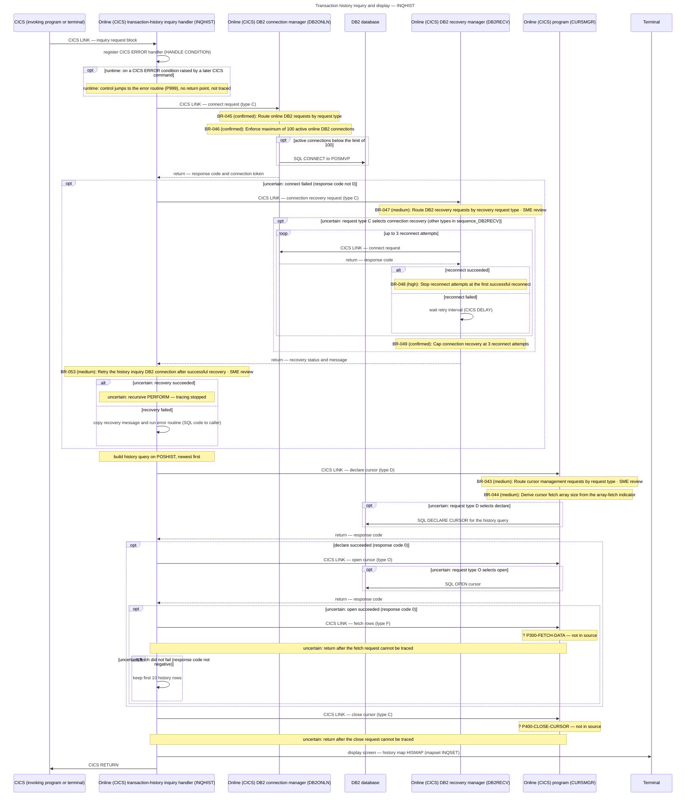

*This diagram shows the messages exchanged when a user asks for transaction history: INQHIST obtains a database connection through DB2ONLN (with recovery through DB2RECV if the connection fails), drives the cursor manager CURSMGR to declare, open, fetch and close the history query, and returns the result screen to the online system. Dotted `runtime:` and `uncertain:` arrows mark the run-time error handler, the recursive connection retry and the request-type branches that have only partial evidence. Diagram file `diagrams/sequence_INQHIST.mmd` (SEQ-INQHIST); rendering not verified (GAP-168).*

**Limitations of Figure 6.1** (from `SEQ-INQHIST.limitations`):

| # | Limitation (plain English) | Class | Gaps |
|---|---|---|---|
| 1 | The error handler INQHIST registers in advance for the online system's general error condition (routine P999, paragraph `SYS-PORTFOLIO-001-FIL-0063-PAR-0012`) is a run-time transfer; it is shown only as a `runtime:` note and its path is not traced. | Unresolved analysis (run-time only) | GAP-169 |
| 2 | After a successful recovery, the connection step calls itself again (a recursive retry); the number of passes depends on run-time results, so nothing is drawn after it on that branch. | Unresolved analysis | GAP-149, GAP-216, GAP-047 |
| 3 | CURSMGR's source file is cut short: its fetch (`P300-FETCH-DATA`) and close (`P400-CLOSE-CURSOR`) paragraphs are not in the source, so the results of the fetch and close requests and the returns after them are unknown. | Source gap | GAP-145, GAP-212 |
| 4 | The request-type dispatch in DB2RECV (BR-047, data name `RECV-CURSOR` ambiguous) and in CURSMGR (BR-043, missing targets) has partial evidence, so the branch each request type selects is drawn as uncertain. | Unresolved analysis | GAP-032, GAP-028, GAP-163 |
| 5 | Two references to the shared inquiry communication area (`INQCOM-ERROR-MSG OF WS-COMMAREA`, `INQCOM-RESPONSE-CODE OF WS-COMMAREA`) are written with an invalid qualification and carry no Field ID; `WS-DB2-TOKEN` is not declared and `SQLCODE` (the database return code supplied by the DB2 precompiler) is unresolved. | Source gap | GAP-010, GAP-011, GAP-117, GAP-310, GAP-211 |
| 6 | INQHIST always sends request type `C` (connection recovery) to DB2RECV, so only DB2RECV's connection-recovery branch is drawn here; DB2RECV's transaction and cursor branches (including its link to ERRHNDL) are shown in Figure 6.2. | Display limit | — |
| 7 | INQHIST's caller INQONLN is drawn as the generic online-system participant, because INQONLN is not an entry point under the discovery rule (see the warning above). | Display limit | — |
| 8 | How the history query's parameter marker (`ACCOUNT_NO = ?`) is bound to a value is not shown in INQHIST (Agent 4 annotation). | Unresolved analysis | GAP-317 |

**Process narrative:**

The history inquiry starts when INQONLN hands control to INQHIST. INQHIST copies the inquiry communication area (the block of data passed between online programs, layout INQCOM) into its own working area, resets its row counter and its "more rows" indicator, and registers its error routine as the handler for the online system's general error condition (*Confirmed* for the registration; what happens when that handler fires is *Uncertain*, run-time only — GAP-169). It then asks the online connection manager DB2ONLN to connect to the database.

DB2ONLN routes each request by its type (BR-045, Confirmed ✓). For a connect request it first checks the active-connection counter against the limit of 100 (BR-046, Confirmed ✓); below the limit it connects to database POSMVP, adds one to the counter, returns response code 0 and builds a connection token from the current date and the counter. Otherwise it returns -1 with the database error details, or the message "Maximum connections reached". Agent 4 notes that nothing visible keeps this counter between separate online tasks (GAP-177, *Uncertain*).

If DB2ONLN does not return 0, INQHIST asks the recovery manager DB2RECV for a connection recovery (request type `C`). DB2RECV routes the request by type (BR-047, Medium ⚠, SME review required — the dispatch evidence is partial). For a connection recovery it makes up to three reconnect attempts (BR-049, Confirmed ✓): each attempt asks DB2ONLN to connect, stops at the first success (BR-048, High ✓), and otherwise marks the recovery for retry, keeps the database error code, waits for the configured retry interval and counts the attempt. After three failed attempts the recovery status is set to failed with response code -1. The interpretation of the failed/retry status values (BR-136) is Low ⚠ — SME review required.

When the recovery succeeds, INQHIST repeats its own connection step (BR-053, Medium ⚠, SME review required). This is a recursive retry — the step calls itself — and the number of repetitions cannot be traced by static analysis because it depends on run-time results; the source contains no retry limit for it (GAP-149, *Uncertain*). When the recovery fails, INQHIST copies DB2RECV's message into its communication area and runs its error routine, which stores the database return code as the response code and copies the working communication area back to the caller. Agent 4 notes that the error routine does not stop processing: history retrieval and display still run afterwards (*Confirmed* as traced; whether this is intended is not stated in the source).

Next, INQHIST builds the history query (transaction-history rows ordered by date, newest first) and drives the cursor manager CURSMGR — a cursor is the database mechanism for reading a query result one row or block of rows at a time — through declare, open, fetch and close requests. CURSMGR routes these by request type (BR-043, Medium ⚠, SME review required); when declaring, it sets the fetch array size to its maximum row count if array fetch is requested, otherwise to one row (BR-044, Medium ⚠; the related single-row indicator value BR-134 is Low ⚠ — SME review required). Because CURSMGR's fetch and close paragraphs are missing from its source file, what those two requests actually do is unknown (GAP-145, *Uncertain*). INQHIST moves the fetched data into a 10-entry history table when the fetch response is not negative.

Finally, INQHIST sends the history screen (map HISMAP of map set INQSET) built from the history table and returns control to the online system. The end of this flow — the results of the fetch and close requests and the behaviour after a recovery or an error — is not fully established (GAP-256).

#### 6.1.2 DB2 connection, transaction and cursor recovery (DB2RECV)

**Entry point:** DB2RECV (online / CICS program; File ID `SYS-PORTFOLIO-001-FIL-0061`), reached by an online link from INQHIST (INQHIST line 108)
**Programs involved:** DB2RECV, DB2ONLN, ERRHNDL (File IDs `SYS-PORTFOLIO-001-FIL-0061`, `SYS-PORTFOLIO-001-FIL-0060`, `SYS-PORTFOLIO-001-FIL-0062`)
**Chain:** DB2RECV → DB2ONLN, or DB2RECV → ERRHNDL → return to the online system (CICS RETURN, statement `SYS-PORTFOLIO-001-FIL-0061-STMT-000002`)
**Diagram status:** complete (`incomplete: false`); all dispatch branches drawn as uncertain

**Business rules applied** (from `rule_annotations`, with placement on the figure):

| Rule | Name | Confidence | SME review | Shown on figure |
|---|---|---|---|---|
| BR-047 | Route DB2 recovery requests by recovery request type | Medium ⚠ | Yes (GAP-032) | Inline note |
| BR-046 | Enforce maximum of 100 active online DB2 connections | Confirmed ✓ | No | Inline note |
| BR-048 | Stop reconnect attempts at the first successful reconnect | High ✓ | No | Inline note |
| BR-049 | Cap connection recovery at 3 reconnect attempts | Confirmed ✓ | No | Inline note |
| BR-051 | Require a trace ID on every logged error | Medium ⚠ | Yes (GAP-042) | Inline note |
| BR-052 | Select error recovery action by error severity | Confirmed ✓ | No | Inline note |
| BR-050 | Handle cursor recovery outcome according to the central error action | Medium ⚠ | Yes (GAP-033) | Inline note |
| BR-135 | Select cursor recovery request type value | Low ⚠ — SME review required | Yes (GAP-034) | Footnote |
| BR-136 | Handle recovery status failed or retry | Low ⚠ — SME review required | Yes (GAP-035) | Footnote |

**Figure 6.2 — DB2 connection, transaction and cursor recovery sequence (DB2RECV)**

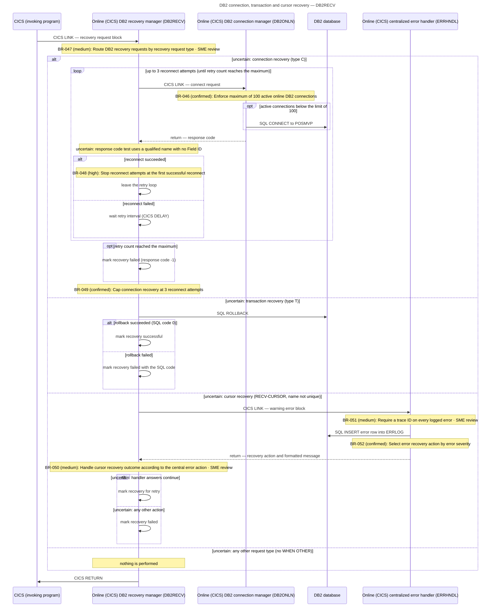

*This diagram shows the three recovery services of DB2RECV: connection recovery (repeated reconnect requests to DB2ONLN, at most three), transaction recovery (undoing the current database work), and cursor recovery (reporting the problem to the central error handler ERRHNDL and acting on its answer). Every dispatch branch is drawn as uncertain because the request-type evidence is partial. Diagram file `diagrams/sequence_DB2RECV.mmd` (SEQ-DB2RECV); rendering not verified (GAP-168).*

**Limitations of Figure 6.2** (from `SEQ-DB2RECV.limitations`):

| # | Limitation (plain English) | Class | Gaps |
|---|---|---|---|
| 1 | The request-type dispatch (BR-047) has partial evidence: the name `RECV-CURSOR` is declared twice (once as a condition name, once as an 18-character field), so it has no Field ID and every dispatch branch is drawn as uncertain. | Source gap | GAP-163, GAP-032 |
| 2 | `DB2-REQUEST-TYPE`, `DB2-RESPONSE-CODE` and `DB2-SQLCODE OF WS-DB2-REQUEST` are written with an invalid qualification and carry no Field ID; `SQLCODE` is supplied by the DB2 precompiler and is unresolved. | Source gap | GAP-007, GAP-008, GAP-009, GAP-306, GAP-211 |
| 3 | DB2RECV's caller is drawn as the generic online-system participant; the inventory's only caller is INQHIST (see Figure 6.1). | Display limit | — |
| 4 | DB2ONLN's internal token generation and ERRHNDL's message formatting are not drawn as separate messages; they make no further program or database calls. | Display limit | — |

**Process narrative:**

DB2RECV is the online database recovery manager. It receives a recovery request block from its caller and routes it by request type (BR-047, Medium ⚠, SME review required, because the data name used to recognise the cursor-recovery type is ambiguous — GAP-163). A request type other than connection, transaction or cursor recovery does nothing. Every path ends by returning control to the online system, and the program reads no files (*Confirmed*).

For a connection recovery (`C`), DB2RECV makes up to three reconnect attempts (BR-049, Confirmed ✓). Each attempt asks DB2ONLN to connect; DB2ONLN applies its own connection limit of 100 (BR-046, Confirmed ✓). DB2RECV marks the recovery successful as soon as DB2ONLN returns response code 0 (BR-048, High ✓); otherwise it marks it for retry, keeps the database error code, waits for the configured retry interval and counts the attempt. After three failed attempts the status becomes failed with response code -1. The failed/retry status values (BR-136) are Low ⚠ — SME review required. Agent 4 notes that the wait command (`EXEC CICS DELAY`) is not in its online-command translation table (GAP-315).

For a transaction recovery (`T`), DB2RECV undoes the current database work (an SQL ROLLBACK) and reports success, or reports failure with the database error code and response code -1 (*Confirmed* as traced).

For a cursor recovery (`R`; the value itself is BR-135, Low ⚠ — SME review required), DB2RECV builds a warning-level error block from the caller's program name, cursor name and database error code and passes it to the central error handler ERRHNDL. ERRHNDL stamps the error with the date and time, creates a trace ID when none was supplied (BR-051, Medium ⚠, SME review required), records the error as a row in the error-log table ERRLOG, reformats the message, and chooses a recovery action from the severity: fatal errors request an abnormal end, warnings and informational errors request continuation, and any other severity requests a return (BR-052, Confirmed ✓). DB2RECV then sets its status to retry when ERRHNDL answers "continue", or to failed otherwise, and returns ERRHNDL's formatted message to its caller (BR-050, Medium ⚠, SME review required).

In the inquiry flow of Figure 6.1 only the connection-recovery branch is used, because INQHIST always sends request type `C`. Because the inventory's only caller of DB2RECV is INQHIST, no traced caller selects the transaction or cursor branches; whether callers outside the repository use them cannot be determined from the source (*Uncertain*).

### 6.2 Per-program process flows

This section gives one compact sub-section for each program, in the order of `logic_artifact.programs`. Each sub-section shows the program type (from `diagrams_artifact.program_types`, with its basis), its permanent File ID, the Logic Agent's tracing status (*success* = fully traced, *partial* = traced with unresolved parts, *empty* = nothing to trace), the business rules implemented by the program (from `rules_artifact.rules_by_program`), a plain-English description drawn from the Agent 4 program narrative, the process flow figure, the rules drawn on the figure (from `rule_annotations[].placement`: *inline* = a note next to the step, *footnote* = listed below the diagram), the diagram's limitations, and the key gaps. Agent 4 records no complexity score, so complexity is shown as `—` and is not estimated. Where a program performs paragraphs that are missing from its source file, the missing paragraphs are named but their behaviour is not described, because the source does not contain it. (A *paragraph* is a named block of code inside a program; one paragraph *performs* another when it runs it as a sub-step and then continues.)

#### BCHCTL00 — Batch control subprogram

**Type:** Batch (batch subprogram; basis: logic entry type) | **File ID:** `SYS-PORTFOLIO-001-FIL-0042` | **Logic status:** partial | **Business rules:** 4 (BR-001, BR-002, BR-129, BR-130) | **Complexity:** — (not computed by Agent 4)

BCHCTL00 is a batch control subprogram that is called with a control request holding a function code, job name, process date, sequence number and return code. It selects one action from the function code (BR-001, Medium ⚠, SME review required): `INIT` selects the initialisation action, `CHEK` the prerequisite check, `UPDT` the status-update action and `TERM` the termination action (the content of these actions is mostly in missing paragraphs, see below); each action also sets an internal processing-mode switch (BR-130, Low ⚠ — SME review required). An unknown function code sets the error text "Invalid function code", return code 8 and calls the shared error routine ERRPROC (*Confirmed*). The program always passes its return code back to the caller.

The delivered source is incomplete. All eleven worker paragraphs that would read and write the indexed batch control file are missing from the source (they are listed only in a "to be implemented" comment), so the actual file reads and writes cannot be traced (*Uncertain*, GAP-144). The prerequisite check returns success (0) when prerequisites are satisfied and a warning (4) otherwise (BR-002, Medium ⚠, SME review required; the "pending" flag value is BR-129, Low ⚠ — SME review required), but nothing in the present source sets the prerequisite flag, so the outcome cannot be determined statically (suspected defect, GAP-173).

**Figure 6.3 — BCHCTL00 process flow**

```mermaid
---
title: BCHCTL00 — process flow
---
flowchart TD
  %% Generated by 6_diagram agent — sequence-builder skill
  %% Program: BCHCTL00 (batch subprogram, logic_status partial) — 6 paragraphs, 4 business rules (none inline)
  %% Edges: solid = confirmed; -.-> runtime:/uncertain: = uncertain; -.-> ? = unsupported

  classDef io         fill:#fef3c7,stroke:#f59e0b,color:#451a03
  classDef terminal   fill:#fee2e2,stroke:#ef4444,color:#450a0a
  classDef runtime    fill:#fff7ed,stroke:#ea580c,color:#431407,stroke-dasharray:4 4
  classDef unresolved fill:#ffffff,stroke:#dc2626,color:#7f1d1d,stroke-dasharray:2 2

  START(["Start — called with batch control request"])
  PARA_0000["Main control"]
  DEC_FUNC{"Function code?"}
  PARA_1000["Process initialize"]:::runtime
  UNRES_1000["? 1100 / 1200 / 1300 / 1400 — not in source"]:::unresolved
  PARA_2000["Check prerequisites"]:::runtime
  UNRES_2000["? 2100 / 2200 — not in source"]:::unresolved
  DEC_PREREQ{"Prerequisites satisfied?"}
  RC_OK["Return code success (0)"]:::runtime
  RC_WARN["Return code warning (4)"]:::runtime
  PARA_3000["Update status"]:::runtime
  UNRES_3000["? 3100 / 3200 / 3300 — not in source"]:::unresolved
  PARA_4000["Process terminate"]:::runtime
  UNRES_4000["? 4100 / 4200 — not in source"]:::unresolved
  PARA_9000["Error routine — invalid function, return code 8"]:::runtime
  CALL_ERRPROC[["Call error processor ERRPROC"]]
  TERMINAL(["Pass return code back — GOBACK"]):::terminal

  START --> PARA_0000
  PARA_0000 --> DEC_FUNC
  DEC_FUNC -.->|uncertain: when 'INIT'| PARA_1000
  DEC_FUNC -.->|uncertain: when 'CHEK'| PARA_2000
  DEC_FUNC -.->|uncertain: when 'UPDT'| PARA_3000
  DEC_FUNC -.->|uncertain: when 'TERM'| PARA_4000
  DEC_FUNC -.->|uncertain: other — invalid code| PARA_9000
  PARA_1000 -.->|? 1100-OPEN-FILES| UNRES_1000
  PARA_1000 -.->|? 1200-READ-CONTROL-RECORD| UNRES_1000
  PARA_1000 -.->|? 1300-VALIDATE-PROCESS| UNRES_1000
  PARA_1000 -.->|? 1400-UPDATE-START-STATUS| UNRES_1000
  PARA_2000 -.->|? 2100-READ-CONTROL-RECORD| UNRES_2000
  PARA_2000 -.->|? 2200-CHECK-DEPENDENCIES| UNRES_2000
  PARA_2000 --> DEC_PREREQ
  DEC_PREREQ -.->|uncertain: yes / true| RC_OK
  DEC_PREREQ -.->|uncertain: no / false| RC_WARN
  PARA_3000 -.->|? 3100-READ-CONTROL-RECORD| UNRES_3000
  PARA_3000 -.->|? 3200-UPDATE-PROCESS-STATUS| UNRES_3000
  PARA_3000 -.->|? 3300-WRITE-CONTROL-RECORD| UNRES_3000
  PARA_4000 -.->|? 4100-UPDATE-COMPLETION| UNRES_4000
  PARA_4000 -.->|? 4200-CLOSE-FILES| UNRES_4000
  PARA_9000 --> CALL_ERRPROC
  PARA_1000 --> TERMINAL
  RC_OK --> TERMINAL
  RC_WARN --> TERMINAL
  PARA_3000 --> TERMINAL
  PARA_4000 --> TERMINAL
  CALL_ERRPROC --> TERMINAL

  %% REVFORGE-ID START file_id=SYS-PORTFOLIO-001-FIL-0042 path_id=SYS-PORTFOLIO-001-PATH-0042
  %% REVFORGE-ID PARA_0000 paragraph_id=SYS-PORTFOLIO-001-FIL-0042-PAR-0001 statement_id=null
  %% REVFORGE-ID DEC_FUNC paragraph_id=SYS-PORTFOLIO-001-FIL-0042-PAR-0001 statement_id=SYS-PORTFOLIO-001-FIL-0042-STMT-000001 field_id=SYS-PORTFOLIO-001-FIL-0042-FLD-000011
  %% REVFORGE-ID PARA_1000 paragraph_id=SYS-PORTFOLIO-001-FIL-0042-PAR-0002 statement_id=SYS-PORTFOLIO-001-FIL-0042-STMT-000022
  %% REVFORGE-ID UNRES_1000 paragraph_id=null statement_id=null
  %% REVFORGE-ID PARA_2000 paragraph_id=SYS-PORTFOLIO-001-FIL-0042-PAR-0003 statement_id=SYS-PORTFOLIO-001-FIL-0042-STMT-000020
  %% REVFORGE-ID UNRES_2000 paragraph_id=null statement_id=null
  %% REVFORGE-ID DEC_PREREQ paragraph_id=SYS-PORTFOLIO-001-FIL-0042-PAR-0003 statement_id=SYS-PORTFOLIO-001-FIL-0042-STMT-000010 field_id=SYS-PORTFOLIO-001-FIL-0042-FLD-000004
  %% REVFORGE-ID RC_OK paragraph_id=SYS-PORTFOLIO-001-FIL-0042-PAR-0003 statement_id=SYS-PORTFOLIO-001-FIL-0042-STMT-000030
  %% REVFORGE-ID RC_WARN paragraph_id=SYS-PORTFOLIO-001-FIL-0042-PAR-0003 statement_id=SYS-PORTFOLIO-001-FIL-0042-STMT-000029
  %% REVFORGE-ID PARA_3000 paragraph_id=SYS-PORTFOLIO-001-FIL-0042-PAR-0004 statement_id=SYS-PORTFOLIO-001-FIL-0042-STMT-000026
  %% REVFORGE-ID UNRES_3000 paragraph_id=null statement_id=null
  %% REVFORGE-ID PARA_4000 paragraph_id=SYS-PORTFOLIO-001-FIL-0042-PAR-0005 statement_id=SYS-PORTFOLIO-001-FIL-0042-STMT-000024
  %% REVFORGE-ID UNRES_4000 paragraph_id=null statement_id=null
  %% REVFORGE-ID PARA_9000 paragraph_id=SYS-PORTFOLIO-001-FIL-0042-PAR-0006 statement_id=SYS-PORTFOLIO-001-FIL-0042-STMT-000028
  %% REVFORGE-ID CALL_ERRPROC paragraph_id=SYS-PORTFOLIO-001-FIL-0042-PAR-0006 statement_id=SYS-PORTFOLIO-001-FIL-0042-STMT-000018
  %% REVFORGE-ID TERMINAL paragraph_id=SYS-PORTFOLIO-001-FIL-0042-PAR-0001 statement_id=SYS-PORTFOLIO-001-FIL-0042-STMT-000003

  %% Unresolvable PERFORM targets (Agent 4 unresolvable_paths, 11): 1100-OPEN-FILES, 1200-READ-CONTROL-RECORD,
  %% 1300-VALIDATE-PROCESS, 1400-UPDATE-START-STATUS, 2100-READ-CONTROL-RECORD, 2200-CHECK-DEPENDENCIES,
  %% 3100-READ-CONTROL-RECORD, 3200-UPDATE-PROCESS-STATUS, 3300-WRITE-CONTROL-RECORD, 4100-UPDATE-COMPLETION, 4200-CLOSE-FILES.
  %% Placeholder nodes are grouped per performing paragraph; they carry no Paragraph ID and no outgoing edges.
  %% Logic Agent warning: the prerequisite flag (WS-PREREQ-MET) is never set by any statement present in the source.

  %% Low-confidence rules not shown inline:
  %% BR-001 (medium): Route batch control requests by function code — see paragraph 0000-MAIN · SME review
  %% BR-002 (medium): Check batch prerequisites are satisfied — see paragraph 2000-CHECK-PREREQUISITES · SME review
  %% ⚠ BR-129 (low): Check batch prerequisites pending value — 88-level definition, no paragraph · SME review
  %% ⚠ BR-130 (low): Select batch control processing mode — 88-level definition, no paragraph · SME review
```

*The figure shows the function-code dispatch of BCHCTL00 to its four actions and the error branch for an unknown code. The eleven missing worker paragraphs appear as four placeholder boxes (one per calling action) reached by dotted `?` arrows. Diagram file `diagrams/flow_BCHCTL00.mmd` (FLOW-BCHCTL00); 17 nodes, 28 edges; rendering not verified (GAP-168).*

**Rules on the figure:** footnote — BR-001, BR-002, BR-129, BR-130 (no inline notes).

**Limitations (diagram incomplete):**

| Limitation (plain English) | Class | Gaps |
|---|---|---|
| Eleven performed paragraphs are not in the source; the batch control file work behind `INIT`, `CHEK`, `UPDT` and `TERM` is unknown. Missing: `1100-OPEN-FILES`, `1200-READ-CONTROL-RECORD`, `1300-VALIDATE-PROCESS`, `1400-UPDATE-START-STATUS`, `2100-READ-CONTROL-RECORD`, `2200-CHECK-DEPENDENCIES`, `3100-READ-CONTROL-RECORD`, `3200-UPDATE-PROCESS-STATUS`, `3300-WRITE-CONTROL-RECORD`, `4100-UPDATE-COMPLETION`, `4200-CLOSE-FILES`. | Source gap | GAP-144, GAP-249 |
| The eleven missing targets are drawn as four grouped placeholder boxes with one dotted `?` arrow per missing call. | Display limit | GAP-249 |
| The prerequisite flag has no initial value and is set by no statement in the source, so the prerequisite outcome cannot be determined. | Source gap | GAP-173 |
| The logic of ERRPROC is not traced in this figure (see the ERRPROC sub-section). | Display limit | — |
| BR-129 and BR-130 are value-set rules attached to no paragraph; they appear in the footnote only. | Display limit | GAP-022, GAP-023 |

**Key gaps:** GAP-020 (BR-001), GAP-021 (BR-002), GAP-022 (BR-129), GAP-023 (BR-130), GAP-144, GAP-173, GAP-249. Copybook-level rule BR-099 (batch control status codes, copybook BCHCTL) is GAP-019.

#### CKPRST — Checkpoint and restart subprogram

**Type:** Batch (batch subprogram; basis: logic entry type) | **File ID:** `SYS-PORTFOLIO-001-FIL-0043` | **Logic status:** partial | **Business rules:** 1 (BR-003) | **Complexity:** — (not computed by Agent 4)

CKPRST is a batch subprogram that receives a checkpoint control block and a return-status block from its caller and then returns. Its only logic is a four-way choice that runs one of four paragraphs — initialise (`PROC-INIT`), take a checkpoint (`PROC-TAKE-CHECKPOINT`), commit a checkpoint (`PROC-COMMIT-CHECKPOINT`) or restart (`PROC-RESTART`) — according to which of four entry-point conditions is true (BR-003, Medium ⚠, SME review required). These condition names are declared nowhere in the repository, so the data item that drives the choice, and its values, are unknown (*Uncertain*, GAP-097 to GAP-100).

All four target paragraphs contain only a comment-like line, so they execute no statements (suspected defect or unfinished code, GAP-174). The program declares an indexed checkpoint file, but no statement opens, reads or writes it, and no error conditions are handled in the source (*Confirmed* as traced). In business terms the program currently performs no checkpoint or restart work.

**Figure 6.4 — CKPRST process flow**

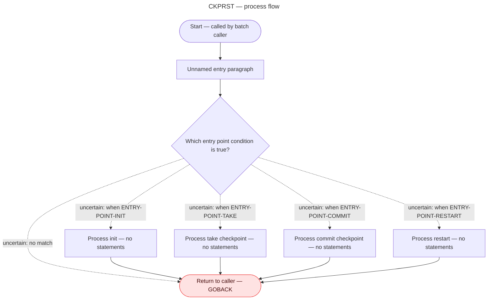

*The figure shows the four-way entry-point choice of CKPRST and the four empty paragraphs it can select, followed by the return to the caller. Branch arrows are dotted (uncertain) because the selecting conditions are not declared. Diagram file `diagrams/flow_CKPRST.mmd` (FLOW-CKPRST); 8 nodes, 11 edges; complete and not truncated; rendering not verified (GAP-168).*

**Rules on the figure:** footnote — BR-003 (no inline notes).

**Limitations (diagram complete, but with partial evidence):**

| Limitation (plain English) | Class | Gaps |
|---|---|---|
| The four entry-point condition names are declared nowhere in the repository, so the branch arrows are drawn as uncertain and the names carry no Field ID. | Source gap | GAP-097, GAP-098, GAP-099, GAP-100 |
| The four target paragraphs contain no executable statements. | Source gap | GAP-174 |
| The checkpoint file is declared but never used, so no file step is drawn. | Source gap | GAP-174 |

**Key gaps:** GAP-024 (BR-003), GAP-097, GAP-098, GAP-099, GAP-100, GAP-174. Copybook-level rules of copybook CKPRST: BR-100 (GAP-025), BR-101 (GAP-026), BR-102 (GAP-027).

#### HISTLD00 — Transaction history load to DB2

**Type:** Batch (batch main program; basis: logic entry type) | **File ID:** `SYS-PORTFOLIO-001-FIL-0044` | **Logic status:** partial | **Business rules:** 2 (BR-004, BR-005) | **Complexity:** — (not computed by Agent 4)

HISTLD00 is a batch program that loads transaction history records into the DB2 table POSHIST. It opens the indexed transaction history file for reading and the batch control file for update, connects to the database, reads the job's own control record (key "HISTLD00") and marks it active. The main loop reads history records one at a time until end of file or until more than 100 load errors have occurred (BR-005, High ✓). For each record it copies 13 transaction fields into the history row and inserts it, counting rows written and errors, and silently skips rows that already exist (duplicate key, database code -803) (*Confirmed* as traced; the field mapping is *Uncertain*, see below).

Every 1000 records it commits the database work, resets the commit counter and rewrites the control record with the read and written counts as a checkpoint (BR-004, Medium ⚠, SME review required). At the end it commits, writes a final checkpoint, closes both files, disconnects from the database, displays the read, written and error counts, and returns the error count as its return code. File open failures, a missing control record and a failed checkpoint rewrite all go to the error routine, which calls ERRPROC and rolls back the database work but does not stop the run (suspected defect, GAP-183). Insert failures go to a database error routine that cannot be traced here.

The database connect, error and disconnect steps (`CONNECT-TO-DB2`, `DB2-ERROR-ROUTINE`, `DISCONNECT-FROM-DB2`) are not paragraphs of this program; they are procedure code held in copybook DBPROC (a shared source file normally used for data definitions) and are not registered for HISTLD00 (GAP-148, GAP-222). The source names of the 13 history fields and of the two checkpoint counters are declared nowhere, so those data movements cannot be fully traced (*Uncertain*, GAP-101 to GAP-116).

**Figure 6.5 — HISTLD00 process flow**

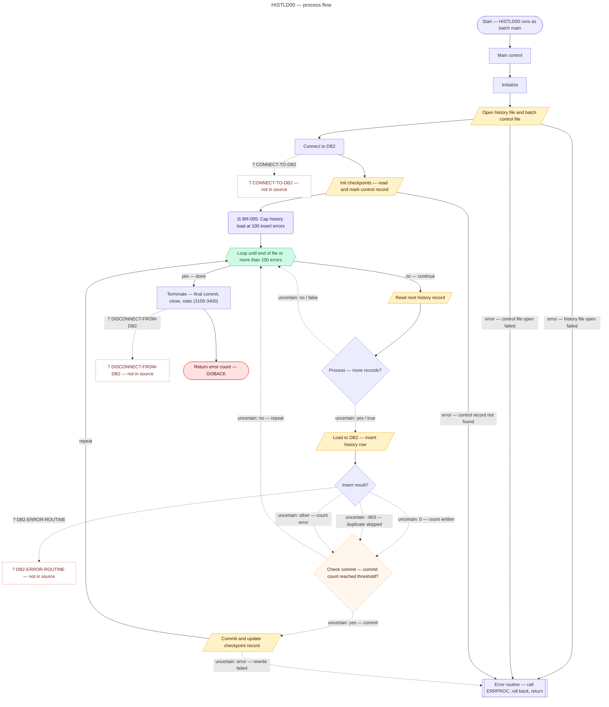

*The figure shows the open-connect-read sequence, the record load loop with its error cap and periodic commit/checkpoint, and the end-of-run steps folded into one "Terminate" box. The three copybook procedure steps appear as `?` placeholders. Diagram file `diagrams/flow_HISTLD00.mmd` (FLOW-HISTLD00); 20 nodes, 27 edges; incomplete and truncated; rendering not verified (GAP-168).*

**Rules on the figure:** inline — BR-005; footnote — BR-004.

**Limitations (diagram incomplete and truncated):**

| Limitation (plain English) | Class | Gaps |
|---|---|---|
| The three performed steps `CONNECT-TO-DB2`, `DB2-ERROR-ROUTINE` and `DISCONNECT-FROM-DB2` are procedure code in copybook DBPROC, not paragraphs of this program; drawn as `?` placeholders. | Source gap | GAP-148, GAP-222, GAP-254 |
| The conditions on "more records", the insert result checks, the commit threshold and the checkpoint rewrite have partial evidence; their outcomes are drawn as uncertain. | Unresolved analysis | GAP-043 |
| Names without a Field ID: `SQLCODE` (precompiler-supplied database return code), the 13 history mapping fields (`TH-*`) and the two checkpoint counters (`BCT-RECORDS-READ`, `BCT-RECORDS-WRITTEN`). | Source gap | GAP-101 to GAP-116, GAP-309, GAP-211 |
| The four end-of-run paragraphs (`3100-FINAL-COMMIT`, `3200-CLOSE-FILES`, `3300-DISCONNECT-DB2`, `3400-DISPLAY-STATS`) are folded into the "Terminate" box, and the final checkpoint call is not drawn. | Display limit | GAP-271 |
| The error routine returns to whichever step called it and does not stop the run; it is drawn without outgoing arrows because its return point depends on the call site. | Display limit | GAP-183 |
| The logic of ERRPROC is not traced in this figure. | Display limit | — |

**Key gaps:** GAP-043 (BR-004), GAP-101 to GAP-116 (undeclared history and checkpoint fields), GAP-148, GAP-183, GAP-254, GAP-271, GAP-309. Related: GAP-222 (copybook DBPROC procedure code); copybook HISTREC rules BR-113 (GAP-044) and BR-114 (GAP-045).

#### POSUPDT — Empty source file (no logic)

**Type:** Unclassified (no entry type; basis: none) | **File ID:** `SYS-PORTFOLIO-001-FIL-0045` | **Logic status:** empty | **Business rules:** 0 | **Complexity:** — (not computed by Agent 4)

POSUPDT has no logic that can be documented. Its source file `src/programs/batch/POSUPDT.cbl` is 1 byte of whitespace: it has no program name, no divisions and no procedure section (the part of a COBOL program that contains executable statements). No execution path, decision, data access or error handling can be described, and the name POSUPDT is taken from the file name in the inventory, not from the program itself (*Confirmed* as a source fact, GAP-001). Whatever business function this member was meant to perform is absent from the BRD.

**Figure 6.6 — POSUPDT process flow (placeholder)**

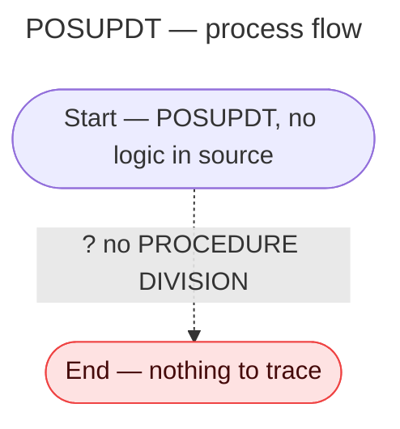

*The figure is a two-box placeholder (start and end) joined by one dotted `?` arrow labelled "no PROCEDURE DIVISION"; the arrow is not backed by any statement. It contains no process content. Diagram file `diagrams/flow_POSUPDT.mmd` (FLOW-POSUPDT); 2 nodes, 1 edge; incomplete; rendering not verified (GAP-168).*

**Rules on the figure:** none.

**Limitations (diagram incomplete):**

| Limitation (plain English) | Class | Gaps |
|---|---|---|
| The source file is 1 byte of whitespace: no program name, no divisions, no paragraphs; the program name is a file-name fallback. | Source gap | GAP-001, GAP-258 |
| No execution traces, decisions, loops or rules exist for this program. | Source gap | GAP-001 |

**Key gaps:** GAP-001 (critical — EMPTY_SOURCE; also recorded as MISSING_PROGRAM_ID), GAP-258.

#### PRCSEQ00 — Batch process run-sequence manager

**Type:** Batch (batch subprogram; basis: logic entry type) | **File ID:** `SYS-PORTFOLIO-001-FIL-0046` | **Logic status:** partial | **Business rules:** 14 (BR-006 to BR-019) | **Complexity:** — (not computed by Agent 4)

PRCSEQ00 is a batch subprogram that manages the run sequence of batch processes for a processing date. The caller selects one function per call (BR-006, Confirmed ✓). `INIT` opens the process sequence file and the batch control file, positions the sequence file at the processing date, loads every sequence record of the requested sequence type into an in-memory process table with status READY (BR-008, High ✓), and writes one batch control record per entry. `NEXT` finds the first READY entry in the table (BR-009, High ✓), reads its process definition and checks each of its dependencies' batch control records, stopping at the first failing dependency (BR-011, Medium ⚠, SME review required). A hard dependency that has not completed sets a warning return code (BR-012, BR-013, Medium ⚠, SME review required); a completed dependency whose return code exceeds the allowed maximum sets an error return code (BR-014, Medium ⚠, SME review required). Only if the return code is still zero is the process marked ACTIVE with a start time and its control record rewritten (BR-007, Medium ⚠); when no process is ready, none is returned (BR-010, Medium ⚠).

`STAT` reads the control record of the requested process, copies its status and return code into the table (BR-015, Low ⚠ — SME review required) and counts active and failed entries (BR-016, BR-017, Medium ⚠). `TERM` recounts and returns an error code if any entry is in error (BR-018, Medium ⚠), a warning if any is still active (BR-019, Medium ⚠), otherwise success, and closes both files. Invalid function codes, open and close failures and record-key failures each set an error text and run the error routine, which sets the error return code and calls ERRPROC; processing then continues (*Confirmed* as traced). The subscript used to step through dependencies (`WS-SUB`) is declared nowhere (GAP-124), the table position is not checked against the 100-entry table limit (GAP-197), and the sequence read loop repeats if a read fails with a status other than end of file (GAP-198) — all *Uncertain* suspected defects.

**Figure 6.7 — PRCSEQ00 process flow**

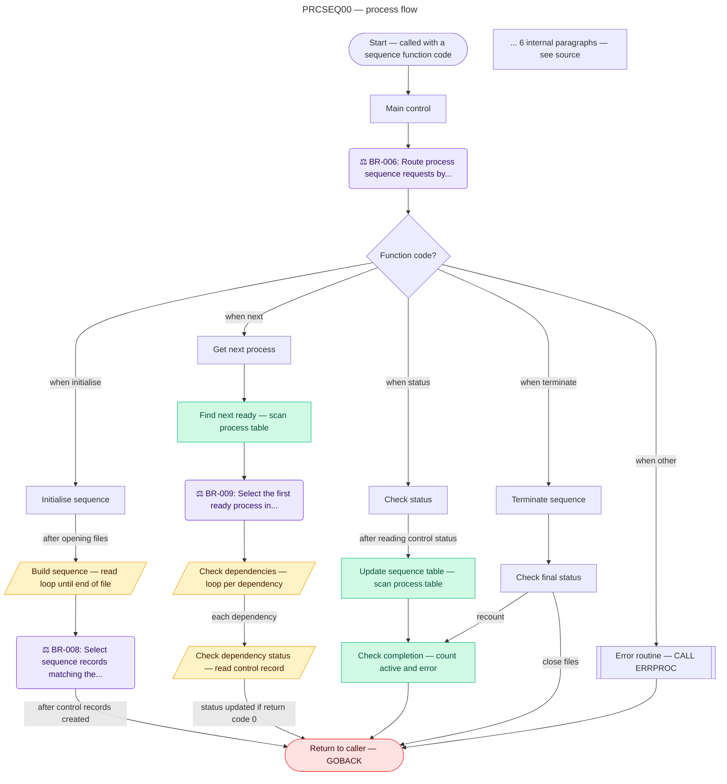

*The figure shows the four-function dispatch of PRCSEQ00 and the main steps of initialisation, next-process selection with dependency checks, status refresh and termination. Six working paragraphs are shown together as one summary box. Diagram file `diagrams/flow_PRCSEQ00.mmd` (FLOW-PRCSEQ00); 20 nodes, 23 edges; complete but truncated; rendering not verified (GAP-168).*

**Rules on the figure:** inline — BR-006, BR-008, BR-009; footnote — BR-007, BR-010, BR-011, BR-012, BR-013, BR-014, BR-015, BR-016, BR-017, BR-018, BR-019.

**Limitations (diagram truncated):**

| Limitation (plain English) | Class | Gaps |
|---|---|---|
| To stay within the 20-box limit, six paragraphs (`1100-OPEN-FILES`, `1210-ADD-TO-SEQUENCE`, `1300-CREATE-CONTROL-RECORDS`, `2300-UPDATE-PROCESS-STATUS`, `3100-READ-CONTROL-STATUS`, `4200-CLOSE-FILES`) are shown as one summary box. These paragraphs are present in the source and traced. | Display limit | GAP-275 |
| Internal decisions, record-key failure branches and the six loops are summarised in box labels; calls to the error routine from those branches are not drawn. | Display limit | GAP-275 |
| Return arrows are drawn once per paragraph: `3300-CHECK-COMPLETION` returns to `4100-CHECK-FINAL-STATUS` on the termination path although its drawn exit goes to the end box. | Display limit | GAP-275 |
| `WS-SUB` is unresolved and `WS-PROC-IX` is a table index name; neither has a Field ID. | Source gap (WS-SUB) | GAP-124 |
| The conditions of BR-011 to BR-014 have partial evidence; these rules are in the footnote only. | Unresolved analysis | GAP-074, GAP-075, GAP-076, GAP-077 |

**Key gaps:** GAP-074 (BR-011), GAP-075 (BR-012), GAP-076 (BR-013), GAP-077 (BR-014), GAP-078 (BR-015), GAP-124, GAP-197, GAP-198, GAP-234, GAP-275, GAP-292 (BR-007), GAP-293 (BR-010), GAP-294 (BR-016), GAP-295 (BR-017), GAP-296 (BR-018), GAP-297 (BR-019). Copybook PRCSEQ rules BR-103 to BR-109: GAP-067 to GAP-073.

#### RCVPRC00 — Batch process recovery

**Type:** Batch (batch subprogram; basis: logic entry type) | **File ID:** `SYS-PORTFOLIO-001-FIL-0047` | **Logic status:** success | **Business rules:** 11 (BR-020 to BR-029, BR-131) | **Complexity:** — (not computed by Agent 4)

RCVPRC00 is a batch subprogram that recovers batch processes recorded in the batch control file. The caller selects one function per call (BR-020, Confirmed ✓). `INIT` opens the batch control file for update and the process sequence file for reading, checks that a processing date is present (BR-022, High ✓) and that the recovery type is `P` (one process), `S` (all processes of the date) or `A` (all processes) (BR-023, Confirmed ✓), and stores the recovery mode; a process ID is required for single-process recovery (BR-024, Confirmed ✓). The naming of the sequence and all-process modes is BR-131 (Low ⚠ — SME review required).

`RECV` runs the selected recovery (BR-021, Confirmed ✓). For one process it reads the control record and the process definition. It restarts the process when its definition is restartable — status READY, restart count plus one, attempt timestamp (BR-025, Confirmed ✓); it terminates the process when the restart count exceeds the maximum of 3 — status ERROR with an error return code (BR-026, Confirmed ✓); otherwise it bypasses it — status DONE with a warning return code — and rewrites the control record (BR-027, Confirmed ✓). Sequence and all-process recovery scan the control file from the start and apply the same process recovery to each record read; sequence mode only takes records of the processing date (BR-028, High ✓). Agent 4 warns that the nested keyed read and rewrite inside these scans can change the scan's position and loop condition (suspected defect, *Uncertain*, GAP-199).

`TERM` logs a completion message through ERRPROC — "Recovery completed successfully" when the return code is zero, otherwise "Recovery completed with errors" (BR-029, Medium ⚠) — and closes both files. Invalid function codes, a missing date, an invalid recovery type, a missing process ID, open and close failures and record-key failures each run the error routine, which sets the error return code and calls ERRPROC; processing then continues (*Confirmed* as traced).

**Figure 6.8 — RCVPRC00 process flow**

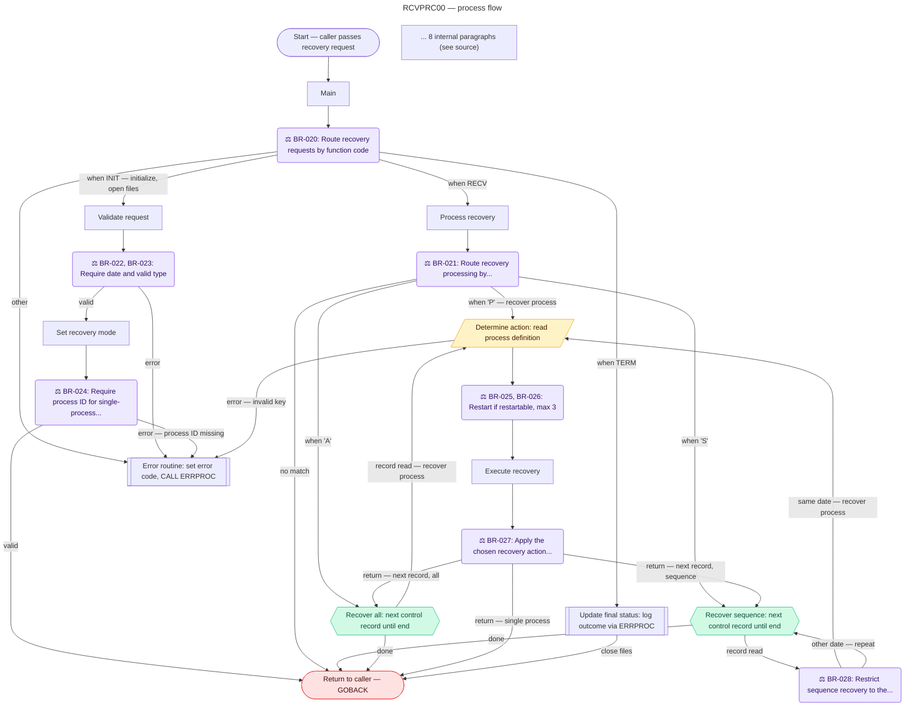

*The figure shows the three-function dispatch, request validation, the single-process restart / terminate / bypass decision and the sequence and all-process scan loops. Eight internal paragraphs are shown together as one summary box. Diagram file `diagrams/flow_RCVPRC00.mmd` (FLOW-RCVPRC00); 20 nodes, 31 edges; complete but truncated; rendering not verified (GAP-168).*

**Rules on the figure:** inline — BR-020, BR-021, BR-022, BR-023, BR-024, BR-025, BR-026, BR-027, BR-028 (BR-022/BR-023 and BR-025/BR-026 share one note each); footnote — BR-029, BR-131.

**Limitations (diagram truncated):**

| Limitation (plain English) | Class | Gaps |
|---|---|---|
| To stay within the 20-box limit, eight internal paragraphs (1000, 1100, 2100, 2121, 2122, 2123, 3000, 3200) are shown as one summary box; arrows through it are labelled with what the hidden step does. These paragraphs are present in the source and traced. | Display limit | GAP-276 |
| Error-routine calls from the summarised paragraphs (open, keyed read, rewrite, close) are not drawn as separate arrows, and the error routine's return arrows are not drawn. | Display limit | GAP-276 |
| The loop-back arrows to the scan loops represent returns from a performed range and carry no Statement ID. | Display limit | GAP-276 |
| Nested keyed read / rewrite inside the sequential scans can change the loop condition and file position (Agent 4 warning, SME review). | Unresolved analysis | GAP-199 |

**Key gaps:** GAP-079 (BR-131), GAP-199, GAP-235 (non-standard time-stamp request), GAP-276, GAP-298 (BR-029).

#### RPTAUD00 — System audit report

**Type:** Batch (batch main program; basis: logic entry type) | **File ID:** `SYS-PORTFOLIO-001-FIL-0048` | **Logic status:** partial | **Business rules:** 0 | **Complexity:** — (not computed by Agent 4)

RPTAUD00 is a batch audit report generator. It opens the indexed audit file (DD name AUDITLOG — the name under which the batch job assigns the physical file) and error file (DD name ERRLOG) for reading and the report file (DD name RPTFILE) for writing; if any open fails it displays an error message, sets return code 12 and ends (*Confirmed* for the open sequence; the three open-status outcomes are drawn as uncertain because their conditions have partial evidence). It then writes three header lines: a line of asterisks, the title "SYSTEM AUDIT REPORT" and "REPORT DATE:" with the system date. Finally it closes the three files and returns.

The body of the report is not in the source. The audit-trail processing, error-log processing and summary writing are delegated to seven paragraphs that are missing from the source file — `2110-READ-AUDIT-RECORDS`, `2120-SUMMARIZE-AUDIT`, `2210-READ-ERROR-RECORDS`, `2220-SUMMARIZE-ERRORS`, `2310-WRITE-AUDIT-SUMMARY`, `2320-WRITE-ERROR-SUMMARY` and `2330-WRITE-CONTROL-SUMMARY` — so what the report contains cannot be traced (*Uncertain*, GAP-150). The error-message field and the record layouts (file descriptions) of the audit and error files are also not declared (GAP-127, GAP-236). No business rules are recorded for this program.

**Figure 6.9 — RPTAUD00 process flow**

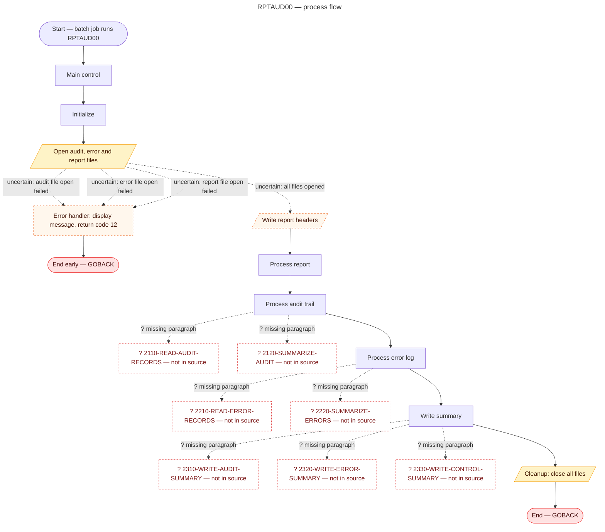

*The figure shows the open-and-check step with its three error exits, the header writing, the calls to the audit, error and summary sections, and the closing step. The seven missing paragraphs appear as placeholders reached by dotted `?` arrows. Diagram file `diagrams/flow_RPTAUD00.mmd` (FLOW-RPTAUD00); 20 nodes, 21 edges; incomplete; rendering not verified (GAP-168).*

**Rules on the figure:** none (no rules are recorded for RPTAUD00 in `rules_artifact.json`).

**Limitations (diagram incomplete):**

| Limitation (plain English) | Class | Gaps |
|---|---|---|
| Seven performed paragraphs (2110, 2120, 2210, 2220, 2310, 2320, 2330, named above) are not in the source; reading and summarising audit and error records and all summary output are drawn only as unsupported placeholders. | Source gap | GAP-150, GAP-259 |
| The error-message field `WS-ERROR-MESSAGE` is declared nowhere; it is shown by description only, with no Field ID. | Source gap | GAP-127 |
| The audit and error files have file-selection entries but no record layout in the source; their record keys `AUD-KEY` and `ERR-KEY` are declared nowhere. | Source gap | GAP-236, GAP-125, GAP-126, GAP-224 |
| To stay within 20 boxes, the three open/status checks are drawn as three labelled error arrows from one box rather than as separate decisions; their outcomes are uncertain (conditions with partial evidence). | Display limit | GAP-259 |

**Key gaps:** GAP-125, GAP-126, GAP-127, GAP-150, GAP-236, GAP-259. Related system-wide: GAP-224 (files without record layouts).

#### RPTPOS00 — Daily position report

**Type:** Batch (batch main program; basis: logic entry type) | **File ID:** `SYS-PORTFOLIO-001-FIL-0049` | **Logic status:** partial | **Business rules:** 0 | **Complexity:** — (not computed by Agent 4)

RPTPOS00 is a batch program that produces the daily position report. It opens the position master file and the transaction history file for reading and the report file for writing, writes three header lines (a line of asterisks, the title "DAILY POSITION REPORT" and the system date), and then reads the position master file record by record until end of file. For each position it moves the portfolio ID, description, quantity and current value into a detail line, computes the percentage change between the current and previous value, and writes the detail line (*Confirmed* as traced; several of the fields involved are not declared, see below). Agent 4 flags a possible division by zero in the percentage-change calculation and notes that the read status is not checked beyond end of file (suspected defects, GAP-200, GAP-201).

It then calls the transaction-activity and summary steps `2210-READ-TRANSACTIONS`, `2220-SUMMARIZE-ACTIVITY`, `2310-WRITE-TOTALS`, `2320-WRITE-EXCEPTIONS` and `2330-WRITE-METRICS`, but none of these paragraphs is in the source, so that part of the report is unknown (*Uncertain*, GAP-151). The transaction history file is opened and closed but never read in the traceable code. A failed open of any file displays an error message, sets return code 12 and ends the program. No business rules are recorded for this program.

**Figure 6.10 — RPTPOS00 process flow**

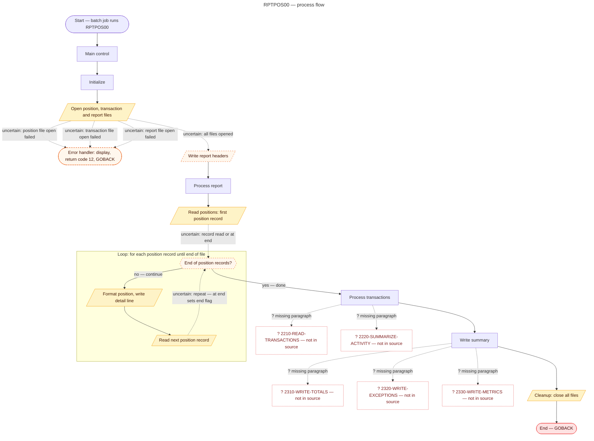

*The figure shows the open-and-check step, the headers, the position read loop with the detail-line calculation, the calls to the missing transaction and summary steps, and the closing step. The five missing paragraphs appear as placeholders reached by dotted `?` arrows. Diagram file `diagrams/flow_RPTPOS00.mmd` (FLOW-RPTPOS00); 20 nodes, 22 edges; incomplete; rendering not verified (GAP-168).*

**Rules on the figure:** none (no rules are recorded for RPTPOS00 in `rules_artifact.json`).

**Limitations (diagram incomplete):**

| Limitation (plain English) | Class | Gaps |
|---|---|---|
| Five performed paragraphs (2210, 2220, 2310, 2320, 2330, named above) are not in the source; the transaction-activity and summary sections are drawn only as unsupported placeholders. | Source gap | GAP-151, GAP-260 |
| Names without a Field ID: the loop flag `END-OF-POSITIONS` (undeclared), `WS-ERROR-MESSAGE`, `POS-DESCRIPTION`, `POS-CURRENT-VALUE`, `POS-PREVIOUS-VALUE`. | Source gap | GAP-128, GAP-129, GAP-130, GAP-131, GAP-132 |
| The position master file has no record layout of its own (the shared POSREC layout precedes any file description); the read status is not checked beyond end of file. | Source gap | GAP-237, GAP-201 |
| To stay within 20 boxes, the three open/status checks are drawn as labelled arrows and the error handler's display / return-code / end steps are one end box. | Display limit | GAP-260 |
| The three open-status checks and both end-of-file checks have partial evidence; their outcomes are drawn as uncertain. | Unresolved analysis | GAP-260 |

**Key gaps:** GAP-128, GAP-129, GAP-130, GAP-131, GAP-132, GAP-151, GAP-200, GAP-201, GAP-237, GAP-260. Related: copybook POSREC rule BR-117 (GAP-066).

#### RPTSTA00 — System statistics and performance report

**Type:** Batch (batch main program; basis: logic entry type) | **File ID:** `SYS-PORTFOLIO-001-FIL-0050` | **Logic status:** partial | **Business rules:** 0 | **Complexity:** — (not computed by Agent 4)

RPTSTA00 is a batch program that is meant to produce the system statistics and performance report. It opens the DB2 statistics file and the batch statistics file for reading and the report file for writing, writes three header lines (asterisks, the title "SYSTEM STATISTICS AND PERFORMANCE REPORT" and the system date) and clears its performance totals. It then reads each statistics file to end of file, calling an accumulation step for each record, and afterwards calls metric-calculation and report-writing steps. A failed open displays an error message, sets return code 12 and ends the program (*Confirmed* as traced). The read status of both files is not checked (suspected defect, GAP-202).

None of the seven called steps exists in the source — `2110-ACCUMULATE-DB2-STATS`, `2210-ACCUMULATE-BATCH-STATS`, `2310-CALC-DB2-METRICS`, `2320-CALC-BATCH-METRICS`, `2410-WRITE-DB2-SECTION`, `2420-WRITE-BATCH-SECTION` and `2430-WRITE-TREND-ANALYSIS` — so what is accumulated, calculated and written is unknown (*Uncertain*, GAP-152). The record layouts of the two statistics files are also incomplete: the program copies `DB2STAT`, which exists in the repository only as a program, not as a shared data definition (critical, GAP-005). No business rules are recorded for this program.

**Figure 6.11 — RPTSTA00 process flow**

```mermaid
---
title: RPTSTA00 — process flow
---
flowchart TD
  %% Generated by 6_diagram agent — sequence-builder skill
  %% Program: RPTSTA00 (batch) — 12 paragraphs, 0 business rules
  %% Logic status: partial — 7 PERFORM targets are not in the source (Agent 4 unresolvable_paths)
  %% Size management: missing targets of 2300 and 2400 are grouped into one placeholder node each
  %% Edges: solid = confirmed; -.-> runtime:/uncertain: = uncertain; -.-> ? = unsupported
  %% REVFORGE-ID FILE file_id=SYS-PORTFOLIO-001-FIL-0050 path_id=SYS-PORTFOLIO-001-PATH-0050

  classDef io         fill:#fef3c7,stroke:#f59e0b,color:#451a03
  classDef terminal   fill:#fee2e2,stroke:#ef4444,color:#450a0a
  classDef loop       fill:#d1fae5,stroke:#10b981,color:#064e3b
  classDef unresolved fill:#ffffff,stroke:#dc2626,color:#7f1d1d,stroke-dasharray:2 2

  START(["Start — batch run"])
  PARA_0000["Main"]
  PARA_1000["Initialize"]
  PARA_1100[/"Open DB2 stats, batch stats and report files"/]:::io
  PARA_9999(["Error handler: display, return code 12, GOBACK"]):::terminal
  PARA_1200[/"Write report headers"/]:::io
  PARA_1300["Initialize accumulators"]
  PARA_2000["Process report"]
  PARA_2100[/"Process DB2 stats: read first record"/]:::io
  LOOP_DB2{{"End of DB2 stats?"}}:::loop
  MISS_2110["? 2110-ACCUMULATE-DB2-STATS — not in source"]:::unresolved
  PARA_2200[/"Process batch stats: read first record"/]:::io
  LOOP_BCH{{"End of batch stats?"}}:::loop
  MISS_2210["? 2210-ACCUMULATE-BATCH-STATS — not in source"]:::unresolved
  PARA_2300["Calculate metrics"]
  MISS_23XX["? 2310-CALC-DB2-METRICS, 2320-CALC-BATCH-METRICS — not in source"]:::unresolved
  PARA_2400["Write report"]
  MISS_24XX["? 2410-WRITE-DB2-SECTION, 2420-WRITE-BATCH-SECTION, 2430-WRITE-TREND-ANALYSIS — not in source"]:::unresolved
  PARA_3000["Cleanup: close files"]
  TERMINAL(["End of run — GOBACK"]):::terminal

  %% REVFORGE-ID START paragraph_id=null statement_id=null
  %% REVFORGE-ID PARA_0000 paragraph_id=SYS-PORTFOLIO-001-FIL-0050-PAR-0001 statement_id=null
  %% REVFORGE-ID PARA_1000 paragraph_id=SYS-PORTFOLIO-001-FIL-0050-PAR-0002 statement_id=SYS-PORTFOLIO-001-FIL-0050-STMT-000001
  %% REVFORGE-ID PARA_1100 paragraph_id=SYS-PORTFOLIO-001-FIL-0050-PAR-0003 statement_id=SYS-PORTFOLIO-001-FIL-0050-STMT-000005
  %% REVFORGE-ID PARA_9999 paragraph_id=SYS-PORTFOLIO-001-FIL-0050-PAR-0012 statement_id=SYS-PORTFOLIO-001-FIL-0050-STMT-000037
  %% REVFORGE-ID PARA_1200 paragraph_id=SYS-PORTFOLIO-001-FIL-0050-PAR-0004 statement_id=SYS-PORTFOLIO-001-FIL-0050-STMT-000006
  %% REVFORGE-ID PARA_1300 paragraph_id=SYS-PORTFOLIO-001-FIL-0050-PAR-0005 statement_id=SYS-PORTFOLIO-001-FIL-0050-STMT-000007
  %% REVFORGE-ID PARA_2000 paragraph_id=SYS-PORTFOLIO-001-FIL-0050-PAR-0006 statement_id=SYS-PORTFOLIO-001-FIL-0050-STMT-000002
  %% REVFORGE-ID PARA_2100 paragraph_id=SYS-PORTFOLIO-001-FIL-0050-PAR-0007 statement_id=SYS-PORTFOLIO-001-FIL-0050-STMT-000019
  %% REVFORGE-ID LOOP_DB2 paragraph_id=SYS-PORTFOLIO-001-FIL-0050-PAR-0007 statement_id=SYS-PORTFOLIO-001-FIL-0050-STMT-000024 field_id=null (END-OF-DB2-STATS unresolved)
  %% REVFORGE-ID MISS_2110 paragraph_id=null statement_id=SYS-PORTFOLIO-001-FIL-0050-STMT-000043
  %% REVFORGE-ID PARA_2200 paragraph_id=SYS-PORTFOLIO-001-FIL-0050-PAR-0008 statement_id=SYS-PORTFOLIO-001-FIL-0050-STMT-000020
  %% REVFORGE-ID LOOP_BCH paragraph_id=SYS-PORTFOLIO-001-FIL-0050-PAR-0008 statement_id=SYS-PORTFOLIO-001-FIL-0050-STMT-000026 field_id=null (END-OF-BATCH-STATS unresolved)
  %% REVFORGE-ID MISS_2210 paragraph_id=null statement_id=SYS-PORTFOLIO-001-FIL-0050-STMT-000046
  %% REVFORGE-ID PARA_2300 paragraph_id=SYS-PORTFOLIO-001-FIL-0050-PAR-0009 statement_id=SYS-PORTFOLIO-001-FIL-0050-STMT-000021
  %% REVFORGE-ID MISS_23XX paragraph_id=null statement_id=SYS-PORTFOLIO-001-FIL-0050-STMT-000027,SYS-PORTFOLIO-001-FIL-0050-STMT-000028
  %% REVFORGE-ID PARA_2400 paragraph_id=SYS-PORTFOLIO-001-FIL-0050-PAR-0010 statement_id=SYS-PORTFOLIO-001-FIL-0050-STMT-000022
  %% REVFORGE-ID MISS_24XX paragraph_id=null statement_id=SYS-PORTFOLIO-001-FIL-0050-STMT-000029,SYS-PORTFOLIO-001-FIL-0050-STMT-000030,SYS-PORTFOLIO-001-FIL-0050-STMT-000031
  %% REVFORGE-ID PARA_3000 paragraph_id=SYS-PORTFOLIO-001-FIL-0050-PAR-0011 statement_id=SYS-PORTFOLIO-001-FIL-0050-STMT-000003
  %% REVFORGE-ID TERMINAL paragraph_id=SYS-PORTFOLIO-001-FIL-0050-PAR-0001 statement_id=SYS-PORTFOLIO-001-FIL-0050-STMT-000004

  START --> PARA_0000
  PARA_0000 --> PARA_1000
  PARA_1000 --> PARA_1100
  PARA_1100 -->|error| PARA_9999
  PARA_1100 --> PARA_1200
  PARA_1200 --> PARA_1300
  PARA_1300 --> PARA_2000
  PARA_2000 --> PARA_2100
  PARA_2100 --> LOOP_DB2
  LOOP_DB2 -.->|? no — continue| MISS_2110
  LOOP_DB2 -->|yes — done| PARA_2200
  PARA_2200 --> LOOP_BCH
  LOOP_BCH -.->|? no — continue| MISS_2210
  LOOP_BCH -->|yes — done| PARA_2300
  PARA_2300 -.->|? perform| MISS_23XX
  PARA_2300 --> PARA_2400
  PARA_2400 -.->|? perform| MISS_24XX
  PARA_2400 --> PARA_3000
  PARA_3000 --> TERMINAL

  %% PARA_1100 error edge: any of three OPEN status checks (STMT-000009, -000011, -000013) performs 9999-ERROR-HANDLER (STMT-000037, -000039, -000041), which ends with GOBACK without closing files.
  %% Each read loop body performs a missing paragraph and then reads the next record (STMT-000044, STMT-000047); the loop-back is not drawn because placeholder nodes have no outgoing edges.
  %% Unresolved names (no Field ID): END-OF-DB2-STATS, END-OF-BATCH-STATS (loop conditions), WS-ERROR-MESSAGE. COPY DB2STAT is unresolved.
  %% No business rules are recorded for this program in rules_artifact.json.
```

*The figure shows the open step with one combined error exit, the headers, the two statistics read loops and the calls to the missing accumulation, calculation and report-writing steps, which appear as grouped placeholders reached by dotted `?` arrows. Diagram file `diagrams/flow_RPTSTA00.mmd` (FLOW-RPTSTA00); 20 nodes, 19 edges; incomplete; rendering not verified (GAP-168).*

**Rules on the figure:** none (no rules are recorded for RPTSTA00 in `rules_artifact.json`).

**Limitations (diagram incomplete — "contains unsupported edges to PERFORM targets that are not in the source; loop bodies after them are omitted"):**

| Limitation (plain English) | Class | Gaps |
|---|---|---|
| Seven performed paragraphs (named above) do not exist in the source; accumulation, metric calculation and report-section writing cannot be drawn. They are shown as placeholders without Paragraph IDs. | Source gap | GAP-152, GAP-261 |
| To stay within 20 boxes, the 2310/2320 and 2410/2420/2430 targets are grouped into one placeholder each, and the three open-status checks are drawn as one error arrow. | Display limit | GAP-261 |
| The read-loop bodies (the next read of each file) are not drawn; placeholder boxes have no outgoing arrows. | Display limit | GAP-261 |
| Names without a Field ID: `END-OF-DB2-STATS`, `END-OF-BATCH-STATS`, `WS-ERROR-MESSAGE`; the copy of `DB2STAT` is unresolved; the record keys `STAT-KEY` and `BCH-KEY` are declared nowhere and the two statistics files have no record layout. | Source gap | GAP-133, GAP-134, GAP-135, GAP-136, GAP-137, GAP-005, GAP-238 |
| Placeholder labels for grouped missing targets exceed the 50-character label guideline so that all target names stay visible. | Display limit | — |

**Key gaps:** GAP-005 (critical), GAP-133, GAP-134, GAP-135, GAP-136, GAP-137, GAP-152, GAP-202, GAP-238, GAP-261.

#### RTNANA00 — Return code analysis report

**Type:** Batch (batch main program; basis: logic entry type) | **File ID:** `SYS-PORTFOLIO-001-FIL-0051` | **Logic status:** partial | **Business rules:** 0 | **Complexity:** — (not computed by Agent 4)

RTNANA00 is a batch database program that produces the return code analysis report. It captures the current date and time, opens the report file (ending with return code 12 if the open fails) and clears its counters. It then opens a database query (cursor `PRGCUR`) over the table RTNCODES that returns, per program and in program order, the total row count and the counts of status codes `S`, `W`, `E` and `F` (*Confirmed* as traced). After writing the report headers (title, report date and time, column headings) it reads the query results until the database signals "no more rows" (code 100); for each row it writes a detail line — program, total, success, warning, error, severe — and adds the counts to running totals. It then closes the query, writes a TOTALS line between separator lines, closes the report file and returns.

Database errors are not checked: a database code other than 0 or 100 while reading the results would keep the read loop running, and there is no error exit (suspected defect, *Uncertain*, GAP-203). No business rules are recorded for this program.

> ⚠ This program contains 0 GO TO statements and 6 PERFORM THRU constructs (a PERFORM THRU runs a range of consecutive paragraphs rather than a single one, which obscures the control flow). Some execution paths may not be fully captured in this diagram. See GAP-219 in Chapter 9.

**Figure 6.12 — RTNANA00 process flow**

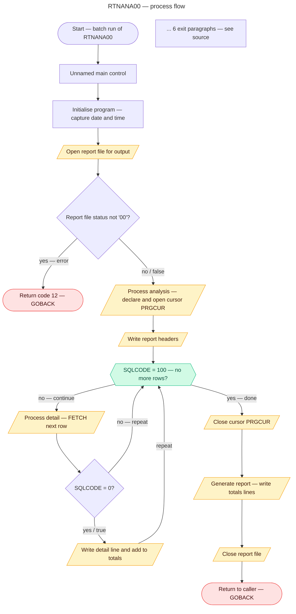

*The figure shows the initialisation, the opening of the analysis query, the header writing, the row-by-row read loop with its detail and totals logic, and the closing steps. The six range-end paragraphs, which contain only an exit statement, are shown together as one summary box. Diagram file `diagrams/flow_RTNANA00.mmd` (FLOW-RTNANA00); 17 nodes, 17 edges; complete but truncated; rendering not verified (GAP-168).*

**Rules on the figure:** none (no rules are recorded for RTNANA00 in `rules_artifact.json`).

**Limitations (diagram truncated):**

| Limitation (plain English) | Class | Gaps |
|---|---|---|
| The six exit-only paragraphs that end the PERFORM THRU ranges are shown as one summary box (they contain only an exit statement). | Display limit | GAP-277 |
| `SQLCODE` is a database return-code item supplied by the DB2 precompiler and has no Field ID. | Source gap | GAP-311, GAP-211 |
| Loop-termination risk (Agent 4): a database code other than 100 during the read keeps the loop running; it is drawn as the "no repeat" arrow because no database error exit exists. | Unresolved analysis | GAP-203 |

**Key gaps:** GAP-203, GAP-219, GAP-277, GAP-311, GAP-320 (query text summarised in the pseudocode).

#### RTNCDE00 — Standard return-code handler

**Type:** Batch (batch subprogram; basis: logic entry type) | **File ID:** `SYS-PORTFOLIO-001-FIL-0052` | **Logic status:** partial | **Business rules:** 3 (BR-030, BR-031, BR-032) | **Complexity:** — (not computed by Agent 4)

RTNCDE00 is a standard return-code handler subprogram. The caller passes a request area holding the shared return-code record (layout RTNCODE), and the request type selects one function (BR-030, Confirmed ✓). `I` initialises the codes area (current and highest code 0, status success, response 0). `S` records a new code, keeps the highest code seen so far (BR-031, High ✓) and classifies the code as success (0), warning (1–4), error (5–8) or severe (any other value) (BR-032, Confirmed ✓). `G` copies the current code, highest code and status back to the caller. `L` inserts a row with the current timestamp, program ID, codes, status and message into the database table RTNCODES, and `A` reads the count, maximum and minimum return code for the program between a start and an end time from the same table.

Both database functions set response code 0 when the database reports success and 8 otherwise; the other functions set response code 0. An unrecognised request type does nothing and returns (*Confirmed* as traced).

> ⚠ This program contains 0 GO TO statements and 5 PERFORM THRU constructs (each function is run as a range ending in an exit-only paragraph). Some execution paths may not be fully captured in this diagram. See GAP-220 in Chapter 9.

**Figure 6.13 — RTNCDE00 process flow**

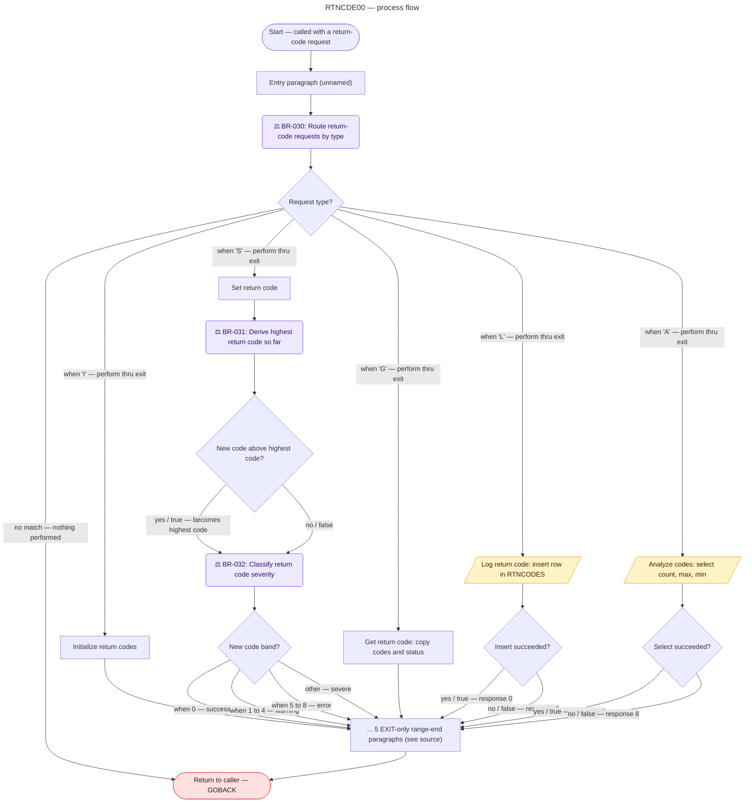

*The figure shows the five-way request-type dispatch, the code classification bands and the two database functions with their success / failure outcomes. The five exit-only range-end paragraphs are shown together as one summary box. Diagram file `diagrams/flow_RTNCDE00.mmd` (FLOW-RTNCDE00); 17 nodes, 27 edges; complete but truncated; rendering not verified (GAP-168).*

**Rules on the figure:** inline — BR-030, BR-031, BR-032 (no footnotes).

**Limitations (diagram truncated):**

| Limitation (plain English) | Class | Gaps |
|---|---|---|
| `SQLCODE` (the database return code supplied by the DB2 precompiler) has no Field ID, so the two database status decisions carry no Field ID. | Source gap | GAP-312, GAP-211 |
| The five exit-only paragraphs that end the PERFORM THRU ranges are shown as one summary box to stay within 20 boxes. | Display limit | GAP-278, GAP-220 |
| The request-type choice has no "any other value" branch; a non-matching request performs nothing and returns. | Source fact (drawn) | — |

**Key gaps:** GAP-220, GAP-278, GAP-312. Related: copybook RTNCODE rule BR-121 (GAP-083).

#### AUDPROC — Audit-trail writer

**Type:** Unclassified (called subprogram; basis: logic entry type) | **File ID:** `SYS-PORTFOLIO-001-FIL-0053` | **Logic status:** success | **Business rules:** 0 | **Complexity:** — (not computed by Agent 4)

AUDPROC is a called audit-trail subroutine. It receives one audit request and appends it as a record to the sequential audit file (DD name AUDFILE). It captures the current timestamp, opens the file in append mode, builds the audit record from the request — system information, audit type, action, status, portfolio or account key, before and after images, and message — and writes it (*Confirmed* as traced). If the file cannot be opened it displays an error, returns code 8, closes the file and returns to the caller at once; if the write fails it displays an error and returns 8; otherwise it returns 0. The file is closed before every return.

Agent 4 flags that the way the system-information group is moved over the record header overwrites the captured timestamp and misaligns the system fields (suspected defect, *Uncertain*, SME review — GAP-172). No business rules are recorded for this program. Its audit record layout comes from copybook AUDITLOG (a shared data definition file), whose coded values are the copybook-level rules BR-110 to BR-112 (Low ⚠ — SME review required, Chapter 5).

**Figure 6.14 — AUDPROC process flow**

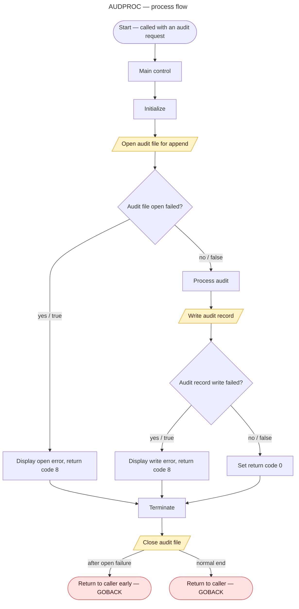

*The figure shows the timestamp capture, the append-mode open with its early-exit error branch, the record build and write with its error branch, and the close-and-return steps. Diagram file `diagrams/flow_AUDPROC.mmd` (FLOW-AUDPROC); 15 nodes, 16 edges; complete and not truncated; rendering not verified (GAP-168).*

**Rules on the figure:** none (no rules are recorded for AUDPROC in `rules_artifact.json`).

**Limitations (diagram complete):**

| Limitation (plain English) | Class | Gaps |
|---|---|---|
| The data-flow warning that the system-information move overwrites the captured timestamp is a data issue and is not drawn in this control-flow figure. | Unresolved analysis | GAP-172 |

**Key gaps:** GAP-172. Related: copybook AUDITLOG rules BR-110 (GAP-016), BR-111 (GAP-017), BR-112 (GAP-018).

#### DB2CMT — DB2 commit controller

**Type:** Unclassified (called subprogram; basis: logic entry type) | **File ID:** `SYS-PORTFOLIO-001-FIL-0054` | **Logic status:** partial | **Business rules:** 2 (BR-033, BR-034) | **Complexity:** — (not computed by Agent 4)

DB2CMT is a called subroutine that controls when database work is made permanent (committed) or undone (rolled back). It routes each request by its function code (BR-033, Confirmed ✓). `INIT` resets the commit, rollback and savepoint counters and returns 0. `CMIT` commits only when the caller's processed-record count has reached the commit frequency or the caller forces a commit with flag `Y`; otherwise it does nothing (BR-034, Confirmed ✓). `RBAK` rolls back the current work, `SAVE` creates a named savepoint (a marker the work can later be rolled back to, keeping open queries) and `REST` rolls back to that savepoint; each successful operation adds one to its counter (rolling back to a savepoint counts as a rollback) and returns 0. `STAT` displays the three counters on the console.

Each failed database operation copies the database error code and a message into the caller's error area, returns 8 and calls DB2ERR with that error area. Agent 4 flags that this parameter layout does not match DB2ERR's request block, so the effect of the call is not asserted (suspected defect, *Uncertain*, SME review — GAP-175). Any other function code returns 12 and calls the shared error routine ERRPROC. The program reads no files.

**Figure 6.15 — DB2CMT process flow**

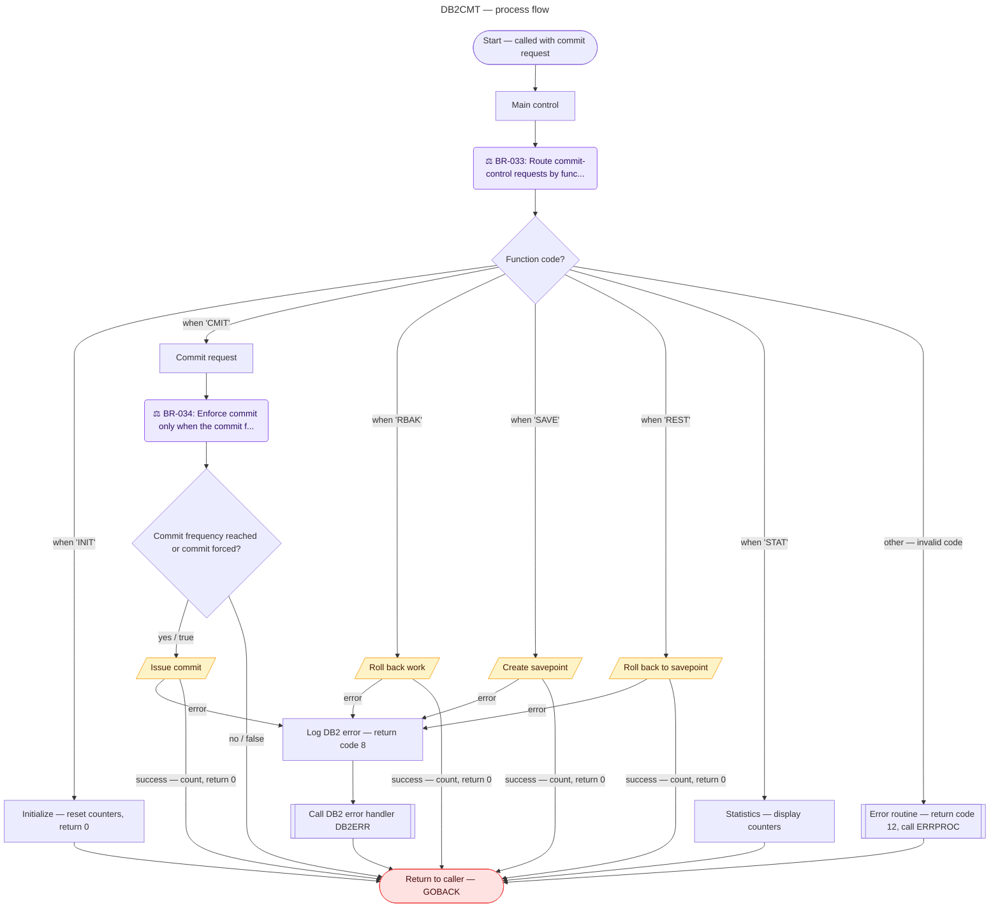

*The figure shows the six-way function dispatch, the commit-frequency decision, the rollback and savepoint operations with their success and failure branches, and the calls to DB2ERR and ERRPROC. Diagram file `diagrams/flow_DB2CMT.mmd` (FLOW-DB2CMT); 17 nodes, 27 edges; complete and not truncated; rendering not verified (GAP-168).*

**Rules on the figure:** inline — BR-033, BR-034 (no footnotes).

**Limitations (diagram complete):**

| Limitation (plain English) | Class | Gaps |
|---|---|---|
| `SQLCODE` (database return code supplied by the DB2 precompiler) is unresolved and has no Field ID; it is named only. | Source gap | GAP-301, GAP-211 |
| The call to DB2ERR passes an error area that does not match DB2ERR's request block; the call is drawn as resolved but its effect is not asserted. | Unresolved analysis | GAP-175 |
| The logic of DB2ERR and ERRPROC is not traced in this figure (see their sub-sections). | Display limit | — |

**Key gaps:** GAP-175, GAP-301.

#### DB2CONN — DB2 connection manager (batch)

**Type:** Batch (batch subprogram; basis: logic entry type) | **File ID:** `SYS-PORTFOLIO-001-FIL-0055` | **Logic status:** partial | **Business rules:** 5 (BR-035, BR-036, BR-037, BR-038, BR-132) | **Complexity:** — (not computed by Agent 4)

DB2CONN is a batch database connection manager subprogram. The caller passes a request area holding a four-character function code, a database name, a plan name, a return code and error information, and DB2CONN routes the request by function code (BR-035, Confirmed ✓). `CONN` connects to the requested database, trying at most 3 times per request (BR-038, Confirmed ✓) and, while retries remain, calling the external program DELAY to wait between failed attempts (BR-036, Confirmed ✓); each failure records the database error code and a message and sets return code 12. DELAY is not in the repository, so the wait itself cannot be traced (GAP-158).

`DISC` commits the work and resets the connection when the program believes it is connected (BR-037, Medium ⚠; the "disconnected" state value is BR-132, Low ⚠ — SME review required), returning 0 on success or 8 with the error code and a message on failure. `STAT` checks the connection by asking the database for its current server name and returns 0 when the connection is active or 4 with a message when it is not. Any other function code sets the error text "Invalid function code", return code 12 and calls the shared error routine ERRPROC. Agent 4 notes that the plan name is stored but used by no database statement (*Confirmed* as traced).

**Figure 6.16 — DB2CONN process flow**

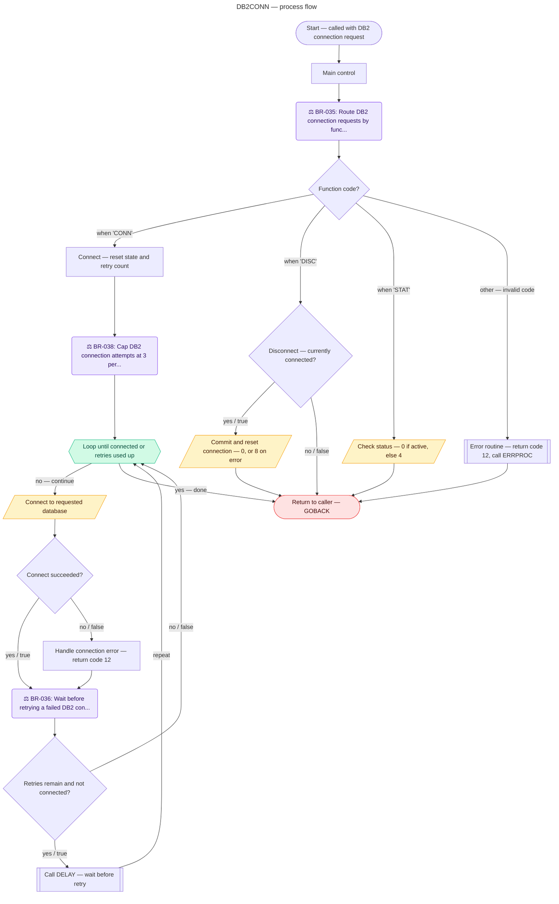

*The figure shows the four-way function dispatch, the connect retry loop with its wait step, and the disconnect and status-check branches with their outcomes, plus the error branch for an invalid function code. Diagram file `diagrams/flow_DB2CONN.mmd` (FLOW-DB2CONN); 18 nodes, 24 edges; complete and not truncated; rendering not verified (GAP-168).*

**Rules on the figure:** inline — BR-035, BR-036, BR-038; footnote — BR-037, BR-132.

**Limitations (diagram complete):**

| Limitation (plain English) | Class | Gaps |
|---|---|---|
| `SQLCODE` (database return code supplied by the DB2 precompiler) is unresolved and has no Field ID; it is named only. | Source gap | GAP-302, GAP-211 |
| The database-result outcomes inside the connection-error, disconnect and status-check paragraphs are summarised in box labels to stay within the box limit; the branches themselves are confirmed in the logic file. | Display limit | — |
| The external programs DELAY and ERRPROC are not traced in this figure (DELAY is not in the repository). | Source gap (DELAY) / display limit (ERRPROC) | GAP-158 |
| BR-132 is a value-set rule attached to no paragraph; it appears in the footnote only. | Display limit | GAP-030 |

**Key gaps:** GAP-030 (BR-132), GAP-158, GAP-283 (BR-037), GAP-302. Related: GAP-222 (copybook DBPROC contains procedure code; DB2CONN copies DBPROC).

#### DB2ERR — DB2 error-handling subroutine

**Type:** Unclassified (called subprogram; basis: logic entry type) | **File ID:** `SYS-PORTFOLIO-001-FIL-0056` | **Logic status:** partial | **Business rules:** 4 (BR-039, BR-040, BR-041, BR-133) | **Complexity:** — (not computed by Agent 4)

DB2ERR is a called database error-handling subroutine that routes each request by its function code (BR-039, Confirmed ✓). `LOG` builds an error-log row — timestamp, calling program, error type `D`, a severity derived from the database error code, a text with the error code and state, the caller's error text, process date and time and additional information — and inserts it into the database table ERRLOG. The severity step also sets the caller's retry flag to `Y` for a deadlock (code -911) or timeout (code -913) and `N` otherwise (BR-040, Medium ⚠; the retry-flag values are BR-133, Low ⚠ — SME review required).

`DIAG` returns a diagnostic message and return code for the database error code: deadlock or timeout 4, connection error (-30081) 12, duplicate key (-803) 8, any other negative code 12, any other non-negative code 4 (BR-041, Medium ⚠). `RETR` reads the latest error-log row for a given program and returns its message and severity, or "No error history found" with return code 4. Any other function code, and a failed error-log insert, set return code 12 and call the shared error routine ERRPROC (*Confirmed* as traced). The program reads no files.

**Figure 6.17 — DB2ERR process flow**

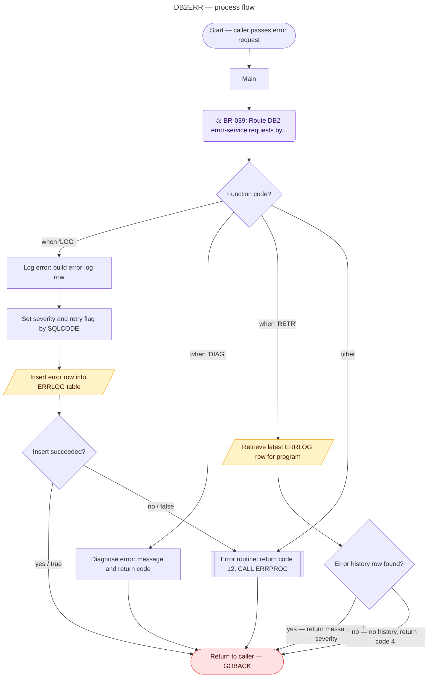

*The figure shows the function-code dispatch to the log, diagnose and retrieve services, the insert and retrieve result decisions, and the error branch to ERRPROC. Diagram file `diagrams/flow_DB2ERR.mmd` (FLOW-DB2ERR); 13 nodes, 17 edges; complete and not truncated; rendering not verified (GAP-168).*

**Rules on the figure:** inline — BR-039; footnote — BR-040, BR-041, BR-133.

**Limitations (diagram complete):**

| Limitation (plain English) | Class | Gaps |
|---|---|---|
| `SQLCODE` (precompiler-supplied database return code) has no Field ID; the insert and retrieve result decisions are shown by name only. | Source gap | GAP-303, GAP-211 |
| The internal severity and diagnosis choices are not drawn as separate branches; rules BR-040 and BR-041 appear as footnotes. | Display limit | GAP-284, GAP-285 |
| ERRPROC is a separate program; its behaviour is not part of this figure. | Display limit | — |

**Key gaps:** GAP-031 (BR-133), GAP-162 (duplicate record name after a copy with renaming), GAP-284 (BR-040), GAP-285 (BR-041), GAP-303, GAP-314 (query with sub-query summarised in the pseudocode). Related: GAP-175 (DB2CMT passes a non-matching parameter layout to DB2ERR); copybook DBTBLS rules BR-124 (GAP-037) and BR-125 (GAP-038).

#### DB2STAT — DB2 statistics collector

**Type:** Unclassified (called subprogram; basis: logic entry type) | **File ID:** `SYS-PORTFOLIO-001-FIL-0057` | **Logic status:** partial | **Business rules:** 1 (BR-042) | **Complexity:** — (not computed by Agent 4)

DB2STAT is a called database statistics-collector subroutine that routes each request by its function code (BR-042, Confirmed ✓). `INIT` clears the statistics record, stores the calling program and the start timestamp, declares a temporary session table for statistics (an "already exists" response, code -601, is tolerated) and inserts an initial row with zero counters. `UPDT` copies the caller's row counters — read, inserted, updated, deleted, commits and rollbacks — into the program's row. `TERM` records the end time, computes the elapsed time from the start and end timestamps and a CPU time estimated as 65% of the elapsed time, updates the row and, on success, displays the statistics. `DISP` reads the row and displays the counters and the formatted CPU and elapsed times on the console.

Every database failure and any unknown function code set return code 12 and call the shared error routine ERRPROC; successful steps set return code 0 (*Confirmed* as traced). Agent 4 flags that a successful initial insert resets the error return code after a table-creation error (suspected defect, *Uncertain*, GAP-180). Note that two report programs (RPTSTA00, UTLMON00) try to copy DB2STAT as if it were a shared data definition, which it is not (GAP-005, GAP-006).

**Figure 6.18 — DB2STAT process flow**

```mermaid
---
title: DB2STAT — process flow
---
flowchart TD
  %% Generated by 6_diagram agent — sequence-builder skill
  %% Program: DB2STAT (called subprogram) — 9 paragraphs, 1 business rule
  %% Edges: solid = confirmed; -.-> runtime:/uncertain: = uncertain; -.-> ? = unsupported

  classDef rule     fill:#ede9fe,stroke:#7c3aed,color:#2e1065
  classDef io       fill:#fef3c7,stroke:#f59e0b,color:#451a03
  classDef terminal fill:#fee2e2,stroke:#ef4444,color:#450a0a

  START(["Start — called with a statistics request"])
  PARA_0000["Main control"]
  RULE_BR042("⚖ BR-042: Route DB2 statistics requests by function"):::rule
  DEC_FUNC{"Function code?"}

  PARA_1000["Initialize: record program and start time"]
  PARA_1100[/"Create stats table: declare temporary table"/]:::io
  DEC_1100{"Declare failed (not 0, not -601)?"}
  PARA_1200[/"Insert initial statistics row"/]:::io
  DEC_1200{"Insert succeeded?"}

  PARA_2000[/"Update stats: copy row counters"/]:::io
  DEC_2000{"Update succeeded?"}

  PARA_3000["Terminate"]
  PARA_3100["Calculate elapsed and CPU times"]
  IO_3000[/"Update end time and times"/]:::io
  DEC_3000{"Update succeeded?"}

  PARA_4000[/"Display stats: select and display counters"/]:::io
  DEC_4000{"Select succeeded?"}

  PARA_9000["Error routine: set return code 12"]
  CALL_ERRPROC[["Call ERRPROC — error processor"]]

  TERMINAL(["Return to caller — GOBACK"]):::terminal

  START --> PARA_0000
  PARA_0000 --> RULE_BR042
  RULE_BR042 --> DEC_FUNC
  DEC_FUNC -->|when 'INIT'| PARA_1000
  DEC_FUNC -->|when 'UPDT'| PARA_2000
  DEC_FUNC -->|when 'TERM'| PARA_3000
  DEC_FUNC -->|when 'DISP'| PARA_4000
  DEC_FUNC -->|other — invalid function| PARA_9000

  PARA_1000 --> PARA_1100
  PARA_1100 --> DEC_1100
  DEC_1100 -->|yes / true| PARA_9000
  DEC_1100 -->|no / false| PARA_1200
  PARA_1200 --> DEC_1200
  DEC_1200 -->|yes / true| TERMINAL
  DEC_1200 -->|no / false| PARA_9000

  PARA_2000 --> DEC_2000
  DEC_2000 -->|yes / true| TERMINAL
  DEC_2000 -->|no / false| PARA_9000

  PARA_3000 --> PARA_3100
  PARA_3100 --> IO_3000
  IO_3000 --> DEC_3000
  DEC_3000 -->|yes / true| PARA_4000
  DEC_3000 -->|no / false| PARA_9000

  PARA_4000 --> DEC_4000
  DEC_4000 -->|yes / true| TERMINAL
  DEC_4000 -->|no / false| PARA_9000

  PARA_9000 --> CALL_ERRPROC
  CALL_ERRPROC -->|returns — after table declare error, insert still runs| PARA_1200
  CALL_ERRPROC -->|returns — other errors| TERMINAL

  %% SQL status checks test SQLCODE (precompiler SQLCA item, UNRESOLVED, no Field ID).
  %% UPDT, TERM and DISP rely on program ID and start time saved by an earlier INIT call in the same run unit (Agent 4 note).

  %% REVFORGE-ID START paragraph_id=null statement_id=null
  %% REVFORGE-ID PARA_0000 paragraph_id=SYS-PORTFOLIO-001-FIL-0057-PAR-0001 statement_id=null
  %% REVFORGE-ID RULE_BR042 paragraph_id=SYS-PORTFOLIO-001-FIL-0057-PAR-0001 statement_id=SYS-PORTFOLIO-001-FIL-0057-STMT-000001 rule_id=BR-042
  %% REVFORGE-ID DEC_FUNC paragraph_id=SYS-PORTFOLIO-001-FIL-0057-PAR-0001 statement_id=SYS-PORTFOLIO-001-FIL-0057-STMT-000001
  %% REVFORGE-ID PARA_1000 paragraph_id=SYS-PORTFOLIO-001-FIL-0057-PAR-0002 statement_id=null
  %% REVFORGE-ID PARA_1100 paragraph_id=SYS-PORTFOLIO-001-FIL-0057-PAR-0003 statement_id=SYS-PORTFOLIO-001-FIL-0057-STMT-000010
  %% REVFORGE-ID DEC_1100 paragraph_id=SYS-PORTFOLIO-001-FIL-0057-PAR-0003 statement_id=SYS-PORTFOLIO-001-FIL-0057-STMT-000011
  %% REVFORGE-ID PARA_1200 paragraph_id=SYS-PORTFOLIO-001-FIL-0057-PAR-0004 statement_id=SYS-PORTFOLIO-001-FIL-0057-STMT-000012
  %% REVFORGE-ID DEC_1200 paragraph_id=SYS-PORTFOLIO-001-FIL-0057-PAR-0004 statement_id=SYS-PORTFOLIO-001-FIL-0057-STMT-000013
  %% REVFORGE-ID PARA_2000 paragraph_id=SYS-PORTFOLIO-001-FIL-0057-PAR-0005 statement_id=SYS-PORTFOLIO-001-FIL-0057-STMT-000020
  %% REVFORGE-ID DEC_2000 paragraph_id=SYS-PORTFOLIO-001-FIL-0057-PAR-0005 statement_id=SYS-PORTFOLIO-001-FIL-0057-STMT-000021
  %% REVFORGE-ID PARA_3000 paragraph_id=SYS-PORTFOLIO-001-FIL-0057-PAR-0006 statement_id=null
  %% REVFORGE-ID PARA_3100 paragraph_id=SYS-PORTFOLIO-001-FIL-0057-PAR-0007 statement_id=null
  %% REVFORGE-ID IO_3000 paragraph_id=SYS-PORTFOLIO-001-FIL-0057-PAR-0006 statement_id=SYS-PORTFOLIO-001-FIL-0057-STMT-000025
  %% REVFORGE-ID DEC_3000 paragraph_id=SYS-PORTFOLIO-001-FIL-0057-PAR-0006 statement_id=SYS-PORTFOLIO-001-FIL-0057-STMT-000026
  %% REVFORGE-ID PARA_4000 paragraph_id=SYS-PORTFOLIO-001-FIL-0057-PAR-0008 statement_id=SYS-PORTFOLIO-001-FIL-0057-STMT-000030
  %% REVFORGE-ID DEC_4000 paragraph_id=SYS-PORTFOLIO-001-FIL-0057-PAR-0008 statement_id=SYS-PORTFOLIO-001-FIL-0057-STMT-000031
  %% REVFORGE-ID PARA_9000 paragraph_id=SYS-PORTFOLIO-001-FIL-0057-PAR-0009 statement_id=null
  %% REVFORGE-ID CALL_ERRPROC paragraph_id=SYS-PORTFOLIO-001-FIL-0057-PAR-0009 statement_id=SYS-PORTFOLIO-001-FIL-0057-STMT-000034 callee_file_id=SYS-PORTFOLIO-001-FIL-0058
  %% REVFORGE-ID TERMINAL paragraph_id=SYS-PORTFOLIO-001-FIL-0057-PAR-0001 statement_id=SYS-PORTFOLIO-001-FIL-0057-STMT-000002

  %% Rules: BR-042 (confirmed) shown inline. No medium/low-confidence rules for this program.
```

*The figure shows the four-way function dispatch, the initialise (declare table and insert), update, terminate (time calculation and update) and display branches with their database result decisions, and the shared error routine that calls ERRPROC. Diagram file `diagrams/flow_DB2STAT.mmd` (FLOW-DB2STAT); 20 nodes, 29 edges; complete and not truncated; rendering not verified (GAP-168).*

**Rules on the figure:** inline — BR-042 (no footnotes).

**Limitations (diagram complete):**

| Limitation (plain English) | Class | Gaps |
|---|---|---|
| `SQLCODE` (precompiler-supplied database return code) has no Field ID; the five database status decisions carry none. | Source gap | GAP-307, GAP-211 |
| The call to ERRPROC is drawn as a single sub-step box; ERRPROC's own logic is in its own figure (Figure 6.19). | Display limit | — |
| Returns from the shared error routine are drawn as two labelled arrows (back to the insert after a declare error, otherwise to the end through the calling paragraphs). | Display limit | — |

**Key gaps:** GAP-180, GAP-307, GAP-316 (two statements recorded as written and flagged for review). Related: GAP-005, GAP-006.

#### ERRPROC — Standard error-processing subroutine

**Type:** Batch (batch subprogram; basis: logic entry type) | **File ID:** `SYS-PORTFOLIO-001-FIL-0058` | **Logic status:** success | **Business rules:** 0 | **Complexity:** — (not computed by Agent 4)

ERRPROC is the standard batch error-processing subroutine called by many other programs (for example BCHCTL00, PRCSEQ00, RCVPRC00, HISTLD00, DB2CMT, DB2CONN, DB2ERR and DB2STAT, as described in their sub-sections). It receives an error request from its caller, opens the sequential error log in append mode, captures a timestamp, and copies the caller's program ID, category, error code, severity, text and details into the standard error message record (layout ERRHAND). It writes this record to the error log, displays the same error details on the console between separator lines, and sets the caller's return code to the requested severity (*Confirmed* as traced).

There is no loop. A non-`00` file status after the open or after the write is only displayed; processing is not stopped, so a failed open of the error log does not prevent the write attempt (suspected defect, *Uncertain*, GAP-182). No business rules are recorded for this program.

**Figure 6.19 — ERRPROC process flow**

```mermaid
---
title: ERRPROC — process flow
---
flowchart TD
  %% Generated by 6_diagram agent — sequence-builder skill
  %% Program: ERRPROC (batch subprogram) — 6 paragraphs, 0 business rules
  %% Edges: solid = confirmed; -.-> runtime:/uncertain: = uncertain; -.-> ? = unsupported
  %% REVFORGE-ID FILE file_id=SYS-PORTFOLIO-001-FIL-0058 path_id=SYS-PORTFOLIO-001-PATH-0058

  classDef io       fill:#fef3c7,stroke:#f59e0b,color:#451a03
  classDef terminal fill:#fee2e2,stroke:#ef4444,color:#450a0a

  START(["Start — caller passes error request"])
  PARA_0000["Main"]
  PARA_1000["Initialize work areas and timestamp"]
  IO_OPEN[/"Open error log for append"/]:::io
  DEC_OPEN{"Log file status not '00'?"}
  DISP_OPEN["Display error opening log file"]
  PARA_2000["Process error: build error message"]
  PARA_2100["Write log"]
  IO_WRITE[/"Write error log record"/]:::io
  DEC_WRITE{"Log file status not '00'?"}
  DISP_WRITE["Display error writing to log"]
  PARA_2200["Display error details on console"]
  SET_RC["Set caller return code to severity"]
  PARA_3000["Terminate"]
  IO_CLOSE[/"Close error log"/]:::io
  TERMINAL(["Return to caller — GOBACK"]):::terminal

  %% REVFORGE-ID START paragraph_id=null statement_id=null
  %% REVFORGE-ID PARA_0000 paragraph_id=SYS-PORTFOLIO-001-FIL-0058-PAR-0001 statement_id=null
  %% REVFORGE-ID PARA_1000 paragraph_id=SYS-PORTFOLIO-001-FIL-0058-PAR-0002 statement_id=SYS-PORTFOLIO-001-FIL-0058-STMT-000001
  %% REVFORGE-ID IO_OPEN paragraph_id=SYS-PORTFOLIO-001-FIL-0058-PAR-0002 statement_id=SYS-PORTFOLIO-001-FIL-0058-STMT-000007
  %% REVFORGE-ID DEC_OPEN paragraph_id=SYS-PORTFOLIO-001-FIL-0058-PAR-0002 statement_id=SYS-PORTFOLIO-001-FIL-0058-STMT-000008 field_id=SYS-PORTFOLIO-001-FIL-0058-FLD-000002
  %% REVFORGE-ID DISP_OPEN paragraph_id=SYS-PORTFOLIO-001-FIL-0058-PAR-0002 statement_id=SYS-PORTFOLIO-001-FIL-0058-STMT-000032
  %% REVFORGE-ID PARA_2000 paragraph_id=SYS-PORTFOLIO-001-FIL-0058-PAR-0003 statement_id=SYS-PORTFOLIO-001-FIL-0058-STMT-000002
  %% REVFORGE-ID PARA_2100 paragraph_id=SYS-PORTFOLIO-001-FIL-0058-PAR-0004 statement_id=SYS-PORTFOLIO-001-FIL-0058-STMT-000016
  %% REVFORGE-ID IO_WRITE paragraph_id=SYS-PORTFOLIO-001-FIL-0058-PAR-0004 statement_id=SYS-PORTFOLIO-001-FIL-0058-STMT-000020
  %% REVFORGE-ID DEC_WRITE paragraph_id=SYS-PORTFOLIO-001-FIL-0058-PAR-0004 statement_id=SYS-PORTFOLIO-001-FIL-0058-STMT-000021 field_id=SYS-PORTFOLIO-001-FIL-0058-FLD-000002
  %% REVFORGE-ID DISP_WRITE paragraph_id=SYS-PORTFOLIO-001-FIL-0058-PAR-0004 statement_id=SYS-PORTFOLIO-001-FIL-0058-STMT-000033
  %% REVFORGE-ID PARA_2200 paragraph_id=SYS-PORTFOLIO-001-FIL-0058-PAR-0005 statement_id=SYS-PORTFOLIO-001-FIL-0058-STMT-000017
  %% REVFORGE-ID SET_RC paragraph_id=SYS-PORTFOLIO-001-FIL-0058-PAR-0003 statement_id=SYS-PORTFOLIO-001-FIL-0058-STMT-000018 field_id=SYS-PORTFOLIO-001-FIL-0058-FLD-000010
  %% REVFORGE-ID PARA_3000 paragraph_id=SYS-PORTFOLIO-001-FIL-0058-PAR-0006 statement_id=SYS-PORTFOLIO-001-FIL-0058-STMT-000003
  %% REVFORGE-ID IO_CLOSE paragraph_id=SYS-PORTFOLIO-001-FIL-0058-PAR-0006 statement_id=SYS-PORTFOLIO-001-FIL-0058-STMT-000031
  %% REVFORGE-ID TERMINAL paragraph_id=SYS-PORTFOLIO-001-FIL-0058-PAR-0001 statement_id=SYS-PORTFOLIO-001-FIL-0058-STMT-000004

  START --> PARA_0000
  PARA_0000 --> PARA_1000
  PARA_1000 --> IO_OPEN
  IO_OPEN --> DEC_OPEN
  DEC_OPEN -->|yes / true| DISP_OPEN
  DEC_OPEN -->|no / false| PARA_2000
  DISP_OPEN --> PARA_2000
  PARA_2000 --> PARA_2100
  PARA_2100 --> IO_WRITE
  IO_WRITE --> DEC_WRITE
  DEC_WRITE -->|yes / true| DISP_WRITE
  DEC_WRITE -->|no / false| PARA_2200
  DISP_WRITE --> PARA_2200
  PARA_2200 --> SET_RC
  SET_RC --> PARA_3000
  PARA_3000 --> IO_CLOSE
  IO_CLOSE --> TERMINAL

  %% Note: a failed OPEN or WRITE is only displayed; processing continues (Agent 4 trace issue io_status_not_abortive).
  %% No business rules are recorded for this program in rules_artifact.json.
```

*The figure shows the append-mode open and its status check, the timestamp and message build, the write and its status check, the console display and the return of the severity to the caller. Diagram file `diagrams/flow_ERRPROC.mmd` (FLOW-ERRPROC); 16 nodes, 17 edges; complete and not truncated; no limitations recorded; rendering not verified (GAP-168).*

**Rules on the figure:** none (no rules are recorded for ERRPROC in `rules_artifact.json`).

**Limitations:** none recorded by Agent 6.

**Key gaps:** GAP-182.

#### CURSMGR — Online cursor manager

**Type:** Online (online main program; basis: logic entry type) | **File ID:** `SYS-PORTFOLIO-001-FIL-0059` | **Logic status:** partial | **Business rules:** 3 (BR-043, BR-044, BR-134) | **Complexity:** — (not computed by Agent 4)

CURSMGR is an online program that manages database cursors (a cursor is the database mechanism for reading a query result one row or block of rows at a time) on behalf of its caller, INQHIST. It receives a cursor request and routes it by request type (BR-043, Medium ⚠, SME review required): `D` declares a cursor, `O` opens it, and `F` (fetch) and `C` (close) run paragraphs that are not in the source file. The cursor name and query text are supplied by the caller at run time, so the query itself cannot be known from the source (GAP-227). When declaring, CURSMGR sets the working array size to its maximum row count if array fetch is requested, otherwise to one row (BR-044, Medium ⚠; the single-row indicator value is BR-134, Low ⚠ — SME review required); opening resets the fetch and row counters. After each database statement it copies a non-zero database code into the response code, and sets 0 when the open succeeds. A request type other than D, O, F or C does nothing, and every path returns control to the caller (*Confirmed* as traced).

The source file is cut off at line 91. The fetch and close paragraphs `P300-FETCH-DATA`, `P300-EXIT`, `P400-CLOSE-CURSOR` and `P400-EXIT` are not in the source, so the fetch and close logic cannot be traced (*Uncertain*, source gap — GAP-145). This also leaves the end of the history inquiry flow in Figure 6.1 unestablished (GAP-256).

> ⚠ This program contains 0 GO TO statements and 4 PERFORM THRU constructs (two of them to the missing paragraphs). Some execution paths may not be fully captured in this diagram. See GAP-212 in Chapter 9.

**Figure 6.20 — CURSMGR process flow**

```mermaid
---
title: CURSMGR — process flow
---
flowchart TD
  %% Generated by 6_diagram agent — sequence-builder skill
  %% Program: CURSMGR (online) — 5 paragraphs, 3 business rules
  %% Logic status: partial — source truncated at line 91; fetch and close paragraphs are not in the source
  %% Unstructured flow: PERFORM ... THRU at lines 46, 49, 52, 55
  %% Edges: solid = confirmed; -.-> runtime:/uncertain: = uncertain; -.-> ? = unsupported

  classDef io         fill:#fef3c7,stroke:#f59e0b,color:#451a03
  classDef terminal   fill:#fee2e2,stroke:#ef4444,color:#450a0a
  classDef unresolved fill:#ffffff,stroke:#dc2626,color:#7f1d1d,stroke-dasharray:2 2

  START(["Start — CICS passes cursor request area"])
  PARA_0001["Unnamed entry paragraph"]
  DECIDE_REQ{"Cursor request type?"}
  PARA_0002["Declare cursor — PERFORM THRU"]
  DEC_ARRAY{"Array fetch requested?"}
  SET_MAX["Array size = maximum rows"]
  SET_ONE["Array size = 1"]
  IO_DECLARE[/"SQL DECLARE cursor — dynamic name and SQL"/]:::io
  DEC_SQL1{"SQLCODE not zero?"}
  SET_RESP1["Return SQLCODE as response code"]
  PARA_0003["Declare cursor exit"]
  PARA_0004["Open cursor — PERFORM THRU"]
  IO_OPEN[/"SQL OPEN cursor — name from caller"/]:::io
  DEC_SQL2{"SQLCODE = 0?"}
  SET_OK["Response code = 0"]
  SET_RESP2["Return SQLCODE as response code"]
  PARA_0005["Open cursor exit — no statements"]
  UNRES_P300["? P300-FETCH-DATA THRU P300-EXIT — not in source"]:::unresolved
  UNRES_P400["? P400-CLOSE-CURSOR THRU P400-EXIT — not in source"]:::unresolved
  TERMINAL(["CICS RETURN to caller"]):::terminal

  %% REVFORGE-ID START file_id=SYS-PORTFOLIO-001-FIL-0059 path_id=SYS-PORTFOLIO-001-PATH-0059 paragraph_id=null statement_id=null
  %% REVFORGE-ID PARA_0001 paragraph_id=SYS-PORTFOLIO-001-FIL-0059-PAR-0001 statement_id=null
  %% REVFORGE-ID DECIDE_REQ paragraph_id=SYS-PORTFOLIO-001-FIL-0059-PAR-0001 statement_id=SYS-PORTFOLIO-001-FIL-0059-STMT-000001
  %% REVFORGE-ID PARA_0002 paragraph_id=SYS-PORTFOLIO-001-FIL-0059-PAR-0002 statement_id=null
  %% REVFORGE-ID DEC_ARRAY paragraph_id=SYS-PORTFOLIO-001-FIL-0059-PAR-0002 statement_id=SYS-PORTFOLIO-001-FIL-0059-STMT-000004 field_id=SYS-PORTFOLIO-001-FIL-0059-FLD-000014
  %% REVFORGE-ID SET_MAX paragraph_id=SYS-PORTFOLIO-001-FIL-0059-PAR-0002 statement_id=SYS-PORTFOLIO-001-FIL-0059-STMT-000018
  %% REVFORGE-ID SET_ONE paragraph_id=SYS-PORTFOLIO-001-FIL-0059-PAR-0002 statement_id=SYS-PORTFOLIO-001-FIL-0059-STMT-000017
  %% REVFORGE-ID IO_DECLARE paragraph_id=SYS-PORTFOLIO-001-FIL-0059-PAR-0002 statement_id=SYS-PORTFOLIO-001-FIL-0059-STMT-000005
  %% REVFORGE-ID DEC_SQL1 paragraph_id=SYS-PORTFOLIO-001-FIL-0059-PAR-0002 statement_id=SYS-PORTFOLIO-001-FIL-0059-STMT-000006 field_id=null
  %% REVFORGE-ID SET_RESP1 paragraph_id=SYS-PORTFOLIO-001-FIL-0059-PAR-0002 statement_id=SYS-PORTFOLIO-001-FIL-0059-STMT-000019
  %% REVFORGE-ID PARA_0003 paragraph_id=SYS-PORTFOLIO-001-FIL-0059-PAR-0003 statement_id=SYS-PORTFOLIO-001-FIL-0059-STMT-000007
  %% REVFORGE-ID PARA_0004 paragraph_id=SYS-PORTFOLIO-001-FIL-0059-PAR-0004 statement_id=null
  %% REVFORGE-ID IO_OPEN paragraph_id=SYS-PORTFOLIO-001-FIL-0059-PAR-0004 statement_id=SYS-PORTFOLIO-001-FIL-0059-STMT-000010
  %% REVFORGE-ID DEC_SQL2 paragraph_id=SYS-PORTFOLIO-001-FIL-0059-PAR-0004 statement_id=SYS-PORTFOLIO-001-FIL-0059-STMT-000011 field_id=null
  %% REVFORGE-ID SET_OK paragraph_id=SYS-PORTFOLIO-001-FIL-0059-PAR-0004 statement_id=SYS-PORTFOLIO-001-FIL-0059-STMT-000021
  %% REVFORGE-ID SET_RESP2 paragraph_id=SYS-PORTFOLIO-001-FIL-0059-PAR-0004 statement_id=SYS-PORTFOLIO-001-FIL-0059-STMT-000020
  %% REVFORGE-ID PARA_0005 paragraph_id=SYS-PORTFOLIO-001-FIL-0059-PAR-0005 statement_id=null
  %% REVFORGE-ID UNRES_P300 paragraph_id=null statement_id=SYS-PORTFOLIO-001-FIL-0059-STMT-000015
  %% REVFORGE-ID UNRES_P400 paragraph_id=null statement_id=SYS-PORTFOLIO-001-FIL-0059-STMT-000013
  %% REVFORGE-ID TERMINAL paragraph_id=SYS-PORTFOLIO-001-FIL-0059-PAR-0001 statement_id=SYS-PORTFOLIO-001-FIL-0059-STMT-000002

  START --> PARA_0001
  PARA_0001 --> DECIDE_REQ
  DECIDE_REQ -.->|uncertain: when 'D' declare| PARA_0002
  DECIDE_REQ -.->|uncertain: when 'O' open| PARA_0004
  DECIDE_REQ -.->|? when 'F' fetch| UNRES_P300
  DECIDE_REQ -.->|? when 'C' close| UNRES_P400
  DECIDE_REQ -.->|uncertain: no match| TERMINAL
  PARA_0002 --> DEC_ARRAY
  DEC_ARRAY -->|yes / true| SET_MAX
  DEC_ARRAY -->|no / false| SET_ONE
  SET_MAX --> IO_DECLARE
  SET_ONE --> IO_DECLARE
  IO_DECLARE --> DEC_SQL1
  DEC_SQL1 -->|yes / true| SET_RESP1
  DEC_SQL1 -->|no / false| PARA_0003
  SET_RESP1 --> PARA_0003
  PARA_0003 --> TERMINAL
  PARA_0004 --> IO_OPEN
  IO_OPEN --> DEC_SQL2
  DEC_SQL2 -->|yes / true| SET_OK
  DEC_SQL2 -->|no / false| SET_RESP2
  SET_OK --> PARA_0005
  SET_RESP2 --> PARA_0005
  PARA_0005 --> TERMINAL

  %% SQLCODE is a precompiler SQLCA item not defined in the repository: shown by name only, no Field ID
  %% Low-confidence rules not shown inline:
  %% BR-043 (medium): Route cursor management requests by request type — see paragraph (UNNAMED) · SME review
  %% BR-044 (medium): Derive cursor fetch array size from the array-fetch indicator — see paragraph P100-DECLARE-CURSOR
  %% ⚠ BR-134 (low): Select single-row fetch indicator value — 88-level definition, no paragraph · SME review
```

*The figure shows the four-way request-type dispatch, the declare branch with its array-size choice, the open branch with its counter reset and response handling, and the fetch and close branches ending at dotted `?` placeholders for the paragraphs missing from the source. Diagram file `diagrams/flow_CURSMGR.mmd` (FLOW-CURSMGR); 20 nodes, 24 edges; incomplete; rendering not verified (GAP-168).*

**Rules on the figure:** footnote — BR-043, BR-044, BR-134 (no inline notes).

**Limitations (diagram incomplete):**

| Limitation (plain English) | Class | Gaps |
|---|---|---|
| The source is cut off at line 91: `P300-FETCH-DATA`, `P300-EXIT`, `P400-CLOSE-CURSOR` and `P400-EXIT` are not in the source, so the fetch and close paths end at unresolved placeholders. | Source gap | GAP-145, GAP-250, GAP-212 |
| The cursor name and query text are supplied by the caller at run time; the cursor's query is unknown from the source. | Unresolved analysis (run-time only) | GAP-227 |
| `SQLCODE` (precompiler-supplied database return code) has no Field ID. | Source gap | GAP-300, GAP-211 |
| BR-134 is a value-set definition attached to no paragraph; it appears in the footnote only. | Display limit | GAP-029 |

**Key gaps:** GAP-028 (BR-043), GAP-029 (BR-134), GAP-145, GAP-212, GAP-227, GAP-250, GAP-282 (BR-044), GAP-300. Related: GAP-256 (SEQ-INQHIST incomplete).

#### DB2ONLN — Online DB2 connection manager

**Type:** Online (online main program; basis: logic entry type) | **File ID:** `SYS-PORTFOLIO-001-FIL-0060` | **Logic status:** partial | **Business rules:** 2 (BR-045, BR-046) | **Complexity:** — (not computed by Agent 4)

DB2ONLN is the online database connection manager used by INQHIST and DB2RECV. It receives a request block from its caller and routes it by request type (BR-045, Confirmed ✓). For a connect request (`C`) it checks the active-connection counter against the limit of 100 (BR-046, Confirmed ✓); below the limit it connects to database POSMVP and, on success, adds one to the counter, returns response code 0 and builds a connection token from the current date and the counter; otherwise it returns -1 with the database error code and message, or the message "Maximum connections reached". For a disconnect request (`D`) it disconnects and, on success, subtracts one from the counter, or returns -1 with the error details.

For a status request (`S`) it asks the database for the current server name and sets the response code from the database result, but then always overwrites the response code with the active-connection count (suspected defect, *Uncertain*, GAP-179). Agent 4 also flags that the connection counter has no visible way to persist between separate online tasks (GAP-177) and that the token-building step uses the same item as both source and target (GAP-178). Any other request type does nothing; every path returns control to the online system, and the program reads no files (*Confirmed* as traced).

> ⚠ This program contains 0 GO TO statements and 5 PERFORM THRU constructs. Some execution paths may not be fully captured in this diagram. See GAP-213 in Chapter 9.

**Figure 6.21 — DB2ONLN process flow**

```mermaid
---
title: DB2ONLN — process flow
---
flowchart TD
  %% Generated by 6_diagram agent — sequence-builder skill
  %% Program: DB2ONLN (online) — 11 paragraphs, 2 business rules
  %% Unstructured flow: PERFORM ... THRU at lines 42, 45, 48, 56, 73
  %% Edges: solid = confirmed; -.-> runtime:/uncertain: = uncertain; -.-> ? = unsupported

  classDef rule     fill:#ede9fe,stroke:#7c3aed,color:#2e1065
  classDef io       fill:#fef3c7,stroke:#f59e0b,color:#451a03
  classDef terminal fill:#fee2e2,stroke:#ef4444,color:#450a0a

  START(["Start — CICS passes DB2 request area"])
  PARA_0001["Unnamed entry paragraph"]
  RULE_BR045("⚖ BR-045: Route online DB2 requests by request..."):::rule
  DECIDE_REQ{"DB2 request type?"}
  PARA_0002["Process connect request"]
  RULE_BR046("⚖ BR-046: Enforce maximum of 100 active online..."):::rule
  DEC_LIMIT{"Active connections below maximum?"}
  PARA_0004[/"Establish connection — SQL CONNECT TO POSMVP"/]:::io
  DEC_SQL1{"SQLCODE = 0?"}
  PARA_0006["Generate connection token"]
  MAX_REACHED["Return -1 — maximum connections reached"]
  ERR_SQL["Return -1 with SQL error code and message"]
  PARA_0008[/"Process disconnect — SQL DISCONNECT"/]:::io
  DEC_SQL2{"SQLCODE = 0?"}
  DISC_OK["Decrement active connections, return 0"]
  PARA_0010[/"Check status — SELECT CURRENT SERVER"/]:::io
  DEC_SQL3{"SQLCODE = 0?"}
  STATUS_RC["Response code = active connection count"]
  SUMMARY["... 5 exit paragraphs — see source"]
  TERMINAL(["CICS RETURN to caller"]):::terminal

  %% REVFORGE-ID START file_id=SYS-PORTFOLIO-001-FIL-0060 path_id=SYS-PORTFOLIO-001-PATH-0060 paragraph_id=null statement_id=null
  %% REVFORGE-ID PARA_0001 paragraph_id=SYS-PORTFOLIO-001-FIL-0060-PAR-0001 statement_id=null
  %% REVFORGE-ID RULE_BR045 rule_id=BR-045 paragraph_id=SYS-PORTFOLIO-001-FIL-0060-PAR-0001 statement_id=SYS-PORTFOLIO-001-FIL-0060-STMT-000001
  %% REVFORGE-ID DECIDE_REQ paragraph_id=SYS-PORTFOLIO-001-FIL-0060-PAR-0001 statement_id=SYS-PORTFOLIO-001-FIL-0060-STMT-000001
  %% REVFORGE-ID PARA_0002 paragraph_id=SYS-PORTFOLIO-001-FIL-0060-PAR-0002 statement_id=null
  %% REVFORGE-ID RULE_BR046 rule_id=BR-046 paragraph_id=SYS-PORTFOLIO-001-FIL-0060-PAR-0002 statement_id=SYS-PORTFOLIO-001-FIL-0060-STMT-000003
  %% REVFORGE-ID DEC_LIMIT paragraph_id=SYS-PORTFOLIO-001-FIL-0060-PAR-0002 statement_id=SYS-PORTFOLIO-001-FIL-0060-STMT-000003
  %% REVFORGE-ID PARA_0004 paragraph_id=SYS-PORTFOLIO-001-FIL-0060-PAR-0004 statement_id=SYS-PORTFOLIO-001-FIL-0060-STMT-000005
  %% REVFORGE-ID DEC_SQL1 paragraph_id=SYS-PORTFOLIO-001-FIL-0060-PAR-0004 statement_id=SYS-PORTFOLIO-001-FIL-0060-STMT-000006 field_id=null
  %% REVFORGE-ID PARA_0006 paragraph_id=SYS-PORTFOLIO-001-FIL-0060-PAR-0006 statement_id=null
  %% REVFORGE-ID MAX_REACHED paragraph_id=SYS-PORTFOLIO-001-FIL-0060-PAR-0002 statement_id=SYS-PORTFOLIO-001-FIL-0060-STMT-000021
  %% REVFORGE-ID ERR_SQL paragraph_id=null statement_id=null shared_by=SYS-PORTFOLIO-001-FIL-0060-STMT-000024,SYS-PORTFOLIO-001-FIL-0060-STMT-000031
  %% REVFORGE-ID PARA_0008 paragraph_id=SYS-PORTFOLIO-001-FIL-0060-PAR-0008 statement_id=SYS-PORTFOLIO-001-FIL-0060-STMT-000011
  %% REVFORGE-ID DEC_SQL2 paragraph_id=SYS-PORTFOLIO-001-FIL-0060-PAR-0008 statement_id=SYS-PORTFOLIO-001-FIL-0060-STMT-000012 field_id=null
  %% REVFORGE-ID DISC_OK paragraph_id=SYS-PORTFOLIO-001-FIL-0060-PAR-0008 statement_id=SYS-PORTFOLIO-001-FIL-0060-STMT-000034
  %% REVFORGE-ID PARA_0010 paragraph_id=SYS-PORTFOLIO-001-FIL-0060-PAR-0010 statement_id=SYS-PORTFOLIO-001-FIL-0060-STMT-000014
  %% REVFORGE-ID DEC_SQL3 paragraph_id=SYS-PORTFOLIO-001-FIL-0060-PAR-0010 statement_id=SYS-PORTFOLIO-001-FIL-0060-STMT-000015 field_id=null
  %% REVFORGE-ID STATUS_RC paragraph_id=SYS-PORTFOLIO-001-FIL-0060-PAR-0010 statement_id=null
  %% REVFORGE-ID SUMMARY paragraph_id=null statement_id=null collapsed=SYS-PORTFOLIO-001-FIL-0060-PAR-0003,SYS-PORTFOLIO-001-FIL-0060-PAR-0005,SYS-PORTFOLIO-001-FIL-0060-PAR-0007,SYS-PORTFOLIO-001-FIL-0060-PAR-0009,SYS-PORTFOLIO-001-FIL-0060-PAR-0011
  %% REVFORGE-ID TERMINAL paragraph_id=SYS-PORTFOLIO-001-FIL-0060-PAR-0001 statement_id=SYS-PORTFOLIO-001-FIL-0060-STMT-000002

  START --> PARA_0001
  PARA_0001 --> RULE_BR045
  RULE_BR045 --> DECIDE_REQ
  DECIDE_REQ -->|when 'C' connect| PARA_0002
  DECIDE_REQ -->|when 'D' disconnect| PARA_0008
  DECIDE_REQ -->|when 'S' status| PARA_0010
  DECIDE_REQ -->|no match| TERMINAL
  PARA_0002 --> RULE_BR046
  RULE_BR046 --> DEC_LIMIT
  DEC_LIMIT -->|yes / true| PARA_0004
  DEC_LIMIT -->|no / false| MAX_REACHED
  PARA_0004 --> DEC_SQL1
  DEC_SQL1 -->|yes — count connection, return 0| PARA_0006
  DEC_SQL1 -->|no / false| ERR_SQL
  PARA_0006 --> TERMINAL
  MAX_REACHED --> TERMINAL
  ERR_SQL --> TERMINAL
  PARA_0008 --> DEC_SQL2
  DEC_SQL2 -->|yes / true| DISC_OK
  DEC_SQL2 -->|no / false| ERR_SQL
  DISC_OK --> TERMINAL
  PARA_0010 --> DEC_SQL3
  DEC_SQL3 -->|yes — response 0| STATUS_RC
  DEC_SQL3 -->|no — SQL error details| STATUS_RC
  STATUS_RC --> TERMINAL

  %% SQLCODE and SQLERRMC are precompiler SQLCA items not defined in the repository: shown by name only, no Field ID
  %% SUMMARY collapses the exit paragraphs P100-EXIT, P110-EXIT, P120-EXIT, P200-EXIT, P300-EXIT
```

*The figure shows the three-way request-type dispatch, the connect branch with its connection-limit check and success / failure outcomes, the disconnect branch and the status branch. The five exit-only range-end paragraphs are shown together as one summary box. Diagram file `diagrams/flow_DB2ONLN.mmd` (FLOW-DB2ONLN); 20 nodes, 25 edges; complete but truncated; rendering not verified (GAP-168).*

**Rules on the figure:** inline — BR-045, BR-046 (no footnotes).

**Limitations (diagram truncated):**

| Limitation (plain English) | Class | Gaps |
|---|---|---|
| The five exit paragraphs that end the PERFORM THRU ranges are shown as one summary box to stay within 20 boxes. | Display limit | GAP-269 |
| One "database error" box is shared by the connect and disconnect failure branches (statements `SYS-PORTFOLIO-001-FIL-0060-STMT-000024` and `SYS-PORTFOLIO-001-FIL-0060-STMT-000031`), so it carries no single Statement ID. | Display limit | GAP-269 |
| `SQLCODE` and `SQLERRMC` (precompiler-supplied database return code and message) have no Field ID. | Source gap | GAP-305, GAP-211 |

**Key gaps:** GAP-177, GAP-178, GAP-179, GAP-213, GAP-269, GAP-305. Related: copybook ERRHND rule BR-127 (GAP-041).

#### DB2RECV — Online DB2 recovery manager

**Type:** Online (online main program; basis: logic entry type) | **File ID:** `SYS-PORTFOLIO-001-FIL-0061` | **Logic status:** partial | **Business rules:** 6 (BR-047, BR-048, BR-049, BR-050, BR-135, BR-136) | **Complexity:** — (not computed by Agent 4)

DB2RECV is the online database recovery manager; its cross-program behaviour is described in section 6.1.2 (Figure 6.2). It receives a recovery request block and routes it by request type (BR-047, Medium ⚠, SME review required). For a connection recovery (`C`) it makes up to three reconnect attempts through DB2ONLN (BR-049, Confirmed ✓), stops at the first successful reconnect (BR-048, High ✓), waits for the retry interval between attempts, and sets the status to failed with response code -1 after three failures. For a transaction recovery (`T`) it undoes the current database work and reports success or failure. For a cursor recovery (`R`, value BR-135, Low ⚠ — SME review required) it passes a warning-level error block to the central error handler ERRHNDL and sets the status to retry or failed according to ERRHNDL's answer (BR-050, Medium ⚠, SME review required; the status values are BR-136, Low ⚠ — SME review required). Any other request type does nothing; every path returns control to the online system and the program reads no files (*Confirmed* as traced).

The data names behind the dispatch are partly unresolved: `RECV-CURSOR` is declared twice and no declaration was chosen (GAP-163), and three request-block fields are written with an invalid qualification (GAP-007, GAP-008, GAP-009). The outcomes of the request-type choice, the reconnect response test and the error-handler answer test are therefore drawn as uncertain.

> ⚠ This program contains 0 GO TO statements and 5 PERFORM THRU constructs. Some execution paths may not be fully captured in this diagram. See GAP-214 in Chapter 9.

**Figure 6.22 — DB2RECV process flow**

```mermaid
---
title: DB2RECV — process flow
---
flowchart TD
  %% Generated by 6_diagram agent — sequence-builder skill
  %% Program: DB2RECV (online) — 11 paragraphs, 6 business rules
  %% Unstructured flow: PERFORM ... THRU at lines 50, 53, 56, 66, 72
  %% Edges: solid = confirmed; -.-> runtime:/uncertain: = uncertain; -.-> ? = unsupported

  classDef rule     fill:#ede9fe,stroke:#7c3aed,color:#2e1065
  classDef io       fill:#fef3c7,stroke:#f59e0b,color:#451a03
  classDef terminal fill:#fee2e2,stroke:#ef4444,color:#450a0a
  classDef loop     fill:#d1fae5,stroke:#10b981,color:#064e3b

  START(["Start — CICS passes recovery request area"])
  PARA_0001["Unnamed entry paragraph"]
  DECIDE_REQ{"Recovery request type?"}
  PARA_0002["Recover connection"]
  LOOP_CHECK{{"Retry count reached maximum?"}}:::loop
  PARA_0004[["Attempt reconnect — CICS LINK DB2ONLN"]]
  DEC_RESP{"DB2ONLN response code = 0?"}
  RULE_BR048("⚖ BR-048: Stop reconnect attempts at the first..."):::rule
  DEC_SUCCESS{"Recovery successful?"}
  PARA_0006["Wait retry interval — CICS DELAY"]
  RULE_BR049("⚖ BR-049: Cap connection recovery at 3 reconnect..."):::rule
  DEC_MAXED{"Retry count reached maximum?"}
  SET_FAILED["Status failed, response code -1"]
  PARA_0008[/"Recover transaction — SQL ROLLBACK"/]:::io
  DEC_SQL{"SQLCODE = 0?"}
  PARA_0010[["Recover cursor — CICS LINK ERRHNDL"]]
  DEC_CONT{"Error handler action is continue?"}
  SUMMARY["... 5 exit paragraphs — see source"]
  TERMINAL(["CICS RETURN to caller"]):::terminal

  %% REVFORGE-ID START file_id=SYS-PORTFOLIO-001-FIL-0061 path_id=SYS-PORTFOLIO-001-PATH-0061 paragraph_id=null statement_id=null
  %% REVFORGE-ID PARA_0001 paragraph_id=SYS-PORTFOLIO-001-FIL-0061-PAR-0001 statement_id=null
  %% REVFORGE-ID DECIDE_REQ paragraph_id=SYS-PORTFOLIO-001-FIL-0061-PAR-0001 statement_id=SYS-PORTFOLIO-001-FIL-0061-STMT-000001
  %% REVFORGE-ID PARA_0002 paragraph_id=SYS-PORTFOLIO-001-FIL-0061-PAR-0002 statement_id=null
  %% REVFORGE-ID LOOP_CHECK paragraph_id=SYS-PORTFOLIO-001-FIL-0061-PAR-0002 statement_id=SYS-PORTFOLIO-001-FIL-0061-STMT-000004
  %% REVFORGE-ID PARA_0004 paragraph_id=SYS-PORTFOLIO-001-FIL-0061-PAR-0004 statement_id=SYS-PORTFOLIO-001-FIL-0061-STMT-000008
  %% REVFORGE-ID DEC_RESP paragraph_id=SYS-PORTFOLIO-001-FIL-0061-PAR-0004 statement_id=SYS-PORTFOLIO-001-FIL-0061-STMT-000009 field_id=null
  %% REVFORGE-ID RULE_BR048 rule_id=BR-048 paragraph_id=SYS-PORTFOLIO-001-FIL-0061-PAR-0002 statement_id=SYS-PORTFOLIO-001-FIL-0061-STMT-000029
  %% REVFORGE-ID DEC_SUCCESS paragraph_id=SYS-PORTFOLIO-001-FIL-0061-PAR-0002 statement_id=SYS-PORTFOLIO-001-FIL-0061-STMT-000029 field_id=SYS-PORTFOLIO-001-FIL-0061-FLD-000016
  %% REVFORGE-ID PARA_0006 paragraph_id=SYS-PORTFOLIO-001-FIL-0061-PAR-0006 statement_id=SYS-PORTFOLIO-001-FIL-0061-STMT-000011
  %% REVFORGE-ID RULE_BR049 rule_id=BR-049 paragraph_id=SYS-PORTFOLIO-001-FIL-0061-PAR-0002 statement_id=SYS-PORTFOLIO-001-FIL-0061-STMT-000005
  %% REVFORGE-ID DEC_MAXED paragraph_id=SYS-PORTFOLIO-001-FIL-0061-PAR-0002 statement_id=SYS-PORTFOLIO-001-FIL-0061-STMT-000005
  %% REVFORGE-ID SET_FAILED paragraph_id=SYS-PORTFOLIO-001-FIL-0061-PAR-0002 statement_id=SYS-PORTFOLIO-001-FIL-0061-STMT-000030
  %% REVFORGE-ID PARA_0008 paragraph_id=SYS-PORTFOLIO-001-FIL-0061-PAR-0008 statement_id=SYS-PORTFOLIO-001-FIL-0061-STMT-000013
  %% REVFORGE-ID DEC_SQL paragraph_id=SYS-PORTFOLIO-001-FIL-0061-PAR-0008 statement_id=SYS-PORTFOLIO-001-FIL-0061-STMT-000014 field_id=null
  %% REVFORGE-ID PARA_0010 paragraph_id=SYS-PORTFOLIO-001-FIL-0061-PAR-0010 statement_id=SYS-PORTFOLIO-001-FIL-0061-STMT-000021
  %% REVFORGE-ID DEC_CONT paragraph_id=SYS-PORTFOLIO-001-FIL-0061-PAR-0010 statement_id=SYS-PORTFOLIO-001-FIL-0061-STMT-000022 field_id=SYS-PORTFOLIO-001-FIL-0019-FLD-000013
  %% REVFORGE-ID SUMMARY paragraph_id=null statement_id=null collapsed=SYS-PORTFOLIO-001-FIL-0061-PAR-0003,SYS-PORTFOLIO-001-FIL-0061-PAR-0005,SYS-PORTFOLIO-001-FIL-0061-PAR-0007,SYS-PORTFOLIO-001-FIL-0061-PAR-0009,SYS-PORTFOLIO-001-FIL-0061-PAR-0011
  %% REVFORGE-ID TERMINAL paragraph_id=SYS-PORTFOLIO-001-FIL-0061-PAR-0001 statement_id=SYS-PORTFOLIO-001-FIL-0061-STMT-000002

  START --> PARA_0001
  PARA_0001 --> DECIDE_REQ
  DECIDE_REQ -.->|uncertain: when 'C' connection| PARA_0002
  DECIDE_REQ -.->|uncertain: when 'T' transaction| PARA_0008
  DECIDE_REQ -.->|uncertain: when RECV-CURSOR 'R'| PARA_0010
  DECIDE_REQ -.->|uncertain: no match| TERMINAL
  PARA_0002 --> LOOP_CHECK
  LOOP_CHECK -->|no — continue| PARA_0004
  PARA_0004 --> DEC_RESP
  DEC_RESP -.->|uncertain: yes — mark success| RULE_BR048
  DEC_RESP -.->|uncertain: no — mark retry, copy SQL code| RULE_BR048
  RULE_BR048 --> DEC_SUCCESS
  DEC_SUCCESS -->|yes — exit loop| RULE_BR049
  DEC_SUCCESS -->|no / false| PARA_0006
  PARA_0006 -->|repeat — count attempt| LOOP_CHECK
  LOOP_CHECK -->|yes — done| RULE_BR049
  RULE_BR049 --> DEC_MAXED
  DEC_MAXED -->|yes / true| SET_FAILED
  DEC_MAXED -->|no / false| TERMINAL
  SET_FAILED --> TERMINAL
  PARA_0008 --> DEC_SQL
  DEC_SQL -->|yes — report success| TERMINAL
  DEC_SQL -->|no — failure, response -1| TERMINAL
  PARA_0010 --> DEC_CONT
  DEC_CONT -.->|uncertain: yes — status retry| TERMINAL
  DEC_CONT -.->|uncertain: no — status failed| TERMINAL

  %% RECV-CURSOR is AMBIGUOUS, DB2-RESPONSE-CODE OF WS-DB2-REQUEST and SQLCODE are UNRESOLVED: shown by name only, no Field ID
  %% Low-confidence rules not shown inline:
  %% BR-047 (medium): Route DB2 recovery requests by recovery request type — see paragraph (UNNAMED) · SME review
  %% BR-050 (medium): Handle cursor recovery outcome according to the central error action — see paragraph P300-RECOVER-CURSOR · SME review
  %% ⚠ BR-135 (low): Select cursor recovery request type value — 88-level definition, no paragraph · SME review
  %% ⚠ BR-136 (low): Handle recovery status failed or retry — 88-level definition, no paragraph · SME review
```

*The figure shows the three-way recovery-type dispatch, the reconnect loop with its three-attempt cap and early stop, the rollback branch and the cursor-recovery branch with its call to ERRHNDL. The five exit-only range-end paragraphs are shown together as one summary box. Diagram file `diagrams/flow_DB2RECV.mmd` (FLOW-DB2RECV); 20 nodes, 26 edges; complete but truncated; rendering not verified (GAP-168).*

**Rules on the figure:** inline — BR-048, BR-049; footnote — BR-047, BR-050, BR-135, BR-136.

**Limitations (diagram truncated):**

| Limitation (plain English) | Class | Gaps |
|---|---|---|
| The five exit paragraphs that end the PERFORM THRU ranges are shown as one summary box to stay within 20 boxes. | Display limit | GAP-270 |
| `RECV-CURSOR` is ambiguous (two declarations); `DB2-RESPONSE-CODE OF WS-DB2-REQUEST` is unresolved (invalid qualification); `SQLCODE` is precompiler-supplied — none carries a Field ID. | Source gap | GAP-163, GAP-008, GAP-306, GAP-211 |
| The outcomes of the request-type choice, the reconnect response test and the error-handler action test have partial evidence and are drawn as uncertain. | Unresolved analysis | GAP-032, GAP-033 |
| BR-135 and BR-136 are value-set definitions attached to no paragraph; they appear in the footnote only. | Display limit | GAP-034, GAP-035 |

**Key gaps:** GAP-007, GAP-008, GAP-009, GAP-032 (BR-047), GAP-033 (BR-050), GAP-034 (BR-135), GAP-035 (BR-136), GAP-163, GAP-214, GAP-270, GAP-306, GAP-315. Related: copybook DB2REQ rule BR-126 (GAP-036), copybook ERRHND rule BR-127 (GAP-041).

#### ERRHNDL — Online centralised error handler

**Type:** Online (online main program; basis: logic entry type) | **File ID:** `SYS-PORTFOLIO-001-FIL-0062` | **Logic status:** partial | **Business rules:** 2 (BR-051, BR-052) | **Complexity:** — (not computed by Agent 4)

ERRHNDL is the online centralised error handler, called by DB2RECV and INQONLN with the standard error block (layout ERRHND) as its communication area. It copies the error block into its working area, stamps the error with the current date and time, and generates a trace ID from a random number when none was supplied (BR-051, Medium ⚠, SME review required; moving a random number into a text trace ID is flagged as an unsupported construct, GAP-228). It then inserts one row into the database error-log table ERRLOG; if the insert fails it replaces the message with "Error logging failed" and marks the error fatal (*Confirmed* as traced).

Next it rebuilds the message as "Error in <program> - <message> (<trace id>)" (Agent 4 flags that this step uses the message as both source and target, GAP-181). Finally it sets the recovery action from the severity: fatal errors request an abnormal end (`A`), warnings and informational errors request continuation (`C`), and any other severity requests a return (`R`) (BR-052, Confirmed ✓). The updated error block is copied back to the caller and control returns to the online system. The program name is taken from the file name because the source is not in the standard fixed-column layout (GAP-299).

> ⚠ This program contains 0 GO TO statements and 4 PERFORM THRU constructs. Some execution paths may not be fully captured in this diagram. See GAP-215 in Chapter 9.

**Figure 6.23 — ERRHNDL process flow**

```mermaid
---
title: ERRHNDL — process flow
---
flowchart TD
  %% Generated by 6_diagram agent — sequence-builder skill
  %% Program: ERRHNDL (online CICS, logic_status partial, unstructured flow: 4 PERFORM THRU) — 9 paragraphs, 2 business rules (1 inline)
  %% Edges: solid = confirmed; -.-> runtime:/uncertain: = uncertain; -.-> ? = unsupported

  classDef rule     fill:#ede9fe,stroke:#7c3aed,color:#2e1065
  classDef io       fill:#fef3c7,stroke:#f59e0b,color:#451a03
  classDef terminal fill:#fee2e2,stroke:#ef4444,color:#450a0a

  START(["Start — linked by CICS with error block"])
  PARA_MAIN["Main control (unnamed paragraph)"]

  subgraph THRU_P100["Perform thru: initialise error handler"]
    PARA_P100["Init error handler — copy block, stamp time"]
    DEC_TRACE{"Trace ID blank?"}
    GEN_TRACE["Generate trace ID"]
    EXIT_P100["P100 exit"]
  end

  subgraph THRU_P200["Perform thru: log error"]
    PARA_P200[/"Log error — insert row into error log table"/]:::io
    DEC_SQL{"Insert failed?"}
    LOG_FAIL["Mark fatal — 'Error logging failed'"]
    EXIT_P200["P200 exit"]
  end

  subgraph THRU_P300["Perform thru: format message"]
    PARA_P300["Format message"]
    EXIT_P300["P300 exit"]
  end

  subgraph THRU_P400["Perform thru: determine action"]
    PARA_P400["Determine action"]
    RULE_BR052("⚖ BR-052: Select error recovery action by error..."):::rule
    DEC_SEV{"Error severity?"}
    ACT_A["Action abend (A)"]
    ACT_C["Action continue (C)"]
    ACT_R["Action return (R)"]
    EXIT_P400["P400 exit"]
  end

  TERMINAL(["Copy block to COMMAREA — CICS RETURN"]):::terminal

  START --> PARA_MAIN
  PARA_MAIN --> PARA_P100
  PARA_P100 --> DEC_TRACE
  DEC_TRACE -->|yes / true| GEN_TRACE
  DEC_TRACE -->|no / false| EXIT_P100
  GEN_TRACE --> EXIT_P100
  EXIT_P100 --> PARA_P200
  PARA_P200 --> DEC_SQL
  DEC_SQL -->|yes / true| LOG_FAIL
  DEC_SQL -->|no / false| EXIT_P200
  LOG_FAIL --> EXIT_P200
  EXIT_P200 --> PARA_P300
  PARA_P300 --> EXIT_P300
  EXIT_P300 --> PARA_P400
  PARA_P400 --> RULE_BR052
  RULE_BR052 --> DEC_SEV
  DEC_SEV -->|when 'F'| ACT_A
  DEC_SEV -->|when 'W'| ACT_C
  DEC_SEV -->|when 'I'| ACT_C
  DEC_SEV -->|other| ACT_R
  ACT_A --> EXIT_P400
  ACT_C --> EXIT_P400
  ACT_R --> EXIT_P400
  EXIT_P400 --> TERMINAL

  %% REVFORGE-ID START file_id=SYS-PORTFOLIO-001-FIL-0062 path_id=SYS-PORTFOLIO-001-PATH-0062
  %% REVFORGE-ID PARA_MAIN paragraph_id=SYS-PORTFOLIO-001-FIL-0062-PAR-0001 statement_id=null
  %% REVFORGE-ID PARA_P100 paragraph_id=SYS-PORTFOLIO-001-FIL-0062-PAR-0002 statement_id=SYS-PORTFOLIO-001-FIL-0062-STMT-000001
  %% REVFORGE-ID DEC_TRACE paragraph_id=SYS-PORTFOLIO-001-FIL-0062-PAR-0002 statement_id=SYS-PORTFOLIO-001-FIL-0062-STMT-000008 field_id=SYS-PORTFOLIO-001-FIL-0019-FLD-000016 rule_id=BR-051
  %% REVFORGE-ID GEN_TRACE paragraph_id=SYS-PORTFOLIO-001-FIL-0062-PAR-0002 statement_id=SYS-PORTFOLIO-001-FIL-0062-STMT-000026
  %% REVFORGE-ID EXIT_P100 paragraph_id=SYS-PORTFOLIO-001-FIL-0062-PAR-0003 statement_id=null
  %% REVFORGE-ID PARA_P200 paragraph_id=SYS-PORTFOLIO-001-FIL-0062-PAR-0004 statement_id=SYS-PORTFOLIO-001-FIL-0062-STMT-000018
  %% REVFORGE-ID DEC_SQL paragraph_id=SYS-PORTFOLIO-001-FIL-0062-PAR-0004 statement_id=SYS-PORTFOLIO-001-FIL-0062-STMT-000019 field=SQLCODE (unresolved, no Field ID)
  %% REVFORGE-ID LOG_FAIL paragraph_id=SYS-PORTFOLIO-001-FIL-0062-PAR-0004 statement_id=SYS-PORTFOLIO-001-FIL-0062-STMT-000027
  %% REVFORGE-ID EXIT_P200 paragraph_id=SYS-PORTFOLIO-001-FIL-0062-PAR-0005 statement_id=null
  %% REVFORGE-ID PARA_P300 paragraph_id=SYS-PORTFOLIO-001-FIL-0062-PAR-0006 statement_id=SYS-PORTFOLIO-001-FIL-0062-STMT-000003
  %% REVFORGE-ID EXIT_P300 paragraph_id=SYS-PORTFOLIO-001-FIL-0062-PAR-0007 statement_id=null
  %% REVFORGE-ID PARA_P400 paragraph_id=SYS-PORTFOLIO-001-FIL-0062-PAR-0008 statement_id=SYS-PORTFOLIO-001-FIL-0062-STMT-000004
  %% REVFORGE-ID RULE_BR052 paragraph_id=SYS-PORTFOLIO-001-FIL-0062-PAR-0008 statement_id=SYS-PORTFOLIO-001-FIL-0062-STMT-000023 rule_id=BR-052
  %% REVFORGE-ID DEC_SEV paragraph_id=SYS-PORTFOLIO-001-FIL-0062-PAR-0008 statement_id=SYS-PORTFOLIO-001-FIL-0062-STMT-000023
  %% REVFORGE-ID ACT_A paragraph_id=SYS-PORTFOLIO-001-FIL-0062-PAR-0008 statement_id=SYS-PORTFOLIO-001-FIL-0062-STMT-000029
  %% REVFORGE-ID ACT_C paragraph_id=SYS-PORTFOLIO-001-FIL-0062-PAR-0008 statement_id=SYS-PORTFOLIO-001-FIL-0062-STMT-000031
  %% REVFORGE-ID ACT_R paragraph_id=SYS-PORTFOLIO-001-FIL-0062-PAR-0008 statement_id=SYS-PORTFOLIO-001-FIL-0062-STMT-000032
  %% REVFORGE-ID EXIT_P400 paragraph_id=SYS-PORTFOLIO-001-FIL-0062-PAR-0009 statement_id=null
  %% REVFORGE-ID TERMINAL paragraph_id=SYS-PORTFOLIO-001-FIL-0062-PAR-0001 statement_id=SYS-PORTFOLIO-001-FIL-0062-STMT-000005

  %% Unstructured flow: each subgraph is one PERFORM ... THRU range performed from the unnamed main paragraph (lines 38, 41, 44, 47);
  %% control returns to the main paragraph after each exit paragraph. SQLCODE has no Field ID (precompiler SQLCA item).
  %% Logic Agent warning (duplicate_copybook_names): ERR-* names are declared twice (WS-ERROR-AREA and DFHCOMMAREA);
  %% the Field IDs identify the copybook definition, not which storage instance is meant.

  %% Low-confidence rules not shown inline:
  %% BR-051 (medium): Require a trace ID on every logged error — see paragraph P100-INIT-ERROR-HANDLER · SME review
```

*The figure shows the four performed ranges of ERRHNDL as grouped blocks — initialise (copy, timestamp and trace ID), log the error to ERRLOG with its failure branch, format the message, and choose the recovery action by severity — followed by the copy-back and return. Diagram file `diagrams/flow_ERRHNDL.mmd` (FLOW-ERRHNDL); 20 nodes, 24 edges; complete and not truncated; rendering not verified (GAP-168).*

**Rules on the figure:** inline — BR-052; footnote — BR-051.

**Limitations (diagram complete):**

| Limitation (plain English) | Class | Gaps |
|---|---|---|
| `SQLCODE` (precompiler-supplied database return code) is unresolved and has no Field ID; it is named only. | Source gap | GAP-308, GAP-211 |
| The four PERFORM THRU ranges are drawn as grouped blocks; the return to the main paragraph between ranges is drawn as a direct arrow from each range's exit to the next range. | Display limit | GAP-215 |
| The error fields (`ERR-*`) are declared twice (working area and communication area); the Field IDs shown identify the copybook definition only. | Source gap | GAP-164 |

**Key gaps:** GAP-042 (BR-051), GAP-164, GAP-181, GAP-215, GAP-228, GAP-299, GAP-308. Related: copybook ERRHND rule BR-127 (GAP-041).

#### INQHIST — Transaction-history inquiry (online)

**Type:** Online (entry type `online_main`; basis: Agent 4 entry type, see ASM-001) | **File ID:** SYS-PORTFOLIO-001-FIL-0063 | **Logic status:** partial | **Business rules:** 2 — BR-053 (Medium ⚠), BR-136 (Low ⚠ — SME review required) | **Complexity:** — (not computed by Agent 4)

INQHIST is an online screen program that answers a request to see a portfolio's transaction history. It first copies the inquiry details passed by the calling screen (the shared inquiry layout `INQCOM`) into its own work area, resets its row counter and "more rows" indicator, and registers an emergency error routine (`P999-ERROR-ROUTINE`) with the online system. It then asks the online database connection program DB2ONLN to connect to the database. If the connection fails, it asks the recovery program DB2RECV to recover the connection; when recovery succeeds it tries the connection step again (BR-053), and when recovery fails it copies the recovery program's message into the reply and runs the error routine, which stores the database result code as the response code. *Confirmed* (Agent 4 narrative and trace), except the retry behaviour, which is *Uncertain* (see below).

Next, the program builds a database query for the history rows of the portfolio (table `POSHIST`, newest date first) and drives the cursor manager CURSMGR through four steps — declare, open, fetch and close — moving the fetched rows into a 10-entry history table whenever the fetch does not report an error. Finally it shows the history on screen `HISMAP` (screen set `INQSET`) and returns control to the online system. Agent 4 notes that the error routine does not stop processing: after it runs, history retrieval and display still take place. *Confirmed* (Agent 4 narrative).

**Figure 6.24 — INQHIST process flow**

```mermaid
---
title: INQHIST — process flow
---
flowchart TD
  %% Generated by 6_diagram agent — sequence-builder skill
  %% Program: INQHIST (online CICS) — 13 paragraphs, 2 business rules (both footnote)
  %% Logic status: partial (recursive PERFORM, unresolved WS-DB2-TOKEN and SQLCODE)
  %% Size management: 6 no-op EXIT paragraphs of PERFORM THRU ranges collapsed into SUMMARY (truncated)
  %% Edges: solid = confirmed; -.-> runtime:/uncertain: = uncertain; -.-> ? = unsupported
  %% REVFORGE-ID FILE file_id=SYS-PORTFOLIO-001-FIL-0063 path_id=SYS-PORTFOLIO-001-PATH-0063

  classDef io        fill:#fef3c7,stroke:#f59e0b,color:#451a03
  classDef terminal  fill:#fee2e2,stroke:#ef4444,color:#450a0a
  classDef runtime   fill:#fff7ed,stroke:#ea580c,color:#431407,stroke-dasharray:4 4
  classDef recursion fill:#fefce8,stroke:#ca8a04,color:#422006,stroke-dasharray:4 4

  START(["Start — CICS transaction with caller commarea"])
  PARA_UNNAMED["Main control - unnamed entry paragraph"]
  PARA_P100["Init program: copy commarea, reset counters"]
  HANDLE_REG["Register CICS handler for ERROR"]
  PARA_P150[["DB2 connect: CICS LINK to DB2ONLN"]]
  DEC_DB2{"Connect response not zero?"}
  LINK_RECV[["CICS LINK to DB2RECV for recovery"]]
  DEC_RECV{"Recovery succeeded?"}
  RECUR_P150["Perform DB2 connect again"]:::recursion
  RECV_FAIL["Copy recovery message to commarea"]:::runtime
  PARA_P999["Error routine: return SQLCODE in commarea"]:::runtime
  PARA_P200[["Get history: declare cursor via CURSMGR"]]
  DEC_DECL{"Declare response zero?"}
  OPEN_CUR[["Open cursor via CURSMGR"]]
  DEC_OPEN{"Open response zero?"}
  PARA_P250[["Fetch history via CURSMGR, fill table"]]
  CLOSE_CUR[["Close cursor via CURSMGR"]]
  PARA_P300[/"Format display: send history map"/]:::io
  TERMINAL(["Return to CICS"]):::terminal
  SUMMARY["... 6 internal EXIT paragraphs of PERFORM THRU ranges (see source)"]

  %% REVFORGE-ID START paragraph_id=null statement_id=null
  %% REVFORGE-ID PARA_UNNAMED paragraph_id=SYS-PORTFOLIO-001-FIL-0063-PAR-0001 statement_id=null
  %% REVFORGE-ID PARA_P100 paragraph_id=SYS-PORTFOLIO-001-FIL-0063-PAR-0002 statement_id=SYS-PORTFOLIO-001-FIL-0063-STMT-000001
  %% REVFORGE-ID HANDLE_REG paragraph_id=SYS-PORTFOLIO-001-FIL-0063-PAR-0002 statement_id=SYS-PORTFOLIO-001-FIL-0063-STMT-000008
  %% REVFORGE-ID PARA_P150 paragraph_id=SYS-PORTFOLIO-001-FIL-0063-PAR-0004 statement_id=SYS-PORTFOLIO-001-FIL-0063-STMT-000009
  %% REVFORGE-ID DEC_DB2 paragraph_id=SYS-PORTFOLIO-001-FIL-0063-PAR-0004 statement_id=SYS-PORTFOLIO-001-FIL-0063-STMT-000013 field_id=SYS-PORTFOLIO-001-FIL-0063-FLD-000013
  %% REVFORGE-ID LINK_RECV paragraph_id=SYS-PORTFOLIO-001-FIL-0063-PAR-0004 statement_id=SYS-PORTFOLIO-001-FIL-0063-STMT-000035
  %% REVFORGE-ID DEC_RECV paragraph_id=SYS-PORTFOLIO-001-FIL-0063-PAR-0004 statement_id=SYS-PORTFOLIO-001-FIL-0063-STMT-000036 field_id=SYS-PORTFOLIO-001-FIL-0063-FLD-000033
  %% REVFORGE-ID RECUR_P150 paragraph_id=SYS-PORTFOLIO-001-FIL-0063-PAR-0004 statement_id=SYS-PORTFOLIO-001-FIL-0063-STMT-000043
  %% REVFORGE-ID RECV_FAIL paragraph_id=SYS-PORTFOLIO-001-FIL-0063-PAR-0004 statement_id=SYS-PORTFOLIO-001-FIL-0063-STMT-000041
  %% REVFORGE-ID PARA_P999 paragraph_id=SYS-PORTFOLIO-001-FIL-0063-PAR-0012 statement_id=SYS-PORTFOLIO-001-FIL-0063-STMT-000042
  %% REVFORGE-ID PARA_P200 paragraph_id=SYS-PORTFOLIO-001-FIL-0063-PAR-0006 statement_id=SYS-PORTFOLIO-001-FIL-0063-STMT-000002
  %% REVFORGE-ID DEC_DECL paragraph_id=SYS-PORTFOLIO-001-FIL-0063-PAR-0006 statement_id=SYS-PORTFOLIO-001-FIL-0063-STMT-000019 field_id=SYS-PORTFOLIO-001-FIL-0063-FLD-000022
  %% REVFORGE-ID OPEN_CUR paragraph_id=SYS-PORTFOLIO-001-FIL-0063-PAR-0006 statement_id=SYS-PORTFOLIO-001-FIL-0063-STMT-000038
  %% REVFORGE-ID DEC_OPEN paragraph_id=SYS-PORTFOLIO-001-FIL-0063-PAR-0006 statement_id=SYS-PORTFOLIO-001-FIL-0063-STMT-000039 field_id=SYS-PORTFOLIO-001-FIL-0063-FLD-000022
  %% REVFORGE-ID PARA_P250 paragraph_id=SYS-PORTFOLIO-001-FIL-0063-PAR-0008 statement_id=SYS-PORTFOLIO-001-FIL-0063-STMT-000044
  %% REVFORGE-ID CLOSE_CUR paragraph_id=SYS-PORTFOLIO-001-FIL-0063-PAR-0006 statement_id=SYS-PORTFOLIO-001-FIL-0063-STMT-000021
  %% REVFORGE-ID PARA_P300 paragraph_id=SYS-PORTFOLIO-001-FIL-0063-PAR-0010 statement_id=SYS-PORTFOLIO-001-FIL-0063-STMT-000003
  %% REVFORGE-ID TERMINAL paragraph_id=SYS-PORTFOLIO-001-FIL-0063-PAR-0001 statement_id=SYS-PORTFOLIO-001-FIL-0063-STMT-000004
  %% REVFORGE-ID SUMMARY paragraph_id=null statement_id=null (collapsed: PAR-0003, PAR-0005, PAR-0007, PAR-0009, PAR-0011, PAR-0013)

  START --> PARA_UNNAMED
  PARA_UNNAMED --> PARA_P100
  PARA_P100 --> HANDLE_REG
  HANDLE_REG --> PARA_P150
  HANDLE_REG -.->|runtime: on ERROR| PARA_P999
  PARA_P150 --> DEC_DB2
  DEC_DB2 -->|yes / true| LINK_RECV
  DEC_DB2 -->|no / false| PARA_P200
  LINK_RECV --> DEC_RECV
  DEC_RECV -.->|uncertain: yes / true| RECUR_P150
  RECUR_P150 -.->|uncertain: recursive PERFORM — tracing stopped| RECUR_P150
  DEC_RECV -.->|uncertain: no / false| RECV_FAIL
  RECV_FAIL --> PARA_P999
  PARA_P999 --> PARA_P200
  PARA_P200 --> DEC_DECL
  DEC_DECL -->|yes / true| OPEN_CUR
  DEC_DECL -->|no / false| CLOSE_CUR
  OPEN_CUR --> DEC_OPEN
  DEC_OPEN -->|yes / true| PARA_P250
  DEC_OPEN -->|no / false| CLOSE_CUR
  PARA_P250 --> CLOSE_CUR
  CLOSE_CUR --> PARA_P300
  PARA_P300 --> TERMINAL

  %% All PERFORMs here are PERFORM ... THRU ranges (7, unstructured flow); each range ends in a no-op EXIT paragraph (collapsed into SUMMARY).
  %% HANDLE CONDITION ERROR (STMT-000008) is a runtime handler only. PARA_P999 to PARA_P200 is the return of PERFORM P999 THRU P999-EXIT (STMT-000042); after a runtime ERROR transfer there is no return point.
  %% Recursive PERFORM P150-DB2-CONNECT THRU P150-EXIT (STMT-000043, Agent 4 unresolvable path, circular_perform): tracing stopped; no further steps drawn.
  %% After the connect IF, P150 moves DB2-CONNECTION-TOKEN to WS-DB2-TOKEN (STMT-000014); WS-DB2-TOKEN is unresolved (no Field ID). SQLCODE in P999 is unresolved (no Field ID).
  %% Unresolved names (no Field ID): INQCOM-ERROR-MSG OF WS-COMMAREA, INQCOM-RESPONSE-CODE OF WS-COMMAREA (invalid qualification), WS-DB2-TOKEN, SQLCODE.
  %% P250 keeps the fetched data only when the fetch response is not negative (STMT-000025).
  %% Low-confidence rules not shown inline:
  %% BR-053 (medium): Retry the history inquiry DB2 connection after successful recovery — see paragraph P150-DB2-CONNECT, decision DEC_RECV · SME review
  %% BR-136 (low) ⚠: Handle recovery status failed or retry — 88-levels of RECV-STATUS, no paragraph · SME review
```

*The diagram traces INQHIST from start-up through the database connection attempt, the recovery branch, history retrieval through CURSMGR and the screen display. The dotted edge from the error-handler registration to `P999-ERROR-ROUTINE` is a run-time-only transfer, and the self-loop on the connection step marks the retry whose depth cannot be traced. The Mermaid file passed a structural lint, but its visual rendering has not been verified (GAP-168).*

**Rules shown on the diagram** (from `rule_annotations[].placement`): BR-053 — footnote; BR-136 — footnote. No rule is placed inline.

**Diagram limitations** (diagram marked incomplete and truncated):

| Limitation (plain English) | Class | Gaps |
|---|---|---|
| The connection paragraph `P150-DB2-CONNECT` (Paragraph ID SYS-PORTFOLIO-001-FIL-0063-PAR-0004) re-runs itself after a successful recovery (Statement ID SYS-PORTFOLIO-001-FIL-0063-STMT-000043). How many times this retry repeats depends on run-time results from DB2ONLN and DB2RECV and is not traceable statically; the source sets no retry limit, so tracing was stopped and the steps after the retry are not drawn. | Unresolved analysis | GAP-149, GAP-255 |
| Some data names carry no Field ID: the token `WS-DB2-TOKEN` is not declared anywhere; `SQLCODE` is supplied by the database precompiler; `INQCOM-ERROR-MSG OF WS-COMMAREA` and `INQCOM-RESPONSE-CODE OF WS-COMMAREA` are invalid qualifications, because the work area holds a copy of a layout that starts its own record, so the fields are not part of the named work area (no Field ID; the candidate fields are kept only as evidence). | Source gap | GAP-117, GAP-310, GAP-010, GAP-011 |
| Six exit-only paragraphs are shown as one summary box to keep the diagram within 20 nodes; the move of `WS-DB2-TOKEN` is not drawn separately. This is a display choice, not missing business logic. | Display limit | GAP-272 |
| If the online system raises an error and jumps into `P999-ERROR-ROUTINE`, there is no return point; that continuation is not traced. | Unresolved analysis (run-time only) | GAP-169 |

**Run-time error handler.** The error-handler registration (Statement ID SYS-PORTFOLIO-001-FIL-0063-STMT-000008) is an online-system instruction that names a routine to jump to if a later online command fails. The jump to `P999-ERROR-ROUTINE` (Paragraph ID SYS-PORTFOLIO-001-FIL-0063-PAR-0012) happens only if such an error is raised at run time; it is not part of the normal flow and is shown as an uncertain, run-time-only edge. *Uncertain* — see GAP-169 in Chapter 9.

> ⚠ This program contains 0 GO TO statements and 7 PERFORM THRU constructs (instructions that run a range of consecutive paragraphs, or named blocks of code, as one unit), one of them recursive. Some execution paths may not be fully captured in this diagram. See GAP-216 in Chapter 9.

**Dead code:** none confirmed by Agent 4.

**Key gaps:** GAP-149 (recursive retry not traceable), GAP-169 (run-time error transfer), GAP-010 and GAP-011 (invalid qualifications, no Field ID), GAP-117 (undeclared `WS-DB2-TOKEN`), GAP-047 (BR-053 needs SME review), GAP-035 (BR-136, low confidence, SME review), GAP-216 (unstructured flow), GAP-255 (process flow incomplete), GAP-256 (sequence diagram incomplete), GAP-272 (diagram shortened), GAP-310 (`SQLCODE` precompiler item), GAP-317 (query parameter binding not shown in pseudocode). Cross-program gaps that include INQHIST: GAP-161 (inquiry layout `INQCOM` copied twice, so its names are declared twice) and GAP-223 (layouts that start their own record copied under a program record).

#### INQONLN — Online portfolio inquiry main handler

**Type:** Online (entry type `online_main`; basis: Agent 4 entry type, see ASM-001) | **File ID:** SYS-PORTFOLIO-001-FIL-0064 | **Logic status:** partial | **Business rules:** 5 — BR-054 (Medium ⚠), BR-055 (Medium ⚠), BR-056 (Medium ⚠), BR-057 (High ✓), BR-058 (High ✓) | **Complexity:** — (not computed by Agent 4)

INQONLN is the main online screen handler for portfolio inquiries. It registers an emergency error routine (`P900-ERROR-ROUTINE`) for three online-system error conditions (general error, program not found and record not found) and then repeats a request cycle until the session ends. In each cycle it clears the inquiry area, receives the inquiry screen `INQMAP` (screen set `INQSET`) and routes the request by its function code (BR-054): `MENU` shows the menu screen `INQMNU`, `INQP` calls INQPORT for a portfolio position inquiry, `INQH` calls INQHIST for a transaction-history inquiry, `EXIT` ends the session, and any other code runs the error routine. *Inferred* — the routing is recorded by Agent 4, but the field it tests is not declared (see below).

After routing, the program runs a three-step security dialogue with SECMGR using the signed-on user ID: validate the user (`V`), check READ access to the resource `INQONLN` (`A`, BR-057) and write an audit entry (`L`, BR-058). If the security response is not zero, it records the error, runs the error routine and ends the task (BR-055). The error routine fills the shared error block (program, paragraph, online-system response codes, warning severity), calls the error-logging program ERRHNDL and abnormally ends the task with code `IERR` when ERRHNDL asks for it (BR-056). *Confirmed* for the call sequence; the function code is tested through `WS-COMMAREA-FUNCTION` and messages are moved to `WS-ERROR-MESSAGE`, neither of which is declared anywhere, so the routing and message handling are *Uncertain* and flagged for review.

**Figure 6.25 — INQONLN process flow**

```mermaid
---
title: INQONLN — process flow
---
flowchart TD
  %% Generated by 6_diagram agent — sequence-builder skill
  %% Program: INQONLN (online CICS) — 13 paragraphs, 5 business rules (2 inline, 3 footnote)
  %% Logic status: partial (EVALUATE subject WS-COMMAREA-FUNCTION and WS-ERROR-MESSAGE undeclared)
  %% Size management: 6 no-op EXIT paragraphs of PERFORM THRU ranges collapsed into SUMMARY (truncated)
  %% Edges: solid = confirmed; -.-> runtime:/uncertain: = uncertain; -.-> ? = unsupported
  %% REVFORGE-ID FILE file_id=SYS-PORTFOLIO-001-FIL-0064 path_id=SYS-PORTFOLIO-001-PATH-0064

  classDef rule     fill:#ede9fe,stroke:#7c3aed,color:#2e1065
  classDef io       fill:#fef3c7,stroke:#f59e0b,color:#451a03
  classDef terminal fill:#fee2e2,stroke:#ef4444,color:#450a0a
  classDef loop     fill:#d1fae5,stroke:#10b981,color:#064e3b
  classDef runtime  fill:#fff7ed,stroke:#ea580c,color:#431407,stroke-dasharray:4 4

  START(["Start — CICS transaction"])
  PARA_UNNAMED["Main control: register CICS error handler"]
  LOOP_CHECK{{"Session terminated?"}}:::loop
  PARA_P100[/"Process request: receive inquiry map"/]:::io
  DEC_FUNC{"Function code?"}
  PARA_P200[/"Display menu: send menu map"/]:::runtime
  PARA_P300[["Portfolio inquiry: LINK to INQPORT"]]:::runtime
  PARA_P400[["History inquiry: LINK to INQHIST"]]:::runtime
  PARA_P900[["Error routine: LINK to ERRHNDL"]]:::runtime
  DEC_ABEND{"Error handler requests abend?"}
  ABEND(["Abend task with code IERR"]):::terminal
  PARA_P050[["Security check: user ID, LINK SECMGR validate"]]
  RULE_BR057("⚖ BR-057: Enforce compliance for READ access...<br/>SME review"):::rule
  DEC_SEC1{"Validation response zero?"}
  RULE_BR058("⚖ BR-058: Report security audit request after...<br/>SME review"):::rule
  DEC_SEC2{"Access response zero?"}
  DEC_SECFAIL{"Security response not zero?"}
  SEC_RETURN(["Security error: run error routine, return to CICS"]):::terminal
  TERMINAL(["Return to CICS"]):::terminal
  SUMMARY["... 6 internal EXIT paragraphs of PERFORM THRU ranges (see source)"]

  %% REVFORGE-ID START paragraph_id=null statement_id=null
  %% REVFORGE-ID PARA_UNNAMED paragraph_id=SYS-PORTFOLIO-001-FIL-0064-PAR-0001 statement_id=SYS-PORTFOLIO-001-FIL-0064-STMT-000001
  %% REVFORGE-ID LOOP_CHECK paragraph_id=SYS-PORTFOLIO-001-FIL-0064-PAR-0001 statement_id=SYS-PORTFOLIO-001-FIL-0064-STMT-000002 field_id=SYS-PORTFOLIO-001-FIL-0064-FLD-000003
  %% REVFORGE-ID PARA_P100 paragraph_id=SYS-PORTFOLIO-001-FIL-0064-PAR-0002 statement_id=SYS-PORTFOLIO-001-FIL-0064-STMT-000005
  %% REVFORGE-ID DEC_FUNC paragraph_id=SYS-PORTFOLIO-001-FIL-0064-PAR-0002 statement_id=SYS-PORTFOLIO-001-FIL-0064-STMT-000006 field_id=null (WS-COMMAREA-FUNCTION unresolved)
  %% REVFORGE-ID PARA_P200 paragraph_id=SYS-PORTFOLIO-001-FIL-0064-PAR-0004 statement_id=SYS-PORTFOLIO-001-FIL-0064-STMT-000033
  %% REVFORGE-ID PARA_P300 paragraph_id=SYS-PORTFOLIO-001-FIL-0064-PAR-0006 statement_id=SYS-PORTFOLIO-001-FIL-0064-STMT-000032
  %% REVFORGE-ID PARA_P400 paragraph_id=SYS-PORTFOLIO-001-FIL-0064-PAR-0008 statement_id=SYS-PORTFOLIO-001-FIL-0064-STMT-000031
  %% REVFORGE-ID PARA_P900 paragraph_id=SYS-PORTFOLIO-001-FIL-0064-PAR-0010 statement_id=SYS-PORTFOLIO-001-FIL-0064-STMT-000021
  %% REVFORGE-ID DEC_ABEND paragraph_id=SYS-PORTFOLIO-001-FIL-0064-PAR-0010 statement_id=SYS-PORTFOLIO-001-FIL-0064-STMT-000022 field_id=SYS-PORTFOLIO-001-FIL-0019-FLD-000014
  %% REVFORGE-ID ABEND paragraph_id=SYS-PORTFOLIO-001-FIL-0064-PAR-0010 statement_id=SYS-PORTFOLIO-001-FIL-0064-STMT-000038
  %% REVFORGE-ID PARA_P050 paragraph_id=SYS-PORTFOLIO-001-FIL-0064-PAR-0012 statement_id=SYS-PORTFOLIO-001-FIL-0064-STMT-000007
  %% REVFORGE-ID RULE_BR057 paragraph_id=SYS-PORTFOLIO-001-FIL-0064-PAR-0012 statement_id=SYS-PORTFOLIO-001-FIL-0064-STMT-000028 rule_id=BR-057
  %% REVFORGE-ID DEC_SEC1 paragraph_id=SYS-PORTFOLIO-001-FIL-0064-PAR-0012 statement_id=SYS-PORTFOLIO-001-FIL-0064-STMT-000028 field_id=SYS-PORTFOLIO-001-FIL-0064-FLD-000009
  %% REVFORGE-ID RULE_BR058 paragraph_id=SYS-PORTFOLIO-001-FIL-0064-PAR-0012 statement_id=SYS-PORTFOLIO-001-FIL-0064-STMT-000043 rule_id=BR-058
  %% REVFORGE-ID DEC_SEC2 paragraph_id=SYS-PORTFOLIO-001-FIL-0064-PAR-0012 statement_id=SYS-PORTFOLIO-001-FIL-0064-STMT-000043 field_id=SYS-PORTFOLIO-001-FIL-0064-FLD-000009
  %% REVFORGE-ID DEC_SECFAIL paragraph_id=SYS-PORTFOLIO-001-FIL-0064-PAR-0002 statement_id=SYS-PORTFOLIO-001-FIL-0064-STMT-000008 field_id=SYS-PORTFOLIO-001-FIL-0064-FLD-000009
  %% REVFORGE-ID SEC_RETURN paragraph_id=SYS-PORTFOLIO-001-FIL-0064-PAR-0002 statement_id=SYS-PORTFOLIO-001-FIL-0064-STMT-000037
  %% REVFORGE-ID TERMINAL paragraph_id=SYS-PORTFOLIO-001-FIL-0064-PAR-0001 statement_id=SYS-PORTFOLIO-001-FIL-0064-STMT-000003
  %% REVFORGE-ID SUMMARY paragraph_id=null statement_id=null (collapsed: PAR-0003, PAR-0005, PAR-0007, PAR-0009, PAR-0011, PAR-0013)

  START --> PARA_UNNAMED
  PARA_UNNAMED -.->|runtime: on ERROR, PGMIDERR, NOTFND| PARA_P900
  PARA_UNNAMED --> LOOP_CHECK
  LOOP_CHECK -->|no — continue| PARA_P100
  LOOP_CHECK -->|yes — done| TERMINAL
  PARA_P100 --> DEC_FUNC
  DEC_FUNC -.->|uncertain: when 'MENU'| PARA_P200
  DEC_FUNC -.->|uncertain: when 'INQP'| PARA_P300
  DEC_FUNC -.->|uncertain: when 'INQH'| PARA_P400
  DEC_FUNC -.->|uncertain: when 'EXIT' — end session| PARA_P050
  DEC_FUNC -.->|uncertain: other| PARA_P900
  PARA_P200 --> PARA_P050
  PARA_P300 --> PARA_P050
  PARA_P400 --> PARA_P050
  PARA_P900 --> DEC_ABEND
  DEC_ABEND -.->|uncertain: yes / true| ABEND
  DEC_ABEND -.->|uncertain: no / false| PARA_P050
  PARA_P050 --> RULE_BR057
  RULE_BR057 --> DEC_SEC1
  DEC_SEC1 -->|yes — request READ access| RULE_BR058
  DEC_SEC1 -->|no / false| DEC_SECFAIL
  RULE_BR058 --> DEC_SEC2
  DEC_SEC2 -->|yes — send audit request| DEC_SECFAIL
  DEC_SEC2 -->|no / false| DEC_SECFAIL
  DEC_SECFAIL -.->|uncertain: yes / true| SEC_RETURN
  DEC_SECFAIL -.->|uncertain: no / false — repeat| LOOP_CHECK

  %% All PERFORMs are PERFORM ... THRU ranges (7, one with UNTIL; unstructured flow); EXIT paragraphs collapsed into SUMMARY.
  %% HANDLE CONDITION (STMT-000001) is a runtime handler only. Entered that way, P900 falls through P900-EXIT into P050-SECURITY-CHECK and P050-EXIT with no CICS RETURN (Agent 4 warning).
  %% DEC_ABEND no-branch to PARA_P050 is the return of the WHEN OTHER perform (STMT-000034); SEC_RETURN performs P900-ERROR-ROUTINE THRU P900-EXIT (STMT-000036) and then issues CICS RETURN (STMT-000037).
  %% Uncertain outcomes: DEC_FUNC (BR-054), DEC_SECFAIL (BR-055) and DEC_ABEND (BR-056) have condition evidence partial. ABEND keeps the terminal style.
  %% Unresolved names (no Field ID): WS-COMMAREA-FUNCTION (EVALUATE subject), WS-ERROR-MESSAGE.
  %% Rules shown inline: BR-057 (high) · SME review; BR-058 (high) · SME review.
  %% Low-confidence rules not shown inline:
  %% BR-054 (medium): Route online inquiry requests by menu function — see paragraph P100-PROCESS-REQUEST, decision DEC_FUNC · SME review
  %% BR-055 (medium): Enforce compliance for security check by ending the request on failure — see paragraph P100-PROCESS-REQUEST, decision DEC_SECFAIL · SME review
  %% BR-056 (medium): Abend the online inquiry transaction when the error handler requests it — see paragraph P900-ERROR-ROUTINE, decision DEC_ABEND · SME review
```

*The diagram shows the request cycle of INQONLN: screen receipt, routing by function code to the menu, INQPORT or INQHIST, and the security dialogue with SECMGR that follows. The dotted edge to `P900-ERROR-ROUTINE` is a run-time-only transfer, and routing outcomes are drawn as uncertain. The Mermaid file passed a structural lint, but its visual rendering has not been verified (GAP-168).*

**Rules shown on the diagram** (from `rule_annotations[].placement`): BR-057 and BR-058 — inline; BR-054, BR-055 and BR-056 — footnote.

**Diagram limitations** (diagram marked truncated, not incomplete):

| Limitation (plain English) | Class | Gaps |
|---|---|---|
| The field that holds the function code (`WS-COMMAREA-FUNCTION`) and the message field (`WS-ERROR-MESSAGE`) are not declared; they are shown by name only, without a Field ID, and the routing outcomes are drawn as uncertain. | Source gap | GAP-118, GAP-119 |
| Six exit-only paragraphs are shown as one summary box to stay within 20 nodes; the two calls to SECMGR are carried on edge labels rather than separate boxes. | Display limit | GAP-273 |
| On a security failure the program runs the error routine before it ends the task; that step is folded into the end node rather than drawn as an edge, to avoid suggesting a return into the request loop. | Display limit | — (recorded as Agent 6 issue `partial_edge_omitted`; no separate gap) |
| If the error routine is entered through the run-time error handler, it runs on into the security paragraph and reaches the end of the program without the normal online return; that continuation is not drawn. | Unresolved analysis (run-time only) | GAP-170 |

**Run-time error handler.** The registration (Statement ID SYS-PORTFOLIO-001-FIL-0064-STMT-000001) names `P900-ERROR-ROUTINE` (Paragraph ID SYS-PORTFOLIO-001-FIL-0064-PAR-0010) as the routine to jump to if a later online command — the user lookup, the calls to SECMGR and ERRHNDL, the abnormal end or the return — raises one of the three conditions. The jump happens only at run time, has no return point and is not part of the normal flow; Agent 4 also notes that a condition raised by the call to ERRHNDL inside the error routine would re-enter it. *Uncertain* — see GAP-170 in Chapter 9.

> ⚠ This program contains 0 GO TO statements and 7 PERFORM THRU constructs (instructions that run a range of consecutive paragraphs as one unit), one of them repeated until the session ends. Some execution paths may not be fully captured in this diagram. See GAP-217 in Chapter 9.

**Dead code:** none confirmed by Agent 4.

**Key gaps:** GAP-170 (run-time error transfer), GAP-118 and GAP-119 (undeclared function-code and message fields), GAP-048 to GAP-052 (BR-054 to BR-058 need SME review), GAP-217 (unstructured flow), GAP-273 (diagram shortened), GAP-318 (user-lookup command not in the pseudocode translation table). Cross-program gaps that include INQONLN: GAP-161 (inquiry layout `INQCOM` copied twice) and GAP-223 (layouts that start their own record copied under a program record).

#### INQPORT — Portfolio position inquiry (online)

**Type:** Online (entry type `online_main`; basis: Agent 4 entry type, see ASM-001) | **File ID:** SYS-PORTFOLIO-001-FIL-0065 | **Logic status:** partial | **Business rules:** 2 — BR-059 (Medium ⚠), BR-137 (Low ⚠ — SME review required) | **Complexity:** — (not computed by Agent 4)

INQPORT is an online screen program that answers a portfolio position inquiry. It copies the caller's inquiry details (shared layout `INQCOM`) into its own work area, registers two emergency routines with the online system — one for a general error (`P999-ERROR-ROUTINE`) and one for "record not found" (`P900-NOT-FOUND`) — and reads the position file `POSFILE` into its position record (layout `POSREC`) using an account-number key. If the read succeeds, the position is shown on screen `POSMAP` (screen set `INQSET`); otherwise the message "Position not found for account" is placed in the reply returned to the caller (BR-059). The program then returns control to the online system. *Confirmed* for the sequence of steps (Agent 4 narrative).

The key mapping is *Uncertain*: both the source of the key (`WS-COMMAREA-ACCOUNT-NO`) and the key field it is moved into (`POSITION-ACCOUNT` of the position record) are declared nowhere, so it is not known which account field is used. The error routine, which sets "Error accessing position data" and a response code in the reply, is reachable only through the run-time error handler. The program also includes a database layout `SQLPOS` that is not in the repository; Agent 4 found that no processing step uses it.

**Figure 6.26 — INQPORT process flow**

```mermaid
---
title: INQPORT — process flow
---
flowchart TD
  %% Generated by 6_diagram agent — sequence-builder skill
  %% Program: INQPORT (online CICS) — 11 paragraphs, 2 business rules (both footnote)
  %% Logic status: partial (undeclared key fields in P200-GET-POSITION)
  %% Edges: solid = confirmed; -.-> runtime:/uncertain: = uncertain; -.-> ? = unsupported
  %% REVFORGE-ID FILE file_id=SYS-PORTFOLIO-001-FIL-0065 path_id=SYS-PORTFOLIO-001-PATH-0065

  classDef io       fill:#fef3c7,stroke:#f59e0b,color:#451a03
  classDef terminal fill:#fee2e2,stroke:#ef4444,color:#450a0a
  classDef runtime  fill:#fff7ed,stroke:#ea580c,color:#431407,stroke-dasharray:4 4

  START(["Start — CICS transaction with caller commarea"])
  PARA_UNNAMED["Main control - unnamed entry paragraph"]
  PARA_P100["Init program: clear buffer, copy commarea"]
  HANDLE_REG["Register CICS handlers for ERROR and NOTFND"]
  PARA_P100_EXIT["Init program exit"]
  PARA_P200["Get position: set read key"]
  IO_READ[/"CICS READ position file"/]:::io
  DEC_RESP{"Read response normal?"}
  PARA_P200_EXIT["Get position exit"]
  DEC_POS{"Position exists?"}
  PARA_P300[/"Format display: send position map"/]:::runtime
  PARA_P300_EXIT["Format display exit"]
  PARA_P900["Not found: set message, return commarea"]:::runtime
  PARA_P900_EXIT["Not found exit"]
  PARA_P999["Error routine: set error message and code"]:::runtime
  PARA_P999_EXIT["Error routine exit — no RETURN follows"]
  TERMINAL(["Return to CICS"]):::terminal

  %% REVFORGE-ID START paragraph_id=null statement_id=null
  %% REVFORGE-ID PARA_UNNAMED paragraph_id=SYS-PORTFOLIO-001-FIL-0065-PAR-0001 statement_id=null
  %% REVFORGE-ID PARA_P100 paragraph_id=SYS-PORTFOLIO-001-FIL-0065-PAR-0002 statement_id=SYS-PORTFOLIO-001-FIL-0065-STMT-000001
  %% REVFORGE-ID HANDLE_REG paragraph_id=SYS-PORTFOLIO-001-FIL-0065-PAR-0002 statement_id=SYS-PORTFOLIO-001-FIL-0065-STMT-000007
  %% REVFORGE-ID PARA_P100_EXIT paragraph_id=SYS-PORTFOLIO-001-FIL-0065-PAR-0003 statement_id=SYS-PORTFOLIO-001-FIL-0065-STMT-000008
  %% REVFORGE-ID PARA_P200 paragraph_id=SYS-PORTFOLIO-001-FIL-0065-PAR-0004 statement_id=SYS-PORTFOLIO-001-FIL-0065-STMT-000002
  %% REVFORGE-ID IO_READ paragraph_id=SYS-PORTFOLIO-001-FIL-0065-PAR-0004 statement_id=SYS-PORTFOLIO-001-FIL-0065-STMT-000010 record_id=SYS-PORTFOLIO-001-FIL-0065-REC-0002
  %% REVFORGE-ID DEC_RESP paragraph_id=SYS-PORTFOLIO-001-FIL-0065-PAR-0004 statement_id=SYS-PORTFOLIO-001-FIL-0065-STMT-000011 field_id=SYS-PORTFOLIO-001-FIL-0065-FLD-000001
  %% REVFORGE-ID PARA_P200_EXIT paragraph_id=SYS-PORTFOLIO-001-FIL-0065-PAR-0005 statement_id=SYS-PORTFOLIO-001-FIL-0065-STMT-000012
  %% REVFORGE-ID DEC_POS paragraph_id=SYS-PORTFOLIO-001-FIL-0065-PAR-0001 statement_id=SYS-PORTFOLIO-001-FIL-0065-STMT-000003 field_id=SYS-PORTFOLIO-001-FIL-0065-FLD-000003
  %% REVFORGE-ID PARA_P300 paragraph_id=SYS-PORTFOLIO-001-FIL-0065-PAR-0006 statement_id=SYS-PORTFOLIO-001-FIL-0065-STMT-000023
  %% REVFORGE-ID PARA_P300_EXIT paragraph_id=SYS-PORTFOLIO-001-FIL-0065-PAR-0007 statement_id=SYS-PORTFOLIO-001-FIL-0065-STMT-000014
  %% REVFORGE-ID PARA_P900 paragraph_id=SYS-PORTFOLIO-001-FIL-0065-PAR-0008 statement_id=SYS-PORTFOLIO-001-FIL-0065-STMT-000022
  %% REVFORGE-ID PARA_P900_EXIT paragraph_id=SYS-PORTFOLIO-001-FIL-0065-PAR-0009 statement_id=SYS-PORTFOLIO-001-FIL-0065-STMT-000017
  %% REVFORGE-ID PARA_P999 paragraph_id=SYS-PORTFOLIO-001-FIL-0065-PAR-0010 statement_id=SYS-PORTFOLIO-001-FIL-0065-STMT-000018
  %% REVFORGE-ID PARA_P999_EXIT paragraph_id=SYS-PORTFOLIO-001-FIL-0065-PAR-0011 statement_id=SYS-PORTFOLIO-001-FIL-0065-STMT-000021
  %% REVFORGE-ID TERMINAL paragraph_id=SYS-PORTFOLIO-001-FIL-0065-PAR-0001 statement_id=SYS-PORTFOLIO-001-FIL-0065-STMT-000004

  START --> PARA_UNNAMED
  PARA_UNNAMED --> PARA_P100
  PARA_P100 --> HANDLE_REG
  HANDLE_REG --> PARA_P100_EXIT
  HANDLE_REG -.->|runtime: on ERROR| PARA_P999
  HANDLE_REG -.->|runtime: on NOTFND| PARA_P900
  PARA_P100_EXIT --> PARA_P200
  PARA_P200 --> IO_READ
  IO_READ --> DEC_RESP
  DEC_RESP -->|yes — set position found| PARA_P200_EXIT
  DEC_RESP -->|no — set no position| PARA_P200_EXIT
  PARA_P200_EXIT --> DEC_POS
  DEC_POS -.->|uncertain: yes / true| PARA_P300
  DEC_POS -.->|uncertain: no / false| PARA_P900
  PARA_P300 --> PARA_P300_EXIT
  PARA_P300_EXIT --> TERMINAL
  PARA_P900 --> PARA_P900_EXIT
  PARA_P900_EXIT --> TERMINAL
  PARA_P999 --> PARA_P999_EXIT

  %% All four PERFORMs from the unnamed paragraph are PERFORM ... THRU ranges (unstructured flow, Agent 2/4).
  %% HANDLE CONDITION (STMT-000007) transfers control only if the condition is raised at run time; drawn as runtime edges only.
  %% P999-EXIT is the last paragraph; if reached via the ERROR handler, execution runs off the end of the PROCEDURE DIVISION (no outgoing edge).
  %% Unresolved names (no Field ID): WS-COMMAREA-ACCOUNT-NO, POSITION-ACCOUNT OF WS-POSITION-RECORD (read key), INQCOM-ERROR-MSG OF WS-COMMAREA, INQCOM-RESPONSE-CODE OF WS-COMMAREA.
  %% DEC_POS outcomes are uncertain because BR-059 condition evidence is partial.
  %% Low-confidence rules not shown inline:
  %% BR-059 (medium): Check position exists before displaying it — see paragraph (UNNAMED), decision DEC_POS · SME review
  %% BR-137 (low) ⚠: Check position not-found value — 88-level NO-POSITION, no paragraph · SME review
```

*The diagram shows INQPORT reading the position by account key and either displaying it or returning a "not found" message. The dotted edges from the handler registration to `P999-ERROR-ROUTINE` and `P900-NOT-FOUND` are run-time-only transfers. The Mermaid file passed a structural lint, but its visual rendering has not been verified (GAP-168).*

**Rules shown on the diagram** (from `rule_annotations[].placement`): BR-059 — footnote; BR-137 — footnote. No rule is placed inline.

**Diagram limitations** (diagram not marked incomplete or truncated; limitations recorded by Agent 6):

| Limitation (plain English) | Class | Gaps |
|---|---|---|
| The read key is moved from `WS-COMMAREA-ACCOUNT-NO` into `POSITION-ACCOUNT`; neither is declared, so both are shown by name only, without a Field ID. | Source gap | GAP-121, GAP-120 |
| `INQCOM-ERROR-MSG OF WS-COMMAREA` and `INQCOM-RESPONSE-CODE OF WS-COMMAREA` are invalid qualifications (the work area holds a copy of a layout that begins its own record); no Field ID is attached. | Source gap | GAP-012, GAP-013 |
| The error routine and its exit paragraph are reachable only through the run-time error handler; after the exit paragraph no return follows, so no outgoing edge is drawn. | Unresolved analysis (run-time only) | GAP-171 |
| The database include `SQLPOS` is not in the repository; its position work area has no fields. No processing step uses it. | Source gap (critical) | GAP-003 |

**Run-time error handlers.** The registration (Statement ID SYS-PORTFOLIO-001-FIL-0065-STMT-000007) names `P999-ERROR-ROUTINE` (Paragraph ID SYS-PORTFOLIO-001-FIL-0065-PAR-0010) for a general error and `P900-NOT-FOUND` (Paragraph ID SYS-PORTFOLIO-001-FIL-0065-PAR-0008) for "record not found". Either jump happens only if the condition is raised at run time; neither is part of the normal flow. *Uncertain* — see GAP-171 in Chapter 9.

> ⚠ This program contains 0 GO TO statements and 4 PERFORM THRU constructs (instructions that run a range of consecutive paragraphs as one unit). Some execution paths may not be fully captured in this diagram. See GAP-218 in Chapter 9.

**Dead code:** none confirmed. Agent 2 listed `P999-ERROR-ROUTINE` and `P999-EXIT` (Paragraph ID SYS-PORTFOLIO-001-FIL-0065-PAR-0011) as dead-code candidates; Agent 4 dismissed this because they are the target of the run-time handler, and asks for SME review.

**Key gaps:** GAP-003 (critical — `EXEC SQL INCLUDE SQLPOS` not in the repository), GAP-171 (run-time transfers), GAP-012 and GAP-013 (invalid qualifications), GAP-120 and GAP-121 (undeclared key fields), GAP-053 (BR-059 needs SME review), GAP-054 (BR-137, low confidence), GAP-184 (screen-send response stored but never tested), GAP-218 (unstructured flow). Cross-program gaps that include INQPORT: GAP-223 (layouts that start their own record copied under a program record) and GAP-240 (Agent 2 dead-code candidates, including the two error-routine paragraphs).

#### SECMGR — Online security service (validation, authorisation, audit)

**Type:** Online (entry type `online_subprogram`; basis: Agent 4 entry type, see ASM-001) | **File ID:** SYS-PORTFOLIO-001-FIL-0066 | **Logic status:** partial | **Business rules:** 3 — BR-060 (Confirmed ✓), BR-061 (Confirmed ✓), BR-062 (Medium ⚠) | **Complexity:** — (not computed by Agent 4)

SECMGR is an online security subprogram. It receives a security request from its caller and selects one of three services by the request type (BR-060). `V` validates the user: it obtains the signed-on user ID from the online system and compares it with the user ID in the request (BR-061). `A` checks authorisation by counting rows in the database table `AUTHFILE` for the user, resource and access type (BR-062). `L` writes an audit row (timestamp, user, terminal, transaction, program and access type) into the database table `AUDITLOG`. *Confirmed* for the routing and validation steps (Agent 4 narrative; BR-060 and BR-061 confirmed).

Each service reports its result in the response code: 0 for success, 8 for a business rejection ("User validation failed", "Access denied") and 12 for a technical failure ("Unable to obtain user credentials", "Authorization check failed", "Audit logging failed"), with the text in the error-information field. Any other request type does nothing and returns the response fields unchanged (GAP-204). The authorisation count is fetched into a work group that holds the database status layout, so its numeric meaning is ambiguous, and the database result code (`SQLCODE`) is supplied by the database precompiler rather than defined in the repository. The authorisation outcome is therefore *Uncertain* (BR-062, medium confidence, SME review).

**Figure 6.27 — SECMGR process flow**

```mermaid
---
title: SECMGR — process flow
---
flowchart TD
  %% Generated by 6_diagram agent — sequence-builder skill
  %% Program: SECMGR (online CICS subprogram, logic_status partial, unstructured flow: 3 PERFORM THRU) — 7 paragraphs, 3 business rules (2 inline)
  %% Edges: solid = confirmed; -.-> runtime:/uncertain: = uncertain; -.-> ? = unsupported

  classDef rule     fill:#ede9fe,stroke:#7c3aed,color:#2e1065
  classDef io       fill:#fef3c7,stroke:#f59e0b,color:#451a03
  classDef terminal fill:#fee2e2,stroke:#ef4444,color:#450a0a
  classDef runtime  fill:#fff7ed,stroke:#ea580c,color:#431407,stroke-dasharray:4 4

  START(["Start — called with security request"])
  PARA_MAIN["Main control (unnamed paragraph)"]
  RULE_BR060("⚖ BR-060: Route security service requests by re..."):::rule
  DEC_REQ{"Request type?"}

  subgraph THRU_P100["Perform thru: validate user"]
    PARA_P100[/"Validate user — get CICS signed-on user"/]:::io
    DEC_RESP{"CICS response normal?"}
    RULE_BR061("⚖ BR-061: Validate requesting user is the signe..."):::rule
    DEC_USER{"Requesting user is signed-on user?"}
    EXIT_P100["P100 exit"]
  end

  subgraph THRU_P200["Perform thru: check authorization"]
    PARA_P200[/"Check authorization — count authorization rows"/]:::io
    DEC_SQL2{"Query result?"}
    DEC_CNT{"Authorization count above zero?"}
    EXIT_P200["P200 exit"]:::runtime
  end

  subgraph THRU_P300["Perform thru: log access"]
    PARA_P300[/"Log access — insert audit row"/]:::io
    DEC_SQL3{"Insert succeeded?"}
    EXIT_P300["P300 exit"]
  end

  TERMINAL(["Return to CICS — CICS RETURN"]):::terminal

  START --> PARA_MAIN
  PARA_MAIN --> RULE_BR060
  RULE_BR060 --> DEC_REQ
  DEC_REQ -->|when 'V'| PARA_P100
  DEC_REQ -->|when 'A'| PARA_P200
  DEC_REQ -->|when 'L'| PARA_P300
  DEC_REQ -->|no match — nothing performed| TERMINAL
  PARA_P100 --> DEC_RESP
  DEC_RESP -->|yes / true| RULE_BR061
  DEC_RESP -->|no — response 12| EXIT_P100
  RULE_BR061 --> DEC_USER
  DEC_USER -->|yes — response 0| EXIT_P100
  DEC_USER -->|no — response 8| EXIT_P100
  EXIT_P100 --> TERMINAL
  PARA_P200 --> DEC_SQL2
  DEC_SQL2 -->|when 0| DEC_CNT
  DEC_SQL2 -->|other — response 12| EXIT_P200
  DEC_CNT -.->|uncertain: yes — response 0| EXIT_P200
  DEC_CNT -.->|uncertain: no — response 8| EXIT_P200
  EXIT_P200 --> TERMINAL
  PARA_P300 --> DEC_SQL3
  DEC_SQL3 -->|yes — response 0| EXIT_P300
  DEC_SQL3 -->|no — response 12| EXIT_P300
  EXIT_P300 --> TERMINAL

  %% REVFORGE-ID START file_id=SYS-PORTFOLIO-001-FIL-0066 path_id=SYS-PORTFOLIO-001-PATH-0066
  %% REVFORGE-ID PARA_MAIN paragraph_id=SYS-PORTFOLIO-001-FIL-0066-PAR-0001 statement_id=null
  %% REVFORGE-ID RULE_BR060 paragraph_id=SYS-PORTFOLIO-001-FIL-0066-PAR-0001 statement_id=SYS-PORTFOLIO-001-FIL-0066-STMT-000001 rule_id=BR-060
  %% REVFORGE-ID DEC_REQ paragraph_id=SYS-PORTFOLIO-001-FIL-0066-PAR-0001 statement_id=SYS-PORTFOLIO-001-FIL-0066-STMT-000001
  %% REVFORGE-ID PARA_P100 paragraph_id=SYS-PORTFOLIO-001-FIL-0066-PAR-0002 statement_id=SYS-PORTFOLIO-001-FIL-0066-STMT-000003
  %% REVFORGE-ID DEC_RESP paragraph_id=SYS-PORTFOLIO-001-FIL-0066-PAR-0002 statement_id=SYS-PORTFOLIO-001-FIL-0066-STMT-000004 field_id=SYS-PORTFOLIO-001-FIL-0066-FLD-000014
  %% REVFORGE-ID RULE_BR061 paragraph_id=SYS-PORTFOLIO-001-FIL-0066-PAR-0002 statement_id=SYS-PORTFOLIO-001-FIL-0066-STMT-000021 rule_id=BR-061
  %% REVFORGE-ID DEC_USER paragraph_id=SYS-PORTFOLIO-001-FIL-0066-PAR-0002 statement_id=SYS-PORTFOLIO-001-FIL-0066-STMT-000021 field_id=SYS-PORTFOLIO-001-FIL-0066-FLD-000011
  %% REVFORGE-ID EXIT_P100 paragraph_id=SYS-PORTFOLIO-001-FIL-0066-PAR-0003 statement_id=SYS-PORTFOLIO-001-FIL-0066-STMT-000005
  %% REVFORGE-ID PARA_P200 paragraph_id=SYS-PORTFOLIO-001-FIL-0066-PAR-0004 statement_id=SYS-PORTFOLIO-001-FIL-0066-STMT-000006
  %% REVFORGE-ID DEC_SQL2 paragraph_id=SYS-PORTFOLIO-001-FIL-0066-PAR-0004 statement_id=SYS-PORTFOLIO-001-FIL-0066-STMT-000007 field=SQLCODE (unresolved, no Field ID)
  %% REVFORGE-ID DEC_CNT paragraph_id=SYS-PORTFOLIO-001-FIL-0066-PAR-0004 statement_id=SYS-PORTFOLIO-001-FIL-0066-STMT-000022 record_id=SYS-PORTFOLIO-001-FIL-0066-REC-0001 rule_id=BR-062
  %% REVFORGE-ID EXIT_P200 paragraph_id=SYS-PORTFOLIO-001-FIL-0066-PAR-0005 statement_id=SYS-PORTFOLIO-001-FIL-0066-STMT-000008
  %% REVFORGE-ID PARA_P300 paragraph_id=SYS-PORTFOLIO-001-FIL-0066-PAR-0006 statement_id=SYS-PORTFOLIO-001-FIL-0066-STMT-000013
  %% REVFORGE-ID DEC_SQL3 paragraph_id=SYS-PORTFOLIO-001-FIL-0066-PAR-0006 statement_id=SYS-PORTFOLIO-001-FIL-0066-STMT-000014 field=SQLCODE (unresolved, no Field ID)
  %% REVFORGE-ID EXIT_P300 paragraph_id=SYS-PORTFOLIO-001-FIL-0066-PAR-0007 statement_id=SYS-PORTFOLIO-001-FIL-0066-STMT-000015
  %% REVFORGE-ID TERMINAL paragraph_id=SYS-PORTFOLIO-001-FIL-0066-PAR-0001 statement_id=SYS-PORTFOLIO-001-FIL-0066-STMT-000002

  %% Unstructured flow: each subgraph is one PERFORM ... THRU range performed from the unnamed main paragraph (lines 44, 47, 50).
  %% Uncertain edges: IF WS-DB2-AREA > 0 (line 90) has evidence partial — the count is fetched into the group that holds the
  %% SQLCA copybook content, so the numeric comparison cannot be determined (Logic Agent ambiguous_host_variable).
  %% SQLCODE has no Field ID (precompiler SQLCA item).

  %% Low-confidence rules not shown inline:
  %% BR-062 (medium): Enforce compliance for resource access authorisation — see paragraph P200-CHECK-AUTH · SME review
```

*The diagram shows SECMGR routing a request to user validation, authorisation check or audit logging, and the success, rejection and technical-failure outcomes of each. The three ranges of consecutive paragraphs are drawn as grouped boxes. The Mermaid file passed a structural lint, but its visual rendering has not been verified (GAP-168).*

**Rules shown on the diagram** (from `rule_annotations[].placement`): BR-060 and BR-061 — inline; BR-062 — footnote.

**Diagram limitations** (diagram not marked incomplete or truncated; limitations recorded by Agent 6):

| Limitation (plain English) | Class | Gaps |
|---|---|---|
| The database result code `SQLCODE` is a precompiler item with no Field ID; it is named only. | Source gap | GAP-313 |
| Three ranges of consecutive paragraphs are run as units; they are drawn as grouped boxes. | Unresolved analysis | GAP-221 |
| The authorisation test "work group greater than zero" is ambiguous (the count is read into the database status group); both outcomes are drawn as uncertain. | Source gap | GAP-239 |

> ⚠ This program contains 0 GO TO statements and 3 PERFORM THRU constructs (instructions that run a range of consecutive paragraphs as one unit). Some execution paths may not be fully captured in this diagram. See GAP-221 in Chapter 9.

**Dead code:** none confirmed by Agent 4.

**Key gaps:** GAP-084 (BR-062 needs SME review), GAP-204 (no catch-all for unknown request types), GAP-239 (count read into the status group), GAP-221 (unstructured flow), GAP-313 (`SQLCODE` precompiler item), GAP-321 (user-lookup command not in the pseudocode translation table; unused error area). Cross-program gaps that include SECMGR: GAP-211 (the database status layout `SQLCA` includes itself; the standard database status items are not in the repository) and GAP-223 (layouts that start their own record copied under a program record).

#### PORTADD — Add new portfolio records (batch)

**Type:** Batch (entry type `batch_main`; basis: Agent 4 entry type, see ASM-001) | **File ID:** SYS-PORTFOLIO-001-FIL-0067 | **Logic status:** success | **Business rules:** 1 — BR-063 (Confirmed ✓) | **Complexity:** — (not computed by Agent 4)

PORTADD is a batch program that adds new portfolios to the portfolio master file. It opens the indexed portfolio file for update and the sequential input file for reading, captures today's date, and reads the input file record by record until it ends. Each input record is checked before it is added (BR-063): a blank portfolio ID, a blank client name or a status other than `A` (active) is counted as an error and the record is skipped. *Confirmed* (Agent 4 narrative; BR-063 confirmed).

Valid records receive today's date as their creation and last-maintenance dates and are written to the portfolio file. The file status then classifies the outcome as added (`00`), duplicate key (`22`) or another write error. At the end the files are closed, the added, duplicate and error counts are displayed, and a return code is passed back to the job — 8 if the files could not be opened, otherwise 0. *Confirmed* (Agent 4 narrative).

**Figure 6.28 — PORTADD process flow**

```mermaid
---
title: PORTADD — process flow
---
flowchart TD
  %% Generated by 6_diagram agent — sequence-builder skill
  %% Program: PORTADD (batch) — 5 paragraphs, 1 business rule
  %% Edges: solid = confirmed; -.-> runtime:/uncertain: = uncertain; -.-> ? = unsupported

  classDef rule     fill:#ede9fe,stroke:#7c3aed,color:#2e1065
  classDef io       fill:#fef3c7,stroke:#f59e0b,color:#451a03
  classDef terminal fill:#fee2e2,stroke:#ef4444,color:#450a0a
  classDef loop     fill:#d1fae5,stroke:#10b981,color:#064e3b

  START(["Start — batch job runs PORTADD"])
  PARA_0000["Main control"]
  PARA_1000["Initialize"]
  IO_OPEN[/"Open portfolio file and input file"/]:::io
  DEC_OPEN{"Either file failed to open?"}

  subgraph LOOP_0000["Loop: for each input record until end of file"]
    LOOP_CHECK{{"End of input file?"}}:::loop
    PARA_2000["Process"]
    IO_READ[/"Read next input record"/]:::io
    PARA_2100["Validate and add"]
    RULE_BR063("⚖ BR-063: Require ID, name and active status"):::rule
    DEC_VALID{"ID or client name blank, or not active?"}
    ERR_INVALID["Count error, display, skip record"]
    IO_WRITE[/"Stamp dates, write portfolio record"/]:::io
    DEC_WRITE{"Write status?"}
    ADD_OK["Count record added"]
    DUP["Count duplicate, display it"]
    WERR["Count write error, display it"]
  end

  PARA_3000["Terminate: close files, display counts"]
  TERMINAL(["End — GOBACK with return code"]):::terminal

  START --> PARA_0000
  PARA_0000 --> PARA_1000
  PARA_1000 --> IO_OPEN
  IO_OPEN --> DEC_OPEN
  DEC_OPEN -->|yes / true — error, return code 8| PARA_3000
  DEC_OPEN -->|no / false| LOOP_CHECK
  PARA_3000 -->|after early close on open failure| LOOP_CHECK
  LOOP_CHECK -->|no — continue| PARA_2000
  PARA_2000 --> IO_READ
  IO_READ -->|at end — set end-of-file flag| LOOP_CHECK
  IO_READ -->|record read| PARA_2100
  PARA_2100 --> RULE_BR063
  RULE_BR063 --> DEC_VALID
  DEC_VALID -->|yes / true| ERR_INVALID
  ERR_INVALID -->|repeat| LOOP_CHECK
  DEC_VALID -->|no / false| IO_WRITE
  IO_WRITE --> DEC_WRITE
  DEC_WRITE -->|when '00' added| ADD_OK
  DEC_WRITE -->|when '22' duplicate| DUP
  DEC_WRITE -->|other| WERR
  ADD_OK -->|repeat| LOOP_CHECK
  DUP -->|repeat| LOOP_CHECK
  WERR -->|repeat| LOOP_CHECK
  LOOP_CHECK -->|yes — done| PARA_3000
  PARA_3000 -->|normal end| TERMINAL

  %% Note: on the open-failure path the read loop runs on closed files; Agent 4 reports its termination cannot be confirmed statically.

  %% REVFORGE-ID START paragraph_id=null statement_id=null
  %% REVFORGE-ID PARA_0000 paragraph_id=SYS-PORTFOLIO-001-FIL-0067-PAR-0001 statement_id=null
  %% REVFORGE-ID PARA_1000 paragraph_id=SYS-PORTFOLIO-001-FIL-0067-PAR-0002 statement_id=null
  %% REVFORGE-ID IO_OPEN paragraph_id=SYS-PORTFOLIO-001-FIL-0067-PAR-0002 statement_id=SYS-PORTFOLIO-001-FIL-0067-STMT-000007
  %% REVFORGE-ID DEC_OPEN paragraph_id=SYS-PORTFOLIO-001-FIL-0067-PAR-0002 statement_id=SYS-PORTFOLIO-001-FIL-0067-STMT-000009
  %% REVFORGE-ID LOOP_CHECK paragraph_id=SYS-PORTFOLIO-001-FIL-0067-PAR-0001 statement_id=SYS-PORTFOLIO-001-FIL-0067-STMT-000002
  %% REVFORGE-ID PARA_2000 paragraph_id=SYS-PORTFOLIO-001-FIL-0067-PAR-0003 statement_id=null
  %% REVFORGE-ID IO_READ paragraph_id=SYS-PORTFOLIO-001-FIL-0067-PAR-0003 statement_id=SYS-PORTFOLIO-001-FIL-0067-STMT-000010
  %% REVFORGE-ID PARA_2100 paragraph_id=SYS-PORTFOLIO-001-FIL-0067-PAR-0004 statement_id=null
  %% REVFORGE-ID RULE_BR063 paragraph_id=SYS-PORTFOLIO-001-FIL-0067-PAR-0004 statement_id=SYS-PORTFOLIO-001-FIL-0067-STMT-000011 rule_id=BR-063
  %% REVFORGE-ID DEC_VALID paragraph_id=SYS-PORTFOLIO-001-FIL-0067-PAR-0004 statement_id=SYS-PORTFOLIO-001-FIL-0067-STMT-000011
  %% REVFORGE-ID ERR_INVALID paragraph_id=SYS-PORTFOLIO-001-FIL-0067-PAR-0004 statement_id=SYS-PORTFOLIO-001-FIL-0067-STMT-000028
  %% REVFORGE-ID IO_WRITE paragraph_id=SYS-PORTFOLIO-001-FIL-0067-PAR-0004 statement_id=SYS-PORTFOLIO-001-FIL-0067-STMT-000014
  %% REVFORGE-ID DEC_WRITE paragraph_id=SYS-PORTFOLIO-001-FIL-0067-PAR-0004 statement_id=SYS-PORTFOLIO-001-FIL-0067-STMT-000015
  %% REVFORGE-ID ADD_OK paragraph_id=SYS-PORTFOLIO-001-FIL-0067-PAR-0004 statement_id=SYS-PORTFOLIO-001-FIL-0067-STMT-000033
  %% REVFORGE-ID DUP paragraph_id=SYS-PORTFOLIO-001-FIL-0067-PAR-0004 statement_id=SYS-PORTFOLIO-001-FIL-0067-STMT-000032
  %% REVFORGE-ID WERR paragraph_id=SYS-PORTFOLIO-001-FIL-0067-PAR-0004 statement_id=SYS-PORTFOLIO-001-FIL-0067-STMT-000030
  %% REVFORGE-ID PARA_3000 paragraph_id=SYS-PORTFOLIO-001-FIL-0067-PAR-0005 statement_id=SYS-PORTFOLIO-001-FIL-0067-STMT-000016
  %% REVFORGE-ID TERMINAL paragraph_id=SYS-PORTFOLIO-001-FIL-0067-PAR-0001 statement_id=SYS-PORTFOLIO-001-FIL-0067-STMT-000004

  %% Rules: BR-063 (confirmed) shown inline. No medium/low-confidence rules for this program.
```

*The diagram shows PORTADD opening its files, reading each input record, validating it, writing valid records and counting added, duplicate and rejected records before closing down. The open-failure path is shown with a comment about loop termination. The Mermaid file passed a structural lint, but its visual rendering has not been verified (GAP-168).*

**Rules shown on the diagram** (from `rule_annotations[].placement`): BR-063 — inline.

**Diagram limitations** (diagram not marked incomplete or truncated; limitations recorded by Agent 6):

| Limitation (plain English) | Class | Gaps |
|---|---|---|
| If the files fail to open, the program closes them and still enters the read loop on closed files, where neither the end-of-file nor the record-found branch runs; whether the loop ends on that path cannot be confirmed statically. The step is drawn as recorded, with a comment. | Source gap (suspected defect) | GAP-185 |
| The portfolio record is used without saying which of its two file buffers is meant (it is declared under both files); the read and write steps carry the single shared layout's Record ID. | Source gap | GAP-165 |
| The end-of-file setting is shown as an edge label and the close and display steps are folded into the termination box to stay within 20 nodes. | Display limit | — (no separate gap) |

**Dead code:** none confirmed by Agent 4.

**Key gaps:** GAP-185 (read loop may not end after an open failure; Agent 4 also notes the termination step runs twice on that path), GAP-165 (unqualified portfolio record under two files), GAP-161 (duplicate data names, cross-program).

#### PORTDEL — Delete portfolio records on request (batch)

**Type:** Batch (entry type `batch_main`; basis: Agent 4 entry type, see ASM-001) | **File ID:** SYS-PORTFOLIO-001-FIL-0068 | **Logic status:** success | **Business rules:** 2 — BR-064 (Medium ⚠), BR-138 (Low ⚠ — SME review required) | **Complexity:** — (not computed by Agent 4)

PORTDEL is a batch program that deletes portfolios from the portfolio master file on request. It opens the indexed portfolio file for update, the sequential file of deletion requests for reading and the sequential audit file for writing, then reads deletion requests until the file ends. For each request it takes the request key (portfolio ID and account number) and reads the portfolio: if the portfolio is found it is deleted, the deletion is counted and an audit record is written with a timestamp, the action `DELETE`, the key, the reason code and the portfolio's status (BR-064). *Confirmed* for the processing steps; BR-064 itself is medium confidence and needs SME review.

A "not found" status (`23`) is counted and reported, and any other read status is counted as an error. A failed delete is counted as an error and a failed audit write is reported. At the end the files are closed, the deleted, not-found and error counts are displayed, and a return code is passed back — 8 if the files could not be opened, otherwise 0. The validity of the deletion reason code (BR-138) is a low-confidence candidate rule from the code-value list; it is not a verified requirement. The audit timestamp is taken with a non-standard instruction, so its format is *Uncertain* (GAP-229).

**Figure 6.29 — PORTDEL process flow**

```mermaid
---
title: PORTDEL — process flow
---
flowchart TD
  %% Generated by 6_diagram agent — sequence-builder skill
  %% Program: PORTDEL (batch) — 7 paragraphs, 2 business rules (none inline)
  %% Edges: solid = confirmed; -.-> runtime:/uncertain: = uncertain; -.-> ? = unsupported

  classDef io       fill:#fef3c7,stroke:#f59e0b,color:#451a03
  classDef terminal fill:#fee2e2,stroke:#ef4444,color:#450a0a
  classDef loop     fill:#d1fae5,stroke:#10b981,color:#064e3b

  START(["Start — PORTDEL runs as batch main"])
  PARA_0000["Main control"]
  PARA_1000[/"Initialize — open portfolio, request and audit files"/]:::io
  DEC_OPEN{"All files opened successfully?"}
  ERR_OPEN["Show open error, return code 8, close files"]
  LOOP_2000{{"Loop until end of deletion requests"}}:::loop
  PARA_2000[/"Process — read next deletion request"/]:::io
  DEC_EOF{"End of file?"}
  PARA_2100[/"Process delete — read portfolio by key"/]:::io
  DEC_FOUND{"Portfolio read status?"}
  NOT_FOUND["Count and report portfolio not found"]
  READ_ERR["Count read error"]
  PARA_2200[/"Delete portfolio record"/]:::io
  DEC_DEL{"Delete succeeded?"}
  DEL_ERR["Count delete error"]
  PARA_2300[/"Write audit record — report write failure"/]:::io
  PARA_3000["Terminate — close files, show counts"]
  TERMINAL(["Return to caller — GOBACK"]):::terminal

  START --> PARA_0000
  PARA_0000 --> PARA_1000
  PARA_1000 --> DEC_OPEN
  DEC_OPEN -->|no / false| ERR_OPEN
  DEC_OPEN -->|yes / true| LOOP_2000
  ERR_OPEN -->|error| LOOP_2000
  LOOP_2000 -->|no — continue| PARA_2000
  PARA_2000 --> DEC_EOF
  DEC_EOF -->|yes — set end of file| LOOP_2000
  DEC_EOF -->|no — request read| PARA_2100
  PARA_2100 --> DEC_FOUND
  DEC_FOUND -->|when found '00'| PARA_2200
  DEC_FOUND -->|when not found '23'| NOT_FOUND
  DEC_FOUND -->|other| READ_ERR
  PARA_2200 --> DEC_DEL
  DEC_DEL -->|yes / true| PARA_2300
  DEC_DEL -->|no / false| DEL_ERR
  PARA_2300 -->|repeat| LOOP_2000
  NOT_FOUND -->|repeat| LOOP_2000
  READ_ERR -->|repeat| LOOP_2000
  DEL_ERR -->|repeat| LOOP_2000
  LOOP_2000 -->|yes — done| PARA_3000
  PARA_3000 --> TERMINAL

  %% REVFORGE-ID START file_id=SYS-PORTFOLIO-001-FIL-0068 path_id=SYS-PORTFOLIO-001-PATH-0068
  %% REVFORGE-ID PARA_0000 paragraph_id=SYS-PORTFOLIO-001-FIL-0068-PAR-0001 statement_id=null
  %% REVFORGE-ID PARA_1000 paragraph_id=SYS-PORTFOLIO-001-FIL-0068-PAR-0002 statement_id=SYS-PORTFOLIO-001-FIL-0068-STMT-000001
  %% REVFORGE-ID DEC_OPEN paragraph_id=SYS-PORTFOLIO-001-FIL-0068-PAR-0002 statement_id=SYS-PORTFOLIO-001-FIL-0068-STMT-000009 field_id=SYS-PORTFOLIO-001-FIL-0068-FLD-000019
  %% REVFORGE-ID ERR_OPEN paragraph_id=SYS-PORTFOLIO-001-FIL-0068-PAR-0002 statement_id=SYS-PORTFOLIO-001-FIL-0068-STMT-000031
  %% REVFORGE-ID LOOP_2000 paragraph_id=SYS-PORTFOLIO-001-FIL-0068-PAR-0001 statement_id=SYS-PORTFOLIO-001-FIL-0068-STMT-000002 field_id=SYS-PORTFOLIO-001-FIL-0068-FLD-000028
  %% REVFORGE-ID PARA_2000 paragraph_id=SYS-PORTFOLIO-001-FIL-0068-PAR-0003 statement_id=SYS-PORTFOLIO-001-FIL-0068-STMT-000010
  %% REVFORGE-ID DEC_EOF paragraph_id=SYS-PORTFOLIO-001-FIL-0068-PAR-0003 statement_id=SYS-PORTFOLIO-001-FIL-0068-STMT-000010
  %% REVFORGE-ID PARA_2100 paragraph_id=SYS-PORTFOLIO-001-FIL-0068-PAR-0004 statement_id=SYS-PORTFOLIO-001-FIL-0068-STMT-000012
  %% REVFORGE-ID DEC_FOUND paragraph_id=SYS-PORTFOLIO-001-FIL-0068-PAR-0004 statement_id=SYS-PORTFOLIO-001-FIL-0068-STMT-000013 field_id=SYS-PORTFOLIO-001-FIL-0068-FLD-000020
  %% REVFORGE-ID NOT_FOUND paragraph_id=SYS-PORTFOLIO-001-FIL-0068-PAR-0004 statement_id=SYS-PORTFOLIO-001-FIL-0068-STMT-000036
  %% REVFORGE-ID READ_ERR paragraph_id=SYS-PORTFOLIO-001-FIL-0068-PAR-0004 statement_id=SYS-PORTFOLIO-001-FIL-0068-STMT-000034
  %% REVFORGE-ID PARA_2200 paragraph_id=SYS-PORTFOLIO-001-FIL-0068-PAR-0005 statement_id=SYS-PORTFOLIO-001-FIL-0068-STMT-000014
  %% REVFORGE-ID DEC_DEL paragraph_id=SYS-PORTFOLIO-001-FIL-0068-PAR-0005 statement_id=SYS-PORTFOLIO-001-FIL-0068-STMT-000015 field_id=SYS-PORTFOLIO-001-FIL-0068-FLD-000019 rule_id=BR-064
  %% REVFORGE-ID DEL_ERR paragraph_id=SYS-PORTFOLIO-001-FIL-0068-PAR-0005 statement_id=SYS-PORTFOLIO-001-FIL-0068-STMT-000039
  %% REVFORGE-ID PARA_2300 paragraph_id=SYS-PORTFOLIO-001-FIL-0068-PAR-0006 statement_id=SYS-PORTFOLIO-001-FIL-0068-STMT-000042
  %% REVFORGE-ID PARA_3000 paragraph_id=SYS-PORTFOLIO-001-FIL-0068-PAR-0007 statement_id=SYS-PORTFOLIO-001-FIL-0068-STMT-000003
  %% REVFORGE-ID TERMINAL paragraph_id=SYS-PORTFOLIO-001-FIL-0068-PAR-0001 statement_id=SYS-PORTFOLIO-001-FIL-0068-STMT-000004

  %% Logic Agent warning (loop_termination_risk): after an open failure the read loop runs on closed files;
  %% loop termination on that path cannot be confirmed statically. 3000-TERMINATE then runs twice (lines 126 and 107).
  %% Logic Agent warning (ambiguous_statement): ACCEPT WS-TIMESTAMP FROM TIME STAMP (line 169) — audit timestamp format unknown.

  %% Low-confidence rules not shown inline:
  %% BR-064 (medium): Flag every successful portfolio deletion in the audit file — see paragraph 2200-DELETE-RECORD · SME review
  %% ⚠ BR-138 (low): Validate portfolio deletion reason code — 88-level definition, no paragraph · SME review
```

*The diagram shows PORTDEL reading each deletion request, looking up the portfolio, deleting it and writing an audit record, with separate outcomes for "not found" and other errors. The Mermaid file passed a structural lint, but its visual rendering has not been verified (GAP-168).*

**Rules shown on the diagram** (from `rule_annotations[].placement`): BR-064 — footnote; BR-138 — footnote (it is a value-list rule with no paragraph).

**Diagram limitations** (diagram not marked incomplete or truncated; limitations recorded by Agent 6):

| Limitation (plain English) | Class | Gaps |
|---|---|---|
| After an open failure the read loop runs on closed files; whether it ends on that path cannot be confirmed statically (diagram comment). | Source gap (suspected defect) | GAP-186 |
| The audit timestamp is taken with "ACCEPT … FROM TIME STAMP", which is not a standard source; the timestamp format is unknown. | Source gap | GAP-229 |
| The audit-write failure check is summarised in the box label. | Display limit | — (no separate gap) |
| BR-138 is a value-list rule with no paragraph, so it appears only as a footnote. | Display limit | GAP-056 |

**Dead code:** none confirmed by Agent 4.

**Key gaps:** GAP-055 (BR-064 needs SME review), GAP-056 (BR-138, low confidence), GAP-186 (read loop after an open failure), GAP-229 (non-standard timestamp instruction). Cross-program gaps that include PORTDEL: GAP-225 (non-standard comment column on line 1) and GAP-226 (a value literal longer than its field; the field is not used by any processing step).

#### PORTMSTR — Portfolio master file maintenance service (batch subprogram)

**Type:** Batch (entry type `batch_subprogram`; basis: Agent 4 entry type, see ASM-001) | **File ID:** SYS-PORTFOLIO-001-FIL-0069 | **Logic status:** partial | **Business rules:** 5 — BR-065 (Medium ⚠), BR-066 (Medium ⚠), BR-067 (Confirmed ✓), BR-068 (Confirmed ✓), BR-069 (Confirmed ✓) | **Complexity:** — (not computed by Agent 4)

PORTMSTR is a batch service program, called by other programs, that maintains the indexed portfolio master file (keyed by portfolio ID). The caller passes a command area holding a one-character command — `C` create, `R` read, `U` update, `D` delete — a 100-character portfolio image and a return-code field. After opening the file for reading and writing, the program copies the portfolio image into the file record and then, by command (BR-065): writes a new record (create); reads the record by key and returns it to the caller (read); rewrites the record and calls the audit program AUDPROC (update); or deletes the record (delete). *Confirmed* for the command handling (Agent 4 narrative); the routing rule itself is medium confidence.

Create and update first validate the portfolio and reject it if any check fails (BR-066): the portfolio ID must be `PORT` followed by five digits (BR-067), the name must not be blank (BR-068) and the status must be `A`, `I` or `C` — active, inactive or closed (BR-069). Every error — open failure, validation failure, duplicate key on create, record not found on read, update or delete, any other non-zero file status and an unknown command — sets the return code to 8 and returns to the caller at once through the error paragraph. The audit step after an update uses data names that are declared nowhere in the program, so the information passed to AUDPROC is *Uncertain*; AUDPROC's own logic is described in its own sub-section.

**Figure 6.30 — PORTMSTR process flow**

```mermaid
---
title: PORTMSTR — process flow
---
flowchart TD
  %% Generated by 6_diagram agent — sequence-builder skill
  %% Program: PORTMSTR (batch subprogram, logic_status partial) — 11 paragraphs, 5 business rules (3 inline)
  %% Edges: solid = confirmed; -.-> runtime:/uncertain: = uncertain; -.-> ? = unsupported

  classDef rule     fill:#ede9fe,stroke:#7c3aed,color:#2e1065
  classDef io       fill:#fef3c7,stroke:#f59e0b,color:#451a03
  classDef terminal fill:#fee2e2,stroke:#ef4444,color:#450a0a
  classDef deadCode fill:#f3f4f6,stroke:#9ca3af,color:#9ca3af,stroke-dasharray:5 5
  classDef runtime  fill:#fff7ed,stroke:#ea580c,color:#431407,stroke-dasharray:4 4

  START(["Start — called with command and portfolio image"])
  PARA_0000["Main control"]
  PARA_1000[/"Initialize — open portfolio file"/]:::io
  DEC_CMD{"Command?"}
  PARA_2000[/"Create portfolio — validate, write record"/]:::io
  PARA_2100["Validate portfolio"]
  RULE_BR067("⚖ BR-067: Validate portfolio ID format is PORT..."):::rule
  RULE_BR068("⚖ BR-068: Require portfolio name"):::rule
  RULE_BR069("⚖ BR-069: Validate portfolio status is active,..."):::rule
  VAL_RET["Return validation result to caller"]
  PARA_3000[/"Read portfolio by key"/]:::io
  PARA_4000[/"Update portfolio — validate, rewrite record"/]:::io
  PARA_LOG[["Log portfolio update — call AUDPROC"]]:::runtime
  PARA_5000[/"Delete portfolio record"/]:::io
  PARA_9000["Error — set message, perform terminate"]
  TERM_ERR(["Return with error — GOBACK"]):::terminal
  PARA_6000["Terminate — close portfolio file"]
  TERMINAL(["Return to caller — GOBACK"]):::terminal

  PARA_DEAD["Handle VSAM error"]:::deadCode
  %% Dead code — no incoming references detected (confirmed by Logic Agent)

  START --> PARA_0000
  PARA_0000 --> PARA_1000
  PARA_1000 -->|error — open failed| PARA_9000
  PARA_1000 --> DEC_CMD
  DEC_CMD -.->|uncertain: when 'C'| PARA_2000
  DEC_CMD -.->|uncertain: when 'R'| PARA_3000
  DEC_CMD -.->|uncertain: when 'U'| PARA_4000
  DEC_CMD -.->|uncertain: when 'D'| PARA_5000
  DEC_CMD -.->|uncertain: other — invalid command| PARA_9000
  PARA_2000 -->|validate| PARA_2100
  PARA_4000 -->|validate| PARA_2100
  PARA_2100 --> RULE_BR067
  RULE_BR067 -->|valid| RULE_BR068
  RULE_BR067 -->|invalid — exit paragraph| VAL_RET
  RULE_BR068 -->|valid| RULE_BR069
  RULE_BR068 -->|invalid — exit paragraph| VAL_RET
  RULE_BR069 -->|valid| VAL_RET
  RULE_BR069 -->|invalid — exit paragraph| VAL_RET
  PARA_2000 -->|error — validation failed| PARA_9000
  PARA_2000 -->|error — duplicate key| PARA_9000
  PARA_2000 -->|error — write failed| PARA_9000
  PARA_2000 -->|success| PARA_6000
  PARA_3000 -->|when found| PARA_6000
  PARA_3000 -->|error — not found| PARA_9000
  PARA_3000 -->|error — other status| PARA_9000
  PARA_4000 -->|error — validation failed| PARA_9000
  PARA_4000 -->|error — not found| PARA_9000
  PARA_4000 -.->|uncertain: error — rewrite failed| PARA_9000
  PARA_4000 -.->|uncertain: success| PARA_LOG
  PARA_LOG --> PARA_6000
  PARA_5000 -->|error — not found| PARA_9000
  PARA_5000 -->|error — delete failed| PARA_9000
  PARA_5000 -->|success| PARA_6000
  PARA_9000 --> TERM_ERR
  PARA_6000 --> TERMINAL

  %% REVFORGE-ID START file_id=SYS-PORTFOLIO-001-FIL-0069 path_id=SYS-PORTFOLIO-001-PATH-0069
  %% REVFORGE-ID PARA_0000 paragraph_id=SYS-PORTFOLIO-001-FIL-0069-PAR-0001 statement_id=null
  %% REVFORGE-ID PARA_1000 paragraph_id=SYS-PORTFOLIO-001-FIL-0069-PAR-0002 statement_id=SYS-PORTFOLIO-001-FIL-0069-STMT-000007
  %% REVFORGE-ID DEC_CMD paragraph_id=SYS-PORTFOLIO-001-FIL-0069-PAR-0001 statement_id=SYS-PORTFOLIO-001-FIL-0069-STMT-000002 rule_id=BR-065
  %% REVFORGE-ID PARA_2000 paragraph_id=SYS-PORTFOLIO-001-FIL-0069-PAR-0003 statement_id=SYS-PORTFOLIO-001-FIL-0069-STMT-000011 rule_id=BR-066
  %% REVFORGE-ID PARA_2100 paragraph_id=SYS-PORTFOLIO-001-FIL-0069-PAR-0004 statement_id=null
  %% REVFORGE-ID RULE_BR067 paragraph_id=SYS-PORTFOLIO-001-FIL-0069-PAR-0004 statement_id=SYS-PORTFOLIO-001-FIL-0069-STMT-000015 field_id=SYS-PORTFOLIO-001-FIL-0069-FLD-000001 rule_id=BR-067
  %% REVFORGE-ID RULE_BR068 paragraph_id=SYS-PORTFOLIO-001-FIL-0069-PAR-0004 statement_id=SYS-PORTFOLIO-001-FIL-0069-STMT-000016 field_id=SYS-PORTFOLIO-001-FIL-0069-FLD-000002 rule_id=BR-068
  %% REVFORGE-ID RULE_BR069 paragraph_id=SYS-PORTFOLIO-001-FIL-0069-PAR-0004 statement_id=SYS-PORTFOLIO-001-FIL-0069-STMT-000018 field_id=SYS-PORTFOLIO-001-FIL-0069-FLD-000017 rule_id=BR-069
  %% REVFORGE-ID VAL_RET paragraph_id=SYS-PORTFOLIO-001-FIL-0069-PAR-0004 statement_id=null
  %% REVFORGE-ID PARA_3000 paragraph_id=SYS-PORTFOLIO-001-FIL-0069-PAR-0005 statement_id=SYS-PORTFOLIO-001-FIL-0069-STMT-000021
  %% REVFORGE-ID PARA_4000 paragraph_id=SYS-PORTFOLIO-001-FIL-0069-PAR-0006 statement_id=SYS-PORTFOLIO-001-FIL-0069-STMT-000024 rule_id=BR-066
  %% REVFORGE-ID PARA_LOG paragraph_id=SYS-PORTFOLIO-001-FIL-0069-PAR-0011 statement_id=SYS-PORTFOLIO-001-FIL-0069-STMT-000057
  %% REVFORGE-ID PARA_5000 paragraph_id=SYS-PORTFOLIO-001-FIL-0069-PAR-0007 statement_id=SYS-PORTFOLIO-001-FIL-0069-STMT-000031
  %% REVFORGE-ID PARA_9000 paragraph_id=SYS-PORTFOLIO-001-FIL-0069-PAR-0009 statement_id=SYS-PORTFOLIO-001-FIL-0069-STMT-000036
  %% REVFORGE-ID TERM_ERR paragraph_id=SYS-PORTFOLIO-001-FIL-0069-PAR-0009 statement_id=SYS-PORTFOLIO-001-FIL-0069-STMT-000037
  %% REVFORGE-ID PARA_6000 paragraph_id=SYS-PORTFOLIO-001-FIL-0069-PAR-0008 statement_id=SYS-PORTFOLIO-001-FIL-0069-STMT-000003
  %% REVFORGE-ID TERMINAL paragraph_id=SYS-PORTFOLIO-001-FIL-0069-PAR-0001 statement_id=SYS-PORTFOLIO-001-FIL-0069-STMT-000004
  %% REVFORGE-ID PARA_DEAD paragraph_id=SYS-PORTFOLIO-001-FIL-0069-PAR-0010 statement_id=null

  %% 2100-VALIDATE-PORTFOLIO is performed by both create and update; each failed check sets the error and exits the paragraph.
  %% Every PERFORM 9000-ERROR ends the run: 9000-ERROR performs 6000-TERMINATE and then GOBACK (non-local exit, Logic Agent).
  %% Uncertain edges: the command EVALUATE (BR-065) and the post-REWRITE status check in 4000 have evidence partial.
  %% 2100-LOG-PORTFOLIO-UPDATE uses 18 names not declared in PORTMSTR (no Field IDs); the AUDPROC parameter layout is unknown.
  %% Logic Agent warning (close_after_failed_open): after a failed OPEN the terminate step closes a file that did not open.

  %% Low-confidence rules not shown inline:
  %% BR-065 (medium): Route portfolio master maintenance by command — see paragraph 0000-MAIN · SME review
  %% BR-066 (medium): Reject portfolio create or update that fails validation — see paragraphs 2000-CREATE-PORTFOLIO, 4000-UPDATE-PORTFOLIO
```

*The diagram shows PORTMSTR opening the portfolio file, routing the caller's command to create, read, update or delete, validating create and update requests, and ending every error at a separate error terminal. The unreachable error paragraph is shown in the dead-code style. The Mermaid file passed a structural lint, but its visual rendering has not been verified (GAP-168).*

**Rules shown on the diagram** (from `rule_annotations[].placement`): BR-067, BR-068 and BR-069 — inline; BR-065 and BR-066 — footnote.

**Diagram limitations** (diagram not marked incomplete or truncated; limitations recorded by Agent 6):

| Limitation (plain English) | Class | Gaps |
|---|---|---|
| 35 data names have no Field ID: 18 used by the reachable audit paragraph `2100-LOG-PORTFOLIO-UPDATE` are declared nowhere, so the layout passed to AUDPROC is unknown; 17 more are used by the unreachable paragraph `2100-HANDLE-VSAM-ERROR`. | Source gap | GAP-123, GAP-122 |
| The command routing (BR-065) and the status check after a rewrite have partial evidence; their outcomes are drawn as uncertain. | Unresolved analysis | GAP-059 |
| The file-status checks after open, write, read, rewrite and delete are drawn as labelled error / success edges instead of separate decision boxes, to stay within 20 nodes. | Display limit | — (no separate gap) |
| AUDPROC's logic is not traced in this diagram. | Unresolved analysis | — (AUDPROC has its own process flow) |

**Dead code:** `2100-HANDLE-VSAM-ERROR` (Paragraph ID SYS-PORTFOLIO-001-FIL-0069-PAR-0010) is confirmed dead code: it is never run and is not reached by running on from the preceding paragraph, which ends the program. Its header comment calls it an "example error handling call". See GAP-243.

**Key gaps:** GAP-015 (file declared as 100 characters but its record computes to 103 bytes), GAP-059 (BR-065 needs SME review), GAP-289 (BR-066, medium confidence), GAP-122 and GAP-123 (undeclared data names), GAP-187 (close issued on a file that failed to open), GAP-210 (relationship between the two portfolio layouts rests only on the name `PORT-ID`, low confidence), GAP-243 (dead code). Cross-program gaps that include PORTMSTR: GAP-225 (non-standard comment column on line 1) and GAP-240 (Agent 2 dead-code candidates).

#### PORTREAD — List the portfolio master file (batch)

**Type:** Batch (entry type `batch_main`; basis: Agent 4 entry type, see ASM-001) | **File ID:** SYS-PORTFOLIO-001-FIL-0070 | **Logic status:** success | **Business rules:** 0 — none extracted | **Complexity:** — (not computed by Agent 4)

PORTREAD is a batch program that lists the contents of the portfolio master file. It opens the indexed portfolio file for reading and reads it from start to end, one record at a time. For each record it adds one to a record counter and displays the record number, portfolio ID, account number, client name, status and total value. At the end it closes the file, displays the total number of records read and passes back a return code — 8 if the file could not be opened, otherwise 0. *Confirmed* (Agent 4 narrative); the only error handled is a failed file open.

**Figure 6.31 — PORTREAD process flow**

```mermaid
---
title: PORTREAD — process flow
---
flowchart TD
  %% Generated by 6_diagram agent — sequence-builder skill
  %% Program: PORTREAD (batch) — 5 paragraphs, 0 business rules
  %% Edges: solid = confirmed; -.-> runtime:/uncertain: = uncertain; -.-> ? = unsupported

  classDef io       fill:#fef3c7,stroke:#f59e0b,color:#451a03
  classDef terminal fill:#fee2e2,stroke:#ef4444,color:#450a0a
  classDef loop     fill:#d1fae5,stroke:#10b981,color:#064e3b

  START(["Start — PORTREAD runs as batch main"])
  PARA_0000["Main control"]
  PARA_1000["Initialize"]
  IO_OPEN[/"Open portfolio file for input"/]:::io
  DEC_OPEN{"File opened successfully?"}
  ERR_OPEN["Show open error, return code 8, close file"]
  LOOP_2000{{"Loop until end of file"}}:::loop
  PARA_2000[/"Process — read next portfolio record"/]:::io
  DEC_EOF{"End of file?"}
  PARA_2100["Display record — count and show fields"]
  PARA_3000["Terminate — close file, show total read"]
  TERMINAL(["Return to caller — GOBACK"]):::terminal

  START --> PARA_0000
  PARA_0000 --> PARA_1000
  PARA_1000 --> IO_OPEN
  IO_OPEN --> DEC_OPEN
  DEC_OPEN -->|no / false| ERR_OPEN
  DEC_OPEN -->|yes / true| LOOP_2000
  ERR_OPEN -->|error| LOOP_2000
  LOOP_2000 -->|no — continue| PARA_2000
  PARA_2000 --> DEC_EOF
  DEC_EOF -->|yes — set end of file| LOOP_2000
  DEC_EOF -->|no — record read| PARA_2100
  PARA_2100 -->|repeat| LOOP_2000
  LOOP_2000 -->|yes — done| PARA_3000
  PARA_3000 --> TERMINAL

  %% REVFORGE-ID START file_id=SYS-PORTFOLIO-001-FIL-0070 path_id=SYS-PORTFOLIO-001-PATH-0070
  %% REVFORGE-ID PARA_0000 paragraph_id=SYS-PORTFOLIO-001-FIL-0070-PAR-0001 statement_id=null
  %% REVFORGE-ID PARA_1000 paragraph_id=SYS-PORTFOLIO-001-FIL-0070-PAR-0002 statement_id=SYS-PORTFOLIO-001-FIL-0070-STMT-000001
  %% REVFORGE-ID IO_OPEN paragraph_id=SYS-PORTFOLIO-001-FIL-0070-PAR-0002 statement_id=SYS-PORTFOLIO-001-FIL-0070-STMT-000006
  %% REVFORGE-ID DEC_OPEN paragraph_id=SYS-PORTFOLIO-001-FIL-0070-PAR-0002 statement_id=SYS-PORTFOLIO-001-FIL-0070-STMT-000007 field_id=SYS-PORTFOLIO-001-FIL-0070-FLD-000005
  %% REVFORGE-ID ERR_OPEN paragraph_id=SYS-PORTFOLIO-001-FIL-0070-PAR-0002 statement_id=SYS-PORTFOLIO-001-FIL-0070-STMT-000021
  %% REVFORGE-ID LOOP_2000 paragraph_id=SYS-PORTFOLIO-001-FIL-0070-PAR-0001 statement_id=SYS-PORTFOLIO-001-FIL-0070-STMT-000002 field_id=SYS-PORTFOLIO-001-FIL-0070-FLD-000009
  %% REVFORGE-ID PARA_2000 paragraph_id=SYS-PORTFOLIO-001-FIL-0070-PAR-0003 statement_id=SYS-PORTFOLIO-001-FIL-0070-STMT-000008
  %% REVFORGE-ID DEC_EOF paragraph_id=SYS-PORTFOLIO-001-FIL-0070-PAR-0003 statement_id=SYS-PORTFOLIO-001-FIL-0070-STMT-000008
  %% REVFORGE-ID PARA_2100 paragraph_id=SYS-PORTFOLIO-001-FIL-0070-PAR-0004 statement_id=SYS-PORTFOLIO-001-FIL-0070-STMT-000024
  %% REVFORGE-ID PARA_3000 paragraph_id=SYS-PORTFOLIO-001-FIL-0070-PAR-0005 statement_id=SYS-PORTFOLIO-001-FIL-0070-STMT-000003
  %% REVFORGE-ID TERMINAL paragraph_id=SYS-PORTFOLIO-001-FIL-0070-PAR-0001 statement_id=SYS-PORTFOLIO-001-FIL-0070-STMT-000004

  %% Logic Agent warning (loop_termination_risk): after an open failure, 3000-TERMINATE closes the file and
  %% control returns to the read loop on a closed file; loop termination on that path cannot be confirmed statically.
  %% On that path 3000-TERMINATE runs twice (lines 81 and 70).
  %% No business rules recorded for this program in rules_artifact.json.
```

*The diagram shows PORTREAD opening the portfolio file, reading and displaying each record until the end of the file, and closing down with a record count. The open-failure path is shown with a comment about loop termination. The Mermaid file passed a structural lint, but its visual rendering has not been verified (GAP-168).*

**Rules shown on the diagram:** none (no business rule was extracted for PORTREAD).

**Diagram limitations** (diagram not marked incomplete or truncated; limitations recorded by Agent 6):

| Limitation (plain English) | Class | Gaps |
|---|---|---|
| After a failed open the read loop runs on a closed file; whether it ends on that path cannot be confirmed statically (noted as a comment in the diagram). | Source gap (suspected defect) | GAP-188 |
| On the open-failure path the termination step runs twice; the diagram shows the first run inside the error step. | Display limit | — (no separate gap) |

**Dead code:** none confirmed by Agent 4.

**Key gaps:** GAP-188 (read loop may not end after an open failure).

#### PORTTEST — Generate synthetic portfolio test records (batch)

**Type:** Batch (entry type `batch_main`; basis: Agent 4 entry type, see ASM-001) | **File ID:** SYS-PORTFOLIO-001-FIL-0071 | **Logic status:** success | **Business rules:** 1 — BR-070 (Medium ⚠) | **Complexity:** — (not computed by Agent 4)

PORTTEST is a batch test-data generator that writes synthetic portfolio records to a sequential test file. It captures today's date and opens the test file for writing; if the open fails it reports the status, closes the file and ends. It then builds records until 100 records have been written (BR-070). Each record is cleared and given a key (`PORT` followed by the record count, with an account number equal to the count plus 1,000,000,000), a client name (`TEST` plus the count), a client type picked from `I`, `C` and `T`, today's date as creation and last-maintenance date, a status picked at random from `A`, `C` and `S`, a random total value up to 1,000,000 and a cash balance of 10% of the total value. *Confirmed* for the steps (Agent 4 narrative).

A successful write adds one to the record count; a failed write is reported and the same count is tried again. At the end the file is closed and the number of records generated is displayed. Agent 4 flags several statements as ambiguous, so the generated values are *Uncertain*: the random subscript used to pick the client type is always 0, which points outside the list (GAP-191); the account number is computed into a text field (GAP-230); and the generated portfolio ID is cut to 8 characters, so IDs may repeat (GAP-189).

**Figure 6.32 — PORTTEST process flow**

```mermaid
---
title: PORTTEST — process flow
---
flowchart TD
  %% Generated by 6_diagram agent — sequence-builder skill
  %% Program: PORTTEST (batch) — 8 paragraphs, 1 business rule
  %% Edges: solid = confirmed; -.-> runtime:/uncertain: = uncertain; -.-> ? = unsupported
  %% REVFORGE-ID FILE file_id=SYS-PORTFOLIO-001-FIL-0071 path_id=SYS-PORTFOLIO-001-PATH-0071

  classDef io       fill:#fef3c7,stroke:#f59e0b,color:#451a03
  classDef terminal fill:#fee2e2,stroke:#ef4444,color:#450a0a
  classDef loop     fill:#d1fae5,stroke:#10b981,color:#064e3b

  START(["Start — batch run"])
  PARA_0000["Main"]
  PARA_1000[/"Initialize: get date, open test file"/]:::io
  DEC_OPEN{"Test file open failed?"}
  OPEN_ERR["Display error opening test file"]
  LOOP_CHECK{{"Record count reached maximum?"}}:::loop
  PARA_2000["Generate records: clear record"]
  PARA_2100["Generate key"]
  PARA_2200["Generate client info"]
  PARA_2300["Generate portfolio info"]
  PARA_2400["Generate financial info"]
  IO_WRITE[/"Write test record"/]:::io
  DEC_WRITE{"Write succeeded?"}
  ADD_COUNT["Add 1 to record count"]
  WRITE_ERR["Display error writing record"]
  PARA_3000["Terminate: close file, show count"]
  TERMINAL(["End of run — GOBACK"]):::terminal

  %% REVFORGE-ID START paragraph_id=null statement_id=null
  %% REVFORGE-ID PARA_0000 paragraph_id=SYS-PORTFOLIO-001-FIL-0071-PAR-0001 statement_id=null
  %% REVFORGE-ID PARA_1000 paragraph_id=SYS-PORTFOLIO-001-FIL-0071-PAR-0002 statement_id=SYS-PORTFOLIO-001-FIL-0071-STMT-000006
  %% REVFORGE-ID DEC_OPEN paragraph_id=SYS-PORTFOLIO-001-FIL-0071-PAR-0002 statement_id=SYS-PORTFOLIO-001-FIL-0071-STMT-000007 field_id=SYS-PORTFOLIO-001-FIL-0071-FLD-000001
  %% REVFORGE-ID OPEN_ERR paragraph_id=SYS-PORTFOLIO-001-FIL-0071-PAR-0002 statement_id=SYS-PORTFOLIO-001-FIL-0071-STMT-000028
  %% REVFORGE-ID LOOP_CHECK paragraph_id=SYS-PORTFOLIO-001-FIL-0071-PAR-0001 statement_id=SYS-PORTFOLIO-001-FIL-0071-STMT-000002 field_id=SYS-PORTFOLIO-001-FIL-0071-FLD-000002
  %% REVFORGE-ID PARA_2000 paragraph_id=SYS-PORTFOLIO-001-FIL-0071-PAR-0003 statement_id=SYS-PORTFOLIO-001-FIL-0071-STMT-000008
  %% REVFORGE-ID PARA_2100 paragraph_id=SYS-PORTFOLIO-001-FIL-0071-PAR-0004 statement_id=SYS-PORTFOLIO-001-FIL-0071-STMT-000009
  %% REVFORGE-ID PARA_2200 paragraph_id=SYS-PORTFOLIO-001-FIL-0071-PAR-0005 statement_id=SYS-PORTFOLIO-001-FIL-0071-STMT-000010
  %% REVFORGE-ID PARA_2300 paragraph_id=SYS-PORTFOLIO-001-FIL-0071-PAR-0006 statement_id=SYS-PORTFOLIO-001-FIL-0071-STMT-000011
  %% REVFORGE-ID PARA_2400 paragraph_id=SYS-PORTFOLIO-001-FIL-0071-PAR-0007 statement_id=SYS-PORTFOLIO-001-FIL-0071-STMT-000012
  %% REVFORGE-ID IO_WRITE paragraph_id=SYS-PORTFOLIO-001-FIL-0071-PAR-0003 statement_id=SYS-PORTFOLIO-001-FIL-0071-STMT-000013 record_id=SYS-PORTFOLIO-001-FIL-0009-REC-0001
  %% REVFORGE-ID DEC_WRITE paragraph_id=SYS-PORTFOLIO-001-FIL-0071-PAR-0003 statement_id=SYS-PORTFOLIO-001-FIL-0071-STMT-000014 field_id=SYS-PORTFOLIO-001-FIL-0071-FLD-000001
  %% REVFORGE-ID ADD_COUNT paragraph_id=SYS-PORTFOLIO-001-FIL-0071-PAR-0003 statement_id=SYS-PORTFOLIO-001-FIL-0071-STMT-000032 field_id=SYS-PORTFOLIO-001-FIL-0071-FLD-000002
  %% REVFORGE-ID WRITE_ERR paragraph_id=SYS-PORTFOLIO-001-FIL-0071-PAR-0003 statement_id=SYS-PORTFOLIO-001-FIL-0071-STMT-000031
  %% REVFORGE-ID PARA_3000 paragraph_id=SYS-PORTFOLIO-001-FIL-0071-PAR-0008 statement_id=SYS-PORTFOLIO-001-FIL-0071-STMT-000003
  %% REVFORGE-ID TERMINAL paragraph_id=SYS-PORTFOLIO-001-FIL-0071-PAR-0001 statement_id=SYS-PORTFOLIO-001-FIL-0071-STMT-000004

  START --> PARA_0000
  PARA_0000 --> PARA_1000
  PARA_1000 --> DEC_OPEN
  DEC_OPEN -->|yes / true| OPEN_ERR
  DEC_OPEN -->|no / false| LOOP_CHECK
  OPEN_ERR -->|error| PARA_3000
  LOOP_CHECK -->|no — continue| PARA_2000
  LOOP_CHECK -->|yes — done| PARA_3000
  PARA_2000 --> PARA_2100
  PARA_2100 --> PARA_2200
  PARA_2200 --> PARA_2300
  PARA_2300 --> PARA_2400
  PARA_2400 --> IO_WRITE
  IO_WRITE --> DEC_WRITE
  DEC_WRITE -->|yes / true| ADD_COUNT
  DEC_WRITE -->|no / false| WRITE_ERR
  ADD_COUNT -->|repeat| LOOP_CHECK
  WRITE_ERR -->|repeat| LOOP_CHECK
  PARA_3000 --> TERMINAL

  %% On the open-failure path 1000-INITIALIZE performs 3000-TERMINATE (STMT-000029) and ends with GOBACK (STMT-000030).
  %% Agent 4 warnings: loop may not terminate if writes keep failing (STMT-000002); ambiguous statements in Generate key (STMT-000016, STMT-000017).
  %% Low-confidence rules not shown inline:
  %% BR-070 (medium): Cap generated test portfolios at 100 written records — see paragraph 0000-MAIN (loop LOOP_CHECK)
```

*The diagram shows PORTTEST opening the test file, generating and writing records until the target count is reached, and closing down. Agent 4 warnings are carried as comments. The Mermaid file passed a structural lint, but its visual rendering has not been verified (GAP-168).*

**Rules shown on the diagram** (from `rule_annotations[].placement`): BR-070 — footnote.

**Diagram limitations** (diagram not marked incomplete or truncated; limitations recorded by Agent 6):

| Limitation (plain English) | Class | Gaps |
|---|---|---|
| The open-failure exit and the normal end share one end box. | Display limit | — (no separate gap) |
| Agent 4 warnings are carried as comments only: the generation loop may not end if writes keep failing, and two statements in the key-generation step are ambiguous. | Source gap (suspected defect) | GAP-190, GAP-191, GAP-230 |

**Dead code:** none confirmed by Agent 4.

**Key gaps:** GAP-290 (BR-070, medium confidence), GAP-190 (loop does not end if writes keep failing), GAP-189 (generated ID truncated, may repeat), GAP-191 (random subscript always 0), GAP-230 (calculation into a text field). Cross-program gap that includes PORTTEST: GAP-225 (non-standard comment line 1).

#### PORTTRAN — Validate portfolio transactions (program entry)

**Type:** Unclassified (entry type `program_entry` — no job step or online link names PORTTRAN; basis: Agent 4 entry type, see ASM-001) | **File ID:** SYS-PORTFOLIO-001-FIL-0072 | **Logic status:** partial | **Business rules:** 11 — BR-071 (Medium ⚠), BR-072 (Confirmed ✓), BR-073 (Medium ⚠), BR-074 (Confirmed ✓), BR-075 (Confirmed ✓), BR-076 (Confirmed ✓), BR-077 (Confirmed ✓), BR-078 (Medium ⚠, dead code), BR-079 (Medium ⚠, dead code), BR-080 (Medium ⚠, dead code), BR-081 (High ✓) | **Complexity:** — (not computed by Agent 4)

PORTTRAN is a portfolio transaction program that validates transaction records. It opens the transaction file for reading (record layout from the shared layout `TRNREC`) and the indexed portfolio file for reading and updating by portfolio ID. The portfolio file's record layout should come from the shared layout `PORTREC`, which is not in the repository, so that file has no known layout (critical source gap, GAP-004). If the transaction file opened successfully, the main loop reads, counts and validates one transaction per pass until the file ends or more than 100 errors have been counted (BR-081). *Confirmed* (Agent 4 narrative and loop analysis).

Each transaction passes a sequence of checks, each of which must pass before the next runs (BR-071): the portfolio ID must be present (BR-072) and found on the portfolio file (BR-073); the transaction type must be buy, sell, transfer or fee — `BU`, `SL`, `TR` or `FE` (BR-074); the quantity must be greater than zero (BR-075); and price and amount must be greater than zero unless the type is transfer (BR-076, BR-077). A valid transaction only adds one to the processed count; an invalid one runs the error routine, which counts the error and calls the error program ERRPROC with the error message. At the end both files are closed and the read, processed and error counts are displayed. The portfolio-exists check (BR-073) depends on the missing `PORTREC` layout, so its outcome is *Uncertain*.

The paragraphs that would apply buys, sells and fees to the portfolio record, reject transfers and pass an audit record to AUDPROC are present in the source but are never run from the program's entry point; the paragraph that leads to them, `2200-UPDATE-POSITIONS`, is confirmed dead code. The rules found there (BR-078, BR-079, BR-080) describe logic that never runs and are not confirmed business outcomes.

**Figure 6.33 — PORTTRAN process flow (overview)**

```mermaid
---
title: PORTTRAN — process flow (overview)
---
flowchart TD
  %% Generated by 6_diagram agent — sequence-builder skill
  %% Program: PORTTRAN (entry type program_entry) — 16 paragraphs, 11 business rules; 1 confirmed dead paragraph
  %% Split for MAX_NODES_PER_DIAGRAM = 20: validation checks in flow_PORTTRAN_part2.mmd, dead-code region in flow_PORTTRAN_part3.mmd
  %% Edges: solid = confirmed; -.-> runtime:/uncertain: = uncertain; -.-> ? = unsupported

  classDef rule     fill:#ede9fe,stroke:#7c3aed,color:#2e1065
  classDef io       fill:#fef3c7,stroke:#f59e0b,color:#451a03
  classDef terminal fill:#fee2e2,stroke:#ef4444,color:#450a0a
  classDef deadCode fill:#f3f4f6,stroke:#9ca3af,color:#9ca3af,stroke-dasharray:5 5
  classDef loop     fill:#d1fae5,stroke:#10b981,color:#064e3b

  START(["Start — PORTTRAN entry, no known caller"])
  PARA_0000["Main control"]
  PARA_1000[/"Initialize: open transaction and portfolio files"/]:::io
  PARA_9000["Error routine: count error"]
  CALL_ERRPROC[["Call ERRPROC — error processor"]]
  DEC_GUARD{"Transaction file opened OK?"}

  subgraph LOOP_2000["Loop: for each transaction until end of file or error cap"]
    RULE_BR081("⚖ BR-081: Cap processing at 100 validation errors"):::rule
    LOOP_CHECK{{"End of file or more than 100 errors?"}}:::loop
    PARA_2000[/"Process transactions: read next record"/]:::io
    PARA_2100["Validate transaction"]
    PARA_2110["Check portfolio (see part 2)"]
    DEC_E1{"No error so far?"}
    PARA_2120["Check transaction type (see part 2)"]
    DEC_E2{"No error so far?"}
    PARA_2130["Check amounts (see part 2)"]
    DEC_E3{"No error after all checks?"}
    COUNT_OK["Count processed transaction"]
  end

  PARA_3000[/"Terminate: close files, display counts"/]:::io
  TERMINAL(["End — GOBACK"]):::terminal

  PARA_2200["Update positions (see part 3)"]:::deadCode
  %% Dead code — no incoming references detected (Agent 4 dead_code_confirmed)

  START --> PARA_0000
  PARA_0000 --> PARA_1000
  PARA_1000 -->|error — transaction file open failed| PARA_9000
  PARA_1000 -->|error — portfolio file open failed| PARA_9000
  PARA_9000 --> CALL_ERRPROC
  CALL_ERRPROC -->|returns — after open error, processing continues| DEC_GUARD
  PARA_1000 -->|files opened| DEC_GUARD
  DEC_GUARD -->|yes / true| RULE_BR081
  DEC_GUARD -->|no / false| PARA_3000
  RULE_BR081 --> LOOP_CHECK
  LOOP_CHECK -->|no — continue| PARA_2000
  PARA_2000 -->|at end — set end-of-file| LOOP_CHECK
  PARA_2000 -->|record read — count it| PARA_2100
  PARA_2100 --> PARA_2110
  PARA_2110 --> DEC_E1
  DEC_E1 -->|yes / true| PARA_2120
  DEC_E1 -->|no / false| DEC_E2
  PARA_2120 --> DEC_E2
  DEC_E2 -->|yes / true| PARA_2130
  DEC_E2 -->|no / false| DEC_E3
  PARA_2130 --> DEC_E3
  DEC_E3 -->|yes / true — valid| COUNT_OK
  DEC_E3 -->|no / false — invalid| PARA_9000
  COUNT_OK -->|repeat| LOOP_CHECK
  CALL_ERRPROC -->|returns — after validation error, repeat| LOOP_CHECK
  LOOP_CHECK -->|yes — done| PARA_3000
  PARA_3000 --> TERMINAL

  %% REVFORGE-ID START paragraph_id=null statement_id=null
  %% REVFORGE-ID PARA_0000 paragraph_id=SYS-PORTFOLIO-001-FIL-0072-PAR-0001 statement_id=null
  %% REVFORGE-ID PARA_1000 paragraph_id=SYS-PORTFOLIO-001-FIL-0072-PAR-0002 statement_id=null
  %% REVFORGE-ID PARA_9000 paragraph_id=SYS-PORTFOLIO-001-FIL-0072-PAR-0016 statement_id=SYS-PORTFOLIO-001-FIL-0072-STMT-000061
  %% REVFORGE-ID CALL_ERRPROC paragraph_id=SYS-PORTFOLIO-001-FIL-0072-PAR-0016 statement_id=SYS-PORTFOLIO-001-FIL-0072-STMT-000064 callee_file_id=SYS-PORTFOLIO-001-FIL-0058
  %% REVFORGE-ID DEC_GUARD paragraph_id=SYS-PORTFOLIO-001-FIL-0072-PAR-0001 statement_id=SYS-PORTFOLIO-001-FIL-0072-STMT-000002
  %% REVFORGE-ID RULE_BR081 paragraph_id=SYS-PORTFOLIO-001-FIL-0072-PAR-0001 statement_id=SYS-PORTFOLIO-001-FIL-0072-STMT-000065 rule_id=BR-081
  %% REVFORGE-ID LOOP_CHECK paragraph_id=SYS-PORTFOLIO-001-FIL-0072-PAR-0001 statement_id=SYS-PORTFOLIO-001-FIL-0072-STMT-000065
  %% REVFORGE-ID PARA_2000 paragraph_id=SYS-PORTFOLIO-001-FIL-0072-PAR-0003 statement_id=SYS-PORTFOLIO-001-FIL-0072-STMT-000011
  %% REVFORGE-ID PARA_2100 paragraph_id=SYS-PORTFOLIO-001-FIL-0072-PAR-0004 statement_id=null
  %% REVFORGE-ID PARA_2110 paragraph_id=SYS-PORTFOLIO-001-FIL-0072-PAR-0005 statement_id=null
  %% REVFORGE-ID DEC_E1 paragraph_id=SYS-PORTFOLIO-001-FIL-0072-PAR-0004 statement_id=SYS-PORTFOLIO-001-FIL-0072-STMT-000014
  %% REVFORGE-ID PARA_2120 paragraph_id=SYS-PORTFOLIO-001-FIL-0072-PAR-0006 statement_id=null
  %% REVFORGE-ID DEC_E2 paragraph_id=SYS-PORTFOLIO-001-FIL-0072-PAR-0004 statement_id=SYS-PORTFOLIO-001-FIL-0072-STMT-000015
  %% REVFORGE-ID PARA_2130 paragraph_id=SYS-PORTFOLIO-001-FIL-0072-PAR-0007 statement_id=null
  %% REVFORGE-ID DEC_E3 paragraph_id=SYS-PORTFOLIO-001-FIL-0072-PAR-0004 statement_id=SYS-PORTFOLIO-001-FIL-0072-STMT-000016
  %% REVFORGE-ID COUNT_OK paragraph_id=SYS-PORTFOLIO-001-FIL-0072-PAR-0004 statement_id=SYS-PORTFOLIO-001-FIL-0072-STMT-000076
  %% REVFORGE-ID PARA_3000 paragraph_id=SYS-PORTFOLIO-001-FIL-0072-PAR-0015 statement_id=SYS-PORTFOLIO-001-FIL-0072-STMT-000057
  %% REVFORGE-ID TERMINAL paragraph_id=SYS-PORTFOLIO-001-FIL-0072-PAR-0001 statement_id=SYS-PORTFOLIO-001-FIL-0072-STMT-000004
  %% REVFORGE-ID PARA_2200 paragraph_id=SYS-PORTFOLIO-001-FIL-0072-PAR-0008 statement_id=null

  %% Rules: BR-081 (high) shown inline; BR-072, BR-074, BR-075, BR-076, BR-077 (confirmed) inline in part 2.
  %% Low-confidence rules not shown inline:
  %% BR-071 (medium): Require each transaction check to pass before the next check runs — see paragraph 2100-VALIDATE-TRANSACTION
  %% BR-073 (medium): Check transaction portfolio exists on the portfolio file — see paragraph 2110-CHECK-PORTFOLIO (part 2) · SME review
  %% BR-078, BR-079, BR-080 (medium): dead-code rules — see part 3 · SME review
```

*The overview shows PORTTRAN opening its two files, the main read-and-validate loop with its 100-error cap, and the close-down with counts. Validation checks are detailed in Figure 6.33b and the unreachable update region in Figure 6.33c. The Mermaid file passed a structural lint, but its visual rendering has not been verified (GAP-168).*

**Figure 6.33b — PORTTRAN process flow (detail, transaction validation checks)**

```mermaid
---
title: PORTTRAN — process flow (detail, transaction validation checks)
---
flowchart TD
  %% Generated by 6_diagram agent — sequence-builder skill
  %% Program: PORTTRAN — detail of 2110, 2120 and 2130; continued from flow_PORTTRAN.mmd
  %% Edges: solid = confirmed; -.-> runtime:/uncertain: = uncertain; -.-> ? = unsupported

  classDef rule     fill:#ede9fe,stroke:#7c3aed,color:#2e1065
  classDef io       fill:#fef3c7,stroke:#f59e0b,color:#451a03
  classDef runtime  fill:#fff7ed,stroke:#ea580c,color:#431407,stroke-dasharray:4 4

  ENTRY(["Validate transaction — error text cleared"])

  PARA_2110["Check portfolio"]
  RULE_BR072("⚖ BR-072: Require portfolio ID on a transaction"):::rule
  DEC_PID{"Portfolio ID blank?"}
  ERR_PID["Error: portfolio ID is required"]
  IO_PREAD[/"Read portfolio record by ID"/]:::io
  ERR_PNF["Error: invalid portfolio ID"]

  PARA_2120["Check transaction type"]
  RULE_BR074("⚖ BR-074: Type is buy, sell, transfer or fee"):::rule
  DEC_TTYPE{"Transaction type?"}
  ERR_TYPE["Error: invalid transaction type"]

  PARA_2130["Check amounts"]
  RULE_BR075("⚖ BR-075: Quantity greater than zero"):::rule
  DEC_QTY{"Quantity zero or less?"}
  RULE_BR076("⚖ BR-076: Price above zero except transfers"):::rule
  DEC_PRICE{"Price zero or less, not a transfer?"}
  RULE_BR077("⚖ BR-077: Amount above zero except transfers"):::rule
  DEC_AMT{"Amount zero or less, not a transfer?"}
  ERR_AMT["Error: quantity, price or amount invalid"]

  RETURN_2100(["Back to 2100 error check — see overview"])

  ENTRY --> PARA_2110
  PARA_2110 --> RULE_BR072
  RULE_BR072 --> DEC_PID
  DEC_PID -->|yes / true| ERR_PID
  ERR_PID -->|exit paragraph| RETURN_2100
  DEC_PID -->|no / false| IO_PREAD
  IO_PREAD -.->|uncertain: not found| ERR_PNF
  IO_PREAD -.->|uncertain: found| RETURN_2100
  ERR_PNF --> RETURN_2100

  ENTRY -->|when no error so far| PARA_2120
  PARA_2120 --> RULE_BR074
  RULE_BR074 --> DEC_TTYPE
  DEC_TTYPE -->|when 'BU', 'SL', 'TR', 'FE'| RETURN_2100
  DEC_TTYPE -->|other| ERR_TYPE
  ERR_TYPE --> RETURN_2100

  ENTRY -->|when no error so far| PARA_2130
  PARA_2130 --> RULE_BR075
  RULE_BR075 --> DEC_QTY
  DEC_QTY -->|yes / true — exit paragraph| ERR_AMT
  DEC_QTY -->|no / false| RULE_BR076
  RULE_BR076 --> DEC_PRICE
  DEC_PRICE -->|yes / true — exit paragraph| ERR_AMT
  DEC_PRICE -->|no / false| RULE_BR077
  RULE_BR077 --> DEC_AMT
  DEC_AMT -->|yes / true| ERR_AMT
  DEC_AMT -->|no / false| RETURN_2100
  ERR_AMT --> RETURN_2100

  class ERR_PNF runtime

  %% The portfolio-exists check (READ ... INVALID KEY, BR-073) is an Agent 5 condition with evidence partial: the PORTFOLIO-FILE record layout and key PORT-ID come from the unresolved COPY PORTREC (no Field ID).

  %% REVFORGE-ID ENTRY paragraph_id=SYS-PORTFOLIO-001-FIL-0072-PAR-0004 statement_id=SYS-PORTFOLIO-001-FIL-0072-STMT-000012
  %% REVFORGE-ID PARA_2110 paragraph_id=SYS-PORTFOLIO-001-FIL-0072-PAR-0005 statement_id=null
  %% REVFORGE-ID RULE_BR072 paragraph_id=SYS-PORTFOLIO-001-FIL-0072-PAR-0005 statement_id=SYS-PORTFOLIO-001-FIL-0072-STMT-000017 rule_id=BR-072
  %% REVFORGE-ID DEC_PID paragraph_id=SYS-PORTFOLIO-001-FIL-0072-PAR-0005 statement_id=SYS-PORTFOLIO-001-FIL-0072-STMT-000017
  %% REVFORGE-ID ERR_PID paragraph_id=SYS-PORTFOLIO-001-FIL-0072-PAR-0005 statement_id=SYS-PORTFOLIO-001-FIL-0072-STMT-000077
  %% REVFORGE-ID IO_PREAD paragraph_id=SYS-PORTFOLIO-001-FIL-0072-PAR-0005 statement_id=SYS-PORTFOLIO-001-FIL-0072-STMT-000019
  %% REVFORGE-ID ERR_PNF paragraph_id=SYS-PORTFOLIO-001-FIL-0072-PAR-0005 statement_id=SYS-PORTFOLIO-001-FIL-0072-STMT-000079
  %% REVFORGE-ID PARA_2120 paragraph_id=SYS-PORTFOLIO-001-FIL-0072-PAR-0006 statement_id=null
  %% REVFORGE-ID RULE_BR074 paragraph_id=SYS-PORTFOLIO-001-FIL-0072-PAR-0006 statement_id=SYS-PORTFOLIO-001-FIL-0072-STMT-000020 rule_id=BR-074
  %% REVFORGE-ID DEC_TTYPE paragraph_id=SYS-PORTFOLIO-001-FIL-0072-PAR-0006 statement_id=SYS-PORTFOLIO-001-FIL-0072-STMT-000020
  %% REVFORGE-ID ERR_TYPE paragraph_id=SYS-PORTFOLIO-001-FIL-0072-PAR-0006 statement_id=SYS-PORTFOLIO-001-FIL-0072-STMT-000081
  %% REVFORGE-ID PARA_2130 paragraph_id=SYS-PORTFOLIO-001-FIL-0072-PAR-0007 statement_id=null
  %% REVFORGE-ID RULE_BR075 paragraph_id=SYS-PORTFOLIO-001-FIL-0072-PAR-0007 statement_id=SYS-PORTFOLIO-001-FIL-0072-STMT-000021 rule_id=BR-075
  %% REVFORGE-ID DEC_QTY paragraph_id=SYS-PORTFOLIO-001-FIL-0072-PAR-0007 statement_id=SYS-PORTFOLIO-001-FIL-0072-STMT-000021
  %% REVFORGE-ID RULE_BR076 paragraph_id=SYS-PORTFOLIO-001-FIL-0072-PAR-0007 statement_id=SYS-PORTFOLIO-001-FIL-0072-STMT-000022 rule_id=BR-076
  %% REVFORGE-ID DEC_PRICE paragraph_id=SYS-PORTFOLIO-001-FIL-0072-PAR-0007 statement_id=SYS-PORTFOLIO-001-FIL-0072-STMT-000022
  %% REVFORGE-ID RULE_BR077 paragraph_id=SYS-PORTFOLIO-001-FIL-0072-PAR-0007 statement_id=SYS-PORTFOLIO-001-FIL-0072-STMT-000023 rule_id=BR-077
  %% REVFORGE-ID DEC_AMT paragraph_id=SYS-PORTFOLIO-001-FIL-0072-PAR-0007 statement_id=SYS-PORTFOLIO-001-FIL-0072-STMT-000023
  %% REVFORGE-ID ERR_AMT paragraph_id=SYS-PORTFOLIO-001-FIL-0072-PAR-0007 statement_id=null
  %% REVFORGE-ID RETURN_2100 paragraph_id=SYS-PORTFOLIO-001-FIL-0072-PAR-0004 statement_id=SYS-PORTFOLIO-001-FIL-0072-STMT-000016

  %% Rules: BR-072, BR-074, BR-075, BR-076, BR-077 (confirmed) shown inline.
  %% Low-confidence rules not shown inline:
  %% BR-073 (medium): Check transaction portfolio exists on the portfolio file — see paragraph 2110-CHECK-PORTFOLIO · SME review
  %% BR-071 (medium): Require each transaction check to pass before the next check runs — see paragraph 2100-VALIDATE-TRANSACTION
```

*This detail shows the chain of transaction checks — portfolio ID present, portfolio found, valid type, positive quantity, and positive price and amount except for transfers — and the error routine reached when a check fails. The Mermaid file passed a structural lint, but its visual rendering has not been verified (GAP-168).*

**Figure 6.33c — PORTTRAN process flow (detail, dead-code region)**

```mermaid
---
title: PORTTRAN — process flow (detail, dead-code region)
---
flowchart TD
  %% Generated by 6_diagram agent — sequence-builder skill
  %% Program: PORTTRAN — 2200-UPDATE-POSITIONS (confirmed dead code) and the paragraphs reached only from it; continued from flow_PORTTRAN.mmd
  %% None of these steps run from entry point 0000-MAIN.
  %% Edges: solid = confirmed; -.-> runtime:/uncertain: = uncertain; -.-> ? = unsupported

  classDef deadCode fill:#f3f4f6,stroke:#9ca3af,color:#9ca3af,stroke-dasharray:5 5
  classDef runtime  fill:#fff7ed,stroke:#ea580c,color:#431407,stroke-dasharray:4 4

  PARA_2200["Update positions — dead code"]:::deadCode
  %% Dead code — no incoming references detected
  DEC_2200{"Transaction type?"}:::deadCode
  PARA_2210["Process buy (reached only from dead code)"]
  PARA_2220["Process sell (reached only from dead code)"]
  PARA_2230["Process transfer (reached only from dead code)"]
  PARA_2240["Process fee (reached only from dead code)"]
  PARA_2300["Update audit trail (reached only from dead code)"]
  PARA_2310["Write audit record (reached only from dead code)"]
  CALL_AUDPROC[["Call AUDPROC — audit writer"]]
  PARA_9000["Error routine — see overview"]
  END_DEAD(["End of region — 2200 has no caller"])

  PARA_2200 --> DEC_2200
  DEC_2200 -.->|uncertain: when 'BU'| PARA_2210
  DEC_2200 -.->|uncertain: when 'SL'| PARA_2220
  DEC_2200 -.->|uncertain: when 'TR'| PARA_2230
  DEC_2200 -.->|uncertain: when 'FE'| PARA_2240
  DEC_2200 -.->|uncertain: no match — no action| PARA_2300
  PARA_2210 --> PARA_2300
  PARA_2220 --> PARA_2300
  PARA_2230 --> PARA_2300
  PARA_2240 --> PARA_2300
  PARA_2210 -.->|uncertain: not found or update failed| PARA_9000
  PARA_2220 -.->|uncertain: on error| PARA_9000
  PARA_2230 -->|always — transfer not implemented| PARA_9000
  PARA_2240 -.->|uncertain: on error| PARA_9000
  PARA_2300 --> PARA_2310
  PARA_2310 --> CALL_AUDPROC
  CALL_AUDPROC -.->|uncertain: return code not 0| PARA_9000
  CALL_AUDPROC -.->|uncertain: return code 0| END_DEAD

  class PARA_2210 runtime
  class PARA_2220 runtime
  class PARA_2230 runtime
  class PARA_2240 runtime

  %% Agent 4 reports 2210-2310 as unreachable from 0000-MAIN (only performed from dead 2200 or from 2300); they are not reclassified as dead code.
  %% The type EVALUATE and the error checks here are Agent 5 conditions with evidence partial (PORTFOLIO-FILE layout from the unresolved COPY PORTREC).

  %% REVFORGE-ID PARA_2200 paragraph_id=SYS-PORTFOLIO-001-FIL-0072-PAR-0008 statement_id=null
  %% REVFORGE-ID DEC_2200 paragraph_id=SYS-PORTFOLIO-001-FIL-0072-PAR-0008 statement_id=SYS-PORTFOLIO-001-FIL-0072-STMT-000024 rule_id=BR-078
  %% REVFORGE-ID PARA_2210 paragraph_id=SYS-PORTFOLIO-001-FIL-0072-PAR-0009 statement_id=null
  %% REVFORGE-ID PARA_2220 paragraph_id=SYS-PORTFOLIO-001-FIL-0072-PAR-0010 statement_id=null
  %% REVFORGE-ID PARA_2230 paragraph_id=SYS-PORTFOLIO-001-FIL-0072-PAR-0011 statement_id=null
  %% REVFORGE-ID PARA_2240 paragraph_id=SYS-PORTFOLIO-001-FIL-0072-PAR-0012 statement_id=null
  %% REVFORGE-ID PARA_2300 paragraph_id=SYS-PORTFOLIO-001-FIL-0072-PAR-0013 statement_id=null
  %% REVFORGE-ID PARA_2310 paragraph_id=SYS-PORTFOLIO-001-FIL-0072-PAR-0014 statement_id=null
  %% REVFORGE-ID CALL_AUDPROC paragraph_id=SYS-PORTFOLIO-001-FIL-0072-PAR-0014 statement_id=SYS-PORTFOLIO-001-FIL-0072-STMT-000055 callee_file_id=SYS-PORTFOLIO-001-FIL-0053
  %% REVFORGE-ID PARA_9000 paragraph_id=SYS-PORTFOLIO-001-FIL-0072-PAR-0016 statement_id=null
  %% REVFORGE-ID END_DEAD paragraph_id=null statement_id=null

  %% Low-confidence rules not shown inline:
  %% BR-078 (medium): Route position updates by transaction type (dead code) — see paragraph 2200-UPDATE-POSITIONS · SME review
  %% BR-079 (medium): Restrict sale quantity to units held (dead code) — see paragraph 2220-PROCESS-SELL · SME review
  %% BR-080 (medium): Report audit action by transaction type (dead code) — see paragraph 2300-UPDATE-AUDIT-TRAIL · SME review
```

*This detail shows the position-update and audit paragraphs that are never run from the program's entry point; `2200-UPDATE-POSITIONS` carries the dead-code style. Nothing in this diagram runs in normal operation. The Mermaid file passed a structural lint, but its visual rendering has not been verified (GAP-168).*

**Rules shown on the diagrams** (from `rule_annotations[].placement`):

| Diagram | Inline | Footnote |
|---|---|---|
| Figure 6.33 (overview) | BR-081 | BR-071, BR-073, BR-078, BR-079, BR-080 |
| Figure 6.33b (validation checks) | BR-072, BR-074, BR-075, BR-076, BR-077 | BR-073, BR-071 |
| Figure 6.33c (dead-code region) | — | BR-078, BR-079, BR-080 |

**Diagram limitations** (overview marked truncated; none of the three marked incomplete):

| Limitation (plain English) | Class | Gaps |
|---|---|---|
| The flow is split into an overview and two detail diagrams to respect the 20-node limit per diagram. | Display limit | GAP-274 |
| No job step or online link names PORTTRAN, so its entry type is "program entry". | Unresolved analysis | — (ASM-001) |
| The shared layout `PORTREC` is not in the repository, so the portfolio file has no record layout; `PORT-ID`, `PORT-TOTAL-UNITS`, `PORT-TOTAL-COST`, `PORTFOLIO-RECORD`, `PORT-ACCOUNT-NO` and `PORT-RECORD` have no Field ID. | Source gap (critical) | GAP-004 |
| The initialisation box carries no Statement ID because the individual open statements are not labelled in the logic file. | Display limit | — (no separate gap) |
| The portfolio-exists read (BR-073) depends on the missing `PORTREC` layout; its outcomes are drawn as uncertain. | Source gap | GAP-004, GAP-060 |
| The three amount-check error messages are drawn as one error box; each edge keeps its own Statement ID. | Display limit | — (no separate gap) |
| In the dead-code detail, paragraph internals (reads, calculations, rewrites, audit record build) are summarised at paragraph level, and some edges carry the first condition's Statement ID. | Display limit | — (no separate gap) |

**Dead code:** `2200-UPDATE-POSITIONS` (Paragraph ID SYS-PORTFOLIO-001-FIL-0072-PAR-0008, lines 167–181) is confirmed dead code — the only occurrence of its name is its own header. The six paragraphs reached only through it — `2210-PROCESS-BUY` (SYS-PORTFOLIO-001-FIL-0072-PAR-0009), `2220-PROCESS-SELL` (SYS-PORTFOLIO-001-FIL-0072-PAR-0010), `2230-PROCESS-TRANSFER` (SYS-PORTFOLIO-001-FIL-0072-PAR-0011), `2240-PROCESS-FEE` (SYS-PORTFOLIO-001-FIL-0072-PAR-0012), `2300-UPDATE-AUDIT-TRAIL` (SYS-PORTFOLIO-001-FIL-0072-PAR-0013) and `2310-WRITE-AUDIT-RECORD` (SYS-PORTFOLIO-001-FIL-0072-PAR-0014) — are not reached from the entry point; Agent 4 reports them for SME review without reclassifying them. See GAP-244.

**Key gaps:** GAP-004 (critical — `COPY PORTREC` not in the repository), GAP-244 (dead code and unreachable callees), GAP-060 (BR-073 needs SME review), GAP-061, GAP-062 and GAP-063 (BR-078, BR-079 and BR-080 in dead code), GAP-291 (BR-071, medium confidence), GAP-231 (non-standard constructs in the unreachable audit paragraph), GAP-257 (component diagram missing `PORTREC`), GAP-274 (flow split into three files). Cross-program gap that includes PORTTRAN: GAP-240 (Agent 2 dead-code candidates).

#### PORTUPDT — Apply field updates to portfolio records (batch)

**Type:** Batch (entry type `batch_main`; basis: Agent 4 entry type, see ASM-001) | **File ID:** SYS-PORTFOLIO-001-FIL-0073 | **Logic status:** success | **Business rules:** 1 — BR-082 (Confirmed ✓) | **Complexity:** — (not computed by Agent 4)

PORTUPDT is a batch program that applies field updates to existing portfolio master records. It opens the indexed portfolio file for update (direct access by portfolio key) and reads the sequential update file record by record until it ends. For each update record it reads the portfolio with the same key (portfolio ID and account number) and, depending on the action code, replaces the portfolio status (`S`), the client name (`N`) or the total value (`V`) with the new value from the update record (BR-082), then rewrites the portfolio record. *Confirmed* (Agent 4 narrative; BR-082 confirmed).

Successful rewrites are counted as updates; portfolios not found and failed rewrites are counted as errors and reported on the console. At the end the program closes both files, displays the update and error counts and passes back a return code — 8 when a file failed to open, otherwise 0. Agent 4 notes two points for review: an update record with an unknown action code changes no field but is still rewritten and counted as an update (GAP-192), and after an open failure the main loop is still entered and may not end (GAP-193).

**Figure 6.34 — PORTUPDT process flow**

```mermaid
---
title: PORTUPDT — process flow
---
flowchart TD
  %% Generated by 6_diagram agent — sequence-builder skill
  %% Program: PORTUPDT (batch) — 6 paragraphs, 1 business rule
  %% Edges: solid = confirmed; -.-> runtime:/uncertain: = uncertain; -.-> ? = unsupported
  %% REVFORGE-ID FILE file_id=SYS-PORTFOLIO-001-FIL-0073 path_id=SYS-PORTFOLIO-001-PATH-0073

  classDef rule     fill:#ede9fe,stroke:#7c3aed,color:#2e1065
  classDef io       fill:#fef3c7,stroke:#f59e0b,color:#451a03
  classDef terminal fill:#fee2e2,stroke:#ef4444,color:#450a0a
  classDef loop     fill:#d1fae5,stroke:#10b981,color:#064e3b

  START(["Start — batch run"])
  PARA_0000["Main"]
  PARA_1000["Initialize: clear counters, open files"]
  DEC_OPEN{"Either file failed to open?"}
  OPEN_ERR["Display open error, return code 8, close files"]
  LOOP_CHECK{{"End of update file?"}}:::loop
  PARA_2000[/"Process: read next update record"/]:::io
  PARA_2100[/"Process update: read portfolio by key"/]:::io
  DEC_FOUND{"Portfolio record found?"}
  NOT_FOUND["Count error, display record not found"]
  PARA_2200["Apply update"]
  RULE_BR082("⚖ BR-082: Select portfolio field to update by..."):::rule
  DEC_ACTION{"Update action?"}
  UPD_STATUS["Set portfolio status to new value"]
  UPD_NAME["Set client name to new value"]
  UPD_VALUE["Set total value to new value"]
  IO_REWRITE[/"Rewrite portfolio record"/]:::io
  DEC_REWRITE{"Rewrite succeeded?"}
  PARA_3000["Terminate: close files, show counts, set return code"]
  TERMINAL(["End of run — GOBACK"]):::terminal

  %% REVFORGE-ID START paragraph_id=null statement_id=null
  %% REVFORGE-ID PARA_0000 paragraph_id=SYS-PORTFOLIO-001-FIL-0073-PAR-0001 statement_id=null
  %% REVFORGE-ID PARA_1000 paragraph_id=SYS-PORTFOLIO-001-FIL-0073-PAR-0002 statement_id=SYS-PORTFOLIO-001-FIL-0073-STMT-000001
  %% REVFORGE-ID DEC_OPEN paragraph_id=SYS-PORTFOLIO-001-FIL-0073-PAR-0002 statement_id=SYS-PORTFOLIO-001-FIL-0073-STMT-000008
  %% REVFORGE-ID OPEN_ERR paragraph_id=SYS-PORTFOLIO-001-FIL-0073-PAR-0002 statement_id=SYS-PORTFOLIO-001-FIL-0073-STMT-000020
  %% REVFORGE-ID LOOP_CHECK paragraph_id=SYS-PORTFOLIO-001-FIL-0073-PAR-0001 statement_id=SYS-PORTFOLIO-001-FIL-0073-STMT-000002 field_id=SYS-PORTFOLIO-001-FIL-0073-FLD-000020
  %% REVFORGE-ID PARA_2000 paragraph_id=SYS-PORTFOLIO-001-FIL-0073-PAR-0003 statement_id=SYS-PORTFOLIO-001-FIL-0073-STMT-000009
  %% REVFORGE-ID PARA_2100 paragraph_id=SYS-PORTFOLIO-001-FIL-0073-PAR-0004 statement_id=SYS-PORTFOLIO-001-FIL-0073-STMT-000011
  %% REVFORGE-ID DEC_FOUND paragraph_id=SYS-PORTFOLIO-001-FIL-0073-PAR-0004 statement_id=SYS-PORTFOLIO-001-FIL-0073-STMT-000012 field_id=SYS-PORTFOLIO-001-FIL-0073-FLD-000013
  %% REVFORGE-ID NOT_FOUND paragraph_id=SYS-PORTFOLIO-001-FIL-0073-PAR-0004 statement_id=SYS-PORTFOLIO-001-FIL-0073-STMT-000025
  %% REVFORGE-ID PARA_2200 paragraph_id=SYS-PORTFOLIO-001-FIL-0073-PAR-0005 statement_id=SYS-PORTFOLIO-001-FIL-0073-STMT-000027
  %% REVFORGE-ID RULE_BR082 paragraph_id=SYS-PORTFOLIO-001-FIL-0073-PAR-0005 statement_id=SYS-PORTFOLIO-001-FIL-0073-STMT-000013 rule_id=BR-082
  %% REVFORGE-ID DEC_ACTION paragraph_id=SYS-PORTFOLIO-001-FIL-0073-PAR-0005 statement_id=SYS-PORTFOLIO-001-FIL-0073-STMT-000013 field_id=SYS-PORTFOLIO-001-FIL-0073-FLD-000004
  %% REVFORGE-ID UPD_STATUS paragraph_id=SYS-PORTFOLIO-001-FIL-0073-PAR-0005 statement_id=SYS-PORTFOLIO-001-FIL-0073-STMT-000029 field_id=SYS-PORTFOLIO-001-FIL-0009-FLD-000013
  %% REVFORGE-ID UPD_NAME paragraph_id=SYS-PORTFOLIO-001-FIL-0073-PAR-0005 statement_id=SYS-PORTFOLIO-001-FIL-0073-STMT-000028 field_id=SYS-PORTFOLIO-001-FIL-0009-FLD-000005
  %% REVFORGE-ID UPD_VALUE paragraph_id=SYS-PORTFOLIO-001-FIL-0073-PAR-0005 statement_id=SYS-PORTFOLIO-001-FIL-0073-STMT-000030 field_id=SYS-PORTFOLIO-001-FIL-0009-FLD-000018
  %% REVFORGE-ID IO_REWRITE paragraph_id=SYS-PORTFOLIO-001-FIL-0073-PAR-0005 statement_id=SYS-PORTFOLIO-001-FIL-0073-STMT-000014 record_id=SYS-PORTFOLIO-001-FIL-0009-REC-0001
  %% REVFORGE-ID DEC_REWRITE paragraph_id=SYS-PORTFOLIO-001-FIL-0073-PAR-0005 statement_id=SYS-PORTFOLIO-001-FIL-0073-STMT-000015 field_id=SYS-PORTFOLIO-001-FIL-0073-FLD-000013
  %% REVFORGE-ID PARA_3000 paragraph_id=SYS-PORTFOLIO-001-FIL-0073-PAR-0006 statement_id=SYS-PORTFOLIO-001-FIL-0073-STMT-000003
  %% REVFORGE-ID TERMINAL paragraph_id=SYS-PORTFOLIO-001-FIL-0073-PAR-0001 statement_id=SYS-PORTFOLIO-001-FIL-0073-STMT-000004

  START --> PARA_0000
  PARA_0000 --> PARA_1000
  PARA_1000 --> DEC_OPEN
  DEC_OPEN -->|yes / true| OPEN_ERR
  DEC_OPEN -->|no / false| LOOP_CHECK
  OPEN_ERR --> LOOP_CHECK
  LOOP_CHECK -->|no — continue| PARA_2000
  LOOP_CHECK -->|yes — done| PARA_3000
  PARA_2000 -->|at end — set end-of-file flag| LOOP_CHECK
  PARA_2000 -->|not at end| PARA_2100
  PARA_2100 --> DEC_FOUND
  DEC_FOUND -->|yes / true| PARA_2200
  DEC_FOUND -->|no / false| NOT_FOUND
  NOT_FOUND -->|repeat| LOOP_CHECK
  PARA_2200 --> RULE_BR082
  RULE_BR082 --> DEC_ACTION
  DEC_ACTION -->|when 'S'| UPD_STATUS
  DEC_ACTION -->|when 'N'| UPD_NAME
  DEC_ACTION -->|when 'V'| UPD_VALUE
  DEC_ACTION -->|no match| IO_REWRITE
  UPD_STATUS --> IO_REWRITE
  UPD_NAME --> IO_REWRITE
  UPD_VALUE --> IO_REWRITE
  IO_REWRITE --> DEC_REWRITE
  DEC_REWRITE -->|yes — count update| LOOP_CHECK
  DEC_REWRITE -->|no — count error, display| LOOP_CHECK
  PARA_3000 --> TERMINAL

  %% Note (Agent 4 trace issue, warning, STMT-000022): after an open failure 1000-INITIALIZE performs 3000-TERMINATE
  %% but does not stop the run or set END-OF-FILE; the main loop is still entered and may not terminate. Drawn as written.
  %% Rules shown inline: BR-082 (confirmed). No medium/low-confidence rules for this program.
```

*The diagram shows PORTUPDT reading each update record, finding the matching portfolio, choosing the field to change by action code and rewriting the record, with error counts for missing portfolios and failed rewrites. The Mermaid file passed a structural lint, but its visual rendering has not been verified (GAP-168).*

**Rules shown on the diagram** (from `rule_annotations[].placement`): BR-082 — inline.

**Diagram limitations** (diagram not marked incomplete or truncated; limitations recorded by Agent 6):

| Limitation (plain English) | Class | Gaps |
|---|---|---|
| After an open failure the main loop is still entered and may not end; drawn as written, not resolved. | Source gap (suspected defect) | GAP-193 |
| The open-error, not-found and two rewrite-outcome boxes each merge several statements; only the first Statement ID of each is attached. | Display limit | — (no separate gap) |

**Dead code:** none confirmed by Agent 4.

**Key gaps:** GAP-192 (unknown action code still rewrites and counts as an update), GAP-193 (loop after an open failure), GAP-232 (text-to-number move with a compiler-dependent result). Cross-program gaps that include PORTUPDT: GAP-225 (non-standard comment line 1) and GAP-226 (a value literal longer than its field; the field is not used).

#### PORTVALD — Portfolio data validation service (batch subprogram)

**Type:** Batch (entry type `batch_subprogram`; basis: Agent 4 entry type, see ASM-001) | **File ID:** SYS-PORTFOLIO-001-FIL-0074 | **Logic status:** success | **Business rules:** 6 — BR-083, BR-084, BR-085, BR-086, BR-087, BR-088 (all Confirmed ✓; BR-085 and BR-088 flagged for SME review) | **Complexity:** — (not computed by Agent 4)

PORTVALD is a batch validation service called by other programs. It receives a validation request from its caller, checks one data element and returns; it uses no files. The validation type selects one check (BR-083): `I` portfolio ID — must start with `PORT` (BR-084) followed by 4 numeric characters (BR-085); `A` account number — must be numeric and not zero (BR-086); `T` investment type — must be `STK`, `BND`, `MMF` or `ETF` (BR-087); `M` amount — must lie between the allowed minimum and maximum (BR-088). *Confirmed* for the checks as coded (Agent 4 narrative; rules confirmed).

Each check returns code 0 with a blank message on success, or an error code (1 invalid ID, 2 invalid account, 3 invalid type, 4 invalid amount) with the matching message from the shared validation layout `PORTVAL`; an unknown validation type returns code 1 with "Invalid validation type". Agent 4 found two checks that do not work as written, so their business effect is *Uncertain*: the ID check can never succeed, because the four digits are tested inside a 10-character field padded with spaces (GAP-196), and the amount range check can never fail, because the amount field cannot hold a value outside the allowed range (GAP-195).

**Figure 6.35 — PORTVALD process flow**

```mermaid
---
title: PORTVALD — process flow
---
flowchart TD
  %% Generated by 6_diagram agent — sequence-builder skill
  %% Program: PORTVALD (batch subprogram) — 5 paragraphs, 6 business rules
  %% Edges: solid = confirmed; -.-> runtime:/uncertain: = uncertain; -.-> ? = unsupported

  classDef rule     fill:#ede9fe,stroke:#7c3aed,color:#2e1065
  classDef terminal fill:#fee2e2,stroke:#ef4444,color:#450a0a

  START(["Start — called with a validation request"])
  PARA_0000["Main control: clear work areas"]
  RULE_BR083("⚖ BR-083: Route validation requests by type"):::rule
  DEC_TYPE{"Validation type?"}

  PARA_1000["Validate ID"]
  RULE_BR084("⚖ BR-084: Portfolio ID starts with PORT"):::rule
  DEC_PREFIX{"ID prefix is not PORT?"}
  RULE_BR085("⚖ BR-085: ID number part is numeric · SME review"):::rule
  DEC_IDNUM{"ID digits not numeric?"}

  PARA_2000["Validate account"]
  RULE_BR086("⚖ BR-086: Account numeric and not zero"):::rule
  DEC_ACCT{"Account not numeric or zero?"}

  PARA_3000["Validate type"]
  RULE_BR087("⚖ BR-087: Investment type is valid"):::rule
  DEC_ITYPE{"Not STK, BND, MMF or ETF?"}

  PARA_4000["Validate amount"]
  RULE_BR088("⚖ BR-088: Amount within min and max · SME review"):::rule
  DEC_AMT{"Amount out of range?"}

  TERMINAL(["Return to caller — GOBACK"]):::terminal

  START --> PARA_0000
  PARA_0000 --> RULE_BR083
  RULE_BR083 --> DEC_TYPE
  DEC_TYPE -->|when 'I' — portfolio ID| PARA_1000
  DEC_TYPE -->|when 'A' — account| PARA_2000
  DEC_TYPE -->|when 'T' — investment type| PARA_3000
  DEC_TYPE -->|when 'M' — amount| PARA_4000
  DEC_TYPE -->|other — code 1, invalid validation type| TERMINAL

  PARA_1000 --> RULE_BR084
  RULE_BR084 --> DEC_PREFIX
  DEC_PREFIX -->|yes / true — invalid ID, code 1| TERMINAL
  DEC_PREFIX -->|no / false| RULE_BR085
  RULE_BR085 --> DEC_IDNUM
  DEC_IDNUM -->|yes / true — invalid ID, code 1| TERMINAL
  DEC_IDNUM -->|no / false — success, code 0| TERMINAL

  PARA_2000 --> RULE_BR086
  RULE_BR086 --> DEC_ACCT
  DEC_ACCT -->|yes / true — invalid account, code 2| TERMINAL
  DEC_ACCT -->|no / false — success, code 0| TERMINAL

  PARA_3000 --> RULE_BR087
  RULE_BR087 --> DEC_ITYPE
  DEC_ITYPE -->|yes / true — invalid type, code 3| TERMINAL
  DEC_ITYPE -->|no / false — success, code 0| TERMINAL

  PARA_4000 --> RULE_BR088
  RULE_BR088 --> DEC_AMT
  DEC_AMT -->|yes / true — invalid amount, code 4| TERMINAL
  DEC_AMT -->|no / false — success, code 0| TERMINAL

  %% Note (Agent 4 warning, line 63): as written the ID digits test is always true, so the ID check can never return success.
  %% Note (Agent 4 warning, line 111): as written the amount range test can never be true, so the amount check always returns success.

  %% REVFORGE-ID START paragraph_id=null statement_id=null
  %% REVFORGE-ID PARA_0000 paragraph_id=SYS-PORTFOLIO-001-FIL-0074-PAR-0001 statement_id=SYS-PORTFOLIO-001-FIL-0074-STMT-000001
  %% REVFORGE-ID RULE_BR083 paragraph_id=SYS-PORTFOLIO-001-FIL-0074-PAR-0001 statement_id=SYS-PORTFOLIO-001-FIL-0074-STMT-000002 rule_id=BR-083
  %% REVFORGE-ID DEC_TYPE paragraph_id=SYS-PORTFOLIO-001-FIL-0074-PAR-0001 statement_id=SYS-PORTFOLIO-001-FIL-0074-STMT-000002
  %% REVFORGE-ID PARA_1000 paragraph_id=SYS-PORTFOLIO-001-FIL-0074-PAR-0002 statement_id=null
  %% REVFORGE-ID RULE_BR084 paragraph_id=SYS-PORTFOLIO-001-FIL-0074-PAR-0002 statement_id=SYS-PORTFOLIO-001-FIL-0074-STMT-000004 rule_id=BR-084
  %% REVFORGE-ID DEC_PREFIX paragraph_id=SYS-PORTFOLIO-001-FIL-0074-PAR-0002 statement_id=SYS-PORTFOLIO-001-FIL-0074-STMT-000004
  %% REVFORGE-ID RULE_BR085 paragraph_id=SYS-PORTFOLIO-001-FIL-0074-PAR-0002 statement_id=SYS-PORTFOLIO-001-FIL-0074-STMT-000006 rule_id=BR-085
  %% REVFORGE-ID DEC_IDNUM paragraph_id=SYS-PORTFOLIO-001-FIL-0074-PAR-0002 statement_id=SYS-PORTFOLIO-001-FIL-0074-STMT-000006
  %% REVFORGE-ID PARA_2000 paragraph_id=SYS-PORTFOLIO-001-FIL-0074-PAR-0003 statement_id=null
  %% REVFORGE-ID RULE_BR086 paragraph_id=SYS-PORTFOLIO-001-FIL-0074-PAR-0003 statement_id=SYS-PORTFOLIO-001-FIL-0074-STMT-000009 rule_id=BR-086
  %% REVFORGE-ID DEC_ACCT paragraph_id=SYS-PORTFOLIO-001-FIL-0074-PAR-0003 statement_id=SYS-PORTFOLIO-001-FIL-0074-STMT-000009
  %% REVFORGE-ID PARA_3000 paragraph_id=SYS-PORTFOLIO-001-FIL-0074-PAR-0004 statement_id=null
  %% REVFORGE-ID RULE_BR087 paragraph_id=SYS-PORTFOLIO-001-FIL-0074-PAR-0004 statement_id=SYS-PORTFOLIO-001-FIL-0074-STMT-000012 rule_id=BR-087
  %% REVFORGE-ID DEC_ITYPE paragraph_id=SYS-PORTFOLIO-001-FIL-0074-PAR-0004 statement_id=SYS-PORTFOLIO-001-FIL-0074-STMT-000012
  %% REVFORGE-ID PARA_4000 paragraph_id=SYS-PORTFOLIO-001-FIL-0074-PAR-0005 statement_id=null
  %% REVFORGE-ID RULE_BR088 paragraph_id=SYS-PORTFOLIO-001-FIL-0074-PAR-0005 statement_id=SYS-PORTFOLIO-001-FIL-0074-STMT-000016 rule_id=BR-088
  %% REVFORGE-ID DEC_AMT paragraph_id=SYS-PORTFOLIO-001-FIL-0074-PAR-0005 statement_id=SYS-PORTFOLIO-001-FIL-0074-STMT-000016
  %% REVFORGE-ID TERMINAL paragraph_id=SYS-PORTFOLIO-001-FIL-0074-PAR-0001 statement_id=SYS-PORTFOLIO-001-FIL-0074-STMT-000003

  %% Rules: BR-083, BR-084, BR-085, BR-086, BR-087, BR-088 (all confirmed) shown inline; BR-085 and BR-088 require SME review. No medium/low-confidence rules for this program.
```

*The diagram shows PORTVALD routing a request by validation type to the ID, account, investment-type or amount check, and returning success or the matching error code. Outcomes that cannot occur as written are marked with comments. The Mermaid file passed a structural lint, but its visual rendering has not been verified (GAP-168).*

**Rules shown on the diagram** (from `rule_annotations[].placement`): BR-083, BR-084, BR-085, BR-086, BR-087 and BR-088 — all inline.

**Diagram limitations** (diagram not marked incomplete or truncated; limitations recorded by Agent 6):

| Limitation (plain English) | Class | Gaps |
|---|---|---|
| As written, the ID digits test always fails, so the "success" outcome of the ID check cannot occur; drawn structurally with a comment. | Source gap (suspected defect) | GAP-196 |
| As written, the amount range test can never be true, so the "invalid amount" outcome cannot occur; drawn structurally with a comment. | Source gap (suspected defect) | GAP-195 |
| Each validation outcome goes directly to the end box; the return through the main paragraph is implied. | Display limit | — (no separate gap) |

**Dead code:** none confirmed by Agent 4.

**Key gaps:** GAP-064 (BR-085 needs SME review), GAP-065 (BR-088 needs SME review), GAP-196 (ID validation can never succeed), GAP-195 (amount check can never fail), GAP-194 (account numeric test covers 50 characters while the comment says 10 digits), GAP-233 (text-to-number move with a compiler-dependent result).

#### TSTGEN00 — Configurable test-data generator (batch)

**Type:** Batch (entry type `batch_main`; basis: Agent 4 entry type, see ASM-001) | **File ID:** SYS-PORTFOLIO-001-FIL-0075 | **Logic status:** partial | **Business rules:** 2 — BR-089 (Medium ⚠), BR-090 (Medium ⚠) | **Complexity:** — (not computed by Agent 4)

TSTGEN00 is a batch test-data generator. It opens a configuration file and a random-seed file for reading and two output files for portfolio and transaction test data, reads one seed value and clears its counters. The main loop reads the configuration file until it ends and, for each configuration record, selects a generator by the configured test type (BR-089): portfolio data (`PORTFOLIO`), transaction data (`TRANSACTN`), error data (`ERROR`) or volume data (`VOLUME`). The portfolio and transaction generators repeat as many times as the configured volume. *Confirmed* for the routing (Agent 4 narrative); BR-089 is medium confidence.

The actual generation and writing of records cannot be traced, because every paragraph the generators call is **not in the source**: `2210-GEN-PORT-DATA`, `2220-WRITE-PORT-RECORD`, `2310-GEN-TRAN-DATA`, `2320-WRITE-TRAN-RECORD`, `2410-GEN-DATA-ERRORS`, `2420-GEN-PROCESS-ERRORS`, `2510-GEN-LARGE-PORTFOLIO` and `2520-GEN-LARGE-TRANSACTION`. What these steps do is unknown. Errors handled are a failed open of any of the four files and an unrecognised test type; each displays a message field that is declared nowhere, counts the error and continues, and the program stops with return code 12 only after more than 100 errors (BR-090). *Uncertain* for everything inside the generators.

**Figure 6.36 — TSTGEN00 process flow**

```mermaid
---
title: TSTGEN00 — process flow
---
flowchart TD
  %% Generated by 6_diagram agent — sequence-builder skill
  %% Program: TSTGEN00 (batch) — 13 paragraphs, 2 business rules
  %% Logic status: partial — 8 PERFORM targets of the generators (2210 to 2520) are not in the source
  %% Size management: 1200-INIT-RANDOM and 1300-INIT-COUNTERS collapsed into SUMMARY; the 8 missing targets shown as 2 placeholders
  %% Edges: solid = confirmed; -.-> runtime:/uncertain: = uncertain; -.-> ? = unsupported

  classDef io         fill:#fef3c7,stroke:#f59e0b,color:#451a03
  classDef terminal   fill:#fee2e2,stroke:#ef4444,color:#450a0a
  classDef loop       fill:#d1fae5,stroke:#10b981,color:#064e3b
  classDef unresolved fill:#ffffff,stroke:#dc2626,color:#7f1d1d,stroke-dasharray:2 2

  START(["Start — batch run of TSTGEN00"])
  PARA_0001["Main control"]
  PARA_0002["Initialise"]
  PARA_0003[/"Open config, seed and two output files"/]:::io
  DEC_OPEN{"Any of the four open statuses not '00'?"}
  PARA_0013{"Error handler: error count above 100?"}
  TERM_ERR(["Return code 12 — GOBACK"]):::terminal
  SUMMARY["... 2 internal paragraphs — see source"]
  LOOP_CHECK{{"End of config?"}}:::loop
  PARA_0006[/"Process — read next config record"/]:::io
  PARA_0007["Generate test data"]
  DECIDE_TYPE{"Config test type?"}
  PARA_0008["Generate portfolios — repeat volume times"]
  PARA_0009["Generate transactions — repeat volume times"]
  PARA_0010["Generate error data"]
  PARA_0011["Generate volume data"]
  UNRES_A["? 2210, 2220, 2310, 2320 — not in source"]:::unresolved
  UNRES_B["? 2410, 2420, 2510, 2520 — not in source"]:::unresolved
  %% UNRES_A = 2210-GEN-PORT-DATA, 2220-WRITE-PORT-RECORD, 2310-GEN-TRAN-DATA, 2320-WRITE-TRAN-RECORD
  %% UNRES_B = 2410-GEN-DATA-ERRORS, 2420-GEN-PROCESS-ERRORS, 2510-GEN-LARGE-PORTFOLIO, 2520-GEN-LARGE-TRANSACTION
  PARA_0012[/"Clean up — close files"/]:::io
  TERMINAL(["Return to caller — GOBACK"]):::terminal

  %% REVFORGE-ID START file_id=SYS-PORTFOLIO-001-FIL-0075 path_id=SYS-PORTFOLIO-001-PATH-0075 paragraph_id=null statement_id=null
  %% REVFORGE-ID PARA_0001 paragraph_id=SYS-PORTFOLIO-001-FIL-0075-PAR-0001 statement_id=null
  %% REVFORGE-ID PARA_0002 paragraph_id=SYS-PORTFOLIO-001-FIL-0075-PAR-0002 statement_id=null
  %% REVFORGE-ID PARA_0003 paragraph_id=SYS-PORTFOLIO-001-FIL-0075-PAR-0003 statement_id=null
  %% REVFORGE-ID DEC_OPEN paragraph_id=SYS-PORTFOLIO-001-FIL-0075-PAR-0003 statement_id=null merged=SYS-PORTFOLIO-001-FIL-0075-STMT-000009,SYS-PORTFOLIO-001-FIL-0075-STMT-000011,SYS-PORTFOLIO-001-FIL-0075-STMT-000013,SYS-PORTFOLIO-001-FIL-0075-STMT-000015
  %% REVFORGE-ID PARA_0013 paragraph_id=SYS-PORTFOLIO-001-FIL-0075-PAR-0013 statement_id=SYS-PORTFOLIO-001-FIL-0075-STMT-000030 field_id=SYS-PORTFOLIO-001-FIL-0075-FLD-000015
  %% REVFORGE-ID TERM_ERR paragraph_id=SYS-PORTFOLIO-001-FIL-0075-PAR-0013 statement_id=SYS-PORTFOLIO-001-FIL-0075-STMT-000051
  %% REVFORGE-ID SUMMARY paragraph_id=null statement_id=null collapsed=SYS-PORTFOLIO-001-FIL-0075-PAR-0004,SYS-PORTFOLIO-001-FIL-0075-PAR-0005
  %% REVFORGE-ID LOOP_CHECK paragraph_id=SYS-PORTFOLIO-001-FIL-0075-PAR-0006 statement_id=SYS-PORTFOLIO-001-FIL-0075-STMT-000019 field_id=SYS-PORTFOLIO-001-FIL-0075-FLD-000013
  %% REVFORGE-ID PARA_0006 paragraph_id=SYS-PORTFOLIO-001-FIL-0075-PAR-0006 statement_id=SYS-PORTFOLIO-001-FIL-0075-STMT-000039
  %% REVFORGE-ID PARA_0007 paragraph_id=SYS-PORTFOLIO-001-FIL-0075-PAR-0007 statement_id=null
  %% REVFORGE-ID DECIDE_TYPE paragraph_id=SYS-PORTFOLIO-001-FIL-0075-PAR-0007 statement_id=SYS-PORTFOLIO-001-FIL-0075-STMT-000020 field_id=SYS-PORTFOLIO-001-FIL-0075-FLD-000001
  %% REVFORGE-ID PARA_0008 paragraph_id=SYS-PORTFOLIO-001-FIL-0075-PAR-0008 statement_id=SYS-PORTFOLIO-001-FIL-0075-STMT-000021
  %% REVFORGE-ID PARA_0009 paragraph_id=SYS-PORTFOLIO-001-FIL-0075-PAR-0009 statement_id=SYS-PORTFOLIO-001-FIL-0075-STMT-000022
  %% REVFORGE-ID PARA_0010 paragraph_id=SYS-PORTFOLIO-001-FIL-0075-PAR-0010 statement_id=null
  %% REVFORGE-ID PARA_0011 paragraph_id=SYS-PORTFOLIO-001-FIL-0075-PAR-0011 statement_id=null
  %% REVFORGE-ID UNRES_A paragraph_id=null statement_id=null perform_statements=SYS-PORTFOLIO-001-FIL-0075-STMT-000046,SYS-PORTFOLIO-001-FIL-0075-STMT-000047,SYS-PORTFOLIO-001-FIL-0075-STMT-000048,SYS-PORTFOLIO-001-FIL-0075-STMT-000049
  %% REVFORGE-ID UNRES_B paragraph_id=null statement_id=null perform_statements=SYS-PORTFOLIO-001-FIL-0075-STMT-000023,SYS-PORTFOLIO-001-FIL-0075-STMT-000024,SYS-PORTFOLIO-001-FIL-0075-STMT-000025,SYS-PORTFOLIO-001-FIL-0075-STMT-000026
  %% REVFORGE-ID PARA_0012 paragraph_id=SYS-PORTFOLIO-001-FIL-0075-PAR-0012 statement_id=null
  %% REVFORGE-ID TERMINAL paragraph_id=SYS-PORTFOLIO-001-FIL-0075-PAR-0001 statement_id=SYS-PORTFOLIO-001-FIL-0075-STMT-000004

  START --> PARA_0001
  PARA_0001 --> PARA_0002
  PARA_0002 --> PARA_0003
  PARA_0003 --> DEC_OPEN
  DEC_OPEN -.->|uncertain: yes — open failed| PARA_0013
  DEC_OPEN -.->|uncertain: no| SUMMARY
  PARA_0013 -.->|uncertain: yes| TERM_ERR
  PARA_0013 -.->|uncertain: no — return after open checks| SUMMARY
  PARA_0013 -.->|uncertain: no — return after unknown test type| LOOP_CHECK
  SUMMARY --> LOOP_CHECK
  LOOP_CHECK -->|no — continue| PARA_0006
  PARA_0006 -->|not at end| PARA_0007
  PARA_0006 -->|at end — set end of config| LOOP_CHECK
  PARA_0007 --> DECIDE_TYPE
  DECIDE_TYPE -.->|uncertain: when 'PORTFOLIO'| PARA_0008
  DECIDE_TYPE -.->|uncertain: when 'TRANSACTN'| PARA_0009
  DECIDE_TYPE -.->|uncertain: when 'ERROR'| PARA_0010
  DECIDE_TYPE -.->|uncertain: when 'VOLUME'| PARA_0011
  DECIDE_TYPE -.->|uncertain: when other| PARA_0013
  PARA_0008 -.->|? perform 2210 and 2220 per record| UNRES_A
  PARA_0009 -.->|? perform 2310 and 2320 per record| UNRES_A
  PARA_0010 -.->|? perform 2410 and 2420| UNRES_B
  PARA_0011 -.->|? perform 2510 and 2520| UNRES_B
  PARA_0008 -.->|uncertain: repeat if unresolved steps return| LOOP_CHECK
  PARA_0009 -.->|uncertain: repeat if unresolved steps return| LOOP_CHECK
  PARA_0010 -.->|uncertain: repeat if unresolved steps return| LOOP_CHECK
  PARA_0011 -.->|uncertain: repeat if unresolved steps return| LOOP_CHECK
  LOOP_CHECK -->|yes — done| PARA_0012
  PARA_0012 --> TERMINAL

  %% WS-PORT-STATUS and WS-TRAN-STATUS are AMBIGUOUS, WS-ERROR-MESSAGE is UNRESOLVED: shown by name only, no Field ID
  %% Low-confidence rules not shown inline:
  %% BR-089 (medium): Route test data generation by configured test type — see paragraph 2100-GENERATE-TEST-DATA · SME review
  %% BR-090 (medium): Cap utility and test-generator runs at 100 errors — see paragraph 9999-ERROR-HANDLER · SME review
```

*The diagram shows TSTGEN00 opening its files, reading each configuration record and routing it to one of four generators, with the 100-error cap. The missing generator paragraphs appear as placeholder boxes marked "not in source". The Mermaid file passed a structural lint, but its visual rendering has not been verified (GAP-168).*

**Rules shown on the diagram** (from `rule_annotations[].placement`): BR-089 — footnote; BR-090 — footnote. No rule is placed inline.

**Diagram limitations** (diagram marked incomplete and truncated):

| Limitation (plain English) | Class | Gaps |
|---|---|---|
| The eight paragraphs the generators call are not in the source; record generation and writing cannot be traced. They are shown as two shared placeholders to stay within 20 nodes. | Source gap | GAP-153, GAP-262 |
| Two initialisation paragraphs are shown as one summary box. | Display limit | GAP-279 |
| One decision box stands for the four file-status checks after opening the files. | Display limit | — (no separate gap) |
| The two file-status fields are each declared twice, so the references are ambiguous; the message field is declared nowhere (no Field ID). | Source gap | GAP-166, GAP-167, GAP-138 |
| The open-status, test-type and error-count outcomes have partial evidence and are drawn as uncertain. | Unresolved analysis | GAP-087, GAP-088 |

**Dead code:** none confirmed by Agent 4.

**Key gaps:** GAP-153 (8 called paragraphs not in the source), GAP-087 (BR-089 needs SME review), GAP-088 (BR-090 needs SME review), GAP-138 (undeclared message field), GAP-166 and GAP-167 (ambiguous status fields), GAP-205 (processing continues after a failed open; the seed read is not checked), GAP-262 (process flow incomplete), GAP-279 (diagram shortened). Cross-program gap that includes TSTGEN00: GAP-223 (layouts that start their own record copied under a program record).

#### TSTVAL00 — Test validation driver (batch)

**Type:** Batch (entry type `batch_main`; basis: Agent 4 entry type, see ASM-001) | **File ID:** SYS-PORTFOLIO-001-FIL-0076 | **Logic status:** partial | **Business rules:** 2 — BR-091 (Medium ⚠), BR-139 (Low ⚠ — SME review required) | **Complexity:** — (not computed by Agent 4)

TSTVAL00 is a batch test-validation driver. It opens three input files (test cases, expected results and actual results) and an output test report, writes two report header lines, clears its test metrics and records the start time. The main loop reads the test-case file until it ends and, for each test case, selects a test runner by test type (BR-091) — `FUNCTIONAL`, `INTEGRATE`, `PERFORM` or `ERROR` — and then validates the results, updates the metrics and writes a detail line. *Confirmed* for the routing structure (Agent 4 narrative); BR-091 is medium confidence.

All of the paragraphs that do this work are **not in the source**: `2200-RUN-FUNCTIONAL-TEST`, `2300-RUN-INTEGRATION-TEST`, `2400-RUN-PERFORMANCE-TEST`, `2500-RUN-ERROR-TEST`, `2600-VALIDATE-RESULTS`, `2700-UPDATE-METRICS` and `2800-WRITE-TEST-DETAIL`. The actual test execution and comparison logic is therefore unknown, and the expected-results and actual-results files are opened and closed but never read by any traceable step. After the loop the program records the end time, computes the elapsed time and the success rate (passed divided by total, times 100, with no guard against a zero total — GAP-206) and writes a summary line. Errors handled are a failed open of any of the four files and an unrecognised test type; the error handler shows a message field that is declared nowhere, sets return code 12 and ends the program at once. The "test passed" indicator rule (BR-139) is a low-confidence candidate, not a verified requirement.

**Figure 6.37 — TSTVAL00 process flow**

```mermaid
---
title: TSTVAL00 — process flow
---
flowchart TD
  %% Generated by 6_diagram agent — sequence-builder skill
  %% Program: TSTVAL00 (batch) — 10 paragraphs, 2 business rules
  %% Logic status: partial — 7 PERFORM targets (2200 to 2800) are not in the source
  %% Edges: solid = confirmed; -.-> runtime:/uncertain: = uncertain; -.-> ? = unsupported

  classDef io         fill:#fef3c7,stroke:#f59e0b,color:#451a03
  classDef terminal   fill:#fee2e2,stroke:#ef4444,color:#450a0a
  classDef loop       fill:#d1fae5,stroke:#10b981,color:#064e3b
  classDef unresolved fill:#ffffff,stroke:#dc2626,color:#7f1d1d,stroke-dasharray:2 2

  START(["Start — batch run of TSTVAL00"])
  PARA_0001["Main control"]
  PARA_0002["Initialise"]
  PARA_0003[/"Open test, expected, actual and report files"/]:::io
  DEC_OPEN{"Any of the four open statuses not '00'?"}
  PARA_0010(["Error handler — return code 12, GOBACK"]):::terminal
  PARA_0004[/"Write report headers"/]:::io
  PARA_0005["Initialise metrics and start time"]
  LOOP_CHECK{{"End of tests?"}}:::loop
  PARA_0006[/"Process — read next test case"/]:::io
  PARA_0007["Execute test"]
  DECIDE_TYPE{"Test type?"}
  UNRES_2200["? 2200-RUN-FUNCTIONAL-TEST — not in source"]:::unresolved
  UNRES_2300["? 2300-RUN-INTEGRATION-TEST — not in source"]:::unresolved
  UNRES_2400["? 2400-RUN-PERFORMANCE-TEST — not in source"]:::unresolved
  UNRES_2500["? 2500-RUN-ERROR-TEST — not in source"]:::unresolved
  UNRES_POST["? 2600, 2700, 2800 — not in source"]:::unresolved
  %% UNRES_POST = 2600-VALIDATE-RESULTS, 2700-UPDATE-METRICS, 2800-WRITE-TEST-DETAIL
  PARA_0008[/"Write summary — elapsed time and success rate"/]:::io
  PARA_0009[/"Clean up — close files"/]:::io
  TERMINAL(["Return to caller — GOBACK"]):::terminal

  %% REVFORGE-ID START file_id=SYS-PORTFOLIO-001-FIL-0076 path_id=SYS-PORTFOLIO-001-PATH-0076 paragraph_id=null statement_id=null
  %% REVFORGE-ID PARA_0001 paragraph_id=SYS-PORTFOLIO-001-FIL-0076-PAR-0001 statement_id=null
  %% REVFORGE-ID PARA_0002 paragraph_id=SYS-PORTFOLIO-001-FIL-0076-PAR-0002 statement_id=null
  %% REVFORGE-ID PARA_0003 paragraph_id=SYS-PORTFOLIO-001-FIL-0076-PAR-0003 statement_id=null
  %% REVFORGE-ID DEC_OPEN paragraph_id=SYS-PORTFOLIO-001-FIL-0076-PAR-0003 statement_id=null merged=SYS-PORTFOLIO-001-FIL-0076-STMT-000009,SYS-PORTFOLIO-001-FIL-0076-STMT-000011,SYS-PORTFOLIO-001-FIL-0076-STMT-000013,SYS-PORTFOLIO-001-FIL-0076-STMT-000015
  %% REVFORGE-ID PARA_0010 paragraph_id=SYS-PORTFOLIO-001-FIL-0076-PAR-0010 statement_id=SYS-PORTFOLIO-001-FIL-0076-STMT-000053
  %% REVFORGE-ID PARA_0004 paragraph_id=SYS-PORTFOLIO-001-FIL-0076-PAR-0004 statement_id=null
  %% REVFORGE-ID PARA_0005 paragraph_id=SYS-PORTFOLIO-001-FIL-0076-PAR-0005 statement_id=null
  %% REVFORGE-ID LOOP_CHECK paragraph_id=SYS-PORTFOLIO-001-FIL-0076-PAR-0006 statement_id=SYS-PORTFOLIO-001-FIL-0076-STMT-000020 field_id=SYS-PORTFOLIO-001-FIL-0076-FLD-000014
  %% REVFORGE-ID PARA_0006 paragraph_id=SYS-PORTFOLIO-001-FIL-0076-PAR-0006 statement_id=SYS-PORTFOLIO-001-FIL-0076-STMT-000044
  %% REVFORGE-ID PARA_0007 paragraph_id=SYS-PORTFOLIO-001-FIL-0076-PAR-0007 statement_id=null
  %% REVFORGE-ID DECIDE_TYPE paragraph_id=SYS-PORTFOLIO-001-FIL-0076-PAR-0007 statement_id=SYS-PORTFOLIO-001-FIL-0076-STMT-000022 field_id=SYS-PORTFOLIO-001-FIL-0076-FLD-000002
  %% REVFORGE-ID UNRES_2200 paragraph_id=null statement_id=SYS-PORTFOLIO-001-FIL-0076-STMT-000048
  %% REVFORGE-ID UNRES_2300 paragraph_id=null statement_id=SYS-PORTFOLIO-001-FIL-0076-STMT-000049
  %% REVFORGE-ID UNRES_2400 paragraph_id=null statement_id=SYS-PORTFOLIO-001-FIL-0076-STMT-000050
  %% REVFORGE-ID UNRES_2500 paragraph_id=null statement_id=SYS-PORTFOLIO-001-FIL-0076-STMT-000047
  %% REVFORGE-ID UNRES_POST paragraph_id=null statement_id=SYS-PORTFOLIO-001-FIL-0076-STMT-000023 also=SYS-PORTFOLIO-001-FIL-0076-STMT-000024,SYS-PORTFOLIO-001-FIL-0076-STMT-000025
  %% REVFORGE-ID PARA_0008 paragraph_id=SYS-PORTFOLIO-001-FIL-0076-PAR-0008 statement_id=null
  %% REVFORGE-ID PARA_0009 paragraph_id=SYS-PORTFOLIO-001-FIL-0076-PAR-0009 statement_id=null
  %% REVFORGE-ID TERMINAL paragraph_id=SYS-PORTFOLIO-001-FIL-0076-PAR-0001 statement_id=SYS-PORTFOLIO-001-FIL-0076-STMT-000004

  START --> PARA_0001
  PARA_0001 --> PARA_0002
  PARA_0002 --> PARA_0003
  PARA_0003 --> DEC_OPEN
  DEC_OPEN -.->|uncertain: yes — open failed| PARA_0010
  DEC_OPEN -.->|uncertain: no| PARA_0004
  PARA_0004 --> PARA_0005
  PARA_0005 --> LOOP_CHECK
  LOOP_CHECK -->|no — continue| PARA_0006
  PARA_0006 -->|not at end| PARA_0007
  PARA_0006 -->|at end — set end of tests| LOOP_CHECK
  PARA_0007 --> DECIDE_TYPE
  DECIDE_TYPE -.->|? when 'FUNCTIONAL'| UNRES_2200
  DECIDE_TYPE -.->|? when 'INTEGRATE'| UNRES_2300
  DECIDE_TYPE -.->|? when 'PERFORM'| UNRES_2400
  DECIDE_TYPE -.->|? when 'ERROR'| UNRES_2500
  DECIDE_TYPE -.->|uncertain: when other| PARA_0010
  PARA_0007 -.->|? then perform 2600, 2700, 2800| UNRES_POST
  PARA_0007 -.->|uncertain: repeat if the unresolved steps return| LOOP_CHECK
  LOOP_CHECK -->|yes — done| PARA_0008
  PARA_0008 --> PARA_0009
  PARA_0009 --> TERMINAL

  %% DEC_OPEN stands for the four file-status IFs in 1100-OPEN-FILES, each performing 9999-ERROR-HANDLER
  %% WS-ERROR-MESSAGE is UNRESOLVED: shown by name only, no Field ID
  %% Low-confidence rules not shown inline:
  %% BR-091 (medium): Route test execution by test type — see paragraph 2100-EXECUTE-TEST · SME review
  %% ⚠ BR-139 (low): Check test passed indicator — 88-level definition, no paragraph · SME review
```

*The diagram shows TSTVAL00 opening its files, writing report headers, routing each test case by type and writing the summary. The missing test-runner, validation, metric and detail-line paragraphs appear as placeholder boxes marked "not in source". The Mermaid file passed a structural lint, but its visual rendering has not been verified (GAP-168).*

**Rules shown on the diagram** (from `rule_annotations[].placement`): BR-091 — footnote; BR-139 — footnote (a value-list rule with no paragraph).

**Diagram limitations** (diagram marked incomplete, not truncated):

| Limitation (plain English) | Class | Gaps |
|---|---|---|
| The seven paragraphs from `2200-RUN-FUNCTIONAL-TEST` to `2800-WRITE-TEST-DETAIL` are not in the source; test execution, validation, metric update and detail writing cannot be traced. | Source gap | GAP-154, GAP-263 |
| `2600`, `2700` and `2800` share one placeholder box to stay within 20 nodes. | Display limit | — (no separate gap) |
| One decision box stands for the four file-status checks after opening the files. | Display limit | — (no separate gap) |
| Possible divide by zero in the summary step: the total-tests counter is never changed in the available source. | Source gap (suspected defect) | GAP-206 |
| The message field is declared nowhere (no Field ID). | Source gap | GAP-139 |
| BR-139 is a value-list rule with no paragraph; it is listed in the footnote only. | Display limit | GAP-090 |

**Dead code:** none confirmed by Agent 4.

**Key gaps:** GAP-154 (7 called paragraphs not in the source), GAP-089 (BR-091 needs SME review), GAP-090 (BR-139, low confidence), GAP-139 (undeclared message field), GAP-206 (possible divide by zero), GAP-263 (process flow incomplete).

#### UTLMNT00 — File maintenance utility (batch)

**Type:** Batch (entry type `batch_main`; basis: Agent 4 entry type, see ASM-001) | **File ID:** SYS-PORTFOLIO-001-FIL-0077 | **Logic status:** partial | **Business rules:** 3 — BR-090 (Medium ⚠), BR-092 (Medium ⚠), BR-140 (Low ⚠ — SME review required) | **Complexity:** — (not computed by Agent 4)

UTLMNT00 is a batch file-maintenance utility. It opens a control file for reading and an archive file and a report file for writing, and clears its counters. The main loop reads the control file until it ends and, for each control record, selects a maintenance function by its function code (BR-092): `ARCHIVE`, `CLEANUP`, `REORG` or `ANALYZE`. Each function copies the name of the target data set from the control record and then calls two or three step paragraphs. *Confirmed* for the routing structure (Agent 4 narrative); BR-092 is medium confidence.

None of the eleven step paragraphs is in the source, so the actual maintenance work cannot be traced: `2210-OPEN-VSAM`, `2220-ARCHIVE-RECORDS` and `2230-CLOSE-VSAM` (archive); `2310-ANALYZE-SPACE`, `2320-DELETE-OLD` and `2330-UPDATE-CATALOG` (clean-up); `2410-EXPORT-DATA`, `2420-DELETE-DEFINE` and `2430-IMPORT-DATA` (reorganisation); `2510-COLLECT-STATS` and `2520-GENERATE-REPORT` (analysis). The archive and report files are opened and closed but never written by any traceable step. Errors handled are a failed open of any of the three files and an unrecognised function code; each displays a message field that is declared nowhere, counts the error and continues, and the program stops with return code 12 only after more than 100 errors (BR-090). The "valid function" indicator rule (BR-140) is a low-confidence candidate, not a verified requirement. *Uncertain* for all maintenance work.

**Figure 6.38 — UTLMNT00 process flow**

```mermaid
---
title: UTLMNT00 — process flow
---
flowchart TD
  %% Generated by 6_diagram agent — sequence-builder skill
  %% Program: UTLMNT00 (batch, logic_status partial) — 12 paragraphs, 3 business rules (none inline)
  %% Edges: solid = confirmed; -.-> runtime:/uncertain: = uncertain; -.-> ? = unsupported

  classDef io         fill:#fef3c7,stroke:#f59e0b,color:#451a03
  classDef terminal   fill:#fee2e2,stroke:#ef4444,color:#450a0a
  classDef loop       fill:#d1fae5,stroke:#10b981,color:#064e3b
  classDef runtime    fill:#fff7ed,stroke:#ea580c,color:#431407,stroke-dasharray:4 4
  classDef unresolved fill:#ffffff,stroke:#dc2626,color:#7f1d1d,stroke-dasharray:2 2

  START(["Start — UTLMNT00 runs as batch main"])
  PARA_0000["Main control"]
  PARA_1000["Initialize"]
  PARA_1100[/"Open control, archive and report files"/]:::io
  PARA_1200["Init processing — clear counters"]
  LOOP_2000{{"Loop until end of control file"}}:::loop
  PARA_2000{"Read next control record — end of file?"}
  DEC_2100{"Maintenance function?"}
  PARA_2200["Archive process"]:::runtime
  UNRES_2200["? 2210 / 2220 / 2230 — not in source"]:::unresolved
  PARA_2300["Cleanup process"]:::runtime
  UNRES_2300["? 2310 / 2320 / 2330 — not in source"]:::unresolved
  PARA_2400["Reorganise process"]:::runtime
  UNRES_2400["? 2410 / 2420 / 2430 — not in source"]:::unresolved
  PARA_2500["Analyze process"]:::runtime
  UNRES_2500["? 2510 / 2520 — not in source"]:::unresolved
  PARA_9999{"Error handler — count error; more than 100 errors?"}:::runtime
  TERM_ERR(["Stop — return code 12, GOBACK"]):::terminal
  PARA_3000["Cleanup — close files"]
  TERMINAL(["Return — GOBACK"]):::terminal

  START --> PARA_0000
  PARA_0000 --> PARA_1000
  PARA_1000 --> PARA_1100
  PARA_1100 -.->|uncertain: control file open failed| PARA_9999
  PARA_1100 -.->|uncertain: archive file open failed| PARA_9999
  PARA_1100 -.->|uncertain: report file open failed| PARA_9999
  PARA_1100 --> PARA_1200
  PARA_1200 --> LOOP_2000
  LOOP_2000 -->|no — continue| PARA_2000
  PARA_2000 -->|yes — set end of control| LOOP_2000
  PARA_2000 -->|no — record read| DEC_2100
  DEC_2100 -.->|uncertain: when 'ARCHIVE'| PARA_2200
  DEC_2100 -.->|uncertain: when 'CLEANUP'| PARA_2300
  DEC_2100 -.->|uncertain: when 'REORG'| PARA_2400
  DEC_2100 -.->|uncertain: when 'ANALYZE'| PARA_2500
  DEC_2100 -.->|uncertain: other — invalid function| PARA_9999
  PARA_2200 -.->|? 2210-OPEN-VSAM| UNRES_2200
  PARA_2200 -.->|? 2220-ARCHIVE-RECORDS| UNRES_2200
  PARA_2200 -.->|? 2230-CLOSE-VSAM| UNRES_2200
  PARA_2300 -.->|? 2310-ANALYZE-SPACE| UNRES_2300
  PARA_2300 -.->|? 2320-DELETE-OLD| UNRES_2300
  PARA_2300 -.->|? 2330-UPDATE-CATALOG| UNRES_2300
  PARA_2400 -.->|? 2410-EXPORT-DATA| UNRES_2400
  PARA_2400 -.->|? 2420-DELETE-DEFINE| UNRES_2400
  PARA_2400 -.->|? 2430-IMPORT-DATA| UNRES_2400
  PARA_2500 -.->|? 2510-COLLECT-STATS| UNRES_2500
  PARA_2500 -.->|? 2520-GENERATE-REPORT| UNRES_2500
  PARA_2200 -->|repeat| LOOP_2000
  PARA_2300 -->|repeat| LOOP_2000
  PARA_2400 -->|repeat| LOOP_2000
  PARA_2500 -->|repeat| LOOP_2000
  PARA_9999 -.->|uncertain: yes — stop| TERM_ERR
  PARA_9999 -.->|uncertain: no — return after open check| PARA_1200
  PARA_9999 -.->|uncertain: no — return, next record| LOOP_2000
  LOOP_2000 -->|yes — done| PARA_3000
  PARA_3000 --> TERMINAL

  %% REVFORGE-ID START file_id=SYS-PORTFOLIO-001-FIL-0077 path_id=SYS-PORTFOLIO-001-PATH-0077
  %% REVFORGE-ID PARA_0000 paragraph_id=SYS-PORTFOLIO-001-FIL-0077-PAR-0001 statement_id=null
  %% REVFORGE-ID PARA_1000 paragraph_id=SYS-PORTFOLIO-001-FIL-0077-PAR-0002 statement_id=SYS-PORTFOLIO-001-FIL-0077-STMT-000001
  %% REVFORGE-ID PARA_1100 paragraph_id=SYS-PORTFOLIO-001-FIL-0077-PAR-0003 statement_id=SYS-PORTFOLIO-001-FIL-0077-STMT-000005
  %% REVFORGE-ID PARA_1200 paragraph_id=SYS-PORTFOLIO-001-FIL-0077-PAR-0004 statement_id=SYS-PORTFOLIO-001-FIL-0077-STMT-000006
  %% REVFORGE-ID LOOP_2000 paragraph_id=SYS-PORTFOLIO-001-FIL-0077-PAR-0005 statement_id=SYS-PORTFOLIO-001-FIL-0077-STMT-000014 field_id=SYS-PORTFOLIO-001-FIL-0077-FLD-000008
  %% REVFORGE-ID PARA_2000 paragraph_id=SYS-PORTFOLIO-001-FIL-0077-PAR-0005 statement_id=SYS-PORTFOLIO-001-FIL-0077-STMT-000041
  %% REVFORGE-ID DEC_2100 paragraph_id=SYS-PORTFOLIO-001-FIL-0077-PAR-0006 statement_id=SYS-PORTFOLIO-001-FIL-0077-STMT-000015 field_id=SYS-PORTFOLIO-001-FIL-0077-FLD-000001 rule_id=BR-092
  %% REVFORGE-ID PARA_2200 paragraph_id=SYS-PORTFOLIO-001-FIL-0077-PAR-0007 statement_id=SYS-PORTFOLIO-001-FIL-0077-STMT-000045
  %% REVFORGE-ID UNRES_2200 paragraph_id=null statement_id=null
  %% REVFORGE-ID PARA_2300 paragraph_id=SYS-PORTFOLIO-001-FIL-0077-PAR-0008 statement_id=SYS-PORTFOLIO-001-FIL-0077-STMT-000046
  %% REVFORGE-ID UNRES_2300 paragraph_id=null statement_id=null
  %% REVFORGE-ID PARA_2400 paragraph_id=SYS-PORTFOLIO-001-FIL-0077-PAR-0009 statement_id=SYS-PORTFOLIO-001-FIL-0077-STMT-000047
  %% REVFORGE-ID UNRES_2400 paragraph_id=null statement_id=null
  %% REVFORGE-ID PARA_2500 paragraph_id=SYS-PORTFOLIO-001-FIL-0077-PAR-0010 statement_id=SYS-PORTFOLIO-001-FIL-0077-STMT-000044
  %% REVFORGE-ID UNRES_2500 paragraph_id=null statement_id=null
  %% REVFORGE-ID PARA_9999 paragraph_id=SYS-PORTFOLIO-001-FIL-0077-PAR-0012 statement_id=SYS-PORTFOLIO-001-FIL-0077-STMT-000034 field_id=SYS-PORTFOLIO-001-FIL-0077-FLD-000017 rule_id=BR-090
  %% REVFORGE-ID TERM_ERR paragraph_id=SYS-PORTFOLIO-001-FIL-0077-PAR-0012 statement_id=SYS-PORTFOLIO-001-FIL-0077-STMT-000049
  %% REVFORGE-ID PARA_3000 paragraph_id=SYS-PORTFOLIO-001-FIL-0077-PAR-0011 statement_id=SYS-PORTFOLIO-001-FIL-0077-STMT-000003
  %% REVFORGE-ID TERMINAL paragraph_id=SYS-PORTFOLIO-001-FIL-0077-PAR-0001 statement_id=SYS-PORTFOLIO-001-FIL-0077-STMT-000004

  %% Unresolvable PERFORM targets (Agent 4 unresolvable_paths, 11): 2210-OPEN-VSAM, 2220-ARCHIVE-RECORDS, 2230-CLOSE-VSAM,
  %% 2310-ANALYZE-SPACE, 2320-DELETE-OLD, 2330-UPDATE-CATALOG, 2410-EXPORT-DATA, 2420-DELETE-DEFINE, 2430-IMPORT-DATA,
  %% 2510-COLLECT-STATS, 2520-GENERATE-REPORT. Placeholders are grouped per performing paragraph; no Paragraph ID, no outgoing edges.
  %% Uncertain edges: the open-status checks (1100), the function dispatch (2100) and the error cap (9999) have evidence partial.
  %% 9999-ERROR-HANDLER returns to its caller when 100 errors are not exceeded; both return points are shown as uncertain edges.
  %% WS-ERROR-MESSAGE (displayed by the error paths) is not declared in the program or its copybooks; no Field ID.

  %% Low-confidence rules not shown inline:
  %% BR-090 (medium): Cap utility and test-generator runs at 100 errors — see paragraph 9999-ERROR-HANDLER · SME review
  %% BR-092 (medium): Route utility maintenance by control function — see paragraph 2100-PROCESS-FUNCTION · SME review
  %% ⚠ BR-140 (low): Check valid maintenance function indicator — 88-level definition, no paragraph · SME review
```

*The diagram shows UTLMNT00 opening its files, reading each control record and routing it to the archive, clean-up, reorganisation or analysis function, with the 100-error cap. The eleven missing step paragraphs appear as placeholder boxes marked "not in source". The Mermaid file passed a structural lint, but its visual rendering has not been verified (GAP-168).*

**Rules shown on the diagram** (from `rule_annotations[].placement`): BR-090, BR-092 and BR-140 — footnote. No rule is placed inline.

**Diagram limitations** (diagram marked incomplete, not truncated):

| Limitation (plain English) | Class | Gaps |
|---|---|---|
| Eleven called paragraphs are not in the source; the archive, clean-up, reorganisation and analysis work cannot be traced. | Source gap | GAP-155, GAP-264 |
| The eleven missing paragraphs are shown as four placeholder boxes grouped by the paragraph that calls them, with one dotted edge per missing call. | Display limit | — (no separate gap) |
| The open-status checks, function routing and error cap have partial evidence (the message field is declared nowhere, no Field ID); their outcomes are drawn as uncertain. | Unresolved analysis | GAP-140, GAP-091, GAP-088 |
| The error handler returns to where it was called when the error cap is not exceeded; the two return points are drawn as uncertain edges. | Unresolved analysis | GAP-207 |
| All error paths enter one error-handler box; the individual call points are listed in the diagram evidence. | Display limit | — (no separate gap) |
| BR-140 is a value-list rule with no paragraph; footnote only. | Display limit | GAP-092 |

**Dead code:** none confirmed by Agent 4.

**Key gaps:** GAP-155 (11 called paragraphs not in the source), GAP-091 (BR-092 needs SME review), GAP-092 (BR-140, low confidence), GAP-088 (BR-090 needs SME review), GAP-140 (undeclared message field), GAP-207 (processing continues after a failed open), GAP-264 (process flow incomplete).

#### UTLMON00 — System monitoring loop (batch)

**Type:** Batch (entry type `batch_main`; basis: Agent 4 entry type, see ASM-001) | **File ID:** SYS-PORTFOLIO-001-FIL-0078 | **Logic status:** partial | **Business rules:** 2 — BR-093 (Medium ⚠), BR-094 (Low ⚠ — SME review required) | **Complexity:** — (not computed by Agent 4)

UTLMON00 is a batch system-monitoring program. It opens a monitoring configuration file and an indexed statistics file for reading and a monitoring log and an alert file for writing, captures the time of day and reads every configuration record, passing each to `1310-STORE-CONFIG`, which is **not in the source**. The main loop then repeats a monitoring cycle until the hour is 23 (BR-094). Each cycle is meant to collect processor, memory, disk and database measurements, check utilisation, response, queue and error thresholds, log the status, generate an alert when a threshold is met (BR-093), call the external program ILBOABN0 with the current minute and capture the time again. *Confirmed* for the structure (Agent 4 narrative); the monitoring work itself is *Uncertain*.

All thirteen step paragraphs are not in the source — `1310-STORE-CONFIG`, `2110-GET-CPU-METRICS`, `2120-GET-MEMORY-METRICS`, `2130-GET-DASD-METRICS`, `2140-GET-DB2-METRICS`, `2210-CHECK-UTILIZATION`, `2220-CHECK-RESPONSE`, `2230-CHECK-QUEUES`, `2240-CHECK-ERRORS`, `2310-LOG-RESOURCES`, `2320-LOG-PERFORMANCE`, `2410-FORMAT-ALERT` and `2420-WRITE-ALERT` — and the external program ILBOABN0 is not in the repository, so its effect (return, or ending the run) cannot be traced. The "threshold met" indicator is tested but set by no traceable statement. As written, the loop condition may never become true, because the time is stored so that the hour positions stay blank: this is a **critical** possible infinite loop (GAP-002). The layout `DB2STAT`, which the program copies, exists only as a program, not as a shared layout, so the statistics file has no record layout (critical, GAP-006). Errors handled are a failed open of any of the four files; the error handler shows a message field that is declared nowhere, sets return code 12 and ends the program at once.

**Figure 6.39 — UTLMON00 process flow (overview)**

```mermaid
---
title: UTLMON00 — process flow (overview)
---
flowchart TD
  %% Generated by 6_diagram agent — sequence-builder skill
  %% Program: UTLMON00 (batch) — 12 paragraphs, 2 business rules (both footnote); logic_status partial (13 PERFORM targets not in source, 1 external CALL not in repository)
  %% Split for MAX_NODES_PER_DIAGRAM = 20: the monitoring-cycle paragraphs and their 12 missing PERFORM targets are drawn in flow_UTLMON00_part2.mmd
  %% Edges: solid = confirmed; -.-> runtime:/uncertain: = uncertain; -.-> ? = unsupported

  classDef io         fill:#fef3c7,stroke:#f59e0b,color:#451a03
  classDef terminal   fill:#fee2e2,stroke:#ef4444,color:#450a0a
  classDef loop       fill:#d1fae5,stroke:#10b981,color:#064e3b
  classDef runtime    fill:#fff7ed,stroke:#ea580c,color:#431407,stroke-dasharray:4 4
  classDef unresolved fill:#ffffff,stroke:#dc2626,color:#7f1d1d,stroke-dasharray:2 2

  START(["Start — batch job runs UTLMON00"])
  PARA_0000["Main control"]
  PARA_1000["Initialize"]
  PARA_1100[/"Open config, log, alert and DB2 stats files"/]:::io
  PARA_9999(["Error handler: display, return code 12, GOBACK"]):::terminal
  PARA_1200_INIT["Init processing: capture current time"]

  subgraph LOOP_1300["Loop: read configuration until end of file"]
    LOOP_CFG{{"End of config file?"}}:::loop
    IO_CFG[/"Read next config record"/]:::io
    UNR_1310["? 1310-STORE-CONFIG — not in source"]:::unresolved
  end

  subgraph LOOP_2000["Loop: monitoring cycle until hour 23"]
    LOOP_MAIN{{"⚠ Hour reached 23?"}}:::loop
    PARA_2000["Process monitoring cycle"]
    PARA_2100["Collect metrics"]
    PARA_2200["Check thresholds"]
    PARA_2300["Log status"]
    PARA_2400["Generate alerts"]
    DEC_THR{"Threshold met?"}
    EXT_ILBO["? ILBOABN0 — not in source"]:::unresolved
    PARA_1200_CYCLE["Init processing: capture current time"]
  end

  PARA_3000[/"Cleanup: close all files"/]:::io
  TERMINAL(["End — GOBACK"]):::terminal

  START --> PARA_0000
  PARA_0000 --> PARA_1000
  PARA_1000 --> PARA_1100
  PARA_1100 -.->|uncertain: config file open failed| PARA_9999
  PARA_1100 -.->|uncertain: log file open failed| PARA_9999
  PARA_1100 -.->|uncertain: alert file open failed| PARA_9999
  PARA_1100 -.->|uncertain: DB2 stats file open failed| PARA_9999
  PARA_1100 -.->|uncertain: all files opened| PARA_1200_INIT
  PARA_1200_INIT --> LOOP_CFG
  LOOP_CFG -->|no — continue| IO_CFG
  IO_CFG -.->|uncertain: at end — set end flag| LOOP_CFG
  IO_CFG -.->|? record read — missing paragraph| UNR_1310
  IO_CFG -.->|uncertain: repeat after record read| LOOP_CFG
  LOOP_CFG -->|yes — done| LOOP_MAIN
  LOOP_MAIN -.->|uncertain: no — continue| PARA_2000
  PARA_2000 --> PARA_2100
  PARA_2100 --> PARA_2200
  PARA_2200 --> PARA_2300
  PARA_2300 --> PARA_2400
  PARA_2400 --> DEC_THR
  DEC_THR -.->|uncertain: yes / true — alert steps in part 2| PARA_1200_CYCLE
  DEC_THR -.->|uncertain: no / false| PARA_1200_CYCLE
  PARA_2000 -.->|? external call, program not in repository| EXT_ILBO
  PARA_1200_CYCLE -->|repeat| LOOP_MAIN
  LOOP_MAIN -.->|uncertain: yes — done| PARA_3000
  PARA_3000 --> TERMINAL

  class PARA_9999 runtime
  class LOOP_CFG runtime
  class PARA_1200_INIT runtime
  class PARA_2000 runtime
  class PARA_1200_CYCLE runtime
  class PARA_3000 runtime

  %% The four open-status checks, the config READ AT END, the THRESHOLD-MET test (BR-093) and the hour-23 loop test (BR-094) are Agent 5 conditions with evidence partial; their outcomes are uncertain.
  %% Agent 4 warning (line 130): the loop UNTIL hour = 23 may never end (POTENTIAL_INFINITE_LOOP; WS-HOUR is space-filled by ACCEPT FROM TIME). CALL ILBOABN0 (line 186) is a static CALL whose effect cannot be traced.
  %% The external CALL runs after the alert step and before the time is captured again; its node has no outgoing edges by rule.

  %% REVFORGE-ID START paragraph_id=null statement_id=null
  %% REVFORGE-ID PARA_0000 paragraph_id=SYS-PORTFOLIO-001-FIL-0078-PAR-0001 statement_id=null
  %% REVFORGE-ID PARA_1000 paragraph_id=SYS-PORTFOLIO-001-FIL-0078-PAR-0002 statement_id=null
  %% REVFORGE-ID PARA_1100 paragraph_id=SYS-PORTFOLIO-001-FIL-0078-PAR-0003 statement_id=SYS-PORTFOLIO-001-FIL-0078-STMT-000008
  %% REVFORGE-ID PARA_9999 paragraph_id=SYS-PORTFOLIO-001-FIL-0078-PAR-0012 statement_id=SYS-PORTFOLIO-001-FIL-0078-STMT-000039
  %% REVFORGE-ID PARA_1200_INIT paragraph_id=SYS-PORTFOLIO-001-FIL-0078-PAR-0004 statement_id=SYS-PORTFOLIO-001-FIL-0078-STMT-000016
  %% REVFORGE-ID LOOP_CFG paragraph_id=SYS-PORTFOLIO-001-FIL-0078-PAR-0005 statement_id=SYS-PORTFOLIO-001-FIL-0078-STMT-000017
  %% REVFORGE-ID IO_CFG paragraph_id=SYS-PORTFOLIO-001-FIL-0078-PAR-0005 statement_id=SYS-PORTFOLIO-001-FIL-0078-STMT-000048
  %% REVFORGE-ID UNR_1310 paragraph_id=null statement_id=null
  %% REVFORGE-ID LOOP_MAIN paragraph_id=SYS-PORTFOLIO-001-FIL-0078-PAR-0001 statement_id=SYS-PORTFOLIO-001-FIL-0078-STMT-000002 rule_id=BR-094
  %% REVFORGE-ID PARA_2000 paragraph_id=SYS-PORTFOLIO-001-FIL-0078-PAR-0006 statement_id=null
  %% REVFORGE-ID PARA_2100 paragraph_id=SYS-PORTFOLIO-001-FIL-0078-PAR-0007 statement_id=null
  %% REVFORGE-ID PARA_2200 paragraph_id=SYS-PORTFOLIO-001-FIL-0078-PAR-0008 statement_id=null
  %% REVFORGE-ID PARA_2300 paragraph_id=SYS-PORTFOLIO-001-FIL-0078-PAR-0009 statement_id=null
  %% REVFORGE-ID PARA_2400 paragraph_id=SYS-PORTFOLIO-001-FIL-0078-PAR-0010 statement_id=null
  %% REVFORGE-ID DEC_THR paragraph_id=SYS-PORTFOLIO-001-FIL-0078-PAR-0010 statement_id=SYS-PORTFOLIO-001-FIL-0078-STMT-000035 rule_id=BR-093
  %% REVFORGE-ID EXT_ILBO paragraph_id=null statement_id=null
  %% REVFORGE-ID PARA_1200_CYCLE paragraph_id=SYS-PORTFOLIO-001-FIL-0078-PAR-0004 statement_id=SYS-PORTFOLIO-001-FIL-0078-STMT-000016
  %% REVFORGE-ID PARA_3000 paragraph_id=SYS-PORTFOLIO-001-FIL-0078-PAR-0011 statement_id=SYS-PORTFOLIO-001-FIL-0078-STMT-000036
  %% REVFORGE-ID TERMINAL paragraph_id=SYS-PORTFOLIO-001-FIL-0078-PAR-0001 statement_id=SYS-PORTFOLIO-001-FIL-0078-STMT-000004

  %% Low-confidence rules not shown inline:
  %% BR-093 (medium): Flag monitoring alert when a threshold is met — see paragraph 2400-GENERATE-ALERTS · SME review
  %% ⚠ BR-094 (low): Restrict monitoring cycles to before hour 23 — see paragraph 0000-MAIN · SME review
```

*The overview shows UTLMON00 opening its files, reading the configuration and entering the monitoring loop that runs until hour 23; the loop carries the low-confidence marker for BR-094. The call to ILBOABN0 is drawn as a "not in source" box with no outgoing edges. The Mermaid file passed a structural lint, but its visual rendering has not been verified (GAP-168).*

**Figure 6.39b — UTLMON00 process flow (detail, monitoring cycle)**

```mermaid
---
title: UTLMON00 — process flow (detail, monitoring cycle)
---
flowchart TD
  %% Generated by 6_diagram agent — sequence-builder skill
  %% Program: UTLMON00 — detail of the monitoring-cycle paragraphs; continued from flow_UTLMON00.mmd
  %% Edges: solid = confirmed; -.-> runtime:/uncertain: = uncertain; -.-> ? = unsupported

  classDef runtime    fill:#fff7ed,stroke:#ea580c,color:#431407,stroke-dasharray:4 4
  classDef unresolved fill:#ffffff,stroke:#dc2626,color:#7f1d1d,stroke-dasharray:2 2

  ENTRY(["Monitoring cycle — process step"])
  PARA_2100["Collect metrics"]
  UNR_2110["? 2110-GET-CPU-METRICS — not in source"]:::unresolved
  UNR_2120["? 2120-GET-MEMORY-METRICS — not in source"]:::unresolved
  UNR_2130["? 2130-GET-DASD-METRICS — not in source"]:::unresolved
  UNR_2140["? 2140-GET-DB2-METRICS — not in source"]:::unresolved
  PARA_2200["Check thresholds"]
  UNR_2210["? 2210-CHECK-UTILIZATION — not in source"]:::unresolved
  UNR_2220["? 2220-CHECK-RESPONSE — not in source"]:::unresolved
  UNR_2230["? 2230-CHECK-QUEUES — not in source"]:::unresolved
  UNR_2240["? 2240-CHECK-ERRORS — not in source"]:::unresolved
  PARA_2300["Log status"]
  UNR_2310["? 2310-LOG-RESOURCES — not in source"]:::unresolved
  UNR_2320["? 2320-LOG-PERFORMANCE — not in source"]:::unresolved
  PARA_2400["Generate alerts"]
  DEC_THR{"Threshold met?"}
  UNR_2410["? 2410-FORMAT-ALERT — not in source"]:::unresolved
  UNR_2420["? 2420-WRITE-ALERT — not in source"]:::unresolved
  RETURN_CYCLE(["Continue monitoring cycle — see overview"])

  ENTRY --> PARA_2100
  PARA_2100 -.->|? missing paragraph| UNR_2110
  PARA_2100 -.->|? missing paragraph| UNR_2120
  PARA_2100 -.->|? missing paragraph| UNR_2130
  PARA_2100 -.->|? missing paragraph| UNR_2140
  PARA_2100 --> PARA_2200
  PARA_2200 -.->|? missing paragraph| UNR_2210
  PARA_2200 -.->|? missing paragraph| UNR_2220
  PARA_2200 -.->|? missing paragraph| UNR_2230
  PARA_2200 -.->|? missing paragraph| UNR_2240
  PARA_2200 --> PARA_2300
  PARA_2300 -.->|? missing paragraph| UNR_2310
  PARA_2300 -.->|? missing paragraph| UNR_2320
  PARA_2300 --> PARA_2400
  PARA_2400 --> DEC_THR
  DEC_THR -.->|? yes — missing paragraph| UNR_2410
  DEC_THR -.->|? yes — missing paragraph| UNR_2420
  DEC_THR -.->|uncertain: yes / true — after alert steps| RETURN_CYCLE
  DEC_THR -.->|uncertain: no / false| RETURN_CYCLE

  class RETURN_CYCLE runtime

  %% Metric collection, threshold checks, status logging and alert formatting/writing are in the 12 missing paragraphs and cannot be traced.
  %% THRESHOLD-MET is tested but never set by any traceable statement (Agent 4 info); the test has evidence partial (BR-093).

  %% REVFORGE-ID ENTRY paragraph_id=SYS-PORTFOLIO-001-FIL-0078-PAR-0006 statement_id=SYS-PORTFOLIO-001-FIL-0078-STMT-000018
  %% REVFORGE-ID PARA_2100 paragraph_id=SYS-PORTFOLIO-001-FIL-0078-PAR-0007 statement_id=null
  %% REVFORGE-ID UNR_2110 paragraph_id=null statement_id=null
  %% REVFORGE-ID UNR_2120 paragraph_id=null statement_id=null
  %% REVFORGE-ID UNR_2130 paragraph_id=null statement_id=null
  %% REVFORGE-ID UNR_2140 paragraph_id=null statement_id=null
  %% REVFORGE-ID PARA_2200 paragraph_id=SYS-PORTFOLIO-001-FIL-0078-PAR-0008 statement_id=null
  %% REVFORGE-ID UNR_2210 paragraph_id=null statement_id=null
  %% REVFORGE-ID UNR_2220 paragraph_id=null statement_id=null
  %% REVFORGE-ID UNR_2230 paragraph_id=null statement_id=null
  %% REVFORGE-ID UNR_2240 paragraph_id=null statement_id=null
  %% REVFORGE-ID PARA_2300 paragraph_id=SYS-PORTFOLIO-001-FIL-0078-PAR-0009 statement_id=null
  %% REVFORGE-ID UNR_2310 paragraph_id=null statement_id=null
  %% REVFORGE-ID UNR_2320 paragraph_id=null statement_id=null
  %% REVFORGE-ID PARA_2400 paragraph_id=SYS-PORTFOLIO-001-FIL-0078-PAR-0010 statement_id=null
  %% REVFORGE-ID DEC_THR paragraph_id=SYS-PORTFOLIO-001-FIL-0078-PAR-0010 statement_id=SYS-PORTFOLIO-001-FIL-0078-STMT-000035 rule_id=BR-093
  %% REVFORGE-ID UNR_2410 paragraph_id=null statement_id=null
  %% REVFORGE-ID UNR_2420 paragraph_id=null statement_id=null
  %% REVFORGE-ID RETURN_CYCLE paragraph_id=SYS-PORTFOLIO-001-FIL-0078-PAR-0006 statement_id=SYS-PORTFOLIO-001-FIL-0078-STMT-000022

  %% Low-confidence rules not shown inline:
  %% BR-093 (medium): Flag monitoring alert when a threshold is met — see paragraph 2400-GENERATE-ALERTS · SME review
```

*This detail shows one monitoring cycle — collect measurements, check thresholds, log status and generate alerts — with each missing step paragraph drawn as a placeholder marked "not in source". The Mermaid file passed a structural lint, but its visual rendering has not been verified (GAP-168).*

**Rules shown on the diagrams** (from `rule_annotations[].placement`): overview — BR-093 and BR-094, footnote; detail — BR-093, footnote. No rule is placed inline.

**Diagram limitations** (overview marked incomplete and truncated; detail marked incomplete):

| Limitation (plain English) | Class | Gaps |
|---|---|---|
| Thirteen called paragraphs are not in the source (`1310` in the overview; `2110`–`2140`, `2210`–`2240`, `2310`–`2320` and `2410`–`2420` in the detail); configuration storage, measurement, threshold checks, status logging and alert output cannot be traced. | Source gap | GAP-156, GAP-265, GAP-266 |
| The call to ILBOABN0 targets a program not in the repository; its effect cannot be traced. | Source gap | GAP-160 |
| The monitoring loop "until hour 23" may never end (possible infinite loop). | Source gap (critical) | GAP-002, GAP-094 |
| The open-status checks, the configuration end-of-file test, the "threshold met" test and the hour-23 test have partial evidence; their outcomes are uncertain. The "threshold met" indicator is tested but never set by any traceable statement. | Unresolved analysis | GAP-093, GAP-094 |
| The initialisation paragraph is drawn twice (initial call and end-of-cycle call); both boxes carry its Paragraph ID. The flow is split into two files to respect the 20-node limit. | Display limit | GAP-280 |
| The message field is declared nowhere (no Field ID); the copied layout `DB2STAT` cannot be expanded, so the statistics file has no record layout. | Source gap | GAP-141, GAP-006 |

**Dead code:** none confirmed by Agent 4.

**Key gaps:** GAP-002 (critical — possible infinite loop), GAP-006 (critical — `COPY DB2STAT` names a program, not a layout), GAP-160 (`CALL ILBOABN0` not in the repository), GAP-156 (13 called paragraphs not in the source), GAP-093 (BR-093 needs SME review), GAP-094 (BR-094, low confidence), GAP-141 (undeclared message field), GAP-265 and GAP-266 (process flows incomplete), GAP-280 (flow split into two files). Cross-program gap that includes UTLMON00: GAP-224 (a file declared without a record layout).

#### UTLVAL00 — Control-file-driven data validation utility (batch)

**Type:** Batch (entry type `batch_main`; basis: Agent 4 entry type, see ASM-001) | **File ID:** SYS-PORTFOLIO-001-FIL-0079 | **Logic status:** partial | **Business rules:** 2 — BR-095 (Medium ⚠), BR-141 (Low ⚠ — SME review required) | **Complexity:** — (not computed by Agent 4)

UTLVAL00 is a batch data-validation utility driven by a control file. It opens the validation control file, the position master file and the transaction history file for reading and an error report for writing, logging an error line for any file that fails to open, and clears its validation totals. It then reads the control file until it ends and, for each control record, selects a validation by type (BR-095): `INTEGRITY` runs position and transaction integrity checks, `XREF` cross-reference checks, `FORMAT` format checks and `BALANCE` position accumulation and balance verification; any other type is logged as "INVALID VALIDATION TYPE". *Confirmed* for the routing structure (Agent 4 narrative); BR-095 is medium confidence.

The eight check paragraphs that would do the actual work are **not in the source**: `2210-CHECK-POSITION-INTEGRITY`, `2220-CHECK-TRANSACTION-INTEGRITY`, `2310-CHECK-POSITION-XREF`, `2320-CHECK-TRANSACTION-XREF`, `2410-CHECK-POSITION-FORMAT`, `2420-CHECK-TRANSACTION-FORMAT`, `2510-ACCUMULATE-POSITIONS` and `2520-VERIFY-BALANCES`. What is validated is therefore unknown, and the position and transaction files are opened but never read by any traceable step. Error handling adds one to the error count, sets the error indicator and writes the message to the error report, then returns; the program never stops on an error, may write to the error report before it is open (GAP-208), and its control loop may not end after an open or read failure (GAP-209). Finally it closes all four files and returns. The "validation error found" indicator rule (BR-141) is a low-confidence candidate, not a verified requirement. *Uncertain* for all checks.

**Figure 6.40 — UTLVAL00 process flow (overview)**

```mermaid
---
title: UTLVAL00 — process flow (overview)
---
flowchart TD
  %% Generated by 6_diagram agent — sequence-builder skill
  %% Program: UTLVAL00 (batch) — 12 paragraphs, 2 business rules (both footnote); logic_status partial (8 PERFORM targets not in source)
  %% Split for MAX_NODES_PER_DIAGRAM = 20: the four check paragraphs and their 8 missing PERFORM targets are drawn in flow_UTLVAL00_part2.mmd
  %% Edges: solid = confirmed; -.-> runtime:/uncertain: = uncertain; -.-> ? = unsupported

  classDef io       fill:#fef3c7,stroke:#f59e0b,color:#451a03
  classDef terminal fill:#fee2e2,stroke:#ef4444,color:#450a0a
  classDef loop     fill:#d1fae5,stroke:#10b981,color:#064e3b
  classDef runtime  fill:#fff7ed,stroke:#ea580c,color:#431407,stroke-dasharray:4 4

  START(["Start — batch job runs UTLVAL00"])
  PARA_0000["Main control"]
  PARA_1000["Initialize"]
  PARA_1100[/"Open control, position, transaction, error files"/]:::io
  PARA_9999["Error handler: count error, write error line"]
  PARA_1200["Init processing: clear totals"]

  subgraph LOOP_2000["Loop: for each validation control record until end of file"]
    LOOP_CHECK{{"End of validation control file?"}}:::loop
    IO_READ[/"Read next validation control record"/]:::io
    PARA_2100["Process validation"]
    DEC_VTYPE{"Validation type?"}
    PARA_2200["Check integrity"]
    PARA_2300["Check cross-reference"]
    PARA_2400["Check format"]
    PARA_2500["Check balance"]
  end

  PARA_3000[/"Cleanup: close all files"/]:::io
  TERMINAL(["End — GOBACK"]):::terminal

  START --> PARA_0000
  PARA_0000 --> PARA_1000
  PARA_1000 --> PARA_1100
  PARA_1100 -.->|uncertain: control file open failed| PARA_9999
  PARA_1100 -.->|uncertain: position file open failed| PARA_9999
  PARA_1100 -.->|uncertain: transaction file open failed| PARA_9999
  PARA_1100 -.->|uncertain: error report open failed| PARA_9999
  PARA_1100 -.->|uncertain: all files opened| PARA_1200
  PARA_9999 -->|returns — open errors do not stop the run| PARA_1200
  PARA_1200 --> LOOP_CHECK
  LOOP_CHECK -->|no — continue| IO_READ
  IO_READ -->|at end — set end flag| LOOP_CHECK
  IO_READ -->|record read| PARA_2100
  PARA_2100 --> DEC_VTYPE
  DEC_VTYPE -.->|uncertain: when 'INTEGRITY'| PARA_2200
  DEC_VTYPE -.->|uncertain: when 'XREF'| PARA_2300
  DEC_VTYPE -.->|uncertain: when 'FORMAT'| PARA_2400
  DEC_VTYPE -.->|uncertain: when 'BALANCE'| PARA_2500
  DEC_VTYPE -.->|uncertain: other — invalid validation type| PARA_9999
  PARA_9999 -->|returns to validation loop| LOOP_CHECK
  PARA_2200 -->|repeat| LOOP_CHECK
  PARA_2300 -->|repeat| LOOP_CHECK
  PARA_2400 -->|repeat| LOOP_CHECK
  PARA_2500 -->|repeat| LOOP_CHECK
  LOOP_CHECK -->|yes — done| PARA_3000
  PARA_3000 --> TERMINAL

  class PARA_9999 runtime
  class PARA_1200 runtime
  class PARA_2200 runtime
  class PARA_2300 runtime
  class PARA_2400 runtime
  class PARA_2500 runtime

  %% The four open-status checks and the validation-type EVALUATE are Agent 5 conditions with evidence partial, so their outcomes are drawn as uncertain.
  %% Agent 4 warnings: the error handler has no GOBACK (failed opens do not stop the program); the loop may not terminate if the control file failed to open.
  %% WS-ERROR-MESSAGE (error message) is undeclared (UNRESOLVED, no Field ID).

  %% REVFORGE-ID START paragraph_id=null statement_id=null
  %% REVFORGE-ID PARA_0000 paragraph_id=SYS-PORTFOLIO-001-FIL-0079-PAR-0001 statement_id=null
  %% REVFORGE-ID PARA_1000 paragraph_id=SYS-PORTFOLIO-001-FIL-0079-PAR-0002 statement_id=null
  %% REVFORGE-ID PARA_1100 paragraph_id=SYS-PORTFOLIO-001-FIL-0079-PAR-0003 statement_id=SYS-PORTFOLIO-001-FIL-0079-STMT-000007
  %% REVFORGE-ID PARA_9999 paragraph_id=SYS-PORTFOLIO-001-FIL-0079-PAR-0012 statement_id=SYS-PORTFOLIO-001-FIL-0079-STMT-000030
  %% REVFORGE-ID PARA_1200 paragraph_id=SYS-PORTFOLIO-001-FIL-0079-PAR-0004 statement_id=SYS-PORTFOLIO-001-FIL-0079-STMT-000015
  %% REVFORGE-ID LOOP_CHECK paragraph_id=SYS-PORTFOLIO-001-FIL-0079-PAR-0005 statement_id=SYS-PORTFOLIO-001-FIL-0079-STMT-000016
  %% REVFORGE-ID IO_READ paragraph_id=SYS-PORTFOLIO-001-FIL-0079-PAR-0005 statement_id=SYS-PORTFOLIO-001-FIL-0079-STMT-000039
  %% REVFORGE-ID PARA_2100 paragraph_id=SYS-PORTFOLIO-001-FIL-0079-PAR-0006 statement_id=null
  %% REVFORGE-ID DEC_VTYPE paragraph_id=SYS-PORTFOLIO-001-FIL-0079-PAR-0006 statement_id=SYS-PORTFOLIO-001-FIL-0079-STMT-000017
  %% REVFORGE-ID PARA_2200 paragraph_id=SYS-PORTFOLIO-001-FIL-0079-PAR-0007 statement_id=null
  %% REVFORGE-ID PARA_2300 paragraph_id=SYS-PORTFOLIO-001-FIL-0079-PAR-0008 statement_id=null
  %% REVFORGE-ID PARA_2400 paragraph_id=SYS-PORTFOLIO-001-FIL-0079-PAR-0009 statement_id=null
  %% REVFORGE-ID PARA_2500 paragraph_id=SYS-PORTFOLIO-001-FIL-0079-PAR-0010 statement_id=null
  %% REVFORGE-ID PARA_3000 paragraph_id=SYS-PORTFOLIO-001-FIL-0079-PAR-0011 statement_id=SYS-PORTFOLIO-001-FIL-0079-STMT-000026
  %% REVFORGE-ID TERMINAL paragraph_id=SYS-PORTFOLIO-001-FIL-0079-PAR-0001 statement_id=SYS-PORTFOLIO-001-FIL-0079-STMT-000004

  %% Low-confidence rules not shown inline:
  %% BR-095 (medium): Route data validation by validation type — see paragraph 2100-PROCESS-VALIDATION · SME review
  %% ⚠ BR-141 (low): Detect validation error found indicator — 88-level definition at line 79, no paragraph · SME review
```

*The overview shows UTLVAL00 opening its four files, reading each control record and routing it to the integrity, cross-reference, format or balance validation, with errors logged to the error report. The check paragraphs themselves are detailed in Figure 6.40b. The Mermaid file passed a structural lint, but its visual rendering has not been verified (GAP-168).*

**Figure 6.40b — UTLVAL00 process flow (detail, validation checks)**

```mermaid
---
title: UTLVAL00 — process flow (detail, validation checks)
---
flowchart TD
  %% Generated by 6_diagram agent — sequence-builder skill
  %% Program: UTLVAL00 — detail of the four check paragraphs; continued from flow_UTLVAL00.mmd
  %% Edges: solid = confirmed; -.-> runtime:/uncertain: = uncertain; -.-> ? = unsupported

  classDef runtime    fill:#fff7ed,stroke:#ea580c,color:#431407,stroke-dasharray:4 4
  classDef unresolved fill:#ffffff,stroke:#dc2626,color:#7f1d1d,stroke-dasharray:2 2

  ENTRY(["Process validation — validation type chosen"])
  PARA_2200["Check integrity"]
  UNR_2210["? 2210-CHECK-POSITION-INTEGRITY — not in source"]:::unresolved
  UNR_2220["? 2220-CHECK-TRANSACTION-INTEGRITY — not in source"]:::unresolved
  PARA_2300["Check cross-reference"]
  UNR_2310["? 2310-CHECK-POSITION-XREF — not in source"]:::unresolved
  UNR_2320["? 2320-CHECK-TRANSACTION-XREF — not in source"]:::unresolved
  PARA_2400["Check format"]
  UNR_2410["? 2410-CHECK-POSITION-FORMAT — not in source"]:::unresolved
  UNR_2420["? 2420-CHECK-TRANSACTION-FORMAT — not in source"]:::unresolved
  PARA_2500["Check balance"]
  UNR_2510["? 2510-ACCUMULATE-POSITIONS — not in source"]:::unresolved
  UNR_2520["? 2520-VERIFY-BALANCES — not in source"]:::unresolved
  RETURN_LOOP(["Return to the validation loop"])

  ENTRY -.->|uncertain: when 'INTEGRITY'| PARA_2200
  ENTRY -.->|uncertain: when 'XREF'| PARA_2300
  ENTRY -.->|uncertain: when 'FORMAT'| PARA_2400
  ENTRY -.->|uncertain: when 'BALANCE'| PARA_2500
  PARA_2200 -.->|? missing paragraph| UNR_2210
  PARA_2200 -.->|? missing paragraph| UNR_2220
  PARA_2300 -.->|? missing paragraph| UNR_2310
  PARA_2300 -.->|? missing paragraph| UNR_2320
  PARA_2400 -.->|? missing paragraph| UNR_2410
  PARA_2400 -.->|? missing paragraph| UNR_2420
  PARA_2500 -.->|? missing paragraph| UNR_2510
  PARA_2500 -.->|? missing paragraph| UNR_2520
  PARA_2200 --> RETURN_LOOP
  PARA_2300 --> RETURN_LOOP
  PARA_2400 --> RETURN_LOOP
  PARA_2500 --> RETURN_LOOP

  class PARA_2200 runtime
  class PARA_2300 runtime
  class PARA_2400 runtime
  class PARA_2500 runtime

  %% The integrity, cross-reference, format and balance checks themselves are in the 8 missing paragraphs and cannot be traced.

  %% REVFORGE-ID ENTRY paragraph_id=SYS-PORTFOLIO-001-FIL-0079-PAR-0006 statement_id=SYS-PORTFOLIO-001-FIL-0079-STMT-000017
  %% REVFORGE-ID PARA_2200 paragraph_id=SYS-PORTFOLIO-001-FIL-0079-PAR-0007 statement_id=null
  %% REVFORGE-ID UNR_2210 paragraph_id=null statement_id=null
  %% REVFORGE-ID UNR_2220 paragraph_id=null statement_id=null
  %% REVFORGE-ID PARA_2300 paragraph_id=SYS-PORTFOLIO-001-FIL-0079-PAR-0008 statement_id=null
  %% REVFORGE-ID UNR_2310 paragraph_id=null statement_id=null
  %% REVFORGE-ID UNR_2320 paragraph_id=null statement_id=null
  %% REVFORGE-ID PARA_2400 paragraph_id=SYS-PORTFOLIO-001-FIL-0079-PAR-0009 statement_id=null
  %% REVFORGE-ID UNR_2410 paragraph_id=null statement_id=null
  %% REVFORGE-ID UNR_2420 paragraph_id=null statement_id=null
  %% REVFORGE-ID PARA_2500 paragraph_id=SYS-PORTFOLIO-001-FIL-0079-PAR-0010 statement_id=null
  %% REVFORGE-ID UNR_2510 paragraph_id=null statement_id=null
  %% REVFORGE-ID UNR_2520 paragraph_id=null statement_id=null
  %% REVFORGE-ID RETURN_LOOP paragraph_id=SYS-PORTFOLIO-001-FIL-0079-PAR-0005 statement_id=SYS-PORTFOLIO-001-FIL-0079-STMT-000016

  %% Low-confidence rules not shown inline:
  %% BR-095 (medium): Route data validation by validation type — see paragraph 2100-PROCESS-VALIDATION · SME review
```

*This detail shows the four validation paragraphs and the eight check paragraphs they call, each drawn as a placeholder marked "not in source". The Mermaid file passed a structural lint, but its visual rendering has not been verified (GAP-168).*

**Rules shown on the diagrams** (from `rule_annotations[].placement`): overview — BR-095 and BR-141, footnote; detail — BR-095, footnote. No rule is placed inline.

**Diagram limitations** (overview marked incomplete and truncated; detail marked incomplete):

| Limitation (plain English) | Class | Gaps |
|---|---|---|
| The eight check paragraphs are not in the source; the integrity, cross-reference, format and balance checks cannot be traced. Their placeholders are in the detail diagram. | Source gap | GAP-157, GAP-267, GAP-268 |
| The flow is split into an overview and a detail diagram to respect the 20-node limit; one placeholder label is kept longer than the label guideline so the full name stays visible. | Display limit | GAP-281 |
| The four open-status checks and the validation-type routing have partial evidence; their outcomes are uncertain. | Unresolved analysis | GAP-095 |
| Agent 4 warnings: the error handler never stops the run, so failed opens do not stop it; the validation loop may not end if the control file failed to open; the error handler may write to an unopened error report. | Source gap (suspected defect) | GAP-208, GAP-209 |
| The message field is declared nowhere (no Field ID). | Source gap | GAP-143 |
| BR-141 has no paragraph or statement source (a value-list definition); it is listed only in the footnote. | Display limit | GAP-096 |

**Dead code:** none confirmed by Agent 4.

**Key gaps:** GAP-157 (8 called paragraphs not in the source), GAP-095 (BR-095 needs SME review), GAP-096 (BR-141, low confidence), GAP-143 (undeclared message field), GAP-142 (record key of the transaction history file declared nowhere), GAP-208 and GAP-209 (error handling and loop termination defects), GAP-267 and GAP-268 (process flows incomplete), GAP-281 (flow split into two files). Cross-program gap that includes UTLVAL00: GAP-224 (files declared without a record layout).

#### DB2HNDL — Database handling template (batch, template source)

**Type:** Batch (entry type `batch_main`; basis: Agent 4 entry type, see ASM-001) — **template program** (source under `src/templates`, see ASM-003) | **File ID:** SYS-PORTFOLIO-001-FIL-0080 | **Logic status:** partial | **Business rules:** 0 — none extracted | **Complexity:** — (not computed by Agent 4)

DB2HNDL comes from the templates folder and is analysed as a program only because of its file type (ASM-003); its findings describe a template, not production business behaviour. It demonstrates standard database operations against the portfolio table: it clears its database work fields, connects to the database `sample`, and then runs example operations in a fixed order — insert portfolio `PORT00001` named "TEST PORTFOLIO" with today's date and timestamp, a total value of 0 and status `A`; read that portfolio back; read all portfolios with status `A` one row at a time until no rows remain; change the portfolio's status to `I`; and delete it. *Confirmed* (Agent 4 narrative).

For each row read, the template calls `2310-PROCESS-CURSOR-ROW`, which is **not in the source**, so per-row processing is unknown. Every operation except the row-by-row read is followed by a common database check that displays the database result code and error text when the result is not zero; for an error result it undoes the work, sets return code 8, commits, disconnects and ends the program. On normal completion the template commits the work and resets the connection. The row-by-row read does not check for read errors, so a persistent read error would repeat the loop without ending it (GAP-176). The database result fields are supplied by the database precompiler (ASM-002).

**Figure 6.41 — DB2HNDL process flow**

```mermaid
---
title: DB2HNDL — process flow
---
flowchart TD
  %% Generated by 6_diagram agent — sequence-builder skill
  %% Program: DB2HNDL (batch DB2 template) — 11 paragraphs, 0 business rules
  %% Logic status: partial — PERFORM target 2310-PROCESS-CURSOR-ROW is not in the source
  %% Edges: solid = confirmed; -.-> runtime:/uncertain: = uncertain; -.-> ? = unsupported
  %% REVFORGE-ID FILE file_id=SYS-PORTFOLIO-001-FIL-0080 path_id=SYS-PORTFOLIO-001-PATH-0080

  classDef io         fill:#fef3c7,stroke:#f59e0b,color:#451a03
  classDef terminal   fill:#fee2e2,stroke:#ef4444,color:#450a0a
  classDef loop       fill:#d1fae5,stroke:#10b981,color:#064e3b
  classDef unresolved fill:#ffffff,stroke:#dc2626,color:#7f1d1d,stroke-dasharray:2 2

  START(["Start — batch run"])
  PARA_0000["Main"]
  PARA_1000["Initialize: clear host variables, connect to DB2"]
  PARA_9000[["Check SQL status: show error if SQLCODE not zero"]]
  PARA_9100["Rollback: undo work, return code 8"]
  PARA_2000["Process example operations"]
  PARA_2100[/"Insert example portfolio row"/]:::io
  PARA_2200[/"Select example portfolio row"/]:::io
  PARA_2300[/"Cursor example: open cursor on active portfolios"/]:::io
  LOOP_CUR{{"No more rows?"}}:::loop
  IO_FETCH[/"Fetch next cursor row"/]:::io
  DEC_ROW{"Row fetched?"}
  MISS_2310["? 2310-PROCESS-CURSOR-ROW — not in source"]:::unresolved
  PARA_2400[/"Update example portfolio status"/]:::io
  PARA_2500[/"Delete example portfolio row"/]:::io
  PARA_3000["Terminate: commit, reset connection"]
  TERMINAL(["End of run — GOBACK"]):::terminal

  %% REVFORGE-ID START paragraph_id=null statement_id=null
  %% REVFORGE-ID PARA_0000 paragraph_id=SYS-PORTFOLIO-001-FIL-0080-PAR-0001 statement_id=null
  %% REVFORGE-ID PARA_1000 paragraph_id=SYS-PORTFOLIO-001-FIL-0080-PAR-0002 statement_id=SYS-PORTFOLIO-001-FIL-0080-STMT-000001
  %% REVFORGE-ID PARA_9000 paragraph_id=SYS-PORTFOLIO-001-FIL-0080-PAR-0010 statement_id=SYS-PORTFOLIO-001-FIL-0080-STMT-000030 field_id=null (SQLCODE unresolved)
  %% REVFORGE-ID PARA_9100 paragraph_id=SYS-PORTFOLIO-001-FIL-0080-PAR-0011 statement_id=SYS-PORTFOLIO-001-FIL-0080-STMT-000039
  %% REVFORGE-ID PARA_2000 paragraph_id=SYS-PORTFOLIO-001-FIL-0080-PAR-0003 statement_id=SYS-PORTFOLIO-001-FIL-0080-STMT-000002
  %% REVFORGE-ID PARA_2100 paragraph_id=SYS-PORTFOLIO-001-FIL-0080-PAR-0004 statement_id=SYS-PORTFOLIO-001-FIL-0080-STMT-000008
  %% REVFORGE-ID PARA_2200 paragraph_id=SYS-PORTFOLIO-001-FIL-0080-PAR-0005 statement_id=SYS-PORTFOLIO-001-FIL-0080-STMT-000009
  %% REVFORGE-ID PARA_2300 paragraph_id=SYS-PORTFOLIO-001-FIL-0080-PAR-0006 statement_id=SYS-PORTFOLIO-001-FIL-0080-STMT-000010
  %% REVFORGE-ID LOOP_CUR paragraph_id=SYS-PORTFOLIO-001-FIL-0080-PAR-0006 statement_id=SYS-PORTFOLIO-001-FIL-0080-STMT-000022 field_id=null (SQLCODE unresolved)
  %% REVFORGE-ID IO_FETCH paragraph_id=SYS-PORTFOLIO-001-FIL-0080-PAR-0006 statement_id=SYS-PORTFOLIO-001-FIL-0080-STMT-000032
  %% REVFORGE-ID DEC_ROW paragraph_id=SYS-PORTFOLIO-001-FIL-0080-PAR-0006 statement_id=SYS-PORTFOLIO-001-FIL-0080-STMT-000033 field_id=null (SQLCODE unresolved)
  %% REVFORGE-ID MISS_2310 paragraph_id=null statement_id=SYS-PORTFOLIO-001-FIL-0080-STMT-000038
  %% REVFORGE-ID PARA_2400 paragraph_id=SYS-PORTFOLIO-001-FIL-0080-PAR-0007 statement_id=SYS-PORTFOLIO-001-FIL-0080-STMT-000011
  %% REVFORGE-ID PARA_2500 paragraph_id=SYS-PORTFOLIO-001-FIL-0080-PAR-0008 statement_id=SYS-PORTFOLIO-001-FIL-0080-STMT-000012
  %% REVFORGE-ID PARA_3000 paragraph_id=SYS-PORTFOLIO-001-FIL-0080-PAR-0009 statement_id=SYS-PORTFOLIO-001-FIL-0080-STMT-000003
  %% REVFORGE-ID TERMINAL paragraph_id=SYS-PORTFOLIO-001-FIL-0080-PAR-0001 statement_id=SYS-PORTFOLIO-001-FIL-0080-STMT-000004

  START --> PARA_0000
  PARA_0000 --> PARA_1000
  PARA_1000 -->|check SQL| PARA_9000
  PARA_1000 --> PARA_2000
  PARA_2000 --> PARA_2100
  PARA_2100 -->|check SQL| PARA_9000
  PARA_2100 --> PARA_2200
  PARA_2200 -->|check SQL| PARA_9000
  PARA_2200 --> PARA_2300
  PARA_2300 --> LOOP_CUR
  LOOP_CUR -->|no — continue| IO_FETCH
  IO_FETCH --> DEC_ROW
  DEC_ROW -.->|? yes / true| MISS_2310
  DEC_ROW -->|no — repeat| LOOP_CUR
  LOOP_CUR -->|yes — done| PARA_2400
  PARA_2400 -->|check SQL| PARA_9000
  PARA_2400 --> PARA_2500
  PARA_2500 -->|check SQL| PARA_9000
  PARA_2500 --> PARA_3000
  PARA_9000 -->|error — negative SQLCODE| PARA_9100
  PARA_9100 --> PARA_3000
  PARA_3000 --> TERMINAL

  %% PARA_9000 returns to the performing paragraph when SQLCODE is not negative (return edges not drawn).
  %% Error path: 9000 performs 9100-ROLLBACK (STMT-000039), sets RETURN-CODE 8, performs 3000-TERMINATE (STMT-000041) and ends with GOBACK (STMT-000042); TERMINAL is shared with the normal GOBACK (STMT-000004).
  %% Agent 4 warning: a persistent FETCH error is not checked inside the cursor loop (STMT-000022), so the loop may not end.
  %% After MISS_2310 the loop-back is not drawn because placeholder nodes have no outgoing edges.
  %% Unresolved names (no Field ID): SQLCODE, SQLERRMC (precompiler SQLCA items).
  %% No business rules are recorded for this program in rules_artifact.json.
```

*The diagram shows the template's fixed sequence of database operations — connect, insert, read, row-by-row read, update and delete — each followed by the common database check, and the commit and disconnect at the end. The missing per-row paragraph is drawn as a placeholder marked "not in source". The Mermaid file passed a structural lint, but its visual rendering has not been verified (GAP-168).*

**Rules shown on the diagram:** none (no business rule was extracted for DB2HNDL).

**Diagram limitations** (diagram marked incomplete: it contains an unsupported edge to `2310-PROCESS-CURSOR-ROW`, which is not in the source):

| Limitation (plain English) | Class | Gaps |
|---|---|---|
| The called paragraph `2310-PROCESS-CURSOR-ROW` is not in the source; per-row processing is unknown and shown as a placeholder without a Paragraph ID. | Source gap | GAP-146, GAP-251 |
| The common database check runs after five steps; its normal return to each step is not drawn, and the error-path end shares the end box with the normal end. | Display limit | — (no separate gap) |
| The database result code and error text have no Field ID (precompiler items). | Source gap | GAP-304 |
| The row-by-row read loop does not check for read errors and may not end. | Source gap (suspected defect) | GAP-176 |

**Dead code:** none confirmed by Agent 4.

**Key gaps:** GAP-146 (`2310-PROCESS-CURSOR-ROW` not in the source), GAP-176 (cursor loop does not end on a persistent read error), GAP-251 (process flow incomplete), GAP-304 (precompiler items without Field ID). Cross-program gaps that include DB2HNDL: GAP-225 (non-standard comment line 1) and GAP-226 (a value literal longer than its field).

#### ERRHANDL — Error-handling pattern template (batch, template source)

**Type:** Batch (entry type `batch_main`; basis: Agent 4 entry type, see ASM-001) — **template program** (source under `src/templates/error`, see ASM-003) | **File ID:** SYS-PORTFOLIO-001-FIL-0081 | **Logic status:** success | **Business rules:** 5 — BR-096 (Medium ⚠), BR-097 (Medium ⚠), BR-098 (Medium ⚠), BR-142 (Low ⚠ — SME review required), BR-143 (Low ⚠ — SME review required) | **Complexity:** — (not computed by Agent 4)

ERRHANDL comes from the templates folder and is analysed as a program only because of its file type (ASM-003); its findings describe a template that demonstrates the standard error-handling pattern, not production business behaviour. It has no inputs or outputs other than console messages and the job return code. After clearing its error indicators and counters, it runs four example handlers in a fixed order, with no condition: a warning ("INVALID INPUT PARAMETER RECEIVED"), an error ("REQUIRED FIELD IS MISSING"), a severe error ("FILE OPERATION FAILED") and an abnormal end (severity CRITICAL, number 999). Each handler fills the error prefix, number, severity and text and displays them through a common logging routine. *Confirmed* (Agent 4 narrative).

The abnormal-end handler displays "ABNORMAL TERMINATION INITIATED" and calls the external system service CEE3ABD with the critical return code (16); this service is not part of the repository and is expected to end the run abnormally. Whether the remaining steps — close-down, final status check and return — are reached therefore depends on that external service and is *Uncertain* (GAP-159). If control did return, the final status check would set the return code to the highest severity counted: 12 for a severe error (BR-096), 8 for an error (BR-097), 4 for a warning only, otherwise 0 (BR-098). The two indicator-value rules (BR-142, BR-143) are low-confidence candidates, not verified requirements.

**Figure 6.42 — ERRHANDL process flow**

```mermaid
---
title: ERRHANDL — process flow
---
flowchart TD
  %% Generated by 6_diagram agent — sequence-builder skill
  %% Program: ERRHANDL (batch template) — 11 paragraphs, 5 business rules
  %% 8000-CHECK-FINAL-STATUS is drawn as its first decision node DEC_SEV to stay within 20 nodes
  %% Edges: solid = confirmed; -.-> runtime:/uncertain: = uncertain; -.-> ? = unsupported

  classDef terminal   fill:#fee2e2,stroke:#ef4444,color:#450a0a
  classDef unresolved fill:#ffffff,stroke:#dc2626,color:#7f1d1d,stroke-dasharray:2 2

  START(["Start — batch template run"])
  PARA_0001["Main control"]
  PARA_0002["Initialise error flags and counters"]
  PARA_0003["Process example error scenarios"]
  PARA_0006["Handle warning"]
  PARA_0007["Handle error"]
  PARA_0008["Handle severe error"]
  PARA_0009["Handle abend"]
  PARA_0010["Log error — display details"]
  PARA_0011["Initiate abend"]
  EXT_CEE3ABD[["? CEE3ABD abend service — not in source"]]:::unresolved
  PARA_0004["Terminate"]
  DEC_SEV{"Check final status: severe errors counted?"}
  DEC_ERR{"Errors counted?"}
  DEC_WARN{"Warnings counted?"}
  RC_12["Return code 12"]
  RC_8["Return code 8"]
  RC_4["Return code 4"]
  RC_0["Return code 0"]
  TERMINAL(["Return to caller — GOBACK"]):::terminal

  %% REVFORGE-ID START file_id=SYS-PORTFOLIO-001-FIL-0081 path_id=SYS-PORTFOLIO-001-PATH-0081 paragraph_id=null statement_id=null
  %% REVFORGE-ID PARA_0001 paragraph_id=SYS-PORTFOLIO-001-FIL-0081-PAR-0001 statement_id=null
  %% REVFORGE-ID PARA_0002 paragraph_id=SYS-PORTFOLIO-001-FIL-0081-PAR-0002 statement_id=null
  %% REVFORGE-ID PARA_0003 paragraph_id=SYS-PORTFOLIO-001-FIL-0081-PAR-0003 statement_id=null
  %% REVFORGE-ID PARA_0006 paragraph_id=SYS-PORTFOLIO-001-FIL-0081-PAR-0006 statement_id=null
  %% REVFORGE-ID PARA_0007 paragraph_id=SYS-PORTFOLIO-001-FIL-0081-PAR-0007 statement_id=null
  %% REVFORGE-ID PARA_0008 paragraph_id=SYS-PORTFOLIO-001-FIL-0081-PAR-0008 statement_id=null
  %% REVFORGE-ID PARA_0009 paragraph_id=SYS-PORTFOLIO-001-FIL-0081-PAR-0009 statement_id=null
  %% REVFORGE-ID PARA_0010 paragraph_id=SYS-PORTFOLIO-001-FIL-0081-PAR-0010 statement_id=null
  %% REVFORGE-ID PARA_0011 paragraph_id=SYS-PORTFOLIO-001-FIL-0081-PAR-0011 statement_id=null
  %% REVFORGE-ID EXT_CEE3ABD paragraph_id=null statement_id=SYS-PORTFOLIO-001-FIL-0081-STMT-000040
  %% REVFORGE-ID PARA_0004 paragraph_id=SYS-PORTFOLIO-001-FIL-0081-PAR-0004 statement_id=null
  %% REVFORGE-ID DEC_SEV paragraph_id=SYS-PORTFOLIO-001-FIL-0081-PAR-0005 statement_id=SYS-PORTFOLIO-001-FIL-0081-STMT-000013 field_id=SYS-PORTFOLIO-001-FIL-0081-FLD-000020
  %% REVFORGE-ID DEC_ERR paragraph_id=SYS-PORTFOLIO-001-FIL-0081-PAR-0005 statement_id=SYS-PORTFOLIO-001-FIL-0081-STMT-000041 field_id=SYS-PORTFOLIO-001-FIL-0081-FLD-000019
  %% REVFORGE-ID DEC_WARN paragraph_id=SYS-PORTFOLIO-001-FIL-0081-PAR-0005 statement_id=SYS-PORTFOLIO-001-FIL-0081-STMT-000043 field_id=SYS-PORTFOLIO-001-FIL-0081-FLD-000018
  %% REVFORGE-ID RC_12 paragraph_id=SYS-PORTFOLIO-001-FIL-0081-PAR-0005 statement_id=SYS-PORTFOLIO-001-FIL-0081-STMT-000042
  %% REVFORGE-ID RC_8 paragraph_id=SYS-PORTFOLIO-001-FIL-0081-PAR-0005 statement_id=SYS-PORTFOLIO-001-FIL-0081-STMT-000044
  %% REVFORGE-ID RC_4 paragraph_id=SYS-PORTFOLIO-001-FIL-0081-PAR-0005 statement_id=SYS-PORTFOLIO-001-FIL-0081-STMT-000046
  %% REVFORGE-ID RC_0 paragraph_id=SYS-PORTFOLIO-001-FIL-0081-PAR-0005 statement_id=SYS-PORTFOLIO-001-FIL-0081-STMT-000045
  %% REVFORGE-ID TERMINAL paragraph_id=SYS-PORTFOLIO-001-FIL-0081-PAR-0001 statement_id=SYS-PORTFOLIO-001-FIL-0081-STMT-000004

  START --> PARA_0001
  PARA_0001 --> PARA_0002
  PARA_0002 --> PARA_0003
  PARA_0003 --> PARA_0006
  PARA_0006 --> PARA_0007
  PARA_0007 --> PARA_0008
  PARA_0008 --> PARA_0009
  PARA_0006 -->|log| PARA_0010
  PARA_0007 -->|log| PARA_0010
  PARA_0008 -->|log| PARA_0010
  PARA_0009 -->|log| PARA_0010
  PARA_0009 --> PARA_0011
  PARA_0011 -.->|? static call — unresolved external| EXT_CEE3ABD
  PARA_0009 -.->|uncertain: reached only if CEE3ABD returns| PARA_0004
  PARA_0004 --> DEC_SEV
  DEC_SEV -->|yes / true| RC_12
  DEC_SEV -->|no / false| DEC_ERR
  DEC_ERR -->|yes / true| RC_8
  DEC_ERR -->|no / false| DEC_WARN
  DEC_WARN -->|yes / true| RC_4
  DEC_WARN -->|no / false| RC_0
  RC_12 --> TERMINAL
  RC_8 --> TERMINAL
  RC_4 --> TERMINAL
  RC_0 --> TERMINAL

  %% Low-confidence rules not shown inline:
  %% BR-096 (medium): Derive final return code 12 when any severe error was counted — see paragraph 8000-CHECK-FINAL-STATUS
  %% BR-097 (medium): Derive final return code 8 when errors but no severe errors were counted — see paragraph 8000-CHECK-FINAL-STATUS
  %% BR-098 (medium): Derive final return code 4 for warnings only, otherwise 0 — see paragraph 8000-CHECK-FINAL-STATUS
  %% ⚠ BR-142 (low): Detect processing error indicator values — 88-level definition, no paragraph · SME review
  %% ⚠ BR-143 (low): Handle abend indicator values — 88-level definition, no paragraph · SME review
```

*The diagram shows the template running its warning, error, severe-error and abnormal-end handlers in sequence through the common logging routine, then the call to CEE3ABD and the final status check. The call to CEE3ABD is drawn as an unresolved, dotted edge, and the edge into close-down is uncertain. The Mermaid file passed a structural lint, but its visual rendering has not been verified (GAP-168).*

**Rules shown on the diagram** (from `rule_annotations[].placement`): BR-096, BR-097, BR-098, BR-142 and BR-143 — footnote. No rule is placed inline.

**Diagram limitations** (diagram marked incomplete, not truncated):

| Limitation (plain English) | Class | Gaps |
|---|---|---|
| The call to CEE3ABD is an unresolved external call (a system service that ends the run abnormally); whether close-down and return are reached depends on that service, so the edge into termination is uncertain. | Source gap | GAP-159, GAP-252 |
| The final status check paragraph is represented by its first decision box to stay within 20 nodes. | Display limit | — (no separate gap) |
| BR-142 and BR-143 are value-list definitions with no paragraph; they are listed in the footnote only. | Display limit | GAP-039, GAP-040 |

**Dead code:** none confirmed by Agent 4.

**Key gaps:** GAP-159 (`CALL CEE3ABD` is an external service, not traced), GAP-252 (process flow incomplete), GAP-286, GAP-287 and GAP-288 (BR-096 to BR-098, medium confidence), GAP-039 and GAP-040 (BR-142 and BR-143, low confidence, SME review).

#### FILEHNDL — File-handling template (batch, template source)

**Type:** Batch (entry type `batch_main`; basis: Agent 4 entry type, see ASM-001) — **template program** (source under `src/templates`, see ASM-003) | **File ID:** SYS-PORTFOLIO-001-FIL-0082 | **Logic status:** partial | **Business rules:** 0 — none extracted | **Complexity:** — (not computed by Agent 4)

FILEHNDL comes from the templates folder and is analysed as a program only because of its file type (ASM-003); it shows how indexed and sequential files are handled and describes no production business behaviour. On the path that actually runs, it opens an indexed file and a sequential input file for reading and an output file for writing, checks the three file statuses, runs its processing paragraph (which contains only comments, so no records are read or written), closes the three files, checks the statuses again and returns. *Confirmed* (Agent 4 narrative).

Any unexpected file status displays the status, sets return code 8, runs the close-down paragraph and ends the run. Because the close-down paragraph itself checks file statuses and its error branches run the close-down paragraph again while it is still active, the program contains a circular chain of calls whose behaviour is undefined; if a close fails, the chain can repeat (GAP-014). This path is *Uncertain* and tracing of it was stopped. The three example paragraphs for reading and writing records are never run (confirmed dead code), and they call two paragraphs that are **not in the source**: `2110-PROCESS-VSAM-RECORD` and `2310-PROCESS-INPUT-RECORD`.

**Figure 6.43 — FILEHNDL process flow**

```mermaid
---
title: FILEHNDL — process flow
---
flowchart TD
  %% Generated by 6_diagram agent — sequence-builder skill
  %% Program: FILEHNDL (batch template) — 10 paragraphs, 0 business rules
  %% Logic status: partial — recursive PERFORM cycle 3000-TERMINATE / 9000-CHECK-FILE-STATUS / 9100 or 9200; two PERFORM targets not in source
  %% Edges: solid = confirmed; -.-> runtime:/uncertain: = uncertain; -.-> ? = unsupported

  classDef io         fill:#fef3c7,stroke:#f59e0b,color:#451a03
  classDef terminal   fill:#fee2e2,stroke:#ef4444,color:#450a0a
  classDef deadCode   fill:#f3f4f6,stroke:#9ca3af,color:#9ca3af,stroke-dasharray:5 5
  classDef recursion  fill:#fefce8,stroke:#ca8a04,color:#422006,stroke-dasharray:4 4
  classDef unresolved fill:#ffffff,stroke:#dc2626,color:#7f1d1d,stroke-dasharray:2 2

  START(["Start — batch run of FILEHNDL"])
  PARA_0001["Main control"]
  PARA_0002[/"Initialise — open VSAM, input and output files"/]:::io
  PARA_0008["Check file status"]
  DEC_VSAM{"VSAM status not success or end of file?"}
  DEC_INPUT{"Input status not success or end of file?"}
  DEC_OUTPUT{"Output status not success?"}
  PARA_0009["VSAM error — display status, return code 8"]:::recursion
  PARA_0010["Sequential file error — return code 8"]:::recursion
  TERM_ERR(["Error end — GOBACK"]):::terminal
  PARA_0003["Process — no statements"]
  PARA_0007[/"Terminate — close the three files"/]:::io
  TERMINAL(["Return to caller — GOBACK"]):::terminal
  PARA_0004["Read VSAM record example"]:::deadCode
  PARA_0005["Write VSAM record example"]:::deadCode
  PARA_0006["Read sequential record example"]:::deadCode
  UNRES_2110["? 2110-PROCESS-VSAM-RECORD — not in source"]:::unresolved
  UNRES_2310["? 2310-PROCESS-INPUT-RECORD — not in source"]:::unresolved

  %% REVFORGE-ID START file_id=SYS-PORTFOLIO-001-FIL-0082 path_id=SYS-PORTFOLIO-001-PATH-0082 paragraph_id=null statement_id=null
  %% REVFORGE-ID PARA_0001 paragraph_id=SYS-PORTFOLIO-001-FIL-0082-PAR-0001 statement_id=null
  %% REVFORGE-ID PARA_0002 paragraph_id=SYS-PORTFOLIO-001-FIL-0082-PAR-0002 statement_id=null
  %% REVFORGE-ID PARA_0008 paragraph_id=SYS-PORTFOLIO-001-FIL-0082-PAR-0008 statement_id=null
  %% REVFORGE-ID DEC_VSAM paragraph_id=SYS-PORTFOLIO-001-FIL-0082-PAR-0008 statement_id=SYS-PORTFOLIO-001-FIL-0082-STMT-000017
  %% REVFORGE-ID DEC_INPUT paragraph_id=SYS-PORTFOLIO-001-FIL-0082-PAR-0008 statement_id=SYS-PORTFOLIO-001-FIL-0082-STMT-000018
  %% REVFORGE-ID DEC_OUTPUT paragraph_id=SYS-PORTFOLIO-001-FIL-0082-PAR-0008 statement_id=SYS-PORTFOLIO-001-FIL-0082-STMT-000019 field_id=SYS-PORTFOLIO-001-FIL-0082-FLD-000012
  %% REVFORGE-ID PARA_0009 paragraph_id=SYS-PORTFOLIO-001-FIL-0082-PAR-0009 statement_id=SYS-PORTFOLIO-001-FIL-0082-STMT-000022
  %% REVFORGE-ID PARA_0010 paragraph_id=SYS-PORTFOLIO-001-FIL-0082-PAR-0010 statement_id=SYS-PORTFOLIO-001-FIL-0082-STMT-000026
  %% REVFORGE-ID TERM_ERR paragraph_id=null statement_id=null goback_statements=SYS-PORTFOLIO-001-FIL-0082-STMT-000023,SYS-PORTFOLIO-001-FIL-0082-STMT-000027
  %% REVFORGE-ID PARA_0003 paragraph_id=SYS-PORTFOLIO-001-FIL-0082-PAR-0003 statement_id=null
  %% REVFORGE-ID PARA_0007 paragraph_id=SYS-PORTFOLIO-001-FIL-0082-PAR-0007 statement_id=null
  %% REVFORGE-ID TERMINAL paragraph_id=SYS-PORTFOLIO-001-FIL-0082-PAR-0001 statement_id=SYS-PORTFOLIO-001-FIL-0082-STMT-000004
  %% REVFORGE-ID PARA_0004 paragraph_id=SYS-PORTFOLIO-001-FIL-0082-PAR-0004 statement_id=null
  %% REVFORGE-ID PARA_0005 paragraph_id=SYS-PORTFOLIO-001-FIL-0082-PAR-0005 statement_id=null
  %% REVFORGE-ID PARA_0006 paragraph_id=SYS-PORTFOLIO-001-FIL-0082-PAR-0006 statement_id=null
  %% REVFORGE-ID UNRES_2110 paragraph_id=null statement_id=SYS-PORTFOLIO-001-FIL-0082-STMT-000029
  %% REVFORGE-ID UNRES_2310 paragraph_id=null statement_id=SYS-PORTFOLIO-001-FIL-0082-STMT-000032

  START --> PARA_0001
  PARA_0001 --> PARA_0002
  PARA_0002 --> PARA_0008
  PARA_0008 --> DEC_VSAM
  DEC_VSAM -.->|uncertain: yes — VSAM error| PARA_0009
  DEC_VSAM -.->|uncertain: no| DEC_INPUT
  DEC_INPUT -.->|uncertain: yes — input error| PARA_0010
  DEC_INPUT -.->|uncertain: no| DEC_OUTPUT
  DEC_OUTPUT -.->|uncertain: yes — output error| PARA_0010
  DEC_OUTPUT -.->|uncertain: no — return after open| PARA_0003
  DEC_OUTPUT -.->|uncertain: no — return after close| TERMINAL
  PARA_0003 --> PARA_0007
  PARA_0007 -->|check status again| PARA_0008
  PARA_0009 -.->|uncertain: recursive PERFORM — tracing stopped| PARA_0009
  PARA_0010 -.->|uncertain: recursive PERFORM — tracing stopped| PARA_0010
  PARA_0009 -.->|uncertain: GOBACK if the recursive PERFORM returns| TERM_ERR
  PARA_0010 -.->|uncertain: GOBACK if the recursive PERFORM returns| TERM_ERR
  PARA_0004 -.->|? perform 2110-PROCESS-VSAM-RECORD| UNRES_2110
  PARA_0006 -.->|? perform 2310-PROCESS-INPUT-RECORD| UNRES_2310

  %% Dead code — no incoming references detected: 2100-READ-VSAM, 2200-WRITE-VSAM, 2300-READ-SEQUENTIAL (template examples)
  %% Recursive PERFORM: 9100-VSAM-ERROR and 9200-SEQ-ERROR perform 3000-TERMINATE, which performs 9000-CHECK-FILE-STATUS again; Agent 4 stopped tracing there
  %% No business rules recorded for this program
```

*The diagram shows the template opening its three files, checking their statuses, running the empty processing step and closing down, with the circular error chain drawn as dotted self-edges. The three unreachable example paragraphs are shown in the dead-code style. The Mermaid file passed a structural lint, but its visual rendering has not been verified (GAP-168).*

**Rules shown on the diagram:** none (no business rule was extracted for FILEHNDL).

**Diagram limitations** (diagram marked incomplete, not truncated):

| Limitation (plain English) | Class | Gaps |
|---|---|---|
| The circular chain close-down → status check → file-error handler → close-down has undefined behaviour; it is drawn as dotted self-edges and tracing stopped. | Source gap | GAP-014, GAP-253 |
| The file-status outcomes have partial evidence and are drawn as uncertain. | Unresolved analysis | GAP-014 |
| `2110-PROCESS-VSAM-RECORD` and `2310-PROCESS-INPUT-RECORD` are not in the source; they are called only from dead code. | Source gap | GAP-147 |
| The internal "key not found" and "end of file" branches of the three dead-code paragraphs are not drawn; the two decision boxes that test two conditions each carry their Field IDs in the logic file, not on the box. | Display limit | — (no separate gap) |

**Dead code:** `2100-READ-VSAM` (Paragraph ID SYS-PORTFOLIO-001-FIL-0082-PAR-0004), `2200-WRITE-VSAM` (SYS-PORTFOLIO-001-FIL-0082-PAR-0005) and `2300-READ-SEQUENTIAL` (SYS-PORTFOLIO-001-FIL-0082-PAR-0006) are confirmed dead code (template examples that are never run). See GAP-242.

**Key gaps:** GAP-014 (circular call chain through close-down), GAP-147 (2 called paragraphs not in the source, inside dead code), GAP-242 (dead code), GAP-253 (process flow incomplete). Cross-program gaps that include FILEHNDL: GAP-225 (non-standard comment line 1) and GAP-240 (Agent 2 dead-code candidates).

#### PROGNAME — Standard program template (batch, template source)

**Type:** Batch (entry type `batch_main`; basis: Agent 4 entry type, see ASM-001) — **template program** (source `src/templates/program/standard-program.cbl`, see ASM-003) | **File ID:** SYS-PORTFOLIO-001-FIL-0083 | **Logic status:** success | **Business rules:** 0 — none extracted | **Complexity:** — (not computed by Agent 4)

PROGNAME is a program template with no files, no parameters and no business logic yet; it is analysed as a program only because of its file type (ASM-003). It clears its work area and then runs its processing paragraph until the end-of-file indicator is set; because that paragraph only sets the indicator (a placeholder comment marks where processing logic would go), it runs exactly once. It then passes its return code (initially 0) to the job and returns. *Confirmed* (Agent 4 narrative). No error conditions are handled at run time.

**Figure 6.44 — PROGNAME process flow**

```mermaid
---
title: PROGNAME — process flow
---
flowchart TD
  %% Generated by 6_diagram agent — sequence-builder skill
  %% Program: PROGNAME (batch template, src/templates/program/standard-program.cbl) — 5 paragraphs, 0 business rules
  %% Edges: solid = confirmed; -.-> runtime:/uncertain: = uncertain; -.-> ? = unsupported

  classDef terminal fill:#fee2e2,stroke:#ef4444,color:#450a0a
  classDef deadCode fill:#f3f4f6,stroke:#9ca3af,color:#9ca3af,stroke-dasharray:5 5
  classDef loop     fill:#d1fae5,stroke:#10b981,color:#064e3b

  START(["Start — PROGNAME runs as batch main"])
  PARA_0000["Main control"]
  PARA_1000["Initialize work areas"]
  LOOP_2000{{"Loop until end of file"}}:::loop
  PARA_2000["Process (placeholder)"]
  PARA_3000["Terminate — set return code"]
  TERMINAL(["Return to caller — GOBACK"]):::terminal

  PARA_9000["Handle error"]:::deadCode
  %% Dead code — no incoming references detected (confirmed by Logic Agent)

  START --> PARA_0000
  PARA_0000 --> PARA_1000
  PARA_1000 --> LOOP_2000
  LOOP_2000 -->|no — continue| PARA_2000
  PARA_2000 -->|repeat| LOOP_2000
  LOOP_2000 -->|yes — done| PARA_3000
  PARA_3000 --> TERMINAL

  %% REVFORGE-ID START file_id=SYS-PORTFOLIO-001-FIL-0083 path_id=SYS-PORTFOLIO-001-PATH-0083
  %% REVFORGE-ID PARA_0000 paragraph_id=SYS-PORTFOLIO-001-FIL-0083-PAR-0001 statement_id=null
  %% REVFORGE-ID PARA_1000 paragraph_id=SYS-PORTFOLIO-001-FIL-0083-PAR-0002 statement_id=SYS-PORTFOLIO-001-FIL-0083-STMT-000001
  %% REVFORGE-ID LOOP_2000 paragraph_id=SYS-PORTFOLIO-001-FIL-0083-PAR-0001 statement_id=SYS-PORTFOLIO-001-FIL-0083-STMT-000002 field_id=SYS-PORTFOLIO-001-FIL-0083-FLD-000005
  %% REVFORGE-ID PARA_2000 paragraph_id=SYS-PORTFOLIO-001-FIL-0083-PAR-0003 statement_id=SYS-PORTFOLIO-001-FIL-0083-STMT-000002
  %% REVFORGE-ID PARA_3000 paragraph_id=SYS-PORTFOLIO-001-FIL-0083-PAR-0004 statement_id=SYS-PORTFOLIO-001-FIL-0083-STMT-000003
  %% REVFORGE-ID TERMINAL paragraph_id=SYS-PORTFOLIO-001-FIL-0083-PAR-0001 statement_id=SYS-PORTFOLIO-001-FIL-0083-STMT-000004
  %% REVFORGE-ID PARA_9000 paragraph_id=SYS-PORTFOLIO-001-FIL-0083-PAR-0005 statement_id=null

  %% Loop note: the loop body sets END-OF-FILE unconditionally, so it runs once (SINGLE_PASS_LOOP, Logic Agent).
  %% No business rules recorded for this program in rules_artifact.json.
```

*The diagram shows the template's skeleton: initialise, a single pass through the placeholder processing paragraph, and return. The unreachable error paragraph is shown in the dead-code style. The Mermaid file passed a structural lint, but its visual rendering has not been verified (GAP-168).*

**Rules shown on the diagram:** none (no business rule was extracted for PROGNAME).

**Diagram limitations** (diagram not marked incomplete or truncated; limitation recorded by Agent 6):

| Limitation (plain English) | Class | Gaps |
|---|---|---|
| The program is a template; its processing paragraph contains only a placeholder comment and the end-of-file setting, so the loop runs once. | Source gap (template placeholder) | GAP-319 |

**Dead code:** `9000-HANDLE-ERROR` (Paragraph ID SYS-PORTFOLIO-001-FIL-0083-PAR-0005), which would set the return code to 8, is never run and is confirmed dead code. See GAP-245.

**Key gaps:** GAP-245 (dead code), GAP-319 (single-pass loop outside the loop-pattern catalogue). Cross-program gaps that include PROGNAME: GAP-225 (non-standard comment lines), GAP-226 (a value literal longer than its field) and GAP-240 (Agent 2 dead-code candidates).

## 7. Component architecture

This chapter describes how the 42 programs of the portfolio management system depend on each other and on shared copybooks (a copybook is a shared COBOL data definition file that many programs copy into themselves). All counts come from the Agent 1 call graph (`inventory_artifact.call_graph`, 130 edges) and the Agent 6 component diagrams. Structural facts taken directly from the call graph are labelled *Confirmed*; interpretations are labelled *Inferred*; doubtful or unresolved links are labelled *Uncertain* and carry their GAP IDs (see Chapter 9).

> **Diagram rendering.** All diagrams in this chapter passed a structural Mermaid lint (Agent 6 audit), but their visual rendering has not been verified with a Mermaid renderer (GAP-168). If a diagram does not display, the node and edge lists in `diagrams_artifact.json` remain authoritative.

### 7.1 System component overview

The system component overview is embedded in Chapter 2 as **Figure 2.1 — System component overview** (`diagrams/component_overview.mmd`, diagram COMP-OVERVIEW) and is not repeated here. It shows the call topology of the 20 most connected nodes (19 of the 42 programs plus the unresolved external call target DELAY) and one summary node that stands for everything omitted. It is incomplete by design: 23 programs and the two unresolved external call targets ILBOABN0 and CEE3ABD fall under the 20-node cap, and copybook inclusions, JCL jobs and file accesses are not drawn in the overview (GAP-248). The per-program neighbourhood diagrams in section 7.3 show the copybooks and files for the ten most connected programs.

### 7.2 Program dependency analysis

#### Edge summary

*Confirmed* (inventory_artifact.stats and call_graph.edges):

| Edge type | Meaning in plain English | Edges | Resolved | Unresolved |
|---|---|---|---|---|
| STATIC_CALL | One program calls another program by a fixed name | 17 | 14 | 3 (DELAY, ILBOABN0, CEE3ABD) |
| CICS_LINK | An online program hands control to another online program and waits for it to return (CICS is the online transaction monitor) | 14 | 14 | 0 |
| COPY | A program copies a copybook into its source | 89 | 88 | 1 (PORTREC) |
| SQL_INCLUDE | A program includes a database definition through the DB2 precompiler (`EXEC SQL INCLUDE`) | 10 | 9 | 1 (SQLPOS) |
| **Total** | | **130** | **125** | **5** |

No dynamic calls (calls whose target name is only known at run time) and no CICS XCTL transfers were found (`dynamic_calls` 0, `cics_xctl_edges` 0). Of the 42 programs, 22 take part in at least one program-to-program call or link; the remaining 20 (CKPRST, POSUPDT, RPTAUD00, RPTPOS00, RPTSTA00, RTNANA00, RTNCDE00, PORTADD, PORTDEL, PORTREAD, PORTTEST, PORTUPDT, PORTVALD, TSTGEN00, TSTVAL00, UTLMNT00, UTLVAL00, DB2HNDL, FILEHNDL, PROGNAME) neither call nor are called by another program in the repository. Thirteen of those twenty (RTNANA00, RPTAUD00, RPTPOS00, RPTSTA00, PORTADD, PORTDEL, PORTREAD, PORTTEST, PORTUPDT, TSTGEN00, TSTVAL00, UTLMNT00, UTLVAL00) are started directly by a JCL batch job step (see Chapter 2.4).

#### Hub programs (called by the most other programs)

*Confirmed* (counts of resolved STATIC_CALL and CICS_LINK edges by target):

| Program | File ID | Distinct callers | Call edges | Callers | Mechanism |
|---|---|---|---|---|---|
| ERRPROC | SYS-PORTFOLIO-001-FIL-0058 | 10 | 11 | BCHCTL00, HISTLD00, PRCSEQ00, RCVPRC00 (2 call sites), DB2CMT, DB2CONN, DB2ERR, DB2STAT, PORTMSTR, PORTTRAN | Static call |
| AUDPROC | SYS-PORTFOLIO-001-FIL-0053 | 2 | 2 | PORTMSTR, PORTTRAN | Static call |
| DB2ONLN | SYS-PORTFOLIO-001-FIL-0060 | 2 | 2 | DB2RECV, INQHIST | CICS LINK |
| ERRHNDL | SYS-PORTFOLIO-001-FIL-0062 | 2 | 2 | DB2RECV, INQONLN | CICS LINK |
| CURSMGR | SYS-PORTFOLIO-001-FIL-0059 | 1 | 4 | INQHIST (4 link sites) | CICS LINK |
| SECMGR | SYS-PORTFOLIO-001-FIL-0066 | 1 | 3 | INQONLN (3 link sites) | CICS LINK |
| DB2ERR | SYS-PORTFOLIO-001-FIL-0056 | 1 | 1 | DB2CMT | Static call |
| DB2RECV | SYS-PORTFOLIO-001-FIL-0061 | 1 | 1 | INQHIST | CICS LINK |
| INQHIST | SYS-PORTFOLIO-001-FIL-0063 | 1 | 1 | INQONLN | CICS LINK |
| INQPORT | SYS-PORTFOLIO-001-FIL-0065 | 1 | 1 | INQONLN | CICS LINK |

The central error logger ERRPROC is the dominant hub of the batch side: ten programs pass their errors to it. In addition, the copybook DBPROC contains a `CALL 'ERRPROC'` inside procedure code; programs that copy DBPROC inherit that call, which the inventory does not count as an edge (*Uncertain*, GAP-222). On the online side, the error handler ERRHNDL and the DB2 connection manager DB2ONLN are shared services reached by CICS LINK. A call between DB2CMT and DB2ERR passes a parameter layout that does not match DB2ERR's interface (GAP-175).

#### Orchestrator programs (calling the most other programs)

*Confirmed* (counts of STATIC_CALL and CICS_LINK edges by source):

| Program | File ID | Distinct callees | Call edges | Callees |
|---|---|---|---|---|
| INQONLN | SYS-PORTFOLIO-001-FIL-0064 | 4 | 6 | INQPORT, INQHIST, ERRHNDL, SECMGR (3 link sites) |
| INQHIST | SYS-PORTFOLIO-001-FIL-0063 | 3 | 6 | DB2ONLN, DB2RECV, CURSMGR (4 link sites) |
| DB2RECV | SYS-PORTFOLIO-001-FIL-0061 | 2 | 2 | DB2ONLN, ERRHNDL |
| DB2CMT | SYS-PORTFOLIO-001-FIL-0054 | 2 | 2 | ERRPROC, DB2ERR |
| DB2CONN | SYS-PORTFOLIO-001-FIL-0055 | 2 | 2 | DELAY (unresolved, GAP-158), ERRPROC |
| PORTMSTR | SYS-PORTFOLIO-001-FIL-0069 | 2 | 2 | ERRPROC, AUDPROC |
| PORTTRAN | SYS-PORTFOLIO-001-FIL-0072 | 2 | 2 | AUDPROC, ERRPROC |
| RCVPRC00 | SYS-PORTFOLIO-001-FIL-0047 | 1 | 2 | ERRPROC (2 call sites) |
| BCHCTL00, HISTLD00, PRCSEQ00, DB2ERR, DB2STAT | (see Chapter 3.1) | 1 each | 1 each | ERRPROC |
| UTLMON00 | SYS-PORTFOLIO-001-FIL-0078 | 1 | 1 | ILBOABN0 (unresolved, GAP-160) |
| ERRHANDL | SYS-PORTFOLIO-001-FIL-0081 | 1 | 1 | CEE3ABD (unresolved, GAP-159) |

The online inquiry program INQONLN is the top of the online call chain: it links to the portfolio inquiry (INQPORT), the history inquiry (INQHIST), the security manager (SECMGR) and the error handler (ERRHNDL). INQHIST in turn links to the DB2 connection, recovery and cursor services (DB2ONLN, DB2RECV, CURSMGR), giving a three-level online chain INQONLN → INQHIST → DB2RECV → DB2ONLN / ERRHNDL. No caller of INQONLN is recorded in the inventory, and the screen map INQSET is not linked to any program by an inventory edge (*Uncertain* — how INQONLN is started is not visible in the repository; see Figure 7.4).

#### Shared copybooks (included by the most programs)

*Confirmed* (`inventory_artifact.copybook_map`; SQL INCLUDE users counted separately from the call-graph edges). Copybooks used by five or more programs are shared infrastructure.

| Copybook | File ID | Programs (COPY) | Additional programs (SQL INCLUDE) | Shared infrastructure | Notes (*Inferred* from copybook path and record names) |
|---|---|---|---|---|---|
| ERRHAND | SYS-PORTFOLIO-001-FIL-0007 | 19 | — | Yes | Common error-handling definitions |
| SQLCA | SYS-PORTFOLIO-001-FIL-0017 | 5 (HISTLD00, DB2CMT, DB2CONN, DB2ERR, DB2STAT) | 9 (RTNANA00, RTNCDE00, CURSMGR, DB2ONLN, DB2RECV, ERRHNDL, INQHIST, SECMGR, DB2HNDL) | Yes (14 programs) | Includes itself; the DB2 SQL communication area is not in the repository (GAP-211, ASM-002) |
| RTNCODE | SYS-PORTFOLIO-001-FIL-0013 | 9 | — | Yes | Standard return-code definitions |
| PORTFLIO | SYS-PORTFOLIO-001-FIL-0009 | 6 | — | Yes | Portfolio record layout |
| BCHCTL | SYS-PORTFOLIO-001-FIL-0002 | 5 | — | Yes | Batch control record |
| DBPROC | SYS-PORTFOLIO-001-FIL-0015 | 5 | — | Yes | Contains procedure code and `CALL 'ERRPROC'` (GAP-222) |
| ERRHND | SYS-PORTFOLIO-001-FIL-0019 | 5 | — | Yes | Online error-handling definitions |
| BCHCON | SYS-PORTFOLIO-001-FIL-0001 | 4 | — | No | Batch constants |
| TRNREC | SYS-PORTFOLIO-001-FIL-0014 | 4 | — | No | Transaction record |
| AUDITLOG | SYS-PORTFOLIO-001-FIL-0005 | 3 | — | No | Audit record |
| POSREC | SYS-PORTFOLIO-001-FIL-0011 | 3 | — | No | Position record |
| INQCOM | SYS-PORTFOLIO-001-FIL-0020 | 3 | — | No | Online inquiry communication area |
| PRCSEQ | SYS-PORTFOLIO-001-FIL-0004 | 2 | — | No | Process sequence record |
| DBTBLS | SYS-PORTFOLIO-001-FIL-0016 | 2 | — | No | DB2 table definitions (src/copybook/db2) |
| CKPRST, HISTREC, PORTVAL, RETHND, DB2REQ | (see Chapter 3.2) | 1 each | — | No | Single-program copybooks |
| COMMON | SYS-PORTFOLIO-001-FIL-0006 | 0 | — | No | Used by no program (GAP-241) |

Two COPY statements (in RPTSTA00 and UTLMON00) name `DB2STAT`, which exists only as a program, not as a copybook. The inventory marked these edges resolved by name lookup, but the data agent treats them as unresolved copy stubs; this BRD follows the data agent (*Uncertain*, GAP-005, GAP-006, ASM-005). Several programs copy the same copybook twice (for example INQHIST, INQONLN and INQPORT each copy INQCOM twice), which duplicates data names (GAP-161).

#### Unresolved dependencies

*Uncertain* — the five unresolved call-graph edges (`resolved: false`) and the related register entries:

| From | To | Edge type | Line | What is missing | GAP ID | Severity |
|---|---|---|---|---|---|---|
| DB2CONN | DELAY | STATIC_CALL | 86 | Called program not in the repository (may be external or in a load library) | GAP-158 | High |
| UTLMON00 | ILBOABN0 | STATIC_CALL | 186 | Called program not in the repository | GAP-160 | High |
| ERRHANDL | CEE3ABD | STATIC_CALL | 186 | External abend service, not traced | GAP-159 | High |
| PORTTRAN | PORTREC | COPY | 40 | Copybook not in the repository; PORTFOLIO-FILE has no record layout | GAP-004 | Critical |
| INQPORT | SQLPOS | SQL_INCLUDE | 21 | Included member not in the repository (a source gap) | GAP-003 | Critical |

The two COPY DB2STAT edges (GAP-005, GAP-006, both critical) and the SQLCA self-include (GAP-211, medium) are resolved in the call graph but unresolved in content, as described above.

#### Program and copybook name collision — CKPRST

The name CKPRST is used twice: by the batch program `src/programs/batch/CKPRST.cbl` (File ID SYS-PORTFOLIO-001-FIL-0043) and by the copybook `src/copybook/batch/CKPRST.cpy` (File ID SYS-PORTFOLIO-001-FIL-0003). The program copies the copybook (two COPY statements, lines 17 and 23). The inventory records this as an informational `name_collision`; each file keeps its own File ID, so the two are never confused in this document (*Confirmed*). No separate gap is registered for the collision itself; the open questions about the CKPRST program are GAP-024 to GAP-027, GAP-097 to GAP-100 and GAP-174.

### 7.3 Per-program neighbourhood diagrams

Agent 6 drew a neighbourhood diagram for each of the ten programs with the most call-graph edges (incoming plus outgoing, all edge types; ties broken by program ID). Each diagram places the program (the *focal* node, dark fill) in the middle with its callers on the left and the programs, copybooks and files it uses on the right. Solid arrows are calls or CICS links, dotted arrows are copybook or SQL inclusions, thick arrows are file writes, and double-headed arrows are files that are both read and written. A hexagon marks a copybook that could not be found.

**Rule count badge.** The focal node carries a badge such as "11 business rules / ⚠ 1 low-confidence / ⚠ unstructured flow". The rule count is the number of rules listed for that program in `rules_artifact.rules_by_program`; the low-confidence count is how many of those rules have confidence *low* (extracted candidates that need SME validation, see Chapter 5); "unstructured flow" means the parser found PERFORM ... THRU ranges (a statement that runs a range of consecutive paragraphs), which makes the control flow harder to follow. The badges are not placement counts; where rules appear inside process-flow diagrams is recorded in each diagram's `rule_annotations[].placement` (Agent 6 audit D-1). Copybook-level rules (BR-099 to BR-128) are not shown in these badges because they belong to copybooks, not programs (GAP-322).

The diagrams below passed the structural Mermaid lint; visual rendering is not verified (GAP-168).

#### ERRPROC — component neighbourhood

**Figure 7.2 — ERRPROC component neighbourhood**

```mermaid
---
title: ERRPROC - component neighbourhood
---
flowchart LR
  %% Generated by 6_diagram agent - component-mapper skill
  %% Rank 1 of top 10 by total call_graph edge count (12)

  classDef batch fill:#dbeafe,stroke:#3b82f6,color:#1e3a5f
  classDef datastore fill:#fef3c7,stroke:#f59e0b,color:#451a03
  classDef focal fill:#1e3a5f,stroke:#1e3a5f,color:#ffffff
  classDef copybook fill:#fce7f3,stroke:#db2777,color:#500724
  classDef unclassified fill:#f3f4f6,stroke:#6b7280,color:#111827

  %% REVFORGE-ID ERRPROC file_id=SYS-PORTFOLIO-001-FIL-0058 path_id=SYS-PORTFOLIO-001-PATH-0058
  %% REVFORGE-ID BCHCTL00 file_id=SYS-PORTFOLIO-001-FIL-0042 path_id=SYS-PORTFOLIO-001-PATH-0042
  %% REVFORGE-ID HISTLD00 file_id=SYS-PORTFOLIO-001-FIL-0044 path_id=SYS-PORTFOLIO-001-PATH-0044
  %% REVFORGE-ID PRCSEQ00 file_id=SYS-PORTFOLIO-001-FIL-0046 path_id=SYS-PORTFOLIO-001-PATH-0046
  %% REVFORGE-ID RCVPRC00 file_id=SYS-PORTFOLIO-001-FIL-0047 path_id=SYS-PORTFOLIO-001-PATH-0047
  %% REVFORGE-ID DB2CMT file_id=SYS-PORTFOLIO-001-FIL-0054 path_id=SYS-PORTFOLIO-001-PATH-0054
  %% REVFORGE-ID DB2CONN file_id=SYS-PORTFOLIO-001-FIL-0055 path_id=SYS-PORTFOLIO-001-PATH-0055
  %% REVFORGE-ID DB2ERR file_id=SYS-PORTFOLIO-001-FIL-0056 path_id=SYS-PORTFOLIO-001-PATH-0056
  %% REVFORGE-ID DB2STAT file_id=SYS-PORTFOLIO-001-FIL-0057 path_id=SYS-PORTFOLIO-001-PATH-0057
  %% REVFORGE-ID PORTMSTR file_id=SYS-PORTFOLIO-001-FIL-0069 path_id=SYS-PORTFOLIO-001-PATH-0069
  %% REVFORGE-ID PORTTRAN file_id=SYS-PORTFOLIO-001-FIL-0072 path_id=SYS-PORTFOLIO-001-PATH-0072
  %% REVFORGE-ID ERRHAND file_id=SYS-PORTFOLIO-001-FIL-0007 path_id=SYS-PORTFOLIO-001-PATH-0007
  %% REVFORGE-ID F_ERROR_LOG record_id=SYS-PORTFOLIO-001-FIL-0058-REC-0001

  BCHCTL00["BCHCTL00"]:::batch
  HISTLD00["HISTLD00"]:::batch
  PRCSEQ00["PRCSEQ00"]:::batch
  RCVPRC00["RCVPRC00"]:::batch
  DB2CMT["DB2CMT"]:::unclassified
  DB2CONN["DB2CONN"]:::batch
  DB2ERR["DB2ERR"]:::unclassified
  DB2STAT["DB2STAT"]:::unclassified
  PORTMSTR["PORTMSTR"]:::batch
  PORTTRAN["PORTTRAN"]:::unclassified
  ERRPROC["ERRPROC<br/>0 business rules"]:::focal
  ERRHAND[/"ERRHAND copybook"/]:::copybook
  F_ERROR_LOG[("Error log file ERROR-LOG")]:::datastore

  BCHCTL00 -->|"calls"| ERRPROC
  HISTLD00 -->|"calls"| ERRPROC
  PRCSEQ00 -->|"calls"| ERRPROC
  RCVPRC00 -->|"calls"| ERRPROC
  DB2CMT -->|"calls"| ERRPROC
  DB2CONN -->|"calls"| ERRPROC
  DB2ERR -->|"calls"| ERRPROC
  DB2STAT -->|"calls"| ERRPROC
  PORTMSTR -->|"calls"| ERRPROC
  PORTTRAN -->|"calls"| ERRPROC
  ERRPROC -.->|"includes"| ERRHAND
  ERRPROC ==>|"writes"| F_ERROR_LOG
```

*ERRPROC (File ID SYS-PORTFOLIO-001-FIL-0058) is the central error logger: ten programs call it, it includes the ERRHAND copybook and it writes the error log file ERROR-LOG (Record ID SYS-PORTFOLIO-001-FIL-0058-REC-0001). Rank 1 of 10 with 12 call-graph edges; 13 nodes, 12 edges.*

**Rule badge:** 0 business rules — the conditions in ERRPROC were classified as technical noise, not business rules (`rules_by_program.ERRPROC` is empty). *Confirmed.*

**Limitations (diagram complete):** programs that copy DBPROC inherit a `CALL 'ERRPROC'` that is not an inventory edge and is not drawn (analysis limitation, GAP-222). A failed opening of the error log does not stop the write that follows (GAP-182).

#### INQHIST — component neighbourhood

**Figure 7.3 — INQHIST component neighbourhood**

```mermaid
---
title: INQHIST - component neighbourhood
---
flowchart LR
  %% Generated by 6_diagram agent - component-mapper skill
  %% Rank 2 of top 10 by total call_graph edge count (10)

  classDef online fill:#d1fae5,stroke:#10b981,color:#064e3b
  classDef focal fill:#1e3a5f,stroke:#1e3a5f,color:#ffffff
  classDef copybook fill:#fce7f3,stroke:#db2777,color:#500724

  %% REVFORGE-ID INQHIST file_id=SYS-PORTFOLIO-001-FIL-0063 path_id=SYS-PORTFOLIO-001-PATH-0063
  %% REVFORGE-ID INQONLN file_id=SYS-PORTFOLIO-001-FIL-0064 path_id=SYS-PORTFOLIO-001-PATH-0064
  %% REVFORGE-ID DB2ONLN file_id=SYS-PORTFOLIO-001-FIL-0060 path_id=SYS-PORTFOLIO-001-PATH-0060
  %% REVFORGE-ID DB2RECV file_id=SYS-PORTFOLIO-001-FIL-0061 path_id=SYS-PORTFOLIO-001-PATH-0061
  %% REVFORGE-ID CURSMGR file_id=SYS-PORTFOLIO-001-FIL-0059 path_id=SYS-PORTFOLIO-001-PATH-0059
  %% REVFORGE-ID INQCOM file_id=SYS-PORTFOLIO-001-FIL-0020 path_id=SYS-PORTFOLIO-001-PATH-0020
  %% REVFORGE-ID SQLCA file_id=SYS-PORTFOLIO-001-FIL-0017 path_id=SYS-PORTFOLIO-001-PATH-0017

  INQONLN("INQONLN"):::online
  INQHIST("INQHIST<br/>2 business rules<br/>⚠ 1 low-confidence<br/>⚠ unstructured flow"):::focal
  INQCOM[/"INQCOM copybook"/]:::copybook
  SQLCA[/"SQLCA SQL include"/]:::copybook
  DB2ONLN("DB2ONLN"):::online
  DB2RECV("DB2RECV"):::online
  CURSMGR("CURSMGR"):::online

  INQONLN -->|"CICS LINK"| INQHIST
  INQHIST -.->|"includes"| INQCOM
  INQHIST -.->|"SQL include"| SQLCA
  INQHIST -->|"CICS LINK"| DB2ONLN
  INQHIST -->|"CICS LINK"| DB2RECV
  INQHIST -->|"CICS LINK"| CURSMGR
```

*The transaction history inquiry INQHIST (File ID SYS-PORTFOLIO-001-FIL-0063) is started by INQONLN through a CICS link and itself links to the DB2 connection (DB2ONLN), recovery (DB2RECV) and cursor (CURSMGR) services; it includes the INQCOM copybook and the SQLCA definitions. Rank 2 with 10 edges (the four link sites to CURSMGR and the two INQCOM copies are drawn as one arrow each); 7 nodes.*

**Rule badge:** 2 business rules (BR-053, BR-136), 1 of them low-confidence; unstructured flow (GAP-216).

**Limitations (diagram complete):** no file or CICS file command is recorded, so no data store is drawn — database access goes through the linked services. The CICS HANDLE CONDITION error handler is a run-time transfer and is not a component edge (GAP-169). A recursive PERFORM of P150-DB2-CONNECT leaves one execution path untraced (GAP-149).

#### INQONLN — component neighbourhood

**Figure 7.4 — INQONLN component neighbourhood**

```mermaid
---
title: INQONLN - component neighbourhood
---
flowchart LR
  %% Generated by 6_diagram agent - component-mapper skill
  %% Rank 3 of top 10 by total call_graph edge count (9)

  classDef online fill:#d1fae5,stroke:#10b981,color:#064e3b
  classDef focal fill:#1e3a5f,stroke:#1e3a5f,color:#ffffff
  classDef copybook fill:#fce7f3,stroke:#db2777,color:#500724

  %% REVFORGE-ID INQONLN file_id=SYS-PORTFOLIO-001-FIL-0064 path_id=SYS-PORTFOLIO-001-PATH-0064
  %% REVFORGE-ID INQPORT file_id=SYS-PORTFOLIO-001-FIL-0065 path_id=SYS-PORTFOLIO-001-PATH-0065
  %% REVFORGE-ID INQHIST file_id=SYS-PORTFOLIO-001-FIL-0063 path_id=SYS-PORTFOLIO-001-PATH-0063
  %% REVFORGE-ID ERRHNDL file_id=SYS-PORTFOLIO-001-FIL-0062 path_id=SYS-PORTFOLIO-001-PATH-0062
  %% REVFORGE-ID SECMGR file_id=SYS-PORTFOLIO-001-FIL-0066 path_id=SYS-PORTFOLIO-001-PATH-0066
  %% REVFORGE-ID INQCOM file_id=SYS-PORTFOLIO-001-FIL-0020 path_id=SYS-PORTFOLIO-001-PATH-0020
  %% REVFORGE-ID ERRHND file_id=SYS-PORTFOLIO-001-FIL-0019 path_id=SYS-PORTFOLIO-001-PATH-0019

  INQONLN("INQONLN<br/>5 business rules<br/>⚠ unstructured flow"):::focal
  INQCOM[/"INQCOM copybook"/]:::copybook
  ERRHND[/"ERRHND copybook"/]:::copybook
  INQPORT("INQPORT"):::online
  INQHIST("INQHIST"):::online
  ERRHNDL("ERRHNDL"):::online
  SECMGR("SECMGR"):::online

  INQONLN -.->|"includes"| INQCOM
  INQONLN -.->|"includes"| ERRHND
  INQONLN -->|"CICS LINK"| INQPORT
  INQONLN -->|"CICS LINK"| INQHIST
  INQONLN -->|"CICS LINK"| ERRHNDL
  INQONLN -->|"CICS LINK"| SECMGR
```

*The online inquiry controller INQONLN (File ID SYS-PORTFOLIO-001-FIL-0064) links to the portfolio inquiry, the history inquiry, the error handler and the security manager, and includes the INQCOM and ERRHND copybooks. Rank 3 with 9 edges (three link sites to SECMGR drawn as one arrow); 7 nodes.*

**Rule badge:** 5 business rules (BR-054 to BR-058), none low-confidence; unstructured flow (GAP-217).

**Limitations (diagram complete):** no caller is recorded in the inventory — no CALL or CICS LINK targets INQONLN and the screen map INQSET is not linked by any inventory edge (*Uncertain*: the starting transaction is not visible in the repository). No file command is recorded, so no data store is drawn. Run-time HANDLE CONDITION routing is not drawn (GAP-170); the menu dispatch field and the message field are undeclared (GAP-118, GAP-119).

#### HISTLD00 — component neighbourhood

**Figure 7.5 — HISTLD00 component neighbourhood**

```mermaid
---
title: HISTLD00 - component neighbourhood
---
flowchart LR
  %% Generated by 6_diagram agent - component-mapper skill
  %% Rank 4 of top 10 by total call_graph edge count (8)

  classDef batch fill:#dbeafe,stroke:#3b82f6,color:#1e3a5f
  classDef datastore fill:#fef3c7,stroke:#f59e0b,color:#451a03
  classDef focal fill:#1e3a5f,stroke:#1e3a5f,color:#ffffff
  classDef copybook fill:#fce7f3,stroke:#db2777,color:#500724

  %% REVFORGE-ID HISTLD00 file_id=SYS-PORTFOLIO-001-FIL-0044 path_id=SYS-PORTFOLIO-001-PATH-0044
  %% REVFORGE-ID HISTREC file_id=SYS-PORTFOLIO-001-FIL-0008 path_id=SYS-PORTFOLIO-001-PATH-0008
  %% REVFORGE-ID BCHCTL file_id=SYS-PORTFOLIO-001-FIL-0002 path_id=SYS-PORTFOLIO-001-PATH-0002
  %% REVFORGE-ID DBTBLS file_id=SYS-PORTFOLIO-001-FIL-0016 path_id=SYS-PORTFOLIO-001-PATH-0016
  %% REVFORGE-ID SQLCA file_id=SYS-PORTFOLIO-001-FIL-0017 path_id=SYS-PORTFOLIO-001-PATH-0017
  %% REVFORGE-ID DBPROC file_id=SYS-PORTFOLIO-001-FIL-0015 path_id=SYS-PORTFOLIO-001-PATH-0015
  %% REVFORGE-ID ERRHAND file_id=SYS-PORTFOLIO-001-FIL-0007 path_id=SYS-PORTFOLIO-001-PATH-0007
  %% REVFORGE-ID BCHCON file_id=SYS-PORTFOLIO-001-FIL-0001 path_id=SYS-PORTFOLIO-001-PATH-0001
  %% REVFORGE-ID ERRPROC file_id=SYS-PORTFOLIO-001-FIL-0058 path_id=SYS-PORTFOLIO-001-PATH-0058
  %% REVFORGE-ID F_TRANSACTION_HISTORY record_id=null
  %% REVFORGE-ID F_BATCH_CONTROL_FILE record_id=null

  HISTLD00["HISTLD00<br/>2 business rules"]:::focal
  HISTREC[/"HISTREC copybook"/]:::copybook
  BCHCTL[/"BCHCTL copybook"/]:::copybook
  DBTBLS[/"DBTBLS copybook"/]:::copybook
  SQLCA[/"SQLCA copybook"/]:::copybook
  DBPROC[/"DBPROC copybook"/]:::copybook
  ERRHAND[/"ERRHAND copybook"/]:::copybook
  BCHCON[/"BCHCON copybook"/]:::copybook
  ERRPROC["ERRPROC"]:::batch
  F_TRANSACTION_HISTORY[("Transaction history file TRANSACTION-HISTORY")]:::datastore
  F_BATCH_CONTROL_FILE[("Batch control file BATCH-CONTROL-FILE")]:::datastore

  HISTLD00 -.->|"includes"| HISTREC
  HISTLD00 -.->|"includes"| BCHCTL
  HISTLD00 -.->|"includes"| DBTBLS
  HISTLD00 -.->|"includes"| SQLCA
  HISTLD00 -.->|"includes"| DBPROC
  HISTLD00 -.->|"includes"| ERRHAND
  HISTLD00 -.->|"includes"| BCHCON
  HISTLD00 -->|"calls"| ERRPROC
  HISTLD00 -->|"reads"| F_TRANSACTION_HISTORY
  HISTLD00 <-->|"reads/writes"| F_BATCH_CONTROL_FILE
```

*The history load batch program HISTLD00 (File ID SYS-PORTFOLIO-001-FIL-0044) includes seven copybooks (HISTREC, BCHCTL, DBTBLS, SQLCA, DBPROC, ERRHAND, BCHCON), calls ERRPROC, reads the transaction history file and reads and writes the batch control file. Rank 4 with 8 edges; 11 nodes.*

**Rule badge:** 2 business rules (BR-004, BR-005), none low-confidence.

**Limitations (diagram complete):** DB2 table access is not drawn, because the diagram rules infer data access only from file OPEN and CICS file commands (display limitation). The PERFORM targets CONNECT-TO-DB2, DB2-ERROR-ROUTINE and DISCONNECT-FROM-DB2 are procedure code inside copybook DBPROC, not paragraphs of the program (GAP-148, GAP-222). The two file nodes have no Record ID; the history record fields used for the load are declared nowhere (GAP-103 to GAP-116).

#### DB2ERR — component neighbourhood

**Figure 7.6 — DB2ERR component neighbourhood**

```mermaid
---
title: DB2ERR - component neighbourhood
---
flowchart LR
  %% Generated by 6_diagram agent - component-mapper skill
  %% Rank 5 of top 10 by total call_graph edge count (6; tie at 6 broken by program ID ascending)

  classDef batch fill:#dbeafe,stroke:#3b82f6,color:#1e3a5f
  classDef focal fill:#1e3a5f,stroke:#1e3a5f,color:#ffffff
  classDef copybook fill:#fce7f3,stroke:#db2777,color:#500724
  classDef unclassified fill:#f3f4f6,stroke:#6b7280,color:#111827

  %% REVFORGE-ID DB2ERR file_id=SYS-PORTFOLIO-001-FIL-0056 path_id=SYS-PORTFOLIO-001-PATH-0056
  %% REVFORGE-ID DB2CMT file_id=SYS-PORTFOLIO-001-FIL-0054 path_id=SYS-PORTFOLIO-001-PATH-0054
  %% REVFORGE-ID DBTBLS file_id=SYS-PORTFOLIO-001-FIL-0016 path_id=SYS-PORTFOLIO-001-PATH-0016
  %% REVFORGE-ID SQLCA file_id=SYS-PORTFOLIO-001-FIL-0017 path_id=SYS-PORTFOLIO-001-PATH-0017
  %% REVFORGE-ID DBPROC file_id=SYS-PORTFOLIO-001-FIL-0015 path_id=SYS-PORTFOLIO-001-PATH-0015
  %% REVFORGE-ID ERRHAND file_id=SYS-PORTFOLIO-001-FIL-0007 path_id=SYS-PORTFOLIO-001-PATH-0007
  %% REVFORGE-ID ERRPROC file_id=SYS-PORTFOLIO-001-FIL-0058 path_id=SYS-PORTFOLIO-001-PATH-0058

  DB2CMT["DB2CMT"]:::unclassified
  DB2ERR["DB2ERR<br/>4 business rules<br/>⚠ 1 low-confidence"]:::focal
  DBTBLS[/"DBTBLS copybook"/]:::copybook
  SQLCA[/"SQLCA copybook"/]:::copybook
  DBPROC[/"DBPROC copybook"/]:::copybook
  ERRHAND[/"ERRHAND copybook"/]:::copybook
  ERRPROC["ERRPROC"]:::batch

  DB2CMT -->|"calls"| DB2ERR
  DB2ERR -.->|"includes"| DBTBLS
  DB2ERR -.->|"includes"| SQLCA
  DB2ERR -.->|"includes"| DBPROC
  DB2ERR -.->|"includes"| ERRHAND
  DB2ERR -->|"calls"| ERRPROC
```

*The DB2 error diagnosis subprogram DB2ERR (File ID SYS-PORTFOLIO-001-FIL-0056) is called by DB2CMT, includes DBTBLS, SQLCA, DBPROC and ERRHAND, and calls ERRPROC. Rank 5 with 6 edges; 7 nodes.*

**Rule badge:** 4 business rules (BR-039, BR-040, BR-041, BR-133), 1 low-confidence.

**Limitations (diagram complete):** the program type is unclassified because Agent 4 records it as a called subprogram (ASM-001); DB2 table access is not drawn (display limitation). The call from DB2CMT passes a parameter layout that does not match DB2ERR's interface (GAP-175); two records named WS-ERRLOG-REC exist after COPY DBTBLS REPLACING (GAP-162).

#### DB2RECV — component neighbourhood

**Figure 7.7 — DB2RECV component neighbourhood**

```mermaid
---
title: DB2RECV - component neighbourhood
---
flowchart LR
  %% Generated by 6_diagram agent - component-mapper skill
  %% Rank 6 of top 10 by total call_graph edge count (6; tie at 6 broken by program ID ascending)

  classDef online fill:#d1fae5,stroke:#10b981,color:#064e3b
  classDef focal fill:#1e3a5f,stroke:#1e3a5f,color:#ffffff
  classDef copybook fill:#fce7f3,stroke:#db2777,color:#500724

  %% REVFORGE-ID DB2RECV file_id=SYS-PORTFOLIO-001-FIL-0061 path_id=SYS-PORTFOLIO-001-PATH-0061
  %% REVFORGE-ID INQHIST file_id=SYS-PORTFOLIO-001-FIL-0063 path_id=SYS-PORTFOLIO-001-PATH-0063
  %% REVFORGE-ID SQLCA file_id=SYS-PORTFOLIO-001-FIL-0017 path_id=SYS-PORTFOLIO-001-PATH-0017
  %% REVFORGE-ID ERRHND file_id=SYS-PORTFOLIO-001-FIL-0019 path_id=SYS-PORTFOLIO-001-PATH-0019
  %% REVFORGE-ID DB2REQ file_id=SYS-PORTFOLIO-001-FIL-0018 path_id=SYS-PORTFOLIO-001-PATH-0018
  %% REVFORGE-ID DB2ONLN file_id=SYS-PORTFOLIO-001-FIL-0060 path_id=SYS-PORTFOLIO-001-PATH-0060
  %% REVFORGE-ID ERRHNDL file_id=SYS-PORTFOLIO-001-FIL-0062 path_id=SYS-PORTFOLIO-001-PATH-0062

  INQHIST("INQHIST"):::online
  DB2RECV("DB2RECV<br/>6 business rules<br/>⚠ 2 low-confidence<br/>⚠ unstructured flow"):::focal
  SQLCA[/"SQLCA SQL include"/]:::copybook
  ERRHND[/"ERRHND copybook"/]:::copybook
  DB2REQ[/"DB2REQ copybook"/]:::copybook
  DB2ONLN("DB2ONLN"):::online
  ERRHNDL("ERRHNDL"):::online

  INQHIST -->|"CICS LINK"| DB2RECV
  DB2RECV -.->|"SQL include"| SQLCA
  DB2RECV -.->|"includes"| ERRHND
  DB2RECV -.->|"includes"| DB2REQ
  DB2RECV -->|"CICS LINK"| DB2ONLN
  DB2RECV -->|"CICS LINK"| ERRHNDL
```

*The DB2 recovery service DB2RECV (File ID SYS-PORTFOLIO-001-FIL-0061) is linked from INQHIST, includes SQLCA, ERRHND and DB2REQ, and links to DB2ONLN for reconnection and to ERRHNDL for error handling. Rank 6 with 6 edges; 7 nodes.*

**Rule badge:** 6 business rules (BR-047 to BR-050, BR-135, BR-136), 2 low-confidence; unstructured flow (GAP-214).

**Limitations (diagram complete):** the request fields DB2-REQUEST-TYPE, DB2-RESPONSE-CODE and DB2-SQLCODE OF WS-DB2-REQUEST are invalid qualifications and have no Field ID (GAP-007, GAP-008, GAP-009); RECV-CURSOR matches two declarations (GAP-163). No Field IDs are used in this diagram.

#### DB2STAT — component neighbourhood

**Figure 7.8 — DB2STAT component neighbourhood**

```mermaid
---
title: DB2STAT - component neighbourhood
---
flowchart LR
  %% Generated by 6_diagram agent - component-mapper skill
  %% Rank 7 of top 10 by total call_graph edge count (6; tie at 6 broken by program ID ascending)
  %% The two incoming edges are inventory COPY edges whose target name matches program DB2STAT (inventory warning copy_target_not_copybook)

  classDef batch fill:#dbeafe,stroke:#3b82f6,color:#1e3a5f
  classDef focal fill:#1e3a5f,stroke:#1e3a5f,color:#ffffff
  classDef copybook fill:#fce7f3,stroke:#db2777,color:#500724

  %% REVFORGE-ID DB2STAT file_id=SYS-PORTFOLIO-001-FIL-0057 path_id=SYS-PORTFOLIO-001-PATH-0057
  %% REVFORGE-ID RPTSTA00 file_id=SYS-PORTFOLIO-001-FIL-0050 path_id=SYS-PORTFOLIO-001-PATH-0050
  %% REVFORGE-ID UTLMON00 file_id=SYS-PORTFOLIO-001-FIL-0078 path_id=SYS-PORTFOLIO-001-PATH-0078
  %% REVFORGE-ID SQLCA file_id=SYS-PORTFOLIO-001-FIL-0017 path_id=SYS-PORTFOLIO-001-PATH-0017
  %% REVFORGE-ID DBPROC file_id=SYS-PORTFOLIO-001-FIL-0015 path_id=SYS-PORTFOLIO-001-PATH-0015
  %% REVFORGE-ID ERRHAND file_id=SYS-PORTFOLIO-001-FIL-0007 path_id=SYS-PORTFOLIO-001-PATH-0007
  %% REVFORGE-ID ERRPROC file_id=SYS-PORTFOLIO-001-FIL-0058 path_id=SYS-PORTFOLIO-001-PATH-0058

  RPTSTA00["RPTSTA00"]:::batch
  UTLMON00["UTLMON00"]:::batch
  DB2STAT["DB2STAT<br/>1 business rules"]:::focal
  SQLCA[/"SQLCA copybook"/]:::copybook
  DBPROC[/"DBPROC copybook"/]:::copybook
  ERRHAND[/"ERRHAND copybook"/]:::copybook
  ERRPROC["ERRPROC"]:::batch

  RPTSTA00 -.->|"includes"| DB2STAT
  UTLMON00 -.->|"includes"| DB2STAT
  DB2STAT -.->|"includes"| SQLCA
  DB2STAT -.->|"includes"| DBPROC
  DB2STAT -.->|"includes"| ERRHAND
  DB2STAT -->|"calls"| ERRPROC
```

*The DB2 statistics subprogram DB2STAT (File ID SYS-PORTFOLIO-001-FIL-0057) includes SQLCA, DBPROC and ERRHAND and calls ERRPROC; the two dotted arrows from RPTSTA00 and UTLMON00 are COPY statements that name the program. Rank 7 with 6 edges; 7 nodes.*

**Rule badge:** 1 business rule (BR-042), none low-confidence.

**Limitations (diagram complete):** DB2STAT reaches the top ten only because of the two COPY DB2STAT edges, which are drawn as confirmed because the inventory marked them resolved, but are doubtful — no copybook named DB2STAT exists (*Uncertain*, GAP-005, GAP-006, ASM-005). The program type is unclassified (called subprogram).

#### PORTTRAN — component neighbourhood

**Figure 7.9 — PORTTRAN component neighbourhood**

```mermaid
---
title: PORTTRAN - component neighbourhood
---
flowchart LR
  %% Generated by 6_diagram agent - component-mapper skill
  %% Rank 8 of top 10 by total call_graph edge count (6; tie at 6 broken by program ID ascending)

  classDef datastore fill:#fef3c7,stroke:#f59e0b,color:#451a03
  classDef external fill:#f3f4f6,stroke:#9ca3af,color:#374151,stroke-dasharray:5 5
  classDef focal fill:#1e3a5f,stroke:#1e3a5f,color:#ffffff
  classDef copybook fill:#fce7f3,stroke:#db2777,color:#500724
  classDef batch fill:#dbeafe,stroke:#3b82f6,color:#1e3a5f
  classDef unclassified fill:#f3f4f6,stroke:#6b7280,color:#111827

  %% REVFORGE-ID PORTTRAN file_id=SYS-PORTFOLIO-001-FIL-0072 path_id=SYS-PORTFOLIO-001-PATH-0072
  %% REVFORGE-ID TRNREC file_id=SYS-PORTFOLIO-001-FIL-0014 path_id=SYS-PORTFOLIO-001-PATH-0014
  %% REVFORGE-ID PORTREC file_id=null path_id=null
  %% REVFORGE-ID ERRHAND file_id=SYS-PORTFOLIO-001-FIL-0007 path_id=SYS-PORTFOLIO-001-PATH-0007
  %% REVFORGE-ID AUDITLOG file_id=SYS-PORTFOLIO-001-FIL-0005 path_id=SYS-PORTFOLIO-001-PATH-0005
  %% REVFORGE-ID AUDPROC file_id=SYS-PORTFOLIO-001-FIL-0053 path_id=SYS-PORTFOLIO-001-PATH-0053
  %% REVFORGE-ID ERRPROC file_id=SYS-PORTFOLIO-001-FIL-0058 path_id=SYS-PORTFOLIO-001-PATH-0058
  %% REVFORGE-ID F_TRANSACTION_FILE record_id=null
  %% REVFORGE-ID F_PORTFOLIO_FILE record_id=null

  PORTTRAN["PORTTRAN<br/>11 business rules"]:::focal
  TRNREC[/"TRNREC copybook"/]:::copybook
  PORTREC{{"PORTREC<br/>copybook not found"}}:::external
  ERRHAND[/"ERRHAND copybook"/]:::copybook
  AUDITLOG[/"AUDITLOG copybook"/]:::copybook
  AUDPROC["AUDPROC"]:::unclassified
  ERRPROC["ERRPROC"]:::batch
  F_TRANSACTION_FILE[("Transaction file TRANSACTION-FILE")]:::datastore
  F_PORTFOLIO_FILE[("Portfolio file PORTFOLIO-FILE")]:::datastore

  PORTTRAN -.->|"includes"| TRNREC
  PORTTRAN -.->|"? unresolved"| PORTREC
  PORTTRAN -.->|"includes"| ERRHAND
  PORTTRAN -.->|"includes"| AUDITLOG
  PORTTRAN -->|"calls"| AUDPROC
  PORTTRAN -->|"calls"| ERRPROC
  PORTTRAN -->|"reads"| F_TRANSACTION_FILE
  PORTTRAN <-->|"reads/writes"| F_PORTFOLIO_FILE
```

*The portfolio transaction processor PORTTRAN (File ID SYS-PORTFOLIO-001-FIL-0072) includes TRNREC, ERRHAND and AUDITLOG, tries to include the missing copybook PORTREC, calls AUDPROC and ERRPROC, reads the transaction file and reads and writes the portfolio file. Rank 8 with 6 edges; 9 nodes.*

**Rule badge:** 11 business rules (BR-071 to BR-081), none low-confidence.

**Limitations (diagram incomplete):** COPY PORTREC is unresolved — the portfolio file record layout and its PORT-* fields have no Record or Field IDs; this is a source gap (missing copybook), drawn as the hexagon "copybook not found" (GAP-004, GAP-257). The program type is unclassified (entry type program_entry; no JCL step or CICS edge names PORTTRAN). Rules BR-078 to BR-080 describe confirmed dead code in 2200-UPDATE-POSITIONS and are not confirmed business outcomes (GAP-244, GAP-061 to GAP-063).

#### RCVPRC00 — component neighbourhood

**Figure 7.10 — RCVPRC00 component neighbourhood**

```mermaid
---
title: RCVPRC00 - component neighbourhood
---
flowchart LR
  %% Generated by 6_diagram agent - component-mapper skill
  %% Rank 9 of top 10 by total call_graph edge count (6; tie at 6 broken by program ID ascending)

  classDef batch fill:#dbeafe,stroke:#3b82f6,color:#1e3a5f
  classDef datastore fill:#fef3c7,stroke:#f59e0b,color:#451a03
  classDef focal fill:#1e3a5f,stroke:#1e3a5f,color:#ffffff
  classDef copybook fill:#fce7f3,stroke:#db2777,color:#500724

  %% REVFORGE-ID RCVPRC00 file_id=SYS-PORTFOLIO-001-FIL-0047 path_id=SYS-PORTFOLIO-001-PATH-0047
  %% REVFORGE-ID BCHCTL file_id=SYS-PORTFOLIO-001-FIL-0002 path_id=SYS-PORTFOLIO-001-PATH-0002
  %% REVFORGE-ID PRCSEQ file_id=SYS-PORTFOLIO-001-FIL-0004 path_id=SYS-PORTFOLIO-001-PATH-0004
  %% REVFORGE-ID BCHCON file_id=SYS-PORTFOLIO-001-FIL-0001 path_id=SYS-PORTFOLIO-001-PATH-0001
  %% REVFORGE-ID ERRHAND file_id=SYS-PORTFOLIO-001-FIL-0007 path_id=SYS-PORTFOLIO-001-PATH-0007
  %% REVFORGE-ID ERRPROC file_id=SYS-PORTFOLIO-001-FIL-0058 path_id=SYS-PORTFOLIO-001-PATH-0058
  %% REVFORGE-ID F_BATCH_CONTROL_FILE record_id=null
  %% REVFORGE-ID F_PROCESS_SEQ_FILE record_id=null

  RCVPRC00["RCVPRC00<br/>11 business rules<br/>⚠ 1 low-confidence"]:::focal
  BCHCTL[/"BCHCTL copybook"/]:::copybook
  PRCSEQ[/"PRCSEQ copybook"/]:::copybook
  BCHCON[/"BCHCON copybook"/]:::copybook
  ERRHAND[/"ERRHAND copybook"/]:::copybook
  ERRPROC["ERRPROC"]:::batch
  F_BATCH_CONTROL_FILE[("Batch control file BATCH-CONTROL-FILE")]:::datastore
  F_PROCESS_SEQ_FILE[("Process sequence file PROCESS-SEQ-FILE")]:::datastore

  RCVPRC00 -.->|"includes"| BCHCTL
  RCVPRC00 -.->|"includes"| PRCSEQ
  RCVPRC00 -.->|"includes"| BCHCON
  RCVPRC00 -.->|"includes"| ERRHAND
  RCVPRC00 -->|"calls"| ERRPROC
  RCVPRC00 <-->|"reads/writes"| F_BATCH_CONTROL_FILE
  RCVPRC00 -->|"reads"| F_PROCESS_SEQ_FILE
```

*The batch recovery program RCVPRC00 (File ID SYS-PORTFOLIO-001-FIL-0047) includes BCHCTL, PRCSEQ, BCHCON and ERRHAND, calls ERRPROC (two call sites), reads and writes the batch control file and reads the process sequence file. Rank 9 with 6 edges; 8 nodes.*

**Rule badge:** 11 business rules (BR-020 to BR-029, BR-131), 1 low-confidence.

**Limitations (diagram complete):** no caller is recorded in the inventory and no JCL step executes RCVPRC00 (Agent 4 entry type batch_subprogram), so how it is started is not visible in the repository (*Uncertain*). Its recovery scan loops re-read and rewrite the file they scan (GAP-199).

#### CURSMGR — component neighbourhood

**Figure 7.11 — CURSMGR component neighbourhood**

```mermaid
---
title: CURSMGR - component neighbourhood
---
flowchart LR
  %% Generated by 6_diagram agent - component-mapper skill
  %% Rank 10 of top 10 by total call_graph edge count (5; tie of 7 programs at 5 broken by program ID ascending)

  classDef online fill:#d1fae5,stroke:#10b981,color:#064e3b
  classDef focal fill:#1e3a5f,stroke:#1e3a5f,color:#ffffff
  classDef copybook fill:#fce7f3,stroke:#db2777,color:#500724

  %% REVFORGE-ID CURSMGR file_id=SYS-PORTFOLIO-001-FIL-0059 path_id=SYS-PORTFOLIO-001-PATH-0059
  %% REVFORGE-ID INQHIST file_id=SYS-PORTFOLIO-001-FIL-0063 path_id=SYS-PORTFOLIO-001-PATH-0063
  %% REVFORGE-ID SQLCA file_id=SYS-PORTFOLIO-001-FIL-0017 path_id=SYS-PORTFOLIO-001-PATH-0017

  INQHIST("INQHIST"):::online
  CURSMGR("CURSMGR<br/>3 business rules<br/>⚠ 1 low-confidence<br/>⚠ unstructured flow"):::focal
  SQLCA[/"SQLCA SQL include"/]:::copybook

  INQHIST -->|"CICS LINK"| CURSMGR
  CURSMGR -.->|"SQL include"| SQLCA
```

*The cursor manager CURSMGR (File ID SYS-PORTFOLIO-001-FIL-0059) is linked from INQHIST (four link sites, one arrow) and includes the SQLCA definitions. Rank 10 with 5 edges; 3 nodes.*

**Rule badge:** 3 business rules (BR-043, BR-044, BR-134), 1 low-confidence; unstructured flow (GAP-212).

**Limitations (diagram complete):** CURSMGR was selected at rank 10 by alphabetical tie-break among seven programs with five edges. Its source is truncated — P300-FETCH-DATA, P300-EXIT, P400-CLOSE-CURSOR and P400-EXIT are missing, a source gap (GAP-145, GAP-250) — and the cursor name and SQL text are supplied by the caller at run time (GAP-227).

## 8. Error handling and recovery

This chapter lists every error-handling point that Agent 5 catalogued (`rules_artifact.error_handling_catalogue`, 157 entries, EH-001 to EH-157) and explains the patterns behind them in plain English. Each entry names the program, the paragraph (a named block of COBOL code), the source line, the condition tested, where control goes when the condition is met, and the permanent Statement ID of the test. **Evidence** is copied from the catalogue: *complete* means every name in the condition and its handler was resolved in the source (*Confirmed*); *partial* means at least one data name, paragraph or copybook involved is missing, ambiguous or reached only from dead code, so the handler's real effect is *Uncertain* and needs SME review.

### 8.1 Error handling patterns

| Error-handling type | Catalogue type | Entries | Evidence complete | Evidence partial |
|---|---|---|---|---|
| File I/O status checks | FILE_IO_ERROR | 70 | 35 | 35 |
| Invalid key on keyed access | INVALID_KEY | 24 | 13 | 11 |
| End of file | EOF_CONTROL | 21 | 12 | 9 |
| CICS response checks | CICS_RESPONSE | 2 | 1 | 1 |
| SQL / DB2 checks | SQL_ERROR | 34 | 31 | 3 |
| Other response-code checks | OTHER | 6 | 1 | 5 |
| **Total** | | **157** | **93** | **64** |

Thirteen entries (EH-103, EH-112 to EH-119, EH-151 to EH-154) are inside confirmed dead code — paragraphs that are never executed — and are marked "(dead code)" below; they describe logic present in the source but are not confirmed business behaviour (GAP-240, GAP-242, GAP-243, GAP-244).

**How the system detects errors (plain English).**

- **File status codes.** After every file operation (open, read, write, rewrite, delete, close) a batch program checks a two-character file status field. `'00'` means success and `'10'` means end of file. The catalogue also shows `'22'` treated as a duplicate key on write (EH-090) and `'23'` as record not found on a keyed read (EH-093, EH-098). Several programs test these codes through named conditions (88-level condition names such as `PORT-SUCCESS`, `PORT-DUP-KEY`, `PORT-NOT-FOUND`, `WS-SUCCESS-STATUS`) instead of the literal codes.
- **Invalid key and end of file.** Keyed reads, writes, rewrites and positioning statements (START) carry an INVALID KEY clause that runs when the key does not exist or is a duplicate. Sequential reads carry an AT END clause that sets an end-of-file switch so the processing loop stops.
- **CICS response codes.** Online programs ask CICS to return a response code (RESP) and compare it with `DFHRESP(NORMAL)`, which means the command succeeded. Some online programs also register run-time error handlers with `EXEC CICS HANDLE CONDITION` (section 8.2).
- **SQLCODE.** Programs with embedded SQL test SQLCODE after each SQL statement: `0` is success, `100` (or `+100`) means no more rows, and negative values are errors. The catalogue shows specific codes handled by name: `-803` duplicate key on insert (EH-007), `-601` object already exists (EH-065), and `-30081` / `-99999`, which DB2CONN reports as "Maximum connections exceeded" and "Network error connecting to DB2" (EH-058). SQLCODE and SQLERRMC belong to the SQL communication area, which the DB2 precompiler (the tool that translates embedded SQL before compilation) supplies; it is not defined in the repository, so these items carry no Field ID (ASM-002, GAP-211, GAP-300 to GAP-313).
- **Central error routines and return codes.** Ten batch and DB2 programs pass errors to the shared logger ERRPROC (Chapter 7.2). Batch programs report severity through a return code: 4 (warning), 8 (error) and 12 (severe) appear throughout the catalogue (for example EH-032, EH-051, EH-057).

**Recurring weaknesses recorded by the analysis.** In several programs an error is logged but processing continues: HISTLD00's error routine returns to its caller so failures do not end the run (GAP-183); ERRPROC still writes after its log file failed to open (EH-070, GAP-182); PORTADD, PORTDEL, PORTREAD and PORTUPDT enter their read loops after a failed open (GAP-185, GAP-186, GAP-188, GAP-193); TSTGEN00, UTLMNT00 and UTLVAL00 continue after a failed open (GAP-205, GAP-207, GAP-208). Many batch error handlers move their message into `WS-ERROR-MESSAGE`, which is declared nowhere, so the text that would be displayed is unknown (GAP-127, GAP-132, GAP-137 to GAP-141, GAP-143). These are *Uncertain* findings that need SME confirmation before they are treated as requirements.

> **Note on Statement IDs.** The Statement ID column gives the permanent ID of the condition statement exactly as recorded in `rules_artifact.json` (`source_ids.statement_id`). File IDs and Paragraph IDs for each entry are in the same artifact.

#### 8.1.1 File I/O error handling (FILE_IO_ERROR, 70 entries)

| EH ID | Program | Paragraph | Line | Condition | Handler | Evidence | Statement ID |
|---|---|---|---|---|---|---|---|
| EH-002 | HISTLD00 | 1100-OPEN-FILES | 104 | `WS-TH-STATUS NOT = '00'` | 9000-ERROR-ROUTINE: 'Error opening history file', CALL ERRPROC, SQL ROLLBACK; processing continues | complete | SYS-PORTFOLIO-001-FIL-0044-STMT-000016 |
| EH-003 | HISTLD00 | 1100-OPEN-FILES | 110 | `WS-BCT-STATUS NOT = '00'` | 9000-ERROR-ROUTINE: 'Error opening control file'; processing continues | complete | SYS-PORTFOLIO-001-FIL-0044-STMT-000018 |
| EH-009 | PRCSEQ00 | 1100-OPEN-FILES | 143 | `WS-PSR-STATUS NOT = '00'` | 9000-ERROR-ROUTINE: 'Error opening sequence file' | complete | SYS-PORTFOLIO-001-FIL-0046-STMT-000019 |
| EH-010 | PRCSEQ00 | 1100-OPEN-FILES | 149 | `WS-BCT-STATUS NOT = '00'` | 9000-ERROR-ROUTINE: 'Error opening control file' | complete | SYS-PORTFOLIO-001-FIL-0046-STMT-000021 |
| EH-019 | PRCSEQ00 | 4200-CLOSE-FILES | 340 | `WS-PSR-STATUS NOT = '00' OR WS-BCT-STATUS NOT = '00'` | 9000-ERROR-ROUTINE: 'Error closing files' | complete | SYS-PORTFOLIO-001-FIL-0046-STMT-000058 |
| EH-020 | RCVPRC00 | 1100-OPEN-FILES | 120 | `WS-BCT-STATUS NOT = '00'` | 9000-ERROR-ROUTINE: 'Error opening control file' | complete | SYS-PORTFOLIO-001-FIL-0047-STMT-000014 |
| EH-021 | RCVPRC00 | 1100-OPEN-FILES | 126 | `WS-PSR-STATUS NOT = '00'` | 9000-ERROR-ROUTINE: 'Error opening sequence file' | complete | SYS-PORTFOLIO-001-FIL-0047-STMT-000016 |
| EH-031 | RCVPRC00 | 3200-CLOSE-FILES | 297 | `WS-BCT-STATUS NOT = '00' OR WS-PSR-STATUS NOT = '00'` | 9000-ERROR-ROUTINE: 'Error closing files' | complete | SYS-PORTFOLIO-001-FIL-0047-STMT-000053 |
| EH-032 | RPTAUD00 | 1100-OPEN-FILES | 95 | `WS-AUDIT-STATUS NOT = '00'` | 9999-ERROR-HANDLER: displays message (undeclared WS-ERROR-MESSAGE), ends with return code 12 | partial | SYS-PORTFOLIO-001-FIL-0048-STMT-000008 |
| EH-033 | RPTAUD00 | 1100-OPEN-FILES | 102 | `WS-ERROR-STATUS NOT = '00'` | 9999-ERROR-HANDLER: ends with return code 12 (message field undeclared) | partial | SYS-PORTFOLIO-001-FIL-0048-STMT-000010 |
| EH-034 | RPTAUD00 | 1100-OPEN-FILES | 109 | `WS-REPORT-STATUS NOT = '00'` | 9999-ERROR-HANDLER: ends with return code 12 (message field undeclared) | partial | SYS-PORTFOLIO-001-FIL-0048-STMT-000012 |
| EH-035 | RPTPOS00 | 1100-OPEN-FILES | 90 | `WS-POSITION-STATUS NOT = '00'` | 9999-ERROR-HANDLER: ends with return code 12 (message field undeclared) | partial | SYS-PORTFOLIO-001-FIL-0049-STMT-000008 |
| EH-036 | RPTPOS00 | 1100-OPEN-FILES | 97 | `WS-TRAN-STATUS NOT = '00'` | 9999-ERROR-HANDLER: ends with return code 12 (message field undeclared) | partial | SYS-PORTFOLIO-001-FIL-0049-STMT-000010 |
| EH-037 | RPTPOS00 | 1100-OPEN-FILES | 104 | `WS-REPORT-STATUS NOT = '00'` | 9999-ERROR-HANDLER: ends with return code 12 (message field undeclared) | partial | SYS-PORTFOLIO-001-FIL-0049-STMT-000012 |
| EH-040 | RPTSTA00 | 1100-OPEN-FILES | 109 | `WS-DB2-STATUS NOT = '00'` | 9999-ERROR-HANDLER: ends with return code 12 (message field undeclared) | partial | SYS-PORTFOLIO-001-FIL-0050-STMT-000009 |
| EH-041 | RPTSTA00 | 1100-OPEN-FILES | 116 | `WS-BCH-STATUS NOT = '00'` | 9999-ERROR-HANDLER: ends with return code 12 (message field undeclared) | partial | SYS-PORTFOLIO-001-FIL-0050-STMT-000011 |
| EH-042 | RPTSTA00 | 1100-OPEN-FILES | 123 | `WS-REPORT-STATUS NOT = '00'` | 9999-ERROR-HANDLER: ends with return code 12 (message field undeclared) | partial | SYS-PORTFOLIO-001-FIL-0050-STMT-000013 |
| EH-047 | RTNANA00 | P100-INIT-PROGRAM | 115 | `WS-REPORT-STATUS NOT = '00'` | Inline: error reported, RETURN-CODE 12, program ends | complete | SYS-PORTFOLIO-001-FIL-0051-STMT-000008 |
| EH-051 | AUDPROC | 1000-INITIALIZE | 63 | `WS-FILE-STATUS NOT = '00'` | 3000-TERMINATE: error displayed, return code 8, file closed, returns without writing the audit record | complete | SYS-PORTFOLIO-001-FIL-0053-STMT-000007 |
| EH-052 | AUDPROC | 2000-PROCESS-AUDIT | 86 | `WS-FILE-STATUS NOT = '00'` | Inline: return code 8 with displayed error on failure, 0 on success | complete | SYS-PORTFOLIO-001-FIL-0053-STMT-000019 |
| EH-070 | ERRPROC | 1000-INITIALIZE | 60 | `WS-LOG-STATUS NOT = '00'` | Inline: status displayed; processing continues and the WRITE is still attempted (GAP-182) | complete | SYS-PORTFOLIO-001-FIL-0058-STMT-000008 |
| EH-071 | ERRPROC | 2100-WRITE-LOG | 88 | `WS-LOG-STATUS NOT = '00'` | Inline: status displayed; processing continues | complete | SYS-PORTFOLIO-001-FIL-0058-STMT-000021 |
| EH-088 | PORTADD | 1000-INITIALIZE | 94 | `NOT WS-SUCCESS-STATUS OR NOT WS-INPUT-SUCCESS` | 3000-TERMINATE: error displayed, return code 8, files closed; the read loop is still entered (GAP-185) | complete | SYS-PORTFOLIO-001-FIL-0067-STMT-000009 |
| EH-090 | PORTADD | 2100-VALIDATE-AND-ADD | 127 | `EVALUATE TRUE WHEN WS-SUCCESS-STATUS / WHEN WS-DUP-STATUS / WHEN OTHER` | Inline: '00' counted as added; '22' duplicate portfolio ID counted and displayed; other statuses counted as errors | complete | SYS-PORTFOLIO-001-FIL-0067-STMT-000015 |
| EH-091 | PORTDEL | 1000-INITIALIZE | 118 | `NOT WS-SUCCESS-STATUS OR NOT WS-DEL-SUCCESS OR NOT WS-AUD-SUCCESS` | 3000-TERMINATE: error displayed, return code 8, files closed | complete | SYS-PORTFOLIO-001-FIL-0068-STMT-000009 |
| EH-093 | PORTDEL | 2100-PROCESS-DELETE | 144 | `EVALUATE TRUE WHEN WS-SUCCESS-STATUS / WHEN WS-REC-NOT-FND / WHEN OTHER` | 2200-DELETE-RECORD when '00'; '23' counted and displayed as not found; other statuses counted as errors | complete | SYS-PORTFOLIO-001-FIL-0068-STMT-000013 |
| EH-094 | PORTDEL | 2300-WRITE-AUDIT | 179 | `NOT WS-AUD-SUCCESS` | Inline: error displayed; processing continues | complete | SYS-PORTFOLIO-001-FIL-0068-STMT-000023 |
| EH-095 | PORTMSTR | 1000-INITIALIZE | 107 | `NOT PORT-SUCCESS` | 9000-ERROR: 'Error opening Portfolio file'; return code 8, request ends (GOBACK) | complete | SYS-PORTFOLIO-001-FIL-0069-STMT-000007 |
| EH-096 | PORTMSTR | 2000-CREATE-PORTFOLIO | 127 | `PORT-DUP-KEY` | 9000-ERROR: 'Portfolio ID already exists' (unique portfolio IDs) | complete | SYS-PORTFOLIO-001-FIL-0069-STMT-000013 |
| EH-097 | PORTMSTR | 2000-CREATE-PORTFOLIO | 132 | `NOT PORT-SUCCESS` | 9000-ERROR: 'Error writing Portfolio record' | complete | SYS-PORTFOLIO-001-FIL-0069-STMT-000014 |
| EH-098 | PORTMSTR | 3000-READ-PORTFOLIO | 171 | `EVALUATE TRUE WHEN PORT-SUCCESS / WHEN PORT-NOT-FOUND / WHEN OTHER` | 9000-ERROR: '00' returns the record; '23' 'Portfolio not found'; other 'Error reading Portfolio' | complete | SYS-PORTFOLIO-001-FIL-0069-STMT-000021 |
| EH-099 | PORTMSTR | 4000-UPDATE-PORTFOLIO | 196 | `PORT-NOT-FOUND` | 9000-ERROR: 'Portfolio not found for update' | complete | SYS-PORTFOLIO-001-FIL-0069-STMT-000026 |
| EH-100 | PORTMSTR | 4000-UPDATE-PORTFOLIO | 201 | `NOT PORT-SUCCESS` | 9000-ERROR: 'Error updating Portfolio'; on success the update is logged through AUDPROC with undeclared data names (GAP-123) | partial | SYS-PORTFOLIO-001-FIL-0069-STMT-000027 |
| EH-101 | PORTMSTR | 5000-DELETE-PORTFOLIO | 217 | `PORT-NOT-FOUND` | 9000-ERROR: 'Portfolio not found for deletion' | complete | SYS-PORTFOLIO-001-FIL-0069-STMT-000031 |
| EH-102 | PORTMSTR | 5000-DELETE-PORTFOLIO | 222 | `NOT PORT-SUCCESS` | 9000-ERROR: 'Error deleting Portfolio' | complete | SYS-PORTFOLIO-001-FIL-0069-STMT-000032 |
| EH-103 | PORTMSTR | 2100-HANDLE-VSAM-ERROR | 248 | `EVALUATE WS-FILE-STATUS WHEN ERR-VSAM-DUPKEY / WHEN ERR-VSAM-NOTFND / WHEN OTHER` | (dead code) VSAM status to severity/message mapping via ERRPROC; all names undeclared (GAP-122, GAP-243) | partial | SYS-PORTFOLIO-001-FIL-0069-STMT-000041 |
| EH-104 | PORTREAD | 1000-INITIALIZE | 78 | `NOT WS-SUCCESS-STATUS` | 3000-TERMINATE: error displayed, return code 8, program terminates (read loop still entered, GAP-188) | complete | SYS-PORTFOLIO-001-FIL-0070-STMT-000007 |
| EH-105 | PORTREAD | 2000-PROCESS | 86 | `READ PORTFOLIO-FILE NEXT RECORD AT END / NOT AT END` | Inline: AT END sets END-OF-FILE; otherwise record counted and displayed (catalogued as FILE_IO_ERROR although it is an end-of-file test) | complete | SYS-PORTFOLIO-001-FIL-0070-STMT-000008 |
| EH-106 | PORTTEST | 1000-INITIALIZE | 58 | `WS-FILE-STATUS NOT = '00'` | Inline: status displayed, file closed, program ended | complete | SYS-PORTFOLIO-001-FIL-0071-STMT-000007 |
| EH-107 | PORTTEST | 2000-GENERATE-RECORDS | 75 | `WS-FILE-STATUS = '00'` | Inline: success counts the test record; failure displays the error and does not count it (GAP-190) | complete | SYS-PORTFOLIO-001-FIL-0071-STMT-000014 |
| EH-108 | PORTTRAN | 0000-MAIN | 63 | `WS-TRAN-STATUS = '00'` | Inline: transactions are processed only if the transaction file opened (loop until end of file or more than 100 errors) | complete | SYS-PORTFOLIO-001-FIL-0072-STMT-000002 |
| EH-109 | PORTTRAN | 1000-INITIALIZE | 80 | `WS-TRAN-STATUS NOT = '00'` | 9000-ERROR-ROUTINE: 'Error opening transaction file'; error count + 1, CALL ERRPROC | complete | SYS-PORTFOLIO-001-FIL-0072-STMT-000008 |
| EH-110 | PORTTRAN | 1000-INITIALIZE | 86 | `WS-PORT-STATUS NOT = '00'` | 9000-ERROR-ROUTINE: 'Error opening portfolio file' | complete | SYS-PORTFOLIO-001-FIL-0072-STMT-000010 |
| EH-118 | PORTTRAN | 2300-UPDATE-AUDIT-TRAIL | 268 | `WS-PORT-STATUS = '00'` | (dead code) portfolio file status mapped to audit status 'SUCC' or 'FAIL' | partial | SYS-PORTFOLIO-001-FIL-0072-STMT-000049 |
| EH-120 | PORTUPDT | 1000-INITIALIZE | 99 | `NOT WS-SUCCESS-STATUS OR NOT WS-UPDT-SUCCESS` | 3000-TERMINATE: error displayed, return code 8, files closed; main loop still entered (GAP-193) | complete | SYS-PORTFOLIO-001-FIL-0073-STMT-000008 |
| EH-122 | PORTUPDT | 2100-PROCESS-UPDATE | 123 | `WS-SUCCESS-STATUS` | 2200-APPLY-UPDATE when found; otherwise 'portfolio not found' displayed and counted as an error | complete | SYS-PORTFOLIO-001-FIL-0073-STMT-000012 |
| EH-123 | PORTUPDT | 2200-APPLY-UPDATE | 144 | `WS-SUCCESS-STATUS` | Inline: success counts the update; failure displays and counts the error | complete | SYS-PORTFOLIO-001-FIL-0073-STMT-000015 |
| EH-124 | TSTGEN00 | 1100-OPEN-FILES | 122 | `WS-CFG-STATUS NOT = '00'` | 9999-ERROR-HANDLER: error counted (message field undeclared, GAP-138) | partial | SYS-PORTFOLIO-001-FIL-0075-STMT-000009 |
| EH-125 | TSTGEN00 | 1100-OPEN-FILES | 129 | `WS-PORT-STATUS NOT = '00'` | 9999-ERROR-HANDLER: WS-PORT-STATUS declared twice (GAP-166); message field undeclared | partial | SYS-PORTFOLIO-001-FIL-0075-STMT-000011 |
| EH-126 | TSTGEN00 | 1100-OPEN-FILES | 136 | `WS-TRAN-STATUS NOT = '00'` | 9999-ERROR-HANDLER: WS-TRAN-STATUS declared twice (GAP-167); message field undeclared | partial | SYS-PORTFOLIO-001-FIL-0075-STMT-000013 |
| EH-127 | TSTGEN00 | 1100-OPEN-FILES | 143 | `WS-RAND-STATUS NOT = '00'` | 9999-ERROR-HANDLER: error counted (message field undeclared) | partial | SYS-PORTFOLIO-001-FIL-0075-STMT-000015 |
| EH-129 | TSTVAL00 | 1100-OPEN-FILES | 141 | `WS-TEST-STATUS NOT = '00'` | 9999-ERROR-HANDLER: ends with return code 12 (message field undeclared, GAP-139) | partial | SYS-PORTFOLIO-001-FIL-0076-STMT-000009 |
| EH-130 | TSTVAL00 | 1100-OPEN-FILES | 148 | `WS-EXP-STATUS NOT = '00'` | 9999-ERROR-HANDLER: ends with return code 12 (message field undeclared) | partial | SYS-PORTFOLIO-001-FIL-0076-STMT-000011 |
| EH-131 | TSTVAL00 | 1100-OPEN-FILES | 155 | `WS-ACT-STATUS NOT = '00'` | 9999-ERROR-HANDLER: ends with return code 12 (message field undeclared) | partial | SYS-PORTFOLIO-001-FIL-0076-STMT-000013 |
| EH-132 | TSTVAL00 | 1100-OPEN-FILES | 162 | `WS-RPT-STATUS NOT = '00'` | 9999-ERROR-HANDLER: ends with return code 12 (message field undeclared) | partial | SYS-PORTFOLIO-001-FIL-0076-STMT-000015 |
| EH-134 | UTLMNT00 | 1100-OPEN-FILES | 99 | `WS-CTL-STATUS NOT = '00'` | 9999-ERROR-HANDLER: error counted, stops only after more than 100 errors (message field undeclared, GAP-140) | partial | SYS-PORTFOLIO-001-FIL-0077-STMT-000008 |
| EH-135 | UTLMNT00 | 1100-OPEN-FILES | 106 | `WS-ARCH-STATUS NOT = '00'` | 9999-ERROR-HANDLER: error counted (message field undeclared) | partial | SYS-PORTFOLIO-001-FIL-0077-STMT-000010 |
| EH-136 | UTLMNT00 | 1100-OPEN-FILES | 113 | `WS-REPORT-STATUS NOT = '00'` | 9999-ERROR-HANDLER: error counted (message field undeclared) | partial | SYS-PORTFOLIO-001-FIL-0077-STMT-000012 |
| EH-138 | UTLMON00 | 1100-OPEN-FILES | 141 | `WS-CFG-STATUS NOT = '00'` | 9999-ERROR-HANDLER: ends with return code 12 (message field undeclared, GAP-141) | partial | SYS-PORTFOLIO-001-FIL-0078-STMT-000009 |
| EH-139 | UTLMON00 | 1100-OPEN-FILES | 148 | `WS-LOG-STATUS NOT = '00'` | 9999-ERROR-HANDLER: ends with return code 12 (message field undeclared) | partial | SYS-PORTFOLIO-001-FIL-0078-STMT-000011 |
| EH-140 | UTLMON00 | 1100-OPEN-FILES | 155 | `WS-ALERT-STATUS NOT = '00'` | 9999-ERROR-HANDLER: ends with return code 12 (message field undeclared) | partial | SYS-PORTFOLIO-001-FIL-0078-STMT-000013 |
| EH-141 | UTLMON00 | 1100-OPEN-FILES | 162 | `WS-DB2-STATUS NOT = '00'` | 9999-ERROR-HANDLER: ends with return code 12 (message field undeclared) | partial | SYS-PORTFOLIO-001-FIL-0078-STMT-000015 |
| EH-143 | UTLVAL00 | 1100-OPEN-FILES | 108 | `WS-VAL-STATUS NOT = '00'` | 9999-ERROR-HANDLER: error counted, ERROR-FOUND set, error record written; processing continues (GAP-143, GAP-208) | partial | SYS-PORTFOLIO-001-FIL-0079-STMT-000008 |
| EH-144 | UTLVAL00 | 1100-OPEN-FILES | 115 | `WS-POS-STATUS NOT = '00'` | 9999-ERROR-HANDLER: error logged; processing continues (message field undeclared) | partial | SYS-PORTFOLIO-001-FIL-0079-STMT-000010 |
| EH-145 | UTLVAL00 | 1100-OPEN-FILES | 122 | `WS-TRAN-STATUS NOT = '00'` | 9999-ERROR-HANDLER: error logged; processing continues (message field undeclared) | partial | SYS-PORTFOLIO-001-FIL-0079-STMT-000012 |
| EH-146 | UTLVAL00 | 1100-OPEN-FILES | 129 | `WS-RPT-STATUS NOT = '00'` | 9999-ERROR-HANDLER: writes to the unopened error report; processing continues (GAP-208) | partial | SYS-PORTFOLIO-001-FIL-0079-STMT-000014 |
| EH-152 | FILEHNDL | 2100-READ-VSAM | 121 | `VSAM-SUCCESS` | (dead code) on success performs 2110-PROCESS-VSAM-RECORD, which is not in the source (GAP-147) | partial | SYS-PORTFOLIO-001-FIL-0082-STMT-000012 |
| EH-155 | FILEHNDL | 9000-CHECK-FILE-STATUS | 163 | `NOT VSAM-SUCCESS AND NOT VSAM-EOF` | 9100-VSAM-ERROR: display, return code 8, terminate, GOBACK; the error path re-enters 3000-TERMINATE (circular, GAP-014) | partial | SYS-PORTFOLIO-001-FIL-0082-STMT-000017 |
| EH-156 | FILEHNDL | 9000-CHECK-FILE-STATUS | 167 | `NOT INPUT-SUCCESS AND NOT INPUT-EOF` | 9200-SEQ-ERROR: display, return code 8, terminate, GOBACK; circular PERFORM of 3000-TERMINATE (GAP-014) | partial | SYS-PORTFOLIO-001-FIL-0082-STMT-000018 |
| EH-157 | FILEHNDL | 9000-CHECK-FILE-STATUS | 171 | `NOT OUTPUT-SUCCESS` | Inline (no handler paragraph recorded): sequential-file error routine (display, return code 8, terminate, GOBACK); circular PERFORM of 3000-TERMINATE (GAP-014) | partial | SYS-PORTFOLIO-001-FIL-0082-STMT-000019 |

*Partial evidence in this group:* the RPTAUD00, RPTPOS00, RPTSTA00, TSTGEN00, TSTVAL00, UTLMNT00, UTLMON00 and UTLVAL00 entries depend on the undeclared message field `WS-ERROR-MESSAGE`; RPTAUD00, RPTPOS00 and RPTSTA00 also open files that have no record layout (GAP-224, GAP-236, GAP-237, GAP-238); the FILEHNDL entries sit on a circular error path (GAP-014, GAP-253); EH-100 and EH-103 depend on undeclared PORTMSTR names (GAP-122, GAP-123).

#### 8.1.2 Invalid key handling (INVALID_KEY, 24 entries)

| EH ID | Program | Paragraph | Line | Condition | Handler | Evidence | Statement ID |
|---|---|---|---|---|---|---|---|
| EH-004 | HISTLD00 | 1300-INIT-CHECKPOINTS | 124 | `READ BATCH-CONTROL-FILE INVALID KEY` | 9000-ERROR-ROUTINE: 'Control record not found'; the following REWRITE is still executed | complete | SYS-PORTFOLIO-001-FIL-0044-STMT-000022 |
| EH-008 | HISTLD00 | 2310-UPDATE-CHECKPOINT | 195 | `REWRITE BATCH-CONTROL-RECORD INVALID KEY` | 9000-ERROR-ROUTINE: 'Error updating checkpoint' (the checkpoint counters moved into this record are not in its layout, see GAP-101, GAP-102) | partial | SYS-PORTFOLIO-001-FIL-0044-STMT-000046 |
| EH-011 | PRCSEQ00 | 1200-BUILD-SEQUENCE | 162 | `START PROCESS-SEQ-FILE INVALID KEY` | 9000-ERROR-ROUTINE: 'No sequence found for date' | complete | SYS-PORTFOLIO-001-FIL-0046-STMT-000025 |
| EH-013 | PRCSEQ00 | 1300-CREATE-CONTROL-RECORDS | 198 | `WRITE BATCH-CONTROL-RECORD INVALID KEY` | 9000-ERROR-ROUTINE: 'Error creating control record' | complete | SYS-PORTFOLIO-001-FIL-0046-STMT-000078 |
| EH-014 | PRCSEQ00 | 2200-CHECK-DEPENDENCIES | 224 | `READ PROCESS-SEQ-FILE INVALID KEY` | 9000-ERROR-ROUTINE: 'Process definition not found'; dependency loop still runs; loop index WS-SUB undeclared (GAP-124) | partial | SYS-PORTFOLIO-001-FIL-0046-STMT-000036 |
| EH-015 | PRCSEQ00 | 2210-CHECK-DEP-STATUS | 243 | `READ BATCH-CONTROL-FILE INVALID KEY` | 9000-ERROR-ROUTINE: 'Dependency record not found'; status tests still run; key uses undeclared WS-SUB (GAP-124) | partial | SYS-PORTFOLIO-001-FIL-0046-STMT-000040 |
| EH-016 | PRCSEQ00 | 2300-UPDATE-PROCESS-STATUS | 264 | `READ BATCH-CONTROL-FILE INVALID KEY` | 9000-ERROR-ROUTINE: 'Process record not found' | complete | SYS-PORTFOLIO-001-FIL-0046-STMT-000044 |
| EH-017 | PRCSEQ00 | 2300-UPDATE-PROCESS-STATUS | 274 | `REWRITE BATCH-CONTROL-RECORD INVALID KEY` | 9000-ERROR-ROUTINE: error text set after marking the process active | complete | SYS-PORTFOLIO-001-FIL-0046-STMT-000048 |
| EH-018 | PRCSEQ00 | 3100-READ-CONTROL-STATUS | 285 | `READ BATCH-CONTROL-FILE INVALID KEY` | 9000-ERROR-ROUTINE: 'Process record not found' | complete | SYS-PORTFOLIO-001-FIL-0046-STMT-000051 |
| EH-022 | RCVPRC00 | 2100-RECOVER-PROCESS | 163 | `READ BATCH-CONTROL-FILE INVALID KEY` | 9000-ERROR-ROUTINE: 'Process record not found' | complete | SYS-PORTFOLIO-001-FIL-0047-STMT-000023 |
| EH-023 | RCVPRC00 | 2110-DETERMINE-ACTION | 176 | `READ PROCESS-SEQ-FILE INVALID KEY` | 9000-ERROR-ROUTINE: 'Process definition not found' | complete | SYS-PORTFOLIO-001-FIL-0047-STMT-000027 |
| EH-024 | RCVPRC00 | 2121-RESTART-PROCESS | 210 | `REWRITE BATCH-CONTROL-RECORD INVALID KEY` | 9000-ERROR-ROUTINE: 'Error updating control record' (restart) | complete | SYS-PORTFOLIO-001-FIL-0047-STMT-000034 |
| EH-025 | RCVPRC00 | 2122-BYPASS-PROCESS | 222 | `REWRITE BATCH-CONTROL-RECORD INVALID KEY` | 9000-ERROR-ROUTINE: 'Error updating control record' (bypass) | complete | SYS-PORTFOLIO-001-FIL-0047-STMT-000038 |
| EH-026 | RCVPRC00 | 2123-TERMINATE-PROCESS | 234 | `REWRITE BATCH-CONTROL-RECORD INVALID KEY` | 9000-ERROR-ROUTINE: 'Error updating control record' (terminate) | complete | SYS-PORTFOLIO-001-FIL-0047-STMT-000042 |
| EH-027 | RCVPRC00 | 2200-RECOVER-SEQUENCE | 245 | `START BATCH-CONTROL-FILE INVALID KEY` | 9000-ERROR-ROUTINE: 'No processes found for date' | complete | SYS-PORTFOLIO-001-FIL-0047-STMT-000045 |
| EH-029 | RCVPRC00 | 2300-RECOVER-ALL | 266 | `START BATCH-CONTROL-FILE INVALID KEY` | 9000-ERROR-ROUTINE: 'No processes found' | complete | SYS-PORTFOLIO-001-FIL-0047-STMT-000048 |
| EH-112 | PORTTRAN | 2210-PROCESS-BUY | 184 | `READ PORTFOLIO-FILE INVALID KEY` | (dead code) 9000-ERROR-ROUTINE: 'Portfolio not found for update' | partial | SYS-PORTFOLIO-001-FIL-0072-STMT-000027 |
| EH-113 | PORTTRAN | 2210-PROCESS-BUY | 194 | `REWRITE PORTFOLIO-RECORD INVALID KEY` | (dead code) 9000-ERROR-ROUTINE: 'Error updating portfolio'; record layout from unresolved COPY PORTREC (GAP-004) | partial | SYS-PORTFOLIO-001-FIL-0072-STMT-000030 |
| EH-114 | PORTTRAN | 2220-PROCESS-SELL | 203 | `READ PORTFOLIO-FILE INVALID KEY` | (dead code) 9000-ERROR-ROUTINE: 'Portfolio not found for update' | partial | SYS-PORTFOLIO-001-FIL-0072-STMT-000032 |
| EH-115 | PORTTRAN | 2220-PROCESS-SELL | 219 | `REWRITE PORTFOLIO-RECORD INVALID KEY` | (dead code) 9000-ERROR-ROUTINE: 'Error updating portfolio' | partial | SYS-PORTFOLIO-001-FIL-0072-STMT-000036 |
| EH-116 | PORTTRAN | 2240-PROCESS-FEE | 233 | `READ PORTFOLIO-FILE INVALID KEY` | (dead code) 9000-ERROR-ROUTINE: 'Portfolio not found for fee' | partial | SYS-PORTFOLIO-001-FIL-0072-STMT-000040 |
| EH-117 | PORTTRAN | 2240-PROCESS-FEE | 242 | `REWRITE PORTFOLIO-RECORD INVALID KEY` | (dead code) 9000-ERROR-ROUTINE: 'Error updating portfolio' | partial | SYS-PORTFOLIO-001-FIL-0072-STMT-000042 |
| EH-151 | FILEHNDL | 2100-READ-VSAM | 116 | `READ VSAM-FILE KEY IS VSAM-RECORD-KEY INVALID KEY` | (dead code) inline record-not-found handling (template paragraph never performed, GAP-242) | partial | SYS-PORTFOLIO-001-FIL-0082-STMT-000011 |
| EH-153 | FILEHNDL | 2200-WRITE-VSAM | 130 | `WRITE VSAM-RECORD INVALID KEY` | (dead code) inline write-error handling (GAP-242) | partial | SYS-PORTFOLIO-001-FIL-0082-STMT-000013 |

*Partial evidence in this group:* eight of the eleven partial entries are in dead code (PORTTRAN 2200-UPDATE-POSITIONS region, GAP-244; FILEHNDL templates, GAP-242); the other three are EH-008 (HISTLD00 checkpoint update; related GAP-101, GAP-102 — the catalogue does not state which name is missing) and EH-014 / EH-015 (undeclared subscript WS-SUB, GAP-124).

#### 8.1.3 End-of-file handling (EOF_CONTROL, 21 entries)

| EH ID | Program | Paragraph | Line | Condition | Handler | Evidence | Statement ID |
|---|---|---|---|---|---|---|---|
| EH-001 | HISTLD00 | 2000-PROCESS | 89 | `MORE-RECORDS` | Inline: while records remain, load to DB2 and check the commit interval; the load path reaches DB2-ERROR-ROUTINE, which is not in the source (GAP-148) | partial | SYS-PORTFOLIO-001-FIL-0044-STMT-000010 |
| EH-005 | HISTLD00 | 2100-READ-HISTORY | 135 | `READ TRANSACTION-HISTORY AT END / NOT AT END` | Inline: AT END sets END-OF-FILE; otherwise records-read counter + 1 | complete | SYS-PORTFOLIO-001-FIL-0044-STMT-000025 |
| EH-012 | PRCSEQ00 | 1200-BUILD-SEQUENCE | 169 | `READ PROCESS-SEQ-FILE NEXT AT END / NOT AT END` | Inline: AT END sets WS-PSR-STATUS to '10' to end the loop; otherwise record type tested | complete | SYS-PORTFOLIO-001-FIL-0046-STMT-000072 |
| EH-028 | RCVPRC00 | 2200-RECOVER-SEQUENCE | 252 | `READ BATCH-CONTROL-FILE NEXT AT END / NOT AT END` | Inline: AT END sets WS-BCT-STATUS to '10'; otherwise processing date tested | complete | SYS-PORTFOLIO-001-FIL-0047-STMT-000090 |
| EH-030 | RCVPRC00 | 2300-RECOVER-ALL | 273 | `READ BATCH-CONTROL-FILE NEXT AT END / NOT AT END` | Inline: AT END sets WS-BCT-STATUS to '10'; otherwise every control record recovered | complete | SYS-PORTFOLIO-001-FIL-0047-STMT-000093 |
| EH-038 | RPTPOS00 | 2100-READ-POSITIONS | 122 | `READ POSITION-MASTER AT END` | Inline: sets END-OF-POSITIONS, a condition name declared nowhere (GAP-128) | partial | SYS-PORTFOLIO-001-FIL-0049-STMT-000020 |
| EH-039 | RPTPOS00 | 2100-READ-POSITIONS | 128 | `READ POSITION-MASTER AT END` | Inline: sets END-OF-POSITIONS (declared nowhere, GAP-128) | partial | SYS-PORTFOLIO-001-FIL-0049-STMT-000045 |
| EH-043 | RPTSTA00 | 2100-PROCESS-DB2-STATS | 145 | `READ DB2-STATS AT END` | Inline: sets END-OF-DB2-STATS (not declared, GAP-134); loop body 2110-ACCUMULATE-DB2-STATS is not in the source (GAP-152) | partial | SYS-PORTFOLIO-001-FIL-0050-STMT-000023 |
| EH-044 | RPTSTA00 | 2100-PROCESS-DB2-STATS | 151 | `READ DB2-STATS AT END` | Inline: sets END-OF-DB2-STATS (not declared) | partial | SYS-PORTFOLIO-001-FIL-0050-STMT-000044 |
| EH-045 | RPTSTA00 | 2200-PROCESS-BATCH-STATS | 157 | `READ BATCH-STATS AT END` | Inline: sets END-OF-BATCH-STATS (not declared, GAP-133); loop body 2210-ACCUMULATE-BATCH-STATS is not in the source | partial | SYS-PORTFOLIO-001-FIL-0050-STMT-000025 |
| EH-046 | RPTSTA00 | 2200-PROCESS-BATCH-STATS | 163 | `READ BATCH-STATS AT END` | Inline: sets END-OF-BATCH-STATS (not declared) | partial | SYS-PORTFOLIO-001-FIL-0050-STMT-000047 |
| EH-089 | PORTADD | 2000-PROCESS | 105 | `READ INPUT-FILE INTO PORT-RECORD AT END / NOT AT END` | Inline: AT END sets END-OF-FILE; otherwise record validated and added | complete | SYS-PORTFOLIO-001-FIL-0067-STMT-000010 |
| EH-092 | PORTDEL | 2000-PROCESS | 131 | `READ DELETE-FILE AT END / NOT AT END` | Inline: AT END sets END-OF-FILE; otherwise delete request processed | complete | SYS-PORTFOLIO-001-FIL-0068-STMT-000010 |
| EH-111 | PORTTRAN | 2000-PROCESS-TRANSACTIONS | 93 | `READ TRANSACTION-FILE AT END / NOT AT END` | Inline: AT END sets END-OF-FILE; otherwise read count + 1 and transaction validated | complete | SYS-PORTFOLIO-001-FIL-0072-STMT-000011 |
| EH-121 | PORTUPDT | 2000-PROCESS | 110 | `READ UPDATE-FILE AT END / NOT AT END` | Inline: AT END sets END-OF-FILE; otherwise update request processed | complete | SYS-PORTFOLIO-001-FIL-0073-STMT-000009 |
| EH-128 | TSTGEN00 | 2000-PROCESS | 158 | `READ TEST-CONFIG AT END / NOT AT END` | Inline: AT END sets END-OF-CONFIG; otherwise test data generated for the configuration record | complete | SYS-PORTFOLIO-001-FIL-0075-STMT-000039 |
| EH-133 | TSTVAL00 | 2000-PROCESS | 178 | `READ TEST-CASES AT END / NOT AT END` | Inline: AT END sets END-OF-TESTS; otherwise the test is executed | complete | SYS-PORTFOLIO-001-FIL-0076-STMT-000044 |
| EH-137 | UTLMNT00 | 2000-PROCESS | 124 | `READ CONTROL-FILE AT END / NOT AT END` | Inline: AT END sets END-OF-CONTROL; otherwise maintenance function processed | complete | SYS-PORTFOLIO-001-FIL-0077-STMT-000041 |
| EH-142 | UTLMON00 | 1300-READ-CONFIG | 173 | `READ MONITOR-CONFIG AT END / NOT AT END` | Inline: AT END sets END-OF-CONFIG; otherwise performs 1310-STORE-CONFIG, which is not in the source (GAP-156) | partial | SYS-PORTFOLIO-001-FIL-0078-STMT-000048 |
| EH-147 | UTLVAL00 | 2000-PROCESS | 140 | `READ VALIDATION-CONTROL AT END / NOT AT END` | Inline: AT END sets END-OF-VALIDATION; otherwise validation processed | complete | SYS-PORTFOLIO-001-FIL-0079-STMT-000039 |
| EH-154 | FILEHNDL | 2300-READ-SEQUENTIAL | 140 | `READ INPUT-FILE AT END / NOT AT END` | (dead code) NOT AT END performs 2310-PROCESS-INPUT-RECORD, which is not in the source (GAP-147, GAP-242) | partial | SYS-PORTFOLIO-001-FIL-0082-STMT-000014 |

*Note:* PORTREAD's end-of-file test (EH-105) is catalogued as FILE_IO_ERROR and is listed in 8.1.1. Several read loops can fail to end when a read fails with a status other than end of file (PRCSEQ00, GAP-198) or after an open failure (GAP-185, GAP-186, GAP-188, GAP-193, GAP-209); RPTPOS00 and RPTSTA00 do not check the read status beyond AT END (GAP-201, GAP-202).

#### 8.1.4 CICS response handling (CICS_RESPONSE, 2 entries)

Online programs ask CICS for a response code on each command and compare it with `DFHRESP(NORMAL)`.

| EH ID | Program | Paragraph | Line | Condition | Handler | Evidence | Statement ID |
|---|---|---|---|---|---|---|---|
| EH-084 | INQPORT | P200-GET-POSITION | 78 | `WS-RESPONSE-CODE = DFHRESP(NORMAL)` | Inline: NORMAL sets the position-found flag, otherwise not found; the READ key is built from names declared nowhere (GAP-120, GAP-121) | partial | SYS-PORTFOLIO-001-FIL-0065-STMT-000011 |
| EH-085 | SECMGR | P100-VALIDATE-USER | 62 | `SEC-RESPONSE-CODE = DFHRESP(NORMAL)` | Inline: on failure response 12 with 'Unable to obtain user credentials' | complete | SYS-PORTFOLIO-001-FIL-0066-STMT-000004 |

Only two CICS response checks are catalogued. INQPORT also stores the response of its SEND MAP command but never tests it (GAP-184). Most online error routing is done by run-time HANDLE CONDITION handlers, described in section 8.2.

#### 8.1.5 SQL / DB2 error handling (SQL_ERROR, 34 entries)

Programs with embedded SQL check SQLCODE after each SQL statement: 0 is success, 100 means no (more) rows, and negative values are errors. SQLCODE and SQLERRMC are supplied by the DB2 precompiler and are not defined in the repository (ASM-002; per-program register entries GAP-300 to GAP-313).

| EH ID | Program | Paragraph | Line | Condition | Handler | Evidence | Statement ID |
|---|---|---|---|---|---|---|---|
| EH-006 | HISTLD00 | 2200-LOAD-TO-DB2 | 165 | `SQLCODE = 0` | Inline: success counts the written record; otherwise the nested -803 check applies; error path reaches DB2-ERROR-ROUTINE, not in the source (GAP-148) | partial | SYS-PORTFOLIO-001-FIL-0044-STMT-000041 |
| EH-007 | HISTLD00 | 2200-LOAD-TO-DB2 | 168 | `SQLCODE = -803` | DB2-ERROR-ROUTINE (not in the source): duplicate-key insert silently skipped; any other failure counted and routed to the missing routine | partial | SYS-PORTFOLIO-001-FIL-0044-STMT-000068 |
| EH-048 | RTNANA00 | P220-PROCESS-DETAIL | 180 | `SQLCODE = 0` | Inline: detail line written and totals added; SQLCODE 100 ends the loop (no SQL-error exit, GAP-203) | complete | SYS-PORTFOLIO-001-FIL-0051-STMT-000027 |
| EH-049 | RTNCDE00 | P400-LOG-RETURN-CODE | 113 | `SQLCODE = 0` | Inline: response 0 on success, 8 otherwise (INSERT into RTNCODES) | complete | SYS-PORTFOLIO-001-FIL-0052-STMT-000022 |
| EH-050 | RTNCDE00 | P500-ANALYZE-CODES | 135 | `SQLCODE = 0` | Inline: response 0 on success, 8 otherwise (SELECT count, max, min) | complete | SYS-PORTFOLIO-001-FIL-0052-STMT-000025 |
| EH-053 | DB2CMT | 2100-ISSUE-COMMIT | 92 | `SQLCODE = 0` | Inline: success counts the commit and returns 0; failure returns 8 and calls DB2ERR (interface mismatch, GAP-175) | complete | SYS-PORTFOLIO-001-FIL-0054-STMT-000007 |
| EH-054 | DB2CMT | 3000-ROLLBACK | 108 | `SQLCODE = 0` | Inline: success counts the rollback; failure returns 8 and calls DB2ERR | complete | SYS-PORTFOLIO-001-FIL-0054-STMT-000009 |
| EH-055 | DB2CMT | 4000-SAVEPOINT | 126 | `SQLCODE = 0` | Inline: success counts the savepoint; failure returns 8 and calls DB2ERR | complete | SYS-PORTFOLIO-001-FIL-0054-STMT-000012 |
| EH-056 | DB2CMT | 5000-RESTORE | 144 | `SQLCODE = 0` | Inline: success counts the rollback to savepoint; failure returns 8 and calls DB2ERR | complete | SYS-PORTFOLIO-001-FIL-0054-STMT-000015 |
| EH-057 | DB2CONN | 1000-CONNECT | 76 | `SQLCODE = 0` | 1100-HANDLE-CONN-ERROR on failure (retry count + 1, return code 12); success marks connected, returns 0 | complete | SYS-PORTFOLIO-001-FIL-0055-STMT-000023 |
| EH-058 | DB2CONN | 1100-HANDLE-CONN-ERROR | 94 | `EVALUATE SQLCODE WHEN -30081 / WHEN -99999 / WHEN OTHER` | Inline: 'Maximum connections exceeded', 'Network error connecting to DB2' or 'General DB2 connection error'; return code 12 | complete | SYS-PORTFOLIO-001-FIL-0055-STMT-000009 |
| EH-059 | DB2CONN | 2000-DISCONNECT | 119 | `SQLCODE = 0` | Inline: success marks disconnected, returns 0; failure returns 8 with SQLCODE and message | complete | SYS-PORTFOLIO-001-FIL-0055-STMT-000030 |
| EH-060 | DB2CONN | 3000-CHECK-STATUS | 138 | `SQLCODE = 0` | Inline: 0 when the connection probe succeeds, 4 with an error message when not | complete | SYS-PORTFOLIO-001-FIL-0055-STMT-000013 |
| EH-061 | DB2ERR | 1100-SET-SEVERITY | 116 | `LS-SQLCODE < 0` | Inline: negative SQLCODE severity 3, otherwise 1; never retryable (fallback of the severity mapping) | complete | SYS-PORTFOLIO-001-FIL-0056-STMT-000031 |
| EH-062 | DB2ERR | 1200-INSERT-ERROR | 132 | `SQLCODE = 0` | 9000-ERROR-ROUTINE on failure: 'Error logging to ERRLOG', return code 12, CALL ERRPROC | complete | SYS-PORTFOLIO-001-FIL-0056-STMT-000019 |
| EH-063 | DB2ERR | 2000-DIAGNOSE-ERROR | 159 | `LS-SQLCODE < 0` | Inline: negative 'Unhandled DB2 error' with 12, otherwise 'DB2 warning condition' with 4 | complete | SYS-PORTFOLIO-001-FIL-0056-STMT-000043 |
| EH-064 | DB2ERR | 3000-RETRIEVE-ERROR | 187 | `SQLCODE = 0` | Inline: returns the latest ERRLOG message and severity, otherwise 'No error history found' with 4 | complete | SYS-PORTFOLIO-001-FIL-0056-STMT-000022 |
| EH-065 | DB2STAT | 1100-CREATE-STATS-TABLE | 105 | `SQLCODE NOT = 0 AND SQLCODE NOT = -601` | 9000-ERROR-ROUTINE: -601 (already exists) tolerated; other failures return code 12 | complete | SYS-PORTFOLIO-001-FIL-0057-STMT-000011 |
| EH-066 | DB2STAT | 1200-INSERT-INITIAL | 122 | `SQLCODE = 0` | 9000-ERROR-ROUTINE on failure; success sets return code 0, also resetting an earlier table-creation error (GAP-180) | complete | SYS-PORTFOLIO-001-FIL-0057-STMT-000013 |
| EH-067 | DB2STAT | 2000-UPDATE-STATS | 149 | `SQLCODE = 0` | 9000-ERROR-ROUTINE on failure (return code 12) | complete | SYS-PORTFOLIO-001-FIL-0057-STMT-000021 |
| EH-068 | DB2STAT | 3000-TERMINATE | 171 | `SQLCODE = 0` | 9000-ERROR-ROUTINE on failure; success displays the statistics | complete | SYS-PORTFOLIO-001-FIL-0057-STMT-000026 |
| EH-069 | DB2STAT | 4000-DISPLAY-STATS | 200 | `SQLCODE = 0` | 9000-ERROR-ROUTINE on failure; success displays counters and times | complete | SYS-PORTFOLIO-001-FIL-0057-STMT-000031 |
| EH-072 | CURSMGR | P100-DECLARE-CURSOR | 74 | `SQLCODE NOT = 0` | Inline: failure returned to the caller in CURS-RESPONSE-CODE | complete | SYS-PORTFOLIO-001-FIL-0059-STMT-000006 |
| EH-073 | CURSMGR | P200-OPEN-CURSOR | 86 | `SQLCODE = 0` | Inline: response code 0 on success, the SQLCODE on failure | complete | SYS-PORTFOLIO-001-FIL-0059-STMT-000011 |
| EH-074 | DB2ONLN | P110-ESTABLISH-CONNECTION | 69 | `SQLCODE = 0` | Inline: success increments the connection count and builds the token; failure returns -1 with SQLCODE and SQLERRMC | complete | SYS-PORTFOLIO-001-FIL-0060-STMT-000006 |
| EH-075 | DB2ONLN | P200-PROCESS-DISCONNECT | 94 | `SQLCODE = 0` | Inline: success decrements the connection count; failure returns -1 with SQLCODE and SQLERRMC | complete | SYS-PORTFOLIO-001-FIL-0060-STMT-000012 |
| EH-076 | DB2ONLN | P300-CHECK-STATUS | 110 | `SQLCODE = 0` | Inline: response code set here is afterwards overwritten with the connection count (GAP-179) | complete | SYS-PORTFOLIO-001-FIL-0060-STMT-000015 |
| EH-078 | DB2RECV | P200-RECOVER-TRANSACTION | 114 | `SQLCODE = 0` | Inline: after ROLLBACK, success sets recovery status success (0), failure sets failed with SQLCODE and response -1 | complete | SYS-PORTFOLIO-001-FIL-0061-STMT-000014 |
| EH-079 | ERRHNDL | P200-LOG-ERROR | 85 | `SQLCODE NOT = 0` | Inline: failed ERRLOG insert sets 'Error logging failed' and escalates the severity to fatal | complete | SYS-PORTFOLIO-001-FIL-0062-STMT-000019 |
| EH-086 | SECMGR | P200-CHECK-AUTH | 88 | `EVALUATE SQLCODE WHEN 0 / WHEN OTHER` | Inline: on failure response 12 with 'Authorization check failed' (count held in SQLCA area, GAP-239) | complete | SYS-PORTFOLIO-001-FIL-0066-STMT-000007 |
| EH-087 | SECMGR | P300-LOG-ACCESS | 127 | `SQLCODE = 0` | Inline: on failure response 12 with 'Audit logging failed' | complete | SYS-PORTFOLIO-001-FIL-0066-STMT-000014 |
| EH-148 | DB2HNDL | 2300-CURSOR-EXAMPLE | 173 | `SQLCODE = +0` | Inline: on success performs 2310-PROCESS-CURSOR-ROW, not in the source (GAP-146); loop until +100 does not end on a persistent FETCH error (GAP-176) | partial | SYS-PORTFOLIO-001-FIL-0080-STMT-000033 |
| EH-149 | DB2HNDL | 9000-CHECK-SQL-STATUS | 226 | `SQLCODE NOT = 0` | Inline: any non-zero SQLCODE displayed with SQLERRMC; negative codes handled by the nested check | complete | SYS-PORTFOLIO-001-FIL-0080-STMT-000030 |
| EH-150 | DB2HNDL | 9000-CHECK-SQL-STATUS | 230 | `SQLCODE < 0` | 3000-TERMINATE: ROLLBACK, return code 8, COMMIT, CONNECT RESET and GOBACK (template program) | complete | SYS-PORTFOLIO-001-FIL-0080-STMT-000037 |

*Evidence note (Inferred):* 31 of the 34 SQL entries carry evidence *complete* in the catalogue even though SQLCODE has no Field ID; the meaning of SQLCODE itself is an assumption about the DB2 precompiler (ASM-002, high confidence), not a definition found in the repository (GAP-211, medium).

#### 8.1.6 Other response-code checks (OTHER, 6 entries)

These entries test a response code returned by another program of the system (through CICS LINK or CALL) rather than a file, CICS or SQL status.

| EH ID | Program | Paragraph | Line | Condition | Handler | Evidence | Statement ID |
|---|---|---|---|---|---|---|---|
| EH-077 | DB2RECV | P110-ATTEMPT-RECONNECT | 93 | `DB2-RESPONSE-CODE OF WS-DB2-REQUEST = 0` | Inline: after LINK to DB2ONLN, success sets recovery status success, otherwise retry with SQLCODE copied; the qualified names are invalid and have no Field ID (GAP-008, GAP-009) | partial | SYS-PORTFOLIO-001-FIL-0061-STMT-000009 |
| EH-080 | INQHIST | P150-DB2-CONNECT | 103 | `DB2-RESPONSE-CODE NOT = 0` | Inline: after LINK to DB2ONLN, a failure sends a connection-recovery request to DB2RECV; the recovery path performs P150 recursively (tracing stopped, GAP-149) | partial | SYS-PORTFOLIO-001-FIL-0063-STMT-000013 |
| EH-081 | INQHIST | P200-GET-HISTORY | 143 | `CURS-RESPONSE-CODE = 0` | Inline: only after a successful cursor DECLARE is the OPEN request sent; the CLOSE request is sent on every path | complete | SYS-PORTFOLIO-001-FIL-0063-STMT-000019 |
| EH-082 | INQHIST | P200-GET-HISTORY | 150 | `CURS-RESPONSE-CODE = 0` | Inline: after a successful OPEN the history is fetched through CURSMGR, whose fetch paragraph is not in its source (GAP-145) | partial | SYS-PORTFOLIO-001-FIL-0063-STMT-000039 |
| EH-083 | INQHIST | P250-FETCH-HISTORY | 171 | `CURS-RESPONSE-CODE >= 0` | Inline: accepts the returned rows (first 320 bytes = 10 entries kept); what CURSMGR returns is unknown (GAP-145) | partial | SYS-PORTFOLIO-001-FIL-0063-STMT-000025 |
| EH-119 | PORTTRAN | 2310-WRITE-AUDIT-RECORD | 296 | `RETURN-CODE NOT = ZERO` | (dead code) 9000-ERROR-ROUTINE after CALL 'AUDPROC': 'Error writing audit record' (GAP-244) | partial | SYS-PORTFOLIO-001-FIL-0072-STMT-000056 |

### 8.2 Run-time error routing (CICS HANDLE CONDITION)

Three online programs register CICS error handlers with `EXEC CICS HANDLE CONDITION`. A handler is not executed where it is written: it tells CICS "if a later command raises this condition, jump to this paragraph". The jump happens only at run time, has no return point and behaves like a GO TO (an unconditional jump), so static analysis cannot tell which command will trigger it or what happens afterwards. These handlers are **not** entries of the error-handling catalogue and are not drawn as executed paths in the process-flow diagrams; they are *Uncertain* and require SME review.

| Program | Registered at | Statement ID | Conditions → handler paragraph | What the analysis records | GAP ID |
|---|---|---|---|---|---|
| INQHIST | P100-INIT-PROGRAM, line 86 | SYS-PORTFOLIO-001-FIL-0063-STMT-000008 | ERROR → P999-ERROR-ROUTINE (SYS-PORTFOLIO-001-FIL-0063-PAR-0012) | After P999-EXIT, control would fall off the end of the program; the run-time path is not traced | GAP-169 |
| INQONLN | unnamed first paragraph, line 40 | SYS-PORTFOLIO-001-FIL-0064-STMT-000001 | ERROR, PGMIDERR, NOTFND → P900-ERROR-ROUTINE (SYS-PORTFOLIO-001-FIL-0064-PAR-0010) | Commands coded without RESP (ASSIGN, LINK SECMGR, LINK ERRHNDL, ABEND, RETURN) jump there; P900 then falls through into P050-SECURITY-CHECK with no CICS RETURN, and a condition raised by the LINK to ERRHNDL inside P900 would re-enter P900 (related rule BR-056) | GAP-170 |
| INQPORT | P100-INIT-PROGRAM, lines 61-63 | SYS-PORTFOLIO-001-FIL-0065-STMT-000007 | ERROR → P999-ERROR-ROUTINE (SYS-PORTFOLIO-001-FIL-0065-PAR-0010); NOTFND → P900-NOT-FOUND (SYS-PORTFOLIO-001-FIL-0065-PAR-0008) | P999-ERROR-ROUTINE ('Error accessing position data') is reachable only through the handler; whether it can fire is not statically determinable | GAP-171 |

The diagrams do not draw these transfers as edges; they are recorded in the diagram limitations of Figures 6.1, 6.24, 6.25 and 6.26 (GAP-255, GAP-256). The online error handler ERRHNDL, reached by CICS LINK from INQONLN and DB2RECV, records errors in the ERRLOG table (EH-079); its message construction uses the same item as sender and receiver (GAP-181).

### 8.3 Abnormal termination and recovery

**Abend services outside the repository.** Two programs call services that are not in the repository and whose effect cannot be traced (an *abend* is an abnormal end of a program run):

| Program | Paragraph | Line | Statement ID | Called service | What the artifacts record | GAP IDs |
|---|---|---|---|---|---|---|
| ERRHANDL (template) | 8500-INITIATE-ABEND | 186 | SYS-PORTFOLIO-001-FIL-0081-STMT-000040 | CEE3ABD | Identified by the artifacts as an external Language Environment abend service; 2000-PROCESS performs 8040-HANDLE-ABEND unconditionally, so whether 3000-TERMINATE, 8000-CHECK-FINAL-STATUS and GOBACK run afterwards depends on the service (related rules BR-096 to BR-098) | GAP-159, GAP-252 |
| UTLMON00 | 2000-PROCESS | 186 | SYS-PORTFOLIO-001-FIL-0078-STMT-000022 | ILBOABN0 | Static call to a program not in the repository; whether it returns or ends the run is unknown, so it is unknown whether the monitoring loop ends through this call | GAP-160, GAP-265; loop risk GAP-002 (critical) |

**Recursive error paths.** Two programs re-enter code that is still active when an error occurs, which COBOL does not define (*Uncertain*):

- **FILEHNDL (template).** 3000-TERMINATE (line 156) performs 9000-CHECK-FILE-STATUS; its error branches (EH-155, EH-156, EH-157) perform 9100-VSAM-ERROR or 9200-SEQ-ERROR, which perform 3000-TERMINATE again (lines 179, 187). If a close fails, the second close of already-closed files fails again and the chain can repeat; the error routines end the run with GOBACK. Tracing stopped at the recursive PERFORM (GAP-014, GAP-253).
- **INQHIST.** After a successful DB2 recovery, P150-DB2-CONNECT performs itself again (EH-080); the number of passes depends on run-time results and the path after it is not traced (GAP-149, GAP-216, GAP-255, related rule BR-053).

**Recovery and restart processing (*Inferred* from paragraph names and rules).** Recovery of failed batch work is handled by RCVPRC00 (paragraphs 2121-RESTART-PROCESS, 2122-BYPASS-PROCESS, 2123-TERMINATE-PROCESS; EH-020 to EH-031; rules BR-020 to BR-029 and BR-131), and DB2 connection and transaction recovery by DB2RECV (EH-077, EH-078; rules BR-047 to BR-050). Checkpointing is coded in HISTLD00 (checkpoint update EH-008; commit-interval rule BR-004), but the checkpoint program CKPRST contains four checkpoint paragraphs with no executable statements, and its entry-point condition names are declared nowhere (GAP-174, GAP-097 to GAP-100). How restart is actually triggered in production is not visible in the repository and needs SME confirmation.

## 9. Gaps and assumptions register

This chapter documents all items that could not be fully resolved by automated static analysis. Each gap is classified by severity and accompanied by a recommended resolution action. Critical and high severity gaps should be resolved with subject matter expert input before this document is used as the basis for modernisation or testing activities.

**Register summary** (`gaps_register.json` meta): 341 candidate gaps were collected by four gap-detector runs and consolidated by root cause into **322 gaps**; 227 of them require SME review. GAP and ASM IDs are run-local register identifiers; every gap keeps the permanent source IDs copied from the artifacts.

| Severity | Gaps |
|---|---|
| Critical | 6 |
| High | 154 |
| Medium | 79 |
| Low | 83 |
| **Total** | **322** |

| Cause | Gaps | Meaning |
|---|---|---|
| source | 165 | COBOL source missing, empty, truncated or outside the repository |
| analysis | 136 | Unresolved or ambiguous references, run-time-only behaviour, uncertain rules or suspected defects |
| display | 21 | Diagram display limits (node caps, splits, summary nodes, rendering not verified) |
| **Total** | **322** | |

**The six critical gaps:**

| GAP ID | Title | Type |
|---|---|---|
| GAP-001 | POSUPDT: source file is empty (1 byte of whitespace) | EMPTY_SOURCE |
| GAP-002 | UTLMON00: main loop UNTIL WS-HOUR = 23 may never end | INFINITE_LOOP_RISK |
| GAP-003 | INQPORT includes SQLPOS (EXEC SQL INCLUDE), which is not in the repository | UNRESOLVED_COPYBOOK |
| GAP-004 | PORTTRAN: COPY PORTREC cannot be resolved; PORTFOLIO-FILE has no record layout | UNRESOLVED_COPYBOOK |
| GAP-005 | RPTSTA00 copies DB2STAT, which exists only as a program, not as a copybook | UNRESOLVED_COPYBOOK |
| GAP-006 | UTLMON00 copies DB2STAT, which exists only as a program, not as a copybook | UNRESOLVED_COPYBOOK |

**Severity deviation — SQLCA (GAP-211).** the reference harness's severity table maps an unresolved copy stub to *critical*. The SQLCA self-include (copybook SQLCA contains `EXEC SQL INCLUDE SQLCA`, so the DB2 SQL communication area with SQLCODE, SQLSTATE and SQLERRMC is not in the repository) was downgraded to **medium** by the synthesis step. The reason recorded in its `severity_note` is that every artifact identifies the missing content as the SQL communication area that the DB2 precompiler supplies, with standard DB2 meaning (assumption ASM-002). This assumption must be confirmed — the programs concerned must be precompiled with the standard DB2 SQLCA — before the downgrade is accepted. All other gaps keep the reference harness severity of their type (the highest severity of a merged set).

The full register follows.

### Gaps and assumptions register

**System:** Portfolio management system (SYS-PORTFOLIO-001)
**Generated:** 2026-10-27T02:54:19Z
**Total gaps:** 322 (6 critical, 154 high, 79 medium, 83 low)
**Items requiring SME review:** 227

Each gap keeps the permanent source IDs (System, File, Path, Paragraph, Statement, Record and Field IDs) of the elements it concerns; IDs are shown without the `SYS-PORTFOLIO-001-` prefix in this register (full IDs are in `gaps_register.json`). **Cause** says whether a gap comes from missing or external COBOL source (*source*), from analysis that could not be completed statically or depends on run time (*analysis*), or from a diagram display limit (*display*).

---

#### Summary

##### By severity and type

| Gap type | Critical | High | Medium | Low | Total |
|---|---|---|---|---|---|
| SME_REVIEW_REQUIRED | 0 | 81 | 0 | 0 | 81 |
| UNDECLARED_DATA_NAME | 0 | 47 | 0 | 0 | 47 |
| SUSPECTED_LOGIC_DEFECT | 0 | 0 | 38 | 0 | 38 |
| DIAGRAM_INCOMPLETE | 0 | 0 | 0 | 23 | 23 |
| UNSUPPORTED_CONSTRUCT | 0 | 0 | 18 | 0 | 18 |
| MEDIUM_CONFIDENCE_RULE | 0 | 0 | 0 | 17 | 17 |
| PRECOMPILER_PROVIDED | 0 | 0 | 0 | 14 | 14 |
| UNRESOLVABLE_PATH | 0 | 14 | 0 | 0 | 14 |
| DIAGRAM_TRUNCATED | 0 | 0 | 0 | 13 | 13 |
| UNSTRUCTURED_FLOW | 0 | 0 | 10 | 0 | 10 |
| PSEUDOCODE_ISSUE | 0 | 0 | 0 | 8 | 8 |
| INVALID_QUALIFICATION | 0 | 7 | 0 | 0 | 7 |
| AMBIGUOUS_DATA_REFERENCE | 0 | 0 | 7 | 0 | 7 |
| UNRESOLVED_COPYBOOK | 4 | 0 | 1 | 0 | 5 |
| DEAD_CODE_CONFIRMED | 0 | 0 | 0 | 4 | 4 |
| RUNTIME_CONDITIONAL_TRANSFER | 0 | 0 | 3 | 0 | 3 |
| UNRESOLVED_CALL | 0 | 3 | 0 | 0 | 3 |
| DEAD_CODE | 0 | 0 | 0 | 2 | 2 |
| RULE_NOT_DIAGRAMMED | 0 | 0 | 0 | 1 | 1 |
| MISSING_PROGRAM_ID | 0 | 0 | 0 | 1 | 1 |
| REDEFINES_MISMATCH | 0 | 1 | 0 | 0 | 1 |
| RECURSIVE_PERFORM | 0 | 1 | 0 | 0 | 1 |
| INFINITE_LOOP_RISK | 1 | 0 | 0 | 0 | 1 |
| UNCONFIRMED_RELATIONSHIP | 0 | 0 | 1 | 0 | 1 |
| EMPTY_SOURCE | 1 | 0 | 0 | 0 | 1 |
| DIAGRAM_RENDER_UNVERIFIED | 0 | 0 | 1 | 0 | 1 |
| **Total** | **6** | **154** | **79** | **83** | **322** |

##### By cause

| Cause | Gaps | Meaning |
|---|---|---|
| source | 165 | COBOL source missing, empty, truncated or outside the repository |
| analysis | 136 | Unresolved or ambiguous references, runtime-only behaviour, uncertain rules or suspected defects |
| display | 21 | Diagram display limits (node caps, splits, summary nodes, rendering not verified) |

##### By program

| Program | Critical | High | Medium | Low | Total | Gap IDs |
|---|---|---|---|---|---|---|
| (system-wide) | 0 | 0 | 8 | 5 | 13 | GAP-161, GAP-168, GAP-211, GAP-222, GAP-223, GAP-224, GAP-225, GAP-226, GAP-240, GAP-241, GAP-246, GAP-247, GAP-248 |
| AUDITLOG | 0 | 3 | 0 | 0 | 3 | GAP-016, GAP-017, GAP-018 |
| AUDPROC | 0 | 0 | 1 | 0 | 1 | GAP-172 |
| BCHCTL | 0 | 1 | 0 | 0 | 1 | GAP-019 |
| BCHCTL, CKPRST, PRCSEQ, AUDITLOG, HISTREC, PORTFLIO, POSREC, RETHND, RTNCODE, TRNREC, DBTBLS, DB2REQ, ERRHND, INQCOM (copybooks) | 0 | 0 | 0 | 1 | 1 | GAP-322 |
| BCHCTL00 | 0 | 5 | 1 | 1 | 7 | GAP-020, GAP-021, GAP-022, GAP-023, GAP-144, GAP-173, GAP-249 |
| CKPRST | 0 | 8 | 1 | 0 | 9 | GAP-024, GAP-025, GAP-026, GAP-027, GAP-097, GAP-098, GAP-099, GAP-100, GAP-174 |
| CURSMGR | 0 | 3 | 2 | 3 | 8 | GAP-028, GAP-029, GAP-145, GAP-212, GAP-227, GAP-250, GAP-282, GAP-300 |
| DB2CMT | 0 | 0 | 1 | 1 | 2 | GAP-175, GAP-301 |
| DB2CONN | 0 | 2 | 0 | 2 | 4 | GAP-030, GAP-158, GAP-283, GAP-302 |
| DB2ERR | 0 | 1 | 1 | 4 | 6 | GAP-031, GAP-162, GAP-284, GAP-285, GAP-303, GAP-314 |
| DB2HNDL | 0 | 1 | 1 | 2 | 4 | GAP-146, GAP-176, GAP-251, GAP-304 |
| DB2ONLN | 0 | 0 | 4 | 2 | 6 | GAP-177, GAP-178, GAP-179, GAP-213, GAP-269, GAP-305 |
| DB2RECV | 0 | 7 | 2 | 3 | 12 | GAP-007, GAP-008, GAP-009, GAP-032, GAP-033, GAP-034, GAP-035, GAP-163, GAP-214, GAP-270, GAP-306, GAP-315 |
| DB2REQ | 0 | 1 | 0 | 0 | 1 | GAP-036 |
| DB2STAT | 0 | 0 | 1 | 2 | 3 | GAP-180, GAP-307, GAP-316 |
| DBTBLS | 0 | 2 | 0 | 0 | 2 | GAP-037, GAP-038 |
| ERRHANDL | 0 | 3 | 0 | 4 | 7 | GAP-039, GAP-040, GAP-159, GAP-252, GAP-286, GAP-287, GAP-288 |
| ERRHND | 0 | 1 | 0 | 0 | 1 | GAP-041 |
| ERRHNDL | 0 | 1 | 4 | 2 | 7 | GAP-042, GAP-164, GAP-181, GAP-215, GAP-228, GAP-299, GAP-308 |
| ERRPROC | 0 | 0 | 1 | 0 | 1 | GAP-182 |
| FILEHNDL | 0 | 2 | 0 | 2 | 4 | GAP-014, GAP-147, GAP-242, GAP-253 |
| HISTLD00 | 0 | 18 | 1 | 3 | 22 | GAP-043, GAP-101, GAP-102, GAP-103, GAP-104, GAP-105, GAP-106, GAP-107, GAP-108, GAP-109, GAP-110, GAP-111, GAP-112, GAP-113, GAP-114, GAP-115, GAP-116, GAP-148, GAP-183, GAP-254, GAP-271, GAP-309 |
| HISTREC | 0 | 2 | 0 | 0 | 2 | GAP-044, GAP-045 |
| INQCOM | 0 | 1 | 0 | 0 | 1 | GAP-046 |
| INQHIST | 0 | 5 | 2 | 5 | 12 | GAP-010, GAP-011, GAP-047, GAP-117, GAP-149, GAP-169, GAP-216, GAP-255, GAP-256, GAP-272, GAP-310, GAP-317 |
| INQONLN | 0 | 7 | 2 | 2 | 11 | GAP-048, GAP-049, GAP-050, GAP-051, GAP-052, GAP-118, GAP-119, GAP-170, GAP-217, GAP-273, GAP-318 |
| INQPORT | 1 | 6 | 3 | 0 | 10 | GAP-003, GAP-012, GAP-013, GAP-053, GAP-054, GAP-120, GAP-121, GAP-171, GAP-184, GAP-218 |
| PORTADD | 0 | 0 | 2 | 0 | 2 | GAP-165, GAP-185 |
| PORTDEL | 0 | 2 | 2 | 0 | 4 | GAP-055, GAP-056, GAP-186, GAP-229 |
| PORTFLIO | 0 | 2 | 0 | 0 | 2 | GAP-057, GAP-058 |
| PORTMSTR | 0 | 4 | 2 | 2 | 8 | GAP-015, GAP-059, GAP-122, GAP-123, GAP-187, GAP-210, GAP-243, GAP-289 |
| PORTREAD | 0 | 0 | 1 | 0 | 1 | GAP-188 |
| PORTTEST | 0 | 0 | 4 | 1 | 5 | GAP-189, GAP-190, GAP-191, GAP-230, GAP-290 |
| PORTTRAN | 1 | 4 | 1 | 4 | 10 | GAP-004, GAP-060, GAP-061, GAP-062, GAP-063, GAP-231, GAP-244, GAP-257, GAP-274, GAP-291 |
| PORTUPDT | 0 | 0 | 3 | 0 | 3 | GAP-192, GAP-193, GAP-232 |
| PORTVALD | 0 | 2 | 4 | 0 | 6 | GAP-064, GAP-065, GAP-194, GAP-195, GAP-196, GAP-233 |
| POSREC | 0 | 1 | 0 | 0 | 1 | GAP-066 |
| POSUPDT | 1 | 0 | 0 | 1 | 2 | GAP-001, GAP-258 |
| PRCSEQ | 0 | 7 | 0 | 0 | 7 | GAP-067, GAP-068, GAP-069, GAP-070, GAP-071, GAP-072, GAP-073 |
| PRCSEQ00 | 0 | 6 | 3 | 7 | 16 | GAP-074, GAP-075, GAP-076, GAP-077, GAP-078, GAP-124, GAP-197, GAP-198, GAP-234, GAP-275, GAP-292, GAP-293, GAP-294, GAP-295, GAP-296, GAP-297 |
| PROGNAME | 0 | 0 | 0 | 2 | 2 | GAP-245, GAP-319 |
| RCVPRC00 | 0 | 1 | 2 | 2 | 5 | GAP-079, GAP-199, GAP-235, GAP-276, GAP-298 |
| RETHND | 0 | 3 | 0 | 0 | 3 | GAP-080, GAP-081, GAP-082 |
| RPTAUD00 | 0 | 4 | 1 | 1 | 6 | GAP-125, GAP-126, GAP-127, GAP-150, GAP-236, GAP-259 |
| RPTPOS00 | 0 | 6 | 3 | 1 | 10 | GAP-128, GAP-129, GAP-130, GAP-131, GAP-132, GAP-151, GAP-200, GAP-201, GAP-237, GAP-260 |
| RPTSTA00 | 1 | 6 | 2 | 1 | 10 | GAP-005, GAP-133, GAP-134, GAP-135, GAP-136, GAP-137, GAP-152, GAP-202, GAP-238, GAP-261 |
| RTNANA00 | 0 | 0 | 2 | 3 | 5 | GAP-203, GAP-219, GAP-277, GAP-311, GAP-320 |
| RTNCDE00 | 0 | 0 | 1 | 2 | 3 | GAP-220, GAP-278, GAP-312 |
| RTNCODE | 0 | 1 | 0 | 0 | 1 | GAP-083 |
| SECMGR | 0 | 1 | 3 | 2 | 6 | GAP-084, GAP-204, GAP-221, GAP-239, GAP-313, GAP-321 |
| TRNREC | 0 | 2 | 0 | 0 | 2 | GAP-085, GAP-086 |
| TSTGEN00 | 0 | 4 | 3 | 2 | 9 | GAP-087, GAP-088, GAP-138, GAP-153, GAP-166, GAP-167, GAP-205, GAP-262, GAP-279 |
| TSTVAL00 | 0 | 4 | 1 | 1 | 6 | GAP-089, GAP-090, GAP-139, GAP-154, GAP-206, GAP-263 |
| UTLMNT00 | 0 | 4 | 1 | 1 | 6 | GAP-091, GAP-092, GAP-140, GAP-155, GAP-207, GAP-264 |
| UTLMON00 | 2 | 5 | 0 | 3 | 10 | GAP-002, GAP-006, GAP-093, GAP-094, GAP-141, GAP-156, GAP-160, GAP-265, GAP-266, GAP-280 |
| UTLVAL00 | 0 | 5 | 2 | 3 | 10 | GAP-095, GAP-096, GAP-142, GAP-143, GAP-157, GAP-208, GAP-209, GAP-267, GAP-268, GAP-281 |

---

#### Critical gaps — must resolve before BRD sign-off

##### GAP-001 — POSUPDT: source file is empty (1 byte of whitespace)
**Type:** EMPTY_SOURCE | **Program:** POSUPDT | **Cause:** source | **SME review:** Yes

The source file src/programs/batch/POSUPDT.cbl is 1 byte (a single blank, no line terminator): no PROGRAM-ID, no divisions and no PROCEDURE DIVISION. Agent 4 logic_status is 'empty'; nothing was traced and no records or fields were registered. The program name POSUPDT is a filename fallback from the inventory.

**Impact:** POSUPDT's behaviour is entirely absent from the BRD: no execution path, branch, data access or error handling can be described.

**Recommended action:** Obtain the real POSUPDT source from the source library or confirm with the development team that the member is obsolete; re-run the pipeline for it if found.

**Source IDs:** File FIL-0045

| Program | Paragraph | Line | Statement ID | Target / name |
|---|---|---|---|---|
| POSUPDT |  |  |  |  |
| POSUPDT |  |  |  | src/programs/batch/POSUPDT.cbl |
| POSUPDT |  |  |  |  |

**Related:** Gaps: GAP-258 | Diagrams: FLOW-POSUPDT

**Detected in:** rules_artifact, logic_artifact, parser_artifact, data_artifact, inventory_artifact, diagrams_artifact | **Also:** MISSING_PROGRAM_ID

---

##### GAP-002 — UTLMON00: main loop UNTIL WS-HOUR = 23 may never end
**Type:** INFINITE_LOOP_RISK | **Program:** UTLMON00 | **Paragraph:** 0000-MAIN | **Line:** 130 | **Cause:** source | **SME review:** Yes

PERFORM 2000-PROCESS UNTIL WS-HOUR = 23 (line 130, STMT-000002, 0000-MAIN) has termination_pattern POTENTIAL_INFINITE_LOOP. The only statement that changes WS-HOUR is ACCEPT WS-TIMESTAMP FROM TIME (line 169, performed at line 136 and at the end of each iteration, line 187). TIME supplies 8 digits HHMMSShh; received by the 16-byte group WS-TIMESTAMP it is placed left-justified in WS-DATE and WS-TIME (including WS-HOUR, bytes 9-10) is space-filled, so WS-HOUR would never equal 23. Whether the unresolved paragraphs or the external CALL 'ILBOABN0' change WS-HOUR or end the program cannot be determined. Flagged ambiguous for SME review.

**Impact:** The monitor may run indefinitely — critical operational risk.

**Recommended action:** Review the loop termination field — confirm it is always set within the loop body (here: how WS-HOUR receives the time), and whether ILBOABN0 or the missing paragraphs end the run.

**Source IDs:** File FIL-0078; Paragraphs FIL-0078-PAR-0001, FIL-0078-PAR-0006; Statements FIL-0078-STMT-000002, FIL-0078-STMT-000016; Fields FIL-0078-FLD-000046

| Program | Paragraph | Line | Statement ID | Target / name |
|---|---|---|---|---|
| UTLMON00 | 0000-MAIN | 130 | FIL-0078-STMT-000002 |  |
| UTLMON00 | 0000-MAIN | 130 | FIL-0078-STMT-000002 | PERFORM 2000-PROCESS UNTIL WS-HOUR = 23 |

**Related:** Rules: BR-094

**Detected in:** rules_artifact, logic_artifact | **Also:** 

---

##### GAP-003 — INQPORT includes SQLPOS (EXEC SQL INCLUDE), which is not in the repository
**Type:** UNRESOLVED_COPYBOOK | **Program:** INQPORT | **Line:** 21 | **Cause:** source | **SME review:** No

Program INQPORT has EXEC SQL INCLUDE SQLPOS END-EXEC at line 21, inside 01 WS-DB2-POSITION (WORKING-STORAGE). SQLPOS is not in the copybook registry: the inventory SQL_INCLUDE edge is resolved:false and Agent 3 left it as an unresolved stub, so WS-DB2-POSITION has no registered fields and total_bytes 0. The Agent 6 flow notes that SQLPOS is not used by any procedure statement. This INQPORT->SQLPOS edge is drawn in no diagram (audit D-3): INQPORT is not a top-10 program and the overview leaves out include edges; it is disclosed in the diagram index issues.

**Impact:** The DB2 host-variable layout WS-DB2-POSITION of INQPORT is unknown. Because the edge appears in no diagram, the BRD text is the only place this gap is visible.

**Recommended action:** Locate the missing copybook in a load library, external PDS, or vendor-supplied library. Add to repo and re-run Data Agent.

**Source IDs:** File FIL-0065; Records FIL-0065-REC-0003

| Program | Paragraph | Line | Statement ID | Target / name |
|---|---|---|---|---|
| INQPORT |  | 21 |  | SQLPOS (SQL_INCLUDE under WS-DB2-POSITION) |
| INQPORT |  | 21 |  | SQLPOS |

**Related:** Diagrams: FLOW-INQPORT

**Detected in:** logic_artifact, data_artifact, parser_artifact, inventory_artifact, diagrams_artifact, agent6_quality_audit | **Also:** UNRESOLVED_REFERENCE

---

##### GAP-004 — PORTTRAN: COPY PORTREC cannot be resolved; PORTFOLIO-FILE has no record layout
**Type:** UNRESOLVED_COPYBOOK | **Program:** PORTTRAN | **Line:** 40 | **Cause:** source | **SME review:** No

COPY PORTREC (line 40, under FD PORTFOLIO-FILE) names a copybook that is not in the inventory copybook_registry; no USES_COPYBOOK or EXPANDS_COPY is registered, so FD PORTFOLIO-FILE has no record layout. RECORD KEY PORT-ID (SELECT PORTFOLIO-FILE, line 27) is declared nowhere else. Names expected from PORTREC have no Field/Record ID: PORT-ID (2110-CHECK-PORTFOLIO, 2210-PROCESS-BUY, 2220-PROCESS-SELL, 2240-PROCESS-FEE), PORT-TOTAL-UNITS (2210, 2220), PORT-TOTAL-COST (2210, 2220, 2240), PORTFOLIO-RECORD (2210, 2220, 2240), PORT-ACCOUNT-NO (2300-UPDATE-AUDIT-TRAIL). PORT-RECORD (2300-UPDATE-AUDIT-TRAIL) is also unresolved; Agent 4 states its origin is not known (possibly PORTREC) and that the REWRITE statements name PORTFOLIO-RECORD, a different name.

**Impact:** The portfolio master record layout used by the transaction program is unknown; portfolio look-up (reachable) and position updates (unreachable paragraphs) cannot be fully described.

**Recommended action:** Locate the missing copybook PORTREC in a load library, external PDS, or vendor-supplied library. Add to repo and re-run Data Agent.

**Source IDs:** File FIL-0072; Paragraphs FIL-0072-PAR-0005, FIL-0072-PAR-0009, FIL-0072-PAR-0010, FIL-0072-PAR-0012, FIL-0072-PAR-0013

| Program | Paragraph | Line | Statement ID | Target / name |
|---|---|---|---|---|
| PORTTRAN |  | 40 |  | COPY PORTREC (FD PORTFOLIO-FILE) |
| PORTTRAN |  | 27 |  | RECORD KEY PORT-ID |
| PORTTRAN | 2110-CHECK-PORTFOLIO |  |  | PORT-ID |
| PORTTRAN | 2210-PROCESS-BUY |  |  | PORT-ID, PORT-TOTAL-UNITS, PORT-TOTAL-COST, PORTFOLIO-RECORD |
| PORTTRAN | 2220-PROCESS-SELL |  |  | PORT-ID, PORT-TOTAL-UNITS, PORT-TOTAL-COST, PORTFOLIO-RECORD |
| PORTTRAN | 2240-PROCESS-FEE |  |  | PORT-ID, PORT-TOTAL-COST, PORTFOLIO-RECORD |
| PORTTRAN | 2300-UPDATE-AUDIT-TRAIL |  |  | PORT-ACCOUNT-NO, PORT-RECORD (origin not known) |
| PORTTRAN |  | 40 |  | PORTREC |
| PORTTRAN |  | 27 |  | PORT-ID |

**Related:** Rules: BR-072, BR-073, BR-079, BR-080 | Gaps: GAP-257 | Diagrams: COMP-PORTTRAN, FLOW-PORTTRAN, FLOW-PORTTRAN-PART2, FLOW-PORTTRAN-PART3

**Detected in:** logic_artifact, data_artifact, inventory_artifact, parser_artifact, diagrams_artifact | **Also:** UNRESOLVED_REFERENCE, UNDECLARED_DATA_NAME

---

##### GAP-005 — RPTSTA00 copies DB2STAT, which exists only as a program, not as a copybook
**Type:** UNRESOLVED_COPYBOOK | **Program:** RPTSTA00 | **Line:** 35 | **Cause:** source | **SME review:** Yes

Program RPTSTA00 has COPY DB2STAT at line 35 in the FILE SECTION, before any FD. No copybook DB2STAT exists; the name matches program src/programs/common/DB2STAT.cbl (SYS-PORTFOLIO-001-FIL-0057). The inventory marked the edge resolved per its registry lookup rule but logged copy_target_not_copybook; Agent 3 left it as an unresolved copy stub (no USES_COPYBOOK or EXPANDS_COPY). SELECT DB2-STATS (line 17) and SELECT BATCH-STATS (line 23) therefore have no FD/record, and RECORD KEY STAT-KEY (line 20) and BCH-KEY (line 26) are not declared in the program or in the expanded copybooks BCHCTL, RTNCODE, ERRHAND ('DB2STAT is unresolved').

**Impact:** The record layouts of the DB2 statistics and batch statistics files read by the report, and their keys, are unknown.

**Recommended action:** Locate the missing copybook in a load library, external PDS, or vendor-supplied library. Add to repo and re-run Data Agent.

**Source IDs:** File FIL-0050

| Program | Paragraph | Line | Statement ID | Target / name |
|---|---|---|---|---|
| RPTSTA00 |  | 35 |  | DB2STAT |
| RPTSTA00 |  | 35 |  | DB2STAT |
| RPTSTA00 |  | 20 |  | STAT-KEY |
| RPTSTA00 |  | 26 |  | BCH-KEY |

**Related:** Gaps: GAP-134, GAP-135, GAP-136, GAP-152, GAP-224, GAP-238, GAP-261 | Diagrams: COMP-DB2STAT, FLOW-RPTSTA00

**Detected in:** logic_artifact, data_artifact, parser_artifact, inventory_artifact, diagrams_artifact | **Also:** UNDECLARED_DATA_NAME

---

##### GAP-006 — UTLMON00 copies DB2STAT, which exists only as a program, not as a copybook
**Type:** UNRESOLVED_COPYBOOK | **Program:** UTLMON00 | **Line:** 43 | **Cause:** source | **SME review:** Yes

Program UTLMON00 has COPY DB2STAT at line 43 directly in the FILE SECTION before any FD. No copybook DB2STAT exists; the name matches program DB2STAT (SYS-PORTFOLIO-001-FIL-0057). The inventory marked the edge resolved per its registry lookup rule but logged copy_target_not_copybook; Agent 3 left it as an unresolved copy stub. SELECT DB2-STATS (line 35) has no FD/record in this program, and RECORD KEY STAT-KEY (line 38) is not declared in the program or in the expanded copybooks RTNCODE, ERRHAND ('DB2STAT is unresolved').

**Impact:** The layout of the DB2 statistics file used by the monitor, and its key, are unknown.

**Recommended action:** Locate the missing copybook in a load library, external PDS, or vendor-supplied library. Add to repo and re-run Data Agent.

**Source IDs:** File FIL-0078

| Program | Paragraph | Line | Statement ID | Target / name |
|---|---|---|---|---|
| UTLMON00 |  | 43 |  | COPY DB2STAT |
| UTLMON00 |  | 38 |  | RECORD KEY STAT-KEY |
| UTLMON00 |  | 43 |  | DB2STAT |
| UTLMON00 |  | 38 |  | STAT-KEY |

**Related:** Gaps: GAP-156, GAP-224, GAP-265 | Diagrams: COMP-DB2STAT, FLOW-UTLMON00

**Detected in:** logic_artifact, data_artifact, parser_artifact, inventory_artifact, diagrams_artifact | **Also:** UNDECLARED_DATA_NAME

---

#### High severity gaps

##### GAP-007 — DB2RECV: DB2-REQUEST-TYPE OF WS-DB2-REQUEST is an invalid qualification
**Type:** INVALID_QUALIFICATION | **Program:** DB2RECV | **Paragraph:** P110-ATTEMPT-RECONNECT | **Line:** 86 | **Cause:** analysis | **SME review:** Yes

DB2-REQUEST-TYPE OF WS-DB2-REQUEST (line 86, P110-ATTEMPT-RECONNECT): resolve-field-references returned UNRESOLVED with unresolved_reason QUALIFIER_HOLDS_LEVEL01_COPY. WS-DB2-REQUEST holds COPY DB2REQ, whose record DB2-REQUEST-AREA begins with its own 01, so the field is not subordinate to the qualifier. target_id null; the candidate is evidence for review, not a match.

**Impact:** The request type passed to DB2ONLN on reconnect cannot be traced to a confirmed field.

**Recommended action:** Confirm with the development team how WS-DB2-REQUEST and copybook DB2REQ are meant to be combined, and which field the reference addresses.

**Source IDs:** File FIL-0061; Paragraphs FIL-0061-PAR-0004; Statements FIL-0061-STMT-000007

| Program | Paragraph | Line | Statement ID | Target / name |
|---|---|---|---|---|
| DB2RECV | P110-ATTEMPT-RECONNECT | 86 | FIL-0061-STMT-000007 | DB2-REQUEST-TYPE OF WS-DB2-REQUEST |

**Detected in:** logic_artifact, data_artifact | **Also:** 

---

##### GAP-008 — DB2RECV: DB2-RESPONSE-CODE OF WS-DB2-REQUEST is an invalid qualification
**Type:** INVALID_QUALIFICATION | **Program:** DB2RECV | **Paragraph:** P110-ATTEMPT-RECONNECT | **Line:** 93 | **Cause:** analysis | **SME review:** Yes

DB2-RESPONSE-CODE OF WS-DB2-REQUEST (line 93, P110-ATTEMPT-RECONNECT): UNRESOLVED, unresolved_reason QUALIFIER_HOLDS_LEVEL01_COPY (WS-DB2-REQUEST holds COPY DB2REQ, whose record begins with its own 01); target_id null.

**Impact:** The DB2ONLN response code tested after a reconnect attempt cannot be traced to a confirmed field.

**Recommended action:** Confirm with the development team how WS-DB2-REQUEST and copybook DB2REQ are meant to be combined, and which field the reference addresses.

**Source IDs:** File FIL-0061; Paragraphs FIL-0061-PAR-0004; Statements FIL-0061-STMT-000009

| Program | Paragraph | Line | Statement ID | Target / name |
|---|---|---|---|---|
| DB2RECV | P110-ATTEMPT-RECONNECT | 93 | FIL-0061-STMT-000009 | DB2-RESPONSE-CODE OF WS-DB2-REQUEST |

**Detected in:** logic_artifact, data_artifact | **Also:** 

---

##### GAP-009 — DB2RECV: DB2-SQLCODE OF WS-DB2-REQUEST is an invalid qualification
**Type:** INVALID_QUALIFICATION | **Program:** DB2RECV | **Paragraph:** P110-ATTEMPT-RECONNECT | **Line:** 98 | **Cause:** analysis | **SME review:** Yes

DB2-SQLCODE OF WS-DB2-REQUEST (line 98, P110-ATTEMPT-RECONNECT): UNRESOLVED, unresolved_reason QUALIFIER_HOLDS_LEVEL01_COPY (WS-DB2-REQUEST holds COPY DB2REQ, whose record begins with its own 01); target_id null.

**Impact:** The SQL code copied after a failed reconnect cannot be traced to a confirmed field.

**Recommended action:** Confirm with the development team how WS-DB2-REQUEST and copybook DB2REQ are meant to be combined, and which field the reference addresses.

**Source IDs:** File FIL-0061; Paragraphs FIL-0061-PAR-0004; Statements FIL-0061-STMT-000033

| Program | Paragraph | Line | Statement ID | Target / name |
|---|---|---|---|---|
| DB2RECV | P110-ATTEMPT-RECONNECT | 98 | FIL-0061-STMT-000033 | DB2-SQLCODE OF WS-DB2-REQUEST |

**Detected in:** logic_artifact, data_artifact | **Also:** 

---

##### GAP-010 — INQHIST: INQCOM-ERROR-MSG OF WS-COMMAREA is not a valid qualification
**Type:** INVALID_QUALIFICATION | **Program:** INQHIST | **Paragraph:** P150-DB2-CONNECT | **Line:** 117 | **Cause:** source | **SME review:** Yes

At line 117 (statement STMT-000041) in P150-DB2-CONNECT the reference INQCOM-ERROR-MSG OF WS-COMMAREA is UNRESOLVED with unresolved_reason QUALIFIER_HOLDS_LEVEL01_COPY: WS-COMMAREA holds COPY INQCOM, whose record INQCOM-AREA begins with its own 01, so the field is not subordinate to the qualifier. target_id is null. Agent 3 also records that COPY INQCOM is expanded twice (WORKING-STORAGE line 15 and LINKAGE line 67) without REPLACING.

**Impact:** The field written by this statement has no Field ID; data lineage for the COMMAREA error message is uncertain.

**Recommended action:** Confirm with the development team which INQCOM-ERROR-MSG is meant (the working-storage or linkage copy) and how the compiler resolves this qualification.

**Source IDs:** File FIL-0063; Paragraphs FIL-0063-PAR-0004; Statements FIL-0063-STMT-000041

| Program | Paragraph | Line | Statement ID | Target / name |
|---|---|---|---|---|
| INQHIST | P150-DB2-CONNECT | 117 | FIL-0063-STMT-000041 | INQCOM-ERROR-MSG OF WS-COMMAREA |

**Related:** Rules: BR-053 | Gaps: GAP-223

**Detected in:** logic_artifact, data_artifact | **Also:** 

---

##### GAP-011 — INQHIST: INQCOM-RESPONSE-CODE OF WS-COMMAREA is not a valid qualification
**Type:** INVALID_QUALIFICATION | **Program:** INQHIST | **Paragraph:** P999-ERROR-ROUTINE | **Line:** 189 | **Cause:** source | **SME review:** Yes

At line 189 (statement STMT-000029) in P999-ERROR-ROUTINE the reference INQCOM-RESPONSE-CODE OF WS-COMMAREA is UNRESOLVED with unresolved_reason QUALIFIER_HOLDS_LEVEL01_COPY (WS-COMMAREA holds COPY INQCOM, whose record begins with its own 01). target_id is null.

**Impact:** The response code set by the error routine has no Field ID; data lineage for the COMMAREA response code is uncertain.

**Recommended action:** Confirm with the development team which INQCOM-RESPONSE-CODE is meant and how the compiler resolves this qualification.

**Source IDs:** File FIL-0063; Paragraphs FIL-0063-PAR-0012; Statements FIL-0063-STMT-000029

| Program | Paragraph | Line | Statement ID | Target / name |
|---|---|---|---|---|
| INQHIST | P999-ERROR-ROUTINE | 189 | FIL-0063-STMT-000029 | INQCOM-RESPONSE-CODE OF WS-COMMAREA |

**Related:** Gaps: GAP-223

**Detected in:** logic_artifact, data_artifact | **Also:** 

---

##### GAP-012 — INQPORT: INQCOM-ERROR-MSG OF WS-COMMAREA is not a valid qualification
**Type:** INVALID_QUALIFICATION | **Program:** INQPORT | **Paragraph:** P900-NOT-FOUND | **Line:** 98 | **Cause:** source | **SME review:** Yes

INQCOM-ERROR-MSG OF WS-COMMAREA is UNRESOLVED with unresolved_reason QUALIFIER_HOLDS_LEVEL01_COPY: WS-COMMAREA holds COPY INQCOM, which begins with its own 01 INQCOM-AREA, so the field is not subordinate to WS-COMMAREA. It occurs in P900-NOT-FOUND (annotation line 97, statement STMT-000015) and P999-ERROR-ROUTINE (annotation line 104, statement STMT-000018); trace_issues gives lines 98 and 105. target_id null.

**Impact:** The not-found and error messages returned to the caller have no Field ID; lineage of the COMMAREA message is uncertain.

**Recommended action:** Confirm with the development team which INQCOM-ERROR-MSG is meant (working-storage or linkage copy of INQCOM) and how the compiler resolves this qualification.

**Source IDs:** File FIL-0065; Paragraphs FIL-0065-PAR-0008, FIL-0065-PAR-0010; Statements FIL-0065-STMT-000015, FIL-0065-STMT-000018

| Program | Paragraph | Line | Statement ID | Target / name |
|---|---|---|---|---|
| INQPORT | P900-NOT-FOUND | 98 | FIL-0065-STMT-000015 | INQCOM-ERROR-MSG OF WS-COMMAREA |
| INQPORT | P999-ERROR-ROUTINE | 105 | FIL-0065-STMT-000018 | INQCOM-ERROR-MSG OF WS-COMMAREA |

**Related:** Gaps: GAP-223

**Detected in:** logic_artifact, data_artifact | **Also:** 

---

##### GAP-013 — INQPORT: INQCOM-RESPONSE-CODE OF WS-COMMAREA is not a valid qualification
**Type:** INVALID_QUALIFICATION | **Program:** INQPORT | **Paragraph:** P999-ERROR-ROUTINE | **Line:** 107 | **Cause:** source | **SME review:** Yes

INQCOM-RESPONSE-CODE OF WS-COMMAREA (line 107, P999-ERROR-ROUTINE) is UNRESOLVED with unresolved_reason QUALIFIER_HOLDS_LEVEL01_COPY (same cause as INQCOM-ERROR-MSG). target_id null. The logic file gives no statement ID for line 107; the P999 annotation at line 104 (STMT-000018) names both references.

**Impact:** The response code set by the error routine has no Field ID.

**Recommended action:** Confirm with the development team which INQCOM-RESPONSE-CODE is meant and how the compiler resolves this qualification.

**Source IDs:** File FIL-0065; Paragraphs FIL-0065-PAR-0010

| Program | Paragraph | Line | Statement ID | Target / name |
|---|---|---|---|---|
| INQPORT | P999-ERROR-ROUTINE | 107 |  | INQCOM-RESPONSE-CODE OF WS-COMMAREA |

**Related:** Gaps: GAP-223

**Detected in:** logic_artifact, data_artifact | **Also:** 

---

##### GAP-014 — FILEHNDL: circular PERFORM 3000-TERMINATE -> 9000-CHECK-FILE-STATUS -> 9100/9200 -> 3000-TERMINATE
**Type:** RECURSIVE_PERFORM | **Program:** FILEHNDL | **Paragraph:** 3000-TERMINATE | **Line:** 156 | **Cause:** source | **SME review:** Yes

3000-TERMINATE (line 156, STMT-000016) performs 9000-CHECK-FILE-STATUS, whose error branches perform 9100-VSAM-ERROR / 9200-SEQ-ERROR, which perform 3000-TERMINATE again (lines 179, 187) while it is still active. Agent 4 states a recursive PERFORM has undefined behaviour in COBOL; if a CLOSE fails, the second CLOSE of already-closed files fails again and the chain can repeat. Tracing of this path stopped at the recursive PERFORM. 9100-VSAM-ERROR and 9200-SEQ-ERROR end the run with GOBACK. This cycle is not one of the program's unresolvable_paths (those are the 2 missing targets).

**Impact:** Termination behaviour after a file CLOSE error is undefined and may repeat.

**Recommended action:** Confirm with the development team the intended error handling on CLOSE failure; consider removing the recursive PERFORM before modernisation.

**Source IDs:** File FIL-0082; Paragraphs FIL-0082-PAR-0008, FIL-0082-PAR-0007, FIL-0082-PAR-0009, FIL-0082-PAR-0010; Statements FIL-0082-STMT-000017, FIL-0082-STMT-000018, FIL-0082-STMT-000019, FIL-0082-STMT-000016, FIL-0082-STMT-000033, FIL-0082-STMT-000034, FIL-0082-STMT-000035, FIL-0082-STMT-000022, FIL-0082-STMT-000026

| Program | Paragraph | Line | Statement ID | Target / name |
|---|---|---|---|---|
| FILEHNDL | 9000-CHECK-FILE-STATUS | 163 | FIL-0082-STMT-000017 |  |
| FILEHNDL | 9000-CHECK-FILE-STATUS | 167 | FIL-0082-STMT-000018 |  |
| FILEHNDL | 9000-CHECK-FILE-STATUS | 171 | FIL-0082-STMT-000019 |  |
| FILEHNDL | 3000-TERMINATE | 156 | FIL-0082-STMT-000016 | 9000-CHECK-FILE-STATUS |
| FILEHNDL | 9100-VSAM-ERROR | 179 |  | 3000-TERMINATE |
| FILEHNDL | 9200-SEQ-ERROR | 187 |  | 3000-TERMINATE |

**Detected in:** rules_artifact, logic_artifact, parser_artifact | **Also:** 

---

##### GAP-015 — PORTMSTR: FD PORTFOLIO-FILE declares 100 characters but its record computes to 103 bytes
**Type:** REDEFINES_MISMATCH | **Program:** PORTMSTR | **Line:** 32 | **Cause:** source | **SME review:** Yes

Agent 3 reports record_contains_mismatch: FD PORTFOLIO-FILE declares RECORD CONTAINS 100 CHARACTERS (line 32), but its record PORTFOLIO-RECORD (lines 33-39) computes to 103 bytes (10+50+10+1+8 packed S9(13)V99 COMP-3 +24 FILLER).

**Impact:** The physical record length of the portfolio master file is inconsistent; field offsets at the end of the record may not match the stored data.

**Recommended action:** Confirm the actual record length of the portfolio master file with the DBA or file definitions and correct the layout or the RECORD CONTAINS clause.

**Source IDs:** File FIL-0069; Records FIL-0069-REC-0001

**Detected in:** data_artifact | **Also:** 

---

##### GAP-016 — BR-110 Report audit record type as transaction, user action or system event — SME review required
**Type:** SME_REVIEW_REQUIRED | **Program:** AUDITLOG | **Line:** 15 | **Cause:** analysis | **SME review:** Yes | **Rule confidence:** low

Report audit record type as transaction, user action or system event. The audit log record defines the audit types transaction ('TRAN'), user action ('USER') and system event ('SYST'); none is tested by name in the analysed programs.

**Impact:** Rule extracted but purpose unclear — may be wrong or incomplete.

**Recommended action:** Present the extracted rule description to a subject matter expert for confirmation or correction.

**Source IDs:** File FIL-0005; Fields FIL-0005-FLD-000007, FIL-0005-FLD-000008, FIL-0005-FLD-000009, FIL-0005-FLD-000010

| Program | Paragraph | Line | Statement ID | Target / name |
|---|---|---|---|---|
|  |  | 15 |  |  |
|  |  | 16 |  |  |
|  |  | 17 |  |  |

**Related:** Rules: BR-110, BR-111, BR-112

**Detected in:** rules_artifact | **Also:** LOW_CONFIDENCE_RULE, RULE_NOT_DIAGRAMMED

---

##### GAP-017 — BR-111 Report audit action code from the defined action list — SME review required
**Type:** SME_REVIEW_REQUIRED | **Program:** AUDITLOG | **Line:** 19 | **Cause:** analysis | **SME review:** Yes | **Rule confidence:** low

Report audit action code from the defined action list. The audit log record defines the actions create, update, delete, inquire, login, logout, startup and shutdown (8-character codes); none is tested by name in the analysed programs.

**Impact:** Rule extracted but purpose unclear — may be wrong or incomplete.

**Recommended action:** Present the extracted rule description to a subject matter expert for confirmation or correction.

**Source IDs:** File FIL-0005; Fields FIL-0005-FLD-000011, FIL-0005-FLD-000012, FIL-0005-FLD-000013, FIL-0005-FLD-000014, FIL-0005-FLD-000015, FIL-0005-FLD-000016, FIL-0005-FLD-000017, FIL-0005-FLD-000018, FIL-0005-FLD-000019

| Program | Paragraph | Line | Statement ID | Target / name |
|---|---|---|---|---|
|  |  | 19 |  |  |
|  |  | 20 |  |  |
|  |  | 21 |  |  |
|  |  | 22 |  |  |
|  |  | 23 |  |  |
|  |  | 24 |  |  |
|  |  | 25 |  |  |
|  |  | 26 |  |  |

**Related:** Rules: BR-080, BR-110, BR-111

**Detected in:** rules_artifact | **Also:** LOW_CONFIDENCE_RULE, RULE_NOT_DIAGRAMMED

---

##### GAP-018 — BR-112 Report audit outcome status as success, failure or warning — SME review required
**Type:** SME_REVIEW_REQUIRED | **Program:** AUDITLOG | **Line:** 28 | **Cause:** analysis | **SME review:** Yes | **Rule confidence:** low

Report audit outcome status as success, failure or warning. The audit log record defines the outcome statuses success ('SUCC'), failure ('FAIL') and warning ('WARN'); none is tested by name in the analysed programs.

**Impact:** Rule extracted but purpose unclear — may be wrong or incomplete.

**Recommended action:** Present the extracted rule description to a subject matter expert for confirmation or correction.

**Source IDs:** File FIL-0005; Fields FIL-0005-FLD-000020, FIL-0005-FLD-000021, FIL-0005-FLD-000022, FIL-0005-FLD-000023

| Program | Paragraph | Line | Statement ID | Target / name |
|---|---|---|---|---|
|  |  | 28 |  |  |
|  |  | 29 |  |  |
|  |  | 30 |  |  |

**Related:** Rules: BR-110, BR-112

**Detected in:** rules_artifact | **Also:** LOW_CONFIDENCE_RULE, RULE_NOT_DIAGRAMMED

---

##### GAP-019 — BR-099 Validate batch control status is a defined status code — SME review required
**Type:** SME_REVIEW_REQUIRED | **Program:** BCHCTL | **Line:** 16 | **Cause:** analysis | **SME review:** Yes | **Rule confidence:** low

Validate batch control status is a defined status code. Copybook BCTREC defines the batch control status values ready ('R'), active ('A'), waiting ('W') and error ('E') as condition names; none of them is tested by name in the analysed programs.

**Impact:** Rule extracted but purpose unclear — may be wrong or incomplete.

**Recommended action:** Present the extracted rule description to a subject matter expert for confirmation or correction.

**Source IDs:** File FIL-0002; Fields FIL-0002-FLD-000006, FIL-0002-FLD-000007, FIL-0002-FLD-000008, FIL-0002-FLD-000009, FIL-0002-FLD-000011

| Program | Paragraph | Line | Statement ID | Target / name |
|---|---|---|---|---|
|  |  | 16 |  |  |
|  |  | 17 |  |  |
|  |  | 18 |  |  |
|  |  | 20 |  |  |

**Related:** Rules: BR-012, BR-099

**Detected in:** rules_artifact | **Also:** LOW_CONFIDENCE_RULE, RULE_NOT_DIAGRAMMED

---

##### GAP-020 — BR-001 Route batch control requests by function code — SME review required
**Type:** SME_REVIEW_REQUIRED | **Program:** BCHCTL00 | **Paragraph:** 0000-MAIN | **Line:** 61 | **Cause:** source | **SME review:** Yes | **Rule confidence:** medium

Route batch control requests by function code. The program dispatches on the caller's four-character function code (LS-FUNCTION): 'INIT' sets initialize mode and performs 1000-PROCESS-INITIALIZE, 'CHEK' performs 2000-CHECK-PREREQUISITES, 'UPDT' performs 3000-UPDATE-STATUS and 'TERM' performs 4000-PROCESS-TERMINATE; any other code is rejected with 'Invalid function code' and return code 8 via the error routine. The detailed work of the four functions is in paragraphs not present in the source. Implemented in program BCHCTL00, paragraph 0000-MAIN.

**Impact:** Rule extracted but purpose unclear — may be wrong or incomplete.

**Recommended action:** Present the extracted rule description to a subject matter expert for confirmation or correction.

**Source IDs:** File FIL-0042; Paragraphs FIL-0042-PAR-0001; Statements FIL-0042-STMT-000001; Fields FIL-0042-FLD-000011, FIL-0042-FLD-000012, FIL-0042-FLD-000013, FIL-0042-FLD-000014, FIL-0042-FLD-000015

**Related:** Rules: BR-001, BR-002

**Detected in:** rules_artifact | **Also:** MEDIUM_CONFIDENCE_RULE

---

##### GAP-021 — BR-002 Check batch prerequisites are satisfied — SME review required
**Type:** SME_REVIEW_REQUIRED | **Program:** BCHCTL00 | **Paragraph:** 2000-CHECK-PREREQUISITES | **Line:** 93 | **Cause:** source | **SME review:** Yes | **Rule confidence:** medium

Check batch prerequisites are satisfied. When the prerequisite flag is satisfied (WS-PREREQ-MET = 'Y'), the system returns success (0) to the caller; otherwise it returns a warning (4). How the flag is set cannot be determined from the present code. Implemented in program BCHCTL00, paragraph 2000-CHECK-PREREQUISITES.

**Impact:** Rule extracted but purpose unclear — may be wrong or incomplete.

**Recommended action:** Present the extracted rule description to a subject matter expert for confirmation or correction.

**Source IDs:** File FIL-0042; Paragraphs FIL-0042-PAR-0003; Statements FIL-0042-STMT-000010; Fields FIL-0042-FLD-000003, FIL-0042-FLD-000004

**Related:** Rules: BR-001, BR-002

**Detected in:** rules_artifact | **Also:** MEDIUM_CONFIDENCE_RULE

---

##### GAP-022 — BR-129 Check batch prerequisites pending value — SME review required
**Type:** SME_REVIEW_REQUIRED | **Program:** BCHCTL00 | **Line:** 40 | **Cause:** analysis | **SME review:** Yes | **Rule confidence:** low

Check batch prerequisites pending value. BCHCTL00 defines the pending value ('N') of the prerequisite flag; it is not tested by name (the satisfied value 'Y' is, see BR-002).

**Impact:** Rule extracted but purpose unclear — may be wrong or incomplete.

**Recommended action:** Present the extracted rule description to a subject matter expert for confirmation or correction.

**Source IDs:** File FIL-0042; Fields FIL-0042-FLD-000003, FIL-0042-FLD-000005

**Related:** Rules: BR-002, BR-129

**Detected in:** rules_artifact | **Also:** LOW_CONFIDENCE_RULE

---

##### GAP-023 — BR-130 Select batch control processing mode — SME review required
**Type:** SME_REVIEW_REQUIRED | **Program:** BCHCTL00 | **Line:** 42 | **Cause:** analysis | **SME review:** Yes | **Rule confidence:** low

Select batch control processing mode. BCHCTL00 defines the processing modes initialise ('I'), check prerequisites ('C'), update status ('U') and finalise ('F'); they are set by the function dispatch but no analysed branch tests them.

**Impact:** Rule extracted but purpose unclear — may be wrong or incomplete.

**Recommended action:** Present the extracted rule description to a subject matter expert for confirmation or correction.

**Source IDs:** File FIL-0042; Fields FIL-0042-FLD-000006, FIL-0042-FLD-000007, FIL-0042-FLD-000008, FIL-0042-FLD-000009, FIL-0042-FLD-000010

| Program | Paragraph | Line | Statement ID | Target / name |
|---|---|---|---|---|
| BCHCTL00 |  | 42 |  |  |
| BCHCTL00 |  | 43 |  |  |
| BCHCTL00 |  | 44 |  |  |
| BCHCTL00 |  | 45 |  |  |

**Related:** Rules: BR-001, BR-130

**Detected in:** rules_artifact | **Also:** LOW_CONFIDENCE_RULE

---

##### GAP-024 — BR-003 Route checkpoint requests by entry point — SME review required
**Type:** SME_REVIEW_REQUIRED | **Program:** CKPRST | **Paragraph:** (UNNAMED) | **Line:** 29 | **Cause:** analysis | **SME review:** Yes | **Rule confidence:** medium

Route checkpoint requests by entry point. The program selects one of four checkpoint actions (initialise, take checkpoint, commit checkpoint, restart) according to which entry-point condition is true and performs the matching paragraph; with no match nothing is performed and the program returns. The data item behind the conditions is not declared and the target paragraphs execute no statements. Implemented in program CKPRST.

**Impact:** Rule extracted but purpose unclear — may be wrong or incomplete.

**Recommended action:** Present the extracted rule description to a subject matter expert for confirmation or correction.

**Source IDs:** File FIL-0043; Paragraphs FIL-0043-PAR-0001; Statements FIL-0043-STMT-000001

**Related:** Rules: BR-003

**Detected in:** rules_artifact | **Also:** MEDIUM_CONFIDENCE_RULE

---

##### GAP-025 — BR-100 Validate checkpoint status is a defined status code — SME review required
**Type:** SME_REVIEW_REQUIRED | **Program:** CKPRST | **Line:** 12 | **Cause:** analysis | **SME review:** Yes | **Rule confidence:** low

Validate checkpoint status is a defined status code. The checkpoint record defines the status values initial ('I'), active ('A'), complete ('C'), failed ('F') and restarted ('R'); none is tested by name in the analysed programs.

**Impact:** Rule extracted but purpose unclear — may be wrong or incomplete.

**Recommended action:** Present the extracted rule description to a subject matter expert for confirmation or correction.

**Source IDs:** File FIL-0003; Fields FIL-0003-FLD-000005, FIL-0003-FLD-000006, FIL-0003-FLD-000007, FIL-0003-FLD-000008, FIL-0003-FLD-000009, FIL-0003-FLD-000010

| Program | Paragraph | Line | Statement ID | Target / name |
|---|---|---|---|---|
|  |  | 12 |  |  |
|  |  | 13 |  |  |
|  |  | 14 |  |  |
|  |  | 15 |  |  |
|  |  | 16 |  |  |

**Related:** Rules: BR-100

**Detected in:** rules_artifact | **Also:** LOW_CONFIDENCE_RULE, RULE_NOT_DIAGRAMMED

---

##### GAP-026 — BR-101 Select checkpoint processing phase by phase code — SME review required
**Type:** SME_REVIEW_REQUIRED | **Program:** CKPRST | **Line:** 28 | **Cause:** analysis | **SME review:** Yes | **Rule confidence:** low

Select checkpoint processing phase by phase code. The checkpoint record defines the phase codes initialise ('00'), read ('10'), process ('20'), update ('30') and terminate ('40'); none is tested by name in the analysed programs.

**Impact:** Rule extracted but purpose unclear — may be wrong or incomplete.

**Recommended action:** Present the extracted rule description to a subject matter expert for confirmation or correction.

**Source IDs:** File FIL-0003; Fields FIL-0003-FLD-000019, FIL-0003-FLD-000020, FIL-0003-FLD-000021, FIL-0003-FLD-000022, FIL-0003-FLD-000023, FIL-0003-FLD-000024

| Program | Paragraph | Line | Statement ID | Target / name |
|---|---|---|---|---|
|  |  | 28 |  |  |
|  |  | 29 |  |  |
|  |  | 30 |  |  |
|  |  | 31 |  |  |
|  |  | 32 |  |  |

**Related:** Rules: BR-101

**Detected in:** rules_artifact | **Also:** LOW_CONFIDENCE_RULE, RULE_NOT_DIAGRAMMED

---

##### GAP-027 — BR-102 Select checkpoint restart mode by mode code — SME review required
**Type:** SME_REVIEW_REQUIRED | **Program:** CKPRST | **Line:** 45 | **Cause:** analysis | **SME review:** Yes | **Rule confidence:** low

Select checkpoint restart mode by mode code. The checkpoint record defines the restart modes normal ('N'), restart ('R') and recover ('C'); none is tested by name in the analysed programs.

**Impact:** Rule extracted but purpose unclear — may be wrong or incomplete.

**Recommended action:** Present the extracted rule description to a subject matter expert for confirmation or correction.

**Source IDs:** File FIL-0003; Fields FIL-0003-FLD-000034, FIL-0003-FLD-000035, FIL-0003-FLD-000036, FIL-0003-FLD-000037

| Program | Paragraph | Line | Statement ID | Target / name |
|---|---|---|---|---|
|  |  | 45 |  |  |
|  |  | 46 |  |  |
|  |  | 47 |  |  |

**Related:** Rules: BR-102

**Detected in:** rules_artifact | **Also:** LOW_CONFIDENCE_RULE, RULE_NOT_DIAGRAMMED

---

##### GAP-028 — BR-043 Route cursor management requests by request type — SME review required
**Type:** SME_REVIEW_REQUIRED | **Program:** CURSMGR | **Paragraph:** (UNNAMED) | **Line:** 44 | **Cause:** source | **SME review:** Yes | **Rule confidence:** medium

Route cursor management requests by request type. The cursor request type (CURS-REQUEST-TYPE) selects the action: 'D' sets the fetch array size and declares the cursor, 'O' resets the counters and opens the cursor; 'F' and 'C' perform the fetch and close paragraphs, which are not present in the source. With any other request type nothing is performed and control returns to CICS. Implemented in program CURSMGR.

**Impact:** Rule extracted but purpose unclear — may be wrong or incomplete.

**Recommended action:** Present the extracted rule description to a subject matter expert for confirmation or correction.

**Source IDs:** File FIL-0059; Paragraphs FIL-0059-PAR-0001; Statements FIL-0059-STMT-000001; Fields FIL-0059-FLD-000006, FIL-0059-FLD-000007, FIL-0059-FLD-000008, FIL-0059-FLD-000009, FIL-0059-FLD-000010

**Related:** Rules: BR-043, BR-044

**Detected in:** rules_artifact | **Also:** MEDIUM_CONFIDENCE_RULE

---

##### GAP-029 — BR-134 Select single-row fetch indicator value — SME review required
**Type:** SME_REVIEW_REQUIRED | **Program:** CURSMGR | **Line:** 38 | **Cause:** analysis | **SME review:** Yes | **Rule confidence:** low

Select single-row fetch indicator value. CURSMGR defines the no-array-fetch value ('N'); it is not tested by name (the ELSE of the array-fetch test covers it, BR-044).

**Impact:** Rule extracted but purpose unclear — may be wrong or incomplete.

**Recommended action:** Present the extracted rule description to a subject matter expert for confirmation or correction.

**Source IDs:** File FIL-0059; Fields FIL-0059-FLD-000013, FIL-0059-FLD-000015

**Related:** Rules: BR-044, BR-134

**Detected in:** rules_artifact | **Also:** LOW_CONFIDENCE_RULE

---

##### GAP-030 — BR-132 Check DB2 disconnected state value — SME review required
**Type:** SME_REVIEW_REQUIRED | **Program:** DB2CONN | **Line:** 28 | **Cause:** analysis | **SME review:** Yes | **Rule confidence:** low

Check DB2 disconnected state value. DB2CONN defines the disconnected value ('N') of its connection state; it is set on disconnect but not tested by name.

**Impact:** Rule extracted but purpose unclear — may be wrong or incomplete.

**Recommended action:** Present the extracted rule description to a subject matter expert for confirmation or correction.

**Source IDs:** File FIL-0055; Fields FIL-0055-FLD-000002

**Related:** Rules: BR-037, BR-132

**Detected in:** rules_artifact | **Also:** LOW_CONFIDENCE_RULE

---

##### GAP-031 — BR-133 Handle DB2 retry indicator values — SME review required
**Type:** SME_REVIEW_REQUIRED | **Program:** DB2ERR | **Line:** 52 | **Cause:** analysis | **SME review:** Yes | **Rule confidence:** low

Handle DB2 retry indicator values. DB2ERR defines the retry indicator values should retry ('Y') and no retry ('N'); they are set by the severity classification and returned to the caller, but no analysed branch tests them.

**Impact:** Rule extracted but purpose unclear — may be wrong or incomplete.

**Recommended action:** Present the extracted rule description to a subject matter expert for confirmation or correction.

**Source IDs:** File FIL-0056; Fields FIL-0056-FLD-000017, FIL-0056-FLD-000018, FIL-0056-FLD-000019

| Program | Paragraph | Line | Statement ID | Target / name |
|---|---|---|---|---|
| DB2ERR |  | 52 |  |  |
| DB2ERR |  | 53 |  |  |

**Related:** Rules: BR-040, BR-133

**Detected in:** rules_artifact | **Also:** LOW_CONFIDENCE_RULE

---

##### GAP-032 — BR-047 Route DB2 recovery requests by recovery request type — SME review required
**Type:** SME_REVIEW_REQUIRED | **Program:** DB2RECV | **Paragraph:** (UNNAMED) | **Line:** 48 | **Cause:** analysis | **SME review:** Yes | **Rule confidence:** medium

Route DB2 recovery requests by recovery request type. The recovery request type (RECV-REQUEST-TYPE) selects the recovery: 'C' reconnects with up to three attempts through DB2ONLN, 'T' rolls back the transaction, and the RECV-CURSOR case links to the central error handler with a warning error block. With any other type nothing is performed and control returns to CICS. Implemented in program DB2RECV.

**Impact:** Rule extracted but purpose unclear — may be wrong or incomplete.

**Recommended action:** Present the extracted rule description to a subject matter expert for confirmation or correction.

**Source IDs:** File FIL-0061; Paragraphs FIL-0061-PAR-0001; Statements FIL-0061-STMT-000001; Fields FIL-0061-FLD-000005, FIL-0061-FLD-000006, FIL-0061-FLD-000007

**Related:** Rules: BR-047, BR-048, BR-049, BR-050

**Detected in:** rules_artifact | **Also:** MEDIUM_CONFIDENCE_RULE

---

##### GAP-033 — BR-050 Handle cursor recovery outcome according to the central error action — SME review required
**Type:** SME_REVIEW_REQUIRED | **Program:** DB2RECV | **Paragraph:** P300-RECOVER-CURSOR | **Line:** 137 | **Cause:** analysis | **SME review:** Yes | **Rule confidence:** medium

Handle cursor recovery outcome according to the central error action. Cursor recovery links to the central error handler with a warning error block; when the handler returns the 'continue' action (ERR-ACTION = 'C') the recovery status is set to retry, otherwise to failed. Implemented in program DB2RECV, paragraph P300-RECOVER-CURSOR.

**Impact:** Rule extracted but purpose unclear — may be wrong or incomplete.

**Recommended action:** Present the extracted rule description to a subject matter expert for confirmation or correction.

**Source IDs:** File FIL-0061; Paragraphs FIL-0061-PAR-0010; Statements FIL-0061-STMT-000022; Fields FIL-0019-FLD-000011, FIL-0019-FLD-000013

**Related:** Rules: BR-050, BR-052

**Detected in:** rules_artifact | **Also:** MEDIUM_CONFIDENCE_RULE

---

##### GAP-034 — BR-135 Select cursor recovery request type value — SME review required
**Type:** SME_REVIEW_REQUIRED | **Program:** DB2RECV | **Line:** 35 | **Cause:** analysis | **SME review:** Yes | **Rule confidence:** low

Select cursor recovery request type value. DB2RECV defines the cursor recovery request type ('R') as RECV-CURSOR; because a data field has the same name, the dispatch's use of it cannot be tied to this definition.

**Impact:** Rule extracted but purpose unclear — may be wrong or incomplete.

**Recommended action:** Present the extracted rule description to a subject matter expert for confirmation or correction.

**Source IDs:** File FIL-0061; Fields FIL-0061-FLD-000005, FIL-0061-FLD-000008

**Related:** Rules: BR-047, BR-135

**Detected in:** rules_artifact | **Also:** LOW_CONFIDENCE_RULE

---

##### GAP-035 — BR-136 Handle recovery status failed or retry — SME review required
**Type:** SME_REVIEW_REQUIRED | **Program:** DB2RECV | **Line:** 44 | **Cause:** analysis | **SME review:** Yes | **Rule confidence:** low

Handle recovery status failed or retry. DB2RECV and INQHIST both define the recovery statuses failed ('F') and retry ('R'); DB2RECV sets them, and only the success value is tested (BR-048, BR-053).

**Impact:** Rule extracted but purpose unclear — may be wrong or incomplete.

**Recommended action:** Present the extracted rule description to a subject matter expert for confirmation or correction.

**Source IDs:** File FIL-0061; also files FIL-0063; Fields FIL-0061-FLD-000015, FIL-0061-FLD-000017, FIL-0061-FLD-000018, FIL-0063-FLD-000032

| Program | Paragraph | Line | Statement ID | Target / name |
|---|---|---|---|---|
| DB2RECV |  | 44 |  |  |
| DB2RECV |  | 45 |  |  |
| INQHIST |  | 62 |  |  |
| INQHIST |  | 63 |  |  |

**Related:** Rules: BR-048, BR-053, BR-136

**Detected in:** rules_artifact | **Also:** LOW_CONFIDENCE_RULE

---

##### GAP-036 — BR-126 Select DB2 request type connect, disconnect or status — SME review required
**Type:** SME_REVIEW_REQUIRED | **Program:** DB2REQ | **Line:** 6 | **Cause:** analysis | **SME review:** Yes | **Rule confidence:** low

Select DB2 request type connect, disconnect or status. Copybook DB2REQ defines the request types connect ('C'), disconnect ('D') and status ('S'); these copybook names are not tested in the analysed programs (DB2ONLN tests its own declarations, BR-045).

**Impact:** Rule extracted but purpose unclear — may be wrong or incomplete.

**Recommended action:** Present the extracted rule description to a subject matter expert for confirmation or correction.

**Source IDs:** File FIL-0018; Fields FIL-0018-FLD-000001, FIL-0018-FLD-000002, FIL-0018-FLD-000003, FIL-0018-FLD-000004

| Program | Paragraph | Line | Statement ID | Target / name |
|---|---|---|---|---|
|  |  | 6 |  |  |
|  |  | 7 |  |  |
|  |  | 8 |  |  |

**Related:** Rules: BR-045, BR-126

**Detected in:** rules_artifact | **Also:** LOW_CONFIDENCE_RULE, RULE_NOT_DIAGRAMMED

---

##### GAP-037 — BR-124 Handle error log type system, application or data — SME review required
**Type:** SME_REVIEW_REQUIRED | **Program:** DBTBLS | **Line:** 37 | **Cause:** analysis | **SME review:** Yes | **Rule confidence:** low

Handle error log type system, application or data. The DB2 ERRLOG record layout defines the error types system ('S'), application ('A') and data ('D'); none is tested by name in the analysed programs.

**Impact:** Rule extracted but purpose unclear — may be wrong or incomplete.

**Recommended action:** Present the extracted rule description to a subject matter expert for confirmation or correction.

**Source IDs:** File FIL-0016; Fields FIL-0016-FLD-000021, FIL-0016-FLD-000022, FIL-0016-FLD-000023, FIL-0016-FLD-000024

| Program | Paragraph | Line | Statement ID | Target / name |
|---|---|---|---|---|
|  |  | 37 |  |  |
|  |  | 38 |  |  |
|  |  | 39 |  |  |

**Related:** Rules: BR-124

**Detected in:** rules_artifact | **Also:** LOW_CONFIDENCE_RULE, RULE_NOT_DIAGRAMMED

---

##### GAP-038 — BR-125 Handle error log severity levels 1 to 4 — SME review required
**Type:** SME_REVIEW_REQUIRED | **Program:** DBTBLS | **Line:** 41 | **Cause:** analysis | **SME review:** Yes | **Rule confidence:** low

Handle error log severity levels 1 to 4. The DB2 ERRLOG record layout defines the severities info (1), warning (2), error (3) and severe (4); DB2ERR moves these numbers directly and no analysed branch tests them by name.

**Impact:** Rule extracted but purpose unclear — may be wrong or incomplete.

**Recommended action:** Present the extracted rule description to a subject matter expert for confirmation or correction.

**Source IDs:** File FIL-0016; Fields FIL-0016-FLD-000025, FIL-0016-FLD-000026, FIL-0016-FLD-000027, FIL-0016-FLD-000028, FIL-0016-FLD-000029

| Program | Paragraph | Line | Statement ID | Target / name |
|---|---|---|---|---|
|  |  | 41 |  |  |
|  |  | 42 |  |  |
|  |  | 43 |  |  |
|  |  | 44 |  |  |

**Related:** Rules: BR-040, BR-125

**Detected in:** rules_artifact | **Also:** LOW_CONFIDENCE_RULE, RULE_NOT_DIAGRAMMED

---

##### GAP-039 — BR-142 Detect processing error indicator values — SME review required
**Type:** SME_REVIEW_REQUIRED | **Program:** ERRHANDL | **Line:** 41 | **Cause:** analysis | **SME review:** Yes | **Rule confidence:** low

Detect processing error indicator values. ERRHANDL defines the processing-error values no error ('N') and error occurred ('Y'); neither is tested by name in the analysed code.

**Impact:** Rule extracted but purpose unclear — may be wrong or incomplete.

**Recommended action:** Present the extracted rule description to a subject matter expert for confirmation or correction.

**Source IDs:** File FIL-0081; Fields FIL-0081-FLD-000012, FIL-0081-FLD-000013, FIL-0081-FLD-000014

| Program | Paragraph | Line | Statement ID | Target / name |
|---|---|---|---|---|
| ERRHANDL |  | 41 |  |  |
| ERRHANDL |  | 42 |  |  |

**Related:** Rules: BR-096, BR-142

**Detected in:** rules_artifact | **Also:** LOW_CONFIDENCE_RULE

---

##### GAP-040 — BR-143 Handle abend indicator values — SME review required
**Type:** SME_REVIEW_REQUIRED | **Program:** ERRHANDL | **Line:** 44 | **Cause:** analysis | **SME review:** Yes | **Rule confidence:** low

Handle abend indicator values. ERRHANDL defines the abend indicator values perform abend ('Y') and no abend ('N'); neither is tested by name in the analysed code.

**Impact:** Rule extracted but purpose unclear — may be wrong or incomplete.

**Recommended action:** Present the extracted rule description to a subject matter expert for confirmation or correction.

**Source IDs:** File FIL-0081; Fields FIL-0081-FLD-000015, FIL-0081-FLD-000016, FIL-0081-FLD-000017

| Program | Paragraph | Line | Statement ID | Target / name |
|---|---|---|---|---|
| ERRHANDL |  | 44 |  |  |
| ERRHANDL |  | 45 |  |  |

**Related:** Rules: BR-096, BR-143

**Detected in:** rules_artifact | **Also:** LOW_CONFIDENCE_RULE

---

##### GAP-041 — BR-127 Handle error action return value — SME review required
**Type:** SME_REVIEW_REQUIRED | **Program:** ERRHND | **Line:** 16 | **Cause:** analysis | **SME review:** Yes | **Rule confidence:** low

Handle error action return value. Copybook ERRHND defines the return action ('R'); ERRHNDL sets it for any severity other than fatal, warning or info, but no analysed branch tests it by name.

**Impact:** Rule extracted but purpose unclear — may be wrong or incomplete.

**Recommended action:** Present the extracted rule description to a subject matter expert for confirmation or correction.

**Source IDs:** File FIL-0019; Fields FIL-0019-FLD-000011, FIL-0019-FLD-000012

**Related:** Rules: BR-052, BR-127

**Detected in:** rules_artifact | **Also:** LOW_CONFIDENCE_RULE, RULE_NOT_DIAGRAMMED

---

##### GAP-042 — BR-051 Require a trace ID on every logged error — SME review required
**Type:** SME_REVIEW_REQUIRED | **Program:** ERRHNDL | **Paragraph:** P100-INIT-ERROR-HANDLER | **Line:** 57 | **Cause:** analysis | **SME review:** Yes | **Rule confidence:** medium

Require a trace ID on every logged error. When the caller supplies no error trace ID (ERR-TRACE-ID blank), the error handler generates one from FUNCTION RANDOM before logging. Implemented in program ERRHNDL, paragraph P100-INIT-ERROR-HANDLER.

**Impact:** Rule extracted but purpose unclear — may be wrong or incomplete.

**Recommended action:** Present the extracted rule description to a subject matter expert for confirmation or correction.

**Source IDs:** File FIL-0062; Paragraphs FIL-0062-PAR-0002; Statements FIL-0062-STMT-000008; Fields FIL-0019-FLD-000016

**Related:** Rules: BR-051, BR-052

**Detected in:** rules_artifact | **Also:** MEDIUM_CONFIDENCE_RULE

---

##### GAP-043 — BR-004 Enforce commit interval of 1000 loaded history records — SME review required
**Type:** SME_REVIEW_REQUIRED | **Program:** HISTLD00 | **Paragraph:** 2300-CHECK-COMMIT | **Line:** 180 | **Cause:** analysis | **SME review:** Yes | **Rule confidence:** medium

Enforce commit interval of 1000 loaded history records. Each processed record increments the commit counter; when the counter reaches or exceeds the commit threshold (WS-COMMIT-THRESHOLD, value 1000) the system commits the DB2 work, resets the counter and rewrites the batch control checkpoint. Otherwise processing continues without a commit. Implemented in program HISTLD00, paragraph 2300-CHECK-COMMIT.

**Impact:** Rule extracted but purpose unclear — may be wrong or incomplete.

**Recommended action:** Present the extracted rule description to a subject matter expert for confirmation or correction.

**Source IDs:** File FIL-0044; Paragraphs FIL-0044-PAR-0010; Statements FIL-0044-STMT-000043; Fields FIL-0044-FLD-000006

**Related:** Rules: BR-004, BR-005

**Detected in:** rules_artifact | **Also:** MEDIUM_CONFIDENCE_RULE

---

##### GAP-044 — BR-113 Validate history record type is portfolio, position or transaction — SME review required
**Type:** SME_REVIEW_REQUIRED | **Program:** HISTREC | **Line:** 14 | **Cause:** analysis | **SME review:** Yes | **Rule confidence:** low

Validate history record type is portfolio, position or transaction. The history record defines the record types portfolio ('PT'), position ('PS') and transaction ('TR'); none is tested by name in the analysed programs.

**Impact:** Rule extracted but purpose unclear — may be wrong or incomplete.

**Recommended action:** Present the extracted rule description to a subject matter expert for confirmation or correction.

**Source IDs:** File FIL-0008; Fields FIL-0008-FLD-000007, FIL-0008-FLD-000008, FIL-0008-FLD-000009, FIL-0008-FLD-000010

| Program | Paragraph | Line | Statement ID | Target / name |
|---|---|---|---|---|
|  |  | 14 |  |  |
|  |  | 15 |  |  |
|  |  | 16 |  |  |

**Related:** Rules: BR-113

**Detected in:** rules_artifact | **Also:** LOW_CONFIDENCE_RULE, RULE_NOT_DIAGRAMMED

---

##### GAP-045 — BR-114 Validate history action code is add, change or delete — SME review required
**Type:** SME_REVIEW_REQUIRED | **Program:** HISTREC | **Line:** 18 | **Cause:** analysis | **SME review:** Yes | **Rule confidence:** low

Validate history action code is add, change or delete. The history record defines the actions add ('A'), change ('C') and delete ('D'); none is tested by name in the analysed programs.

**Impact:** Rule extracted but purpose unclear — may be wrong or incomplete.

**Recommended action:** Present the extracted rule description to a subject matter expert for confirmation or correction.

**Source IDs:** File FIL-0008; Fields FIL-0008-FLD-000011, FIL-0008-FLD-000012, FIL-0008-FLD-000013, FIL-0008-FLD-000014

| Program | Paragraph | Line | Statement ID | Target / name |
|---|---|---|---|---|
|  |  | 18 |  |  |
|  |  | 19 |  |  |
|  |  | 20 |  |  |

**Related:** Rules: BR-114

**Detected in:** rules_artifact | **Also:** LOW_CONFIDENCE_RULE, RULE_NOT_DIAGRAMMED

---

##### GAP-046 — BR-128 Select inquiry function menu, portfolio, history or exit — SME review required
**Type:** SME_REVIEW_REQUIRED | **Program:** INQCOM | **Line:** 6 | **Cause:** analysis | **SME review:** Yes | **Rule confidence:** low

Select inquiry function menu, portfolio, history or exit. Copybook INQCOM defines the inquiry functions 'MENU', 'INQP', 'INQH' and 'EXIT'; INQONLN dispatches on the same values through an undeclared field, not by these names.

**Impact:** Rule extracted but purpose unclear — may be wrong or incomplete.

**Recommended action:** Present the extracted rule description to a subject matter expert for confirmation or correction.

**Source IDs:** File FIL-0020; Fields FIL-0020-FLD-000001, FIL-0020-FLD-000002, FIL-0020-FLD-000003, FIL-0020-FLD-000004, FIL-0020-FLD-000005

| Program | Paragraph | Line | Statement ID | Target / name |
|---|---|---|---|---|
|  |  | 6 |  |  |
|  |  | 7 |  |  |
|  |  | 8 |  |  |
|  |  | 9 |  |  |

**Related:** Rules: BR-054, BR-128

**Detected in:** rules_artifact | **Also:** LOW_CONFIDENCE_RULE, RULE_NOT_DIAGRAMMED

---

##### GAP-047 — BR-053 Retry the history inquiry DB2 connection after successful recovery — SME review required
**Type:** SME_REVIEW_REQUIRED | **Program:** INQHIST | **Paragraph:** P150-DB2-CONNECT | **Line:** 113 | **Cause:** analysis | **SME review:** Yes | **Rule confidence:** medium

Retry the history inquiry DB2 connection after successful recovery. After a failed connect, when the DB2RECV connection recovery reports success (RECV-STATUS = 'S') the connect paragraph is performed again; otherwise the recovery message is copied to the inquiry error message and the error routine returns the SQLCODE to the caller. Implemented in program INQHIST, paragraph P150-DB2-CONNECT.

**Impact:** Rule extracted but purpose unclear — may be wrong or incomplete.

**Recommended action:** Present the extracted rule description to a subject matter expert for confirmation or correction.

**Source IDs:** File FIL-0063; Paragraphs FIL-0063-PAR-0004; Statements FIL-0063-STMT-000036; Fields FIL-0063-FLD-000032, FIL-0063-FLD-000033

**Related:** Rules: BR-047, BR-048, BR-053

**Detected in:** rules_artifact | **Also:** MEDIUM_CONFIDENCE_RULE

---

##### GAP-048 — BR-054 Route online inquiry requests by menu function — SME review required
**Type:** SME_REVIEW_REQUIRED | **Program:** INQONLN | **Paragraph:** P100-PROCESS-REQUEST | **Line:** 62 | **Cause:** analysis | **SME review:** Yes | **Rule confidence:** medium

Route online inquiry requests by menu function. The four-character function code selects the online action: 'MENU' displays the menu, 'INQP' links to the portfolio inquiry (INQPORT), 'INQH' links to the history inquiry (INQHIST), 'EXIT' ends the session; any other code goes to the error routine. Implemented in program INQONLN, paragraph P100-PROCESS-REQUEST.

**Impact:** Rule extracted but purpose unclear — may be wrong or incomplete.

**Recommended action:** Present the extracted rule description to a subject matter expert for confirmation or correction.

**Source IDs:** File FIL-0064; Paragraphs FIL-0064-PAR-0002; Statements FIL-0064-STMT-000006

**Related:** Rules: BR-054, BR-055

**Detected in:** rules_artifact | **Also:** MEDIUM_CONFIDENCE_RULE

---

##### GAP-049 — BR-055 Enforce compliance for security check by ending the request on failure — SME review required
**Type:** SME_REVIEW_REQUIRED | **Program:** INQONLN | **Paragraph:** P100-PROCESS-REQUEST | **Line:** 82 | **Cause:** analysis | **SME review:** Yes | **Rule confidence:** medium

Enforce compliance for security check by ending the request on failure. After the request has been processed, the security dialogue with SECMGR is run; when it reports a non-zero response the security error is passed to the error routine and the task returns to CICS. Implemented in program INQONLN, paragraph P100-PROCESS-REQUEST.

**Impact:** Rule extracted but purpose unclear — may be wrong or incomplete.

**Recommended action:** Present the extracted rule description to a subject matter expert for confirmation or correction.

**Source IDs:** File FIL-0064; Paragraphs FIL-0064-PAR-0002; Statements FIL-0064-STMT-000008; Fields FIL-0064-FLD-000009

**Related:** Rules: BR-055, BR-057, BR-058

**Detected in:** rules_artifact | **Also:** MEDIUM_CONFIDENCE_RULE

---

##### GAP-050 — BR-056 Abend the online inquiry transaction when the error handler requests it — SME review required
**Type:** SME_REVIEW_REQUIRED | **Program:** INQONLN | **Paragraph:** P900-ERROR-ROUTINE | **Line:** 131 | **Cause:** analysis | **SME review:** Yes | **Rule confidence:** medium

Abend the online inquiry transaction when the error handler requests it. The inquiry error routine links to the central error handler with a warning error block; when the handler returns the abend action (ERR-ACTION = 'A') the transaction is abended with code IERR; otherwise the error message is kept and processing continues. Implemented in program INQONLN, paragraph P900-ERROR-ROUTINE.

**Impact:** Rule extracted but purpose unclear — may be wrong or incomplete.

**Recommended action:** Present the extracted rule description to a subject matter expert for confirmation or correction.

**Source IDs:** File FIL-0064; Paragraphs FIL-0064-PAR-0010; Statements FIL-0064-STMT-000022; Fields FIL-0019-FLD-000011, FIL-0019-FLD-000014

**Related:** Rules: BR-052, BR-056

**Detected in:** rules_artifact | **Also:** MEDIUM_CONFIDENCE_RULE

---

##### GAP-051 — BR-057 Enforce compliance for READ access check after user validation — SME review required
**Type:** SME_REVIEW_REQUIRED | **Program:** INQONLN | **Paragraph:** P050-SECURITY-CHECK | **Line:** 151 | **Cause:** analysis | **SME review:** Yes | **Rule confidence:** high

Enforce compliance for READ access check after user validation. The security dialogue first sends a validation request ('V') for the signed-on user to SECMGR; only when it succeeds (response 0) does it send the authorisation request ('A') for READ access to resource INQONLN. Implemented in program INQONLN, paragraph P050-SECURITY-CHECK.

**Impact:** Rule extracted but purpose unclear — may be wrong or incomplete.

**Recommended action:** Present the extracted rule description to a subject matter expert for confirmation or correction.

**Source IDs:** File FIL-0064; Paragraphs FIL-0064-PAR-0012; Statements FIL-0064-STMT-000028; Fields FIL-0064-FLD-000009

**Related:** Rules: BR-055, BR-057, BR-058

**Detected in:** rules_artifact | **Also:** 

---

##### GAP-052 — BR-058 Report security audit request after access is granted — SME review required
**Type:** SME_REVIEW_REQUIRED | **Program:** INQONLN | **Paragraph:** P050-SECURITY-CHECK | **Line:** 161 | **Cause:** analysis | **SME review:** Yes | **Rule confidence:** high

Report security audit request after access is granted. When the authorisation request succeeds (response 0), the security dialogue sends the third SECMGR request ('L', audit). Implemented in program INQONLN, paragraph P050-SECURITY-CHECK.

**Impact:** Rule extracted but purpose unclear — may be wrong or incomplete.

**Recommended action:** Present the extracted rule description to a subject matter expert for confirmation or correction.

**Source IDs:** File FIL-0064; Paragraphs FIL-0064-PAR-0012; Statements FIL-0064-STMT-000043; Fields FIL-0064-FLD-000009

**Related:** Rules: BR-057, BR-058

**Detected in:** rules_artifact | **Also:** 

---

##### GAP-053 — BR-059 Check position exists before displaying it — SME review required
**Type:** SME_REVIEW_REQUIRED | **Program:** INQPORT | **Paragraph:** (UNNAMED) | **Line:** 47 | **Cause:** analysis | **SME review:** Yes | **Rule confidence:** medium

Check position exists before displaying it. When the position was found (WS-POSITION-FOUND = 'Y') the system formats and sends the position display map; otherwise the caller receives the message 'Position not found for account'. Implemented in program INQPORT.

**Impact:** Rule extracted but purpose unclear — may be wrong or incomplete.

**Recommended action:** Present the extracted rule description to a subject matter expert for confirmation or correction.

**Source IDs:** File FIL-0065; Paragraphs FIL-0065-PAR-0001; Statements FIL-0065-STMT-000003; Fields FIL-0065-FLD-000002, FIL-0065-FLD-000003

**Related:** Rules: BR-054, BR-059

**Detected in:** rules_artifact | **Also:** MEDIUM_CONFIDENCE_RULE

---

##### GAP-054 — BR-137 Check position not-found value — SME review required
**Type:** SME_REVIEW_REQUIRED | **Program:** INQPORT | **Line:** 27 | **Cause:** analysis | **SME review:** Yes | **Rule confidence:** low

Check position not-found value. INQPORT defines the not-found value ('N') of the position-found flag; it is set after an unsuccessful read but not tested by name.

**Impact:** Rule extracted but purpose unclear — may be wrong or incomplete.

**Recommended action:** Present the extracted rule description to a subject matter expert for confirmation or correction.

**Source IDs:** File FIL-0065; Fields FIL-0065-FLD-000002, FIL-0065-FLD-000004

**Related:** Rules: BR-059, BR-137

**Detected in:** rules_artifact | **Also:** LOW_CONFIDENCE_RULE

---

##### GAP-055 — BR-064 Flag every successful portfolio deletion in the audit file — SME review required
**Type:** SME_REVIEW_REQUIRED | **Program:** PORTDEL | **Paragraph:** 2200-DELETE-RECORD | **Line:** 159 | **Cause:** analysis | **SME review:** Yes | **Rule confidence:** medium

Flag every successful portfolio deletion in the audit file. When the DELETE of a portfolio record succeeds (file status '00'), the deleted count is incremented and an audit record is written (timestamp, action 'DELETE', key, reason code, portfolio status). Otherwise the delete error is displayed and counted. Implemented in program PORTDEL, paragraph 2200-DELETE-RECORD.

**Impact:** Rule extracted but purpose unclear — may be wrong or incomplete.

**Recommended action:** Present the extracted rule description to a subject matter expert for confirmation or correction.

**Source IDs:** File FIL-0068; Paragraphs FIL-0068-PAR-0005; Statements FIL-0068-STMT-000015; Fields FIL-0068-FLD-000018, FIL-0068-FLD-000019

**Related:** Rules: BR-064

**Detected in:** rules_artifact | **Also:** MEDIUM_CONFIDENCE_RULE

---

##### GAP-056 — BR-138 Validate portfolio deletion reason code — SME review required
**Type:** SME_REVIEW_REQUIRED | **Program:** PORTDEL | **Line:** 50 | **Cause:** analysis | **SME review:** Yes | **Rule confidence:** low

Validate portfolio deletion reason code. PORTDEL defines the deletion reasons closed ('01'), transferred ('02') and requested ('03'); the reason code is written to the audit record but never tested.

**Impact:** Rule extracted but purpose unclear — may be wrong or incomplete.

**Recommended action:** Present the extracted rule description to a subject matter expert for confirmation or correction.

**Source IDs:** File FIL-0068; Fields FIL-0068-FLD-000004, FIL-0068-FLD-000005, FIL-0068-FLD-000006, FIL-0068-FLD-000007

| Program | Paragraph | Line | Statement ID | Target / name |
|---|---|---|---|---|
| PORTDEL |  | 50 |  |  |
| PORTDEL |  | 51 |  |  |
| PORTDEL |  | 52 |  |  |

**Related:** Rules: BR-064, BR-138

**Detected in:** rules_artifact | **Also:** LOW_CONFIDENCE_RULE

---

##### GAP-057 — BR-115 Validate portfolio client type is individual, corporate or trust — SME review required
**Type:** SME_REVIEW_REQUIRED | **Program:** PORTFLIO | **Line:** 18 | **Cause:** analysis | **SME review:** Yes | **Rule confidence:** low

Validate portfolio client type is individual, corporate or trust. The portfolio record defines the client types individual ('I'), corporate ('C') and trust ('T'); none is tested by name in the analysed programs.

**Impact:** Rule extracted but purpose unclear — may be wrong or incomplete.

**Recommended action:** Present the extracted rule description to a subject matter expert for confirmation or correction.

**Source IDs:** File FIL-0009; Fields FIL-0009-FLD-000006, FIL-0009-FLD-000007, FIL-0009-FLD-000008, FIL-0009-FLD-000009

| Program | Paragraph | Line | Statement ID | Target / name |
|---|---|---|---|---|
|  |  | 18 |  |  |
|  |  | 19 |  |  |
|  |  | 20 |  |  |

**Related:** Rules: BR-115

**Detected in:** rules_artifact | **Also:** LOW_CONFIDENCE_RULE, RULE_NOT_DIAGRAMMED

---

##### GAP-058 — BR-116 Validate portfolio record status is active, closed or suspended — SME review required
**Type:** SME_REVIEW_REQUIRED | **Program:** PORTFLIO | **Line:** 25 | **Cause:** analysis | **SME review:** Yes | **Rule confidence:** low

Validate portfolio record status is active, closed or suspended. The portfolio record defines the statuses active ('A'), closed ('C') and suspended ('S'); none is tested by name in the analysed programs.

**Impact:** Rule extracted but purpose unclear — may be wrong or incomplete.

**Recommended action:** Present the extracted rule description to a subject matter expert for confirmation or correction.

**Source IDs:** File FIL-0009; Fields FIL-0009-FLD-000013, FIL-0009-FLD-000014, FIL-0009-FLD-000015, FIL-0009-FLD-000016

| Program | Paragraph | Line | Statement ID | Target / name |
|---|---|---|---|---|
|  |  | 25 |  |  |
|  |  | 26 |  |  |
|  |  | 27 |  |  |

**Related:** Rules: BR-063, BR-069, BR-116

**Detected in:** rules_artifact | **Also:** LOW_CONFIDENCE_RULE, RULE_NOT_DIAGRAMMED

---

##### GAP-059 — BR-065 Route portfolio master maintenance by command — SME review required
**Type:** SME_REVIEW_REQUIRED | **Program:** PORTMSTR | **Paragraph:** 0000-MAIN | **Line:** 86 | **Cause:** analysis | **SME review:** Yes | **Rule confidence:** medium

Route portfolio master maintenance by command. The caller's command (LS-COMMAND) selects the action: 'C' validates and writes a new portfolio, 'R' reads a portfolio by key and returns its record, 'U' validates and rewrites the portfolio and then logs the update through AUDPROC, 'D' deletes the portfolio by key; any other command gives 'Invalid command' with return code 8. Implemented in program PORTMSTR, paragraph 0000-MAIN.

**Impact:** Rule extracted but purpose unclear — may be wrong or incomplete.

**Recommended action:** Present the extracted rule description to a subject matter expert for confirmation or correction.

**Source IDs:** File FIL-0069; Paragraphs FIL-0069-PAR-0001; Statements FIL-0069-STMT-000002; Fields FIL-0069-FLD-000023, FIL-0069-FLD-000024, FIL-0069-FLD-000025, FIL-0069-FLD-000026, FIL-0069-FLD-000027

**Related:** Rules: BR-065

**Detected in:** rules_artifact | **Also:** MEDIUM_CONFIDENCE_RULE

---

##### GAP-060 — BR-073 Check transaction portfolio exists on the portfolio file — SME review required
**Type:** SME_REVIEW_REQUIRED | **Program:** PORTTRAN | **Paragraph:** 2110-CHECK-PORTFOLIO | **Line:** 127 | **Cause:** source | **SME review:** Yes | **Rule confidence:** medium

Check transaction portfolio exists on the portfolio file. The transaction's portfolio ID is used as the key to read the portfolio file; when no portfolio is found the error text is set to 'Invalid Portfolio ID: ' followed by the transaction's portfolio ID. Implemented in program PORTTRAN, paragraph 2110-CHECK-PORTFOLIO.

**Impact:** Rule extracted but purpose unclear — may be wrong or incomplete.

**Recommended action:** Present the extracted rule description to a subject matter expert for confirmation or correction.

**Source IDs:** File FIL-0072; Paragraphs FIL-0072-PAR-0005; Statements FIL-0072-STMT-000019

**Related:** Rules: BR-072, BR-073

**Detected in:** rules_artifact | **Also:** MEDIUM_CONFIDENCE_RULE

---

##### GAP-061 — BR-078 Route position updates by transaction type (dead code) — SME review required
**Type:** SME_REVIEW_REQUIRED | **Program:** PORTTRAN | **Paragraph:** 2200-UPDATE-POSITIONS | **Line:** 168 | **Cause:** analysis | **SME review:** Yes | **Rule confidence:** medium

Route position updates by transaction type (dead code). The source contains a dispatch of position updates by transaction type: 'BU' to buy processing, 'SL' to sell processing, 'TR' to transfer processing and 'FE' to fee processing, followed by an audit-trail update. The paragraph is never performed, so these updates do not happen in the delivered program. Present in program PORTTRAN, paragraph 2200-UPDATE-POSITIONS.

**Impact:** Rule extracted but purpose unclear — may be wrong or incomplete.

**Recommended action:** Present the extracted rule description to a subject matter expert for confirmation or correction.

**Source IDs:** File FIL-0072; Paragraphs FIL-0072-PAR-0008; Statements FIL-0072-STMT-000024; Fields FIL-0014-FLD-000008

**Related:** Rules: BR-078, BR-079, BR-080

**Detected in:** rules_artifact | **Also:** MEDIUM_CONFIDENCE_RULE

---

##### GAP-062 — BR-079 Restrict sale quantity to units held (dead code) — SME review required
**Type:** SME_REVIEW_REQUIRED | **Program:** PORTTRAN | **Paragraph:** 2220-PROCESS-SELL | **Line:** 210 | **Cause:** source | **SME review:** Yes | **Rule confidence:** medium

Restrict sale quantity to units held (dead code). The source contains a check that, when the portfolio's total units (PORT-TOTAL-UNITS) are fewer than the sale quantity (TRN-QUANTITY), sets 'Insufficient units for sale' and performs the error routine; otherwise units and cost are reduced and the portfolio rewritten. The paragraph is unreachable, so the check does not run in the delivered program. Present in program PORTTRAN, paragraph 2220-PROCESS-SELL.

**Impact:** Rule extracted but purpose unclear — may be wrong or incomplete.

**Recommended action:** Present the extracted rule description to a subject matter expert for confirmation or correction.

**Source IDs:** File FIL-0072; Paragraphs FIL-0072-PAR-0010; Statements FIL-0072-STMT-000033; Fields FIL-0014-FLD-000013

**Related:** Rules: BR-078, BR-079

**Detected in:** rules_artifact | **Also:** MEDIUM_CONFIDENCE_RULE

---

##### GAP-063 — BR-080 Report audit action by transaction type (dead code) — SME review required
**Type:** SME_REVIEW_REQUIRED | **Program:** PORTTRAN | **Paragraph:** 2300-UPDATE-AUDIT-TRAIL | **Line:** 257 | **Cause:** analysis | **SME review:** Yes | **Rule confidence:** medium

Report audit action by transaction type (dead code). The source maps each transaction type to an audit action: buy 'CREATE', sell 'DELETE', transfer and fee 'UPDATE'. The paragraph is unreachable, so no audit record is produced this way in the delivered program. Present in program PORTTRAN, paragraph 2300-UPDATE-AUDIT-TRAIL.

**Impact:** Rule extracted but purpose unclear — may be wrong or incomplete.

**Recommended action:** Present the extracted rule description to a subject matter expert for confirmation or correction.

**Source IDs:** File FIL-0072; Paragraphs FIL-0072-PAR-0013; Statements FIL-0072-STMT-000048; Fields FIL-0014-FLD-000008

**Related:** Rules: BR-078, BR-080

**Detected in:** rules_artifact | **Also:** MEDIUM_CONFIDENCE_RULE

---

##### GAP-064 — BR-085 Validate portfolio ID number part is numeric — SME review required
**Type:** SME_REVIEW_REQUIRED | **Program:** PORTVALD | **Paragraph:** 1000-VALIDATE-ID | **Line:** 63 | **Cause:** analysis | **SME review:** Yes | **Rule confidence:** confirmed

Validate portfolio ID number part is numeric. Characters 5 to 8 of the input value are moved into VAL-NUMERIC-CHECK; when it is not numeric the validation returns the invalid-ID code (1), otherwise success (0). As coded, the receiving field is longer than the moved characters, so the test is not numeric for every input. Implemented in program PORTVALD, paragraph 1000-VALIDATE-ID.

**Impact:** Rule extracted but purpose unclear — may be wrong or incomplete.

**Recommended action:** Present the extracted rule description to a subject matter expert for confirmation or correction.

**Source IDs:** File FIL-0074; Paragraphs FIL-0074-PAR-0002; Statements FIL-0074-STMT-000006; Fields FIL-0010-FLD-000013

**Related:** Rules: BR-067, BR-084, BR-085

**Detected in:** rules_artifact | **Also:** 

---

##### GAP-065 — BR-088 Enforce amount within the allowed minimum and maximum — SME review required
**Type:** SME_REVIEW_REQUIRED | **Program:** PORTVALD | **Paragraph:** 4000-VALIDATE-AMOUNT | **Line:** 111 | **Cause:** analysis | **SME review:** Yes | **Rule confidence:** confirmed

Enforce amount within the allowed minimum and maximum. When the amount (VAL-TEMP-NUM) is below the minimum (VAL-MIN-AMOUNT) or above the maximum (VAL-MAX-AMOUNT), the validation returns the invalid-amount code (4) with its message; otherwise success (0). As coded, the bounds cover the full range of the amount field. Implemented in program PORTVALD, paragraph 4000-VALIDATE-AMOUNT.

**Impact:** Rule extracted but purpose unclear — may be wrong or incomplete.

**Recommended action:** Present the extracted rule description to a subject matter expert for confirmation or correction.

**Source IDs:** File FIL-0074; Paragraphs FIL-0074-PAR-0005; Statements FIL-0074-STMT-000016; Fields FIL-0010-FLD-000014, FIL-0010-FLD-000010, FIL-0010-FLD-000011

**Related:** Rules: BR-088

**Detected in:** rules_artifact | **Also:** 

---

##### GAP-066 — BR-117 Validate position status is active, closed or pending — SME review required
**Type:** SME_REVIEW_REQUIRED | **Program:** POSREC | **Line:** 17 | **Cause:** analysis | **SME review:** Yes | **Rule confidence:** low

Validate position status is active, closed or pending. The position record defines the statuses active ('A'), closed ('C') and pending ('P'); none is tested by name in the analysed programs.

**Impact:** Rule extracted but purpose unclear — may be wrong or incomplete.

**Recommended action:** Present the extracted rule description to a subject matter expert for confirmation or correction.

**Source IDs:** File FIL-0011; Fields FIL-0011-FLD-000010, FIL-0011-FLD-000011, FIL-0011-FLD-000012, FIL-0011-FLD-000013

| Program | Paragraph | Line | Statement ID | Target / name |
|---|---|---|---|---|
|  |  | 17 |  |  |
|  |  | 18 |  |  |
|  |  | 19 |  |  |

**Related:** Rules: BR-117

**Detected in:** rules_artifact | **Also:** LOW_CONFIDENCE_RULE, RULE_NOT_DIAGRAMMED

---

##### GAP-067 — BR-103 Select process sequence type by type code — SME review required
**Type:** SME_REVIEW_REQUIRED | **Program:** PRCSEQ | **Line:** 13 | **Cause:** analysis | **SME review:** Yes | **Rule confidence:** low

Select process sequence type by type code. The process sequence record defines the process types initialisation ('INI'), processing ('PRC'), reporting ('RPT') and termination ('TRM'); none is tested by name in the analysed programs.

**Impact:** Rule extracted but purpose unclear — may be wrong or incomplete.

**Recommended action:** Present the extracted rule description to a subject matter expert for confirmation or correction.

**Source IDs:** File FIL-0004; Fields FIL-0004-FLD-000006, FIL-0004-FLD-000007, FIL-0004-FLD-000008, FIL-0004-FLD-000009, FIL-0004-FLD-000010

| Program | Paragraph | Line | Statement ID | Target / name |
|---|---|---|---|---|
|  |  | 13 |  |  |
|  |  | 14 |  |  |
|  |  | 15 |  |  |
|  |  | 16 |  |  |

**Related:** Rules: BR-008, BR-103

**Detected in:** rules_artifact | **Also:** LOW_CONFIDENCE_RULE, RULE_NOT_DIAGRAMMED

---

##### GAP-068 — BR-104 Validate process run frequency is daily, weekly or monthly — SME review required
**Type:** SME_REVIEW_REQUIRED | **Program:** PRCSEQ | **Line:** 19 | **Cause:** analysis | **SME review:** Yes | **Rule confidence:** low

Validate process run frequency is daily, weekly or monthly. The process sequence record defines the frequencies daily ('D'), weekly ('W') and monthly ('M'); none is tested by name in the analysed programs.

**Impact:** Rule extracted but purpose unclear — may be wrong or incomplete.

**Recommended action:** Present the extracted rule description to a subject matter expert for confirmation or correction.

**Source IDs:** File FIL-0004; Fields FIL-0004-FLD-000012, FIL-0004-FLD-000013, FIL-0004-FLD-000014, FIL-0004-FLD-000015

| Program | Paragraph | Line | Statement ID | Target / name |
|---|---|---|---|---|
|  |  | 19 |  |  |
|  |  | 20 |  |  |
|  |  | 21 |  |  |

**Related:** Rules: BR-104

**Detected in:** rules_artifact | **Also:** LOW_CONFIDENCE_RULE, RULE_NOT_DIAGRAMMED

---

##### GAP-069 — BR-105 Validate dependency type soft value — SME review required
**Type:** SME_REVIEW_REQUIRED | **Program:** PRCSEQ | **Line:** 30 | **Cause:** analysis | **SME review:** Yes | **Rule confidence:** low

Validate dependency type soft value. The process sequence record defines the soft dependency type ('S') alongside the hard type; the soft value is not tested by name in the analysed programs (a soft dependency that is not done leaves the return code unchanged, see BR-013).

**Impact:** Rule extracted but purpose unclear — may be wrong or incomplete.

**Recommended action:** Present the extracted rule description to a subject matter expert for confirmation or correction.

**Source IDs:** File FIL-0004; Fields FIL-0004-FLD-000022, FIL-0004-FLD-000024

**Related:** Rules: BR-013, BR-105

**Detected in:** rules_artifact | **Also:** LOW_CONFIDENCE_RULE, RULE_NOT_DIAGRAMMED

---

##### GAP-070 — BR-106 Validate process not-restartable indicator — SME review required
**Type:** SME_REVIEW_REQUIRED | **Program:** PRCSEQ | **Line:** 38 | **Cause:** analysis | **SME review:** Yes | **Rule confidence:** low

Validate process not-restartable indicator. The process sequence record defines the not-restartable value ('N') of the restart indicator; it is not tested by name in the analysed programs.

**Impact:** Rule extracted but purpose unclear — may be wrong or incomplete.

**Recommended action:** Present the extracted rule description to a subject matter expert for confirmation or correction.

**Source IDs:** File FIL-0004; Fields FIL-0004-FLD-000030, FIL-0004-FLD-000032

**Related:** Rules: BR-025, BR-106

**Detected in:** rules_artifact | **Also:** LOW_CONFIDENCE_RULE, RULE_NOT_DIAGRAMMED

---

##### GAP-071 — BR-107 Validate process active days pattern — SME review required
**Type:** SME_REVIEW_REQUIRED | **Program:** PRCSEQ | **Line:** 41 | **Cause:** analysis | **SME review:** Yes | **Rule confidence:** low

Validate process active days pattern. The process sequence record defines three active-day patterns (Monday to Sunday flags): weekdays ('YYYYYNN'), weekend ('NNNNNYY') and all days ('YYYYYYY'); none is tested by name in the analysed programs.

**Impact:** Rule extracted but purpose unclear — may be wrong or incomplete.

**Recommended action:** Present the extracted rule description to a subject matter expert for confirmation or correction.

**Source IDs:** File FIL-0004; Fields FIL-0004-FLD-000034, FIL-0004-FLD-000035, FIL-0004-FLD-000036, FIL-0004-FLD-000037

| Program | Paragraph | Line | Statement ID | Target / name |
|---|---|---|---|---|
|  |  | 41 |  |  |
|  |  | 42 |  |  |
|  |  | 43 |  |  |

**Related:** Rules: BR-107

**Detected in:** rules_artifact | **Also:** LOW_CONFIDENCE_RULE, RULE_NOT_DIAGRAMMED

---

##### GAP-072 — BR-108 Validate month-end run indicator — SME review required
**Type:** SME_REVIEW_REQUIRED | **Program:** PRCSEQ | **Line:** 45 | **Cause:** analysis | **SME review:** Yes | **Rule confidence:** low

Validate month-end run indicator. The process sequence record defines the last-day-of-month value ('Y') of the month-end indicator; it is not tested by name in the analysed programs.

**Impact:** Rule extracted but purpose unclear — may be wrong or incomplete.

**Recommended action:** Present the extracted rule description to a subject matter expert for confirmation or correction.

**Source IDs:** File FIL-0004; Fields FIL-0004-FLD-000038, FIL-0004-FLD-000039

**Related:** Rules: BR-108

**Detected in:** rules_artifact | **Also:** LOW_CONFIDENCE_RULE, RULE_NOT_DIAGRAMMED

---

##### GAP-073 — BR-109 Validate holiday run indicator — SME review required
**Type:** SME_REVIEW_REQUIRED | **Program:** PRCSEQ | **Line:** 47 | **Cause:** analysis | **SME review:** Yes | **Rule confidence:** low

Validate holiday run indicator. The process sequence record defines whether a process skips holidays ('N') or runs on holidays ('Y'); neither is tested by name in the analysed programs.

**Impact:** Rule extracted but purpose unclear — may be wrong or incomplete.

**Recommended action:** Present the extracted rule description to a subject matter expert for confirmation or correction.

**Source IDs:** File FIL-0004; Fields FIL-0004-FLD-000040, FIL-0004-FLD-000041, FIL-0004-FLD-000042

| Program | Paragraph | Line | Statement ID | Target / name |
|---|---|---|---|---|
|  |  | 47 |  |  |
|  |  | 48 |  |  |

**Related:** Rules: BR-109

**Detected in:** rules_artifact | **Also:** LOW_CONFIDENCE_RULE, RULE_NOT_DIAGRAMMED

---

##### GAP-074 — BR-011 Stop dependency checking at the first failing dependency — SME review required
**Type:** SME_REVIEW_REQUIRED | **Program:** PRCSEQ00 | **Paragraph:** 2200-CHECK-DEPENDENCIES | **Line:** 233 | **Cause:** analysis | **SME review:** Yes | **Rule confidence:** medium

Stop dependency checking at the first failing dependency. The system checks the process's dependencies one by one and stops as soon as a dependency check leaves a non-zero return code. Implemented in program PRCSEQ00, paragraph 2200-CHECK-DEPENDENCIES.

**Impact:** Rule extracted but purpose unclear — may be wrong or incomplete.

**Recommended action:** Present the extracted rule description to a subject matter expert for confirmation or correction.

**Source IDs:** File FIL-0046; Paragraphs FIL-0046-PAR-0012; Statements FIL-0046-STMT-000084; Fields FIL-0046-FLD-000021

**Related:** Rules: BR-007, BR-011, BR-012

**Detected in:** rules_artifact | **Also:** MEDIUM_CONFIDENCE_RULE

---

##### GAP-075 — BR-012 Check dependency job has completed — SME review required
**Type:** SME_REVIEW_REQUIRED | **Program:** PRCSEQ00 | **Paragraph:** 2210-CHECK-DEP-STATUS | **Line:** 249 | **Cause:** analysis | **SME review:** Yes | **Rule confidence:** medium

Check dependency job has completed. For each dependency the system reads the dependency's batch control record and tests whether its status is DONE (BCT-STATUS = 'D'). When the dependency is not done, a hard dependency blocks the process (see the hard-dependency rule); when it is done, its return code is compared with the maximum allowed for that dependency. Implemented in program PRCSEQ00, paragraph 2210-CHECK-DEP-STATUS.

**Impact:** Rule extracted but purpose unclear — may be wrong or incomplete.

**Recommended action:** Present the extracted rule description to a subject matter expert for confirmation or correction.

**Source IDs:** File FIL-0046; Paragraphs FIL-0046-PAR-0013; Statements FIL-0046-STMT-000041; Fields FIL-0002-FLD-000006, FIL-0002-FLD-000010

**Related:** Rules: BR-012, BR-013, BR-014

**Detected in:** rules_artifact | **Also:** MEDIUM_CONFIDENCE_RULE

---

##### GAP-076 — BR-013 Block process with warning when a hard dependency has not completed — SME review required
**Type:** SME_REVIEW_REQUIRED | **Program:** PRCSEQ00 | **Paragraph:** 2210-CHECK-DEP-STATUS | **Line:** 250 | **Cause:** analysis | **SME review:** Yes | **Rule confidence:** medium

Block process with warning when a hard dependency has not completed. When a dependency that is not yet done is a hard dependency (PSR-DEP-TYPE = 'H'), the system sets the warning return code (4), which prevents the process from being started. A soft dependency that is not done leaves the return code unchanged. Implemented in program PRCSEQ00, paragraph 2210-CHECK-DEP-STATUS.

**Impact:** Rule extracted but purpose unclear — may be wrong or incomplete.

**Recommended action:** Present the extracted rule description to a subject matter expert for confirmation or correction.

**Source IDs:** File FIL-0046; Paragraphs FIL-0046-PAR-0013; Statements FIL-0046-STMT-000088; Fields FIL-0004-FLD-000022, FIL-0004-FLD-000023

**Related:** Rules: BR-012, BR-013, BR-014

**Detected in:** rules_artifact | **Also:** MEDIUM_CONFIDENCE_RULE

---

##### GAP-077 — BR-014 Enforce dependency return code does not exceed allowed maximum — SME review required
**Type:** SME_REVIEW_REQUIRED | **Program:** PRCSEQ00 | **Paragraph:** 2210-CHECK-DEP-STATUS | **Line:** 254 | **Cause:** analysis | **SME review:** Yes | **Rule confidence:** medium

Enforce dependency return code does not exceed allowed maximum. When a completed dependency ended with a return code (BCT-RETURN-CODE) greater than the maximum allowed for that dependency (PSR-DEP-RC), the system sets the error return code (8), which prevents the process from being started. Otherwise the dependency is satisfied. Implemented in program PRCSEQ00, paragraph 2210-CHECK-DEP-STATUS.

**Impact:** Rule extracted but purpose unclear — may be wrong or incomplete.

**Recommended action:** Present the extracted rule description to a subject matter expert for confirmation or correction.

**Source IDs:** File FIL-0046; Paragraphs FIL-0046-PAR-0013; Statements FIL-0046-STMT-000087; Fields FIL-0002-FLD-000024, FIL-0004-FLD-000025

**Related:** Rules: BR-012, BR-013, BR-014

**Detected in:** rules_artifact | **Also:** MEDIUM_CONFIDENCE_RULE

---

##### GAP-078 — BR-015 Select process table entry by process ID for status refresh — SME review required
**Type:** SME_REVIEW_REQUIRED | **Program:** PRCSEQ00 | **Paragraph:** 3200-UPDATE-SEQUENCE-TABLE | **Line:** 295 | **Cause:** analysis | **SME review:** Yes | **Rule confidence:** low

Select process table entry by process ID for status refresh. The system scans the process table for the entry whose process ID equals the job name of the control record just read, copies the control record's status and return code into that entry, and stops the scan. Implemented in program PRCSEQ00, paragraph 3200-UPDATE-SEQUENCE-TABLE.

**Impact:** Rule extracted but purpose unclear — may be wrong or incomplete.

**Recommended action:** Present the extracted rule description to a subject matter expert for confirmation or correction.

**Source IDs:** File FIL-0046; Paragraphs FIL-0046-PAR-0016; Statements FIL-0046-STMT-000095; Fields FIL-0046-FLD-000009, FIL-0002-FLD-000002

**Related:** Rules: BR-015

**Detected in:** rules_artifact | **Also:** LOW_CONFIDENCE_RULE

---

##### GAP-079 — BR-131 Select recovery mode sequence or all by name — SME review required
**Type:** SME_REVIEW_REQUIRED | **Program:** RCVPRC00 | **Line:** 51 | **Cause:** analysis | **SME review:** Yes | **Rule confidence:** low

Select recovery mode sequence or all by name. RCVPRC00 defines the recovery modes sequence ('S') and all ('A') as condition names; they are not tested by name (the EVALUATE uses the literals, BR-021).

**Impact:** Rule extracted but purpose unclear — may be wrong or incomplete.

**Recommended action:** Present the extracted rule description to a subject matter expert for confirmation or correction.

**Source IDs:** File FIL-0047; Fields FIL-0047-FLD-000004, FIL-0047-FLD-000006, FIL-0047-FLD-000007

| Program | Paragraph | Line | Statement ID | Target / name |
|---|---|---|---|---|
| RCVPRC00 |  | 51 |  |  |
| RCVPRC00 |  | 52 |  |  |

**Related:** Rules: BR-021, BR-131

**Detected in:** rules_artifact | **Also:** LOW_CONFIDENCE_RULE

---

##### GAP-080 — BR-118 Handle standard return code levels 0, 4, 8, 12 and 16 — SME review required
**Type:** SME_REVIEW_REQUIRED | **Program:** RETHND | **Line:** 9 | **Cause:** analysis | **SME review:** Yes | **Rule confidence:** low

Handle standard return code levels 0, 4, 8, 12 and 16. Copybook RETHND defines the return code levels success (0), warning (4), error (8), severe (12) and critical (16); none is tested by name in the analysed programs.

**Impact:** Rule extracted but purpose unclear — may be wrong or incomplete.

**Recommended action:** Present the extracted rule description to a subject matter expert for confirmation or correction.

**Source IDs:** File FIL-0012; Fields FIL-0012-FLD-000002, FIL-0012-FLD-000003, FIL-0012-FLD-000004, FIL-0012-FLD-000005, FIL-0012-FLD-000006, FIL-0012-FLD-000007

| Program | Paragraph | Line | Statement ID | Target / name |
|---|---|---|---|---|
|  |  | 9 |  |  |
|  |  | 10 |  |  |
|  |  | 11 |  |  |
|  |  | 12 |  |  |
|  |  | 13 |  |  |

**Related:** Rules: BR-032, BR-118

**Detected in:** rules_artifact | **Also:** LOW_CONFIDENCE_RULE, RULE_NOT_DIAGRAMMED

---

##### GAP-081 — BR-119 Handle error type classification codes — SME review required
**Type:** SME_REVIEW_REQUIRED | **Program:** RETHND | **Line:** 25 | **Cause:** analysis | **SME review:** Yes | **Rule confidence:** low

Handle error type classification codes. Copybook RETHND defines the error types validation ('V'), processing ('P'), database ('D'), file ('F') and security ('S'); none is tested by name in the analysed programs.

**Impact:** Rule extracted but purpose unclear — may be wrong or incomplete.

**Recommended action:** Present the extracted rule description to a subject matter expert for confirmation or correction.

**Source IDs:** File FIL-0012; Fields FIL-0012-FLD-000017, FIL-0012-FLD-000018, FIL-0012-FLD-000019, FIL-0012-FLD-000020, FIL-0012-FLD-000021, FIL-0012-FLD-000022

| Program | Paragraph | Line | Statement ID | Target / name |
|---|---|---|---|---|
|  |  | 25 |  |  |
|  |  | 26 |  |  |
|  |  | 27 |  |  |
|  |  | 28 |  |  |
|  |  | 29 |  |  |

**Related:** Rules: BR-119

**Detected in:** rules_artifact | **Also:** LOW_CONFIDENCE_RULE, RULE_NOT_DIAGRAMMED

---

##### GAP-082 — BR-120 Handle error action flag continue, abort or retry — SME review required
**Type:** SME_REVIEW_REQUIRED | **Program:** RETHND | **Line:** 38 | **Cause:** analysis | **SME review:** Yes | **Rule confidence:** low

Handle error action flag continue, abort or retry. Copybook RETHND defines the action flags continue ('C'), abort ('A') and retry ('R'); none is tested by name in the analysed programs.

**Impact:** Rule extracted but purpose unclear — may be wrong or incomplete.

**Recommended action:** Present the extracted rule description to a subject matter expert for confirmation or correction.

**Source IDs:** File FIL-0012; Fields FIL-0012-FLD-000029, FIL-0012-FLD-000030, FIL-0012-FLD-000031, FIL-0012-FLD-000032

| Program | Paragraph | Line | Statement ID | Target / name |
|---|---|---|---|---|
|  |  | 38 |  |  |
|  |  | 39 |  |  |
|  |  | 40 |  |  |

**Related:** Rules: BR-120

**Detected in:** rules_artifact | **Also:** LOW_CONFIDENCE_RULE, RULE_NOT_DIAGRAMMED

---

##### GAP-083 — BR-121 Handle return-code status success, warning, error or severe — SME review required
**Type:** SME_REVIEW_REQUIRED | **Program:** RTNCODE | **Line:** 17 | **Cause:** analysis | **SME review:** Yes | **Rule confidence:** low

Handle return-code status success, warning, error or severe. Copybook RTNCODE defines the statuses success ('S'), warning ('W'), error ('E') and severe ('F'); RTNCDE00 sets them when classifying a return code, but no analysed branch tests them by name.

**Impact:** Rule extracted but purpose unclear — may be wrong or incomplete.

**Recommended action:** Present the extracted rule description to a subject matter expert for confirmation or correction.

**Source IDs:** File FIL-0013; Fields FIL-0013-FLD-000012, FIL-0013-FLD-000013, FIL-0013-FLD-000014, FIL-0013-FLD-000015, FIL-0013-FLD-000016

| Program | Paragraph | Line | Statement ID | Target / name |
|---|---|---|---|---|
|  |  | 17 |  |  |
|  |  | 18 |  |  |
|  |  | 19 |  |  |
|  |  | 20 |  |  |

**Related:** Rules: BR-032, BR-121

**Detected in:** rules_artifact | **Also:** LOW_CONFIDENCE_RULE, RULE_NOT_DIAGRAMMED

---

##### GAP-084 — BR-062 Enforce compliance for resource access authorisation — SME review required
**Type:** SME_REVIEW_REQUIRED | **Program:** SECMGR | **Paragraph:** P200-CHECK-AUTH | **Line:** 90 | **Cause:** analysis | **SME review:** Yes | **Rule confidence:** medium

Enforce compliance for resource access authorisation. Access is granted (response 0) only when the authorisation table AUTHFILE holds at least one row for the user, resource and access type; otherwise the response is 8 with 'Access denied'. Implemented in program SECMGR, paragraph P200-CHECK-AUTH.

**Impact:** Rule extracted but purpose unclear — may be wrong or incomplete.

**Recommended action:** Present the extracted rule description to a subject matter expert for confirmation or correction.

**Source IDs:** File FIL-0066; Paragraphs FIL-0066-PAR-0004; Statements FIL-0066-STMT-000022

**Related:** Rules: BR-057, BR-061, BR-062

**Detected in:** rules_artifact | **Also:** MEDIUM_CONFIDENCE_RULE

---

##### GAP-085 — BR-122 Validate transaction type code values buy, sell, transfer and fee — SME review required
**Type:** SME_REVIEW_REQUIRED | **Program:** TRNREC | **Line:** 15 | **Cause:** analysis | **SME review:** Yes | **Rule confidence:** low

Validate transaction type code values buy, sell, transfer and fee. Copybook TRNREC defines the transaction types buy ('BU'), sell ('SL'), transfer ('TR') and fee ('FE') as condition names; PORTTRAN tests the same values by literal, not by these names.

**Impact:** Rule extracted but purpose unclear — may be wrong or incomplete.

**Recommended action:** Present the extracted rule description to a subject matter expert for confirmation or correction.

**Source IDs:** File FIL-0014; Fields FIL-0014-FLD-000008, FIL-0014-FLD-000009, FIL-0014-FLD-000010, FIL-0014-FLD-000011, FIL-0014-FLD-000012

| Program | Paragraph | Line | Statement ID | Target / name |
|---|---|---|---|---|
|  |  | 15 |  |  |
|  |  | 16 |  |  |
|  |  | 17 |  |  |
|  |  | 18 |  |  |

**Related:** Rules: BR-074, BR-122

**Detected in:** rules_artifact | **Also:** LOW_CONFIDENCE_RULE, RULE_NOT_DIAGRAMMED

---

##### GAP-086 — BR-123 Validate transaction status is pending, done, failed or reversed — SME review required
**Type:** SME_REVIEW_REQUIRED | **Program:** TRNREC | **Line:** 24 | **Cause:** analysis | **SME review:** Yes | **Rule confidence:** low

Validate transaction status is pending, done, failed or reversed. Copybook TRNREC defines the transaction statuses pending ('P'), done ('D'), failed ('F') and reversed ('R'); none is tested by name in the analysed programs.

**Impact:** Rule extracted but purpose unclear — may be wrong or incomplete.

**Recommended action:** Present the extracted rule description to a subject matter expert for confirmation or correction.

**Source IDs:** File FIL-0014; Fields FIL-0014-FLD-000017, FIL-0014-FLD-000018, FIL-0014-FLD-000019, FIL-0014-FLD-000020, FIL-0014-FLD-000021

| Program | Paragraph | Line | Statement ID | Target / name |
|---|---|---|---|---|
|  |  | 24 |  |  |
|  |  | 25 |  |  |
|  |  | 26 |  |  |
|  |  | 27 |  |  |

**Related:** Rules: BR-123

**Detected in:** rules_artifact | **Also:** LOW_CONFIDENCE_RULE, RULE_NOT_DIAGRAMMED

---

##### GAP-087 — BR-089 Route test data generation by configured test type — SME review required
**Type:** SME_REVIEW_REQUIRED | **Program:** TSTGEN00 | **Paragraph:** 2100-GENERATE-TEST-DATA | **Line:** 167 | **Cause:** source | **SME review:** Yes | **Rule confidence:** medium

Route test data generation by configured test type. The configured test type (CFG-TEST-TYPE) selects the generator: 'PORTFOLIO' portfolio data, 'TRANSACTN' transaction data, 'ERROR' error data, 'VOLUME' volume data; any other type is reported as an invalid test type through the error handler. The generation itself is performed by paragraphs not present in the source. Implemented in program TSTGEN00, paragraph 2100-GENERATE-TEST-DATA.

**Impact:** Rule extracted but purpose unclear — may be wrong or incomplete.

**Recommended action:** Present the extracted rule description to a subject matter expert for confirmation or correction.

**Source IDs:** File FIL-0075; Paragraphs FIL-0075-PAR-0007; Statements FIL-0075-STMT-000020; Fields FIL-0075-FLD-000001

**Related:** Rules: BR-089, BR-090

**Detected in:** rules_artifact | **Also:** MEDIUM_CONFIDENCE_RULE

---

##### GAP-088 — BR-090 Cap utility and test-generator runs at 100 errors — SME review required
**Type:** SME_REVIEW_REQUIRED | **Program:** TSTGEN00 | **Paragraph:** 9999-ERROR-HANDLER | **Line:** 213 | **Cause:** analysis | **SME review:** Yes | **Rule confidence:** medium

Cap utility and test-generator runs at 100 errors. Each reported error increments the error count; when the count exceeds 100 the program ends with return code 12; otherwise control returns to the calling paragraph and processing continues. Implemented in programs TSTGEN00 and UTLMNT00, paragraph 9999-ERROR-HANDLER.

**Impact:** Rule extracted but purpose unclear — may be wrong or incomplete.

**Recommended action:** Present the extracted rule description to a subject matter expert for confirmation or correction.

**Source IDs:** File FIL-0075; also files FIL-0077; Paragraphs FIL-0075-PAR-0013, FIL-0077-PAR-0012; Statements FIL-0075-STMT-000030, FIL-0077-STMT-000034; Fields FIL-0075-FLD-000015, FIL-0077-FLD-000017

| Program | Paragraph | Line | Statement ID | Target / name |
|---|---|---|---|---|
| TSTGEN00 | 9999-ERROR-HANDLER | 213 | FIL-0075-STMT-000030 |  |
| UTLMNT00 | 9999-ERROR-HANDLER | 179 | FIL-0077-STMT-000034 |  |

**Related:** Rules: BR-005, BR-081, BR-090

**Detected in:** rules_artifact | **Also:** MEDIUM_CONFIDENCE_RULE

---

##### GAP-089 — BR-091 Route test execution by test type — SME review required
**Type:** SME_REVIEW_REQUIRED | **Program:** TSTVAL00 | **Paragraph:** 2100-EXECUTE-TEST | **Line:** 188 | **Cause:** source | **SME review:** Yes | **Rule confidence:** medium

Route test execution by test type. The test type (TEST-TYPE) of each test case selects the runner: 'FUNCTIONAL', 'INTEGRATE', 'PERFORM' or 'ERROR'; any other type is reported as an invalid test type and the program ends. The runners are paragraphs not present in the source. Implemented in program TSTVAL00, paragraph 2100-EXECUTE-TEST.

**Impact:** Rule extracted but purpose unclear — may be wrong or incomplete.

**Recommended action:** Present the extracted rule description to a subject matter expert for confirmation or correction.

**Source IDs:** File FIL-0076; Paragraphs FIL-0076-PAR-0007; Statements FIL-0076-STMT-000022; Fields FIL-0076-FLD-000002

**Related:** Rules: BR-091

**Detected in:** rules_artifact | **Also:** MEDIUM_CONFIDENCE_RULE

---

##### GAP-090 — BR-139 Check test passed indicator — SME review required
**Type:** SME_REVIEW_REQUIRED | **Program:** TSTVAL00 | **Line:** 86 | **Cause:** source | **SME review:** Yes | **Rule confidence:** low

Check test passed indicator. TSTVAL00 defines the test-passed value ('Y'); no analysed branch tests it.

**Impact:** Rule extracted but purpose unclear — may be wrong or incomplete.

**Recommended action:** Present the extracted rule description to a subject matter expert for confirmation or correction.

**Source IDs:** File FIL-0076; Fields FIL-0076-FLD-000015, FIL-0076-FLD-000016

**Related:** Rules: BR-091, BR-139

**Detected in:** rules_artifact | **Also:** LOW_CONFIDENCE_RULE

---

##### GAP-091 — BR-092 Route utility maintenance by control function — SME review required
**Type:** SME_REVIEW_REQUIRED | **Program:** UTLMNT00 | **Paragraph:** 2100-PROCESS-FUNCTION | **Line:** 133 | **Cause:** source | **SME review:** Yes | **Rule confidence:** medium

Route utility maintenance by control function. The control record's function (CTL-FUNCTION) selects the maintenance process: archive, cleanup, reorganise or analyse; any other function is reported as invalid through the error handler. The step paragraphs of each process are not present in the source. Implemented in program UTLMNT00, paragraph 2100-PROCESS-FUNCTION.

**Impact:** Rule extracted but purpose unclear — may be wrong or incomplete.

**Recommended action:** Present the extracted rule description to a subject matter expert for confirmation or correction.

**Source IDs:** File FIL-0077; Paragraphs FIL-0077-PAR-0006; Statements FIL-0077-STMT-000015; Fields FIL-0077-FLD-000001

**Related:** Rules: BR-090, BR-092

**Detected in:** rules_artifact | **Also:** MEDIUM_CONFIDENCE_RULE

---

##### GAP-092 — BR-140 Check valid maintenance function indicator — SME review required
**Type:** SME_REVIEW_REQUIRED | **Program:** UTLMNT00 | **Line:** 68 | **Cause:** analysis | **SME review:** Yes | **Rule confidence:** low

Check valid maintenance function indicator. UTLMNT00 defines the valid-function value ('Y'); no analysed branch tests it.

**Impact:** Rule extracted but purpose unclear — may be wrong or incomplete.

**Recommended action:** Present the extracted rule description to a subject matter expert for confirmation or correction.

**Source IDs:** File FIL-0077; Fields FIL-0077-FLD-000009, FIL-0077-FLD-000010

**Related:** Rules: BR-092, BR-140

**Detected in:** rules_artifact | **Also:** LOW_CONFIDENCE_RULE

---

##### GAP-093 — BR-093 Flag monitoring alert when a threshold is met — SME review required
**Type:** SME_REVIEW_REQUIRED | **Program:** UTLMON00 | **Paragraph:** 2400-GENERATE-ALERTS | **Line:** 207 | **Cause:** source | **SME review:** Yes | **Rule confidence:** medium

Flag monitoring alert when a threshold is met. When the threshold-met flag (WS-THRESHOLD-MET = 'Y') is set, the monitor formats and writes an alert; the alert paragraphs and the paragraphs that would set the flag are not present in the source. Implemented in program UTLMON00, paragraph 2400-GENERATE-ALERTS.

**Impact:** Rule extracted but purpose unclear — may be wrong or incomplete.

**Recommended action:** Present the extracted rule description to a subject matter expert for confirmation or correction.

**Source IDs:** File FIL-0078; Paragraphs FIL-0078-PAR-0010; Statements FIL-0078-STMT-000035; Fields FIL-0078-FLD-000032, FIL-0078-FLD-000033

**Related:** Rules: BR-093, BR-094

**Detected in:** rules_artifact | **Also:** MEDIUM_CONFIDENCE_RULE

---

##### GAP-094 — BR-094 Restrict monitoring cycles to before hour 23 — SME review required
**Type:** SME_REVIEW_REQUIRED | **Program:** UTLMON00 | **Paragraph:** 0000-MAIN | **Line:** 130 | **Cause:** source | **SME review:** Yes | **Rule confidence:** low

Restrict monitoring cycles to before hour 23. The monitor repeats its processing cycle until the captured hour (WS-HOUR) equals 23. Whether the loop ever ends cannot be confirmed from the code, and the work done in each cycle is in paragraphs not present in the source. Implemented in program UTLMON00, paragraph 0000-MAIN.

**Impact:** Rule extracted but purpose unclear — may be wrong or incomplete.

**Recommended action:** Present the extracted rule description to a subject matter expert for confirmation or correction.

**Source IDs:** File FIL-0078; Paragraphs FIL-0078-PAR-0001; Statements FIL-0078-STMT-000002; Fields FIL-0078-FLD-000046

**Related:** Rules: BR-093, BR-094

**Detected in:** rules_artifact | **Also:** LOW_CONFIDENCE_RULE

---

##### GAP-095 — BR-095 Route data validation by validation type — SME review required
**Type:** SME_REVIEW_REQUIRED | **Program:** UTLVAL00 | **Paragraph:** 2100-PROCESS-VALIDATION | **Line:** 149 | **Cause:** source | **SME review:** Yes | **Rule confidence:** medium

Route data validation by validation type. The validation type (VAL-TYPE) of each control record selects the check: 'INTEGRITY', 'XREF', 'FORMAT' or 'BALANCE'; any other type is reported as 'INVALID VALIDATION TYPE'. What each check validates is in paragraphs not present in the source. Implemented in program UTLVAL00, paragraph 2100-PROCESS-VALIDATION.

**Impact:** Rule extracted but purpose unclear — may be wrong or incomplete.

**Recommended action:** Present the extracted rule description to a subject matter expert for confirmation or correction.

**Source IDs:** File FIL-0079; Paragraphs FIL-0079-PAR-0006; Statements FIL-0079-STMT-000017; Fields FIL-0079-FLD-000001

**Related:** Rules: BR-095

**Detected in:** rules_artifact | **Also:** MEDIUM_CONFIDENCE_RULE

---

##### GAP-096 — BR-141 Detect validation error found indicator — SME review required
**Type:** SME_REVIEW_REQUIRED | **Program:** UTLVAL00 | **Line:** 79 | **Cause:** analysis | **SME review:** Yes | **Rule confidence:** low

Detect validation error found indicator. UTLVAL00 defines the error-found value ('Y'); its error handler sets it, but no analysed branch tests it.

**Impact:** Rule extracted but purpose unclear — may be wrong or incomplete.

**Recommended action:** Present the extracted rule description to a subject matter expert for confirmation or correction.

**Source IDs:** File FIL-0079; Fields FIL-0079-FLD-000013, FIL-0079-FLD-000014

**Related:** Rules: BR-095, BR-141

**Detected in:** rules_artifact | **Also:** LOW_CONFIDENCE_RULE

---

##### GAP-097 — CKPRST: condition name ENTRY-POINT-COMMIT is declared nowhere
**Type:** UNDECLARED_DATA_NAME | **Program:** CKPRST | **Paragraph:** (UNNAMED) | **Line:** 34 | **Cause:** source | **SME review:** Yes

The EVALUATE TRUE at line 29 tests ENTRY-POINT-COMMIT (WHEN at line 34, selecting PERFORM PROC-COMMIT-CHECKPOINT). Not declared in the program or in copybooks CKPRST and RETHND and nowhere else in the repository source; resolution UNRESOLVED, target_id null.

**Impact:** Which request selects committing a checkpoint cannot be determined statically.

**Recommended action:** Locate the declaration of the ENTRY-POINT-* condition names or confirm the request codes with an SME.

**Source IDs:** File FIL-0043; Paragraphs FIL-0043-PAR-0001; Statements FIL-0043-STMT-000001, FIL-0043-STMT-000007

| Program | Paragraph | Line | Statement ID | Target / name |
|---|---|---|---|---|
| CKPRST | (UNNAMED) | 34 | FIL-0043-STMT-000001 | ENTRY-POINT-COMMIT |

**Related:** Rules: BR-003

**Detected in:** logic_artifact | **Also:** 

---

##### GAP-098 — CKPRST: condition name ENTRY-POINT-INIT is declared nowhere
**Type:** UNDECLARED_DATA_NAME | **Program:** CKPRST | **Paragraph:** (UNNAMED) | **Line:** 30 | **Cause:** source | **SME review:** Yes

The EVALUATE TRUE at line 29 tests ENTRY-POINT-INIT (WHEN at line 30, selecting PERFORM PROC-INIT). Agent 4 reports it is not declared in the program or in copybooks CKPRST and RETHND and appears nowhere else in the repository source; resolution UNRESOLVED, target_id null.

**Impact:** Which request selects checkpoint initialisation cannot be determined statically; the data item tested and its values are unknown.

**Recommended action:** Locate the declaration of the ENTRY-POINT-* condition names (missing copybook or version of CKPRST) or confirm the request codes with an SME.

**Source IDs:** File FIL-0043; Paragraphs FIL-0043-PAR-0001; Statements FIL-0043-STMT-000001, FIL-0043-STMT-000008

| Program | Paragraph | Line | Statement ID | Target / name |
|---|---|---|---|---|
| CKPRST | (UNNAMED) | 30 | FIL-0043-STMT-000001 | ENTRY-POINT-INIT |

**Related:** Rules: BR-003

**Detected in:** logic_artifact | **Also:** 

---

##### GAP-099 — CKPRST: condition name ENTRY-POINT-RESTART is declared nowhere
**Type:** UNDECLARED_DATA_NAME | **Program:** CKPRST | **Paragraph:** (UNNAMED) | **Line:** 36 | **Cause:** source | **SME review:** Yes

The EVALUATE TRUE at line 29 tests ENTRY-POINT-RESTART (WHEN at line 36, selecting PERFORM PROC-RESTART). Not declared in the program or in copybooks CKPRST and RETHND and nowhere else in the repository source; resolution UNRESOLVED, target_id null.

**Impact:** Which request selects restart processing cannot be determined statically.

**Recommended action:** Locate the declaration of the ENTRY-POINT-* condition names or confirm the request codes with an SME.

**Source IDs:** File FIL-0043; Paragraphs FIL-0043-PAR-0001; Statements FIL-0043-STMT-000001, FIL-0043-STMT-000009

| Program | Paragraph | Line | Statement ID | Target / name |
|---|---|---|---|---|
| CKPRST | (UNNAMED) | 36 | FIL-0043-STMT-000001 | ENTRY-POINT-RESTART |

**Related:** Rules: BR-003

**Detected in:** logic_artifact | **Also:** 

---

##### GAP-100 — CKPRST: condition name ENTRY-POINT-TAKE is declared nowhere
**Type:** UNDECLARED_DATA_NAME | **Program:** CKPRST | **Paragraph:** (UNNAMED) | **Line:** 32 | **Cause:** source | **SME review:** Yes

The EVALUATE TRUE at line 29 tests ENTRY-POINT-TAKE (WHEN at line 32, selecting PERFORM PROC-TAKE-CHECKPOINT). Not declared in the program or in copybooks CKPRST and RETHND and nowhere else in the repository source; resolution UNRESOLVED, target_id null.

**Impact:** Which request selects taking a checkpoint cannot be determined statically.

**Recommended action:** Locate the declaration of the ENTRY-POINT-* condition names or confirm the request codes with an SME.

**Source IDs:** File FIL-0043; Paragraphs FIL-0043-PAR-0001; Statements FIL-0043-STMT-000001, FIL-0043-STMT-000010

| Program | Paragraph | Line | Statement ID | Target / name |
|---|---|---|---|---|
| CKPRST | (UNNAMED) | 32 | FIL-0043-STMT-000001 | ENTRY-POINT-TAKE |

**Related:** Rules: BR-003

**Detected in:** logic_artifact | **Also:** 

---

##### GAP-101 — HISTLD00: checkpoint target field BCT-RECORDS-READ is not in BATCH-CONTROL-RECORD
**Type:** UNDECLARED_DATA_NAME | **Program:** HISTLD00 | **Paragraph:** 2310-UPDATE-CHECKPOINT | **Line:** 192 | **Cause:** source | **SME review:** Yes

MOVE WS-RECORDS-READ TO BCT-RECORDS-READ (line 192, 2310-UPDATE-CHECKPOINT) writes to a field not present in BATCH-CONTROL-RECORD (copybook BCHCTL). Resolution UNRESOLVED, target_id null; statement flagged ambiguous (undeclared target field).

**Impact:** Where the records-read count is stored in the batch control record cannot be determined.

**Recommended action:** Confirm the BATCH-CONTROL-RECORD layout version used by HISTLD00 with the development team.

**Source IDs:** File FIL-0044; Paragraphs FIL-0044-PAR-0011; Statements FIL-0044-STMT-000044

| Program | Paragraph | Line | Statement ID | Target / name |
|---|---|---|---|---|
| HISTLD00 | 2310-UPDATE-CHECKPOINT | 192 | FIL-0044-STMT-000044 | BCT-RECORDS-READ |

**Detected in:** logic_artifact | **Also:** UNRESOLVED_STATEMENT

---

##### GAP-102 — HISTLD00: checkpoint target field BCT-RECORDS-WRITTEN is not in BATCH-CONTROL-RECORD
**Type:** UNDECLARED_DATA_NAME | **Program:** HISTLD00 | **Paragraph:** 2310-UPDATE-CHECKPOINT | **Line:** 193 | **Cause:** source | **SME review:** Yes

MOVE WS-RECORDS-WRITTEN TO BCT-RECORDS-WRITTEN (line 193, 2310-UPDATE-CHECKPOINT) writes to a field not present in BATCH-CONTROL-RECORD (copybook BCHCTL). Resolution UNRESOLVED, target_id null; statement flagged ambiguous (undeclared target field).

**Impact:** Where the records-written count is stored in the batch control record cannot be determined.

**Recommended action:** Confirm the BATCH-CONTROL-RECORD layout version used by HISTLD00 with the development team.

**Source IDs:** File FIL-0044; Paragraphs FIL-0044-PAR-0011; Statements FIL-0044-STMT-000045

| Program | Paragraph | Line | Statement ID | Target / name |
|---|---|---|---|---|
| HISTLD00 | 2310-UPDATE-CHECKPOINT | 193 | FIL-0044-STMT-000045 | BCT-RECORDS-WRITTEN |

**Detected in:** logic_artifact | **Also:** UNRESOLVED_STATEMENT

---

##### GAP-103 — HISTLD00: RECORD KEY TH-KEY of TRANSACTION-HISTORY is declared nowhere
**Type:** UNDECLARED_DATA_NAME | **Program:** HISTLD00 | **Line:** 21 | **Cause:** source | **SME review:** Yes

Agent 3 reports that RECORD KEY TH-KEY of SELECT TRANSACTION-HISTORY (line 17; key at line 21) is not declared in HISTLD00 nor in the copybook HISTREC expanded under its FD; no data item named TH-KEY was found in any copybook of the inventory.

**Impact:** The key by which the transaction history file is accessed cannot be identified.

**Recommended action:** Locate the record layout that declares TH-KEY or confirm the key field with the development team.

**Source IDs:** File FIL-0044

| Program | Paragraph | Line | Statement ID | Target / name |
|---|---|---|---|---|
| HISTLD00 |  | 21 |  | TH-KEY |
| HISTLD00 |  | 21 |  | TH-KEY |

**Related:** Gaps: GAP-104 | Diagrams: FLOW-HISTLD00

**Detected in:** data_artifact, logic_artifact | **Also:** 

---

##### GAP-104 — HISTLD00: source field TH-ACCOUNT-NO is declared nowhere
**Type:** UNDECLARED_DATA_NAME | **Program:** HISTLD00 | **Paragraph:** 2200-LOAD-TO-DB2 | **Line:** 146 | **Cause:** source | **SME review:** Yes

MOVE TH-ACCOUNT-NO TO PH-ACCOUNT-NO (line 146, 2200-LOAD-TO-DB2) reads a field that is not declared: no TH-* items exist; the TRANSACTION-HISTORY record (HISTREC) defines HIST-* fields only. Resolution UNRESOLVED, target_id null; statement recorded verbatim and flagged ambiguous.

**Impact:** Which bytes of HISTORY-RECORD are loaded into PH-ACCOUNT-NO cannot be determined.

**Recommended action:** Locate the TH-* record layout or confirm the HIST-* to PH-* mapping with the development team.

**Source IDs:** File FIL-0044; Paragraphs FIL-0044-PAR-0009; Statements FIL-0044-STMT-000027

| Program | Paragraph | Line | Statement ID | Target / name |
|---|---|---|---|---|
| HISTLD00 | 2200-LOAD-TO-DB2 | 146 | FIL-0044-STMT-000027 | TH-ACCOUNT-NO |

**Related:** Gaps: GAP-103

**Detected in:** logic_artifact | **Also:** UNRESOLVED_STATEMENT

---

##### GAP-105 — HISTLD00: source field TH-AMOUNT is declared nowhere
**Type:** UNDECLARED_DATA_NAME | **Program:** HISTLD00 | **Paragraph:** 2200-LOAD-TO-DB2 | **Line:** 154 | **Cause:** source | **SME review:** Yes

MOVE TH-AMOUNT TO PH-AMOUNT (line 154, 2200-LOAD-TO-DB2) reads a field that is not declared (no TH-* items exist; HISTREC defines HIST-* fields only). Resolution UNRESOLVED, target_id null; flagged ambiguous.

**Impact:** Which bytes of HISTORY-RECORD are loaded into PH-AMOUNT cannot be determined.

**Recommended action:** Locate the TH-* record layout or confirm the HIST-* to PH-* mapping with the development team.

**Source IDs:** File FIL-0044; Paragraphs FIL-0044-PAR-0009; Statements FIL-0044-STMT-000035

| Program | Paragraph | Line | Statement ID | Target / name |
|---|---|---|---|---|
| HISTLD00 | 2200-LOAD-TO-DB2 | 154 | FIL-0044-STMT-000035 | TH-AMOUNT |

**Detected in:** logic_artifact | **Also:** UNRESOLVED_STATEMENT

---

##### GAP-106 — HISTLD00: source field TH-COST-BASIS is declared nowhere
**Type:** UNDECLARED_DATA_NAME | **Program:** HISTLD00 | **Paragraph:** 2200-LOAD-TO-DB2 | **Line:** 157 | **Cause:** source | **SME review:** Yes

MOVE TH-COST-BASIS TO PH-COST-BASIS (line 157, 2200-LOAD-TO-DB2) reads a field that is not declared (no TH-* items exist; HISTREC defines HIST-* fields only). Resolution UNRESOLVED, target_id null; flagged ambiguous.

**Impact:** Which bytes of HISTORY-RECORD are loaded into PH-COST-BASIS cannot be determined.

**Recommended action:** Locate the TH-* record layout or confirm the HIST-* to PH-* mapping with the development team.

**Source IDs:** File FIL-0044; Paragraphs FIL-0044-PAR-0009; Statements FIL-0044-STMT-000038

| Program | Paragraph | Line | Statement ID | Target / name |
|---|---|---|---|---|
| HISTLD00 | 2200-LOAD-TO-DB2 | 157 | FIL-0044-STMT-000038 | TH-COST-BASIS |

**Detected in:** logic_artifact | **Also:** UNRESOLVED_STATEMENT

---

##### GAP-107 — HISTLD00: source field TH-FEES is declared nowhere
**Type:** UNDECLARED_DATA_NAME | **Program:** HISTLD00 | **Paragraph:** 2200-LOAD-TO-DB2 | **Line:** 155 | **Cause:** source | **SME review:** Yes

MOVE TH-FEES TO PH-FEES (line 155, 2200-LOAD-TO-DB2) reads a field that is not declared (no TH-* items exist; HISTREC defines HIST-* fields only). Resolution UNRESOLVED, target_id null; flagged ambiguous.

**Impact:** Which bytes of HISTORY-RECORD are loaded into PH-FEES cannot be determined.

**Recommended action:** Locate the TH-* record layout or confirm the HIST-* to PH-* mapping with the development team.

**Source IDs:** File FIL-0044; Paragraphs FIL-0044-PAR-0009; Statements FIL-0044-STMT-000036

| Program | Paragraph | Line | Statement ID | Target / name |
|---|---|---|---|---|
| HISTLD00 | 2200-LOAD-TO-DB2 | 155 | FIL-0044-STMT-000036 | TH-FEES |

**Detected in:** logic_artifact | **Also:** UNRESOLVED_STATEMENT

---

##### GAP-108 — HISTLD00: source field TH-GAIN-LOSS is declared nowhere
**Type:** UNDECLARED_DATA_NAME | **Program:** HISTLD00 | **Paragraph:** 2200-LOAD-TO-DB2 | **Line:** 158 | **Cause:** source | **SME review:** Yes

MOVE TH-GAIN-LOSS TO PH-GAIN-LOSS (line 158, 2200-LOAD-TO-DB2) reads a field that is not declared (no TH-* items exist; HISTREC defines HIST-* fields only). Resolution UNRESOLVED, target_id null; flagged ambiguous.

**Impact:** Which bytes of HISTORY-RECORD are loaded into PH-GAIN-LOSS cannot be determined.

**Recommended action:** Locate the TH-* record layout or confirm the HIST-* to PH-* mapping with the development team.

**Source IDs:** File FIL-0044; Paragraphs FIL-0044-PAR-0009; Statements FIL-0044-STMT-000039

| Program | Paragraph | Line | Statement ID | Target / name |
|---|---|---|---|---|
| HISTLD00 | 2200-LOAD-TO-DB2 | 158 | FIL-0044-STMT-000039 | TH-GAIN-LOSS |

**Detected in:** logic_artifact | **Also:** UNRESOLVED_STATEMENT

---

##### GAP-109 — HISTLD00: source field TH-PORTFOLIO-ID is declared nowhere
**Type:** UNDECLARED_DATA_NAME | **Program:** HISTLD00 | **Paragraph:** 2200-LOAD-TO-DB2 | **Line:** 147 | **Cause:** source | **SME review:** Yes

MOVE TH-PORTFOLIO-ID TO PH-PORTFOLIO-ID (line 147, 2200-LOAD-TO-DB2) reads a field that is not declared (no TH-* items exist; HISTREC defines HIST-* fields only). Resolution UNRESOLVED, target_id null; flagged ambiguous.

**Impact:** Which bytes of HISTORY-RECORD are loaded into PH-PORTFOLIO-ID cannot be determined.

**Recommended action:** Locate the TH-* record layout or confirm the HIST-* to PH-* mapping with the development team.

**Source IDs:** File FIL-0044; Paragraphs FIL-0044-PAR-0009; Statements FIL-0044-STMT-000028

| Program | Paragraph | Line | Statement ID | Target / name |
|---|---|---|---|---|
| HISTLD00 | 2200-LOAD-TO-DB2 | 147 | FIL-0044-STMT-000028 | TH-PORTFOLIO-ID |

**Detected in:** logic_artifact | **Also:** UNRESOLVED_STATEMENT

---

##### GAP-110 — HISTLD00: source field TH-PRICE is declared nowhere
**Type:** UNDECLARED_DATA_NAME | **Program:** HISTLD00 | **Paragraph:** 2200-LOAD-TO-DB2 | **Line:** 153 | **Cause:** source | **SME review:** Yes

MOVE TH-PRICE TO PH-PRICE (line 153, 2200-LOAD-TO-DB2) reads a field that is not declared (no TH-* items exist; HISTREC defines HIST-* fields only). Resolution UNRESOLVED, target_id null; flagged ambiguous.

**Impact:** Which bytes of HISTORY-RECORD are loaded into PH-PRICE cannot be determined.

**Recommended action:** Locate the TH-* record layout or confirm the HIST-* to PH-* mapping with the development team.

**Source IDs:** File FIL-0044; Paragraphs FIL-0044-PAR-0009; Statements FIL-0044-STMT-000034

| Program | Paragraph | Line | Statement ID | Target / name |
|---|---|---|---|---|
| HISTLD00 | 2200-LOAD-TO-DB2 | 153 | FIL-0044-STMT-000034 | TH-PRICE |

**Detected in:** logic_artifact | **Also:** UNRESOLVED_STATEMENT

---

##### GAP-111 — HISTLD00: source field TH-QUANTITY is declared nowhere
**Type:** UNDECLARED_DATA_NAME | **Program:** HISTLD00 | **Paragraph:** 2200-LOAD-TO-DB2 | **Line:** 152 | **Cause:** source | **SME review:** Yes

MOVE TH-QUANTITY TO PH-QUANTITY (line 152, 2200-LOAD-TO-DB2) reads a field that is not declared (no TH-* items exist; HISTREC defines HIST-* fields only). Resolution UNRESOLVED, target_id null; flagged ambiguous.

**Impact:** Which bytes of HISTORY-RECORD are loaded into PH-QUANTITY cannot be determined.

**Recommended action:** Locate the TH-* record layout or confirm the HIST-* to PH-* mapping with the development team.

**Source IDs:** File FIL-0044; Paragraphs FIL-0044-PAR-0009; Statements FIL-0044-STMT-000033

| Program | Paragraph | Line | Statement ID | Target / name |
|---|---|---|---|---|
| HISTLD00 | 2200-LOAD-TO-DB2 | 152 | FIL-0044-STMT-000033 | TH-QUANTITY |

**Detected in:** logic_artifact | **Also:** UNRESOLVED_STATEMENT

---

##### GAP-112 — HISTLD00: source field TH-SECURITY-ID is declared nowhere
**Type:** UNDECLARED_DATA_NAME | **Program:** HISTLD00 | **Paragraph:** 2200-LOAD-TO-DB2 | **Line:** 151 | **Cause:** source | **SME review:** Yes

MOVE TH-SECURITY-ID TO PH-SECURITY-ID (line 151, 2200-LOAD-TO-DB2) reads a field that is not declared (no TH-* items exist; HISTREC defines HIST-* fields only). Resolution UNRESOLVED, target_id null; flagged ambiguous.

**Impact:** Which bytes of HISTORY-RECORD are loaded into PH-SECURITY-ID cannot be determined.

**Recommended action:** Locate the TH-* record layout or confirm the HIST-* to PH-* mapping with the development team.

**Source IDs:** File FIL-0044; Paragraphs FIL-0044-PAR-0009; Statements FIL-0044-STMT-000032

| Program | Paragraph | Line | Statement ID | Target / name |
|---|---|---|---|---|
| HISTLD00 | 2200-LOAD-TO-DB2 | 151 | FIL-0044-STMT-000032 | TH-SECURITY-ID |

**Detected in:** logic_artifact | **Also:** UNRESOLVED_STATEMENT

---

##### GAP-113 — HISTLD00: source field TH-TOTAL-AMOUNT is declared nowhere
**Type:** UNDECLARED_DATA_NAME | **Program:** HISTLD00 | **Paragraph:** 2200-LOAD-TO-DB2 | **Line:** 156 | **Cause:** source | **SME review:** Yes

MOVE TH-TOTAL-AMOUNT TO PH-TOTAL-AMOUNT (line 156, 2200-LOAD-TO-DB2) reads a field that is not declared (no TH-* items exist; HISTREC defines HIST-* fields only). Resolution UNRESOLVED, target_id null; flagged ambiguous.

**Impact:** Which bytes of HISTORY-RECORD are loaded into PH-TOTAL-AMOUNT cannot be determined.

**Recommended action:** Locate the TH-* record layout or confirm the HIST-* to PH-* mapping with the development team.

**Source IDs:** File FIL-0044; Paragraphs FIL-0044-PAR-0009; Statements FIL-0044-STMT-000037

| Program | Paragraph | Line | Statement ID | Target / name |
|---|---|---|---|---|
| HISTLD00 | 2200-LOAD-TO-DB2 | 156 | FIL-0044-STMT-000037 | TH-TOTAL-AMOUNT |

**Detected in:** logic_artifact | **Also:** UNRESOLVED_STATEMENT

---

##### GAP-114 — HISTLD00: source field TH-TRANS-DATE is declared nowhere
**Type:** UNDECLARED_DATA_NAME | **Program:** HISTLD00 | **Paragraph:** 2200-LOAD-TO-DB2 | **Line:** 148 | **Cause:** source | **SME review:** Yes

MOVE TH-TRANS-DATE TO PH-TRANS-DATE (line 148, 2200-LOAD-TO-DB2) reads a field that is not declared (no TH-* items exist; HISTREC defines HIST-* fields only). Resolution UNRESOLVED, target_id null; flagged ambiguous.

**Impact:** Which bytes of HISTORY-RECORD are loaded into PH-TRANS-DATE cannot be determined.

**Recommended action:** Locate the TH-* record layout or confirm the HIST-* to PH-* mapping with the development team.

**Source IDs:** File FIL-0044; Paragraphs FIL-0044-PAR-0009; Statements FIL-0044-STMT-000029

| Program | Paragraph | Line | Statement ID | Target / name |
|---|---|---|---|---|
| HISTLD00 | 2200-LOAD-TO-DB2 | 148 | FIL-0044-STMT-000029 | TH-TRANS-DATE |

**Detected in:** logic_artifact | **Also:** UNRESOLVED_STATEMENT

---

##### GAP-115 — HISTLD00: source field TH-TRANS-TIME is declared nowhere
**Type:** UNDECLARED_DATA_NAME | **Program:** HISTLD00 | **Paragraph:** 2200-LOAD-TO-DB2 | **Line:** 149 | **Cause:** source | **SME review:** Yes

MOVE TH-TRANS-TIME TO PH-TRANS-TIME (line 149, 2200-LOAD-TO-DB2) reads a field that is not declared (no TH-* items exist; HISTREC defines HIST-* fields only). Resolution UNRESOLVED, target_id null; flagged ambiguous.

**Impact:** Which bytes of HISTORY-RECORD are loaded into PH-TRANS-TIME cannot be determined.

**Recommended action:** Locate the TH-* record layout or confirm the HIST-* to PH-* mapping with the development team.

**Source IDs:** File FIL-0044; Paragraphs FIL-0044-PAR-0009; Statements FIL-0044-STMT-000030

| Program | Paragraph | Line | Statement ID | Target / name |
|---|---|---|---|---|
| HISTLD00 | 2200-LOAD-TO-DB2 | 149 | FIL-0044-STMT-000030 | TH-TRANS-TIME |

**Detected in:** logic_artifact | **Also:** UNRESOLVED_STATEMENT

---

##### GAP-116 — HISTLD00: source field TH-TRANS-TYPE is declared nowhere
**Type:** UNDECLARED_DATA_NAME | **Program:** HISTLD00 | **Paragraph:** 2200-LOAD-TO-DB2 | **Line:** 150 | **Cause:** source | **SME review:** Yes

MOVE TH-TRANS-TYPE TO PH-TRANS-TYPE (line 150, 2200-LOAD-TO-DB2) reads a field that is not declared (no TH-* items exist; HISTREC defines HIST-* fields only). Resolution UNRESOLVED, target_id null; flagged ambiguous.

**Impact:** Which bytes of HISTORY-RECORD are loaded into PH-TRANS-TYPE cannot be determined.

**Recommended action:** Locate the TH-* record layout or confirm the HIST-* to PH-* mapping with the development team.

**Source IDs:** File FIL-0044; Paragraphs FIL-0044-PAR-0009; Statements FIL-0044-STMT-000031

| Program | Paragraph | Line | Statement ID | Target / name |
|---|---|---|---|---|
| HISTLD00 | 2200-LOAD-TO-DB2 | 150 | FIL-0044-STMT-000031 | TH-TRANS-TYPE |

**Detected in:** logic_artifact | **Also:** UNRESOLVED_STATEMENT

---

##### GAP-117 — INQHIST: WS-DB2-TOKEN is not declared
**Type:** UNDECLARED_DATA_NAME | **Program:** INQHIST | **Paragraph:** P150-DB2-CONNECT | **Line:** 124 | **Cause:** source | **SME review:** Yes

At line 124 (statement STMT-000014) in P150-DB2-CONNECT, MOVE DB2-CONNECTION-TOKEN TO WS-DB2-TOKEN names a receiving item that is not declared in the program or its copybooks. Agent 4 translated the statement as written, flagged it and listed it in unresolved_statements.

**Impact:** The statement cannot compile as recorded or depends on a definition outside the repository; where the DB2 connection token is kept is unknown.

**Recommended action:** Locate the definition of WS-DB2-TOKEN (missing copybook or source revision) or confirm with the development team that the statement is defective.

**Source IDs:** File FIL-0063; Paragraphs FIL-0063-PAR-0004; Statements FIL-0063-STMT-000014

| Program | Paragraph | Line | Statement ID | Target / name |
|---|---|---|---|---|
| INQHIST | P150-DB2-CONNECT | 124 | FIL-0063-STMT-000014 | WS-DB2-TOKEN |

**Related:** Rules: BR-053

**Detected in:** logic_artifact | **Also:** UNRESOLVED_STATEMENT

---

##### GAP-118 — INQONLN: EVALUATE subject WS-COMMAREA-FUNCTION is not declared
**Type:** UNDECLARED_DATA_NAME | **Program:** INQONLN | **Paragraph:** P100-PROCESS-REQUEST | **Line:** 62 | **Cause:** source | **SME review:** Yes

At line 62 (statement STMT-000006) in P100-PROCESS-REQUEST, EVALUATE WS-COMMAREA-FUNCTION tests a data name that is not declared in the program or its copybooks; which WHEN branch is taken cannot be determined from the declared data. Copybook INQCOM declares INQCOM-FUNCTION, whose 88-level values are the same four literals ('MENU', 'INQP', 'INQH', 'EXIT'); Agent 4 chose no substitute. The loop flag SESSION-TERMINATED is set only in WHEN 'EXIT' of this EVALUATE.

**Impact:** The function dispatch of the online inquiry menu (and the only normal way the request loop ends) depends on an undeclared item.

**Recommended action:** Confirm with the development team whether WS-COMMAREA-FUNCTION should be INQCOM-FUNCTION or is defined outside the repository.

**Source IDs:** File FIL-0064; Paragraphs FIL-0064-PAR-0002; Statements FIL-0064-STMT-000006

| Program | Paragraph | Line | Statement ID | Target / name |
|---|---|---|---|---|
| INQONLN | P100-PROCESS-REQUEST | 62 | FIL-0064-STMT-000006 | WS-COMMAREA-FUNCTION |

**Related:** Rules: BR-054, BR-055

**Detected in:** logic_artifact | **Also:** UNRESOLVED_STATEMENT

---

##### GAP-119 — INQONLN: WS-ERROR-MESSAGE is not declared
**Type:** UNDECLARED_DATA_NAME | **Program:** INQONLN | **Paragraph:** P100-PROCESS-REQUEST | **Line:** 83 | **Cause:** source | **SME review:** Yes

WS-ERROR-MESSAGE is not declared in the program or its copybooks. It is the receiving item of MOVE SEC-ERROR-INFO TO WS-ERROR-MESSAGE (line 83, STMT-000035, P100-PROCESS-REQUEST) and MOVE ERR-MESSAGE TO WS-ERROR-MESSAGE (line 135, STMT-000023, P900-ERROR-ROUTINE). Note: trace_issues lists lines 84 and 135, unresolved_statements lists lines 83 and 135.

**Impact:** Security and error messages are moved to an item with no definition; where they end up is unknown.

**Recommended action:** Locate the definition of WS-ERROR-MESSAGE or confirm with the development team that the statements are defective.

**Source IDs:** File FIL-0064; Paragraphs FIL-0064-PAR-0002, FIL-0064-PAR-0010; Statements FIL-0064-STMT-000035, FIL-0064-STMT-000023

| Program | Paragraph | Line | Statement ID | Target / name |
|---|---|---|---|---|
| INQONLN | P100-PROCESS-REQUEST | 83 | FIL-0064-STMT-000035 | WS-ERROR-MESSAGE |
| INQONLN | P900-ERROR-ROUTINE | 135 | FIL-0064-STMT-000023 | WS-ERROR-MESSAGE |

**Related:** Rules: BR-054, BR-055, BR-056

**Detected in:** logic_artifact | **Also:** UNRESOLVED_STATEMENT

---

##### GAP-120 — INQPORT: POSITION-ACCOUNT OF WS-POSITION-RECORD is not declared
**Type:** UNDECLARED_DATA_NAME | **Program:** INQPORT | **Paragraph:** P200-GET-POSITION | **Line:** 74 | **Cause:** source | **SME review:** Yes

POSITION-ACCOUNT (qualified OF WS-POSITION-RECORD) is declared nowhere in INQPORT, INQCOM or POSREC (POSREC defines POS-KEY/POS-PORTFOLIO-ID). It receives the MOVE at line 69/70 (statement STMT-000009) and is the RIDFLD key of the CICS READ of POSFILE at line 74 (statement STMT-000010), both in P200-GET-POSITION. resolve-field-references returned UNRESOLVED with no candidates.

**Impact:** The key used to read the position file is undefined in the repository; the record selected by the inquiry is unknown.

**Recommended action:** Confirm with the development team which POSREC key field is meant (for example POS-KEY) or locate the missing definition.

**Source IDs:** File FIL-0065; Paragraphs FIL-0065-PAR-0004; Statements FIL-0065-STMT-000009, FIL-0065-STMT-000010

| Program | Paragraph | Line | Statement ID | Target / name |
|---|---|---|---|---|
| INQPORT | P200-GET-POSITION | 70 | FIL-0065-STMT-000009 | POSITION-ACCOUNT OF WS-POSITION-RECORD |
| INQPORT | P200-GET-POSITION | 74 | FIL-0065-STMT-000010 | POSITION-ACCOUNT OF WS-POSITION-RECORD (READ RIDFLD) |

**Detected in:** logic_artifact | **Also:** 

---

##### GAP-121 — INQPORT: WS-COMMAREA-ACCOUNT-NO is not declared
**Type:** UNDECLARED_DATA_NAME | **Program:** INQPORT | **Paragraph:** P200-GET-POSITION | **Line:** 69 | **Cause:** source | **SME review:** Yes

MOVE WS-COMMAREA-ACCOUNT-NO TO POSITION-ACCOUNT OF WS-POSITION-RECORD (line 69, statement STMT-000009, P200-GET-POSITION) uses a sending item declared nowhere in INQPORT, INQCOM or POSREC (INQCOM defines INQCOM-ACCOUNT-NO). Recorded verbatim and flagged ambiguous; the key value read from POSFILE is therefore unknown.

**Impact:** The account key used for the portfolio position inquiry cannot be traced to its source.

**Recommended action:** Confirm with the development team whether WS-COMMAREA-ACCOUNT-NO should be INQCOM-ACCOUNT-NO or is defined outside the repository.

**Source IDs:** File FIL-0065; Paragraphs FIL-0065-PAR-0004; Statements FIL-0065-STMT-000009

| Program | Paragraph | Line | Statement ID | Target / name |
|---|---|---|---|---|
| INQPORT | P200-GET-POSITION | 69 | FIL-0065-STMT-000009 | WS-COMMAREA-ACCOUNT-NO |

**Detected in:** logic_artifact | **Also:** 

---

##### GAP-122 — PORTMSTR: 17 data names in dead paragraph 2100-HANDLE-VSAM-ERROR are not declared
**Type:** UNDECLARED_DATA_NAME | **Program:** PORTMSTR | **Paragraph:** 2100-HANDLE-VSAM-ERROR | **Line:** 244 | **Cause:** source | **SME review:** Yes

The dead paragraph 2100-HANDLE-VSAM-ERROR (PAR-0010, lines 243-267) uses LS-PROGRAM-ID, ERR-CAT-VSAM, LS-CATEGORY, WS-FILE-STATUS, LS-ERROR-CODE, ERR-VSAM-DUPKEY, ERR-VSAM-NOTFND, ERR-WARNING, LS-SEVERITY, ERR-VSAM-22, ERR-VSAM-23, LS-ERROR-TEXT, ERR-ERROR, ERR-OTHER, PORT-KEY, LS-ERROR-DETAILS and LS-ERROR-REQUEST; none is declared in PORTMSTR. 13 statements (lines 244-262, including CALL 'ERRPROC' USING LS-ERROR-REQUEST at line 262) are recorded verbatim in unresolved_statements and flagged ambiguous. Grouped as one root cause; each name is listed for per-name splitting.

**Impact:** No effect on executed logic (the paragraph is unreachable), but the intended VSAM error handling cannot be described.

**Recommended action:** Confirm with the development team whether the paragraph is a retired example; if it is to be kept, locate the declarations (likely an error-request copybook).

**Source IDs:** File FIL-0069; Paragraphs FIL-0069-PAR-0010; Statements FIL-0069-STMT-000038, FIL-0069-STMT-000039, FIL-0069-STMT-000040, FIL-0069-STMT-000041, FIL-0069-STMT-000094, FIL-0069-STMT-000095, FIL-0069-STMT-000096, FIL-0069-STMT-000097, FIL-0069-STMT-000098, FIL-0069-STMT-000099, FIL-0069-STMT-000042, FIL-0069-STMT-000043

| Program | Paragraph | Line | Statement ID | Target / name |
|---|---|---|---|---|
| PORTMSTR | 2100-HANDLE-VSAM-ERROR | 244 | FIL-0069-STMT-000038 | LS-PROGRAM-ID |
| PORTMSTR | 2100-HANDLE-VSAM-ERROR | 245 | FIL-0069-STMT-000039 | ERR-CAT-VSAM, LS-CATEGORY |
| PORTMSTR | 2100-HANDLE-VSAM-ERROR | 246 | FIL-0069-STMT-000040 | WS-FILE-STATUS, LS-ERROR-CODE |
| PORTMSTR | 2100-HANDLE-VSAM-ERROR | 248 | FIL-0069-STMT-000041 | WS-FILE-STATUS, ERR-VSAM-DUPKEY, ERR-VSAM-NOTFND |
| PORTMSTR | 2100-HANDLE-VSAM-ERROR | 250 | FIL-0069-STMT-000094 | ERR-WARNING, LS-SEVERITY |
| PORTMSTR | 2100-HANDLE-VSAM-ERROR | 251 | FIL-0069-STMT-000095 | ERR-VSAM-22, LS-ERROR-TEXT |
| PORTMSTR | 2100-HANDLE-VSAM-ERROR | 253 | FIL-0069-STMT-000096 | ERR-WARNING, LS-SEVERITY |
| PORTMSTR | 2100-HANDLE-VSAM-ERROR | 254 | FIL-0069-STMT-000097 | ERR-VSAM-23, LS-ERROR-TEXT |
| PORTMSTR | 2100-HANDLE-VSAM-ERROR | 256 | FIL-0069-STMT-000098 | ERR-ERROR, LS-SEVERITY |
| PORTMSTR | 2100-HANDLE-VSAM-ERROR | 257 | FIL-0069-STMT-000099 | ERR-OTHER, LS-ERROR-TEXT |
| PORTMSTR | 2100-HANDLE-VSAM-ERROR | 260 | FIL-0069-STMT-000042 | PORT-KEY, LS-ERROR-DETAILS |
| PORTMSTR | 2100-HANDLE-VSAM-ERROR | 262 | FIL-0069-STMT-000043 | LS-ERROR-REQUEST (CALL 'ERRPROC' USING) |

**Detected in:** logic_artifact | **Also:** UNRESOLVED_STATEMENT

---

##### GAP-123 — PORTMSTR: 18 data names in reachable 2100-LOG-PORTFOLIO-UPDATE are not declared
**Type:** UNDECLARED_DATA_NAME | **Program:** PORTMSTR | **Paragraph:** 2100-LOG-PORTFOLIO-UPDATE | **Line:** 269 | **Cause:** source | **SME review:** Yes

The reachable paragraph 2100-LOG-PORTFOLIO-UPDATE (PAR-0011, lines 268-288, performed after a successful REWRITE) uses LS-AUDIT-REQUEST, LS-SYSTEM-ID, USERID, LS-USER-ID, LS-PROGRAM, TERMINAL-ID, LS-TERMINAL, LS-TYPE, LS-ACTION, LS-STATUS, LS-PORT-ID, PORT-ACCOUNT-NO, LS-ACCT-NO, WS-BEFORE-IMAGE, LS-BEFORE-IMAGE, PORT-RECORD, LS-AFTER-IMAGE and LS-MESSAGE; none is declared in PORTMSTR and the program has no COPY statements. 13 statements (STMT-000044 to STMT-000057, lines 269-287) are recorded verbatim in unresolved_statements and flagged ambiguous; their layout and the AUDPROC parameter structure (CALL 'AUDPROC' USING LS-AUDIT-REQUEST, line 287) are unknown. Grouped here as one root cause (one paragraph without declarations); each name is listed for per-name splitting.

**Impact:** The audit record sent to AUDPROC after a portfolio update cannot be described; the statements cannot compile as recorded.

**Recommended action:** Locate the missing copybook(s) or source revision that declare these names (likely the AUDPROC request layout) and re-run Agents 3 and 4; otherwise confirm with the development team.

**Source IDs:** File FIL-0069; Paragraphs FIL-0069-PAR-0011; Statements FIL-0069-STMT-000044, FIL-0069-STMT-000045, FIL-0069-STMT-000046, FIL-0069-STMT-000047, FIL-0069-STMT-000048, FIL-0069-STMT-000049, FIL-0069-STMT-000050, FIL-0069-STMT-000051, FIL-0069-STMT-000052, FIL-0069-STMT-000053, FIL-0069-STMT-000054, FIL-0069-STMT-000055, FIL-0069-STMT-000056, FIL-0069-STMT-000057

| Program | Paragraph | Line | Statement ID | Target / name |
|---|---|---|---|---|
| PORTMSTR | 2100-LOG-PORTFOLIO-UPDATE | 269 | FIL-0069-STMT-000044 | LS-AUDIT-REQUEST |
| PORTMSTR | 2100-LOG-PORTFOLIO-UPDATE | 271 | FIL-0069-STMT-000045 | LS-SYSTEM-ID |
| PORTMSTR | 2100-LOG-PORTFOLIO-UPDATE | 272 | FIL-0069-STMT-000046 | USERID, LS-USER-ID |
| PORTMSTR | 2100-LOG-PORTFOLIO-UPDATE | 273 | FIL-0069-STMT-000047 | LS-PROGRAM |
| PORTMSTR | 2100-LOG-PORTFOLIO-UPDATE | 274 | FIL-0069-STMT-000048 | TERMINAL-ID, LS-TERMINAL |
| PORTMSTR | 2100-LOG-PORTFOLIO-UPDATE | 276 | FIL-0069-STMT-000049 | LS-TYPE |
| PORTMSTR | 2100-LOG-PORTFOLIO-UPDATE | 277 | FIL-0069-STMT-000050 | LS-ACTION |
| PORTMSTR | 2100-LOG-PORTFOLIO-UPDATE | 278 | FIL-0069-STMT-000051 | LS-STATUS |
| PORTMSTR | 2100-LOG-PORTFOLIO-UPDATE | 280 | FIL-0069-STMT-000052 | LS-PORT-ID |
| PORTMSTR | 2100-LOG-PORTFOLIO-UPDATE | 281 | FIL-0069-STMT-000053 | PORT-ACCOUNT-NO, LS-ACCT-NO |
| PORTMSTR | 2100-LOG-PORTFOLIO-UPDATE | 283 | FIL-0069-STMT-000054 | WS-BEFORE-IMAGE, LS-BEFORE-IMAGE |
| PORTMSTR | 2100-LOG-PORTFOLIO-UPDATE | 284 | FIL-0069-STMT-000055 | PORT-RECORD, LS-AFTER-IMAGE |
| PORTMSTR | 2100-LOG-PORTFOLIO-UPDATE | 285 | FIL-0069-STMT-000056 | LS-MESSAGE |
| PORTMSTR | 2100-LOG-PORTFOLIO-UPDATE | 287 | FIL-0069-STMT-000057 | LS-AUDIT-REQUEST (CALL 'AUDPROC' USING) |

**Detected in:** logic_artifact | **Also:** UNRESOLVED_STATEMENT

---

##### GAP-124 — PRCSEQ00: loop index and subscript WS-SUB is declared nowhere
**Type:** UNDECLARED_DATA_NAME | **Program:** PRCSEQ00 | **Paragraph:** 2200-CHECK-DEPENDENCIES | **Line:** 230 | **Cause:** source | **SME review:** Yes

WS-SUB is used as the PERFORM VARYING index in 2200-CHECK-DEPENDENCIES (line 230) and as a subscript in 2210-CHECK-DEP-STATUS (lines 240, 250, 254), but is not declared in PRCSEQ00 or in the copybooks it uses (PRCSEQ, BCHCTL, BCHCON, ERRHAND). resolve-field-references returned UNRESOLVED (no unresolved_reason, no candidates); target_id null. Recorded as written; not filled in.

**Impact:** The size and type of the dependency loop index are unknown; the dependency-check loop cannot be confirmed to behave as described.

**Recommended action:** Locate the declaration of WS-SUB (missing copybook or source version) or confirm its definition with the development team.

**Source IDs:** File FIL-0046; Paragraphs FIL-0046-PAR-0012, FIL-0046-PAR-0013; Statements FIL-0046-STMT-000037, FIL-0046-STMT-000038, FIL-0046-STMT-000088, FIL-0046-STMT-000087

| Program | Paragraph | Line | Statement ID | Target / name |
|---|---|---|---|---|
| PRCSEQ00 | 2200-CHECK-DEPENDENCIES | 230 | FIL-0046-STMT-000037 | WS-SUB |
| PRCSEQ00 | 2210-CHECK-DEP-STATUS | 240 | FIL-0046-STMT-000038 | WS-SUB |
| PRCSEQ00 | 2210-CHECK-DEP-STATUS | 250 | FIL-0046-STMT-000088 | WS-SUB |
| PRCSEQ00 | 2210-CHECK-DEP-STATUS | 254 | FIL-0046-STMT-000087 | WS-SUB |

**Related:** Rules: BR-011, BR-012, BR-013, BR-014

**Detected in:** logic_artifact | **Also:** 

---

##### GAP-125 — RPTAUD00: RECORD KEY AUD-KEY of AUDIT-FILE is declared nowhere
**Type:** UNDECLARED_DATA_NAME | **Program:** RPTAUD00 | **Line:** 20 | **Cause:** source | **SME review:** Yes

Agent 3 reports that RECORD KEY AUD-KEY (SELECT AUDIT-FILE, line 20) is not declared in the program or in the expanded copybooks AUDITLOG, ERRHAND, RTNCODE. AUDIT-FILE also has no FD (see nofd:FILE-SECTION).

**Impact:** The key by which the audit file is read cannot be identified.

**Recommended action:** Locate the record layout that declares AUD-KEY or confirm the key field with the development team.

**Source IDs:** File FIL-0048

| Program | Paragraph | Line | Statement ID | Target / name |
|---|---|---|---|---|
| RPTAUD00 |  | 20 |  | AUD-KEY |
| RPTAUD00 |  | 20 |  | AUD-KEY |

**Related:** Gaps: GAP-224 | Diagrams: FLOW-RPTAUD00

**Detected in:** data_artifact, logic_artifact | **Also:** 

---

##### GAP-126 — RPTAUD00: RECORD KEY ERR-KEY of ERROR-FILE is declared nowhere
**Type:** UNDECLARED_DATA_NAME | **Program:** RPTAUD00 | **Cause:** source | **SME review:** Yes

Agent 3 (carried in the Agent 4 trace_issues) reports that RECORD KEY ERR-KEY (SELECT ERROR-FILE) is not declared in the program or in copybooks AUDITLOG, ERRHAND, RTNCODE. The artifact gives line 20 for the pair of keys; the exact line of the ERR-KEY clause is not recorded.

**Impact:** The key of the error file cannot be identified.

**Recommended action:** Locate the ERROR-FILE record layout defining ERR-KEY or confirm the key with the development team.

**Source IDs:** File FIL-0048

| Program | Paragraph | Line | Statement ID | Target / name |
|---|---|---|---|---|
| RPTAUD00 |  |  |  | ERR-KEY |
| RPTAUD00 |  | 26 |  | ERR-KEY |

**Related:** Gaps: GAP-224 | Diagrams: FLOW-RPTAUD00

**Detected in:** data_artifact, logic_artifact | **Also:** 

---

##### GAP-127 — RPTAUD00: WS-ERROR-MESSAGE is declared nowhere
**Type:** UNDECLARED_DATA_NAME | **Program:** RPTAUD00 | **Paragraph:** 1100-OPEN-FILES | **Line:** 97 | **Cause:** source | **SME review:** Yes

MOVE ... TO WS-ERROR-MESSAGE and DISPLAY WS-ERROR-MESSAGE (lines 97, 104, 111, 145; paragraphs 1100-OPEN-FILES and 9999-ERROR-HANDLER) reference an item that is not declared in RPTAUD00 or its copybooks; resolution UNRESOLVED, target_id null; recorded verbatim and flagged ambiguous.

**Impact:** The size of the error message displayed on open failures is unknown.

**Recommended action:** Locate the declaration of WS-ERROR-MESSAGE or confirm it with the development team.

**Source IDs:** File FIL-0048; Paragraphs FIL-0048-PAR-0003, FIL-0048-PAR-0010

| Program | Paragraph | Line | Statement ID | Target / name |
|---|---|---|---|---|
| RPTAUD00 | 1100-OPEN-FILES | 97 |  | WS-ERROR-MESSAGE |
| RPTAUD00 | 1100-OPEN-FILES | 104 |  | WS-ERROR-MESSAGE |
| RPTAUD00 | 1100-OPEN-FILES | 111 |  | WS-ERROR-MESSAGE |
| RPTAUD00 | 9999-ERROR-HANDLER | 145 |  | WS-ERROR-MESSAGE |

**Detected in:** logic_artifact | **Also:** 

---

##### GAP-128 — RPTPOS00: loop condition END-OF-POSITIONS is declared nowhere
**Type:** UNDECLARED_DATA_NAME | **Program:** RPTPOS00 | **Paragraph:** 2100-READ-POSITIONS | **Line:** 126 | **Cause:** source | **SME review:** Yes

The position read loop in 2100-READ-POSITIONS (PERFORM UNTIL END-OF-POSITIONS, line 126) and the SET statements at lines 123 and 129 use condition name END-OF-POSITIONS, which is not declared in the program or its copybooks; resolution UNRESOLVED, target_id null. The loop is classified FILE_EXHAUSTION_LOOP from the SET ... TO TRUE statements in the AT END branches, but the data item it sets is unknown.

**Impact:** The end-of-file flag of the position report loop has no known data item; the loop's termination is inferred, not confirmed.

**Recommended action:** Locate the declaration of END-OF-POSITIONS or confirm it with the development team.

**Source IDs:** File FIL-0049; Paragraphs FIL-0049-PAR-0006; Statements FIL-0049-STMT-000021

| Program | Paragraph | Line | Statement ID | Target / name |
|---|---|---|---|---|
| RPTPOS00 | 2100-READ-POSITIONS | 126 | FIL-0049-STMT-000021 | END-OF-POSITIONS |
| RPTPOS00 | 2100-READ-POSITIONS | 123 |  | END-OF-POSITIONS |
| RPTPOS00 | 2100-READ-POSITIONS | 129 |  | END-OF-POSITIONS |

**Detected in:** logic_artifact | **Also:** PSEUDOCODE_ISSUE

---

##### GAP-129 — RPTPOS00: POS-CURRENT-VALUE is not in POSREC or the program
**Type:** UNDECLARED_DATA_NAME | **Program:** RPTPOS00 | **Paragraph:** 2110-FORMAT-POSITION | **Line:** 137 | **Cause:** source | **SME review:** Yes

POS-CURRENT-VALUE (lines 137, 139, 2110-FORMAT-POSITION) is not declared in copybook POSREC (which declares POS-MARKET-VALUE and POS-COST-BASIS) or the program; resolution UNRESOLVED, target_id null. No substitute is assumed.

**Impact:** The current value used in the position change calculation has no known source field.

**Recommended action:** Confirm the POSREC layout version used by RPTPOS00, or which POSREC field is meant, with the development team.

**Source IDs:** File FIL-0049; Paragraphs FIL-0049-PAR-0007

| Program | Paragraph | Line | Statement ID | Target / name |
|---|---|---|---|---|
| RPTPOS00 | 2110-FORMAT-POSITION | 137 |  | POS-CURRENT-VALUE |
| RPTPOS00 | 2110-FORMAT-POSITION | 139 |  | POS-CURRENT-VALUE |

**Detected in:** logic_artifact | **Also:** 

---

##### GAP-130 — RPTPOS00: POS-DESCRIPTION is not in POSREC or the program
**Type:** UNDECLARED_DATA_NAME | **Program:** RPTPOS00 | **Paragraph:** 2110-FORMAT-POSITION | **Line:** 135 | **Cause:** source | **SME review:** Yes

POS-DESCRIPTION (line 135, 2110-FORMAT-POSITION) is not declared in copybook POSREC or the program; resolution UNRESOLVED, target_id null.

**Impact:** The position description printed on the report has no known source field.

**Recommended action:** Confirm the POSREC layout version used by RPTPOS00 with the development team.

**Source IDs:** File FIL-0049; Paragraphs FIL-0049-PAR-0007

| Program | Paragraph | Line | Statement ID | Target / name |
|---|---|---|---|---|
| RPTPOS00 | 2110-FORMAT-POSITION | 135 |  | POS-DESCRIPTION |

**Detected in:** logic_artifact | **Also:** 

---

##### GAP-131 — RPTPOS00: POS-PREVIOUS-VALUE is not in POSREC or the program
**Type:** UNDECLARED_DATA_NAME | **Program:** RPTPOS00 | **Paragraph:** 2110-FORMAT-POSITION | **Line:** 139 | **Cause:** source | **SME review:** Yes

POS-PREVIOUS-VALUE (lines 139, 140, 2110-FORMAT-POSITION) is not declared in copybook POSREC or the program; resolution UNRESOLVED, target_id null. It is also the divisor of the change-percentage COMPUTE at line 138.

**Impact:** The previous value used in the position change calculation has no known source field.

**Recommended action:** Confirm the POSREC layout version used by RPTPOS00 with the development team.

**Source IDs:** File FIL-0049; Paragraphs FIL-0049-PAR-0007

| Program | Paragraph | Line | Statement ID | Target / name |
|---|---|---|---|---|
| RPTPOS00 | 2110-FORMAT-POSITION | 139 |  | POS-PREVIOUS-VALUE |
| RPTPOS00 | 2110-FORMAT-POSITION | 140 |  | POS-PREVIOUS-VALUE |

**Related:** Gaps: GAP-200

**Detected in:** logic_artifact | **Also:** 

---

##### GAP-132 — RPTPOS00: WS-ERROR-MESSAGE is declared nowhere
**Type:** UNDECLARED_DATA_NAME | **Program:** RPTPOS00 | **Paragraph:** 1100-OPEN-FILES | **Line:** 92 | **Cause:** source | **SME review:** Yes

WS-ERROR-MESSAGE (lines 92, 99, 106, 158; paragraphs 1100-OPEN-FILES and 9999-ERROR-HANDLER) is not declared in the program or in copybooks RTNCODE/ERRHAND (ERRHAND declares ERR-MESSAGE, not WS-ERROR-MESSAGE); resolution UNRESOLVED, target_id null.

**Impact:** The size of the error message displayed on open failures is unknown.

**Recommended action:** Locate the declaration of WS-ERROR-MESSAGE or confirm whether ERR-MESSAGE was intended, with the development team.

**Source IDs:** File FIL-0049; Paragraphs FIL-0049-PAR-0003, FIL-0049-PAR-0011

| Program | Paragraph | Line | Statement ID | Target / name |
|---|---|---|---|---|
| RPTPOS00 | 1100-OPEN-FILES | 92 |  | WS-ERROR-MESSAGE |
| RPTPOS00 | 1100-OPEN-FILES | 99 |  | WS-ERROR-MESSAGE |
| RPTPOS00 | 1100-OPEN-FILES | 106 |  | WS-ERROR-MESSAGE |
| RPTPOS00 | 9999-ERROR-HANDLER | 158 |  | WS-ERROR-MESSAGE |

**Detected in:** logic_artifact | **Also:** 

---

##### GAP-133 — RPTSTA00: loop condition END-OF-BATCH-STATS is declared nowhere
**Type:** UNDECLARED_DATA_NAME | **Program:** RPTSTA00 | **Paragraph:** 2200-PROCESS-BATCH-STATS | **Line:** 161 | **Cause:** source | **SME review:** Yes

The batch statistics read loop in 2200-PROCESS-BATCH-STATS (UNTIL END-OF-BATCH-STATS, line 161; also lines 158, 164) tests a condition name not declared in the program or its copybooks; resolution UNRESOLVED, target_id null. The loop is classified FILE_EXHAUSTION_LOOP from the SET ... TO TRUE statements in the AT END branches.

**Impact:** The end-of-file flag of the batch statistics loop has no known data item; termination is inferred, not confirmed.

**Recommended action:** Locate the declaration of END-OF-BATCH-STATS or confirm it with the development team.

**Source IDs:** File FIL-0050; Paragraphs FIL-0050-PAR-0008; Statements FIL-0050-STMT-000026

| Program | Paragraph | Line | Statement ID | Target / name |
|---|---|---|---|---|
| RPTSTA00 | 2200-PROCESS-BATCH-STATS | 161 | FIL-0050-STMT-000026 | END-OF-BATCH-STATS |

**Detected in:** logic_artifact | **Also:** PSEUDOCODE_ISSUE

---

##### GAP-134 — RPTSTA00: loop condition END-OF-DB2-STATS is declared nowhere
**Type:** UNDECLARED_DATA_NAME | **Program:** RPTSTA00 | **Paragraph:** 2100-PROCESS-DB2-STATS | **Line:** 149 | **Cause:** source | **SME review:** Yes

The DB2 statistics read loop in 2100-PROCESS-DB2-STATS (UNTIL END-OF-DB2-STATS, line 149; also lines 146, 152) tests a condition name not declared in the program or its resolved copybooks; resolution UNRESOLVED, target_id null. Agent 4 notes it may come from the unresolved COPY DB2STAT. The loop is classified FILE_EXHAUSTION_LOOP from the SET ... TO TRUE statements in the AT END branches.

**Impact:** The end-of-file flag of the DB2 statistics loop has no known data item; termination is inferred, not confirmed.

**Recommended action:** Resolve COPY DB2STAT or locate the declaration of END-OF-DB2-STATS.

**Source IDs:** File FIL-0050; Paragraphs FIL-0050-PAR-0007; Statements FIL-0050-STMT-000024

| Program | Paragraph | Line | Statement ID | Target / name |
|---|---|---|---|---|
| RPTSTA00 | 2100-PROCESS-DB2-STATS | 149 | FIL-0050-STMT-000024 | END-OF-DB2-STATS |

**Related:** Gaps: GAP-005

**Detected in:** logic_artifact | **Also:** PSEUDOCODE_ISSUE

---

##### GAP-135 — RPTSTA00: RECORD KEY BCH-KEY of BATCH-STATS is declared nowhere
**Type:** UNDECLARED_DATA_NAME | **Program:** RPTSTA00 | **Cause:** source | **SME review:** Yes

Agent 3 (carried in the Agent 4 trace_issues) reports that RECORD KEY BCH-KEY (BATCH-STATS) is not declared in the program or in the expanded copybooks. The artifact gives line 20 for the pair of keys; the exact line of the BCH-KEY clause is not recorded.

**Impact:** The key of the batch statistics file cannot be identified.

**Recommended action:** Locate the BATCH-STATS record layout defining BCH-KEY or confirm the key with the development team.

**Source IDs:** File FIL-0050

| Program | Paragraph | Line | Statement ID | Target / name |
|---|---|---|---|---|
| RPTSTA00 |  |  |  | BCH-KEY |

**Related:** Gaps: GAP-005

**Detected in:** data_artifact, logic_artifact | **Also:** 

---

##### GAP-136 — RPTSTA00: RECORD KEY STAT-KEY of DB2-STATS is declared nowhere
**Type:** UNDECLARED_DATA_NAME | **Program:** RPTSTA00 | **Line:** 20 | **Cause:** source | **SME review:** Yes

Agent 3 (carried in the Agent 4 trace_issues) reports that RECORD KEY STAT-KEY (DB2-STATS, line 20) is not declared in the program or in the expanded copybooks.

**Impact:** The key of the DB2 statistics file cannot be identified.

**Recommended action:** Resolve COPY DB2STAT or locate the DB2-STATS record layout defining STAT-KEY.

**Source IDs:** File FIL-0050

| Program | Paragraph | Line | Statement ID | Target / name |
|---|---|---|---|---|
| RPTSTA00 |  | 20 |  | STAT-KEY |

**Related:** Gaps: GAP-005

**Detected in:** data_artifact, logic_artifact | **Also:** 

---

##### GAP-137 — RPTSTA00: WS-ERROR-MESSAGE is declared nowhere
**Type:** UNDECLARED_DATA_NAME | **Program:** RPTSTA00 | **Paragraph:** 1100-OPEN-FILES | **Line:** 111 | **Cause:** source | **SME review:** Yes

WS-ERROR-MESSAGE (lines 111, 118, 125, 183; paragraphs 1100-OPEN-FILES and 9999-ERROR-HANDLER) is not declared in the program or in copybooks RTNCODE/ERRHAND/BCHCTL; resolution UNRESOLVED, target_id null.

**Impact:** The size of the error message displayed on open failures is unknown.

**Recommended action:** Locate the declaration of WS-ERROR-MESSAGE or confirm it with the development team.

**Source IDs:** File FIL-0050; Paragraphs FIL-0050-PAR-0003, FIL-0050-PAR-0012

| Program | Paragraph | Line | Statement ID | Target / name |
|---|---|---|---|---|
| RPTSTA00 | 1100-OPEN-FILES | 111 |  | WS-ERROR-MESSAGE |
| RPTSTA00 | 1100-OPEN-FILES | 118 |  | WS-ERROR-MESSAGE |
| RPTSTA00 | 1100-OPEN-FILES | 125 |  | WS-ERROR-MESSAGE |
| RPTSTA00 | 9999-ERROR-HANDLER | 183 |  | WS-ERROR-MESSAGE |

**Detected in:** logic_artifact | **Also:** 

---

##### GAP-138 — TSTGEN00: WS-ERROR-MESSAGE is not declared
**Type:** UNDECLARED_DATA_NAME | **Program:** TSTGEN00 | **Paragraph:** 1100-OPEN-FILES | **Line:** 124 | **Cause:** source | **SME review:** Yes

WS-ERROR-MESSAGE (lines 124, 131, 138, 145 in 1100-OPEN-FILES; 178 in 2100-GENERATE-TEST-DATA; 212 in 9999-ERROR-HANDLER) is not declared in the program or in copybooks RTNCODE, ERRHAND, PORTFLIO, TRNREC (ERRHAND declares ERR-MESSAGE, a different name). resolve-field-references UNRESOLVED; target_id null. The logic file gives no statement IDs for these lines.

**Impact:** Error messages are moved to an item with no definition.

**Recommended action:** Locate the definition of WS-ERROR-MESSAGE or confirm with the development team whether ERR-MESSAGE was meant.

**Source IDs:** File FIL-0075; Paragraphs FIL-0075-PAR-0003, FIL-0075-PAR-0007, FIL-0075-PAR-0013

| Program | Paragraph | Line | Statement ID | Target / name |
|---|---|---|---|---|
| TSTGEN00 | 1100-OPEN-FILES | 124 |  | WS-ERROR-MESSAGE (also lines 131, 138, 145) |
| TSTGEN00 | 2100-GENERATE-TEST-DATA | 178 |  | WS-ERROR-MESSAGE |
| TSTGEN00 | 9999-ERROR-HANDLER | 212 |  | WS-ERROR-MESSAGE |

**Related:** Rules: BR-089, BR-090

**Detected in:** logic_artifact | **Also:** 

---

##### GAP-139 — TSTVAL00: WS-ERROR-MESSAGE is not declared
**Type:** UNDECLARED_DATA_NAME | **Program:** TSTVAL00 | **Paragraph:** 1100-OPEN-FILES | **Line:** 143 | **Cause:** source | **SME review:** Yes

WS-ERROR-MESSAGE (lines 143, 150, 157, 164 in 1100-OPEN-FILES; 199 in 2100-EXECUTE-TEST; 223 in 9999-ERROR-HANDLER) is not declared in the program or in copybooks RTNCODE, ERRHAND; resolve-field-references UNRESOLVED; target_id null. No statement IDs are given for these lines.

**Impact:** Error messages are moved to an item with no definition.

**Recommended action:** Locate the definition of WS-ERROR-MESSAGE or confirm with the development team which item was meant.

**Source IDs:** File FIL-0076; Paragraphs FIL-0076-PAR-0003, FIL-0076-PAR-0007, FIL-0076-PAR-0010

| Program | Paragraph | Line | Statement ID | Target / name |
|---|---|---|---|---|
| TSTVAL00 | 1100-OPEN-FILES | 143 |  | WS-ERROR-MESSAGE (also lines 150, 157, 164) |
| TSTVAL00 | 2100-EXECUTE-TEST | 199 |  | WS-ERROR-MESSAGE |
| TSTVAL00 | 9999-ERROR-HANDLER | 223 |  | WS-ERROR-MESSAGE |

**Related:** Rules: BR-091

**Detected in:** logic_artifact | **Also:** 

---

##### GAP-140 — UTLMNT00: WS-ERROR-MESSAGE is not declared
**Type:** UNDECLARED_DATA_NAME | **Program:** UTLMNT00 | **Paragraph:** 1100-OPEN-FILES | **Line:** 101 | **Cause:** source | **SME review:** Yes

WS-ERROR-MESSAGE (lines 101, 108, 115 in 1100-OPEN-FILES; 144 in 2100-PROCESS-FUNCTION; 178 in 9999-ERROR-HANDLER) is not declared in the program or in copybooks RTNCODE, ERRHAND; resolve-field-references UNRESOLVED; target_id null. No statement IDs are given for these lines.

**Impact:** Error messages are moved to an item with no definition.

**Recommended action:** Locate the definition of WS-ERROR-MESSAGE or confirm with the development team which item was meant.

**Source IDs:** File FIL-0077; Paragraphs FIL-0077-PAR-0003, FIL-0077-PAR-0006, FIL-0077-PAR-0012

| Program | Paragraph | Line | Statement ID | Target / name |
|---|---|---|---|---|
| UTLMNT00 | 1100-OPEN-FILES | 101 |  | WS-ERROR-MESSAGE (also lines 108, 115) |
| UTLMNT00 | 2100-PROCESS-FUNCTION | 144 |  | WS-ERROR-MESSAGE |
| UTLMNT00 | 9999-ERROR-HANDLER | 178 |  | WS-ERROR-MESSAGE |

**Related:** Rules: BR-090, BR-092

**Detected in:** logic_artifact | **Also:** 

---

##### GAP-141 — UTLMON00: WS-ERROR-MESSAGE is not declared
**Type:** UNDECLARED_DATA_NAME | **Program:** UTLMON00 | **Paragraph:** 1100-OPEN-FILES | **Line:** 143 | **Cause:** source | **SME review:** Yes

WS-ERROR-MESSAGE (lines 143, 150, 157, 164 in 1100-OPEN-FILES; 219 in 9999-ERROR-HANDLER) is not declared in the program or in copybooks RTNCODE, ERRHAND; resolve-field-references UNRESOLVED; target_id null. No statement IDs are given for these lines.

**Impact:** Error messages are moved to an item with no definition.

**Recommended action:** Locate the definition of WS-ERROR-MESSAGE or confirm with the development team which item was meant.

**Source IDs:** File FIL-0078; Paragraphs FIL-0078-PAR-0003, FIL-0078-PAR-0012

| Program | Paragraph | Line | Statement ID | Target / name |
|---|---|---|---|---|
| UTLMON00 | 1100-OPEN-FILES | 143 |  | WS-ERROR-MESSAGE (also lines 150, 157, 164) |
| UTLMON00 | 9999-ERROR-HANDLER | 219 |  | WS-ERROR-MESSAGE |

**Detected in:** logic_artifact | **Also:** 

---

##### GAP-142 — UTLVAL00: RECORD KEY TRAN-KEY of TRANSACTION-HISTORY is declared nowhere
**Type:** UNDECLARED_DATA_NAME | **Program:** UTLVAL00 | **Line:** 35 | **Cause:** source | **SME review:** Yes

Agent 3 reports that RECORD KEY TRAN-KEY of SELECT TRANSACTION-HISTORY (line 32; key at line 35) is not declared in UTLVAL00 nor in copybook TRNREC; no data item named TRAN-KEY was found in any copybook of the inventory. (RECORD KEY POS-KEY of POSITION-MASTER is declared in copybook POSREC.)

**Impact:** The key by which UTLVAL00 accesses the transaction history file cannot be identified.

**Recommended action:** Locate the record layout that declares TRAN-KEY or confirm the key field with the development team.

**Source IDs:** File FIL-0079

| Program | Paragraph | Line | Statement ID | Target / name |
|---|---|---|---|---|
| UTLVAL00 |  | 35 |  | TRAN-KEY |

**Related:** Diagrams: FLOW-UTLVAL00

**Detected in:** data_artifact | **Also:** 

---

##### GAP-143 — UTLVAL00: WS-ERROR-MESSAGE is not declared
**Type:** UNDECLARED_DATA_NAME | **Program:** UTLVAL00 | **Paragraph:** 1100-OPEN-FILES | **Line:** 110 | **Cause:** source | **SME review:** Yes

WS-ERROR-MESSAGE (lines 110, 117, 124, 131 in 1100-OPEN-FILES; 160 in 2100-PROCESS-VALIDATION; 189 in 9999-ERROR-HANDLER) is not declared in the program or in copybooks RTNCODE/ERRHAND/POSREC/TRNREC; resolve-field-references UNRESOLVED; target_id null. No statement IDs are given for these lines.

**Impact:** Error messages are moved to an item with no definition.

**Recommended action:** Locate the definition of WS-ERROR-MESSAGE or confirm with the development team which item was meant.

**Source IDs:** File FIL-0079; Paragraphs FIL-0079-PAR-0003, FIL-0079-PAR-0006, FIL-0079-PAR-0012

| Program | Paragraph | Line | Statement ID | Target / name |
|---|---|---|---|---|
| UTLVAL00 | 1100-OPEN-FILES | 110 |  | WS-ERROR-MESSAGE (also lines 117, 124, 131) |
| UTLVAL00 | 2100-PROCESS-VALIDATION | 160 |  | WS-ERROR-MESSAGE |
| UTLVAL00 | 9999-ERROR-HANDLER | 189 |  | WS-ERROR-MESSAGE |

**Related:** Rules: BR-095

**Detected in:** logic_artifact | **Also:** 

---

##### GAP-144 — BCHCTL00: 11 PERFORM targets are not present in the source
**Type:** UNRESOLVABLE_PATH | **Program:** BCHCTL00 | **Paragraph:** 1000-PROCESS-INITIALIZE | **Line:** 84 | **Cause:** source | **SME review:** Yes

Paragraphs 1000-PROCESS-INITIALIZE, 2000-CHECK-PREREQUISITES, 3000-UPDATE-STATUS and 4000-PROCESS-TERMINATE perform 11 paragraphs that do not exist in the source; 9 of them are named only in a trailing comment block (lines 116-127) listing paragraphs 'to be implemented', and 2 (2100-READ-CONTROL-RECORD, 3100-READ-CONTROL-RECORD) are not listed there either. Agent 4 records them as unresolvable steps with null target IDs and notes that the source as delivered would not compile.

**Impact:** The open/read/validate/update/write/close work on BATCH-CONTROL-FILE behind the INIT, CHEK, UPDT and TERM functions is unknown; BATCH-CONTROL-FILE is never opened, read, written or closed by statements present in the source, and on the INIT, UPDT and TERM paths the return code is whatever the caller passed (or what the missing paragraphs would set).

**Recommended action:** Locate the complete version of BCHCTL00 (or the missing paragraphs) in the source library; until then document the four batch control functions as incomplete and confirm their intended behaviour with an SME.

**Source IDs:** File FIL-0042; Paragraphs FIL-0042-PAR-0002, FIL-0042-PAR-0003, FIL-0042-PAR-0004, FIL-0042-PAR-0005; Statements FIL-0042-STMT-000004, FIL-0042-STMT-000005, FIL-0042-STMT-000006, FIL-0042-STMT-000007, FIL-0042-STMT-000008, FIL-0042-STMT-000009, FIL-0042-STMT-000011, FIL-0042-STMT-000012, FIL-0042-STMT-000013, FIL-0042-STMT-000014, FIL-0042-STMT-000015

| Program | Paragraph | Line | Statement ID | Target / name |
|---|---|---|---|---|
| BCHCTL00 | 1000-PROCESS-INITIALIZE | 84 | FIL-0042-STMT-000004 | 1100-OPEN-FILES |
| BCHCTL00 | 1000-PROCESS-INITIALIZE | 85 | FIL-0042-STMT-000005 | 1200-READ-CONTROL-RECORD |
| BCHCTL00 | 1000-PROCESS-INITIALIZE | 86 | FIL-0042-STMT-000006 | 1300-VALIDATE-PROCESS |
| BCHCTL00 | 1000-PROCESS-INITIALIZE | 87 | FIL-0042-STMT-000007 | 1400-UPDATE-START-STATUS |
| BCHCTL00 | 2000-CHECK-PREREQUISITES | 91 | FIL-0042-STMT-000008 | 2100-READ-CONTROL-RECORD |
| BCHCTL00 | 2000-CHECK-PREREQUISITES | 92 | FIL-0042-STMT-000009 | 2200-CHECK-DEPENDENCIES |
| BCHCTL00 | 3000-UPDATE-STATUS | 101 | FIL-0042-STMT-000011 | 3100-READ-CONTROL-RECORD |
| BCHCTL00 | 3000-UPDATE-STATUS | 102 | FIL-0042-STMT-000012 | 3200-UPDATE-PROCESS-STATUS |
| BCHCTL00 | 3000-UPDATE-STATUS | 103 | FIL-0042-STMT-000013 | 3300-WRITE-CONTROL-RECORD |
| BCHCTL00 | 4000-PROCESS-TERMINATE | 107 | FIL-0042-STMT-000014 | 4100-UPDATE-COMPLETION |
| BCHCTL00 | 4000-PROCESS-TERMINATE | 108 | FIL-0042-STMT-000015 | 4200-CLOSE-FILES |

**Related:** Rules: BR-001, BR-002 | Gaps: GAP-173, GAP-249

**Detected in:** logic_artifact, parser_artifact | **Also:** UNRESOLVED_STATEMENT, PSEUDOCODE_ISSUE

---

##### GAP-145 — CURSMGR: source is truncated; fetch and close cursor paragraphs are missing
**Type:** UNRESOLVABLE_PATH | **Program:** CURSMGR | **Paragraph:** (UNNAMED) | **Line:** 52 | **Cause:** source | **SME review:** Yes

The source file ends at line 91 with 'P200-EXIT' and no terminating period or newline. Paragraphs P300-FETCH-DATA, P300-EXIT, P400-CLOSE-CURSOR and P400-EXIT, referenced by PERFORM ... THRU at lines 52 and 55 of the request dispatch, are not present. Recorded as 2 unresolvable steps with null target IDs.

**Impact:** The fetch (CURS-FETCH) and close (CURS-CLOSE) cursor functions cannot be described; only declare and open are traced.

**Recommended action:** Obtain the complete CURSMGR source from the source library and re-run the pipeline for it; confirm the fetch and close behaviour with an SME.

**Source IDs:** File FIL-0059; Paragraphs FIL-0059-PAR-0001; Statements FIL-0059-STMT-000015, FIL-0059-STMT-000013

| Program | Paragraph | Line | Statement ID | Target / name |
|---|---|---|---|---|
| CURSMGR | (UNNAMED) | 52 | FIL-0059-STMT-000015 | P300-FETCH-DATA THRU P300-EXIT |
| CURSMGR | (UNNAMED) | 55 | FIL-0059-STMT-000013 | P400-CLOSE-CURSOR THRU P400-EXIT |

**Related:** Rules: BR-043 | Gaps: GAP-212, GAP-250, GAP-256

**Detected in:** logic_artifact, parser_artifact | **Also:** UNRESOLVED_STATEMENT, PSEUDOCODE_ISSUE

---

##### GAP-146 — DB2HNDL: PERFORM 2310-PROCESS-CURSOR-ROW target is not declared
**Type:** UNRESOLVABLE_PATH | **Program:** DB2HNDL | **Paragraph:** 2300-CURSOR-EXAMPLE | **Line:** 174 | **Cause:** source | **SME review:** Yes

Agent 4 records 1 unresolvable path in DB2HNDL: PERFORM 2310-PROCESS-CURSOR-ROW (statement STMT-000038, 2300-CURSOR-EXAMPLE; line 174 per trace_issues and unresolved_statements) names a paragraph not defined in the program; it is translated as a call with an !! UNRESOLVED flag. The per-row processing of the cursor loop is unknown. The unresolvable_paths entry itself carries no line or reason field. The source is under src/templates (file db2-handling.cbl).

**Impact:** The per-row processing of the DB2 cursor example is absent from the BRD.

**Recommended action:** Locate the missing paragraph or confirm with the development team that the template is intentionally incomplete.

**Source IDs:** File FIL-0080; Paragraphs FIL-0080-PAR-0006; Statements FIL-0080-STMT-000038

| Program | Paragraph | Line | Statement ID | Target / name |
|---|---|---|---|---|
| DB2HNDL | 2300-CURSOR-EXAMPLE | 174 | FIL-0080-STMT-000038 | 2310-PROCESS-CURSOR-ROW |

**Related:** Gaps: GAP-251

**Detected in:** logic_artifact, parser_artifact | **Also:** UNRESOLVED_STATEMENT

---

##### GAP-147 — FILEHNDL: 2 PERFORM targets are not declared (inside confirmed dead code)
**Type:** UNRESOLVABLE_PATH | **Program:** FILEHNDL | **Paragraph:** 2100-READ-VSAM | **Line:** 122 | **Cause:** source | **SME review:** No

Agent 4 records 2 unresolvable paths in FILEHNDL: PERFORM 2110-PROCESS-VSAM-RECORD (line 122, STMT-000029, 2100-READ-VSAM) and PERFORM 2310-PROCESS-INPUT-RECORD (line 144, STMT-000032, 2300-READ-SEQUENTIAL) name paragraphs not declared in the program (Agent 2 cfg_issues unresolved_target). Both statements lie inside confirmed dead code. The source is a template under src/templates.

**Impact:** Limited: the missing targets are only referenced from unreachable template paragraphs; their record-processing logic is unknown.

**Recommended action:** Confirm with the development team that the template paragraphs are examples; otherwise locate the missing paragraphs.

**Source IDs:** File FIL-0082; Paragraphs FIL-0082-PAR-0004, FIL-0082-PAR-0006; Statements FIL-0082-STMT-000029, FIL-0082-STMT-000032

| Program | Paragraph | Line | Statement ID | Target / name |
|---|---|---|---|---|
| FILEHNDL | 2100-READ-VSAM | 122 | FIL-0082-STMT-000029 | 2110-PROCESS-VSAM-RECORD |
| FILEHNDL | 2300-READ-SEQUENTIAL | 144 | FIL-0082-STMT-000032 | 2310-PROCESS-INPUT-RECORD |

**Related:** Gaps: GAP-253

**Detected in:** logic_artifact, parser_artifact | **Also:** UNRESOLVED_STATEMENT

---

##### GAP-148 — HISTLD00: DB2 connect, error and disconnect PERFORM targets are not paragraphs of the program
**Type:** UNRESOLVABLE_PATH | **Program:** HISTLD00 | **Paragraph:** 1200-CONNECT-DB2 | **Line:** 117 | **Cause:** source | **SME review:** Yes

PERFORM CONNECT-TO-DB2 (line 117), DB2-ERROR-ROUTINE (line 172) and DISCONNECT-FROM-DB2 (line 216) name no paragraph or section of HISTLD00. Agent 3 reports paragraphs with these names as procedure code inside copybook DBPROC (copybook lines 26-63), but COPY DBPROC is in WORKING-STORAGE (line 45), so no procedure paragraph is registered for this program. Recorded as unresolvable steps with null target IDs.

**Impact:** The DB2 connection, DB2 error handling and DB2 disconnection behaviour of the history load is not traced; their logic is not filled in.

**Recommended action:** Confirm how DBPROC's procedure code is meant to be included (COPY placement in the PROCEDURE DIVISION) and document the three DB2 routines from the copybook source with the development team.

**Source IDs:** File FIL-0044; Paragraphs FIL-0044-PAR-0006, FIL-0044-PAR-0009, FIL-0044-PAR-0014; Statements FIL-0044-STMT-000019, FIL-0044-STMT-000076, FIL-0044-STMT-000050

| Program | Paragraph | Line | Statement ID | Target / name |
|---|---|---|---|---|
| HISTLD00 | 1200-CONNECT-DB2 | 117 | FIL-0044-STMT-000019 | CONNECT-TO-DB2 |
| HISTLD00 | 2200-LOAD-TO-DB2 | 172 | FIL-0044-STMT-000076 | DB2-ERROR-ROUTINE |
| HISTLD00 | 3300-DISCONNECT-DB2 | 216 | FIL-0044-STMT-000050 | DISCONNECT-FROM-DB2 |

**Related:** Gaps: GAP-222, GAP-254

**Detected in:** logic_artifact, parser_artifact, data_artifact | **Also:** UNRESOLVED_STATEMENT, PSEUDOCODE_ISSUE

---

##### GAP-149 — INQHIST: recursive PERFORM of P150-DB2-CONNECT could not be traced
**Type:** UNRESOLVABLE_PATH | **Program:** INQHIST | **Paragraph:** P150-DB2-CONNECT | **Line:** 114 | **Cause:** analysis | **SME review:** Yes

Agent 4 records 1 unresolvable path in INQHIST. At line 114 (statement STMT-000043) paragraph P150-DB2-CONNECT performs its own range P150-DB2-CONNECT THRU P150-EXIT when RECV-SUCCESS is true. The recursion depth depends on the run-time results of DB2ONLN and DB2RECV, so tracing of this path was stopped. The source has no recursion limit; Agent 4 notes that COBOL does not define recursive PERFORM of an active range.

**Impact:** The DB2 connection-recovery retry path of INQHIST is documented only up to the first recursive entry; the number of retries and the behaviour of a repeated connect are not known from static analysis.

**Recommended action:** Confirm with the development team how the recursive PERFORM behaves at run time (compiler behaviour, retry limit, exit condition) and whether it is intended as a retry loop.

**Source IDs:** File FIL-0063; Paragraphs FIL-0063-PAR-0004; Statements FIL-0063-STMT-000036, FIL-0063-STMT-000013, FIL-0063-STMT-000043; Fields FIL-0063-FLD-000032, FIL-0063-FLD-000033

| Program | Paragraph | Line | Statement ID | Target / name |
|---|---|---|---|---|
| INQHIST | P150-DB2-CONNECT | 113 | FIL-0063-STMT-000036 |  |
| INQHIST | P150-DB2-CONNECT | 103 | FIL-0063-STMT-000013 |  |
| INQHIST | P150-DB2-CONNECT | 114 | FIL-0063-STMT-000043 | P150-DB2-CONNECT THRU P150-EXIT |

**Related:** Rules: BR-053 | Gaps: GAP-216, GAP-255, GAP-256

**Detected in:** rules_artifact, logic_artifact, parser_artifact | **Also:** RECURSIVE_PERFORM, UNRESOLVED_STATEMENT

---

##### GAP-150 — RPTAUD00: all 7 PERFORM targets of the report processing paragraphs are missing
**Type:** UNRESOLVABLE_PATH | **Program:** RPTAUD00 | **Paragraph:** 2100-PROCESS-AUDIT-TRAIL | **Line:** 127 | **Cause:** source | **SME review:** Yes

Paragraphs 2100-PROCESS-AUDIT-TRAIL, 2200-PROCESS-ERROR-LOG and 2300-WRITE-SUMMARY perform 7 paragraphs that are not declared in the program; Agent 4 reports they are also missing from every other source file under src/. Recorded as unresolvable steps.

**Impact:** The reading of the audit and error files and all summary output of the audit report cannot be traced; the report's content is unknown.

**Recommended action:** Locate the complete version of RPTAUD00 (or the missing paragraphs) in the source library; confirm the audit report content with an SME.

**Source IDs:** File FIL-0048; Paragraphs FIL-0048-PAR-0006, FIL-0048-PAR-0007, FIL-0048-PAR-0008; Statements FIL-0048-STMT-000020, FIL-0048-STMT-000021, FIL-0048-STMT-000022, FIL-0048-STMT-000023, FIL-0048-STMT-000024, FIL-0048-STMT-000025, FIL-0048-STMT-000026

| Program | Paragraph | Line | Statement ID | Target / name |
|---|---|---|---|---|
| RPTAUD00 | 2100-PROCESS-AUDIT-TRAIL | 127 | FIL-0048-STMT-000020 | 2110-READ-AUDIT-RECORDS |
| RPTAUD00 | 2100-PROCESS-AUDIT-TRAIL | 128 | FIL-0048-STMT-000021 | 2120-SUMMARIZE-AUDIT |
| RPTAUD00 | 2200-PROCESS-ERROR-LOG | 131 | FIL-0048-STMT-000022 | 2210-READ-ERROR-RECORDS |
| RPTAUD00 | 2200-PROCESS-ERROR-LOG | 132 | FIL-0048-STMT-000023 | 2220-SUMMARIZE-ERRORS |
| RPTAUD00 | 2300-WRITE-SUMMARY | 135 | FIL-0048-STMT-000024 | 2310-WRITE-AUDIT-SUMMARY |
| RPTAUD00 | 2300-WRITE-SUMMARY | 136 | FIL-0048-STMT-000025 | 2320-WRITE-ERROR-SUMMARY |
| RPTAUD00 | 2300-WRITE-SUMMARY | 137 | FIL-0048-STMT-000026 | 2330-WRITE-CONTROL-SUMMARY |

**Related:** Gaps: GAP-259

**Detected in:** logic_artifact, parser_artifact | **Also:** UNRESOLVED_STATEMENT, PSEUDOCODE_ISSUE

---

##### GAP-151 — RPTPOS00: 5 PERFORM targets of the transaction and summary sections are missing
**Type:** UNRESOLVABLE_PATH | **Program:** RPTPOS00 | **Paragraph:** 2200-PROCESS-TRANSACTIONS | **Line:** 144 | **Cause:** source | **SME review:** Yes

2200-PROCESS-TRANSACTIONS and 2300-WRITE-SUMMARY perform 5 paragraphs that are not paragraphs or sections of the program; the PROCEDURE DIVISION has no COPY statements, and a source search finds no paragraph of these names in RPTPOS00 or in any copybook of the repository. Recorded as unresolvable steps with null target IDs.

**Impact:** The transaction-activity and summary sections of the position report (totals, exceptions, metrics) cannot be traced.

**Recommended action:** Locate the complete version of RPTPOS00 (or the missing paragraphs); confirm the report's transaction and summary content with an SME.

**Source IDs:** File FIL-0049; Paragraphs FIL-0049-PAR-0008, FIL-0049-PAR-0009; Statements FIL-0049-STMT-000028, FIL-0049-STMT-000029, FIL-0049-STMT-000030, FIL-0049-STMT-000031, FIL-0049-STMT-000032

| Program | Paragraph | Line | Statement ID | Target / name |
|---|---|---|---|---|
| RPTPOS00 | 2200-PROCESS-TRANSACTIONS | 144 | FIL-0049-STMT-000028 | 2210-READ-TRANSACTIONS |
| RPTPOS00 | 2200-PROCESS-TRANSACTIONS | 145 | FIL-0049-STMT-000029 | 2220-SUMMARIZE-ACTIVITY |
| RPTPOS00 | 2300-WRITE-SUMMARY | 148 | FIL-0049-STMT-000030 | 2310-WRITE-TOTALS |
| RPTPOS00 | 2300-WRITE-SUMMARY | 149 | FIL-0049-STMT-000031 | 2320-WRITE-EXCEPTIONS |
| RPTPOS00 | 2300-WRITE-SUMMARY | 150 | FIL-0049-STMT-000032 | 2330-WRITE-METRICS |

**Related:** Gaps: GAP-260

**Detected in:** logic_artifact, parser_artifact | **Also:** UNRESOLVED_STATEMENT, PSEUDOCODE_ISSUE

---

##### GAP-152 — RPTSTA00: 7 PERFORM targets for accumulation, metrics and report writing are missing
**Type:** UNRESOLVABLE_PATH | **Program:** RPTSTA00 | **Paragraph:** 2100-PROCESS-DB2-STATS | **Line:** 150 | **Cause:** source | **SME review:** Yes

2100-PROCESS-DB2-STATS, 2200-PROCESS-BATCH-STATS, 2300-CALCULATE-METRICS and 2400-WRITE-REPORT perform 7 paragraphs that are not paragraphs or sections of the program; a source search finds no paragraph of these names in RPTSTA00 or in any copybook. Recorded as unresolvable steps with null target IDs.

**Impact:** Accumulation of DB2 and batch statistics, metric calculation and the writing of every report section cannot be traced.

**Recommended action:** Locate the complete version of RPTSTA00 (or the missing paragraphs); confirm the statistics report content with an SME.

**Source IDs:** File FIL-0050; Paragraphs FIL-0050-PAR-0007, FIL-0050-PAR-0008, FIL-0050-PAR-0009, FIL-0050-PAR-0010; Statements FIL-0050-STMT-000043, FIL-0050-STMT-000046, FIL-0050-STMT-000027, FIL-0050-STMT-000028, FIL-0050-STMT-000029, FIL-0050-STMT-000030, FIL-0050-STMT-000031

| Program | Paragraph | Line | Statement ID | Target / name |
|---|---|---|---|---|
| RPTSTA00 | 2100-PROCESS-DB2-STATS | 150 | FIL-0050-STMT-000043 | 2110-ACCUMULATE-DB2-STATS |
| RPTSTA00 | 2200-PROCESS-BATCH-STATS | 162 | FIL-0050-STMT-000046 | 2210-ACCUMULATE-BATCH-STATS |
| RPTSTA00 | 2300-CALCULATE-METRICS | 169 | FIL-0050-STMT-000027 | 2310-CALC-DB2-METRICS |
| RPTSTA00 | 2300-CALCULATE-METRICS | 170 | FIL-0050-STMT-000028 | 2320-CALC-BATCH-METRICS |
| RPTSTA00 | 2400-WRITE-REPORT | 173 | FIL-0050-STMT-000029 | 2410-WRITE-DB2-SECTION |
| RPTSTA00 | 2400-WRITE-REPORT | 174 | FIL-0050-STMT-000030 | 2420-WRITE-BATCH-SECTION |
| RPTSTA00 | 2400-WRITE-REPORT | 175 | FIL-0050-STMT-000031 | 2430-WRITE-TREND-ANALYSIS |

**Related:** Gaps: GAP-005, GAP-261

**Detected in:** logic_artifact, parser_artifact | **Also:** UNRESOLVED_STATEMENT, PSEUDOCODE_ISSUE

---

##### GAP-153 — TSTGEN00: 8 PERFORM targets are not declared in the program
**Type:** UNRESOLVABLE_PATH | **Program:** TSTGEN00 | **Paragraph:** 2200-GEN-PORTFOLIO | **Line:** 185 | **Cause:** source | **SME review:** Yes

Agent 4 records 8 unresolvable paths in TSTGEN00: the PERFORM targets 2210-GEN-PORT-DATA, 2220-WRITE-PORT-RECORD (2200-GEN-PORTFOLIO), 2310-GEN-TRAN-DATA, 2320-WRITE-TRAN-RECORD (2300-GEN-TRANSACTION), 2410-GEN-DATA-ERRORS, 2420-GEN-PROCESS-ERRORS (2400-GEN-ERROR-DATA), 2510-GEN-LARGE-PORTFOLIO and 2520-GEN-LARGE-TRANSACTION (2500-GEN-VOLUME-DATA) are not declared as a paragraph or section in this program (Agent 2 resolved=false; no relationship registered). The work done inside the two VARYING loops (2200, 2300) and by 2400/2500 cannot be traced; whether the missing paragraphs modify the loop index WS-RECORDS-WRITTEN or CFG-VOLUME cannot be determined.

**Impact:** The actual test-data generation (portfolio, transaction, error and volume records) is absent from the BRD; only the driver paragraphs are documented.

**Recommended action:** Locate the missing source of these paragraphs (truncated or separate member) or confirm with the development team that the program is incomplete.

**Source IDs:** File FIL-0075; Paragraphs FIL-0075-PAR-0008, FIL-0075-PAR-0009, FIL-0075-PAR-0010, FIL-0075-PAR-0011; Statements FIL-0075-STMT-000046, FIL-0075-STMT-000047, FIL-0075-STMT-000048, FIL-0075-STMT-000049, FIL-0075-STMT-000023, FIL-0075-STMT-000024, FIL-0075-STMT-000025, FIL-0075-STMT-000026

| Program | Paragraph | Line | Statement ID | Target / name |
|---|---|---|---|---|
| TSTGEN00 | 2200-GEN-PORTFOLIO | 185 | FIL-0075-STMT-000046 | 2210-GEN-PORT-DATA |
| TSTGEN00 | 2200-GEN-PORTFOLIO | 186 | FIL-0075-STMT-000047 | 2220-WRITE-PORT-RECORD |
| TSTGEN00 | 2300-GEN-TRANSACTION | 192 | FIL-0075-STMT-000048 | 2310-GEN-TRAN-DATA |
| TSTGEN00 | 2300-GEN-TRANSACTION | 193 | FIL-0075-STMT-000049 | 2320-WRITE-TRAN-RECORD |
| TSTGEN00 | 2400-GEN-ERROR-DATA | 197 | FIL-0075-STMT-000023 | 2410-GEN-DATA-ERRORS |
| TSTGEN00 | 2400-GEN-ERROR-DATA | 198 | FIL-0075-STMT-000024 | 2420-GEN-PROCESS-ERRORS |
| TSTGEN00 | 2500-GEN-VOLUME-DATA | 201 | FIL-0075-STMT-000025 | 2510-GEN-LARGE-PORTFOLIO |
| TSTGEN00 | 2500-GEN-VOLUME-DATA | 202 | FIL-0075-STMT-000026 | 2520-GEN-LARGE-TRANSACTION |

**Related:** Gaps: GAP-262

**Detected in:** logic_artifact, parser_artifact | **Also:** UNRESOLVED_STATEMENT

---

##### GAP-154 — TSTVAL00: 7 PERFORM targets are not declared in the program
**Type:** UNRESOLVABLE_PATH | **Program:** TSTVAL00 | **Paragraph:** 2100-EXECUTE-TEST | **Line:** 190 | **Cause:** source | **SME review:** Yes

Agent 4 records 7 unresolvable paths in TSTVAL00, all in 2100-EXECUTE-TEST: 2200-RUN-FUNCTIONAL-TEST, 2300-RUN-INTEGRATION-TEST, 2400-RUN-PERFORMANCE-TEST, 2500-RUN-ERROR-TEST, 2600-VALIDATE-RESULTS, 2700-UPDATE-METRICS and 2800-WRITE-TEST-DETAIL are not declared as a paragraph or section (Agent 2 resolved=false; no relationship registered). Test execution, result validation, metric update and detail-line writing cannot be traced. EXPECTED-RESULTS and ACTUAL-RESULTS are opened and closed but read by no statement in the program; they may be read by the unresolved paragraphs.

**Impact:** The test-validation behaviour of TSTVAL00 is absent from the BRD; only the driver is documented.

**Recommended action:** Locate the missing source of these paragraphs or confirm with the development team that the program is incomplete.

**Source IDs:** File FIL-0076; Paragraphs FIL-0076-PAR-0007; Statements FIL-0076-STMT-000048, FIL-0076-STMT-000049, FIL-0076-STMT-000050, FIL-0076-STMT-000047, FIL-0076-STMT-000023, FIL-0076-STMT-000024, FIL-0076-STMT-000025

| Program | Paragraph | Line | Statement ID | Target / name |
|---|---|---|---|---|
| TSTVAL00 | 2100-EXECUTE-TEST | 190 | FIL-0076-STMT-000048 | 2200-RUN-FUNCTIONAL-TEST |
| TSTVAL00 | 2100-EXECUTE-TEST | 192 | FIL-0076-STMT-000049 | 2300-RUN-INTEGRATION-TEST |
| TSTVAL00 | 2100-EXECUTE-TEST | 194 | FIL-0076-STMT-000050 | 2400-RUN-PERFORMANCE-TEST |
| TSTVAL00 | 2100-EXECUTE-TEST | 196 | FIL-0076-STMT-000047 | 2500-RUN-ERROR-TEST |
| TSTVAL00 | 2100-EXECUTE-TEST | 202 | FIL-0076-STMT-000023 | 2600-VALIDATE-RESULTS |
| TSTVAL00 | 2100-EXECUTE-TEST | 203 | FIL-0076-STMT-000024 | 2700-UPDATE-METRICS |
| TSTVAL00 | 2100-EXECUTE-TEST | 204 | FIL-0076-STMT-000025 | 2800-WRITE-TEST-DETAIL |

**Related:** Rules: BR-091 | Gaps: GAP-263

**Detected in:** logic_artifact, parser_artifact | **Also:** UNRESOLVED_STATEMENT

---

##### GAP-155 — UTLMNT00: 11 PERFORM targets are not declared in the program
**Type:** UNRESOLVABLE_PATH | **Program:** UTLMNT00 | **Paragraph:** 2200-ARCHIVE-PROCESS | **Line:** 150 | **Cause:** source | **SME review:** Yes

Agent 4 records 11 unresolvable paths in UTLMNT00: 2210-OPEN-VSAM, 2220-ARCHIVE-RECORDS, 2230-CLOSE-VSAM (2200-ARCHIVE-PROCESS), 2310-ANALYZE-SPACE, 2320-DELETE-OLD, 2330-UPDATE-CATALOG (2300-CLEANUP-PROCESS), 2410-EXPORT-DATA, 2420-DELETE-DEFINE, 2430-IMPORT-DATA (2400-REORG-PROCESS), 2510-COLLECT-STATS and 2520-GENERATE-REPORT (2500-ANALYZE-PROCESS) are not declared as paragraphs or sections in this file (no COPY in the PROCEDURE DIVISION; Agent 2 resolved=false). The actual archive, cleanup, reorganisation and analysis work cannot be traced. Several data items and ARCHIVE-FILE / REPORT-FILE are never used by a statement in the program and may be used by the unresolved paragraphs.

**Impact:** The maintenance functions of UTLMNT00 are absent from the BRD; only the dispatcher is documented.

**Recommended action:** Locate the missing source of these paragraphs or confirm with the development team that the program is incomplete.

**Source IDs:** File FIL-0077; Paragraphs FIL-0077-PAR-0007, FIL-0077-PAR-0008, FIL-0077-PAR-0009, FIL-0077-PAR-0010; Statements FIL-0077-STMT-000017, FIL-0077-STMT-000018, FIL-0077-STMT-000019, FIL-0077-STMT-000021, FIL-0077-STMT-000022, FIL-0077-STMT-000023, FIL-0077-STMT-000025, FIL-0077-STMT-000026, FIL-0077-STMT-000027, FIL-0077-STMT-000029, FIL-0077-STMT-000030

| Program | Paragraph | Line | Statement ID | Target / name |
|---|---|---|---|---|
| UTLMNT00 | 2200-ARCHIVE-PROCESS | 150 | FIL-0077-STMT-000017 | 2210-OPEN-VSAM |
| UTLMNT00 | 2200-ARCHIVE-PROCESS | 151 | FIL-0077-STMT-000018 | 2220-ARCHIVE-RECORDS |
| UTLMNT00 | 2200-ARCHIVE-PROCESS | 152 | FIL-0077-STMT-000019 | 2230-CLOSE-VSAM |
| UTLMNT00 | 2300-CLEANUP-PROCESS | 156 | FIL-0077-STMT-000021 | 2310-ANALYZE-SPACE |
| UTLMNT00 | 2300-CLEANUP-PROCESS | 157 | FIL-0077-STMT-000022 | 2320-DELETE-OLD |
| UTLMNT00 | 2300-CLEANUP-PROCESS | 158 | FIL-0077-STMT-000023 | 2330-UPDATE-CATALOG |
| UTLMNT00 | 2400-REORG-PROCESS | 162 | FIL-0077-STMT-000025 | 2410-EXPORT-DATA |
| UTLMNT00 | 2400-REORG-PROCESS | 163 | FIL-0077-STMT-000026 | 2420-DELETE-DEFINE |
| UTLMNT00 | 2400-REORG-PROCESS | 164 | FIL-0077-STMT-000027 | 2430-IMPORT-DATA |
| UTLMNT00 | 2500-ANALYZE-PROCESS | 168 | FIL-0077-STMT-000029 | 2510-COLLECT-STATS |
| UTLMNT00 | 2500-ANALYZE-PROCESS | 169 | FIL-0077-STMT-000030 | 2520-GENERATE-REPORT |

**Related:** Gaps: GAP-264

**Detected in:** logic_artifact, parser_artifact | **Also:** UNRESOLVED_STATEMENT

---

##### GAP-156 — UTLMON00: 13 PERFORM targets are not declared in the program
**Type:** UNRESOLVABLE_PATH | **Program:** UTLMON00 | **Paragraph:** 1300-READ-CONFIG | **Line:** 177 | **Cause:** source | **SME review:** Yes

Agent 4 records 13 unresolvable paths in UTLMON00: 1310-STORE-CONFIG (1300-READ-CONFIG); 2110-GET-CPU-METRICS, 2120-GET-MEMORY-METRICS, 2130-GET-DASD-METRICS, 2140-GET-DB2-METRICS (2100-COLLECT-METRICS); 2210-CHECK-UTILIZATION, 2220-CHECK-RESPONSE, 2230-CHECK-QUEUES, 2240-CHECK-ERRORS (2200-CHECK-THRESHOLDS); 2310-LOG-RESOURCES, 2320-LOG-PERFORMANCE (2300-LOG-STATUS); 2410-FORMAT-ALERT, 2420-WRITE-ALERT (2400-GENERATE-ALERTS). None has a matching paragraph in the file (Agent 2 resolved=false). Configuration storage, metric collection, threshold checks, status logging and alert formatting/writing cannot be traced. THRESHOLD-MET, tested at line 207, is set by no statement in the program and may be set by the unresolved paragraphs 2210-2240.

**Impact:** The monitoring logic of UTLMON00 is absent from the BRD; only the driver loop is documented.

**Recommended action:** Locate the missing source of these paragraphs or confirm with the development team that the program is incomplete.

**Source IDs:** File FIL-0078; Paragraphs FIL-0078-PAR-0005, FIL-0078-PAR-0007, FIL-0078-PAR-0008, FIL-0078-PAR-0009, FIL-0078-PAR-0010; Statements FIL-0078-STMT-000052, FIL-0078-STMT-000024, FIL-0078-STMT-000025, FIL-0078-STMT-000026, FIL-0078-STMT-000027, FIL-0078-STMT-000028, FIL-0078-STMT-000029, FIL-0078-STMT-000030, FIL-0078-STMT-000031, FIL-0078-STMT-000033, FIL-0078-STMT-000034, FIL-0078-STMT-000049, FIL-0078-STMT-000050

| Program | Paragraph | Line | Statement ID | Target / name |
|---|---|---|---|---|
| UTLMON00 | 1300-READ-CONFIG | 177 | FIL-0078-STMT-000052 | 1310-STORE-CONFIG |
| UTLMON00 | 2100-COLLECT-METRICS | 190 | FIL-0078-STMT-000024 | 2110-GET-CPU-METRICS |
| UTLMON00 | 2100-COLLECT-METRICS | 191 | FIL-0078-STMT-000025 | 2120-GET-MEMORY-METRICS |
| UTLMON00 | 2100-COLLECT-METRICS | 192 | FIL-0078-STMT-000026 | 2130-GET-DASD-METRICS |
| UTLMON00 | 2100-COLLECT-METRICS | 193 | FIL-0078-STMT-000027 | 2140-GET-DB2-METRICS |
| UTLMON00 | 2200-CHECK-THRESHOLDS | 196 | FIL-0078-STMT-000028 | 2210-CHECK-UTILIZATION |
| UTLMON00 | 2200-CHECK-THRESHOLDS | 197 | FIL-0078-STMT-000029 | 2220-CHECK-RESPONSE |
| UTLMON00 | 2200-CHECK-THRESHOLDS | 198 | FIL-0078-STMT-000030 | 2230-CHECK-QUEUES |
| UTLMON00 | 2200-CHECK-THRESHOLDS | 199 | FIL-0078-STMT-000031 | 2240-CHECK-ERRORS |
| UTLMON00 | 2300-LOG-STATUS | 203 | FIL-0078-STMT-000033 | 2310-LOG-RESOURCES |
| UTLMON00 | 2300-LOG-STATUS | 204 | FIL-0078-STMT-000034 | 2320-LOG-PERFORMANCE |
| UTLMON00 | 2400-GENERATE-ALERTS | 208 | FIL-0078-STMT-000049 | 2410-FORMAT-ALERT |
| UTLMON00 | 2400-GENERATE-ALERTS | 209 | FIL-0078-STMT-000050 | 2420-WRITE-ALERT |

**Related:** Rules: BR-093 | Gaps: GAP-006, GAP-265, GAP-266, GAP-280

**Detected in:** logic_artifact, parser_artifact | **Also:** UNRESOLVED_STATEMENT

---

##### GAP-157 — UTLVAL00: 8 PERFORM targets are not declared in the program
**Type:** UNRESOLVABLE_PATH | **Program:** UTLVAL00 | **Paragraph:** 2200-CHECK-INTEGRITY | **Line:** 165 | **Cause:** source | **SME review:** Yes

Agent 4 records 8 unresolvable paths in UTLVAL00: 2210-CHECK-POSITION-INTEGRITY, 2220-CHECK-TRANSACTION-INTEGRITY (2200-CHECK-INTEGRITY), 2310-CHECK-POSITION-XREF, 2320-CHECK-TRANSACTION-XREF (2300-CHECK-XREF), 2410-CHECK-POSITION-FORMAT, 2420-CHECK-TRANSACTION-FORMAT (2400-CHECK-FORMAT), 2510-ACCUMULATE-POSITIONS and 2520-VERIFY-BALANCES (2500-CHECK-BALANCE). No paragraph of these names exists in UTLVAL00 or in any copybook. The actual integrity, cross-reference, format and balance checks cannot be traced; several counters and ERROR-FOUND / VAL-PARAMETERS may be used only in the missing paragraphs.

**Impact:** The data-validation checks of UTLVAL00 are absent from the BRD; only the driver is documented.

**Recommended action:** Locate the missing source of these paragraphs or confirm with the development team that the program is incomplete.

**Source IDs:** File FIL-0079; Paragraphs FIL-0079-PAR-0007, FIL-0079-PAR-0008, FIL-0079-PAR-0009, FIL-0079-PAR-0010; Statements FIL-0079-STMT-000018, FIL-0079-STMT-000019, FIL-0079-STMT-000020, FIL-0079-STMT-000021, FIL-0079-STMT-000022, FIL-0079-STMT-000023, FIL-0079-STMT-000024, FIL-0079-STMT-000025

| Program | Paragraph | Line | Statement ID | Target / name |
|---|---|---|---|---|
| UTLVAL00 | 2200-CHECK-INTEGRITY | 165 | FIL-0079-STMT-000018 | 2210-CHECK-POSITION-INTEGRITY |
| UTLVAL00 | 2200-CHECK-INTEGRITY | 166 | FIL-0079-STMT-000019 | 2220-CHECK-TRANSACTION-INTEGRITY |
| UTLVAL00 | 2300-CHECK-XREF | 169 | FIL-0079-STMT-000020 | 2310-CHECK-POSITION-XREF |
| UTLVAL00 | 2300-CHECK-XREF | 170 | FIL-0079-STMT-000021 | 2320-CHECK-TRANSACTION-XREF |
| UTLVAL00 | 2400-CHECK-FORMAT | 173 | FIL-0079-STMT-000022 | 2410-CHECK-POSITION-FORMAT |
| UTLVAL00 | 2400-CHECK-FORMAT | 174 | FIL-0079-STMT-000023 | 2420-CHECK-TRANSACTION-FORMAT |
| UTLVAL00 | 2500-CHECK-BALANCE | 177 | FIL-0079-STMT-000024 | 2510-ACCUMULATE-POSITIONS |
| UTLVAL00 | 2500-CHECK-BALANCE | 178 | FIL-0079-STMT-000025 | 2520-VERIFY-BALANCES |

**Related:** Gaps: GAP-267, GAP-268, GAP-281

**Detected in:** logic_artifact, parser_artifact | **Also:** UNRESOLVED_STATEMENT

---

##### GAP-158 — DB2CONN: CALL 'DELAY' targets a program not in the repository
**Type:** UNRESOLVED_CALL | **Program:** DB2CONN | **Paragraph:** 1000-CONNECT | **Line:** 86 | **Cause:** source | **SME review:** Yes

Static CALL 'DELAY' USING DB2-RETRY-WAIT (line 86, 1000-CONNECT) is made between failed DB2 connect attempts. Agent 4 records it as an external program, not part of this program's CFG, whose behaviour is not traced; the calls_made target has no paragraph or section ID. The inventory records the edge DB2CONN -> DELAY as resolved false (not found in the file registry).

**Impact:** The wait behaviour between DB2 connection retries is not documented.

**Recommended action:** Determine if DELAY is in a load library, vendor package, or OS utility. Document its interface (DB2-RETRY-WAIT) and expected behaviour.

**Source IDs:** File FIL-0055; Paragraphs FIL-0055-PAR-0002; Statements FIL-0055-STMT-000041

| Program | Paragraph | Line | Statement ID | Target / name |
|---|---|---|---|---|
| DB2CONN | 1000-CONNECT | 86 | FIL-0055-STMT-000041 | DELAY |

**Related:** Rules: BR-036 | Gaps: GAP-248 | Diagrams: COMP-OVERVIEW, FLOW-DB2CONN

**Detected in:** logic_artifact, inventory_artifact, parser_artifact, diagrams_artifact | **Also:** UNRESOLVED_REFERENCE

---

##### GAP-159 — ERRHANDL: CALL 'CEE3ABD' is an external service, not traced
**Type:** UNRESOLVED_CALL | **Program:** ERRHANDL | **Paragraph:** 8500-INITIATE-ABEND | **Line:** 186 | **Cause:** source | **SME review:** Yes

CALL 'CEE3ABD' USING RC-CRITICAL, 3 (line 186, STMT-000040, 8500-INITIATE-ABEND) calls an external Language Environment abend service, not a program of this system; it is not traced and has no paragraph or file ID. 2000-PROCESS performs 8040-HANDLE-ABEND unconditionally (line 169, STMT-000036), and 8040 performs 8500-INITIATE-ABEND. If CEE3ABD abends the run unit as its name indicates, steps 13-15 (3000-TERMINATE, 8000-CHECK-FINAL-STATUS, GOBACK) are not reached; the static trace lists them in source order, and whether they run depends on the external service's behaviour (flagged ambiguous). The source is a template under src/templates/error whose 2000-PROCESS runs every handler once in fixed order.

**Impact:** Whether the final status check and termination run after the abend call is unknown.

**Recommended action:** Determine if CEE3ABD is in a load library, vendor package, or OS utility (Language Environment). Document the interface and expected behaviour.

**Source IDs:** File FIL-0081; Paragraphs FIL-0081-PAR-0011, FIL-0081-PAR-0009, FIL-0081-PAR-0004, FIL-0081-PAR-0005; Statements FIL-0081-STMT-000040, FIL-0081-STMT-000036

| Program | Paragraph | Line | Statement ID | Target / name |
|---|---|---|---|---|
| ERRHANDL | 8500-INITIATE-ABEND | 186 | FIL-0081-STMT-000040 | CEE3ABD |
| ERRHANDL | 8040-HANDLE-ABEND | 169 | FIL-0081-STMT-000036 | path to the abend call (line 169 lies in 8040-HANDLE-ABEND, lines 159-171) |

**Related:** Rules: BR-096, BR-097, BR-098 | Gaps: GAP-248, GAP-252 | Diagrams: FLOW-ERRHANDL, COMP-OVERVIEW

**Detected in:** logic_artifact, inventory_artifact, parser_artifact, diagrams_artifact | **Also:** UNRESOLVED_REFERENCE

---

##### GAP-160 — UTLMON00: CALL 'ILBOABN0' target is not in the repository
**Type:** UNRESOLVED_CALL | **Program:** UTLMON00 | **Paragraph:** 2000-PROCESS | **Line:** 186 | **Cause:** source | **SME review:** Yes

CALL 'ILBOABN0' USING WS-MINUTE (line 186, STMT-000022, 2000-PROCESS) is a static CALL to a program that is not in the repository or the registry; its effect (return, or ending the run) cannot be traced. WS-MINUTE (PIC 9(2), in WS-TIME) is space-filled by the ACCEPT in 1200-INIT-PROCESSING. Recorded verbatim and flagged for SME review.

**Impact:** Whether the monitor loop ends through this call is unknown; the process flow has a black hole.

**Recommended action:** Determine if ILBOABN0 is in a load library, vendor package, or OS utility (runtime library). Document the interface and expected behaviour.

**Source IDs:** File FIL-0078; Paragraphs FIL-0078-PAR-0006; Statements FIL-0078-STMT-000022

| Program | Paragraph | Line | Statement ID | Target / name |
|---|---|---|---|---|
| UTLMON00 | 2000-PROCESS | 186 | FIL-0078-STMT-000022 | ILBOABN0 |

**Related:** Gaps: GAP-248, GAP-265 | Diagrams: FLOW-UTLMON00, COMP-OVERVIEW

**Detected in:** logic_artifact, inventory_artifact, parser_artifact, diagrams_artifact | **Also:** UNRESOLVED_STATEMENT, UNRESOLVED_REFERENCE

---

#### Medium severity gaps

##### GAP-161 — The same data names are declared more than once (duplicate names, copybooks expanded twice)
**Type:** AMBIGUOUS_DATA_REFERENCE | **Program:** system-wide | **Cause:** source | **SME review:** Yes

Agent 3 records duplicate declarations that require qualification: DB2RECV declares RECV-CURSOR twice in RECOVERY-REQUEST-AREA (an 88-level under RECV-REQUEST-TYPE, line 35, and a 10-level PIC X(18) under RECV-ERROR-INFO, line 40; both have their own Field IDs); DB2ERR COPY DBTBLS REPLACING renames ERRLOG-RECORD to WS-ERRLOG-REC, the same name as the enclosing 01 (line 19); PORTADD includes COPY PORTFLIO under two FDs (lines 37 and 40), declaring PORT-RECORD twice. In addition four copybooks are expanded twice without REPLACING (CKPRST in FILE and LINKAGE, line 23; ERRHND in ERRHNDL WORKING-STORAGE and LINKAGE, line 35; INQCOM in INQHIST, line 67, and INQONLN, line 37), so their record and field names are declared in both sections.

**Impact:** Unqualified references to these names are ambiguous; Agent 4 and Agent 6 flag RECV-CURSOR (DB2RECV) as AMBIGUOUS and PORT-RECORD used unqualified in PORTADD.

**Recommended action:** Confirm with the development team which declaration each unqualified reference is meant to use.

**Source IDs:** Records FIL-0016-REC-0002, FIL-0009-REC-0001, FIL-0003-REC-0001, FIL-0003-REC-0002, FIL-0019-REC-0001, FIL-0020-REC-0001

| Program | Paragraph | Line | Statement ID | Target / name |
|---|---|---|---|---|
| DB2RECV |  |  |  | RECV-CURSOR |
| DB2ERR |  |  |  | WS-ERRLOG-REC |
| PORTADD |  |  |  | PORT-RECORD |
| CKPRST |  |  |  |  |
| ERRHNDL |  |  |  |  |
| INQHIST |  |  |  |  |
| INQONLN |  |  |  |  |

**Related:** Diagrams: FLOW-DB2RECV, SEQ-DB2RECV, FLOW-PORTADD, FLOW-ERRHNDL

**Detected in:** data_artifact, diagrams_artifact | **Also:** 

---

##### GAP-162 — DB2ERR: two 01 items named WS-ERRLOG-REC after COPY DBTBLS REPLACING
**Type:** AMBIGUOUS_DATA_REFERENCE | **Program:** DB2ERR | **Paragraph:** 1000-LOG-ERROR | **Line:** 73 | **Cause:** analysis | **SME review:** Yes

After COPY DBTBLS REPLACING ==ERRLOG-RECORD== BY ==WS-ERRLOG-REC== (lines 19-21), two 01 items carry the name WS-ERRLOG-REC: the enclosing 01 at line 18 and the renamed copybook record ERRLOG-RECORD. resolve-field-references returned RESOLVED to the program record SYS-PORTFOLIO-001-FIL-0056-REC-0001 (registry names differ); which item INITIALIZE (line 73) and the host variable :WS-ERRLOG-REC (line 129) address at compile time is flagged for SME review.

**Impact:** Which layout is initialised and inserted into the DB2 error log table is not certain.

**Recommended action:** Confirm with the development team which WS-ERRLOG-REC the compiler binds at lines 73 and 129, and the resulting error-log row layout.

**Source IDs:** File FIL-0056; Paragraphs FIL-0056-PAR-0002, FIL-0056-PAR-0004

| Program | Paragraph | Line | Statement ID | Target / name |
|---|---|---|---|---|
| DB2ERR | 1000-LOG-ERROR | 73 |  | WS-ERRLOG-REC |
| DB2ERR | 1200-INSERT-ERROR | 129 |  | WS-ERRLOG-REC |

**Detected in:** logic_artifact, parser_artifact, data_artifact | **Also:** 

---

##### GAP-163 — DB2RECV: RECV-CURSOR matches two declarations, none chosen
**Type:** AMBIGUOUS_DATA_REFERENCE | **Program:** DB2RECV | **Paragraph:** (UNNAMED) | **Line:** 55 | **Cause:** analysis | **SME review:** Yes

RECV-CURSOR (lines 55, 128; paragraphs (UNNAMED) and P300-RECOVER-CURSOR) matches the 88-level condition under RECV-REQUEST-TYPE (line 35) and the PIC X(18) field under RECV-ERROR-INFO (line 40); resolve-field-references returned AMBIGUOUS; target_id null. No candidate is chosen. Agent 3 notes references require qualification.

**Impact:** Whether the cursor-recovery dispatch and the cursor name passed to ERRHNDL use the condition or the field cannot be confirmed statically.

**Recommended action:** Confirm with the development team which RECV-CURSOR each reference addresses (the source as written may not compile without qualification).

**Source IDs:** File FIL-0061; Paragraphs FIL-0061-PAR-0001, FIL-0061-PAR-0010

| Program | Paragraph | Line | Statement ID | Target / name |
|---|---|---|---|---|
| DB2RECV | (UNNAMED) | 55 |  | RECV-CURSOR |
| DB2RECV | P300-RECOVER-CURSOR | 128 |  | RECV-CURSOR |

**Related:** Rules: BR-047, BR-135

**Detected in:** logic_artifact, data_artifact | **Also:** 

---

##### GAP-164 — ERRHNDL: ERR-* names are declared twice (WORKING-STORAGE and COMMAREA)
**Type:** AMBIGUOUS_DATA_REFERENCE | **Program:** ERRHNDL | **Paragraph:** P100-INIT-ERROR-HANDLER | **Line:** 55 | **Cause:** analysis | **SME review:** Yes

COPY ERRHND is expanded twice without REPLACING (under WS-ERROR-AREA, line 16, and under DFHCOMMAREA, line 35), so ERR-* names are declared twice. Unqualified references such as ERR-TIMESTAMP are not unique in COBOL terms; the lookup resolved each to the single copybook Field ID, which identifies the definition but not which of the two storage instances is meant. Agent 4 annotates ERR-TIMESTAMP and ERR-TRACE-ID (line 55) and the 88-level names tested and set at line 116.

**Impact:** Whether the timestamp, trace ID and recovery action are set in the working copy or in the COMMAREA returned to the caller cannot be confirmed statically.

**Recommended action:** Confirm with the development team which storage instance each unqualified ERR-* reference addresses (the source as written may not compile without qualification).

**Source IDs:** File FIL-0062; Paragraphs FIL-0062-PAR-0002, FIL-0062-PAR-0008; Statements FIL-0062-STMT-000007, FIL-0062-STMT-000024

| Program | Paragraph | Line | Statement ID | Target / name |
|---|---|---|---|---|
| ERRHNDL | P100-INIT-ERROR-HANDLER | 55 | FIL-0062-STMT-000007 | ERR-TIMESTAMP, ERR-TRACE-ID |
| ERRHNDL | P400-DETERMINE-ACTION | 116 | FIL-0062-STMT-000024 | 88-level ERR-* condition names |

**Related:** Rules: BR-051, BR-052

**Detected in:** logic_artifact, data_artifact | **Also:** 

---

##### GAP-165 — PORTADD: PORT-RECORD used unqualified while declared under two FDs
**Type:** AMBIGUOUS_DATA_REFERENCE | **Program:** PORTADD | **Paragraph:** 2100-VALIDATE-AND-ADD | **Line:** 125 | **Cause:** source | **SME review:** Yes

COPY PORTFLIO is included under FD PORTFOLIO-FILE (line 37) and FD INPUT-FILE (line 40), which declares two PORT-RECORDs with the same data names. PORT-RECORD and its fields (PORT-ID, PORT-CLIENT-NAME, PORT-STATUS, PORT-CREATE-DATE, PORT-LAST-MAINT) are used without OF PORTFOLIO-FILE / OF INPUT-FILE qualification at lines 105, 114, 122 and 125. The registry holds one copybook record, so the lookups resolve to the single copybook IDs; which file buffer is meant (READ INTO vs WRITE) is recorded as written and flagged for SME review. For WRITE PORT-RECORD (line 125) Agent 4 notes the intent appears to be PORTFOLIO-FILE.

**Impact:** Which file buffer each statement uses is uncertain; field-to-file lineage of the portfolio add may be wrong.

**Recommended action:** Confirm with the development team which file buffer each unqualified PORT-RECORD reference uses and how the program compiles.

**Source IDs:** File FIL-0067; Paragraphs FIL-0067-PAR-0003, FIL-0067-PAR-0004; Statements FIL-0067-STMT-000010, FIL-0067-STMT-000014; Records FIL-0009-REC-0001

| Program | Paragraph | Line | Statement ID | Target / name |
|---|---|---|---|---|
| PORTADD | 2000-PROCESS | 105 | FIL-0067-STMT-000010 | READ ... INTO PORT-RECORD |
| PORTADD | 2100-VALIDATE-AND-ADD | 114 |  | PORT-RECORD fields (unqualified) |
| PORTADD | 2100-VALIDATE-AND-ADD | 122 |  | PORT-RECORD fields (unqualified) |
| PORTADD | 2100-VALIDATE-AND-ADD | 125 | FIL-0067-STMT-000014 | WRITE PORT-RECORD |

**Related:** Rules: BR-063

**Detected in:** logic_artifact, data_artifact | **Also:** 

---

##### GAP-166 — TSTGEN00: WS-PORT-STATUS is declared twice; reference is ambiguous
**Type:** AMBIGUOUS_DATA_REFERENCE | **Program:** TSTGEN00 | **Paragraph:** 1100-OPEN-FILES | **Line:** 129 | **Cause:** source | **SME review:** Yes

WS-PORT-STATUS is declared under WS-FILE-STATUS (line 71, PIC XX, FILE STATUS of PORTFOLIO-OUT) and under WS-PORTFOLIO-DATA (line 98, PIC X(1)); the unqualified test at line 129 (STMT-000011, 1100-OPEN-FILES) cannot be matched to one field. resolve-field-references AMBIGUOUS; target_id null; no candidate chosen.

**Impact:** Which status the open check tests is uncertain.

**Recommended action:** Confirm with the development team which WS-PORT-STATUS is meant and how the compiler resolves it.

**Source IDs:** File FIL-0075; Paragraphs FIL-0075-PAR-0003; Statements FIL-0075-STMT-000011

| Program | Paragraph | Line | Statement ID | Target / name |
|---|---|---|---|---|
| TSTGEN00 | 1100-OPEN-FILES | 129 | FIL-0075-STMT-000011 | WS-PORT-STATUS |

**Detected in:** logic_artifact, parser_artifact | **Also:** 

---

##### GAP-167 — TSTGEN00: WS-TRAN-STATUS is declared twice; reference is ambiguous
**Type:** AMBIGUOUS_DATA_REFERENCE | **Program:** TSTGEN00 | **Paragraph:** 1100-OPEN-FILES | **Line:** 136 | **Cause:** source | **SME review:** Yes

WS-TRAN-STATUS is declared under WS-FILE-STATUS (line 72, PIC XX, FILE STATUS of TRANSACTION-OUT) and under WS-TRANSACTION-DATA (line 106, PIC X(1)); the unqualified test at line 136 (STMT-000013, 1100-OPEN-FILES) cannot be matched to one field. resolve-field-references AMBIGUOUS; target_id null; no candidate chosen.

**Impact:** Which status the open check tests is uncertain.

**Recommended action:** Confirm with the development team which WS-TRAN-STATUS is meant and how the compiler resolves it.

**Source IDs:** File FIL-0075; Paragraphs FIL-0075-PAR-0003; Statements FIL-0075-STMT-000013

| Program | Paragraph | Line | Statement ID | Target / name |
|---|---|---|---|---|
| TSTGEN00 | 1100-OPEN-FILES | 136 | FIL-0075-STMT-000013 | WS-TRAN-STATUS |

**Detected in:** logic_artifact, parser_artifact | **Also:** 

---

##### GAP-168 — Visual rendering of the 60 Mermaid diagrams has not been verified
**Type:** DIAGRAM_RENDER_UNVERIFIED | **Program:** system-wide | **Cause:** display | **SME review:** No

All 60 .mmd files passed a structural lint (diagram type after the front matter, quote balance, edge endpoints defined, classDef for every class, subgraph/end balance, sequence participants and blocks, ERD syntax), but no Mermaid renderer or JavaScript runtime was available, so no diagram was rendered. The diagrams use features that need a recent Mermaid (v10+): front-matter title; 'PK, FK' on one ERD attribute (erd.mmd line 36); '<-->' edges (3 component files); two empty ERD entity blocks TSTGEN00_*_RECORD { } (lines 61-65); Unicode symbols inside quoted labels. The audit names the empty ERD blocks, 'PK, FK' and front matter as the most likely render failures.

**Impact:** A diagram embedded in the BRD may fail to display or display differently in the reader's tool; the diagram content itself was checked against the artifacts.

**Recommended action:** Before publishing the BRD, render all 60 files with Mermaid v10+ on a machine that has a renderer; if erd.mmd fails, drop the two empty { } blocks (audit section 9, item 4).

**Related:** Diagrams: ALL-60

**Detected in:** agent6_quality_audit, diagrams_artifact | **Also:** 

---

##### GAP-169 — INQHIST: CICS HANDLE CONDITION ERROR transfers to P999-ERROR-ROUTINE at run time
**Type:** RUNTIME_CONDITIONAL_TRANSFER | **Program:** INQHIST | **Paragraph:** P100-INIT-PROGRAM | **Line:** 86 | **Cause:** analysis | **SME review:** Yes

At line 86 (statement STMT-000008) in P100-INIT-PROGRAM, EXEC CICS HANDLE CONDITION ERROR(P999-ERROR-ROUTINE) registers a handler only. If a later CICS command raises ERROR, control transfers to P999-ERROR-ROUTINE (PAR-0012) without a return point; Agent 4 did not trace that transfer as an executed path and no CFG edge or Neo4j relationship exists for it. When entered through the handler, control after P999-EXIT would fall off the end of the procedure division; that run-time path is not traced.

**Impact:** The error-handling flow of INQHIST after a CICS ERROR condition is not part of the documented execution path.

**Recommended action:** Confirm with the development team which CICS commands can raise ERROR in INQHIST and what happens after P999-ERROR-ROUTINE when it is entered through the handler.

**Source IDs:** File FIL-0063; Paragraphs FIL-0063-PAR-0002, FIL-0063-PAR-0012; Statements FIL-0063-STMT-000008

| Program | Paragraph | Line | Statement ID | Target / name |
|---|---|---|---|---|
| INQHIST | P100-INIT-PROGRAM | 86 | FIL-0063-STMT-000008 | ERROR -> P999-ERROR-ROUTINE (SYS-PORTFOLIO-001-FIL-0063-PAR-0012) |

**Related:** Gaps: GAP-255, GAP-256

**Detected in:** logic_artifact, parser_artifact | **Also:** 

---

##### GAP-170 — INQONLN: CICS HANDLE CONDITION ERROR/PGMIDERR/NOTFND transfers to P900-ERROR-ROUTINE at run time
**Type:** RUNTIME_CONDITIONAL_TRANSFER | **Program:** INQONLN | **Paragraph:** (UNNAMED) | **Line:** 40 | **Cause:** analysis | **SME review:** Yes

At line 40 (statement STMT-000001, paragraph (UNNAMED)) EXEC CICS HANDLE CONDITION registers P900-ERROR-ROUTINE (PAR-0010) for ERROR, PGMIDERR and NOTFND. CICS commands coded without RESP (ASSIGN, LINK SECMGR, LINK ERRHNDL, ABEND, RETURN) transfer control there without return when they raise these conditions (GO TO-like). Agent 4 records that, entered this way, P900-ERROR-ROUTINE falls through P900-EXIT into P050-SECURITY-CHECK and P050-EXIT, the end of the program, with no EXEC CICS RETURN, and that a condition raised by the LINK to ERRHNDL inside P900 would re-enter P900. No CFG edge or relationship exists for the transfer.

**Impact:** The run-time error path of the main online inquiry handler is not traced; its end-of-task behaviour after a handled condition is uncertain.

**Recommended action:** Confirm with the development team which commands can raise these conditions, and what the task does after P900-ERROR-ROUTINE when entered through the handler (fall-through into P050-SECURITY-CHECK, possible re-entry).

**Source IDs:** File FIL-0064; Paragraphs FIL-0064-PAR-0001, FIL-0064-PAR-0010; Statements FIL-0064-STMT-000001

| Program | Paragraph | Line | Statement ID | Target / name |
|---|---|---|---|---|
| INQONLN | (UNNAMED) | 40 | FIL-0064-STMT-000001 | ERROR/PGMIDERR/NOTFND -> P900-ERROR-ROUTINE (SYS-PORTFOLIO-001-FIL-0064-PAR-0010) |

**Related:** Rules: BR-056

**Detected in:** logic_artifact, parser_artifact | **Also:** 

---

##### GAP-171 — INQPORT: CICS HANDLE CONDITION ERROR and NOTFND transfer control at run time
**Type:** RUNTIME_CONDITIONAL_TRANSFER | **Program:** INQPORT | **Paragraph:** P100-INIT-PROGRAM | **Line:** 62 | **Cause:** analysis | **SME review:** Yes

EXEC CICS HANDLE CONDITION ERROR(P999-ERROR-ROUTINE) NOTFND(P900-NOT-FOUND) (statement STMT-000007, P100-INIT-PROGRAM, lines 61-63) registers two runtime handlers: ERROR to P999-ERROR-ROUTINE (PAR-0010) and NOTFND to P900-NOT-FOUND (PAR-0008). The transfers happen only if the condition is raised at run time and are not traced as executed paths; no CFG edge or Neo4j relationship exists. Agent 2 flagged P999-ERROR-ROUTINE and P999-EXIT as dead-code candidates; Agent 4 dismissed them because the handler makes P999 a runtime target, and states that whether it can fire is not statically determinable (SME review). The HANDLE CONDITION command is not in the CICS translation table and its pseudocode is flagged !! REVIEW.

**Impact:** P999-ERROR-ROUTINE ('Error accessing position data') is reachable only through the CICS ERROR handler; the error path of INQPORT is not part of the traced flow.

**Recommended action:** Confirm with the development team which CICS commands can raise ERROR or NOTFND in INQPORT and the resulting behaviour of the error and not-found routines.

**Source IDs:** File FIL-0065; Paragraphs FIL-0065-PAR-0002, FIL-0065-PAR-0010, FIL-0065-PAR-0011, FIL-0065-PAR-0008; Statements FIL-0065-STMT-000007

| Program | Paragraph | Line | Statement ID | Target / name |
|---|---|---|---|---|
| INQPORT | P100-INIT-PROGRAM | 62 | FIL-0065-STMT-000007 | ERROR -> P999-ERROR-ROUTINE (SYS-PORTFOLIO-001-FIL-0065-PAR-0010) |
| INQPORT | P100-INIT-PROGRAM | 63 | FIL-0065-STMT-000007 | NOTFND -> P900-NOT-FOUND (SYS-PORTFOLIO-001-FIL-0065-PAR-0008) |

**Related:** Gaps: GAP-218

**Detected in:** logic_artifact, parser_artifact | **Also:** 

---

##### GAP-172 — AUDPROC: group MOVE overwrites the audit timestamp and misaligns system fields
**Type:** SUSPECTED_LOGIC_DEFECT | **Program:** AUDPROC | **Paragraph:** 2000-PROCESS-AUDIT | **Line:** 74 | **Cause:** analysis | **SME review:** Yes

Agent 4 warns (flagged for SME review, ambiguous) that line 74 moves WS-FORMATTED-TIME into AUD-TIMESTAMP, then line 75 moves the 32-byte group LS-SYSTEM-INFO into the 58-byte group AUD-HEADER, which begins with AUD-TIMESTAMP (AUDITLOG lines 8-13). A group MOVE is an alphanumeric move: the 32 bytes fill the start of AUD-HEADER (over the timestamp) and the rest is space-filled, so the timestamp set at line 74 is overwritten and AUD-SYSTEM-ID .. AUD-TERMINAL do not receive the matching LS- fields.

**Impact:** Audit records written by AUDPROC may carry no timestamp and misplaced system, user and terminal values.

**Recommended action:** Confirm with the development team the intended mapping of LS-SYSTEM-INFO into AUD-HEADER and check sample audit records.

**Source IDs:** File FIL-0053; Paragraphs FIL-0053-PAR-0003; Statements FIL-0053-STMT-000009, FIL-0053-STMT-000010; Fields FIL-0005-FLD-000002, FIL-0053-FLD-000001

| Program | Paragraph | Line | Statement ID | Target / name |
|---|---|---|---|---|
| AUDPROC | 2000-PROCESS-AUDIT | 74 | FIL-0053-STMT-000009 | AUD-TIMESTAMP |
| AUDPROC | 2000-PROCESS-AUDIT | 75 | FIL-0053-STMT-000010 | AUD-HEADER <- LS-SYSTEM-INFO |

**Detected in:** logic_artifact | **Also:** 

---

##### GAP-173 — BCHCTL00: prerequisite flag WS-PREREQ-MET is tested but never set
**Type:** SUSPECTED_LOGIC_DEFECT | **Program:** BCHCTL00 | **Paragraph:** 2000-CHECK-PREREQUISITES | **Line:** 93 | **Cause:** source | **SME review:** Yes

In 2000-CHECK-PREREQUISITES, IF PREREQS-SATISFIED (line 93) tests WS-PREREQ-MET, which has no VALUE clause and is not set by any statement present in the source. Agent 4 notes it would presumably be set by the missing paragraphs 2100-READ-CONTROL-RECORD / 2200-CHECK-DEPENDENCIES; the value tested at run time cannot be determined statically.

**Impact:** Whether the CHEK function reports prerequisites as met (return 0) or not met (return 4) cannot be determined from the delivered source.

**Recommended action:** Confirm with the development team where WS-PREREQ-MET is set (expected in the missing paragraphs 2100/2200) and what values it takes before the prerequisite rule is accepted.

**Source IDs:** File FIL-0042; Paragraphs FIL-0042-PAR-0003; Statements FIL-0042-STMT-000010; Fields FIL-0042-FLD-000004

| Program | Paragraph | Line | Statement ID | Target / name |
|---|---|---|---|---|
| BCHCTL00 | 2000-CHECK-PREREQUISITES | 93 | FIL-0042-STMT-000010 | PREREQS-SATISFIED (parent WS-PREREQ-MET) |

**Related:** Rules: BR-002, BR-129 | Gaps: GAP-144

**Detected in:** logic_artifact | **Also:** 

---

##### GAP-174 — CKPRST: the four checkpoint paragraphs contain no executable statements
**Type:** SUSPECTED_LOGIC_DEFECT | **Program:** CKPRST | **Paragraph:** PROC-INIT | **Line:** 43 | **Cause:** source | **SME review:** Yes

Agent 2 (carried in the Agent 4 trace_issues) records that paragraphs PROC-INIT, PROC-TAKE-CHECKPOINT, PROC-COMMIT-CHECKPOINT and PROC-RESTART contain only a comment line and a separator period, with no executable statements. The EVALUATE TRUE at line 29 has no WHEN OTHER: if no condition is true, no paragraph is performed and the program goes straight to GOBACK.

**Impact:** No checkpoint initialise, take, commit or restart behaviour can be described from the source; the program as delivered performs no checkpoint work.

**Recommended action:** Confirm with the development team whether CKPRST is a stub or whether a complete version exists in another library.

**Source IDs:** File FIL-0043; Paragraphs FIL-0043-PAR-0002, FIL-0043-PAR-0003, FIL-0043-PAR-0004, FIL-0043-PAR-0005

| Program | Paragraph | Line | Statement ID | Target / name |
|---|---|---|---|---|
| CKPRST | PROC-INIT | 43 |  |  |
| CKPRST | PROC-TAKE-CHECKPOINT |  |  |  |
| CKPRST | PROC-COMMIT-CHECKPOINT |  |  |  |
| CKPRST | PROC-RESTART |  |  |  |

**Related:** Rules: BR-003

**Detected in:** logic_artifact, parser_artifact | **Also:** 

---

##### GAP-175 — DB2CMT: CALL 'DB2ERR' passes a parameter layout that does not match DB2ERR's interface
**Type:** SUSPECTED_LOGIC_DEFECT | **Program:** DB2CMT | **Paragraph:** 9100-LOG-ERROR | **Line:** 169 | **Cause:** analysis | **SME review:** Yes

Agent 4 warns (flagged for SME review, ambiguous) that CALL 'DB2ERR' USING LS-ERROR-INFO (line 169, 9100-LOG-ERROR) passes an 84-byte group (LS-SQLCODE S9(9) COMP + LS-ERROR-MSG X(80)), but DB2ERR's PROCEDURE DIVISION USING LS-ERROR-REQUEST (SYS-PORTFOLIO-001-FIL-0056-REC-0005, 204 bytes) starts with the 4-byte function code LS-FUNCTION. DB2ERR would read the binary SQLCODE bytes as its function code; its logic takes WHEN OTHER for any value other than 'LOG ', 'DIAG', 'RETR'. The effect is not asserted.

**Impact:** DB2 error logging from DB2CMT may not reach DB2ERR's logging function; DB2 commit/rollback errors may go unlogged.

**Recommended action:** Confirm the intended DB2ERR call interface with the development team and check how DB2CMT errors are actually logged.

**Source IDs:** File FIL-0054; Paragraphs FIL-0054-PAR-0010; Statements FIL-0054-STMT-000023; Records FIL-0056-REC-0005

| Program | Paragraph | Line | Statement ID | Target / name |
|---|---|---|---|---|
| DB2CMT | 9100-LOG-ERROR | 169 | FIL-0054-STMT-000023 | DB2ERR |

**Detected in:** logic_artifact | **Also:** 

---

##### GAP-176 — DB2HNDL: cursor loop does not end on a persistent FETCH error
**Type:** SUSPECTED_LOGIC_DEFECT | **Program:** DB2HNDL | **Paragraph:** 2300-CURSOR-EXAMPLE | **Line:** 165 | **Cause:** source | **SME review:** Yes

The cursor loop (line 165, STMT-000022, 2300-CURSOR-EXAMPLE; termination_pattern FILE_EXHAUSTION_LOOP) ends only when SQLCODE = +100, set by the FETCH at line 166. The condition is first tested with the SQLCODE left by OPEN PORTFOLIO_CURSOR. A negative SQLCODE from FETCH is not checked inside the loop (9000-CHECK-SQL-STATUS is not performed in 2300), so a persistent FETCH error would repeat the loop without ending it.

**Impact:** A DB2 FETCH error could make the program loop indefinitely.

**Recommended action:** Review the loop termination field — confirm it is always set within the loop body, and add or confirm SQLCODE error checks inside the loop.

**Source IDs:** File FIL-0080; Paragraphs FIL-0080-PAR-0006; Statements FIL-0080-STMT-000022, FIL-0080-STMT-000032

| Program | Paragraph | Line | Statement ID | Target / name |
|---|---|---|---|---|
| DB2HNDL | 2300-CURSOR-EXAMPLE | 165 | FIL-0080-STMT-000022 | PERFORM UNTIL SQLCODE = +100 |

**Detected in:** logic_artifact | **Also:** 

---

##### GAP-177 — DB2ONLN: active-connection counter has no visible mechanism to persist across CICS tasks
**Type:** SUSPECTED_LOGIC_DEFECT | **Program:** DB2ONLN | **Paragraph:** P100-PROCESS-CONNECT | **Line:** 55 | **Cause:** analysis | **SME review:** Yes

At line 55 (P100-PROCESS-CONNECT) the connection limit check uses WS-ACTIVE-CONNECTIONS (VALUE 0, line 20) against WS-MAX-CONNECTIONS (VALUE 100, line 22). Agent 4 notes both are WORKING-STORAGE items and the source shows no mechanism that keeps the counter across CICS tasks.

**Impact:** The 'Maximum connections reached' limit may not work as described if the counter does not persist between tasks.

**Recommended action:** Confirm with the CICS/DB2 team how the active-connection count is meant to be shared across tasks.

**Source IDs:** File FIL-0060; Paragraphs FIL-0060-PAR-0002; Statements FIL-0060-STMT-000003

| Program | Paragraph | Line | Statement ID | Target / name |
|---|---|---|---|---|
| DB2ONLN | P100-PROCESS-CONNECT | 55 | FIL-0060-STMT-000003 | WS-ACTIVE-CONNECTIONS |

**Related:** Rules: BR-046

**Detected in:** logic_artifact | **Also:** 

---

##### GAP-178 — DB2ONLN: connection token STRING uses the same item as sender and receiver
**Type:** SUSPECTED_LOGIC_DEFECT | **Program:** DB2ONLN | **Paragraph:** P120-GENERATE-TOKEN | **Line:** 85 | **Cause:** analysis | **SME review:** Yes

STRING DB2-CONNECTION-TOKEN ... INTO DB2-CONNECTION-TOKEN (lines 85-87, P120-GENERATE-TOKEN) uses the same item as sender and receiver. The pseudocode notes: the receiving field is also the first sending field and is already full, so the appended counter cannot fit; the result of an overlapping STRING is ambiguous. WS-ACTIVE-CONNECTIONS is PIC S9(8) COMP (binary).

**Impact:** The connection token returned to callers may not contain the connection counter as intended.

**Recommended action:** Confirm the intended token format with the development team and check sample tokens.

**Source IDs:** File FIL-0060; Paragraphs FIL-0060-PAR-0006; Statements FIL-0060-STMT-000009

| Program | Paragraph | Line | Statement ID | Target / name |
|---|---|---|---|---|
| DB2ONLN | P120-GENERATE-TOKEN | 85 | FIL-0060-STMT-000009 | DB2-CONNECTION-TOKEN |

**Detected in:** logic_artifact | **Also:** 

---

##### GAP-179 — DB2ONLN: status request overwrites its own response code with the connection count
**Type:** SUSPECTED_LOGIC_DEFECT | **Program:** DB2ONLN | **Paragraph:** P300-CHECK-STATUS | **Cause:** analysis | **SME review:** Yes

In P300-CHECK-STATUS the response code is set to 0 or -1 from SQLCODE, then 'SET db2_response_code = ws_active_connections -- unconditionally overwrites the 0 / -1 result set just above' (statement STMT-000016). The narrative states that the status request sets the response code from SQLCODE but then unconditionally overwrites it with the active-connection count.

**Impact:** Callers of the status function cannot tell from the response code whether the DB2 status check failed.

**Recommended action:** Confirm with the development team whether the status response code is meant to carry the connection count.

**Source IDs:** File FIL-0060; Paragraphs FIL-0060-PAR-0010; Statements FIL-0060-STMT-000016

| Program | Paragraph | Line | Statement ID | Target / name |
|---|---|---|---|---|
| DB2ONLN | P300-CHECK-STATUS |  | FIL-0060-STMT-000016 | DB2-RESPONSE-CODE |

**Detected in:** logic_artifact | **Also:** 

---

##### GAP-180 — DB2STAT: a successful initial insert resets the error return code after a table-creation error
**Type:** SUSPECTED_LOGIC_DEFECT | **Program:** DB2STAT | **Paragraph:** 1000-INITIALIZE | **Line:** 85 | **Cause:** analysis | **SME review:** Yes

1000-INITIALIZE performs 1200-INSERT-INITIAL unconditionally (line 85); after a table-creation error (return code 12 set in 9000-ERROR-ROUTINE) a successful insert resets LS-RETURN-CODE to 0.

**Impact:** A caller may be told initialisation succeeded although creation of the statistics table failed.

**Recommended action:** Confirm with the development team whether a table-creation failure should be reported to the caller.

**Source IDs:** File FIL-0057; Paragraphs FIL-0057-PAR-0002; Statements FIL-0057-STMT-000009

| Program | Paragraph | Line | Statement ID | Target / name |
|---|---|---|---|---|
| DB2STAT | 1000-INITIALIZE | 85 | FIL-0057-STMT-000009 | LS-RETURN-CODE |

**Detected in:** logic_artifact | **Also:** 

---

##### GAP-181 — ERRHNDL: message STRING uses ERR-MESSAGE as both sender and receiver
**Type:** SUSPECTED_LOGIC_DEFECT | **Program:** ERRHNDL | **Paragraph:** P300-FORMAT-MESSAGE | **Line:** 93 | **Cause:** analysis | **SME review:** Yes

STRING ... ERR-MESSAGE ... INTO ERR-MESSAGE (lines 93-100, P300-FORMAT-MESSAGE) uses the same item as sender and receiver. The pseudocode notes: ERR-MESSAGE is both a sender and the receiver (PIC X(80)); with no ON OVERFLOW clause the text is cut at 80 characters, and the overlapping STRING result is ambiguous.

**Impact:** The formatted error message 'Error in <program> - <message> (<trace id>)' returned to callers may be truncated or garbled.

**Recommended action:** Confirm the intended message format with the development team and check sample ERRLOG rows and returned messages.

**Source IDs:** File FIL-0062; Paragraphs FIL-0062-PAR-0006; Statements FIL-0062-STMT-000021

| Program | Paragraph | Line | Statement ID | Target / name |
|---|---|---|---|---|
| ERRHNDL | P300-FORMAT-MESSAGE | 93 | FIL-0062-STMT-000021 | ERR-MESSAGE |

**Detected in:** logic_artifact | **Also:** 

---

##### GAP-182 — ERRPROC: a failed OPEN of ERROR-LOG does not stop the WRITE
**Type:** SUSPECTED_LOGIC_DEFECT | **Program:** ERRPROC | **Paragraph:** 1000-INITIALIZE | **Line:** 60 | **Cause:** analysis | **SME review:** Yes

When OPEN EXTEND ERROR-LOG fails (IF at line 60, 1000-INITIALIZE), the program only displays the status; 2000-PROCESS-ERROR still runs and WRITE ERROR-LOG-RECORD is attempted on an unopened file. The narrative adds that a non-'00' file status after OPEN or after WRITE is only displayed; processing is not stopped.

**Impact:** Errors reported by callers may not be written to the error log while the caller is still told the requested severity.

**Recommended action:** Confirm with the development team whether a failed open of the error log must stop processing or set a distinct return code.

**Source IDs:** File FIL-0058; Paragraphs FIL-0058-PAR-0002, FIL-0058-PAR-0003; Statements FIL-0058-STMT-000008

| Program | Paragraph | Line | Statement ID | Target / name |
|---|---|---|---|---|
| ERRPROC | 1000-INITIALIZE | 60 | FIL-0058-STMT-000008 | ERROR-LOG |

**Detected in:** logic_artifact | **Also:** 

---

##### GAP-183 — HISTLD00: the error routine returns to its caller, so failures do not end the run
**Type:** SUSPECTED_LOGIC_DEFECT | **Program:** HISTLD00 | **Paragraph:** 9000-ERROR-ROUTINE | **Line:** 228 | **Cause:** analysis | **SME review:** Yes

Agent 4 warns that 9000-ERROR-ROUTINE calls ERRPROC and issues ROLLBACK WORK but returns to its caller; open failures (lines 104-113), a missing control record (line 125) and checkpoint rewrite failures (line 196) do not end the run. After READ INVALID KEY in 1300-INIT-CHECKPOINTS the REWRITE at line 131 is still executed and its status is not checked.

**Impact:** After an open failure, missing control record or failed checkpoint rewrite, processing continues; the outcome of the run in those cases is not what an error stop would give.

**Recommended action:** Confirm with the development team whether 9000-ERROR-ROUTINE is intended to stop the run, and whether the REWRITE after INVALID KEY at line 131 is intended.

**Source IDs:** File FIL-0044; Paragraphs FIL-0044-PAR-0016, FIL-0044-PAR-0005, FIL-0044-PAR-0007, FIL-0044-PAR-0011; Statements FIL-0044-STMT-000055

| Program | Paragraph | Line | Statement ID | Target / name |
|---|---|---|---|---|
| HISTLD00 | 9000-ERROR-ROUTINE |  | FIL-0044-STMT-000055 |  |
| HISTLD00 | 1100-OPEN-FILES | 104 |  |  |
| HISTLD00 | 1300-INIT-CHECKPOINTS | 131 |  |  |
| HISTLD00 | 2310-UPDATE-CHECKPOINT | 196 |  |  |

**Detected in:** logic_artifact | **Also:** 

---

##### GAP-184 — INQPORT: SEND MAP response is stored but never tested
**Type:** SUSPECTED_LOGIC_DEFECT | **Program:** INQPORT | **Paragraph:** P300-FORMAT-DISPLAY | **Line:** 87 | **Cause:** source | **SME review:** Yes

EXEC CICS SEND MAP at line 87 (statement STMT-000013, P300-FORMAT-DISPLAY) stores RESP in WS-RESPONSE-CODE but the value is not tested afterwards.

**Impact:** A failure to display the position map would go unnoticed by the program.

**Recommended action:** Confirm with the development team whether the unchecked response is intended.

**Source IDs:** File FIL-0065; Paragraphs FIL-0065-PAR-0006; Statements FIL-0065-STMT-000013

| Program | Paragraph | Line | Statement ID | Target / name |
|---|---|---|---|---|
| INQPORT | P300-FORMAT-DISPLAY | 87 | FIL-0065-STMT-000013 | WS-RESPONSE-CODE (RESP of SEND MAP) |

**Detected in:** logic_artifact | **Also:** 

---

##### GAP-185 — PORTADD: read loop may not end after a file open failure
**Type:** SUSPECTED_LOGIC_DEFECT | **Program:** PORTADD | **Paragraph:** 0000-MAIN | **Line:** 79 | **Cause:** source | **SME review:** Yes

PERFORM 2000-PROCESS UNTIL END-OF-FILE (line 79, STMT-000002, 0000-MAIN; termination_pattern FILE_EXHAUSTION_LOOP). END-OF-FILE is set only on READ AT END (line 107). If the files failed to open, 1000-INITIALIZE performs 3000-TERMINATE (closing the files) and returns; 0000-MAIN then enters the read loop on a closed file, where neither AT END nor NOT AT END fires, so termination on that path cannot be confirmed statically. On that path 3000-TERMINATE also runs twice (lines 100 and 82) and WS-RETURN-CODE stays 8.

**Impact:** On an open failure the batch step may loop instead of ending with an error.

**Recommended action:** Review the loop termination field — confirm it is always set within the loop body, and confirm the intended behaviour after an open failure.

**Source IDs:** File FIL-0067; Paragraphs FIL-0067-PAR-0001, FIL-0067-PAR-0002; Statements FIL-0067-STMT-000002; Fields FIL-0067-FLD-000012

| Program | Paragraph | Line | Statement ID | Target / name |
|---|---|---|---|---|
| PORTADD | 0000-MAIN | 79 | FIL-0067-STMT-000002 | PERFORM 2000-PROCESS UNTIL END-OF-FILE |

**Detected in:** logic_artifact | **Also:** 

---

##### GAP-186 — PORTDEL: read loop may not end after a file open failure
**Type:** SUSPECTED_LOGIC_DEFECT | **Program:** PORTDEL | **Paragraph:** 0000-MAIN | **Line:** 104 | **Cause:** source | **SME review:** Yes

PERFORM 2000-PROCESS UNTIL END-OF-FILE (line 104, STMT-000002, 0000-MAIN; FILE_EXHAUSTION_LOOP). END-OF-FILE is set only on READ DELETE-FILE AT END (line 133). If any file failed to open, 1000-INITIALIZE performs 3000-TERMINATE and returns; 0000-MAIN then enters the read loop on a closed file, where neither AT END nor NOT AT END fires, so termination on that path cannot be confirmed statically. 3000-TERMINATE runs twice on that path (lines 126 and 107).

**Impact:** On an open failure the delete batch may loop instead of ending with an error.

**Recommended action:** Review the loop termination field — confirm it is always set within the loop body, and confirm the intended behaviour after an open failure.

**Source IDs:** File FIL-0068; Paragraphs FIL-0068-PAR-0001, FIL-0068-PAR-0002; Statements FIL-0068-STMT-000002; Fields FIL-0068-FLD-000028

| Program | Paragraph | Line | Statement ID | Target / name |
|---|---|---|---|---|
| PORTDEL | 0000-MAIN | 104 | FIL-0068-STMT-000002 | PERFORM 2000-PROCESS UNTIL END-OF-FILE |

**Detected in:** logic_artifact | **Also:** 

---

##### GAP-187 — PORTMSTR: CLOSE issued on a file that failed to open
**Type:** SUSPECTED_LOGIC_DEFECT | **Program:** PORTMSTR | **Paragraph:** 1000-INITIALIZE | **Line:** 109 | **Cause:** source | **SME review:** Yes

If OPEN I-O PORTFOLIO-FILE fails (line 109, STMT-000065, 1000-INITIALIZE), 9000-ERROR performs 6000-TERMINATE, which issues CLOSE PORTFOLIO-FILE on a file that did not open; the CLOSE status is not checked. Agent 4 also notes that 9000-ERROR (PAR-0009) is reached only by PERFORM and ends with GOBACK, so control never returns to the statement after PERFORM 9000-ERROR.

**Impact:** Error-path behaviour after an open failure depends on run-time handling of the CLOSE.

**Recommended action:** Confirm with the development team the intended error handling after an open failure.

**Source IDs:** File FIL-0069; Paragraphs FIL-0069-PAR-0002, FIL-0069-PAR-0009; Statements FIL-0069-STMT-000065, FIL-0069-STMT-000037

| Program | Paragraph | Line | Statement ID | Target / name |
|---|---|---|---|---|
| PORTMSTR | 1000-INITIALIZE | 109 | FIL-0069-STMT-000065 | OPEN I-O PORTFOLIO-FILE failure path |

**Detected in:** logic_artifact | **Also:** 

---

##### GAP-188 — PORTREAD: read loop may not end after a file open failure
**Type:** SUSPECTED_LOGIC_DEFECT | **Program:** PORTREAD | **Paragraph:** 0000-MAIN | **Line:** 67 | **Cause:** source | **SME review:** Yes

PERFORM 2000-PROCESS UNTIL END-OF-FILE (line 67, STMT-000002, 0000-MAIN; FILE_EXHAUSTION_LOOP). END-OF-FILE is set only on READ AT END (line 88). If the file failed to open, 1000-INITIALIZE performs 3000-TERMINATE and returns; 0000-MAIN then enters the read loop on a closed file, where neither AT END nor NOT AT END fires; termination on that path cannot be confirmed statically. 3000-TERMINATE runs twice on that path (lines 81 and 70).

**Impact:** On an open failure the read batch may loop instead of ending with an error.

**Recommended action:** Review the loop termination field — confirm it is always set within the loop body, and confirm the intended behaviour after an open failure.

**Source IDs:** File FIL-0070; Paragraphs FIL-0070-PAR-0001; Statements FIL-0070-STMT-000002; Fields FIL-0070-FLD-000009

| Program | Paragraph | Line | Statement ID | Target / name |
|---|---|---|---|---|
| PORTREAD | 0000-MAIN | 67 | FIL-0070-STMT-000002 | PERFORM 2000-PROCESS UNTIL END-OF-FILE |

**Detected in:** logic_artifact | **Also:** 

---

##### GAP-189 — PORTTEST: generated PORT-ID is truncated and may repeat
**Type:** SUSPECTED_LOGIC_DEFECT | **Program:** PORTTEST | **Paragraph:** 2100-GENERATE-KEY | **Line:** 83 | **Cause:** source | **SME review:** Yes

STRING 'PORT' WS-RECORD-COUNT (4 + 5 characters) INTO PORT-ID (PIC X(8)) at line 83 (STMT-000015, 2100-GENERATE-KEY) has no ON OVERFLOW clause; only the first 8 characters fit ('PORT' + first 4 digits of the count). Agent 4 notes generated IDs may repeat (info-level note).

**Impact:** Test records may be generated with duplicate keys.

**Recommended action:** Confirm with the development team whether duplicate generated IDs are acceptable for the test file.

**Source IDs:** File FIL-0071; Paragraphs FIL-0071-PAR-0004; Statements FIL-0071-STMT-000015

| Program | Paragraph | Line | Statement ID | Target / name |
|---|---|---|---|---|
| PORTTEST | 2100-GENERATE-KEY | 83 | FIL-0071-STMT-000015 | STRING ... INTO PORT-ID |

**Detected in:** logic_artifact | **Also:** 

---

##### GAP-190 — PORTTEST: generation loop does not end if writes keep failing
**Type:** SUSPECTED_LOGIC_DEFECT | **Program:** PORTTEST | **Paragraph:** 0000-MAIN | **Line:** 48 | **Cause:** source | **SME review:** Yes

PERFORM 2000-GENERATE-RECORDS UNTIL WS-RECORD-COUNT >= WS-MAX-RECORDS (line 48, STMT-000002, 0000-MAIN; termination_pattern CONDITIONAL_TERMINATION_LOOP). WS-RECORD-COUNT is incremented only when WRITE returns status '00' (line 76). If writes keep failing, the count never reaches WS-MAX-RECORDS (100) and the loop does not terminate.

**Impact:** A persistent write error makes the test-data generator loop indefinitely.

**Recommended action:** Review the loop termination field — confirm it is always set within the loop body, or that a write failure stops the run.

**Source IDs:** File FIL-0071; Paragraphs FIL-0071-PAR-0001, FIL-0071-PAR-0003; Statements FIL-0071-STMT-000002; Fields FIL-0071-FLD-000002, FIL-0071-FLD-000003

| Program | Paragraph | Line | Statement ID | Target / name |
|---|---|---|---|---|
| PORTTEST | 0000-MAIN | 48 | FIL-0071-STMT-000002 | PERFORM 2000-GENERATE-RECORDS UNTIL WS-RECORD-COUNT >= WS-MAX-RECORDS |

**Related:** Rules: BR-070

**Detected in:** logic_artifact | **Also:** 

---

##### GAP-191 — PORTTEST: RANDOM subscript is always 0, client-type reference modification starts outside the field
**Type:** SUSPECTED_LOGIC_DEFECT | **Program:** PORTTEST | **Paragraph:** 2100-GENERATE-KEY | **Line:** 87 | **Cause:** source | **SME review:** Yes

MOVE FUNCTION RANDOM(WS-RECORD-COUNT) TO WS-TYPE-SUB (line 87, STMT-000016, 2100-GENERATE-KEY): RANDOM returns a value in [0, 1) and WS-TYPE-SUB is PIC 9(1), so the integer part moved is 0; WS-CLIENT-TYPES(WS-TYPE-SUB:1) at line 96 (STMT-000019, 2200-GENERATE-CLIENT-INFO) then uses reference-modification start 0, outside the field. Runtime result depends on compiler bounds checking; recorded verbatim.

**Impact:** Generated test records may all get the same or an invalid client type.

**Recommended action:** Confirm with the development team the intended client-type selection and the compiler's bounds-checking behaviour.

**Source IDs:** File FIL-0071; Paragraphs FIL-0071-PAR-0004, FIL-0071-PAR-0005; Statements FIL-0071-STMT-000016, FIL-0071-STMT-000019

| Program | Paragraph | Line | Statement ID | Target / name |
|---|---|---|---|---|
| PORTTEST | 2100-GENERATE-KEY | 87 | FIL-0071-STMT-000016 | MOVE FUNCTION RANDOM(WS-RECORD-COUNT) TO WS-TYPE-SUB |
| PORTTEST | 2200-GENERATE-CLIENT-INFO | 96 | FIL-0071-STMT-000019 | WS-CLIENT-TYPES(WS-TYPE-SUB:1) |

**Detected in:** logic_artifact | **Also:** 

---

##### GAP-192 — PORTUPDT: unknown action code still rewrites and counts as an update
**Type:** SUSPECTED_LOGIC_DEFECT | **Program:** PORTUPDT | **Paragraph:** 2200-APPLY-UPDATE | **Line:** 132 | **Cause:** source | **SME review:** Yes

EVALUATE TRUE at line 132 (STMT-000013, 2200-APPLY-UPDATE) has no WHEN OTHER: an update record with an action code other than 'S', 'N' or 'V' changes no field, but REWRITE PORT-RECORD still runs and counts as an update when it succeeds (Agent 4 info note).

**Impact:** Invalid update requests are reported as successful updates.

**Recommended action:** Confirm with the business owner whether unknown action codes should be rejected and not counted.

**Source IDs:** File FIL-0073; Paragraphs FIL-0073-PAR-0005; Statements FIL-0073-STMT-000013

| Program | Paragraph | Line | Statement ID | Target / name |
|---|---|---|---|---|
| PORTUPDT | 2200-APPLY-UPDATE | 132 | FIL-0073-STMT-000013 | EVALUATE TRUE (action code) |

**Related:** Rules: BR-082

**Detected in:** logic_artifact | **Also:** 

---

##### GAP-193 — PORTUPDT: update loop may not end after a file open failure
**Type:** SUSPECTED_LOGIC_DEFECT | **Program:** PORTUPDT | **Paragraph:** 1000-INITIALIZE | **Line:** 105 | **Cause:** source | **SME review:** Yes

When an OPEN fails, 1000-INITIALIZE (line 105, STMT-000022) performs 3000-TERMINATE (closing the files) but neither stops the run nor sets END-OF-FILE. 0000-MAIN then enters PERFORM 2000-PROCESS UNTIL END-OF-FILE (line 86, STMT-000002; FILE_EXHAUSTION_LOOP); a READ on a file that is not open fails with a non-end-of-file status, so neither AT END nor NOT AT END runs and END-OF-FILE is never set. As written the loop may not terminate (recorded for SME review). 3000-TERMINATE is also performed twice on that path (lines 105 and 89).

**Impact:** On an open failure the update batch may loop instead of ending with an error.

**Recommended action:** Review the loop termination field — confirm it is always set within the loop body, and confirm the intended behaviour after an open failure.

**Source IDs:** File FIL-0073; Paragraphs FIL-0073-PAR-0002, FIL-0073-PAR-0001; Statements FIL-0073-STMT-000022, FIL-0073-STMT-000002, FIL-0073-STMT-000003; Fields FIL-0073-FLD-000020

| Program | Paragraph | Line | Statement ID | Target / name |
|---|---|---|---|---|
| PORTUPDT | 1000-INITIALIZE | 105 | FIL-0073-STMT-000022 | PERFORM 3000-TERMINATE on open failure |
| PORTUPDT | 0000-MAIN | 86 | FIL-0073-STMT-000002 | PERFORM 2000-PROCESS UNTIL END-OF-FILE |

**Detected in:** logic_artifact | **Also:** 

---

##### GAP-194 — PORTVALD: account NUMERIC test covers 50 characters, comment says 10 digits
**Type:** SUSPECTED_LOGIC_DEFECT | **Program:** PORTVALD | **Paragraph:** 2000-VALIDATE-ACCOUNT | **Line:** 77 | **Cause:** source | **SME review:** Yes

In 2000-VALIDATE-ACCOUNT (line 77, STMT-000009) the comment says 10 digits, but the NUMERIC test applies to all 50 characters of LS-INPUT-VALUE PIC X(50): a value passes only if all 50 positions are digits. Whether callers pass a 50-digit value cannot be determined from this program (annotation marked ambiguous, not a trace warning).

**Impact:** A 10-digit account number padded with spaces would fail validation.

**Recommended action:** Confirm with the development team the account-number length passed by callers.

**Source IDs:** File FIL-0074; Paragraphs FIL-0074-PAR-0003; Statements FIL-0074-STMT-000009

| Program | Paragraph | Line | Statement ID | Target / name |
|---|---|---|---|---|
| PORTVALD | 2000-VALIDATE-ACCOUNT | 77 | FIL-0074-STMT-000009 | LS-INPUT-VALUE NUMERIC test |

**Related:** Rules: BR-086

**Detected in:** logic_artifact | **Also:** 

---

##### GAP-195 — PORTVALD: amount range check can never fail as written
**Type:** SUSPECTED_LOGIC_DEFECT | **Program:** PORTVALD | **Paragraph:** 4000-VALIDATE-AMOUNT | **Line:** 111 | **Cause:** source | **SME review:** Yes

VAL-TEMP-NUM is PIC S9(13)V99, whose value range is exactly VAL-MIN-AMOUNT (-9999999999999.99) to VAL-MAX-AMOUNT (+9999999999999.99); the out-of-range test (line 111, STMT-000016, 4000-VALIDATE-AMOUNT) can never be true, so 4000-VALIDATE-AMOUNT always returns VAL-SUCCESS. Recorded as written for SME review.

**Impact:** The amount limit check has no effect.

**Recommended action:** Confirm with the business owner the intended amount limits.

**Source IDs:** File FIL-0074; Paragraphs FIL-0074-PAR-0005; Statements FIL-0074-STMT-000016; Fields FIL-0010-FLD-000014, FIL-0010-FLD-000010, FIL-0010-FLD-000011

| Program | Paragraph | Line | Statement ID | Target / name |
|---|---|---|---|---|
| PORTVALD | 4000-VALIDATE-AMOUNT | 111 | FIL-0074-STMT-000016 |  |
| PORTVALD | 4000-VALIDATE-AMOUNT | 111 | FIL-0074-STMT-000016 | VAL-TEMP-NUM range test |

**Related:** Rules: BR-088

**Detected in:** rules_artifact, logic_artifact | **Also:** 

---

##### GAP-196 — PORTVALD: ID validation can never succeed as written
**Type:** SUSPECTED_LOGIC_DEFECT | **Program:** PORTVALD | **Paragraph:** 1000-VALIDATE-ID | **Line:** 63 | **Cause:** source | **SME review:** Yes

Line 62 moves 4 characters (LS-INPUT-VALUE(5:4)) into VAL-NUMERIC-CHECK PIC X(10), padding the remaining 6 positions with spaces; the NUMERIC class test on the whole X(10) field (line 63, STMT-000006, 1000-VALIDATE-ID) is then false for any input, so IS NOT NUMERIC is always true and 1000-VALIDATE-ID can never return VAL-SUCCESS. Recorded as written for SME review.

**Impact:** Every portfolio ID is rejected by this validation as written.

**Recommended action:** Confirm with the development team the intended ID format check.

**Source IDs:** File FIL-0074; Paragraphs FIL-0074-PAR-0002; Statements FIL-0074-STMT-000006; Fields FIL-0010-FLD-000013

| Program | Paragraph | Line | Statement ID | Target / name |
|---|---|---|---|---|
| PORTVALD | 1000-VALIDATE-ID | 63 | FIL-0074-STMT-000006 |  |
| PORTVALD | 1000-VALIDATE-ID | 63 | FIL-0074-STMT-000006 | IF VAL-NUMERIC-CHECK IS NOT NUMERIC |

**Related:** Rules: BR-067, BR-084, BR-085

**Detected in:** rules_artifact, logic_artifact | **Also:** 

---

##### GAP-197 — PRCSEQ00: process table index is not checked against the OCCURS 100 limit
**Type:** SUSPECTED_LOGIC_DEFECT | **Program:** PRCSEQ00 | **Paragraph:** 1210-ADD-TO-SEQUENCE | **Line:** 185 | **Cause:** analysis | **SME review:** Yes

In 1210-ADD-TO-SEQUENCE, WS-PROC-IX is incremented once per matching sequence record (line 185) without a check against the OCCURS 100 limit of WS-PROC-ENTRY.

**Impact:** If more than 100 matching sequence records are read, entries would be stored beyond the table; the resulting behaviour is not described by the artifacts.

**Recommended action:** Confirm with the development team the maximum number of processes per sequence and whether a bound check is required.

**Source IDs:** File FIL-0046; Paragraphs FIL-0046-PAR-0009; Statements FIL-0046-STMT-000031; Fields FIL-0046-FLD-000008

| Program | Paragraph | Line | Statement ID | Target / name |
|---|---|---|---|---|
| PRCSEQ00 | 1210-ADD-TO-SEQUENCE | 185 | FIL-0046-STMT-000031 | WS-PROC-IX (index of WS-PROC-ENTRY) |

**Detected in:** logic_artifact | **Also:** 

---

##### GAP-198 — PRCSEQ00: sequence read loop repeats if a READ fails with a status other than end of file
**Type:** SUSPECTED_LOGIC_DEFECT | **Program:** PRCSEQ00 | **Paragraph:** 1200-BUILD-SEQUENCE | **Line:** 168 | **Cause:** analysis | **SME review:** Yes

The read loop in 1200-BUILD-SEQUENCE (PERFORM UNTIL WS-PSR-STATUS = '10', line 168) ends only when WS-PSR-STATUS = '10' (set by the AT END branch at line 171 or by the READ itself). Agent 4 notes that a READ that fails with another status takes neither AT END nor NOT AT END, so the loop would repeat; no other status is tested inside the loop.

**Impact:** On a read error other than end of file the sequence build may not end.

**Recommended action:** Review the loop termination field: confirm whether a non-'10' READ failure can occur and whether it should end the loop or route to the error routine.

**Source IDs:** File FIL-0046; Paragraphs FIL-0046-PAR-0008; Statements FIL-0046-STMT-000026; Fields FIL-0046-FLD-000001

| Program | Paragraph | Line | Statement ID | Target / name |
|---|---|---|---|---|
| PRCSEQ00 | 1200-BUILD-SEQUENCE | 168 | FIL-0046-STMT-000026 | WS-PSR-STATUS |

**Related:** Rules: BR-008

**Detected in:** logic_artifact | **Also:** 

---

##### GAP-199 — RCVPRC00: recovery scan loops re-read and rewrite the file they are scanning
**Type:** SUSPECTED_LOGIC_DEFECT | **Program:** RCVPRC00 | **Paragraph:** 2200-RECOVER-SEQUENCE | **Line:** 251 | **Cause:** analysis | **SME review:** Yes

Agent 4 warns (!! REVIEW) that both READ NEXT loops on BATCH-CONTROL-FILE (2200-RECOVER-SEQUENCE line 251, 2300-RECOVER-ALL line 272) perform 2100-RECOVER-PROCESS, which issues a keyed READ (line 163) and a REWRITE (lines 210/222/234) on the same file. These statements also set WS-BCT-STATUS (the loop condition field) and, with ACCESS MODE DYNAMIC, the keyed READ changes the position used by the next READ NEXT; loop progress and termination therefore depend on the keys read inside 2100. In addition each loop ends only when WS-BCT-STATUS = '10'; a READ NEXT failing with another status takes neither AT END nor NOT AT END and the loop repeats.

**Impact:** Sequence and all-process recovery may skip, repeat or never finish scanning control records, depending on the keys read; which records are recovered is not certain from static analysis.

**Recommended action:** Review the loop termination field WS-BCT-STATUS and the file positioning with the development team; confirm that the keyed READ/REWRITE inside 2100-RECOVER-PROCESS does not disturb the READ NEXT scan.

**Source IDs:** File FIL-0047; Paragraphs FIL-0047-PAR-0015, FIL-0047-PAR-0016, FIL-0047-PAR-0009; Statements FIL-0047-STMT-000046, FIL-0047-STMT-000049, FIL-0047-STMT-000023, FIL-0047-STMT-000034, FIL-0047-STMT-000038, FIL-0047-STMT-000042; Fields FIL-0047-FLD-000001

| Program | Paragraph | Line | Statement ID | Target / name |
|---|---|---|---|---|
| RCVPRC00 | 2200-RECOVER-SEQUENCE | 251 | FIL-0047-STMT-000046 | WS-BCT-STATUS |
| RCVPRC00 | 2300-RECOVER-ALL | 272 | FIL-0047-STMT-000049 | WS-BCT-STATUS |
| RCVPRC00 | 2100-RECOVER-PROCESS | 163 |  | keyed READ on BATCH-CONTROL-FILE |

**Related:** Rules: BR-028

**Detected in:** logic_artifact | **Also:** 

---

##### GAP-200 — RPTPOS00: possible divide by zero in the position change calculation
**Type:** SUSPECTED_LOGIC_DEFECT | **Program:** RPTPOS00 | **Paragraph:** 2110-FORMAT-POSITION | **Line:** 138 | **Cause:** analysis | **SME review:** Yes

Agent 4 warns that the COMPUTE at line 138 (2110-FORMAT-POSITION) divides by POS-PREVIOUS-VALUE with no ON SIZE ERROR clause and no zero test; recorded as written.

**Impact:** A position with a zero previous value would make the change-percentage calculation fail or give an undefined result.

**Recommended action:** Confirm with the development team how a zero previous value should be reported and whether a zero test is required.

**Source IDs:** File FIL-0049; Paragraphs FIL-0049-PAR-0007; Statements FIL-0049-STMT-000026

| Program | Paragraph | Line | Statement ID | Target / name |
|---|---|---|---|---|
| RPTPOS00 | 2110-FORMAT-POSITION | 138 | FIL-0049-STMT-000026 | POS-PREVIOUS-VALUE |

**Related:** Gaps: GAP-131

**Detected in:** logic_artifact | **Also:** 

---

##### GAP-201 — RPTPOS00: READ POSITION-MASTER status is not checked
**Type:** SUSPECTED_LOGIC_DEFECT | **Program:** RPTPOS00 | **Paragraph:** 2100-READ-POSITIONS | **Line:** 122 | **Cause:** analysis | **SME review:** Yes

READ POSITION-MASTER (lines 122, 128) has only AT END handling; WS-POSITION-STATUS is not tested after the READs, so I/O errors other than end of file are not handled in the source.

**Impact:** A read error on the position master is not detected; the report's behaviour in that case is not described.

**Recommended action:** Confirm with the development team whether read errors on POSITION-MASTER need handling.

**Source IDs:** File FIL-0049; Paragraphs FIL-0049-PAR-0006

| Program | Paragraph | Line | Statement ID | Target / name |
|---|---|---|---|---|
| RPTPOS00 | 2100-READ-POSITIONS | 122 |  | WS-POSITION-STATUS |
| RPTPOS00 | 2100-READ-POSITIONS | 128 |  | WS-POSITION-STATUS |

**Detected in:** logic_artifact | **Also:** 

---

##### GAP-202 — RPTSTA00: READ status of DB2-STATS and BATCH-STATS is not checked
**Type:** SUSPECTED_LOGIC_DEFECT | **Program:** RPTSTA00 | **Paragraph:** 2100-PROCESS-DB2-STATS | **Line:** 145 | **Cause:** analysis | **SME review:** Yes

READs of DB2-STATS and BATCH-STATS (lines 145, 151, 157, 163) have only AT END handling; the file status fields are not tested after the READs.

**Impact:** Read errors on the statistics files are not detected; the report's behaviour in that case is not described.

**Recommended action:** Confirm with the development team whether read errors on the statistics files need handling.

**Source IDs:** File FIL-0050; Paragraphs FIL-0050-PAR-0007, FIL-0050-PAR-0008

| Program | Paragraph | Line | Statement ID | Target / name |
|---|---|---|---|---|
| RPTSTA00 | 2100-PROCESS-DB2-STATS | 145 |  | READ DB2-STATS |
| RPTSTA00 | 2100-PROCESS-DB2-STATS | 151 |  | READ DB2-STATS |
| RPTSTA00 | 2200-PROCESS-BATCH-STATS | 157 |  | READ BATCH-STATS |
| RPTSTA00 | 2200-PROCESS-BATCH-STATS | 163 |  | READ BATCH-STATS |

**Detected in:** logic_artifact | **Also:** 

---

##### GAP-203 — RTNANA00: detail FETCH loop has no exit for SQL errors
**Type:** SUSPECTED_LOGIC_DEFECT | **Program:** RTNANA00 | **Paragraph:** P200-PROCESS-ANALYSIS | **Line:** 144 | **Cause:** analysis | **SME review:** Yes

Agent 4 warns that the detail loop (PERFORM P220-PROCESS-DETAIL THRU P220-EXIT UNTIL SQLCODE = 100, line 144, in P200-PROCESS-ANALYSIS) ends only when SQLCODE = 100 (no more rows). Any other non-zero SQLCODE from the FETCH skips the IF SQLCODE = 0 branch and the loop repeats the FETCH; there is no exit for SQL errors in the source. SQLCODE is also not checked after DECLARE, OPEN or CLOSE of cursor PRGCUR (lines 126, 139, 148); a negative SQLCODE after OPEN would reach the FETCH loop. The loop's termination_pattern is EXTERNAL_TERMINATION_LOOP (not POTENTIAL_INFINITE_LOOP).

**Impact:** On a DB2 error during the return-analysis fetch the program may loop without ending.

**Recommended action:** Review the loop termination field SQLCODE: confirm with the development team whether SQL errors can occur on the FETCH and how they should end the loop.

**Source IDs:** File FIL-0051; Paragraphs FIL-0051-PAR-0004, FIL-0051-PAR-0008, FIL-0051-PAR-0009; Statements FIL-0051-STMT-000014, FIL-0051-STMT-000026

| Program | Paragraph | Line | Statement ID | Target / name |
|---|---|---|---|---|
| RTNANA00 | P200-PROCESS-ANALYSIS | 144 | FIL-0051-STMT-000014 | SQLCODE |

**Related:** Gaps: GAP-311

**Detected in:** logic_artifact | **Also:** 

---

##### GAP-204 — SECMGR: request-type EVALUATE has no WHEN OTHER
**Type:** SUSPECTED_LOGIC_DEFECT | **Program:** SECMGR | **Paragraph:** (UNNAMED) | **Line:** 42 | **Cause:** source | **SME review:** Yes

EVALUATE TRUE at line 42 (statement STMT-000001, paragraph (UNNAMED)) has no WHEN OTHER: a request type other than V/A/L performs nothing and returns with SEC-RESPONSE-CODE and SEC-ERROR-INFO unchanged (Agent 4 info note).

**Impact:** An unknown security request type returns whatever response code the caller passed in; callers may treat it as success.

**Recommended action:** Confirm with the development team whether callers initialise SEC-RESPONSE-CODE and whether an invalid request type should be rejected.

**Source IDs:** File FIL-0066; Paragraphs FIL-0066-PAR-0001; Statements FIL-0066-STMT-000001

| Program | Paragraph | Line | Statement ID | Target / name |
|---|---|---|---|---|
| SECMGR | (UNNAMED) | 42 | FIL-0066-STMT-000001 | EVALUATE TRUE (request type) |

**Related:** Rules: BR-060

**Detected in:** logic_artifact | **Also:** 

---

##### GAP-205 — TSTGEN00: processing continues after a failed OPEN; seed READ unchecked
**Type:** SUSPECTED_LOGIC_DEFECT | **Program:** TSTGEN00 | **Paragraph:** 9999-ERROR-HANDLER | **Line:** 213 | **Cause:** source | **SME review:** Yes

9999-ERROR-HANDLER (line 213, STMT-000030) ends the program (RETURN-CODE 12, GOBACK) only when WS-ERROR-COUNT > 100; otherwise control returns to the performing statement and processing continues, including after a failed OPEN. Separately, READ RANDOM-SEED (line 150, STMT-000016, 1200-INIT-RANDOM) has no AT END clause and WS-RAND-STATUS is not tested after it; SEED-RECORD is moved to WS-RANDOM-SEED regardless. Both are Agent 4 info-level notes.

**Impact:** The generator may run on unopened files or an unread seed.

**Recommended action:** Confirm with the development team whether an open failure or a missing seed record should stop the run.

**Source IDs:** File FIL-0075; Paragraphs FIL-0075-PAR-0013, FIL-0075-PAR-0004; Statements FIL-0075-STMT-000030, FIL-0075-STMT-000016

| Program | Paragraph | Line | Statement ID | Target / name |
|---|---|---|---|---|
| TSTGEN00 | 9999-ERROR-HANDLER | 213 | FIL-0075-STMT-000030 | error handler returns unless WS-ERROR-COUNT > 100 |
| TSTGEN00 | 1200-INIT-RANDOM | 150 | FIL-0075-STMT-000016 | READ RANDOM-SEED without status check |

**Related:** Rules: BR-090

**Detected in:** logic_artifact | **Also:** 

---

##### GAP-206 — TSTVAL00: possible divide by zero in success-rate calculation
**Type:** SUSPECTED_LOGIC_DEFECT | **Program:** TSTVAL00 | **Paragraph:** 2900-WRITE-SUMMARY | **Line:** 212 | **Cause:** source | **SME review:** Yes

COMPUTE WS-SUCCESS-RATE = (WS-TESTS-PASSED / WS-TOTAL-TESTS) * 100 (line 212, STMT-000031, 2900-WRITE-SUMMARY) has no ON SIZE ERROR and no zero test. WS-TOTAL-TESTS is set to zero by INITIALIZE (line 173) and no statement in the program changes it; it may be updated only in the unresolved paragraph 2700-UPDATE-METRICS.

**Impact:** The summary step may fail or produce an undefined rate when no tests are counted.

**Recommended action:** Confirm with the development team where WS-TOTAL-TESTS is set and whether a zero check is needed.

**Source IDs:** File FIL-0076; Paragraphs FIL-0076-PAR-0008; Statements FIL-0076-STMT-000031

| Program | Paragraph | Line | Statement ID | Target / name |
|---|---|---|---|---|
| TSTVAL00 | 2900-WRITE-SUMMARY | 212 | FIL-0076-STMT-000031 | COMPUTE WS-SUCCESS-RATE |

**Detected in:** logic_artifact | **Also:** 

---

##### GAP-207 — UTLMNT00: processing continues after a failed OPEN
**Type:** SUSPECTED_LOGIC_DEFECT | **Program:** UTLMNT00 | **Paragraph:** 9999-ERROR-HANDLER | **Line:** 179 | **Cause:** source | **SME review:** Yes

9999-ERROR-HANDLER (line 179, STMT-000034) ends the program (RETURN-CODE 12, GOBACK) only when WS-ERROR-COUNT > 100; otherwise control returns and processing continues, including after a failed OPEN (Agent 4 info note).

**Impact:** Maintenance functions may run against files that failed to open.

**Recommended action:** Confirm with the development team whether an open failure should stop the run.

**Source IDs:** File FIL-0077; Paragraphs FIL-0077-PAR-0012; Statements FIL-0077-STMT-000034

| Program | Paragraph | Line | Statement ID | Target / name |
|---|---|---|---|---|
| UTLMNT00 | 9999-ERROR-HANDLER | 179 | FIL-0077-STMT-000034 | error handler returns unless WS-ERROR-COUNT > 100 |

**Related:** Rules: BR-090

**Detected in:** logic_artifact | **Also:** 

---

##### GAP-208 — UTLVAL00: error handler never stops the run and may write to an unopened file
**Type:** SUSPECTED_LOGIC_DEFECT | **Program:** UTLVAL00 | **Paragraph:** 9999-ERROR-HANDLER | **Line:** 186 | **Cause:** source | **SME review:** Yes

9999-ERROR-HANDLER (line 186, STMT-000030) has no GOBACK/STOP RUN: after logging an error it returns and processing continues, so a failed OPEN does not stop the program and RETURN-CODE is never set. If VALIDATION-CONTROL, POSITION-MASTER or TRANSACTION-HISTORY fails to open (lines 111, 118, 125), the handler writes ERROR-RECORD (line 190) before ERROR-REPORT is opened (line 128); if ERROR-REPORT itself fails to open, it writes to the unopened file. The WRITE status is not checked.

**Impact:** Open failures are not reported through the return code and error records may be lost.

**Recommended action:** Confirm with the development team the intended error handling and return-code setting.

**Source IDs:** File FIL-0079; Paragraphs FIL-0079-PAR-0012, FIL-0079-PAR-0003; Statements FIL-0079-STMT-000030

| Program | Paragraph | Line | Statement ID | Target / name |
|---|---|---|---|---|
| UTLVAL00 | 9999-ERROR-HANDLER | 186 | FIL-0079-STMT-000030 | error handler returns |
| UTLVAL00 | 1100-OPEN-FILES | 111 |  | write before open (also lines 118, 125) |
| UTLVAL00 | 9999-ERROR-HANDLER | 190 |  | WRITE ERROR-RECORD |

**Detected in:** logic_artifact | **Also:** 

---

##### GAP-209 — UTLVAL00: validation loop may not end after an open or read failure
**Type:** SUSPECTED_LOGIC_DEFECT | **Program:** UTLVAL00 | **Paragraph:** 2000-PROCESS | **Line:** 139 | **Cause:** source | **SME review:** Yes

PERFORM UNTIL END-OF-VALIDATION (line 139, STMT-000016, 2000-PROCESS; FILE_EXHAUSTION_LOOP). END-OF-VALIDATION is set only by the AT END branch of READ VALIDATION-CONTROL. If the file failed to open (processing continues) or a READ fails with a status other than end of file, neither AT END nor NOT AT END runs and the loop may not terminate. WS-VAL-STATUS is not tested in the loop.

**Impact:** The utility may loop indefinitely after a file error.

**Recommended action:** Review the loop termination field — confirm it is always set within the loop body, and check for missing READ status tests.

**Source IDs:** File FIL-0079; Paragraphs FIL-0079-PAR-0005; Statements FIL-0079-STMT-000016; Fields FIL-0079-FLD-000012

| Program | Paragraph | Line | Statement ID | Target / name |
|---|---|---|---|---|
| UTLVAL00 | 2000-PROCESS | 139 | FIL-0079-STMT-000016 | PERFORM UNTIL END-OF-VALIDATION |

**Detected in:** logic_artifact | **Also:** 

---

##### GAP-210 — PORT-RECORD (PORTFLIO) and PORTFOLIO-RECORD (PORTMSTR) linked only by the name PORT-ID (REL-002, low confidence)
**Type:** UNCONFIRMED_RELATIONSHIP | **Program:** PORTMSTR | **Cause:** analysis | **SME review:** Yes

Data relationship REL-002 (type NAMING_CONVENTION, confidence low) links copybook record PORT-RECORD (PORTFLIO.cpy) to the PORTMSTR file record PORTFOLIO-RECORD via field PORT-ID. Agent 3 notes: 'Both records contain PORT-ID; normalized_type or length differ'. The field catalogue records PORT-ID as PIC X(8) in PORT-RECORD (path PORT-KEY.PORT-ID) and PIC X(10) in PORTFOLIO-RECORD. The ERD labels it (unconfirmed).

**Impact:** Whether the two portfolio records describe the same entity and share a key is not established; the data model chapter cannot present it as a confirmed relationship.

**Recommended action:** Validate with data architect or DBA whether the shared key field represents a genuine foreign key relationship.

**Source IDs:** File FIL-0009; Records FIL-0009-REC-0001, FIL-0069-REC-0001; Fields FIL-0009-FLD-000002, FIL-0069-FLD-000001

| Program | Paragraph | Line | Statement ID | Target / name |
|---|---|---|---|---|
|  |  |  |  |  |
| PORTMSTR |  |  |  |  |

**Related:** Diagrams: ERD-MAIN

**Detected in:** data_artifact, diagrams_artifact | **Also:** 

---

##### GAP-211 — Copybook SQLCA includes itself; the DB2 SQLCA structure (SQLCODE, SQLSTATE, ...) is not in the repository
**Type:** UNRESOLVED_COPYBOOK | **Program:** system-wide | **Line:** 6 | **Cause:** source | **SME review:** No

Copybook SQLCA (src/copybook/db2/SQLCA.cpy) contains EXEC SQL INCLUDE SQLCA END-EXEC at line 6, which names itself. The inventory logged self_include and added no edge; Agent 3 did not register the self-reference and left it as an unresolved stub. The copybook defines only the record SQL-STATUS-CODES (35 bytes); the precompiler SQLCA items (SQLCODE, SQLSTATE, ...) are not defined in the repository. Programs that include SQLCA (e.g. CURSMGR, ERRHNDL, SECMGR) therefore get SQL-STATUS-CODES only.

**Impact:** SQLCODE and the other SQLCA items referenced by the DB2 programs have no Field ID; their meaning is the standard DB2 one (classified_conditions: 'precompiler-supplied SQLCA field; standard DB2 meaning').

**Recommended action:** Locate the missing copybook in a load library, external PDS, or vendor-supplied library (or confirm the DB2 precompiler supplies the SQLCA). Add to repo and re-run Data Agent.

**Severity note:** reference-harness maps an unresolved copy stub to critical. Downgraded to medium by the synthesis step because every artifact records the missing content as the SQL communication area (SQLCA) that the DB2 precompiler supplies, with standard DB2 meaning; confirm that these programs are precompiled with the standard DB2 SQLCA (see assumptions). Severity copied from the reference harness table for UNRESOLVED_COPYBOOK. Every logic file that records this stub states that the missing content is the DB2 precompiler SQLCA structure (SQLCODE, SQLSTATE, SQLERRMC, ...); the merge may decide to treat it as PRECOMPILER_PROVIDED context instead.

**Source IDs:** File FIL-0017; Records FIL-0017-REC-0001

| Program | Paragraph | Line | Statement ID | Target / name |
|---|---|---|---|---|
| HISTLD00 |  | 44 |  | SQLCA |
| RTNCDE00 |  |  |  | SQLCA |
| DB2CMT |  | 21 |  | SQLCA |
| DB2CONN |  | 22 |  | SQLCA |
| DB2ERR |  | 24 |  | SQLCA |
| DB2STAT |  | 32 |  | SQLCA |
| DB2ONLN |  | 16 |  | SQLCA |
| DB2RECV |  | 16 |  | SQLCA |
|  |  | 6 |  | SQLCA |
| CURSMGR |  | 16 |  |  |
| ERRHNDL |  | 19 |  |  |
| SECMGR |  | 16 |  |  |

**Related:** Gaps: GAP-300, GAP-301, GAP-302, GAP-303, GAP-305, GAP-306, GAP-307, GAP-308, GAP-309, GAP-310, GAP-312, GAP-313

**Detected in:** data_artifact, logic_artifact, inventory_artifact | **Also:** PRECOMPILER_PROVIDED

---

##### GAP-212 — CURSMGR uses PERFORM ... THRU ranges (unstructured flow), two of them to paragraphs missing from the source
**Type:** UNSTRUCTURED_FLOW | **Program:** CURSMGR | **Paragraph:** (UNNAMED) | **Line:** 46 | **Cause:** analysis | **SME review:** No

Agent 2 sets has_unstructured_flow true for CURSMGR (goto_edges 0, has_alter false). The unstructured constructs are 4 PERFORM ... THRU ranges in the unnamed main paragraph. The ranges P300-FETCH-DATA THRU P300-EXIT (line 52) and P400-CLOSE-CURSOR THRU P400-EXIT (line 55) are resolved:false because neither paragraph exists in the source (truncated file); that missing-target gap is the per-program logic gap paths:CURSMGR.

**Impact:** Flow tracing through the THRU ranges is approximated.

**Recommended action:** Map GO TO targets manually. Consider refactoring GO TO chains into structured PERFORM before modernisation. (Here the constructs are PERFORM ... THRU ranges, not GO TO.)

**Source IDs:** File FIL-0059; Paragraphs FIL-0059-PAR-0001; Statements FIL-0059-STMT-000014, FIL-0059-STMT-000016, FIL-0059-STMT-000015, FIL-0059-STMT-000013

| Program | Paragraph | Line | Statement ID | Target / name |
|---|---|---|---|---|
|  | (UNNAMED) | 46 | FIL-0059-STMT-000014 | P100-DECLARE-CURSOR THRU P100-EXIT |
|  | (UNNAMED) | 49 | FIL-0059-STMT-000016 | P200-OPEN-CURSOR THRU P200-EXIT |
|  | (UNNAMED) | 52 | FIL-0059-STMT-000015 | P300-FETCH-DATA THRU P300-EXIT |
|  | (UNNAMED) | 55 | FIL-0059-STMT-000013 | P400-CLOSE-CURSOR THRU P400-EXIT |

**Related:** Gaps: GAP-145 | Diagrams: FLOW-CURSMGR

**Detected in:** parser_artifact | **Also:** 

---

##### GAP-213 — DB2ONLN uses PERFORM ... THRU ranges (unstructured flow)
**Type:** UNSTRUCTURED_FLOW | **Program:** DB2ONLN | **Paragraph:** (UNNAMED) | **Line:** 42 | **Cause:** analysis | **SME review:** No

Agent 2 sets has_unstructured_flow true for DB2ONLN (goto_edges 0, has_alter false). The unstructured constructs are 5 PERFORM ... THRU ranges (3 in the unnamed main paragraph, 1 in P100-PROCESS-CONNECT, 1 in P110-ESTABLISH-CONNECTION).

**Impact:** Flow tracing through the THRU ranges is approximated; a paragraph placed inside a range would run without an explicit PERFORM.

**Recommended action:** Map GO TO targets manually. Consider refactoring GO TO chains into structured PERFORM before modernisation. (Here the constructs are PERFORM ... THRU ranges, not GO TO.)

**Source IDs:** File FIL-0060; Paragraphs FIL-0060-PAR-0001, FIL-0060-PAR-0002, FIL-0060-PAR-0004; Statements FIL-0060-STMT-000018, FIL-0060-STMT-000019, FIL-0060-STMT-000020, FIL-0060-STMT-000023, FIL-0060-STMT-000030

| Program | Paragraph | Line | Statement ID | Target / name |
|---|---|---|---|---|
|  | (UNNAMED) | 42 | FIL-0060-STMT-000018 | P100-PROCESS-CONNECT THRU P100-EXIT |
|  | (UNNAMED) | 45 | FIL-0060-STMT-000019 | P200-PROCESS-DISCONNECT THRU P200-EXIT |
|  | (UNNAMED) | 48 | FIL-0060-STMT-000020 | P300-CHECK-STATUS THRU P300-EXIT |
|  | P100-PROCESS-CONNECT | 56 | FIL-0060-STMT-000023 | P110-ESTABLISH-CONNECTION THRU P110-EXIT |
|  | P110-ESTABLISH-CONNECTION | 73 | FIL-0060-STMT-000030 | P120-GENERATE-TOKEN THRU P120-EXIT |

**Related:** Gaps: GAP-269 | Diagrams: FLOW-DB2ONLN

**Detected in:** parser_artifact, diagrams_artifact | **Also:** 

---

##### GAP-214 — DB2RECV uses PERFORM ... THRU ranges (unstructured flow)
**Type:** UNSTRUCTURED_FLOW | **Program:** DB2RECV | **Paragraph:** (UNNAMED) | **Line:** 50 | **Cause:** analysis | **SME review:** No

Agent 2 sets has_unstructured_flow true for DB2RECV (goto_edges 0, has_alter false). The unstructured constructs are 5 PERFORM ... THRU ranges (3 in the unnamed main paragraph, 2 in P100-RECOVER-CONNECTION).

**Impact:** Flow tracing through the THRU ranges is approximated; a paragraph placed inside a range would run without an explicit PERFORM.

**Recommended action:** Map GO TO targets manually. Consider refactoring GO TO chains into structured PERFORM before modernisation. (Here the constructs are PERFORM ... THRU ranges, not GO TO.)

**Source IDs:** File FIL-0061; Paragraphs FIL-0061-PAR-0001, FIL-0061-PAR-0002; Statements FIL-0061-STMT-000025, FIL-0061-STMT-000027, FIL-0061-STMT-000026, FIL-0061-STMT-000028, FIL-0061-STMT-000043

| Program | Paragraph | Line | Statement ID | Target / name |
|---|---|---|---|---|
|  | (UNNAMED) | 50 | FIL-0061-STMT-000025 | P100-RECOVER-CONNECTION THRU P100-EXIT |
|  | (UNNAMED) | 53 | FIL-0061-STMT-000027 | P200-RECOVER-TRANSACTION THRU P200-EXIT |
|  | (UNNAMED) | 56 | FIL-0061-STMT-000026 | P300-RECOVER-CURSOR THRU P300-EXIT |
|  | P100-RECOVER-CONNECTION | 66 | FIL-0061-STMT-000028 | P110-ATTEMPT-RECONNECT THRU P110-EXIT |
|  | P100-RECOVER-CONNECTION | 72 | FIL-0061-STMT-000043 | P120-WAIT-INTERVAL THRU P120-EXIT |

**Related:** Gaps: GAP-270 | Diagrams: FLOW-DB2RECV

**Detected in:** parser_artifact, diagrams_artifact | **Also:** 

---

##### GAP-215 — ERRHNDL uses PERFORM ... THRU ranges (unstructured flow)
**Type:** UNSTRUCTURED_FLOW | **Program:** ERRHNDL | **Paragraph:** (UNNAMED) | **Line:** 38 | **Cause:** analysis | **SME review:** No

Agent 2 sets has_unstructured_flow true for ERRHNDL (goto_edges 0, has_alter false). The unstructured constructs are 4 PERFORM ... THRU ranges in the unnamed main paragraph.

**Impact:** Flow tracing through the THRU ranges is approximated; a paragraph placed inside a range would run without an explicit PERFORM.

**Recommended action:** Map GO TO targets manually. Consider refactoring GO TO chains into structured PERFORM before modernisation. (Here the constructs are PERFORM ... THRU ranges, not GO TO.)

**Source IDs:** File FIL-0062; Paragraphs FIL-0062-PAR-0001; Statements FIL-0062-STMT-000001, FIL-0062-STMT-000002, FIL-0062-STMT-000003, FIL-0062-STMT-000004

| Program | Paragraph | Line | Statement ID | Target / name |
|---|---|---|---|---|
|  | (UNNAMED) | 38 | FIL-0062-STMT-000001 | P100-INIT-ERROR-HANDLER THRU P100-EXIT |
|  | (UNNAMED) | 41 | FIL-0062-STMT-000002 | P200-LOG-ERROR THRU P200-EXIT |
|  | (UNNAMED) | 44 | FIL-0062-STMT-000003 | P300-FORMAT-MESSAGE THRU P300-EXIT |
|  | (UNNAMED) | 47 | FIL-0062-STMT-000004 | P400-DETERMINE-ACTION THRU P400-EXIT |

**Related:** Diagrams: FLOW-ERRHNDL

**Detected in:** parser_artifact, diagrams_artifact | **Also:** 

---

##### GAP-216 — INQHIST uses PERFORM ... THRU ranges (unstructured flow), one of them recursive
**Type:** UNSTRUCTURED_FLOW | **Program:** INQHIST | **Paragraph:** (UNNAMED) | **Line:** 70 | **Cause:** analysis | **SME review:** No

Agent 2 sets has_unstructured_flow true for INQHIST (goto_edges 0, has_alter false). The unstructured constructs are 7 PERFORM ... THRU ranges. One of them, PERFORM P150-DB2-CONNECT THRU P150-EXIT at line 114, is issued from inside P150-DB2-CONNECT itself (recursive); that recursion is the per-program logic gap paths:INQHIST.

**Impact:** Flow tracing through the THRU ranges is approximated; the recursive range makes the number of passes run-time dependent.

**Recommended action:** Map GO TO targets manually. Consider refactoring GO TO chains into structured PERFORM before modernisation. (Here the constructs are PERFORM ... THRU ranges, not GO TO.)

**Source IDs:** File FIL-0063; Paragraphs FIL-0063-PAR-0001, FIL-0063-PAR-0002, FIL-0063-PAR-0004, FIL-0063-PAR-0006; Statements FIL-0063-STMT-000001, FIL-0063-STMT-000002, FIL-0063-STMT-000003, FIL-0063-STMT-000009, FIL-0063-STMT-000043, FIL-0063-STMT-000042, FIL-0063-STMT-000044

| Program | Paragraph | Line | Statement ID | Target / name |
|---|---|---|---|---|
|  | (UNNAMED) | 70 | FIL-0063-STMT-000001 | P100-INIT-PROGRAM THRU P100-EXIT |
|  | (UNNAMED) | 73 | FIL-0063-STMT-000002 | P200-GET-HISTORY THRU P200-EXIT |
|  | (UNNAMED) | 76 | FIL-0063-STMT-000003 | P300-FORMAT-DISPLAY THRU P300-EXIT |
|  | P100-INIT-PROGRAM | 90 | FIL-0063-STMT-000009 | P150-DB2-CONNECT THRU P150-EXIT |
|  | P150-DB2-CONNECT | 114 | FIL-0063-STMT-000043 | P150-DB2-CONNECT THRU P150-EXIT |
|  | P150-DB2-CONNECT | 119 | FIL-0063-STMT-000042 | P999-ERROR-ROUTINE THRU P999-EXIT |
|  | P200-GET-HISTORY | 151 | FIL-0063-STMT-000044 | P250-FETCH-HISTORY THRU P250-EXIT |

**Related:** Gaps: GAP-149, GAP-272 | Diagrams: FLOW-INQHIST, SEQ-INQHIST

**Detected in:** parser_artifact, diagrams_artifact | **Also:** 

---

##### GAP-217 — INQONLN uses PERFORM ... THRU ranges (unstructured flow)
**Type:** UNSTRUCTURED_FLOW | **Program:** INQONLN | **Paragraph:** (UNNAMED) | **Line:** 46 | **Cause:** analysis | **SME review:** No

Agent 2 sets has_unstructured_flow true for INQONLN (goto_edges 0, has_alter false). The unstructured constructs are 7 PERFORM ... THRU ranges (1 in the unnamed main paragraph, 6 in P100-PROCESS-REQUEST, two of them to P900-ERROR-ROUTINE).

**Impact:** Flow tracing through the THRU ranges is approximated; a paragraph placed inside a range would run without an explicit PERFORM.

**Recommended action:** Map GO TO targets manually. Consider refactoring GO TO chains into structured PERFORM before modernisation. (Here the constructs are PERFORM ... THRU ranges, not GO TO.)

**Source IDs:** File FIL-0064; Paragraphs FIL-0064-PAR-0001, FIL-0064-PAR-0002; Statements FIL-0064-STMT-000002, FIL-0064-STMT-000033, FIL-0064-STMT-000032, FIL-0064-STMT-000031, FIL-0064-STMT-000034, FIL-0064-STMT-000007, FIL-0064-STMT-000036

| Program | Paragraph | Line | Statement ID | Target / name |
|---|---|---|---|---|
|  | (UNNAMED) | 46 | FIL-0064-STMT-000002 | P100-PROCESS-REQUEST THRU P100-EXIT |
|  | P100-PROCESS-REQUEST | 64 | FIL-0064-STMT-000033 | P200-DISPLAY-MENU THRU P200-EXIT |
|  | P100-PROCESS-REQUEST | 67 | FIL-0064-STMT-000032 | P300-PORTFOLIO-INQUIRY THRU P300-EXIT |
|  | P100-PROCESS-REQUEST | 70 | FIL-0064-STMT-000031 | P400-HISTORY-INQUIRY THRU P400-EXIT |
|  | P100-PROCESS-REQUEST | 75 | FIL-0064-STMT-000034 | P900-ERROR-ROUTINE THRU P900-EXIT |
|  | P100-PROCESS-REQUEST | 79 | FIL-0064-STMT-000007 | P050-SECURITY-CHECK THRU P050-EXIT |
|  | P100-PROCESS-REQUEST | 85 | FIL-0064-STMT-000036 | P900-ERROR-ROUTINE THRU P900-EXIT |

**Related:** Gaps: GAP-273 | Diagrams: FLOW-INQONLN

**Detected in:** parser_artifact, diagrams_artifact | **Also:** 

---

##### GAP-218 — INQPORT uses PERFORM ... THRU ranges (unstructured flow)
**Type:** UNSTRUCTURED_FLOW | **Program:** INQPORT | **Paragraph:** (UNNAMED) | **Line:** 41 | **Cause:** analysis | **SME review:** No

Agent 2 sets has_unstructured_flow true for INQPORT (goto_edges 0, has_alter false). The unstructured constructs are 4 PERFORM ... THRU ranges in the unnamed main paragraph. Agent 2 also notes that EXEC CICS HANDLE CONDITION (line 61, STMT-000007) names P999-ERROR-ROUTINE (ERROR) and P900-NOT-FOUND (NOTFND); that is not a PERFORM/GO TO/ALTER edge.

**Impact:** Flow tracing through the THRU ranges is approximated; a paragraph placed inside a range would run without an explicit PERFORM.

**Recommended action:** Map GO TO targets manually. Consider refactoring GO TO chains into structured PERFORM before modernisation. (Here the constructs are PERFORM ... THRU ranges, not GO TO.)

**Source IDs:** File FIL-0065; Paragraphs FIL-0065-PAR-0001; Statements FIL-0065-STMT-000001, FIL-0065-STMT-000002, FIL-0065-STMT-000023, FIL-0065-STMT-000022

| Program | Paragraph | Line | Statement ID | Target / name |
|---|---|---|---|---|
|  | (UNNAMED) | 41 | FIL-0065-STMT-000001 | P100-INIT-PROGRAM THRU P100-EXIT |
|  | (UNNAMED) | 44 | FIL-0065-STMT-000002 | P200-GET-POSITION THRU P200-EXIT |
|  | (UNNAMED) | 48 | FIL-0065-STMT-000023 | P300-FORMAT-DISPLAY THRU P300-EXIT |
|  | (UNNAMED) | 51 | FIL-0065-STMT-000022 | P900-NOT-FOUND THRU P900-EXIT |

**Related:** Gaps: GAP-171 | Diagrams: FLOW-INQPORT

**Detected in:** parser_artifact | **Also:** 

---

##### GAP-219 — RTNANA00 uses PERFORM ... THRU ranges (unstructured flow)
**Type:** UNSTRUCTURED_FLOW | **Program:** RTNANA00 | **Paragraph:** (UNNAMED) | **Line:** 97 | **Cause:** analysis | **SME review:** No

Agent 2 sets has_unstructured_flow true for RTNANA00 (goto_edges 0, has_alter false). The unstructured constructs are 6 PERFORM ... THRU ranges, each logged as a warning that obscures control flow. The range-end paragraphs contain only EXIT and are collapsed in the flow diagram.

**Impact:** Flow tracing through the THRU ranges is approximated; a paragraph placed inside a range would run without an explicit PERFORM.

**Recommended action:** Map GO TO targets manually. Consider refactoring GO TO chains into structured PERFORM before modernisation. (Here the constructs are PERFORM ... THRU ranges, not GO TO.)

**Source IDs:** File FIL-0051; Paragraphs FIL-0051-PAR-0001, FIL-0051-PAR-0004; Statements FIL-0051-STMT-000001, FIL-0051-STMT-000002, FIL-0051-STMT-000003, FIL-0051-STMT-000004, FIL-0051-STMT-000013, FIL-0051-STMT-000014

| Program | Paragraph | Line | Statement ID | Target / name |
|---|---|---|---|---|
|  | (UNNAMED) | 97 | FIL-0051-STMT-000001 | P100-INIT-PROGRAM THRU P100-EXIT |
|  | (UNNAMED) | 100 | FIL-0051-STMT-000002 | P200-PROCESS-ANALYSIS THRU P200-EXIT |
|  | (UNNAMED) | 103 | FIL-0051-STMT-000003 | P300-GENERATE-REPORT THRU P300-EXIT |
|  | (UNNAMED) | 106 | FIL-0051-STMT-000004 | P900-CLOSE-FILES THRU P900-EXIT |
|  | P200-PROCESS-ANALYSIS | 141 | FIL-0051-STMT-000013 | P210-WRITE-HEADERS THRU P210-EXIT |
|  | P200-PROCESS-ANALYSIS | 144 | FIL-0051-STMT-000014 | P220-PROCESS-DETAIL THRU P220-EXIT |

**Related:** Gaps: GAP-277 | Diagrams: FLOW-RTNANA00

**Detected in:** parser_artifact, diagrams_artifact | **Also:** 

---

##### GAP-220 — RTNCDE00 uses PERFORM ... THRU ranges (unstructured flow)
**Type:** UNSTRUCTURED_FLOW | **Program:** RTNCDE00 | **Paragraph:** (UNNAMED) | **Line:** 35 | **Cause:** analysis | **SME review:** No

Agent 2 sets has_unstructured_flow true for RTNCDE00 (goto_edges 0, has_alter false). The unstructured constructs are 5 PERFORM ... THRU ranges in the unnamed main paragraph; each range ends in an EXIT-only paragraph.

**Impact:** Flow tracing through the THRU ranges is approximated; a paragraph placed inside a range would run without an explicit PERFORM.

**Recommended action:** Map GO TO targets manually. Consider refactoring GO TO chains into structured PERFORM before modernisation. (Here the constructs are PERFORM ... THRU ranges, not GO TO.)

**Source IDs:** File FIL-0052; Paragraphs FIL-0052-PAR-0001; Statements FIL-0052-STMT-000029, FIL-0052-STMT-000031, FIL-0052-STMT-000028, FIL-0052-STMT-000030, FIL-0052-STMT-000027

| Program | Paragraph | Line | Statement ID | Target / name |
|---|---|---|---|---|
|  | (UNNAMED) | 35 | FIL-0052-STMT-000029 | P100-INIT-RETURN-CODES THRU P100-EXIT |
|  | (UNNAMED) | 38 | FIL-0052-STMT-000031 | P200-SET-RETURN-CODE THRU P200-EXIT |
|  | (UNNAMED) | 41 | FIL-0052-STMT-000028 | P300-GET-RETURN-CODE THRU P300-EXIT |
|  | (UNNAMED) | 44 | FIL-0052-STMT-000030 | P400-LOG-RETURN-CODE THRU P400-EXIT |
|  | (UNNAMED) | 47 | FIL-0052-STMT-000027 | P500-ANALYZE-CODES THRU P500-EXIT |

**Related:** Gaps: GAP-278 | Diagrams: FLOW-RTNCDE00

**Detected in:** parser_artifact, diagrams_artifact | **Also:** 

---

##### GAP-221 — SECMGR uses PERFORM ... THRU ranges (unstructured flow)
**Type:** UNSTRUCTURED_FLOW | **Program:** SECMGR | **Paragraph:** (UNNAMED) | **Line:** 44 | **Cause:** analysis | **SME review:** No

Agent 2 sets has_unstructured_flow true for SECMGR (goto_edges 0, has_alter false). The unstructured constructs are 3 PERFORM ... THRU ranges in the unnamed main paragraph.

**Impact:** Flow tracing through the THRU ranges is approximated; a paragraph placed inside a range would run without an explicit PERFORM.

**Recommended action:** Map GO TO targets manually. Consider refactoring GO TO chains into structured PERFORM before modernisation. (Here the constructs are PERFORM ... THRU ranges, not GO TO.)

**Source IDs:** File FIL-0066; Paragraphs FIL-0066-PAR-0001; Statements FIL-0066-STMT-000018, FIL-0066-STMT-000017, FIL-0066-STMT-000016

| Program | Paragraph | Line | Statement ID | Target / name |
|---|---|---|---|---|
|  | (UNNAMED) | 44 | FIL-0066-STMT-000018 | P100-VALIDATE-USER THRU P100-EXIT |
|  | (UNNAMED) | 47 | FIL-0066-STMT-000017 | P200-CHECK-AUTH THRU P200-EXIT |
|  | (UNNAMED) | 50 | FIL-0066-STMT-000016 | P300-LOG-ACCESS THRU P300-EXIT |

**Related:** Diagrams: FLOW-SECMGR

**Detected in:** parser_artifact, diagrams_artifact | **Also:** 

---

##### GAP-222 — Copybook DBPROC contains procedure code (paragraphs and CALL 'ERRPROC') that is copied into WORKING-STORAGE
**Type:** UNSUPPORTED_CONSTRUCT | **Program:** system-wide | **Line:** 26 | **Cause:** analysis | **SME review:** Yes

Copybook DBPROC contains procedure code: paragraphs CONNECT-TO-DB2, DISCONNECT-FROM-DB2, DB2-ERROR-ROUTINE and CHECK-SQL-STATUS (copybook lines 26-63) and CALL 'ERRPROC' (line 56). Agent 3 did not parse it as a data layout; only its data record DB2-ERROR-HANDLING is expanded. The inventory does not scan copybooks for edges, so the inherited CALL ERRPROC is not an inventory edge for the programs that copy DBPROC (HISTLD00, DB2CMT, DB2CONN, DB2ERR, DB2STAT). In HISTLD00 three PERFORM targets (CONNECT-TO-DB2, DB2-ERROR-ROUTINE, DISCONNECT-FROM-DB2) are these copybook paragraphs and are not registered for the program.

**Impact:** The DB2 connect, error and disconnect logic held in DBPROC is not traced for any program, and the call to ERRPROC it contains is missing from the dependency graph.

**Recommended action:** Confirm with the development team where DBPROC is copied in the compiled programs (PROCEDURE DIVISION or WORKING-STORAGE) and document its paragraphs and its CALL to ERRPROC.

**Source IDs:** File FIL-0015

| Program | Paragraph | Line | Statement ID | Target / name |
|---|---|---|---|---|
|  |  | 26 |  |  |
|  |  | 56 |  | ERRPROC |
| HISTLD00 |  |  |  |  |
| DB2CMT |  |  |  |  |
| DB2CONN |  |  |  |  |
| DB2ERR |  | 25 |  |  |
| DB2STAT |  |  |  |  |

**Related:** Gaps: GAP-148, GAP-254 | Diagrams: COMP-ERRPROC, FLOW-HISTLD00

**Detected in:** inventory_artifact, data_artifact, logic_artifact, diagrams_artifact | **Also:** 

---

##### GAP-223 — Copybooks whose records are level 01 are copied under a program 01 record (16 occurrences in 12 programs)
**Type:** UNSUPPORTED_CONSTRUCT | **Program:** system-wide | **Cause:** source | **SME review:** Yes

Agent 3 records 16 issues (types copy_level_conflict 7, nested_level_01_copy_expansion 2, level_01_copy_under_01 2, copybook_01_under_program_01 3, copybook_level_01_under_01 1, copybook_level_01_under_record 1) for one pattern: a COPY or EXEC SQL INCLUDE sits under a program 01 record, but the copybook's own record is itself level 01. 'A level-01 inside a copybook starts a new record', so the holder 01 has no subordinate items of its own (inline_bytes 0). Agent 3 registered each as written: EXPANDS_COPY from the holder record, whose total_bytes includes the copybook record. Programs: RTNANA00 (line 32), TSTGEN00 (52, 58), RTNCDE00 (26, 30), INQPORT (15, 18, 38), DB2ERR (19), CURSMGR (16), DB2RECV (16, 25, 28), ERRHNDL (16), SECMGR (16), DB2ONLN (16, 25), INQHIST (15), INQONLN (16).

**Impact:** Holder records (e.g. WS-DB2-AREA, WS-ERROR-AREA, WS-COMMAREA, DFHCOMMAREA) are empty groups; references qualified by the holder (e.g. INQCOM-ERROR-MSG OF WS-COMMAREA) do not resolve. The ERD draws TSTGEN00 PORTFOLIO-RECORD and TRANSACTION-RECORD with no fields.

**Recommended action:** Confirm with the development team how these copybooks are compiled (the holder 01 is an empty group) and whether qualified references by the holder name are intended.

**Source IDs:** Records FIL-0051-REC-0003, FIL-0075-REC-0002, FIL-0075-REC-0003, FIL-0056-REC-0001, FIL-0059-REC-0001, FIL-0060-REC-0001, FIL-0060-REC-0003

| Program | Paragraph | Line | Statement ID | Target / name |
|---|---|---|---|---|
| RTNANA00 |  |  |  |  |
| TSTGEN00 |  |  |  |  |
| RTNCDE00 |  |  |  |  |
| INQPORT |  |  |  |  |
| DB2ERR |  |  |  |  |
| CURSMGR |  |  |  |  |
| DB2RECV |  |  |  |  |
| ERRHNDL |  |  |  |  |
| SECMGR |  |  |  |  |
| DB2ONLN |  |  |  |  |
| INQHIST |  |  |  |  |
| INQONLN |  |  |  |  |

**Related:** Gaps: GAP-010, GAP-011, GAP-012, GAP-013, GAP-247 | Diagrams: ERD-MAIN, SEQ-INQHIST, SEQ-DB2RECV

**Detected in:** data_artifact, diagrams_artifact | **Also:** 

---

##### GAP-224 — Files declared with SELECT but without an FD / record layout (RPTAUD00, RPTPOS00, RPTSTA00, UTLMON00, UTLVAL00)
**Type:** UNSUPPORTED_CONSTRUCT | **Program:** system-wide | **Cause:** source | **SME review:** Yes

In five programs COPY statements sit directly in the FILE SECTION before any FD, so some SELECTed files have no FD and no file record: RPTAUD00 AUDIT-FILE and ERROR-FILE (COPY AUDITLOG / ERRHAND at lines 35-36; neither copybook contains an FD); RPTPOS00 POSITION-MASTER and TRANSACTION-HISTORY (COPY POSREC / TRNREC at lines 35-36); RPTSTA00 DB2-STATS and BATCH-STATS (COPY DB2STAT / BCHCTL at lines 35-36); UTLMON00 DB2-STATS (COPY DB2STAT at line 43); UTLVAL00 POSITION-MASTER and TRANSACTION-HISTORY (COPY POSREC / TRNREC at lines 44-45; select_without_fd). Agent 3 links the copybook records to the FILE section by EXPANDS_COPY with no fd_name; they are not registered as program FILE records.

**Impact:** Which record layout each of these files has is inferred from the copybook placement only; for RPTSTA00 and UTLMON00 the DB2STAT layout is missing altogether.

**Recommended action:** Confirm with the development team the FD and record layout of each listed file (the compiled version of these programs may differ from the repository source).

| Program | Paragraph | Line | Statement ID | Target / name |
|---|---|---|---|---|
| RPTAUD00 |  | 35 |  |  |
| RPTPOS00 |  | 35 |  |  |
| RPTSTA00 |  | 35 |  |  |
| UTLMON00 |  | 43 |  |  |
| UTLVAL00 |  | 44 |  |  |

**Related:** Gaps: GAP-005, GAP-006, GAP-125, GAP-126, GAP-259, GAP-260 | Diagrams: FLOW-RPTAUD00, FLOW-RPTPOS00, FLOW-RPTSTA00, FLOW-UTLMON00, FLOW-UTLVAL00

**Detected in:** data_artifact, diagrams_artifact | **Also:** 

---

##### GAP-225 — Non-standard comment / indicator columns in 15 source lines (14 files)
**Type:** UNSUPPORTED_CONSTRUCT | **Program:** system-wide | **Cause:** source | **SME review:** No

Agent 3 records 14 misplaced_comment_indicator warnings and 1 invalid_indicator_area warning: lines whose first non-blank character in columns 8-72 is '*' (column 8, Area A, instead of the column-7 indicator), or '*>' inline-comment style, were treated as comments and skipped. Files: copybook CKPRST (lines 1, 5), BCHCTL00, HISTLD00, PRCSEQ00, DB2CMT, DB2CONN, DB2STAT, PORTDEL, PORTMSTR, PORTUPDT, DB2HNDL, FILEHNDL (line 1 each), PROGNAME (lines 20, 24, 47, '*>'), and PORTTEST line 1 ('*' in column 3 and '=' in the column-7 indicator area; the line precedes the IDENTIFICATION DIVISION and contains no data entry).

**Impact:** None recorded on data or logic (the lines were skipped as comments and contain no data entry); whether the compiled version treats them the same way is not recorded.

**Recommended action:** Confirm with the development team that these lines are comments in the compiled version.

**Severity note:** Severity from the UNSUPPORTED_CONSTRUCT type row; the artifacts record no effect on data or logic. The consolidator may lower it.

| Program | Paragraph | Line | Statement ID | Target / name |
|---|---|---|---|---|
|  |  |  |  |  |
| BCHCTL00 |  |  |  |  |
| HISTLD00 |  |  |  |  |
| PRCSEQ00 |  |  |  |  |
| DB2CMT |  |  |  |  |
| DB2CONN |  |  |  |  |
| DB2STAT |  |  |  |  |
| PORTDEL |  |  |  |  |
| PORTMSTR |  |  |  |  |
| PORTUPDT |  |  |  |  |
| DB2HNDL |  |  |  |  |
| FILEHNDL |  |  |  |  |
| PROGNAME |  |  |  |  |
| PORTTEST |  |  |  |  |

**Detected in:** data_artifact | **Also:** 

---

##### GAP-226 — VALUE clauses that cannot take effect as written (literal longer than PIC, VALUE in FILE / LINKAGE SECTION) - 8 items
**Type:** UNSUPPORTED_CONSTRUCT | **Program:** system-wide | **Cause:** source | **SME review:** No

Agent 3 records VALUE literals longer than their PIC and VALUE clauses in sections where they are not applied; all were recorded as literal text only, not evaluated. Literal longer than PIC: BCHCON BCT-EMERGENCY PIC X(8) VALUE 'EMERGENCY' (9 characters, line 47); DB2HNDL FILLER PIC X(20) VALUE 'DB2 ERROR - SQLCODE: ' (21 characters, line 58); PORTDEL WS-PROGRAM-NAME PIC X(08) VALUE 'PORTDEL  ' (line 69); PORTUPDT WS-PROGRAM-NAME PIC X(08) VALUE 'PORTUPDT ' (line 55); PROGNAME WS-PROGRAM-NAME PIC X(08) VALUE 'PROGNAME ' (line 31). VALUE in FILE SECTION: PRCSEQ00 (copybook PRCSEQ record STANDARD-SEQUENCES, line 34) and RPTAUD00 (ERRHAND copied into the FILE SECTION, line 36). VALUE in LINKAGE SECTION: CURSMGR CURS-ARRAY-FETCH VALUE 'N' (line 36).

**Impact:** The initial values documented for these items may not be what the program sees at run time (values truncated, or not applied to file/linkage storage).

**Recommended action:** Confirm with the development team the intended values; where a constant depends on a FILE/LINKAGE VALUE, confirm how it is actually set.

**Severity note:** Severity from the UNSUPPORTED_CONSTRUCT type row; the artifacts record no effect on logic. The consolidator may lower it.

| Program | Paragraph | Line | Statement ID | Target / name |
|---|---|---|---|---|
|  |  | 47 |  | BCT-EMERGENCY |
| DB2HNDL |  | 58 |  | WS-DB2-ERROR-MSG.FILLER#1 |
| PORTDEL |  | 69 |  | WS-PROGRAM-NAME |
| PORTUPDT |  | 55 |  | WS-PROGRAM-NAME |
| PROGNAME |  | 31 |  | WS-PROGRAM-NAME |
| PRCSEQ00 |  | 34 |  | STANDARD-SEQUENCES |
| RPTAUD00 |  | 36 |  |  |
| CURSMGR |  | 36 |  | CURS-ARRAY-FETCH |

**Detected in:** data_artifact | **Also:** 

---

##### GAP-227 — CURSMGR: cursor name and SQL statement text are supplied by the caller at run time
**Type:** UNSUPPORTED_CONSTRUCT | **Program:** CURSMGR | **Paragraph:** P100-DECLARE-CURSOR | **Line:** 70 | **Cause:** analysis | **SME review:** Yes

Agent 4 flags (!! REVIEW) that the cursor name and statement text are host variables supplied by the caller (lines 70, 84, in P100-DECLARE-CURSOR and P200-OPEN-CURSOR); the SQL executed is not known statically.

**Impact:** Which queries CURSMGR runs, and on which tables, cannot be determined from the source.

**Recommended action:** Identify the callers of CURSMGR and the statement texts they pass, or capture them at run time.

**Source IDs:** File FIL-0059; Paragraphs FIL-0059-PAR-0002, FIL-0059-PAR-0004

| Program | Paragraph | Line | Statement ID | Target / name |
|---|---|---|---|---|
| CURSMGR | P100-DECLARE-CURSOR | 70 |  | dynamic cursor / statement text |
| CURSMGR | P200-OPEN-CURSOR | 84 |  | dynamic cursor / statement text |

**Detected in:** logic_artifact | **Also:** 

---

##### GAP-228 — ERRHNDL: MOVE FUNCTION RANDOM to an alphanumeric trace ID
**Type:** UNSUPPORTED_CONSTRUCT | **Program:** ERRHNDL | **Paragraph:** P100-INIT-ERROR-HANDLER | **Line:** 58 | **Cause:** analysis | **SME review:** Yes

MOVE FUNCTION RANDOM TO ERR-TRACE-ID (line 58, P100-INIT-ERROR-HANDLER) moves a numeric function result to PIC X(16); Agent 4 notes the resulting character form is compiler-dependent and the trace-ID format is not determinable from the source.

**Impact:** The format of generated trace IDs written to ERRLOG and returned to callers is unknown.

**Recommended action:** Confirm the trace-ID format with the development team or from sample ERRLOG rows.

**Source IDs:** File FIL-0062; Paragraphs FIL-0062-PAR-0002; Statements FIL-0062-STMT-000026

| Program | Paragraph | Line | Statement ID | Target / name |
|---|---|---|---|---|
| ERRHNDL | P100-INIT-ERROR-HANDLER | 58 | FIL-0062-STMT-000026 | ERR-TRACE-ID |

**Related:** Rules: BR-051

**Detected in:** logic_artifact | **Also:** 

---

##### GAP-229 — PORTDEL: ACCEPT WS-TIMESTAMP FROM TIME STAMP is not a standard ACCEPT source
**Type:** UNSUPPORTED_CONSTRUCT | **Program:** PORTDEL | **Paragraph:** 2300-WRITE-AUDIT | **Line:** 169 | **Cause:** source | **SME review:** Yes

'ACCEPT WS-TIMESTAMP FROM TIME STAMP' (line 169, STMT-000016, 2300-WRITE-AUDIT) is recorded verbatim: 'TIME STAMP' is not a standard ACCEPT FROM mnemonic (standard forms are DATE, DAY, DAY-OF-WEEK, TIME). The exact timestamp format written to AUD-TIMESTAMP is unknown; flagged ambiguous.

**Impact:** The format of the deletion audit timestamp is unknown.

**Recommended action:** Confirm with the development team which compiler extension provides TIME STAMP and the resulting format.

**Source IDs:** File FIL-0068; Paragraphs FIL-0068-PAR-0006; Statements FIL-0068-STMT-000016

| Program | Paragraph | Line | Statement ID | Target / name |
|---|---|---|---|---|
| PORTDEL | 2300-WRITE-AUDIT | 169 | FIL-0068-STMT-000016 | ACCEPT WS-TIMESTAMP FROM TIME STAMP |

**Detected in:** logic_artifact | **Also:** 

---

##### GAP-230 — PORTTEST: COMPUTE into alphanumeric PORT-ACCOUNT-NO
**Type:** UNSUPPORTED_CONSTRUCT | **Program:** PORTTEST | **Paragraph:** 2100-GENERATE-KEY | **Line:** 88 | **Cause:** source | **SME review:** Yes

COMPUTE PORT-ACCOUNT-NO = WS-RECORD-COUNT + 1000000000 (line 88, STMT-000017, 2100-GENERATE-KEY): PORT-ACCOUNT-NO is PIC X(10) (alphanumeric), which is not a valid COMPUTE receiving item in standard COBOL. Recorded verbatim.

**Impact:** The generated account number value depends on compiler extensions.

**Recommended action:** Confirm with the development team how the compiler treats this COMPUTE and the intended account-number format.

**Source IDs:** File FIL-0071; Paragraphs FIL-0071-PAR-0004; Statements FIL-0071-STMT-000017

| Program | Paragraph | Line | Statement ID | Target / name |
|---|---|---|---|---|
| PORTTEST | 2100-GENERATE-KEY | 88 | FIL-0071-STMT-000017 | COMPUTE PORT-ACCOUNT-NO |

**Detected in:** logic_artifact | **Also:** 

---

##### GAP-231 — PORTTRAN: FUNCTION USER-ID and STRING of COMP-3 operands (unreachable audit paragraph)
**Type:** UNSUPPORTED_CONSTRUCT | **Program:** PORTTRAN | **Paragraph:** 2300-UPDATE-AUDIT-TRAIL | **Line:** 254 | **Cause:** source | **SME review:** Yes

In 2300-UPDATE-AUDIT-TRAIL (PAR-0013, unreachable from 0000-MAIN): MOVE FUNCTION USER-ID TO AUD-USER-ID (line 254, STMT-000046) uses a function that is not a standard IBM Enterprise COBOL intrinsic; and STRING ... TRN-AMOUNT ... TRN-QUANTITY ... INTO AUD-MESSAGE (line 281, STMT-000053) sends operands that TRNREC declares COMP-3, while STRING operands are normally display usage; the result is not determined statically. Both recorded verbatim and flagged for SME review.

**Impact:** Audit user ID and audit message content are uncertain if the paragraph is ever reconnected.

**Recommended action:** Confirm with the development team the compiler extension for FUNCTION USER-ID and the intended audit message format.

**Source IDs:** File FIL-0072; Paragraphs FIL-0072-PAR-0013; Statements FIL-0072-STMT-000046, FIL-0072-STMT-000053

| Program | Paragraph | Line | Statement ID | Target / name |
|---|---|---|---|---|
| PORTTRAN | 2300-UPDATE-AUDIT-TRAIL | 254 | FIL-0072-STMT-000046 | FUNCTION USER-ID |
| PORTTRAN | 2300-UPDATE-AUDIT-TRAIL | 281 | FIL-0072-STMT-000053 | STRING with COMP-3 TRN-AMOUNT, TRN-QUANTITY |

**Related:** Rules: BR-080

**Detected in:** logic_artifact | **Also:** 

---

##### GAP-232 — PORTUPDT: alphanumeric-to-numeric MOVE with compiler-dependent result
**Type:** UNSUPPORTED_CONSTRUCT | **Program:** PORTUPDT | **Paragraph:** 2200-APPLY-UPDATE | **Line:** 138 | **Cause:** source | **SME review:** Yes

MOVE of alphanumeric UPDT-NEW-VALUE X(50) to numeric WS-NUMERIC-WORK S9(13)V99 (line 138, STMT-000030, 2200-APPLY-UPDATE) treats the source as an unsigned integer; a decimal point, sign or other characters are not interpreted and the result is compiler-dependent (annotation marked ambiguous).

**Impact:** Numeric updates with decimals or signs may store wrong values.

**Recommended action:** Confirm with the development team the input format of UPDT-NEW-VALUE and the compiler behaviour.

**Source IDs:** File FIL-0073; Paragraphs FIL-0073-PAR-0005; Statements FIL-0073-STMT-000030

| Program | Paragraph | Line | Statement ID | Target / name |
|---|---|---|---|---|
| PORTUPDT | 2200-APPLY-UPDATE | 138 | FIL-0073-STMT-000030 | MOVE UPDT-NEW-VALUE TO WS-NUMERIC-WORK |

**Related:** Rules: BR-082

**Detected in:** logic_artifact | **Also:** 

---

##### GAP-233 — PORTVALD: alphanumeric-to-numeric MOVE with compiler-dependent result
**Type:** UNSUPPORTED_CONSTRUCT | **Program:** PORTVALD | **Paragraph:** 4000-VALIDATE-AMOUNT | **Line:** 109 | **Cause:** source | **SME review:** Yes

MOVE of LS-INPUT-VALUE X(50) to a numeric display item S9(13)V99 (line 109, STMT-000015, 4000-VALIDATE-AMOUNT) treats the source as an unsigned integer; a decimal point, sign or non-digit characters are not interpreted, and the resulting value is compiler-dependent (annotation marked ambiguous).

**Impact:** Amounts with decimals or signs may be validated against a wrong value.

**Recommended action:** Confirm with the development team the amount input format and the compiler behaviour.

**Source IDs:** File FIL-0074; Paragraphs FIL-0074-PAR-0005; Statements FIL-0074-STMT-000015

| Program | Paragraph | Line | Statement ID | Target / name |
|---|---|---|---|---|
| PORTVALD | 4000-VALIDATE-AMOUNT | 109 | FIL-0074-STMT-000015 | MOVE LS-INPUT-VALUE to numeric display item S9(13)V99 |

**Related:** Rules: BR-088

**Detected in:** logic_artifact | **Also:** 

---

##### GAP-234 — PRCSEQ00: non-standard ACCEPT ... FROM TIME STAMP
**Type:** UNSUPPORTED_CONSTRUCT | **Program:** PRCSEQ00 | **Paragraph:** 2300-UPDATE-PROCESS-STATUS | **Line:** 271 | **Cause:** analysis | **SME review:** Yes

Agent 4 notes that ACCEPT ... FROM TIME STAMP (line 271, 2300-UPDATE-PROCESS-STATUS) is not a standard ACCEPT source (standard: DATE, DAY, DAY-OF-WEEK, TIME); it was translated as 'current timestamp' and flagged ambiguous.

**Impact:** The format and content of the timestamp recorded when a process status is updated is not confirmed.

**Recommended action:** Confirm with the development team which compiler extension provides FROM TIME STAMP and the format it returns.

**Source IDs:** File FIL-0046; Paragraphs FIL-0046-PAR-0014; Statements FIL-0046-STMT-000046

| Program | Paragraph | Line | Statement ID | Target / name |
|---|---|---|---|---|
| PRCSEQ00 | 2300-UPDATE-PROCESS-STATUS | 271 | FIL-0046-STMT-000046 | ACCEPT ... FROM TIME STAMP |

**Detected in:** logic_artifact | **Also:** PSEUDOCODE_ISSUE

---

##### GAP-235 — RCVPRC00: non-standard ACCEPT WS-CURRENT-TIME FROM TIME STAMP
**Type:** UNSUPPORTED_CONSTRUCT | **Program:** RCVPRC00 | **Paragraph:** 2121-RESTART-PROCESS | **Line:** 207 | **Cause:** analysis | **SME review:** Yes

ACCEPT WS-CURRENT-TIME FROM TIME STAMP (line 207, 2121-RESTART-PROCESS) is recorded verbatim and flagged ambiguous: TIME STAMP is not a standard ACCEPT source (DATE, DAY, DAY-OF-WEEK, TIME); its exact content depends on the compiler.

**Impact:** The format of the restart attempt timestamp is not confirmed.

**Recommended action:** Confirm with the development team which compiler extension provides FROM TIME STAMP and the format it returns.

**Source IDs:** File FIL-0047; Paragraphs FIL-0047-PAR-0012; Statements FIL-0047-STMT-000032

| Program | Paragraph | Line | Statement ID | Target / name |
|---|---|---|---|---|
| RCVPRC00 | 2121-RESTART-PROCESS | 207 | FIL-0047-STMT-000032 | ACCEPT ... FROM TIME STAMP |

**Detected in:** logic_artifact | **Also:** PSEUDOCODE_ISSUE

---

##### GAP-236 — RPTAUD00: AUDIT-FILE and ERROR-FILE are opened and closed but have no FD
**Type:** UNSUPPORTED_CONSTRUCT | **Program:** RPTAUD00 | **Paragraph:** 1100-OPEN-FILES | **Line:** 94 | **Cause:** source | **SME review:** Yes

OPEN INPUT AUDIT-FILE, OPEN INPUT ERROR-FILE and CLOSE of both files (lines 94, 101, 140) reference files that have SELECT entries (lines 17, 23) but no FD in the source; COPY AUDITLOG and COPY ERRHAND appear in the FILE SECTION before any FD and neither contains an FD, so the copybook records are linked from the FILE section, not as file records. Recorded verbatim, flagged ambiguous. REPORT-FILE has FD at line 38 and record REPORT-RECORD.

**Impact:** The record layouts read from the audit and error files are not confirmed.

**Recommended action:** Confirm with the development team which record layouts belong to AUDIT-FILE and ERROR-FILE and where their FDs are defined.

**Source IDs:** File FIL-0048; Paragraphs FIL-0048-PAR-0003, FIL-0048-PAR-0009

| Program | Paragraph | Line | Statement ID | Target / name |
|---|---|---|---|---|
| RPTAUD00 | 1100-OPEN-FILES | 94 |  | AUDIT-FILE |
| RPTAUD00 | 1100-OPEN-FILES | 101 |  | ERROR-FILE |
| RPTAUD00 | 3000-CLEANUP | 140 |  | AUDIT-FILE, ERROR-FILE |

**Detected in:** logic_artifact, parser_artifact, data_artifact | **Also:** 

---

##### GAP-237 — RPTPOS00: POSITION-MASTER and TRANSACTION-HISTORY have no inline FD
**Type:** UNSUPPORTED_CONSTRUCT | **Program:** RPTPOS00 | **Line:** 35 | **Cause:** source | **SME review:** Yes

SELECT POSITION-MASTER and TRANSACTION-HISTORY have no inline FD; the FILE SECTION has COPY POSREC (line 35) and COPY TRNREC (line 36) directly under it before any FD; records POSITION-RECORD and TRANSACTION-RECORD are linked by EXPANDS_COPY from section SYS-PORTFOLIO-001-FIL-0049-SEC-0002 with no fd_name.

**Impact:** The association of the position and transaction record layouts with their files is assumed from COPY placement, not declared.

**Recommended action:** Confirm with the development team that POSREC and TRNREC are the record layouts of POSITION-MASTER and TRANSACTION-HISTORY.

**Source IDs:** File FIL-0049

| Program | Paragraph | Line | Statement ID | Target / name |
|---|---|---|---|---|
| RPTPOS00 |  | 35 |  | POSITION-MASTER |
| RPTPOS00 |  | 36 |  | TRANSACTION-HISTORY |

**Detected in:** parser_artifact, data_artifact, logic_artifact | **Also:** 

---

##### GAP-238 — RPTSTA00: DB2-STATS and BATCH-STATS have SELECT entries but no FD
**Type:** UNSUPPORTED_CONSTRUCT | **Program:** RPTSTA00 | **Line:** 35 | **Cause:** source | **SME review:** Yes

COPY DB2STAT and COPY BCHCTL appear directly under the FILE SECTION with no FD (lines 35, 36); files DB2-STATS and BATCH-STATS have no FD in this source. BCHCTL contains no FD; the BCHCTL record is linked by EXPANDS_COPY from the FILE section SYS-PORTFOLIO-001-FIL-0050-SEC-0002 with no fd_name.

**Impact:** The record layouts read from the two statistics files are not confirmed.

**Recommended action:** Confirm with the development team which record layouts belong to DB2-STATS and BATCH-STATS and where their FDs are defined.

**Source IDs:** File FIL-0050

| Program | Paragraph | Line | Statement ID | Target / name |
|---|---|---|---|---|
| RPTSTA00 |  | 35 |  | DB2-STATS |
| RPTSTA00 |  | 36 |  | BATCH-STATS |

**Related:** Gaps: GAP-005

**Detected in:** parser_artifact, data_artifact, logic_artifact | **Also:** 

---

##### GAP-239 — SECMGR: SELECT COUNT(*) INTO the SQLCA holder group WS-DB2-AREA
**Type:** UNSUPPORTED_CONSTRUCT | **Program:** SECMGR | **Paragraph:** P200-CHECK-AUTH | **Line:** 81 | **Cause:** source | **SME review:** Yes

In P200-CHECK-AUTH, SELECT COUNT(*) INTO :WS-DB2-AREA (statement STMT-000006; trace_issues gives line 81, the annotation line 79) uses the 01 group that holds the SQLCA copybook content (SQL-STATUS-CODES, 35 bytes of SQLSTATE constants) as the host variable, and IF WS-DB2-AREA > 0 (line 90, STMT-000022) compares it with 0. Agent 4 recorded both verbatim and flagged them ambiguous: the effective numeric comparison cannot be determined from the declarations.

**Impact:** The authorisation decision of SECMGR (access granted when the count is greater than zero) rests on a comparison whose effect is undetermined.

**Recommended action:** Confirm with the development team or DBA which host variable receives the COUNT(*) and how the authorisation test is meant to work.

**Source IDs:** File FIL-0066; Paragraphs FIL-0066-PAR-0004; Statements FIL-0066-STMT-000006, FIL-0066-STMT-000022; Records FIL-0066-REC-0001

| Program | Paragraph | Line | Statement ID | Target / name |
|---|---|---|---|---|
| SECMGR | P200-CHECK-AUTH | 81 | FIL-0066-STMT-000006 | WS-DB2-AREA (host variable) |
| SECMGR | P200-CHECK-AUTH | 90 | FIL-0066-STMT-000022 | IF WS-DB2-AREA > 0 |

**Related:** Rules: BR-062

**Detected in:** logic_artifact | **Also:** 

---

#### Low severity gaps

##### GAP-240 — Agent 2 found 8 dead-code candidate paragraphs in 5 programs
**Type:** DEAD_CODE | **Program:** system-wide | **Cause:** analysis | **SME review:** Yes

parser_artifact.stats.total_dead_code_candidates is 8: paragraphs with no incoming PERFORM/GO TO/THRU-range edge that are not entry points. INQPORT P999-ERROR-ROUTINE and P999-EXIT (Agent 2 notes they are named by EXEC CICS HANDLE CONDITION, which is not a CFG edge); PORTMSTR 2100-HANDLE-VSAM-ERROR (lines 243-267); PORTTRAN 2200-UPDATE-POSITIONS (lines 167-181); FILEHNDL (template) 2100-READ-VSAM, 2200-WRITE-VSAM, 2300-READ-SEQUENTIAL (lines 113-147); PROGNAME (template) 9000-HANDLE-ERROR (lines 87-90). These are candidates only; confirmation or refutation is Agent 4's (per-program logic gaps).

**Impact:** Unreachable code may represent retired functionality; rules found in it (e.g. BR-078 to BR-080 in PORTTRAN 2200-UPDATE-POSITIONS, per the Agent 6 limitations) may not be active.

**Recommended action:** Confirm with development team whether the code is intentionally retired or accidentally unreachable.

**Source IDs:** Paragraphs FIL-0065-PAR-0010, FIL-0065-PAR-0011, FIL-0069-PAR-0010, FIL-0072-PAR-0008, FIL-0082-PAR-0004, FIL-0082-PAR-0005, FIL-0082-PAR-0006, FIL-0083-PAR-0005

| Program | Paragraph | Line | Statement ID | Target / name |
|---|---|---|---|---|
| INQPORT | P999-ERROR-ROUTINE | 103 |  |  |
| INQPORT | P999-EXIT | 109 |  |  |
| PORTMSTR | 2100-HANDLE-VSAM-ERROR | 243 |  |  |
| PORTTRAN | 2200-UPDATE-POSITIONS | 167 |  |  |
| FILEHNDL | 2100-READ-VSAM | 113 |  |  |
| FILEHNDL | 2200-WRITE-VSAM | 129 |  |  |
| FILEHNDL | 2300-READ-SEQUENTIAL | 139 |  |  |
| PROGNAME | 9000-HANDLE-ERROR | 87 |  |  |

**Related:** Rules: BR-078, BR-079, BR-080 | Gaps: GAP-253, GAP-274 | Diagrams: FLOW-INQPORT, FLOW-PORTMSTR, FLOW-PORTTRAN-PART3, FLOW-FILEHNDL, FLOW-PROGNAME

**Detected in:** parser_artifact, diagrams_artifact | **Also:** 

---

##### GAP-241 — Six copybooks are used by no program (COMMON, ERRLOG, PORTPLAN, POSHIST, RTNCODES, DB2-DEFINITIONS)
**Type:** DEAD_CODE | **Program:** system-wide | **Cause:** source | **SME review:** No

The inventory copybook_map lists COMMON, ERRLOG, PORTPLAN, POSHIST, RTNCODES and DB2-DEFINITIONS with no using program. Agent 3 confirms for COMMON: it has no users in the copybook_map and no SQL_INCLUDE edges; its fields are marked shared_level 'local'.

**Impact:** These definitions may represent retired or externally used structures; they do not take part in any traced program.

**Recommended action:** Confirm with development team whether the code is intentionally retired or accidentally unreachable.

| Program | Paragraph | Line | Statement ID | Target / name |
|---|---|---|---|---|
|  |  |  |  |  |
|  |  |  |  |  |
|  |  |  |  |  |
|  |  |  |  |  |
|  |  |  |  |  |
|  |  |  |  |  |

**Detected in:** inventory_artifact, data_artifact | **Also:** 

---

##### GAP-242 — FILEHNDL: template paragraphs 2100-READ-VSAM, 2200-WRITE-VSAM, 2300-READ-SEQUENTIAL are unreachable
**Type:** DEAD_CODE_CONFIRMED | **Program:** FILEHNDL | **Paragraph:** 2100-READ-VSAM | **Line:** 113 | **Cause:** source | **SME review:** No

Agent 4 searched the source for PERFORM / GO TO / THRU references to each name and found none. PERFORM 2000-PROCESS covers only lines 109-112 (comment-only paragraph) and does not fall through into 2100-READ-VSAM; 0000-MAIN ends with GOBACK. Dead code confirmed (template examples).

**Impact:** Unreachable template example code; the program performs no file processing in 2000-PROCESS.

**Recommended action:** Confirm with development team whether the code is intentionally retired or accidentally unreachable.

**Source IDs:** File FIL-0082; Paragraphs FIL-0082-PAR-0004, FIL-0082-PAR-0005, FIL-0082-PAR-0006

| Program | Paragraph | Line | Statement ID | Target / name |
|---|---|---|---|---|
| FILEHNDL | 2100-READ-VSAM | 113 |  | 2100-READ-VSAM |
| FILEHNDL | 2200-WRITE-VSAM | 129 |  | 2200-WRITE-VSAM |
| FILEHNDL | 2300-READ-SEQUENTIAL | 139 |  | 2300-READ-SEQUENTIAL |

**Detected in:** logic_artifact, parser_artifact | **Also:** 

---

##### GAP-243 — PORTMSTR: paragraph 2100-HANDLE-VSAM-ERROR is unreachable
**Type:** DEAD_CODE_CONFIRMED | **Program:** PORTMSTR | **Paragraph:** 2100-HANDLE-VSAM-ERROR | **Line:** 243 | **Cause:** source | **SME review:** No

Agent 4 confirms the Agent 2 dead-code candidate 2100-HANDLE-VSAM-ERROR (PAR-0010, line 243): a source search for PERFORM / GO TO / THRU finds only the paragraph header; it follows 9000-ERROR, which ends with GOBACK, so it is not reached by fall-through either. Its header comment (lines 240-242) calls it an 'Example error handling call'.

**Impact:** Unreachable code; may represent retired or example functionality.

**Recommended action:** Confirm with development team whether the code is intentionally retired or accidentally unreachable.

**Source IDs:** File FIL-0069; Paragraphs FIL-0069-PAR-0010

| Program | Paragraph | Line | Statement ID | Target / name |
|---|---|---|---|---|
| PORTMSTR | 2100-HANDLE-VSAM-ERROR | 243 |  | 2100-HANDLE-VSAM-ERROR |

**Detected in:** logic_artifact, parser_artifact | **Also:** 

---

##### GAP-244 — PORTTRAN: 2200-UPDATE-POSITIONS is dead; its six callees are unreachable
**Type:** DEAD_CODE_CONFIRMED | **Program:** PORTTRAN | **Paragraph:** 2200-UPDATE-POSITIONS | **Line:** 167 | **Cause:** source | **SME review:** Yes

2200-UPDATE-POSITIONS (PAR-0008, lines 167-181) is confirmed dead code: a source search for PERFORM / GO TO / THRU finds only its header at line 167. Agent 4 additionally reports, for SME review and without reclassifying them, that 2210-PROCESS-BUY, 2220-PROCESS-SELL, 2230-PROCESS-TRANSFER, 2240-PROCESS-FEE, 2300-UPDATE-AUDIT-TRAIL and 2310-WRITE-AUDIT-RECORD are performed only from 2200-UPDATE-POSITIONS (or 2310 from 2300) and so are not reached from 0000-MAIN. As a result PORTTRAN only validates and counts transactions; buys, sells, fees, transfer rejection and the AUDPROC audit are never applied.

**Impact:** The position-update and audit functionality of PORTTRAN is never executed; it may be retired or accidentally disconnected.

**Recommended action:** Confirm with development team whether the code is intentionally retired or accidentally unreachable.

**Source IDs:** File FIL-0072; Paragraphs FIL-0072-PAR-0008, FIL-0072-PAR-0009, FIL-0072-PAR-0010, FIL-0072-PAR-0012, FIL-0072-PAR-0013, FIL-0072-PAR-0014, FIL-0072-PAR-0011; Statements FIL-0072-STMT-000024, FIL-0072-STMT-000027, FIL-0072-STMT-000030, FIL-0072-STMT-000032, FIL-0072-STMT-000033, FIL-0072-STMT-000036, FIL-0072-STMT-000040, FIL-0072-STMT-000042, FIL-0072-STMT-000048, FIL-0072-STMT-000049, FIL-0072-STMT-000056; Fields FIL-0014-FLD-000008, FIL-0014-FLD-000013

| Program | Paragraph | Line | Statement ID | Target / name |
|---|---|---|---|---|
| PORTTRAN | 2200-UPDATE-POSITIONS | 168 | FIL-0072-STMT-000024 |  |
| PORTTRAN | 2210-PROCESS-BUY | 184 | FIL-0072-STMT-000027 |  |
| PORTTRAN | 2220-PROCESS-SELL | 210 | FIL-0072-STMT-000033 |  |
| PORTTRAN | 2240-PROCESS-FEE | 233 | FIL-0072-STMT-000040 |  |
| PORTTRAN | 2300-UPDATE-AUDIT-TRAIL | 257 | FIL-0072-STMT-000048 |  |
| PORTTRAN | 2310-WRITE-AUDIT-RECORD | 296 | FIL-0072-STMT-000056 |  |
| PORTTRAN | 2200-UPDATE-POSITIONS | 167 |  | dead_code_confirmed |
| PORTTRAN | 2210-PROCESS-BUY | 182 |  | unreachable_via_dead_code |
| PORTTRAN | 2220-PROCESS-SELL | 201 |  | unreachable_via_dead_code |
| PORTTRAN | 2230-PROCESS-TRANSFER | 226 |  | unreachable_via_dead_code |
| PORTTRAN | 2240-PROCESS-FEE | 231 |  | unreachable_via_dead_code |
| PORTTRAN | 2300-UPDATE-AUDIT-TRAIL | 249 |  | unreachable_via_dead_code |
| PORTTRAN | 2310-WRITE-AUDIT-RECORD | 292 |  | unreachable_via_dead_code |

**Related:** Rules: BR-078, BR-079, BR-080

**Detected in:** rules_artifact, logic_artifact, parser_artifact | **Also:** 

---

##### GAP-245 — PROGNAME: 9000-HANDLE-ERROR is unreachable
**Type:** DEAD_CODE_CONFIRMED | **Program:** PROGNAME | **Paragraph:** 9000-HANDLE-ERROR | **Line:** 87 | **Cause:** source | **SME review:** No

A source search for PERFORM / GO TO / THRU 9000-HANDLE-ERROR (PAR-0005) finds only the paragraph header at line 87; the paragraph is last in the program and is not reached by fall-through (control returns from 3000-TERMINATE to the PERFORM at line 59). It would set the return code to WS-ERROR (8). PROGNAME is a program template (src/templates).

**Impact:** Unreachable template error routine; no error conditions are handled at run time.

**Recommended action:** Confirm with development team whether the code is intentionally retired or accidentally unreachable.

**Source IDs:** File FIL-0083; Paragraphs FIL-0083-PAR-0005

| Program | Paragraph | Line | Statement ID | Target / name |
|---|---|---|---|---|
| PROGNAME | 9000-HANDLE-ERROR | 87 |  | 9000-HANDLE-ERROR |

**Detected in:** logic_artifact, parser_artifact | **Also:** 

---

##### GAP-246 — Diagram index metadata inconsistencies (audit D-1, D-4, D-5, D-6)
**Type:** DIAGRAM_INCOMPLETE | **Program:** system-wide | **Cause:** display | **SME review:** No

The Agent 6 audit lists four minor or cosmetic metadata defects in diagrams_artifact.json. They do not affect accuracy: no relationship, ID or rule flag is changed. D-1: rules_annotated means different things across batches (7 entries differ, e.g. FLOW-UTLVAL00 has rules_annotated [] but rule_annotations [BR-095, BR-141]); rule placement must be read from rule_annotations[].placement. D-4: FLOW-DB2RECV node_count is 20 but 19 nodes are drawn and listed in node_sources. D-5: about 34 flow label segments and 9 overview labels exceed the 50-character label guideline (longest: the RPTSTA00 grouped placeholder, 93), kept long so every missing name stays visible. D-6: in FLOW-RCVPRC00 five edges skip the collapsed 1000, 2100 and 3000 paragraphs; verified correct but not labelled as shortcuts.

**Impact:** None on the accuracy of the BRD, provided rule placement is taken from rule_annotations[].placement and node counts are not quoted from the index for FLOW-DB2RECV.

**Recommended action:** Optional, non-blocking (audit section 9): standardise rules_annotated or document use of rule_annotations[].placement; set FLOW-DB2RECV node_count to 19.

| Program | Paragraph | Line | Statement ID | Target / name |
|---|---|---|---|---|
|  |  |  |  |  |
|  |  |  |  |  |
|  |  |  |  |  |
|  |  |  |  |  |

**Related:** Rules: BR-095, BR-141 | Diagrams: FLOW-UTLVAL00, FLOW-UTLMON00, FLOW-PORTTRAN, FLOW-DB2RECV, FLOW-RPTSTA00, COMP-OVERVIEW, FLOW-RCVPRC00

**Detected in:** agent6_quality_audit | **Also:** 

---

##### GAP-247 — Entity-relationship diagram is incomplete (20-entity limit; 25 relationships not drawn)
**Type:** DIAGRAM_INCOMPLETE | **Program:** system-wide | **Cause:** display | **SME review:** No

erd.mmd has incomplete true. Of 65 entities, 20 are drawn: the reference harness filter yields 24, and the 4 used-by-3+ entities with fewest programs (BATCH-CONTROL-RECORD, DB2-ERROR-HANDLING, BATCH-CONTROL-CONSTANTS, AUDIT-RECORD) were omitted; 41 further entities are isolated low-usage. 25 COPY_EXPANSION relationships (REL-005 to REL-029) start from program working-storage records that are not data_model entities and are listed but not drawn. TSTGEN00_PORTFOLIO_RECORD and TSTGEN00_TRANSACTION_RECORD have field_count 0 and are drawn with no attributes. Cardinalities are the skill defaults, not derived from data; entities without key-suffix fields use their first field as implied PK.

**Impact:** Display limitation; the full model is in data_artifact.data_model. Cardinalities and implied keys in the picture are not findings.

**Recommended action:** Use data_artifact.data_model for the full entity list and relationships; state in the BRD that cardinalities are defaults.

**Related:** Gaps: GAP-223 | Diagrams: ERD-MAIN

**Detected in:** diagrams_artifact, agent6_quality_audit | **Also:** 

---

##### GAP-248 — System component overview is incomplete (20-node limit; external calls and includes not drawn)
**Type:** DIAGRAM_INCOMPLETE | **Program:** system-wide | **Cause:** display | **SME review:** No

component_overview.mmd has incomplete true. With the 20-node cap, 23 programs and 2 unresolved external call targets (ILBOABN0 from UTLMON00, CEE3ABD from ERRHANDL) are summarised in an OMITTED node; the edges PRCSEQ00 -> ERRPROC, UTLMON00 -> ILBOABN0 and ERRHANDL -> CEE3ABD are not drawn in any component diagram. COPY and SQL_INCLUDE edges (89 + 10) are not shown in the overview (they appear in per-program diagrams), and the 15 JCL jobs and program-file accesses are not drawn. The unresolved DB2CONN -> DELAY call is drawn as '? unresolved'.

**Impact:** Mainly a display limitation; the full call topology is in the inventory call_graph. The unresolved external calls are separate source gaps.

**Recommended action:** Use the inventory call_graph and jcl_registry for the complete topology; no diagram change needed for accuracy.

**Related:** Gaps: GAP-158, GAP-159, GAP-160 | Diagrams: COMP-OVERVIEW

**Detected in:** diagrams_artifact, agent6_quality_audit | **Also:** 

---

##### GAP-249 — BCHCTL00 process flow is incomplete: eleven performed paragraphs are not in the source
**Type:** DIAGRAM_INCOMPLETE | **Program:** BCHCTL00 | **Cause:** source | **SME review:** No

flow_BCHCTL00.mmd has incomplete true. 11 PERFORM targets are not present in the source; the work of 1000, 2000, 3000 and 4000 (BATCH-CONTROL-FILE I/O) is unknown. The missing targets are shown as 4 placeholder nodes grouped by performing paragraph, one dotted '?' edge per missing PERFORM. WS-PREREQ-MET has no VALUE clause and is not set by any statement present, so the prerequisite outcome cannot be determined statically.

**Impact:** The batch-control processing of BCHCTL00 is unknown.

**Recommended action:** Resolve the root-cause gap paths:BCHCTL00.

**Source IDs:** File FIL-0042

**Related:** Gaps: GAP-144 | Diagrams: FLOW-BCHCTL00

**Detected in:** diagrams_artifact, agent6_quality_audit | **Also:** 

---

##### GAP-250 — CURSMGR process flow is incomplete: source cut off at line 91
**Type:** DIAGRAM_INCOMPLETE | **Program:** CURSMGR | **Cause:** source | **SME review:** No

flow_CURSMGR.mmd has incomplete true. The source is truncated at line 91: P300-FETCH-DATA, P300-EXIT, P400-CLOSE-CURSOR and P400-EXIT are not in the source, so the fetch and close paths end at unresolved placeholders. The cursor name and SQL statement are caller host variables (dynamic SQL), so the query is unknown statically; SQLCODE has no Field ID.

**Impact:** The fetch and close behaviour of the cursor manager is unknown.

**Recommended action:** Resolve the root-cause gap paths:CURSMGR (obtain the complete source).

**Source IDs:** File FIL-0059

**Related:** Gaps: GAP-145 | Diagrams: FLOW-CURSMGR

**Detected in:** diagrams_artifact, agent6_quality_audit | **Also:** 

---

##### GAP-251 — DB2HNDL process flow is incomplete: 2310-PROCESS-CURSOR-ROW is not in the source
**Type:** DIAGRAM_INCOMPLETE | **Program:** DB2HNDL | **Cause:** source | **SME review:** No

flow_DB2HNDL.mmd has incomplete true; incomplete_reason: 'Contains an unsupported edge to PERFORM target 2310-PROCESS-CURSOR-ROW, which is not in the source.' Per-row cursor processing is unknown and shown as a placeholder without Paragraph ID.

**Impact:** What the DB2 template does with each fetched row is unknown.

**Recommended action:** Resolve the root-cause gap paths:DB2HNDL.

**Source IDs:** File FIL-0080

**Related:** Gaps: GAP-146 | Diagrams: FLOW-DB2HNDL

**Detected in:** diagrams_artifact, agent6_quality_audit | **Also:** 

---

##### GAP-252 — ERRHANDL process flow is incomplete: termination after CALL CEE3ABD is uncertain
**Type:** DIAGRAM_INCOMPLETE | **Program:** ERRHANDL | **Cause:** source | **SME review:** No

flow_ERRHANDL.mmd has incomplete true. CALL CEE3ABD is an unresolved external call; whether 3000-TERMINATE and GOBACK are reached depends on that service, so the edge into termination is drawn uncertain. 8000-CHECK-FINAL-STATUS is represented by its first decision node to stay within 20 nodes.

**Impact:** The end of the error-handling template's flow is not established.

**Recommended action:** Resolve the root-cause gap call:ERRHANDL>CEE3ABD.

**Source IDs:** File FIL-0081

**Related:** Gaps: GAP-159 | Diagrams: FLOW-ERRHANDL

**Detected in:** diagrams_artifact, agent6_quality_audit | **Also:** 

---

##### GAP-253 — FILEHNDL process flow is incomplete (two paragraphs missing; recursive cycle)
**Type:** DIAGRAM_INCOMPLETE | **Program:** FILEHNDL | **Cause:** source | **SME review:** No

flow_FILEHNDL.mmd has incomplete true. 2110-PROCESS-VSAM-RECORD and 2310-PROCESS-INPUT-RECORD are not in the source (reached only from dead code); the internal INVALID KEY / AT END branches of the three dead-code paragraphs are not drawn; a recursive PERFORM cycle (3000-TERMINATE, 9000-CHECK-FILE-STATUS, 9100-VSAM-ERROR / 9200-SEQ-ERROR) has undefined behaviour and is drawn as dotted self-edges with tracing stopped; file-status outcomes have partial evidence.

**Impact:** Parts of the file-handling template cannot be shown; most of the missing part is reachable only from dead code.

**Recommended action:** Resolve the root-cause gap paths:FILEHNDL.

**Source IDs:** File FIL-0082

**Related:** Gaps: GAP-147, GAP-240 | Diagrams: FLOW-FILEHNDL

**Detected in:** diagrams_artifact, agent6_quality_audit | **Also:** 

---

##### GAP-254 — HISTLD00 process flow is incomplete: DB2 connect / error / disconnect steps are copybook procedure code
**Type:** DIAGRAM_INCOMPLETE | **Program:** HISTLD00 | **Cause:** analysis | **SME review:** No

flow_HISTLD00.mmd has incomplete true. Three PERFORM targets (CONNECT-TO-DB2, DB2-ERROR-ROUTINE, DISCONNECT-FROM-DB2) are procedure code in copybook DBPROC and are not registered for this program; they are shown as '?' placeholders. Several conditions (MORE-RECORDS, INSERT SQLCODE checks, commit threshold, checkpoint REWRITE) have partial evidence; SQLCODE, the 13 TH-* mapping fields, BCT-RECORDS-READ and BCT-RECORDS-WRITTEN have no Field ID.

**Impact:** The DB2 connection and error handling of the history load is not shown.

**Recommended action:** Resolve the root-cause gaps copyproc:DBPROC and paths:HISTLD00.

**Source IDs:** File FIL-0044

**Related:** Gaps: GAP-148, GAP-222 | Diagrams: FLOW-HISTLD00

**Detected in:** diagrams_artifact, agent6_quality_audit | **Also:** 

---

##### GAP-255 — INQHIST process flow is incomplete: tracing stopped at the recursive PERFORM
**Type:** DIAGRAM_INCOMPLETE | **Program:** INQHIST | **Paragraph:** P150-DB2-CONNECT | **Line:** 114 | **Cause:** analysis | **SME review:** No

flow_INQHIST.mmd has incomplete true; incomplete_reason: 'Steps after the recursive PERFORM (STMT-000043) are omitted because Agent 4 stopped tracing.' After a run-time ERROR transfer into P999-ERROR-ROUTINE there is no return point, and that continuation is not traced. Unresolved names (WS-DB2-TOKEN, SQLCODE, and two invalid qualifications OF WS-COMMAREA) are shown without Field ID.

**Impact:** What INQHIST does after a successful DB2 reconnection and after a run-time error is not established.

**Recommended action:** Resolve the root-cause gap paths:INQHIST (recursive PERFORM) and the run-time handler gap.

**Source IDs:** File FIL-0063; Paragraphs FIL-0063-PAR-0004; Statements FIL-0063-STMT-000043

**Related:** Gaps: GAP-149, GAP-169 | Diagrams: FLOW-INQHIST

**Detected in:** diagrams_artifact, agent6_quality_audit | **Also:** 

---

##### GAP-256 — INQHIST sequence diagram is incomplete (missing CURSMGR paragraphs, recursion, run-time handler)
**Type:** DIAGRAM_INCOMPLETE | **Program:** INQHIST | **Cause:** source | **SME review:** No

sequence_INQHIST.mmd has incomplete true. The CICS HANDLE CONDITION ERROR handler (P999, PAR-0012) is a run-time transfer shown only as a 'runtime:' note; the recursive PERFORM of P150-DB2-CONNECT is shown as 'uncertain: recursive PERFORM - tracing stopped' with nothing after it; CURSMGR's source is truncated (P300-FETCH-DATA and P400-CLOSE-CURSOR missing), so the fetch and close results and the returns after them are unknown; the DB2RECV and CURSMGR dispatch conditions have partial evidence and are drawn uncertain; invalid qualifications and undeclared / precompiler names carry no Field ID.

**Impact:** The end of the online history inquiry flow (fetch/close results, behaviour after recovery and after errors) is not established.

**Recommended action:** Resolve the root-cause gaps (missing CURSMGR paragraphs, INQHIST recursion, run-time handler).

**Source IDs:** File FIL-0063; Paragraphs FIL-0063-PAR-0012; Statements FIL-0063-STMT-000043

**Related:** Rules: BR-043, BR-047 | Gaps: GAP-145, GAP-149, GAP-169 | Diagrams: SEQ-INQHIST

**Detected in:** diagrams_artifact, agent6_quality_audit | **Also:** 

---

##### GAP-257 — PORTTRAN component diagram is incomplete: copybook PORTREC is missing
**Type:** DIAGRAM_INCOMPLETE | **Program:** PORTTRAN | **Cause:** source | **SME review:** No

component_PORTTRAN.mmd has incomplete true because COPY PORTREC is unresolved: the PORTFOLIO-FILE record layout and its PORT-* fields have no Record/Field IDs.

**Impact:** Reflects a source gap (missing copybook), not a drawing error.

**Recommended action:** Resolve the root-cause gap copy:PORTTRAN:PORTREC.

**Source IDs:** File FIL-0072

**Related:** Gaps: GAP-004 | Diagrams: COMP-PORTTRAN

**Detected in:** diagrams_artifact, agent6_quality_audit | **Also:** 

---

##### GAP-258 — POSUPDT process flow is a 2-node placeholder (empty source file)
**Type:** DIAGRAM_INCOMPLETE | **Program:** POSUPDT | **Cause:** source | **SME review:** No

flow_POSUPDT.mmd has incomplete true. The source file is 1 byte of whitespace (no PROGRAM-ID, divisions or paragraphs); no execution traces, branches, loops or rules exist, so only a minimal START -> TERMINAL placeholder ('? no PROCEDURE DIVISION') is drawn.

**Impact:** Reflects a source gap; nothing about POSUPDT can be shown.

**Recommended action:** Resolve the root-cause gap empty:POSUPDT.

**Source IDs:** File FIL-0045

**Related:** Gaps: GAP-001 | Diagrams: FLOW-POSUPDT

**Detected in:** diagrams_artifact, agent6_quality_audit | **Also:** 

---

##### GAP-259 — RPTAUD00 process flow is incomplete: seven performed paragraphs are not in the source
**Type:** DIAGRAM_INCOMPLETE | **Program:** RPTAUD00 | **Cause:** source | **SME review:** No

flow_RPTAUD00.mmd has incomplete true. Seven PERFORM targets (2110, 2120, 2210, 2220, 2310, 2320, 2330) are not in the source; reading and summarising audit and error records and all summary output cannot be traced and are drawn only as unsupported placeholders. AUDIT-FILE and ERROR-FILE have SELECT entries but no FD; WS-ERROR-MESSAGE is declared nowhere.

**Impact:** The audit report's content and calculations are unknown.

**Recommended action:** Resolve the root-cause gaps paths:RPTAUD00 and nofd:FILE-SECTION.

**Source IDs:** File FIL-0048

**Related:** Gaps: GAP-150, GAP-224 | Diagrams: FLOW-RPTAUD00

**Detected in:** diagrams_artifact, agent6_quality_audit | **Also:** 

---

##### GAP-260 — RPTPOS00 process flow is incomplete: five performed paragraphs are not in the source
**Type:** DIAGRAM_INCOMPLETE | **Program:** RPTPOS00 | **Cause:** source | **SME review:** No

flow_RPTPOS00.mmd has incomplete true. Five PERFORM targets (2210, 2220, 2310, 2320, 2330) are not in the source; the transaction-activity and summary sections of the report cannot be traced and are drawn only as unsupported placeholders. POSITION-MASTER has no FD; several names (END-OF-POSITIONS, WS-ERROR-MESSAGE, POS-DESCRIPTION, POS-CURRENT-VALUE, POS-PREVIOUS-VALUE) have no Field ID.

**Impact:** The transaction-activity and summary parts of the position report are unknown.

**Recommended action:** Resolve the root-cause gaps paths:RPTPOS00 and nofd:FILE-SECTION.

**Source IDs:** File FIL-0049

**Related:** Gaps: GAP-151, GAP-224 | Diagrams: FLOW-RPTPOS00

**Detected in:** diagrams_artifact, agent6_quality_audit | **Also:** 

---

##### GAP-261 — RPTSTA00 process flow is incomplete: seven performed paragraphs are not in the source
**Type:** DIAGRAM_INCOMPLETE | **Program:** RPTSTA00 | **Cause:** source | **SME review:** No

flow_RPTSTA00.mmd has incomplete true; incomplete_reason: 'Contains unsupported edges to PERFORM targets that are not in the source; loop bodies after them are omitted.' Seven PERFORM targets do not exist in the source, so accumulation, metric calculation and report-section writing cannot be drawn (2310/2320 and 2410/2420/2430 grouped into one placeholder each). Read-loop bodies are not drawn; COPY DB2STAT is unresolved.

**Impact:** The statistics report's accumulation, metrics and section output are unknown.

**Recommended action:** Resolve the root-cause gaps paths:RPTSTA00 and copy:RPTSTA00:DB2STAT.

**Source IDs:** File FIL-0050

**Related:** Gaps: GAP-005, GAP-152 | Diagrams: FLOW-RPTSTA00

**Detected in:** diagrams_artifact, agent6_quality_audit | **Also:** 

---

##### GAP-262 — TSTGEN00 process flow is incomplete: eight performed paragraphs are not in the source
**Type:** DIAGRAM_INCOMPLETE | **Program:** TSTGEN00 | **Cause:** source | **SME review:** No

flow_TSTGEN00.mmd has incomplete true. Eight PERFORM targets of the generators (2210, 2220, 2310, 2320, 2410, 2420, 2510, 2520) are not in the source, so record generation and writing cannot be traced; they are shown as two shared placeholders to stay within 20 nodes. WS-PORT-STATUS and WS-TRAN-STATUS are ambiguous and WS-ERROR-MESSAGE unresolved (no Field ID).

**Impact:** How TSTGEN00 generates and writes test records is unknown.

**Recommended action:** Resolve the root-cause gap paths:TSTGEN00.

**Source IDs:** File FIL-0075

**Related:** Gaps: GAP-153 | Diagrams: FLOW-TSTGEN00

**Detected in:** diagrams_artifact, agent6_quality_audit | **Also:** 

---

##### GAP-263 — TSTVAL00 process flow is incomplete: seven performed paragraphs are not in the source
**Type:** DIAGRAM_INCOMPLETE | **Program:** TSTVAL00 | **Cause:** source | **SME review:** No

flow_TSTVAL00.mmd has incomplete true. Seven PERFORM targets (2200-RUN-FUNCTIONAL-TEST to 2800-WRITE-TEST-DETAIL) are not in the source, so test execution, validation, metric update and detail writing cannot be traced; 2600, 2700 and 2800 share one unresolved placeholder node to stay within 20 nodes.

**Impact:** The test-validation steps of TSTVAL00 are unknown.

**Recommended action:** Resolve the root-cause gap paths:TSTVAL00.

**Source IDs:** File FIL-0076

**Related:** Gaps: GAP-154 | Diagrams: FLOW-TSTVAL00

**Detected in:** diagrams_artifact, agent6_quality_audit | **Also:** 

---

##### GAP-264 — UTLMNT00 process flow is incomplete: eleven performed paragraphs are not in the source
**Type:** DIAGRAM_INCOMPLETE | **Program:** UTLMNT00 | **Cause:** source | **SME review:** No

flow_UTLMNT00.mmd has incomplete true. 11 PERFORM targets are not present in the source; the archive, cleanup, reorganisation and analysis work cannot be traced. The missing targets are shown as 4 placeholder nodes grouped by performing paragraph; open-status checks, function dispatch and error cap have partial evidence and are uncertain.

**Impact:** The maintenance utility's archive, cleanup, reorganisation and analysis steps are unknown.

**Recommended action:** Resolve the root-cause gap paths:UTLMNT00.

**Source IDs:** File FIL-0077

**Related:** Gaps: GAP-155 | Diagrams: FLOW-UTLMNT00

**Detected in:** diagrams_artifact, agent6_quality_audit | **Also:** 

---

##### GAP-265 — UTLMON00 process flow (overview) is incomplete: missing paragraphs and external call ILBOABN0
**Type:** DIAGRAM_INCOMPLETE | **Program:** UTLMON00 | **Cause:** source | **SME review:** No

flow_UTLMON00.mmd has incomplete true. 13 PERFORM targets are not in the source (1310 here; the rest in part 2), so configuration storage, metric collection, threshold checks, status logging and alert output cannot be traced; CALL ILBOABN0 targets a program not in the repository; COPY DB2STAT cannot be expanded. Agent 4 warns the monitoring loop UNTIL hour 23 may never terminate.

**Impact:** Most of the monitor's work and the effect of ILBOABN0 are unknown.

**Recommended action:** Resolve the root-cause gaps paths:UTLMON00, call:UTLMON00>ILBOABN0 and copy:UTLMON00:DB2STAT.

**Source IDs:** File FIL-0078

**Related:** Rules: BR-094 | Gaps: GAP-006, GAP-156, GAP-160 | Diagrams: FLOW-UTLMON00

**Detected in:** diagrams_artifact, agent6_quality_audit | **Also:** 

---

##### GAP-266 — UTLMON00 process flow (part 2) is incomplete: twelve monitoring paragraphs are not in the source
**Type:** DIAGRAM_INCOMPLETE | **Program:** UTLMON00 | **Cause:** source | **SME review:** No

flow_UTLMON00_part2.mmd has incomplete true. 12 PERFORM targets of the monitoring-cycle paragraphs are not in the source; their logic cannot be traced. THRESHOLD-MET is tested but never set by any traceable statement.

**Impact:** Metric collection, thresholds, logging and alerts of the monitor are unknown.

**Recommended action:** Resolve the root-cause gap paths:UTLMON00.

**Source IDs:** File FIL-0078

**Related:** Gaps: GAP-156 | Diagrams: FLOW-UTLMON00-PART2

**Detected in:** diagrams_artifact, agent6_quality_audit | **Also:** 

---

##### GAP-267 — UTLVAL00 process flow (overview) is incomplete: eight check paragraphs are not in the source
**Type:** DIAGRAM_INCOMPLETE | **Program:** UTLVAL00 | **Cause:** source | **SME review:** No

flow_UTLVAL00.mmd has incomplete true. Eight PERFORM targets (2210, 2220, 2310, 2320, 2410, 2420, 2510, 2520) are not in the source, so the actual integrity, cross-reference, format and balance checks cannot be traced; their placeholders are in part 2. Open-status checks and the validation-type EVALUATE have partial evidence and are uncertain.

**Impact:** The validation checks of UTLVAL00 are unknown.

**Recommended action:** Resolve the root-cause gap paths:UTLVAL00.

**Source IDs:** File FIL-0079

**Related:** Gaps: GAP-157 | Diagrams: FLOW-UTLVAL00

**Detected in:** diagrams_artifact, agent6_quality_audit | **Also:** 

---

##### GAP-268 — UTLVAL00 process flow (part 2) is incomplete: the eight check paragraphs are not in the source
**Type:** DIAGRAM_INCOMPLETE | **Program:** UTLVAL00 | **Cause:** source | **SME review:** No

flow_UTLVAL00_part2.mmd has incomplete true. The 8 PERFORM targets of the check paragraphs are not in the source; the checks cannot be traced and are drawn as placeholders.

**Impact:** The validation checks of UTLVAL00 are unknown.

**Recommended action:** Resolve the root-cause gap paths:UTLVAL00.

**Source IDs:** File FIL-0079

**Related:** Gaps: GAP-157 | Diagrams: FLOW-UTLVAL00-PART2

**Detected in:** diagrams_artifact, agent6_quality_audit | **Also:** 

---

##### GAP-269 — Process flow of DB2ONLN is shortened: five exit-only paragraphs shown as one summary box
**Type:** DIAGRAM_TRUNCATED | **Program:** DB2ONLN | **Cause:** display | **SME review:** No

flow_DB2ONLN.mmd has truncated true. To stay within 20 nodes, the five exit paragraphs that end the PERFORM ... THRU ranges are collapsed into one SUMMARY node; ERR_SQL is shared by the connect and disconnect failure branches. The collapsed paragraphs contain only EXIT and carry no business rule.

**Impact:** Display limitation only; no business logic is missing. The collapsed Paragraph IDs are kept on the SUMMARY node.

**Recommended action:** No action needed for accuracy; read the collapsed_paragraph_ids on the SUMMARY node or the DB2ONLN logic file for the omitted steps.

**Source IDs:** File FIL-0060

**Related:** Gaps: GAP-213 | Diagrams: FLOW-DB2ONLN

**Detected in:** diagrams_artifact, agent6_quality_audit | **Also:** 

---

##### GAP-270 — Process flow of DB2RECV is shortened: five exit-only paragraphs shown as one summary box
**Type:** DIAGRAM_TRUNCATED | **Program:** DB2RECV | **Cause:** display | **SME review:** No

flow_DB2RECV.mmd has truncated true. The five exit paragraphs of the PERFORM ... THRU ranges are collapsed into one SUMMARY node to stay within 20 nodes. The collapsed paragraphs contain only EXIT and carry no business rule.

**Impact:** Display limitation only; no business logic is missing.

**Recommended action:** No action needed for accuracy; read the collapsed_paragraph_ids on the SUMMARY node or the DB2RECV logic file for the omitted steps.

**Source IDs:** File FIL-0061

**Related:** Gaps: GAP-214 | Diagrams: FLOW-DB2RECV

**Detected in:** diagrams_artifact, agent6_quality_audit | **Also:** 

---

##### GAP-271 — Process flow of HISTLD00 is shortened: four end-of-run paragraphs folded into the Terminate node
**Type:** DIAGRAM_TRUNCATED | **Program:** HISTLD00 | **Cause:** display | **SME review:** No

flow_HISTLD00.mmd has truncated true. 3100-FINAL-COMMIT, 3200-CLOSE-FILES, 3300-DISCONNECT-DB2 and 3400-DISPLAY-STATS are collapsed into the Terminate node; the final checkpoint call 3100 -> 2310 is not drawn. The collapsed Paragraph IDs are listed on that node. (The diagram is also incomplete; see DIAGRAM_INCOMPLETE.)

**Impact:** Display limitation; the final commit and checkpoint step are not visible in the picture.

**Recommended action:** Cite the HISTLD00 logic file for 3100-3400 and the final checkpoint call.

**Source IDs:** File FIL-0044

**Related:** Diagrams: FLOW-HISTLD00

**Detected in:** diagrams_artifact, agent6_quality_audit | **Also:** 

---

##### GAP-272 — Process flow of INQHIST is shortened: six exit-only paragraphs shown as one summary box
**Type:** DIAGRAM_TRUNCATED | **Program:** INQHIST | **Cause:** display | **SME review:** No

flow_INQHIST.mmd has truncated true. Six no-op EXIT paragraphs are collapsed into SUMMARY to stay within 20 nodes; the WS-DB2-TOKEN move (STMT-000014) is not drawn as a separate node. (The diagram is also incomplete because of the recursive PERFORM; see DIAGRAM_INCOMPLETE.)

**Impact:** Display limitation only for the collapsed steps.

**Recommended action:** No action needed for accuracy; read the collapsed_paragraph_ids on the SUMMARY node or the INQHIST logic file.

**Source IDs:** File FIL-0063

**Related:** Gaps: GAP-216 | Diagrams: FLOW-INQHIST

**Detected in:** diagrams_artifact, agent6_quality_audit | **Also:** 

---

##### GAP-273 — Process flow of INQONLN is shortened: six exit-only paragraphs shown as one summary box
**Type:** DIAGRAM_TRUNCATED | **Program:** INQONLN | **Cause:** display | **SME review:** No

flow_INQONLN.mmd has truncated true. Six no-op EXIT paragraphs are collapsed into SUMMARY to stay within 20 nodes; the SECMGR LINK statements STMT-000042 and STMT-000045 are carried on edge labels, and the PERFORM of P900 from the security-failure branch (STMT-000036) is folded into terminal node SEC_RETURN.

**Impact:** Display limitation only; no business logic is missing.

**Recommended action:** No action needed for accuracy; read the collapsed_paragraph_ids on the SUMMARY node or the INQONLN logic file.

**Source IDs:** File FIL-0064

**Related:** Gaps: GAP-217 | Diagrams: FLOW-INQONLN

**Detected in:** diagrams_artifact, agent6_quality_audit | **Also:** 

---

##### GAP-274 — Process flow of PORTTRAN is split into three files
**Type:** DIAGRAM_TRUNCATED | **Program:** PORTTRAN | **Cause:** display | **SME review:** No

flow_PORTTRAN.mmd has truncated true: it is split into an overview, part 2 (validation checks with BR-072..BR-077) and part 3 (dead-code region) to respect the 20-node limit. Nothing is dropped. Part 3 shows 2200-UPDATE-POSITIONS (confirmed dead code) and 2210-2310, reached only from it.

**Impact:** Display limitation only; read the three parts together.

**Recommended action:** Present FLOW-PORTTRAN, FLOW-PORTTRAN-PART2 and FLOW-PORTTRAN-PART3 together.

**Source IDs:** File FIL-0072

**Related:** Gaps: GAP-240 | Diagrams: FLOW-PORTTRAN, FLOW-PORTTRAN-PART2, FLOW-PORTTRAN-PART3

**Detected in:** diagrams_artifact, agent6_quality_audit | **Also:** 

---

##### GAP-275 — Process flow of PRCSEQ00 is shortened: six working paragraphs shown as one summary box
**Type:** DIAGRAM_TRUNCATED | **Program:** PRCSEQ00 | **Cause:** display | **SME review:** No

flow_PRCSEQ00.mmd has truncated true. 19 paragraphs exceed the 20-node budget: 1100-OPEN-FILES, 1210-ADD-TO-SEQUENCE, 1300-CREATE-CONTROL-RECORDS, 2300-UPDATE-PROCESS-STATUS, 3100-READ-CONTROL-STATUS and 4200-CLOSE-FILES are collapsed into SUMMARY. Internal IF / INVALID KEY decisions and the six PERFORM loops are summarised in node labels; the PERFORMs of 9000-ERROR-ROUTINE from those branches are not drawn. The audit notes these are substantive paragraphs (not EXIT-only) and that the BRD should cite the logic file for them.

**Impact:** Display limitation; the collapsed internal logic is in the PRCSEQ00 logic file, not in the picture.

**Recommended action:** Cite the PRCSEQ00 logic file for the collapsed paragraphs; optionally add a _part2 detail diagram (audit section 9, item 5).

**Source IDs:** File FIL-0046

**Related:** Diagrams: FLOW-PRCSEQ00

**Detected in:** diagrams_artifact, agent6_quality_audit | **Also:** 

---

##### GAP-276 — Process flow of RCVPRC00 is shortened: eight working paragraphs shown as one summary box
**Type:** DIAGRAM_TRUNCATED | **Program:** RCVPRC00 | **Cause:** display | **SME review:** No

flow_RCVPRC00.mmd has truncated true. 18 paragraphs and 9 inline rules exceed the 20-node cap: 8 internal paragraphs (1000, 1100, 2100, 2121, 2122, 2123, 3000, 3200) are collapsed into SUMMARY; edges that pass through them are labelled with what the collapsed step does; BR-022/BR-023 and BR-025/BR-026 share one rule node each. Error performs from collapsed paragraphs are not drawn. The audit verified that five edges jumping over collapsed paragraphs are correct but not labelled as shortcuts (D-6).

**Impact:** Display limitation; the collapsed internal logic is in the RCVPRC00 logic file. No collapsed paragraph carries a business rule.

**Recommended action:** Cite the RCVPRC00 logic file for the collapsed paragraphs; optionally add a _part2 detail diagram (audit section 9, item 5).

**Source IDs:** File FIL-0047

**Related:** Diagrams: FLOW-RCVPRC00

**Detected in:** diagrams_artifact, agent6_quality_audit | **Also:** 

---

##### GAP-277 — Process flow of RTNANA00 is shortened: six exit-only paragraphs shown as one summary box
**Type:** DIAGRAM_TRUNCATED | **Program:** RTNANA00 | **Cause:** display | **SME review:** No

flow_RTNANA00.mmd has truncated true. The six EXIT paragraphs of the PERFORM ... THRU ranges are collapsed into SUMMARY (they contain only EXIT).

**Impact:** Display limitation only; no business logic is missing.

**Recommended action:** No action needed for accuracy; read the collapsed_paragraph_ids on the SUMMARY node or the RTNANA00 logic file for the omitted steps.

**Source IDs:** File FIL-0051

**Related:** Gaps: GAP-219 | Diagrams: FLOW-RTNANA00

**Detected in:** diagrams_artifact, agent6_quality_audit | **Also:** 

---

##### GAP-278 — Process flow of RTNCDE00 is shortened: five exit-only paragraphs shown as one summary box
**Type:** DIAGRAM_TRUNCATED | **Program:** RTNCDE00 | **Cause:** display | **SME review:** No

flow_RTNCDE00.mmd has truncated true. The five PERFORM ... THRU ranges each end in an EXIT-only paragraph; these five paragraphs are collapsed into one SUMMARY node (SUMMARY_EXIT), with 11 edges to the shared exit matching the THRU ranges.

**Impact:** Display limitation only; no business logic is missing.

**Recommended action:** No action needed for accuracy; the collapsed Paragraph IDs are listed in collapsed_paragraph_ids.

**Source IDs:** File FIL-0052

**Related:** Gaps: GAP-220 | Diagrams: FLOW-RTNCDE00

**Detected in:** diagrams_artifact, agent6_quality_audit | **Also:** 

---

##### GAP-279 — Process flow of TSTGEN00 is shortened: two initialisation paragraphs shown as one summary box
**Type:** DIAGRAM_TRUNCATED | **Program:** TSTGEN00 | **Cause:** display | **SME review:** No

flow_TSTGEN00.mmd has truncated true. 1200-INIT-RANDOM and 1300-INIT-COUNTERS are collapsed into SUMMARY; the four file-status IFs of 1100-OPEN-FILES are drawn as one decision (DEC_OPEN). The audit finds the 3 edges into and out of SUMMARY source-supported and no rule on the collapsed paragraphs. (The diagram is also incomplete for missing source; see the DIAGRAM_INCOMPLETE candidate.)

**Impact:** Display limitation only for the collapsed steps.

**Recommended action:** No action needed for accuracy; read the collapsed_paragraph_ids on the SUMMARY node or the TSTGEN00 logic file for the omitted steps.

**Source IDs:** File FIL-0075

**Related:** Diagrams: FLOW-TSTGEN00

**Detected in:** diagrams_artifact, agent6_quality_audit | **Also:** 

---

##### GAP-280 — Process flow of UTLMON00 is split into two files
**Type:** DIAGRAM_TRUNCATED | **Program:** UTLMON00 | **Cause:** display | **SME review:** No

flow_UTLMON00.mmd has truncated true: it is split into an overview and flow_UTLMON00_part2.mmd to respect the 20-node limit (missing PERFORM targets must each be drawn). Nothing is dropped; 1200-INIT-PROCESSING is drawn twice (initial and end-of-cycle call), both carrying its Paragraph ID.

**Impact:** Display limitation only; read both parts together.

**Recommended action:** Present FLOW-UTLMON00 and FLOW-UTLMON00-PART2 together.

**Source IDs:** File FIL-0078

**Related:** Gaps: GAP-156 | Diagrams: FLOW-UTLMON00, FLOW-UTLMON00-PART2

**Detected in:** diagrams_artifact, agent6_quality_audit | **Also:** 

---

##### GAP-281 — Process flow of UTLVAL00 is split into two files
**Type:** DIAGRAM_TRUNCATED | **Program:** UTLVAL00 | **Cause:** display | **SME review:** No

flow_UTLVAL00.mmd has truncated true: it is split into an overview and flow_UTLVAL00_part2.mmd to respect MAX_NODES_PER_DIAGRAM = 20. Nothing is dropped; the placeholders for the 8 missing PERFORM targets are in part 2.

**Impact:** Display limitation only; read both parts together.

**Recommended action:** Present FLOW-UTLVAL00 and FLOW-UTLVAL00-PART2 together.

**Source IDs:** File FIL-0079

**Related:** Gaps: GAP-157 | Diagrams: FLOW-UTLVAL00, FLOW-UTLVAL00-PART2

**Detected in:** diagrams_artifact, agent6_quality_audit | **Also:** 

---

##### GAP-282 — BR-044 Derive cursor fetch array size from the array-fetch indicator — medium confidence
**Type:** MEDIUM_CONFIDENCE_RULE | **Program:** CURSMGR | **Paragraph:** P100-DECLARE-CURSOR | **Line:** 64 | **Cause:** analysis | **SME review:** No | **Rule confidence:** medium

Derive cursor fetch array size from the array-fetch indicator. When the caller requests array fetch (CURS-ARRAY-FETCH = 'Y'), the fetch array size is set to the maximum number of rows (WS-MAX-ROWS); otherwise it is set to 1 (single-row fetch). Implemented in program CURSMGR, paragraph P100-DECLARE-CURSOR.

**Impact:** Rule is likely correct but warrants confirmation.

**Recommended action:** Confirm the rule with a business analyst or developer familiar with the domain (rule is likely correct but warrants confirmation).

**Source IDs:** File FIL-0059; Paragraphs FIL-0059-PAR-0002; Statements FIL-0059-STMT-000004; Fields FIL-0059-FLD-000013, FIL-0059-FLD-000014

**Related:** Rules: BR-043, BR-044

**Detected in:** rules_artifact | **Also:** 

---

##### GAP-283 — BR-037 Require an active connection before disconnecting — medium confidence
**Type:** MEDIUM_CONFIDENCE_RULE | **Program:** DB2CONN | **Paragraph:** 2000-DISCONNECT | **Line:** 110 | **Cause:** analysis | **SME review:** No | **Rule confidence:** medium

Require an active connection before disconnecting. On a disconnect request the system commits the work and resets the connection only when its connection flag shows it is connected; otherwise nothing is done. Implemented in program DB2CONN, paragraph 2000-DISCONNECT.

**Impact:** Rule is likely correct but warrants confirmation.

**Recommended action:** Confirm the rule with a business analyst or developer familiar with the domain (rule is likely correct but warrants confirmation).

**Source IDs:** File FIL-0055; Paragraphs FIL-0055-PAR-0004; Statements FIL-0055-STMT-000011; Fields FIL-0055-FLD-000001

**Related:** Rules: BR-037

**Detected in:** rules_artifact | **Also:** 

---

##### GAP-284 — BR-040 Classify DB2 error severity and retry eligibility by SQLCODE — medium confidence
**Type:** MEDIUM_CONFIDENCE_RULE | **Program:** DB2ERR | **Paragraph:** 1100-SET-SEVERITY | **Line:** 101 | **Cause:** analysis | **SME review:** No | **Rule confidence:** medium

Classify DB2 error severity and retry eligibility by SQLCODE. When logging a DB2 error the system sets the severity and the retry flag from the SQLCODE: deadlock (-911) and timeout (-913) get severity 2 and are marked retryable; connection error (-30081) gets severity 4; duplicate key (-803) and not found (+100) get severity 1; any other negative code gets severity 3 and any other non-negative code severity 1. Only deadlock and timeout are retryable. Implemented in program DB2ERR, paragraph 1100-SET-SEVERITY.

**Impact:** Rule is likely correct but warrants confirmation.

**Recommended action:** Confirm the rule with a business analyst or developer familiar with the domain (rule is likely correct but warrants confirmation).

**Source IDs:** File FIL-0056; Paragraphs FIL-0056-PAR-0003; Statements FIL-0056-STMT-000017; Fields FIL-0056-FLD-000012

**Related:** Rules: BR-040, BR-041

**Detected in:** rules_artifact | **Also:** 

---

##### GAP-285 — BR-041 Handle DB2 error diagnosis with message and return code by SQLCODE — medium confidence
**Type:** MEDIUM_CONFIDENCE_RULE | **Program:** DB2ERR | **Paragraph:** 2000-DIAGNOSE-ERROR | **Line:** 141 | **Cause:** analysis | **SME review:** No | **Rule confidence:** medium

Handle DB2 error diagnosis with message and return code by SQLCODE. On a diagnosis request the system returns: deadlock (-911) 'Deadlock detected - retry transaction' with return code 4; timeout (-913) 'Timeout occurred - retry transaction' with 4; connection error (-30081) 'DB2 connection error - check availability' with 12; duplicate key (-803) 'Duplicate key violation' with 8; any other negative code 'Unhandled DB2 error' with 12; any other non-negative code 'DB2 warning condition' with 4. Implemented in program DB2ERR, paragraph 2000-DIAGNOSE-ERROR.

**Impact:** Rule is likely correct but warrants confirmation.

**Recommended action:** Confirm the rule with a business analyst or developer familiar with the domain (rule is likely correct but warrants confirmation).

**Source IDs:** File FIL-0056; Paragraphs FIL-0056-PAR-0005; Statements FIL-0056-STMT-000020; Fields FIL-0056-FLD-000012

**Related:** Rules: BR-040, BR-041

**Detected in:** rules_artifact | **Also:** 

---

##### GAP-286 — BR-096 Derive final return code 12 when any severe error was counted — medium confidence
**Type:** MEDIUM_CONFIDENCE_RULE | **Program:** ERRHANDL | **Paragraph:** 8000-CHECK-FINAL-STATUS | **Line:** 109 | **Cause:** analysis | **SME review:** No | **Rule confidence:** medium

Derive final return code 12 when any severe error was counted. At the final status check, when the severe-error count is greater than zero the program's return code is 12; otherwise the error count is checked. This template paragraph runs only if the preceding CALL 'CEE3ABD' returns (flagged upstream). Implemented in program ERRHANDL, paragraph 8000-CHECK-FINAL-STATUS.

**Impact:** Rule is likely correct but warrants confirmation.

**Recommended action:** Confirm the rule with a business analyst or developer familiar with the domain (rule is likely correct but warrants confirmation).

**Source IDs:** File FIL-0081; Paragraphs FIL-0081-PAR-0005; Statements FIL-0081-STMT-000013; Fields FIL-0081-FLD-000020

**Related:** Rules: BR-096, BR-097, BR-098

**Detected in:** rules_artifact | **Also:** 

---

##### GAP-287 — BR-097 Derive final return code 8 when errors but no severe errors were counted — medium confidence
**Type:** MEDIUM_CONFIDENCE_RULE | **Program:** ERRHANDL | **Paragraph:** 8000-CHECK-FINAL-STATUS | **Line:** 112 | **Cause:** analysis | **SME review:** No | **Rule confidence:** medium

Derive final return code 8 when errors but no severe errors were counted. With no severe errors, when the error count is greater than zero the return code is 8; otherwise the warning count is checked. Implemented in program ERRHANDL, paragraph 8000-CHECK-FINAL-STATUS.

**Impact:** Rule is likely correct but warrants confirmation.

**Recommended action:** Confirm the rule with a business analyst or developer familiar with the domain (rule is likely correct but warrants confirmation).

**Source IDs:** File FIL-0081; Paragraphs FIL-0081-PAR-0005; Statements FIL-0081-STMT-000041; Fields FIL-0081-FLD-000019

**Related:** Rules: BR-096, BR-097, BR-098

**Detected in:** rules_artifact | **Also:** 

---

##### GAP-288 — BR-098 Derive final return code 4 for warnings only, otherwise 0 — medium confidence
**Type:** MEDIUM_CONFIDENCE_RULE | **Program:** ERRHANDL | **Paragraph:** 8000-CHECK-FINAL-STATUS | **Line:** 115 | **Cause:** analysis | **SME review:** No | **Rule confidence:** medium

Derive final return code 4 for warnings only, otherwise 0. With no severe errors and no errors, when the warning count is greater than zero the return code is 4; otherwise it is 0. Implemented in program ERRHANDL, paragraph 8000-CHECK-FINAL-STATUS.

**Impact:** Rule is likely correct but warrants confirmation.

**Recommended action:** Confirm the rule with a business analyst or developer familiar with the domain (rule is likely correct but warrants confirmation).

**Source IDs:** File FIL-0081; Paragraphs FIL-0081-PAR-0005; Statements FIL-0081-STMT-000043; Fields FIL-0081-FLD-000018

**Related:** Rules: BR-096, BR-097, BR-098

**Detected in:** rules_artifact | **Also:** 

---

##### GAP-289 — BR-066 Reject portfolio create or update that fails validation — medium confidence
**Type:** MEDIUM_CONFIDENCE_RULE | **Program:** PORTMSTR | **Paragraph:** 2000-CREATE-PORTFOLIO | **Line:** 122 | **Cause:** analysis | **SME review:** No | **Rule confidence:** medium

Reject portfolio create or update that fails validation. After the portfolio validation (ID format, name, status), when the return code is not success (0) the error routine ends the request with return code 8: on create the record is not written, on update it is not rewritten. Implemented in program PORTMSTR, paragraphs 2000-CREATE-PORTFOLIO and 4000-UPDATE-PORTFOLIO.

**Impact:** Rule is likely correct but warrants confirmation.

**Recommended action:** Confirm the rule with a business analyst or developer familiar with the domain (rule is likely correct but warrants confirmation).

**Source IDs:** File FIL-0069; Paragraphs FIL-0069-PAR-0003, FIL-0069-PAR-0006; Statements FIL-0069-STMT-000011, FIL-0069-STMT-000024; Fields FIL-0069-FLD-000022, FIL-0069-FLD-000008

| Program | Paragraph | Line | Statement ID | Target / name |
|---|---|---|---|---|
| PORTMSTR | 2000-CREATE-PORTFOLIO | 122 | FIL-0069-STMT-000011 |  |
| PORTMSTR | 4000-UPDATE-PORTFOLIO | 190 | FIL-0069-STMT-000024 |  |

**Related:** Rules: BR-063, BR-066, BR-067, BR-068, BR-069

**Detected in:** rules_artifact | **Also:** 

---

##### GAP-290 — BR-070 Cap generated test portfolios at 100 written records — medium confidence
**Type:** MEDIUM_CONFIDENCE_RULE | **Program:** PORTTEST | **Paragraph:** 0000-MAIN | **Line:** 48 | **Cause:** analysis | **SME review:** No | **Rule confidence:** medium

Cap generated test portfolios at 100 written records. The test generator keeps generating and writing portfolio records until the count of successfully written records reaches the maximum (WS-MAX-RECORDS, 100); failed writes are not counted. Implemented in program PORTTEST, paragraph 0000-MAIN.

**Impact:** Rule is likely correct but warrants confirmation.

**Recommended action:** Confirm the rule with a business analyst or developer familiar with the domain (rule is likely correct but warrants confirmation).

**Source IDs:** File FIL-0071; Paragraphs FIL-0071-PAR-0001; Statements FIL-0071-STMT-000002; Fields FIL-0071-FLD-000002, FIL-0071-FLD-000003

**Related:** Rules: BR-070

**Detected in:** rules_artifact | **Also:** 

---

##### GAP-291 — BR-071 Require each transaction check to pass before the next check runs — medium confidence
**Type:** MEDIUM_CONFIDENCE_RULE | **Program:** PORTTRAN | **Paragraph:** 2100-VALIDATE-TRANSACTION | **Line:** 113 | **Cause:** analysis | **SME review:** No | **Rule confidence:** medium

Require each transaction check to pass before the next check runs. Transaction validation is a chain driven by the error text (ERR-TEXT): the transaction type check runs only when the portfolio check left no error text, the amount checks run only when no earlier check failed, and finally a transaction with no error text is counted as processed while any error is counted and reported through ERRPROC. Implemented in program PORTTRAN, paragraph 2100-VALIDATE-TRANSACTION.

**Impact:** Rule is likely correct but warrants confirmation.

**Recommended action:** Confirm the rule with a business analyst or developer familiar with the domain (rule is likely correct but warrants confirmation).

**Source IDs:** File FIL-0072; Paragraphs FIL-0072-PAR-0004; Statements FIL-0072-STMT-000016, FIL-0072-STMT-000014, FIL-0072-STMT-000015; Fields FIL-0007-FLD-000017

| Program | Paragraph | Line | Statement ID | Target / name |
|---|---|---|---|---|
| PORTTRAN | 2100-VALIDATE-TRANSACTION | 106 | FIL-0072-STMT-000014 |  |
| PORTTRAN | 2100-VALIDATE-TRANSACTION | 109 | FIL-0072-STMT-000015 |  |
| PORTTRAN | 2100-VALIDATE-TRANSACTION | 113 | FIL-0072-STMT-000016 |  |

**Related:** Rules: BR-071, BR-072, BR-073, BR-074, BR-075, BR-076, BR-077, BR-081

**Detected in:** rules_artifact | **Also:** 

---

##### GAP-292 — BR-007 Require clean dependency check before starting a process — medium confidence
**Type:** MEDIUM_CONFIDENCE_RULE | **Program:** PRCSEQ00 | **Paragraph:** 2000-GET-NEXT-PROCESS | **Line:** 103 | **Cause:** analysis | **SME review:** No | **Rule confidence:** medium

Require clean dependency check before starting a process. After finding the next ready process and checking its dependencies, the system marks the process ACTIVE (with its start time, rewriting its control record) only when the return code is still zero. Otherwise the process is not started and the non-zero return code is returned to the caller. Implemented in program PRCSEQ00, paragraph 2000-GET-NEXT-PROCESS.

**Impact:** Rule is likely correct but warrants confirmation.

**Recommended action:** Confirm the rule with a business analyst or developer familiar with the domain (rule is likely correct but warrants confirmation).

**Source IDs:** File FIL-0046; Paragraphs FIL-0046-PAR-0003; Statements FIL-0046-STMT-000009; Fields FIL-0046-FLD-000021

**Related:** Rules: BR-007, BR-011

**Detected in:** rules_artifact | **Also:** 

---

##### GAP-293 — BR-010 Return no next process when none is ready — medium confidence
**Type:** MEDIUM_CONFIDENCE_RULE | **Program:** PRCSEQ00 | **Paragraph:** 2100-FIND-NEXT-READY | **Line:** 216 | **Cause:** analysis | **SME review:** No | **Rule confidence:** medium

Return no next process when none is ready. When the scan of the process table passes the last entry without finding a READY process (WS-SEQUENCE-IX greater than WS-PROCESS-COUNT), the system returns a blank next-process name to the caller. Implemented in program PRCSEQ00, paragraph 2100-FIND-NEXT-READY.

**Impact:** Rule is likely correct but warrants confirmation.

**Recommended action:** Confirm the rule with a business analyst or developer familiar with the domain (rule is likely correct but warrants confirmation).

**Source IDs:** File FIL-0046; Paragraphs FIL-0046-PAR-0011; Statements FIL-0046-STMT-000034; Fields FIL-0046-FLD-000004, FIL-0046-FLD-000005

**Related:** Rules: BR-009, BR-010

**Detected in:** rules_artifact | **Also:** 

---

##### GAP-294 — BR-016 Count active processes in the run sequence — medium confidence
**Type:** MEDIUM_CONFIDENCE_RULE | **Program:** PRCSEQ00 | **Paragraph:** 3300-CHECK-COMPLETION | **Line:** 312 | **Cause:** analysis | **SME review:** No | **Rule confidence:** medium

Count active processes in the run sequence. For each process table entry whose status is ACTIVE (BCT-STAT-ACTIVE, 'A') the system adds 1 to the active count, which is used to derive the final sequence status. Implemented in program PRCSEQ00, paragraph 3300-CHECK-COMPLETION.

**Impact:** Rule is likely correct but warrants confirmation.

**Recommended action:** Confirm the rule with a business analyst or developer familiar with the domain (rule is likely correct but warrants confirmation).

**Source IDs:** File FIL-0046; Paragraphs FIL-0046-PAR-0017; Statements FIL-0046-STMT-000096; Fields FIL-0046-FLD-000011, FIL-0001-FLD-000003

**Related:** Rules: BR-016, BR-017, BR-019

**Detected in:** rules_artifact | **Also:** 

---

##### GAP-295 — BR-017 Count processes in error in the run sequence — medium confidence
**Type:** MEDIUM_CONFIDENCE_RULE | **Program:** PRCSEQ00 | **Paragraph:** 3300-CHECK-COMPLETION | **Line:** 316 | **Cause:** analysis | **SME review:** No | **Rule confidence:** medium

Count processes in error in the run sequence. For each process table entry whose status is ERROR (BCT-STAT-ERROR, 'E') the system adds 1 to the error count, which is used to derive the final sequence status. Implemented in program PRCSEQ00, paragraph 3300-CHECK-COMPLETION.

**Impact:** Rule is likely correct but warrants confirmation.

**Recommended action:** Confirm the rule with a business analyst or developer familiar with the domain (rule is likely correct but warrants confirmation).

**Source IDs:** File FIL-0046; Paragraphs FIL-0046-PAR-0017; Statements FIL-0046-STMT-000097; Fields FIL-0046-FLD-000011, FIL-0001-FLD-000006

**Related:** Rules: BR-016, BR-017, BR-018

**Detected in:** rules_artifact | **Also:** 

---

##### GAP-296 — BR-018 Detect run sequence ending with processes in error — medium confidence
**Type:** MEDIUM_CONFIDENCE_RULE | **Program:** PRCSEQ00 | **Paragraph:** 4100-CHECK-FINAL-STATUS | **Line:** 325 | **Cause:** analysis | **SME review:** No | **Rule confidence:** medium

Detect run sequence ending with processes in error. At termination, when any process in the sequence is in error (error count greater than zero), the system sets the error return code (8) for the sequence. Otherwise the active-process check decides between warning and success. Implemented in program PRCSEQ00, paragraph 4100-CHECK-FINAL-STATUS.

**Impact:** Rule is likely correct but warrants confirmation.

**Recommended action:** Confirm the rule with a business analyst or developer familiar with the domain (rule is likely correct but warrants confirmation).

**Source IDs:** File FIL-0046; Paragraphs FIL-0046-PAR-0018; Statements FIL-0046-STMT-000056; Fields FIL-0046-FLD-000007

**Related:** Rules: BR-017, BR-018, BR-019

**Detected in:** rules_artifact | **Also:** 

---

##### GAP-297 — BR-019 Return warning when processes are still active at sequence end — medium confidence
**Type:** MEDIUM_CONFIDENCE_RULE | **Program:** PRCSEQ00 | **Paragraph:** 4100-CHECK-FINAL-STATUS | **Line:** 328 | **Cause:** analysis | **SME review:** No | **Rule confidence:** medium

Return warning when processes are still active at sequence end. When no process is in error but at least one process is still active, the system sets the warning return code (4) for the sequence; otherwise the sequence ends with success (0). Implemented in program PRCSEQ00, paragraph 4100-CHECK-FINAL-STATUS.

**Impact:** Rule is likely correct but warrants confirmation.

**Recommended action:** Confirm the rule with a business analyst or developer familiar with the domain (rule is likely correct but warrants confirmation).

**Source IDs:** File FIL-0046; Paragraphs FIL-0046-PAR-0018; Statements FIL-0046-STMT-000098; Fields FIL-0046-FLD-000006

**Related:** Rules: BR-016, BR-018, BR-019

**Detected in:** rules_artifact | **Also:** 

---

##### GAP-298 — BR-029 Report recovery outcome according to the overall return code — medium confidence
**Type:** MEDIUM_CONFIDENCE_RULE | **Program:** RCVPRC00 | **Paragraph:** 3100-UPDATE-FINAL-STATUS | **Line:** 284 | **Cause:** analysis | **SME review:** No | **Rule confidence:** medium

Report recovery outcome according to the overall return code. At termination, when the return code is zero the system logs 'Recovery completed successfully' through ERRPROC; otherwise it logs 'Recovery completed with errors'. Implemented in program RCVPRC00, paragraph 3100-UPDATE-FINAL-STATUS.

**Impact:** Rule is likely correct but warrants confirmation.

**Recommended action:** Confirm the rule with a business analyst or developer familiar with the domain (rule is likely correct but warrants confirmation).

**Source IDs:** File FIL-0047; Paragraphs FIL-0047-PAR-0017; Statements FIL-0047-STMT-000050; Fields FIL-0047-FLD-000020

**Related:** Rules: BR-029

**Detected in:** rules_artifact | **Also:** 

---

##### GAP-299 — ERRHNDL PROGRAM-ID taken from the filename (source is not in fixed-column layout)
**Type:** MISSING_PROGRAM_ID | **Program:** ERRHNDL | **Line:** 2 | **Cause:** source | **SME review:** No

The inventory did not find PROGRAM-ID in src/programs/online/ERRHNDL.cbl with its fixed-format pattern and used the filename as fallback ID. The file is not in fixed-column layout: 'PROGRAM-ID. ERRHNDL.' starts in column 1 (line 2) and COPY/EXEC statements start in column 4; the declared name equals the fallback ID. Agent 2 records source_format 'free' and Agent 3 read the lines as whole-line program text.

**Impact:** None on the program identity (declared name equals the fallback ID); the free-format layout is non-standard for the rest of the repository.

**Recommended action:** Confirm the program ID with the development team and whether the free-format source is the version that is compiled.

**Source IDs:** File FIL-0062

**Detected in:** inventory_artifact, data_artifact | **Also:** UNSUPPORTED_CONSTRUCT

---

##### GAP-300 — CURSMGR: SQLCODE has no Field ID (DB2 precompiler SQLCA item)
**Type:** PRECOMPILER_PROVIDED | **Program:** CURSMGR | **Paragraph:** P100-DECLARE-CURSOR | **Line:** 74 | **Cause:** source | **SME review:** No

SQLCODE (lines 74, 75, 86, 89; P100-DECLARE-CURSOR, P200-OPEN-CURSOR) is not defined in the program or in copybook SQLCA (precompiler-supplied SQLCA item); resolution UNRESOLVED, target_id null. Agent 3 notes copybook SQLCA (SYS-PORTFOLIO-001-FIL-0017) defines only SQL-STATUS-CODES.

**Impact:** None on behaviour (standard DB2 meaning); the field cannot be traced to a registered layout.

**Recommended action:** Document SQLCODE as the standard DB2 SQLCA return code; no repository change needed.

**Source IDs:** File FIL-0059; Paragraphs FIL-0059-PAR-0002, FIL-0059-PAR-0004

| Program | Paragraph | Line | Statement ID | Target / name |
|---|---|---|---|---|
| CURSMGR | P100-DECLARE-CURSOR | 74 |  | SQLCODE |
| CURSMGR | P100-DECLARE-CURSOR | 75 |  | SQLCODE |
| CURSMGR | P200-OPEN-CURSOR | 86 |  | SQLCODE |
| CURSMGR | P200-OPEN-CURSOR | 89 |  | SQLCODE |

**Related:** Gaps: GAP-211

**Detected in:** logic_artifact, data_artifact | **Also:** 

---

##### GAP-301 — DB2CMT: SQLCODE has no Field ID (DB2 precompiler SQLCA item)
**Type:** PRECOMPILER_PROVIDED | **Program:** DB2CMT | **Paragraph:** 2100-ISSUE-COMMIT | **Line:** 92 | **Cause:** source | **SME review:** No

SQLCODE (lines 92, 96, 108, 112, 126, 130, 144, 148; paragraphs 2100-ISSUE-COMMIT, 3000-ROLLBACK, 4000-SAVEPOINT, 5000-RESTORE) is not defined in the program or its copybooks (precompiler-supplied SQLCA item); resolution UNRESOLVED, target_id null.

**Impact:** None on behaviour (standard DB2 meaning); the field cannot be traced to a registered layout.

**Recommended action:** Document SQLCODE as the standard DB2 SQLCA return code; no repository change needed.

**Source IDs:** File FIL-0054; Paragraphs FIL-0054-PAR-0004, FIL-0054-PAR-0005, FIL-0054-PAR-0006, FIL-0054-PAR-0007

| Program | Paragraph | Line | Statement ID | Target / name |
|---|---|---|---|---|
| DB2CMT | 2100-ISSUE-COMMIT | 92 |  | SQLCODE |
| DB2CMT | 2100-ISSUE-COMMIT | 96 |  | SQLCODE |
| DB2CMT | 3000-ROLLBACK | 108 |  | SQLCODE |
| DB2CMT | 3000-ROLLBACK | 112 |  | SQLCODE |
| DB2CMT | 4000-SAVEPOINT | 126 |  | SQLCODE |
| DB2CMT | 4000-SAVEPOINT | 130 |  | SQLCODE |
| DB2CMT | 5000-RESTORE | 144 |  | SQLCODE |
| DB2CMT | 5000-RESTORE | 148 |  | SQLCODE |

**Related:** Gaps: GAP-211

**Detected in:** logic_artifact, data_artifact | **Also:** 

---

##### GAP-302 — DB2CONN: SQLCODE has no Field ID (DB2 precompiler SQLCA item)
**Type:** PRECOMPILER_PROVIDED | **Program:** DB2CONN | **Paragraph:** 1000-CONNECT | **Line:** 76 | **Cause:** source | **SME review:** No

SQLCODE (lines 76, 92, 94, 119, 123, 138, 143; paragraphs 1000-CONNECT, 1100-HANDLE-CONN-ERROR, 2000-DISCONNECT, 3000-CHECK-STATUS) is supplied by the DB2 precompiler SQLCA and is not registered in the program or its copybooks; resolution UNRESOLVED, target_id null. Copybook SQLCA (copied at line 22) defines only SQL-STATUS-CODES; its EXEC SQL INCLUDE SQLCA self-include is unresolved.

**Impact:** None on behaviour (standard DB2 meaning); the field cannot be traced to a registered layout.

**Recommended action:** Document SQLCODE as the standard DB2 SQLCA return code; no repository change needed.

**Source IDs:** File FIL-0055; Paragraphs FIL-0055-PAR-0002, FIL-0055-PAR-0003, FIL-0055-PAR-0004, FIL-0055-PAR-0005

| Program | Paragraph | Line | Statement ID | Target / name |
|---|---|---|---|---|
| DB2CONN | 1000-CONNECT | 76 |  | SQLCODE |
| DB2CONN | 1100-HANDLE-CONN-ERROR | 92 |  | SQLCODE |
| DB2CONN | 1100-HANDLE-CONN-ERROR | 94 |  | SQLCODE |
| DB2CONN | 2000-DISCONNECT | 119 |  | SQLCODE |
| DB2CONN | 2000-DISCONNECT | 123 |  | SQLCODE |
| DB2CONN | 3000-CHECK-STATUS | 138 |  | SQLCODE |
| DB2CONN | 3000-CHECK-STATUS | 143 |  | SQLCODE |

**Related:** Gaps: GAP-211

**Detected in:** logic_artifact, data_artifact | **Also:** 

---

##### GAP-303 — DB2ERR: SQLCODE has no Field ID (DB2 precompiler SQLCA item)
**Type:** PRECOMPILER_PROVIDED | **Program:** DB2ERR | **Paragraph:** 1200-INSERT-ERROR | **Line:** 132 | **Cause:** source | **SME review:** No

SQLCODE (lines 132, 187; 1200-INSERT-ERROR, 3000-RETRIEVE-ERROR) is not defined in the program or its copybooks (precompiler-supplied SQLCA item); resolution UNRESOLVED, target_id null.

**Impact:** None on behaviour (standard DB2 meaning); the field cannot be traced to a registered layout.

**Recommended action:** Document SQLCODE as the standard DB2 SQLCA return code; no repository change needed.

**Source IDs:** File FIL-0056; Paragraphs FIL-0056-PAR-0004, FIL-0056-PAR-0006

| Program | Paragraph | Line | Statement ID | Target / name |
|---|---|---|---|---|
| DB2ERR | 1200-INSERT-ERROR | 132 |  | SQLCODE |
| DB2ERR | 3000-RETRIEVE-ERROR | 187 |  | SQLCODE |

**Related:** Gaps: GAP-211

**Detected in:** logic_artifact, data_artifact | **Also:** 

---

##### GAP-304 — DB2HNDL: SQLCODE and SQLERRMC have no Field ID (DB2 precompiler items)
**Type:** PRECOMPILER_PROVIDED | **Program:** DB2HNDL | **Paragraph:** 9000-CHECK-SQL-STATUS | **Line:** 226 | **Cause:** source | **SME review:** No

SQLCODE (lines 165, 173 in 2300-CURSOR-EXAMPLE; 226, 227, 230 in 9000-CHECK-SQL-STATUS) and SQLERRMC (line 228, 9000-CHECK-SQL-STATUS) are precompiler SQLCA fields; resolve-field-references UNRESOLVED; target_id null. Agent 3 records that copybook SQLCA defines only SQL-STATUS-CODES. SQLCODE is also the loop condition field (condition_field_ids resolution UNRESOLVED) of the cursor loop at line 165.

**Impact:** None on business meaning (standard DB2 status fields); the references have no Field ID.

**Recommended action:** No action beyond noting SQLCODE and SQLERRMC as standard DB2 precompiler fields.

**Source IDs:** File FIL-0080; Paragraphs FIL-0080-PAR-0006, FIL-0080-PAR-0010; Statements FIL-0080-STMT-000022

| Program | Paragraph | Line | Statement ID | Target / name |
|---|---|---|---|---|
| DB2HNDL | 2300-CURSOR-EXAMPLE | 165 | FIL-0080-STMT-000022 | SQLCODE (also line 173) |
| DB2HNDL | 9000-CHECK-SQL-STATUS | 226 |  | SQLCODE (also lines 227, 230) |
| DB2HNDL | 9000-CHECK-SQL-STATUS | 228 |  | SQLERRMC |

**Detected in:** logic_artifact, data_artifact | **Also:** 

---

##### GAP-305 — DB2ONLN: SQLCODE and SQLERRMC have no Field ID (DB2 precompiler SQLCA items)
**Type:** PRECOMPILER_PROVIDED | **Program:** DB2ONLN | **Paragraph:** P110-ESTABLISH-CONNECTION | **Line:** 69 | **Cause:** source | **SME review:** No

SQLCODE (lines 69, 71, 76, 94, 98, 110, 113) and SQLERRMC (lines 77, 99) in P110-ESTABLISH-CONNECTION, P200-PROCESS-DISCONNECT and P300-CHECK-STATUS are not defined in the program or in copybook SQLCA (precompiler-supplied SQLCA items); resolution UNRESOLVED, target_id null.

**Impact:** None on behaviour (standard DB2 meaning); the fields cannot be traced to a registered layout.

**Recommended action:** Document SQLCODE and SQLERRMC as standard DB2 SQLCA items; no repository change needed.

**Source IDs:** File FIL-0060; Paragraphs FIL-0060-PAR-0004, FIL-0060-PAR-0008, FIL-0060-PAR-0010

| Program | Paragraph | Line | Statement ID | Target / name |
|---|---|---|---|---|
| DB2ONLN | P110-ESTABLISH-CONNECTION | 69 |  | SQLCODE (also lines 71, 76) |
| DB2ONLN | P110-ESTABLISH-CONNECTION | 77 |  | SQLERRMC |
| DB2ONLN | P200-PROCESS-DISCONNECT | 94 |  | SQLCODE (also line 98) |
| DB2ONLN | P200-PROCESS-DISCONNECT | 99 |  | SQLERRMC |
| DB2ONLN | P300-CHECK-STATUS | 110 |  | SQLCODE (also line 113) |

**Related:** Gaps: GAP-211

**Detected in:** logic_artifact, data_artifact | **Also:** 

---

##### GAP-306 — DB2RECV: SQLCODE has no Field ID (DB2 precompiler SQLCA item)
**Type:** PRECOMPILER_PROVIDED | **Program:** DB2RECV | **Paragraph:** P200-RECOVER-TRANSACTION | **Line:** 114 | **Cause:** source | **SME review:** No

SQLCODE (lines 114, 119; P200-RECOVER-TRANSACTION) is not defined in the program or in copybook SQLCA (precompiler-supplied SQLCA item); resolution UNRESOLVED with no unresolved_reason; target_id null.

**Impact:** None on behaviour (standard DB2 meaning); the field cannot be traced to a registered layout.

**Recommended action:** Document SQLCODE as the standard DB2 SQLCA return code; no repository change needed.

**Source IDs:** File FIL-0061; Paragraphs FIL-0061-PAR-0008

| Program | Paragraph | Line | Statement ID | Target / name |
|---|---|---|---|---|
| DB2RECV | P200-RECOVER-TRANSACTION | 114 |  | SQLCODE |
| DB2RECV | P200-RECOVER-TRANSACTION | 119 |  | SQLCODE |

**Related:** Gaps: GAP-211

**Detected in:** logic_artifact, data_artifact | **Also:** 

---

##### GAP-307 — DB2STAT: SQLCODE has no Field ID (DB2 precompiler SQLCA item)
**Type:** PRECOMPILER_PROVIDED | **Program:** DB2STAT | **Paragraph:** 1100-CREATE-STATS-TABLE | **Line:** 105 | **Cause:** source | **SME review:** No

SQLCODE (lines 105, 122, 149, 171, 200; paragraphs 1100-CREATE-STATS-TABLE, 1200-INSERT-INITIAL, 2000-UPDATE-STATS, 3000-TERMINATE, 4000-DISPLAY-STATS) is not defined in the program or its copybooks (precompiler-supplied SQLCA item); resolution UNRESOLVED, target_id null.

**Impact:** None on behaviour (standard DB2 meaning); the field cannot be traced to a registered layout.

**Recommended action:** Document SQLCODE as the standard DB2 SQLCA return code; no repository change needed.

**Source IDs:** File FIL-0057; Paragraphs FIL-0057-PAR-0003, FIL-0057-PAR-0004, FIL-0057-PAR-0005, FIL-0057-PAR-0006, FIL-0057-PAR-0008

| Program | Paragraph | Line | Statement ID | Target / name |
|---|---|---|---|---|
| DB2STAT | 1100-CREATE-STATS-TABLE | 105 |  | SQLCODE |
| DB2STAT | 1200-INSERT-INITIAL | 122 |  | SQLCODE |
| DB2STAT | 2000-UPDATE-STATS | 149 |  | SQLCODE |
| DB2STAT | 3000-TERMINATE | 171 |  | SQLCODE |
| DB2STAT | 4000-DISPLAY-STATS | 200 |  | SQLCODE |

**Related:** Gaps: GAP-211

**Detected in:** logic_artifact, data_artifact | **Also:** 

---

##### GAP-308 — ERRHNDL: SQLCODE has no Field ID (DB2 precompiler SQLCA item)
**Type:** PRECOMPILER_PROVIDED | **Program:** ERRHNDL | **Paragraph:** P200-LOG-ERROR | **Line:** 85 | **Cause:** source | **SME review:** No

SQLCODE (line 85, P200-LOG-ERROR) is not defined in the program or in copybook SQLCA (precompiler-supplied SQLCA item); resolution UNRESOLVED, target_id null. Agent 3 notes copybook SQLCA defines only SQL-STATUS-CODES.

**Impact:** None on behaviour (standard DB2 meaning); the field cannot be traced to a registered layout.

**Recommended action:** Document SQLCODE as the standard DB2 SQLCA return code; no repository change needed.

**Source IDs:** File FIL-0062; Paragraphs FIL-0062-PAR-0004

| Program | Paragraph | Line | Statement ID | Target / name |
|---|---|---|---|---|
| ERRHNDL | P200-LOG-ERROR | 85 |  | SQLCODE |

**Related:** Gaps: GAP-211

**Detected in:** logic_artifact, data_artifact | **Also:** 

---

##### GAP-309 — HISTLD00: SQLCODE has no Field ID (DB2 precompiler SQLCA item)
**Type:** PRECOMPILER_PROVIDED | **Program:** HISTLD00 | **Paragraph:** 2200-LOAD-TO-DB2 | **Line:** 165 | **Cause:** source | **SME review:** No

SQLCODE is referenced at lines 165 and 168 (INSERT result checks in 2200-LOAD-TO-DB2). It is a precompiler-supplied SQLCA item; the copybook SQLCA self-includes (EXEC SQL INCLUDE SQLCA), so the SQLCA is not defined in the repository and SQLCODE has no Field ID.

**Impact:** None on behaviour (standard DB2 meaning); the field cannot be traced to a registered layout.

**Recommended action:** Document SQLCODE as the standard DB2 SQLCA return code; no repository change needed.

**Source IDs:** File FIL-0044; Paragraphs FIL-0044-PAR-0009

| Program | Paragraph | Line | Statement ID | Target / name |
|---|---|---|---|---|
| HISTLD00 | 2200-LOAD-TO-DB2 | 165 |  | SQLCODE |
| HISTLD00 | 2200-LOAD-TO-DB2 | 168 | FIL-0044-STMT-000068 | SQLCODE |

**Related:** Gaps: GAP-211

**Detected in:** logic_artifact, data_artifact | **Also:** 

---

##### GAP-310 — INQHIST: SQLCODE has no Field ID (DB2 precompiler item)
**Type:** PRECOMPILER_PROVIDED | **Program:** INQHIST | **Paragraph:** P999-ERROR-ROUTINE | **Line:** 189 | **Cause:** source | **SME review:** No

SQLCODE (line 189, statement STMT-000029, P999-ERROR-ROUTINE) is not defined in the program or in copybook SQLCA; it is a precompiler-supplied SQLCA item. target_id is null. Agent 3 records the SQLCA copybook layout's self-include stub as unresolved, so the precompiler SQLCA items are not defined in the repository copybook.

**Impact:** None on business meaning (standard DB2 status field); the reference has no Field ID.

**Recommended action:** No action beyond noting SQLCODE as a standard DB2 precompiler field.

**Source IDs:** File FIL-0063; Paragraphs FIL-0063-PAR-0012; Statements FIL-0063-STMT-000029

| Program | Paragraph | Line | Statement ID | Target / name |
|---|---|---|---|---|
| INQHIST | P999-ERROR-ROUTINE | 189 | FIL-0063-STMT-000029 | SQLCODE |

**Related:** Gaps: GAP-211

**Detected in:** logic_artifact, data_artifact | **Also:** 

---

##### GAP-311 — RTNANA00: SQLCODE has no Field ID (DB2 precompiler SQLCA item)
**Type:** PRECOMPILER_PROVIDED | **Program:** RTNANA00 | **Paragraph:** P200-PROCESS-ANALYSIS | **Line:** 146 | **Cause:** source | **SME review:** No

SQLCODE (lines 146, 180; P200-PROCESS-ANALYSIS, P220-PROCESS-DETAIL) is not defined in the program or in copybook SQLCA: the repository SQLCA declares only SQL-STATUS-CODES and the precompiler SQLCA structure is not present; resolution UNRESOLVED, target_id null.

**Impact:** None on behaviour (standard DB2 meaning); the field cannot be traced to a registered layout.

**Recommended action:** Document SQLCODE as the standard DB2 SQLCA return code; no repository change needed.

**Source IDs:** File FIL-0051; Paragraphs FIL-0051-PAR-0004, FIL-0051-PAR-0008

| Program | Paragraph | Line | Statement ID | Target / name |
|---|---|---|---|---|
| RTNANA00 | P200-PROCESS-ANALYSIS | 146 |  | SQLCODE |
| RTNANA00 | P220-PROCESS-DETAIL | 180 |  | SQLCODE |

**Related:** Gaps: GAP-203

**Detected in:** logic_artifact | **Also:** 

---

##### GAP-312 — RTNCDE00: SQLCODE has no Field ID (DB2 precompiler SQLCA item)
**Type:** PRECOMPILER_PROVIDED | **Program:** RTNCDE00 | **Paragraph:** P400-LOG-RETURN-CODE | **Line:** 113 | **Cause:** source | **SME review:** No

SQLCODE (lines 113, 135; P400-LOG-RETURN-CODE, P500-ANALYZE-CODES) is supplied by the DB2 precompiler SQLCA and is not registered; resolution UNRESOLVED, target_id null. Agent 3 notes copybook SQLCA defines only SQL-STATUS-CODES.

**Impact:** None on behaviour (standard DB2 meaning); the field cannot be traced to a registered layout.

**Recommended action:** Document SQLCODE as the standard DB2 SQLCA return code; no repository change needed.

**Source IDs:** File FIL-0052; Paragraphs FIL-0052-PAR-0008, FIL-0052-PAR-0010

| Program | Paragraph | Line | Statement ID | Target / name |
|---|---|---|---|---|
| RTNCDE00 | P400-LOG-RETURN-CODE | 113 |  | SQLCODE |
| RTNCDE00 | P500-ANALYZE-CODES | 135 |  | SQLCODE |

**Related:** Gaps: GAP-211

**Detected in:** logic_artifact, data_artifact | **Also:** 

---

##### GAP-313 — SECMGR: SQLCODE has no Field ID (DB2 precompiler item)
**Type:** PRECOMPILER_PROVIDED | **Program:** SECMGR | **Paragraph:** P200-CHECK-AUTH | **Line:** 88 | **Cause:** source | **SME review:** No

SQLCODE (lines 88 STMT-000007 in P200-CHECK-AUTH and 127 STMT-000014 in P300-LOG-ACCESS) is not defined in the program or in copybook SQLCA (precompiler-supplied); target_id null. Agent 3 records that copybook SQLCA defines only SQL-STATUS-CODES and that its self-include stub is unresolved.

**Impact:** None on business meaning (standard DB2 status field); the references have no Field ID.

**Recommended action:** No action beyond noting SQLCODE as a standard DB2 precompiler field.

**Source IDs:** File FIL-0066; Paragraphs FIL-0066-PAR-0004, FIL-0066-PAR-0006; Statements FIL-0066-STMT-000007, FIL-0066-STMT-000014

| Program | Paragraph | Line | Statement ID | Target / name |
|---|---|---|---|---|
| SECMGR | P200-CHECK-AUTH | 88 | FIL-0066-STMT-000007 | SQLCODE |
| SECMGR | P300-LOG-ACCESS | 127 | FIL-0066-STMT-000014 | SQLCODE |

**Related:** Rules: BR-062 | Gaps: GAP-211

**Detected in:** logic_artifact, data_artifact | **Also:** 

---

##### GAP-314 — DB2ERR: SELECT with subquery summarised in pseudocode
**Type:** PSEUDOCODE_ISSUE | **Program:** DB2ERR | **Paragraph:** 3000-RETRIEVE-ERROR | **Line:** 172 | **Cause:** display | **SME review:** No

The SELECT with subquery at line 172 (3000-RETRIEVE-ERROR) is summarised in the pseudocode; see source lines 172-185.

**Impact:** Minor: the pseudocode does not show the full SQL; the source is available.

**Recommended action:** Refer to source lines 172-185 when the retrieval query must be specified exactly.

**Source IDs:** File FIL-0056; Paragraphs FIL-0056-PAR-0006; Statements FIL-0056-STMT-000021

| Program | Paragraph | Line | Statement ID | Target / name |
|---|---|---|---|---|
| DB2ERR | 3000-RETRIEVE-ERROR | 172 | FIL-0056-STMT-000021 | SELECT with subquery |

**Detected in:** logic_artifact | **Also:** 

---

##### GAP-315 — DB2RECV: EXEC CICS DELAY not in the CICS command table
**Type:** PSEUDOCODE_ISSUE | **Program:** DB2RECV | **Paragraph:** P120-WAIT-INTERVAL | **Line:** 105 | **Cause:** display | **SME review:** No

EXEC CICS DELAY (line 105, P120-WAIT-INTERVAL) is not in Agent 4's CICS command table; recorded as CICS DELAY [INTERVAL(WS-RETRY-INTERVAL)].

**Impact:** Minor: the wait between reconnect attempts is described generically; the source is available.

**Recommended action:** Refer to source line 105 for the exact DELAY options.

**Source IDs:** File FIL-0061; Paragraphs FIL-0061-PAR-0006; Statements FIL-0061-STMT-000011

| Program | Paragraph | Line | Statement ID | Target / name |
|---|---|---|---|---|
| DB2RECV | P120-WAIT-INTERVAL | 105 | FIL-0061-STMT-000011 | EXEC CICS DELAY |

**Detected in:** logic_artifact | **Also:** 

---

##### GAP-316 — DB2STAT: two statements recorded as written and flagged for review
**Type:** PSEUDOCODE_ISSUE | **Program:** DB2STAT | **Paragraph:** 3100-CALC-TIMES | **Line:** 181 | **Cause:** analysis | **SME review:** Yes

Agent 4 flags two statements as ambiguous: the COMPUTE with FUNCTION NUMVAL over timestamp substrings (line 181, 3100-CALC-TIMES) is recorded as written; the SELECT of 8 columns INTO an 11-item host structure (line 190, 4000-DISPLAY-STATS) is flagged for review.

**Impact:** The elapsed-time calculation and which statistics are displayed are not confirmed in the pseudocode; the source is available.

**Recommended action:** Review source lines 181 and 190 with a developer; confirm the elapsed-time formula and the column-to-host-variable mapping of the display SELECT.

**Source IDs:** File FIL-0057; Paragraphs FIL-0057-PAR-0007, FIL-0057-PAR-0008; Statements FIL-0057-STMT-000027, FIL-0057-STMT-000030

| Program | Paragraph | Line | Statement ID | Target / name |
|---|---|---|---|---|
| DB2STAT | 3100-CALC-TIMES | 181 | FIL-0057-STMT-000027 | COMPUTE ... FUNCTION NUMVAL |
| DB2STAT | 4000-DISPLAY-STATS | 190 | FIL-0057-STMT-000030 | SELECT 8 columns INTO 11-item host structure |

**Detected in:** logic_artifact | **Also:** 

---

##### GAP-317 — INQHIST: SQL parameter marker binding not shown
**Type:** PSEUDOCODE_ISSUE | **Program:** INQHIST | **Paragraph:** P200-GET-HISTORY | **Line:** 130 | **Cause:** analysis | **SME review:** Yes

In P200-GET-HISTORY (line 130, statement STMT-000016) the SQL text has a parameter marker (ACCOUNT_NO = ?), but no account number is placed in WS-CURSOR-REQUEST; Agent 4 marks the annotation ambiguous because how the marker is bound is not shown in INQHIST.

**Impact:** Which account the history inquiry selects is not determinable from INQHIST alone.

**Recommended action:** Review CURSMGR's handling of the cursor request and confirm with the development team how the ACCOUNT_NO parameter is supplied.

**Source IDs:** File FIL-0063; Paragraphs FIL-0063-PAR-0006; Statements FIL-0063-STMT-000016

| Program | Paragraph | Line | Statement ID | Target / name |
|---|---|---|---|---|
| INQHIST | P200-GET-HISTORY | 130 | FIL-0063-STMT-000016 | ACCOUNT_NO = ? (SQL parameter marker) |

**Detected in:** logic_artifact | **Also:** 

---

##### GAP-318 — INQONLN: CICS ASSIGN not in the translation table
**Type:** PSEUDOCODE_ISSUE | **Program:** INQONLN | **Paragraph:** P050-SECURITY-CHECK | **Line:** 142 | **Cause:** analysis | **SME review:** No

EXEC CICS ASSIGN at line 142 (statement STMT-000026, P050-SECURITY-CHECK) is not in the CICS translation table; Agent 4 recorded it as CICS ASSIGN [USERID(SEC-USER-ID)].

**Impact:** Minor: the statement is recorded literally; source is available.

**Recommended action:** No action needed beyond confirming that ASSIGN USERID obtains the signed-on user ID.

**Source IDs:** File FIL-0064; Paragraphs FIL-0064-PAR-0012; Statements FIL-0064-STMT-000026

| Program | Paragraph | Line | Statement ID | Target / name |
|---|---|---|---|---|
| INQONLN | P050-SECURITY-CHECK | 142 | FIL-0064-STMT-000026 | EXEC CICS ASSIGN |

**Related:** Rules: BR-057, BR-058

**Detected in:** logic_artifact | **Also:** 

---

##### GAP-319 — PROGNAME: single-pass loop outside the loop-pattern catalogue (template placeholder)
**Type:** PSEUDOCODE_ISSUE | **Program:** PROGNAME | **Paragraph:** 0000-MAIN | **Line:** 56 | **Cause:** analysis | **SME review:** No

PERFORM 2000-PROCESS UNTIL END-OF-FILE (line 56, STMT-000002, 0000-MAIN): the termination flag is set unconditionally by the only statement of the body (SET END-OF-FILE TO TRUE, line 75). None of the catalogue patterns applies; Agent 4 recorded it as SINGLE_PASS_LOOP. The template comment at line 74 says main processing logic is still to be added.

**Impact:** Minor; PROGNAME is a template with no business logic.

**Recommended action:** No action needed; note PROGNAME as a template, not a production program.

**Source IDs:** File FIL-0083; Paragraphs FIL-0083-PAR-0001, FIL-0083-PAR-0003; Statements FIL-0083-STMT-000002

| Program | Paragraph | Line | Statement ID | Target / name |
|---|---|---|---|---|
| PROGNAME | 0000-MAIN | 56 | FIL-0083-STMT-000002 | PERFORM 2000-PROCESS UNTIL END-OF-FILE (SINGLE_PASS_LOOP) |

**Detected in:** logic_artifact | **Also:** 

---

##### GAP-320 — RTNANA00: cursor SQL summarised in pseudocode
**Type:** PSEUDOCODE_ISSUE | **Program:** RTNANA00 | **Paragraph:** P200-PROCESS-ANALYSIS | **Line:** 126 | **Cause:** display | **SME review:** No

The DECLARE CURSOR with GROUP BY and conditional COUNTs (line 126, P200-PROCESS-ANALYSIS) is summarised in the pseudocode; the full SQL is in source lines 126-137.

**Impact:** Minor: the pseudocode does not show the full SQL; the source is available.

**Recommended action:** Refer to source lines 126-137 when the analysis query must be specified exactly.

**Source IDs:** File FIL-0051; Paragraphs FIL-0051-PAR-0004; Statements FIL-0051-STMT-000011

| Program | Paragraph | Line | Statement ID | Target / name |
|---|---|---|---|---|
| RTNANA00 | P200-PROCESS-ANALYSIS | 126 | FIL-0051-STMT-000011 | DECLARE CURSOR PRGCUR |

**Detected in:** logic_artifact | **Also:** 

---

##### GAP-321 — SECMGR: CICS ASSIGN not in the translation table; unused WS-ERROR-AREA
**Type:** PSEUDOCODE_ISSUE | **Program:** SECMGR | **Paragraph:** P100-VALIDATE-USER | **Line:** 57 | **Cause:** analysis | **SME review:** No

EXEC CICS ASSIGN at lines 57 (STMT-000003, P100-VALIDATE-USER) and 108 (P300-LOG-ACCESS; no statement ID given in the issue) is not in the CICS translation table and was recorded as 'CICS ASSIGN' with its options. Agent 4 also notes that WS-ERROR-AREA (COPY ERRHND, line 26) is not referenced by any procedure statement.

**Impact:** Minor; source is available.

**Recommended action:** No action needed beyond confirming the ASSIGN options used.

**Source IDs:** File FIL-0066; Paragraphs FIL-0066-PAR-0002, FIL-0066-PAR-0006; Statements FIL-0066-STMT-000003

| Program | Paragraph | Line | Statement ID | Target / name |
|---|---|---|---|---|
| SECMGR | P100-VALIDATE-USER | 57 | FIL-0066-STMT-000003 | EXEC CICS ASSIGN |
| SECMGR | P300-LOG-ACCESS | 108 |  | EXEC CICS ASSIGN |
| SECMGR |  | 26 |  | WS-ERROR-AREA (unused) |

**Related:** Rules: BR-061

**Detected in:** logic_artifact | **Also:** 

---

##### GAP-322 — 30 copybook-level rules (BR-099 to BR-128) are annotated in no diagram
**Type:** RULE_NOT_DIAGRAMMED | **Program:** BCHCTL, CKPRST, PRCSEQ, AUDITLOG, HISTREC, PORTFLIO, POSREC, RETHND, RTNCODE, TRNREC, DBTBLS, DB2REQ, ERRHND, INQCOM (copybooks) | **Cause:** display | **SME review:** Yes | **Rule confidence:** low

The 30 copybook-level value-set rules BR-099 to BR-128 have no program or paragraph in their primary source (program_id and paragraph null) and are listed only in rules_artifact.rules_by_file_id / business_rules. None of them appears in any diagrams_artifact rule_annotations entry. BR-099 to BR-125 (27 rules) are annotated nowhere and are not mentioned by the Diagram Agent (Agent 6 audit D-2). BR-126 (DB2REQ), BR-127 (ERRHND) and BR-128 (INQCOM) are also not annotated, but the Diagram Agent disclosed this in its issues (type rules_not_annotated). The rules themselves are in the business rules catalogue; each also has its own SME_REVIEW_REQUIRED candidate in this part.

**Impact:** Rules that no diagram annotates are visible only in the rules catalogue; the diagrams do not show where these value sets apply.

**Recommended action:** Present these rules from the business rules catalogue (rules_by_file_id) rather than from the diagrams, and state in the BRD that they are not shown in any diagram. (RULE_NOT_DIAGRAMMED is a REVFORGE type; the reference harness table has no standard action for it.)

| Program | Paragraph | Line | Statement ID | Target / name |
|---|---|---|---|---|
|  |  |  |  |  |
|  |  |  |  |  |
|  |  |  |  |  |
|  |  |  |  |  |
|  |  |  |  |  |
|  |  |  |  |  |
|  |  |  |  |  |
|  |  |  |  |  |
|  |  |  |  |  |
|  |  |  |  |  |
|  |  |  |  |  |
|  |  |  |  |  |
|  |  |  |  |  |
|  |  |  |  |  |

**Related:** Rules: BR-099, BR-100, BR-101, BR-102, BR-103, BR-104, BR-105, BR-106, BR-107, BR-108, BR-109, BR-110, BR-111, BR-112, BR-113, BR-114, BR-115, BR-116, BR-117, BR-118, BR-119, BR-120, BR-121, BR-122, BR-123, BR-124, BR-125, BR-126, BR-127, BR-128

**Detected in:** rules_artifact, diagrams_artifact | **Also:** 

---

#### Assumptions

| ID | Assumption | Basis | Confidence |
|---|---|---|---|
| ASM-001 | Each program's type (batch / online) is taken from Agent 4's execution_traces[0].entry_type, because the inventory gives every program subtype 'unknown' (no filename starts with CB, CO or CA): 28 batch, 8 online, 6 unclassified (AUDPROC, DB2CMT, DB2ERR, DB2STAT = called_subprogram; PORTTRAN = program_entry; POSUPDT = no trace, logic empty). | diagrams_artifact issues[program_type_from_logic]; inventory_artifact issues[subtype_unknown] (count 42; batch_programs 0, online_programs 0) | medium |
| ASM-002 | SQLCODE, SQLSTATE, SQLERRMC and the other SQLCA items are supplied by the DB2 precompiler and have their standard DB2 meaning; they are not defined in the repository (copybook SQLCA defines only SQL-STATUS-CODES) and carry no Field ID. | classified_conditions.json unresolved[field_id_unresolved SQLCODE].detail 'precompiler-supplied SQLCA field; standard DB2 meaning'; data_artifact issues[sqlca_structure_not_in_copybook] and issues[unresolved_copy_stub SQLCA] | high |
| ASM-003 | The four sources under src/templates (DB2HNDL, ERRHANDL, FILEHNDL, PROGNAME) are templates; they are catalogued and analysed as programs because of their file extension; findings for them are labelled as coming from template sources. | inventory_artifact issues[template_source]; diagrams_artifact FLOW-PROGNAME.limitations ('Program is a template under src/templates'); data_artifact issues[empty_data_section PROGNAME] ('Source is a template') | high |
| ASM-004 | Lines whose comment marker is not in the standard indicator column (column 7) are treated as comments; they contain no data entry. | data_artifact issues[misplaced_comment_indicator] x14 and issues[invalid_indicator_area] ('treated as a comment and skipped') | medium |
| ASM-005 | The two COPY DB2STAT edges (RPTSTA00, UTLMON00) are drawn as confirmed in the diagrams only because the inventory marked them resolved by registry lookup; Agent 3 treats them as unresolved copy stubs. The BRD follows Agent 3 (unresolved). | diagrams_artifact issues[copy_target_is_program] ('Kept as confirmed per evidence rule (resolved:true) with a note'); COMP-DB2STAT.limitations ('doubtful'); inventory_artifact issues[copy_target_not_copybook] | medium |
| ASM-006 | Entity-relationship cardinalities in erd.mmd are the skill defaults per relationship type, and entities without key-suffix fields use their first field as an implied primary key; neither is derived from data. | diagrams_artifact ERD-MAIN.limitations; issues[erd_entity_no_key_fields] | high |

## Appendix A — Full data dictionary

This appendix is a verbatim transcription of the Data Agent's record and field catalogues (`data_artifact.json`: `record_catalogue`, `field_catalogue`, `condition_catalogue`). Each record heading gives its permanent Record ID; each row gives the permanent Field ID. Level 88 rows are condition names (named values of the field above them).

### AUDITLOG — AUDIT-RECORD

**Record ID:** `SYS-PORTFOLIO-001-FIL-0005-REC-0001` | **File ID:** `SYS-PORTFOLIO-001-FIL-0005` | **Source:** `src/copybook/common/AUDITLOG.cpy` (copybook, COPYBOOK) | **Fields:** 29 | **Bytes:** 392 | **Used by:** RPTAUD00, AUDPROC, PORTTRAN

| Field name | Level | Type | Length | Dec | Signed | Storage | Notes | Field ID |
|---|---|---|---|---|---|---|---|---|
| AUD-TIMESTAMP | 10 | STRING | 26 | — | — | DISPLAY | PIC X(26); shared; line 9 | `SYS-PORTFOLIO-001-FIL-0005-FLD-000002` |
| AUD-SYSTEM-ID | 10 | STRING | 8 | — | — | DISPLAY | PIC X(8); shared; line 10 | `SYS-PORTFOLIO-001-FIL-0005-FLD-000003` |
| AUD-USER-ID | 10 | STRING | 8 | — | — | DISPLAY | PIC X(8); shared; line 11 | `SYS-PORTFOLIO-001-FIL-0005-FLD-000004` |
| AUD-PROGRAM | 10 | STRING | 8 | — | — | DISPLAY | PIC X(8); shared; line 12 | `SYS-PORTFOLIO-001-FIL-0005-FLD-000005` |
| AUD-TERMINAL | 10 | STRING | 8 | — | — | DISPLAY | PIC X(8); shared; line 13 | `SYS-PORTFOLIO-001-FIL-0005-FLD-000006` |
| AUD-TYPE | 05 | STRING | 4 | — | — | DISPLAY | PIC X(4); shared; line 14 | `SYS-PORTFOLIO-001-FIL-0005-FLD-000007` |
| AUD-TRANSACTION | 88 | Condition | — | — | — | — | of AUD-TYPE: 'TRAN'; line 15 | `SYS-PORTFOLIO-001-FIL-0005-FLD-000008` |
| AUD-USER-ACTION | 88 | Condition | — | — | — | — | of AUD-TYPE: 'USER'; line 16 | `SYS-PORTFOLIO-001-FIL-0005-FLD-000009` |
| AUD-SYSTEM-EVENT | 88 | Condition | — | — | — | — | of AUD-TYPE: 'SYST'; line 17 | `SYS-PORTFOLIO-001-FIL-0005-FLD-000010` |
| AUD-ACTION | 05 | STRING | 8 | — | — | DISPLAY | PIC X(8); shared; line 18 | `SYS-PORTFOLIO-001-FIL-0005-FLD-000011` |
| AUD-CREATE | 88 | Condition | — | — | — | — | of AUD-ACTION: 'CREATE  '; line 19 | `SYS-PORTFOLIO-001-FIL-0005-FLD-000012` |
| AUD-UPDATE | 88 | Condition | — | — | — | — | of AUD-ACTION: 'UPDATE  '; line 20 | `SYS-PORTFOLIO-001-FIL-0005-FLD-000013` |
| AUD-DELETE | 88 | Condition | — | — | — | — | of AUD-ACTION: 'DELETE  '; line 21 | `SYS-PORTFOLIO-001-FIL-0005-FLD-000014` |
| AUD-INQUIRE | 88 | Condition | — | — | — | — | of AUD-ACTION: 'INQUIRE '; line 22 | `SYS-PORTFOLIO-001-FIL-0005-FLD-000015` |
| AUD-LOGIN | 88 | Condition | — | — | — | — | of AUD-ACTION: 'LOGIN   '; line 23 | `SYS-PORTFOLIO-001-FIL-0005-FLD-000016` |
| AUD-LOGOUT | 88 | Condition | — | — | — | — | of AUD-ACTION: 'LOGOUT  '; line 24 | `SYS-PORTFOLIO-001-FIL-0005-FLD-000017` |
| AUD-STARTUP | 88 | Condition | — | — | — | — | of AUD-ACTION: 'STARTUP '; line 25 | `SYS-PORTFOLIO-001-FIL-0005-FLD-000018` |
| AUD-SHUTDOWN | 88 | Condition | — | — | — | — | of AUD-ACTION: 'SHUTDOWN'; line 26 | `SYS-PORTFOLIO-001-FIL-0005-FLD-000019` |
| AUD-STATUS | 05 | STRING | 4 | — | — | DISPLAY | PIC X(4); shared; line 27 | `SYS-PORTFOLIO-001-FIL-0005-FLD-000020` |
| AUD-SUCCESS | 88 | Condition | — | — | — | — | of AUD-STATUS: 'SUCC'; line 28 | `SYS-PORTFOLIO-001-FIL-0005-FLD-000021` |
| AUD-FAILURE | 88 | Condition | — | — | — | — | of AUD-STATUS: 'FAIL'; line 29 | `SYS-PORTFOLIO-001-FIL-0005-FLD-000022` |
| AUD-WARNING | 88 | Condition | — | — | — | — | of AUD-STATUS: 'WARN'; line 30 | `SYS-PORTFOLIO-001-FIL-0005-FLD-000023` |
| AUD-PORTFOLIO-ID | 10 | STRING | 8 | — | — | DISPLAY | PIC X(8); shared; line 32 | `SYS-PORTFOLIO-001-FIL-0005-FLD-000025` |
| AUD-ACCOUNT-NO | 10 | STRING | 10 | — | — | DISPLAY | PIC X(10); shared; line 33 | `SYS-PORTFOLIO-001-FIL-0005-FLD-000026` |
| AUD-BEFORE-IMAGE | 05 | STRING | 100 | — | — | DISPLAY | PIC X(100); shared; line 34 | `SYS-PORTFOLIO-001-FIL-0005-FLD-000027` |
| AUD-AFTER-IMAGE | 05 | STRING | 100 | — | — | DISPLAY | PIC X(100); shared; line 35 | `SYS-PORTFOLIO-001-FIL-0005-FLD-000028` |
| AUD-MESSAGE | 05 | STRING | 100 | — | — | DISPLAY | PIC X(100); shared; line 36 | `SYS-PORTFOLIO-001-FIL-0005-FLD-000029` |

### AUDPROC — WS-FILE-STATUS

**Record ID:** `SYS-PORTFOLIO-001-FIL-0053-REC-0001` | **File ID:** `SYS-PORTFOLIO-001-FIL-0053` | **Source:** `src/programs/common/AUDPROC.cbl` (program_ws, WORKING-STORAGE) | **Fields:** 0 | **Bytes:** 2 | **Used by:** AUDPROC

| Field name | Level | Type | Length | Dec | Signed | Storage | Notes | Field ID |
|---|---|---|---|---|---|---|---|---|
| WS-FILE-STATUS | 01 | STRING | 2 | — | — | DISPLAY | PIC X(2); local; line 30 | `` |

### AUDPROC — WS-FORMATTED-TIME

**Record ID:** `SYS-PORTFOLIO-001-FIL-0053-REC-0002` | **File ID:** `SYS-PORTFOLIO-001-FIL-0053` | **Source:** `src/programs/common/AUDPROC.cbl` (program_ws, WORKING-STORAGE) | **Fields:** 0 | **Bytes:** 26 | **Used by:** AUDPROC

| Field name | Level | Type | Length | Dec | Signed | Storage | Notes | Field ID |
|---|---|---|---|---|---|---|---|---|
| WS-FORMATTED-TIME | 01 | STRING | 26 | — | — | DISPLAY | PIC X(26); local; line 31 | `` |

### AUDPROC — LS-AUDIT-REQUEST

**Record ID:** `SYS-PORTFOLIO-001-FIL-0053-REC-0003` | **File ID:** `SYS-PORTFOLIO-001-FIL-0053` | **Source:** `src/programs/common/AUDPROC.cbl` (program_ws, LINKAGE) | **Fields:** 15 | **Bytes:** 368 | **Used by:** AUDPROC

| Field name | Level | Type | Length | Dec | Signed | Storage | Notes | Field ID |
|---|---|---|---|---|---|---|---|---|
| LS-SYSTEM-ID | 10 | STRING | 8 | — | — | DISPLAY | PIC X(8); local; line 36 | `SYS-PORTFOLIO-001-FIL-0053-FLD-000002` |
| LS-USER-ID | 10 | STRING | 8 | — | — | DISPLAY | PIC X(8); local; line 37 | `SYS-PORTFOLIO-001-FIL-0053-FLD-000003` |
| LS-PROGRAM | 10 | STRING | 8 | — | — | DISPLAY | PIC X(8); local; line 38 | `SYS-PORTFOLIO-001-FIL-0053-FLD-000004` |
| LS-TERMINAL | 10 | STRING | 8 | — | — | DISPLAY | PIC X(8); local; line 39 | `SYS-PORTFOLIO-001-FIL-0053-FLD-000005` |
| LS-TYPE | 05 | STRING | 4 | — | — | DISPLAY | PIC X(4); local; line 40 | `SYS-PORTFOLIO-001-FIL-0053-FLD-000006` |
| LS-ACTION | 05 | STRING | 8 | — | — | DISPLAY | PIC X(8); local; line 41 | `SYS-PORTFOLIO-001-FIL-0053-FLD-000007` |
| LS-STATUS | 05 | STRING | 4 | — | — | DISPLAY | PIC X(4); local; line 42 | `SYS-PORTFOLIO-001-FIL-0053-FLD-000008` |
| LS-PORT-ID | 10 | STRING | 8 | — | — | DISPLAY | PIC X(8); local; line 44 | `SYS-PORTFOLIO-001-FIL-0053-FLD-000010` |
| LS-ACCT-NO | 10 | STRING | 10 | — | — | DISPLAY | PIC X(10); local; line 45 | `SYS-PORTFOLIO-001-FIL-0053-FLD-000011` |
| LS-BEFORE-IMAGE | 05 | STRING | 100 | — | — | DISPLAY | PIC X(100); local; line 46 | `SYS-PORTFOLIO-001-FIL-0053-FLD-000012` |
| LS-AFTER-IMAGE | 05 | STRING | 100 | — | — | DISPLAY | PIC X(100); local; line 47 | `SYS-PORTFOLIO-001-FIL-0053-FLD-000013` |
| LS-MESSAGE | 05 | STRING | 100 | — | — | DISPLAY | PIC X(100); local; line 48 | `SYS-PORTFOLIO-001-FIL-0053-FLD-000014` |
| LS-RETURN-CODE | 05 | SIGNED_INTEGER | 4 | — | Yes | BINARY | PIC S9(4) COMP; local; line 49 | `SYS-PORTFOLIO-001-FIL-0053-FLD-000015` |

### BCHCON — BATCH-CONTROL-CONSTANTS

**Record ID:** `SYS-PORTFOLIO-001-FIL-0001-REC-0001` | **File ID:** `SYS-PORTFOLIO-001-FIL-0001` | **Source:** `src/copybook/batch/BCHCON.cpy` (copybook, COPYBOOK) | **Fields:** 40 | **Bytes:** 186 | **Used by:** BCHCTL00, HISTLD00, PRCSEQ00, RCVPRC00

| Field name | Level | Type | Length | Dec | Signed | Storage | Notes | Field ID |
|---|---|---|---|---|---|---|---|---|
| BCT-STAT-READY | 10 | STRING | 1 | — | — | DISPLAY | PIC X(1); shared; line 9 | `SYS-PORTFOLIO-001-FIL-0001-FLD-000002` |
| BCT-STAT-ACTIVE | 10 | STRING | 1 | — | — | DISPLAY | PIC X(1); shared; line 10 | `SYS-PORTFOLIO-001-FIL-0001-FLD-000003` |
| BCT-STAT-WAITING | 10 | STRING | 1 | — | — | DISPLAY | PIC X(1); shared; line 11 | `SYS-PORTFOLIO-001-FIL-0001-FLD-000004` |
| BCT-STAT-DONE | 10 | STRING | 1 | — | — | DISPLAY | PIC X(1); shared; line 12 | `SYS-PORTFOLIO-001-FIL-0001-FLD-000005` |
| BCT-STAT-ERROR | 10 | STRING | 1 | — | — | DISPLAY | PIC X(1); shared; line 13 | `SYS-PORTFOLIO-001-FIL-0001-FLD-000006` |
| BCT-RC-SUCCESS | 10 | SIGNED_INTEGER | 4 | — | Yes | BINARY | PIC S9(4) COMP; shared; line 17 | `SYS-PORTFOLIO-001-FIL-0001-FLD-000008` |
| BCT-RC-WARNING | 10 | SIGNED_INTEGER | 4 | — | Yes | BINARY | PIC S9(4) COMP; shared; line 18 | `SYS-PORTFOLIO-001-FIL-0001-FLD-000009` |
| BCT-RC-ERROR | 10 | SIGNED_INTEGER | 4 | — | Yes | BINARY | PIC S9(4) COMP; shared; line 19 | `SYS-PORTFOLIO-001-FIL-0001-FLD-000010` |
| BCT-RC-SEVERE | 10 | SIGNED_INTEGER | 4 | — | Yes | BINARY | PIC S9(4) COMP; shared; line 20 | `SYS-PORTFOLIO-001-FIL-0001-FLD-000011` |
| BCT-RC-CRITICAL | 10 | SIGNED_INTEGER | 4 | — | Yes | BINARY | PIC S9(4) COMP; shared; line 21 | `SYS-PORTFOLIO-001-FIL-0001-FLD-000012` |
| BCT-MAX-PREREQ | 10 | INTEGER | 2 | — | — | BINARY | PIC 9(2) COMP; shared; line 25 | `SYS-PORTFOLIO-001-FIL-0001-FLD-000014` |
| BCT-MAX-RESTARTS | 10 | INTEGER | 2 | — | — | BINARY | PIC 9(2) COMP; shared; line 26 | `SYS-PORTFOLIO-001-FIL-0001-FLD-000015` |
| BCT-WAIT-INTERVAL | 10 | INTEGER | 4 | — | — | BINARY | PIC 9(4) COMP; shared; line 27 | `SYS-PORTFOLIO-001-FIL-0001-FLD-000016` |
| BCT-MAX-WAIT-TIME | 10 | INTEGER | 4 | — | — | BINARY | PIC 9(4) COMP; shared; line 28 | `SYS-PORTFOLIO-001-FIL-0001-FLD-000017` |
| BCT-TYPE-INITIAL | 10 | STRING | 3 | — | — | DISPLAY | PIC X(3); shared; line 32 | `SYS-PORTFOLIO-001-FIL-0001-FLD-000019` |
| BCT-TYPE-UPDATE | 10 | STRING | 3 | — | — | DISPLAY | PIC X(3); shared; line 33 | `SYS-PORTFOLIO-001-FIL-0001-FLD-000020` |
| BCT-TYPE-REPORT | 10 | STRING | 3 | — | — | DISPLAY | PIC X(3); shared; line 34 | `SYS-PORTFOLIO-001-FIL-0001-FLD-000021` |
| BCT-TYPE-CLEANUP | 10 | STRING | 3 | — | — | DISPLAY | PIC X(3); shared; line 35 | `SYS-PORTFOLIO-001-FIL-0001-FLD-000022` |
| BCT-DEP-REQUIRED | 10 | STRING | 1 | — | — | DISPLAY | PIC X(1); shared; line 39 | `SYS-PORTFOLIO-001-FIL-0001-FLD-000024` |
| BCT-DEP-OPTIONAL | 10 | STRING | 1 | — | — | DISPLAY | PIC X(1); shared; line 40 | `SYS-PORTFOLIO-001-FIL-0001-FLD-000025` |
| BCT-DEP-EXCLUSIVE | 10 | STRING | 1 | — | — | DISPLAY | PIC X(1); shared; line 41 | `SYS-PORTFOLIO-001-FIL-0001-FLD-000026` |
| BCT-START-OF-DAY | 10 | STRING | 8 | — | — | DISPLAY | PIC X(8); shared; line 45 | `SYS-PORTFOLIO-001-FIL-0001-FLD-000028` |
| BCT-END-OF-DAY | 10 | STRING | 8 | — | — | DISPLAY | PIC X(8); shared; line 46 | `SYS-PORTFOLIO-001-FIL-0001-FLD-000029` |
| BCT-EMERGENCY | 10 | STRING | 8 | — | — | DISPLAY | PIC X(8); shared; line 47 | `SYS-PORTFOLIO-001-FIL-0001-FLD-000030` |
| BCT-REC-CONTROL | 10 | STRING | 1 | — | — | DISPLAY | PIC X(1); shared; line 51 | `SYS-PORTFOLIO-001-FIL-0001-FLD-000032` |
| BCT-REC-PROCESS | 10 | STRING | 1 | — | — | DISPLAY | PIC X(1); shared; line 52 | `SYS-PORTFOLIO-001-FIL-0001-FLD-000033` |
| BCT-REC-DEPEND | 10 | STRING | 1 | — | — | DISPLAY | PIC X(1); shared; line 53 | `SYS-PORTFOLIO-001-FIL-0001-FLD-000034` |
| BCT-REC-HISTORY | 10 | STRING | 1 | — | — | DISPLAY | PIC X(1); shared; line 54 | `SYS-PORTFOLIO-001-FIL-0001-FLD-000035` |
| BCT-MSG-STARTING | 10 | STRING | 30 | — | — | DISPLAY | PIC X(30); shared; line 58 | `SYS-PORTFOLIO-001-FIL-0001-FLD-000037` |
| BCT-MSG-COMPLETE | 10 | STRING | 30 | — | — | DISPLAY | PIC X(30); shared; line 60 | `SYS-PORTFOLIO-001-FIL-0001-FLD-000038` |
| BCT-MSG-FAILED | 10 | STRING | 30 | — | — | DISPLAY | PIC X(30); shared; line 62 | `SYS-PORTFOLIO-001-FIL-0001-FLD-000039` |
| BCT-MSG-WAITING | 10 | STRING | 30 | — | — | DISPLAY | PIC X(30); shared; line 64 | `SYS-PORTFOLIO-001-FIL-0001-FLD-000040` |

### BCHCTL — BATCH-CONTROL-RECORD

**Record ID:** `SYS-PORTFOLIO-001-FIL-0002-REC-0001` | **File ID:** `SYS-PORTFOLIO-001-FIL-0002` | **Source:** `src/copybook/batch/BCHCTL.cpy` (copybook, COPYBOOK) | **Fields:** 30 | **Bytes:** 381 | **Used by:** BCHCTL00, HISTLD00, PRCSEQ00, RCVPRC00, RPTSTA00

| Field name | Level | Type | Length | Dec | Signed | Storage | Notes | Field ID |
|---|---|---|---|---|---|---|---|---|
| BCT-JOB-NAME | 10 | STRING | 8 | — | — | DISPLAY | PIC X(8); high_shared; line 11 | `SYS-PORTFOLIO-001-FIL-0002-FLD-000002` |
| BCT-PROCESS-DATE | 10 | STRING | 8 | — | — | DISPLAY | PIC X(8); high_shared; line 12 | `SYS-PORTFOLIO-001-FIL-0002-FLD-000003` |
| BCT-SEQUENCE-NO | 10 | INTEGER | 4 | — | — | DISPLAY | PIC 9(4); high_shared; line 13 | `SYS-PORTFOLIO-001-FIL-0002-FLD-000004` |
| BCT-STATUS | 10 | STRING | 1 | — | — | DISPLAY | PIC X(1); high_shared; line 15 | `SYS-PORTFOLIO-001-FIL-0002-FLD-000006` |
| BCT-STATUS-READY | 88 | Condition | — | — | — | — | of BCT-STATUS: 'R'; line 16 | `SYS-PORTFOLIO-001-FIL-0002-FLD-000007` |
| BCT-STATUS-ACTIVE | 88 | Condition | — | — | — | — | of BCT-STATUS: 'A'; line 17 | `SYS-PORTFOLIO-001-FIL-0002-FLD-000008` |
| BCT-STATUS-WAITING | 88 | Condition | — | — | — | — | of BCT-STATUS: 'W'; line 18 | `SYS-PORTFOLIO-001-FIL-0002-FLD-000009` |
| BCT-STATUS-DONE | 88 | Condition | — | — | — | — | of BCT-STATUS: 'D'; line 19 | `SYS-PORTFOLIO-001-FIL-0002-FLD-000010` |
| BCT-STATUS-ERROR | 88 | Condition | — | — | — | — | of BCT-STATUS: 'E'; line 20 | `SYS-PORTFOLIO-001-FIL-0002-FLD-000011` |
| BCT-STEP-NAME | 15 | STRING | 8 | — | — | DISPLAY | PIC X(8); high_shared; line 22 | `SYS-PORTFOLIO-001-FIL-0002-FLD-000013` |
| BCT-PROGRAM-NAME | 15 | STRING | 8 | — | — | DISPLAY | PIC X(8); high_shared; line 23 | `SYS-PORTFOLIO-001-FIL-0002-FLD-000014` |
| BCT-START-TIME | 15 | STRING | 8 | — | — | DISPLAY | PIC X(8); high_shared; line 24 | `SYS-PORTFOLIO-001-FIL-0002-FLD-000015` |
| BCT-END-TIME | 15 | STRING | 8 | — | — | DISPLAY | PIC X(8); high_shared; line 25 | `SYS-PORTFOLIO-001-FIL-0002-FLD-000016` |
| BCT-PREREQ-COUNT | 15 | INTEGER | 2 | — | — | BINARY | PIC 9(2) COMP; high_shared; line 27 | `SYS-PORTFOLIO-001-FIL-0002-FLD-000018` |
| BCT-PREREQ-NAME | 20 | STRING | 8 | — | — | DISPLAY | PIC X(8); high_shared; line 29 | `SYS-PORTFOLIO-001-FIL-0002-FLD-000020` |
| BCT-PREREQ-SEQ | 20 | INTEGER | 4 | — | — | DISPLAY | PIC 9(4); high_shared; line 30 | `SYS-PORTFOLIO-001-FIL-0002-FLD-000021` |
| BCT-PREREQ-RC | 20 | SIGNED_INTEGER | 4 | — | Yes | BINARY | PIC S9(4) COMP; high_shared; line 31 | `SYS-PORTFOLIO-001-FIL-0002-FLD-000022` |
| BCT-RETURN-CODE | 15 | SIGNED_INTEGER | 4 | — | Yes | BINARY | PIC S9(4) COMP; high_shared; line 33 | `SYS-PORTFOLIO-001-FIL-0002-FLD-000024` |
| BCT-ERROR-DESC | 15 | STRING | 80 | — | — | DISPLAY | PIC X(80); high_shared; line 34 | `SYS-PORTFOLIO-001-FIL-0002-FLD-000025` |
| BCT-RESTART-COUNT | 10 | INTEGER | 2 | — | — | BINARY | PIC 9(2) COMP; high_shared; line 36 | `SYS-PORTFOLIO-001-FIL-0002-FLD-000027` |
| BCT-ATTEMPT-TS | 10 | STRING | 26 | — | — | DISPLAY | PIC X(26); high_shared; line 37 | `SYS-PORTFOLIO-001-FIL-0002-FLD-000028` |
| BCT-COMPLETE-TS | 10 | STRING | 26 | — | — | DISPLAY | PIC X(26); high_shared; line 38 | `SYS-PORTFOLIO-001-FIL-0002-FLD-000029` |
| BCT-FILLER | 05 | STRING | 50 | — | — | DISPLAY | PIC X(50); high_shared; line 39 | `SYS-PORTFOLIO-001-FIL-0002-FLD-000030` |

### BCHCTL00 — WS-FILE-STATUS

**Record ID:** `SYS-PORTFOLIO-001-FIL-0042-REC-0001` | **File ID:** `SYS-PORTFOLIO-001-FIL-0042` | **Source:** `src/programs/batch/BCHCTL00.cbl` (program_ws, WORKING-STORAGE) | **Fields:** 1 | **Bytes:** 2 | **Used by:** BCHCTL00

| Field name | Level | Type | Length | Dec | Signed | Storage | Notes | Field ID |
|---|---|---|---|---|---|---|---|---|
| WS-BCT-STATUS | 05 | STRING | 2 | — | — | DISPLAY | PIC X(2); local; line 34 | `SYS-PORTFOLIO-001-FIL-0042-FLD-000001` |

### BCHCTL00 — WS-WORK-AREAS

**Record ID:** `SYS-PORTFOLIO-001-FIL-0042-REC-0002` | **File ID:** `SYS-PORTFOLIO-001-FIL-0042` | **Source:** `src/programs/batch/BCHCTL00.cbl` (program_ws, WORKING-STORAGE) | **Fields:** 9 | **Bytes:** 28 | **Used by:** BCHCTL00

| Field name | Level | Type | Length | Dec | Signed | Storage | Notes | Field ID |
|---|---|---|---|---|---|---|---|---|
| WS-CURRENT-TIME | 05 | STRING | 26 | — | — | DISPLAY | PIC X(26); local; line 37 | `SYS-PORTFOLIO-001-FIL-0042-FLD-000002` |
| WS-PREREQ-MET | 05 | STRING | 1 | — | — | DISPLAY | PIC X(1); local; line 38 | `SYS-PORTFOLIO-001-FIL-0042-FLD-000003` |
| PREREQS-SATISFIED | 88 | Condition | — | — | — | — | of WS-PREREQ-MET: 'Y'; line 39 | `SYS-PORTFOLIO-001-FIL-0042-FLD-000004` |
| PREREQS-PENDING | 88 | Condition | — | — | — | — | of WS-PREREQ-MET: 'N'; line 40 | `SYS-PORTFOLIO-001-FIL-0042-FLD-000005` |
| WS-PROCESS-MODE | 05 | STRING | 1 | — | — | DISPLAY | PIC X(1); local; line 41 | `SYS-PORTFOLIO-001-FIL-0042-FLD-000006` |
| MODE-INITIALIZE | 88 | Condition | — | — | — | — | of WS-PROCESS-MODE: 'I'; line 42 | `SYS-PORTFOLIO-001-FIL-0042-FLD-000007` |
| MODE-CHECK-PREREQ | 88 | Condition | — | — | — | — | of WS-PROCESS-MODE: 'C'; line 43 | `SYS-PORTFOLIO-001-FIL-0042-FLD-000008` |
| MODE-UPDATE-STATUS | 88 | Condition | — | — | — | — | of WS-PROCESS-MODE: 'U'; line 44 | `SYS-PORTFOLIO-001-FIL-0042-FLD-000009` |
| MODE-FINALIZE | 88 | Condition | — | — | — | — | of WS-PROCESS-MODE: 'F'; line 45 | `SYS-PORTFOLIO-001-FIL-0042-FLD-000010` |

### BCHCTL00 — LS-CONTROL-REQUEST

**Record ID:** `SYS-PORTFOLIO-001-FIL-0042-REC-0003` | **File ID:** `SYS-PORTFOLIO-001-FIL-0042` | **Source:** `src/programs/batch/BCHCTL00.cbl` (program_ws, LINKAGE) | **Fields:** 9 | **Bytes:** 26 | **Used by:** BCHCTL00

| Field name | Level | Type | Length | Dec | Signed | Storage | Notes | Field ID |
|---|---|---|---|---|---|---|---|---|
| LS-FUNCTION | 05 | STRING | 4 | — | — | DISPLAY | PIC X(4); local; line 49 | `SYS-PORTFOLIO-001-FIL-0042-FLD-000011` |
| FUNC-INIT | 88 | Condition | — | — | — | — | of LS-FUNCTION: 'INIT'; line 50 | `SYS-PORTFOLIO-001-FIL-0042-FLD-000012` |
| FUNC-CHEK | 88 | Condition | — | — | — | — | of LS-FUNCTION: 'CHEK'; line 51 | `SYS-PORTFOLIO-001-FIL-0042-FLD-000013` |
| FUNC-UPDT | 88 | Condition | — | — | — | — | of LS-FUNCTION: 'UPDT'; line 52 | `SYS-PORTFOLIO-001-FIL-0042-FLD-000014` |
| FUNC-TERM | 88 | Condition | — | — | — | — | of LS-FUNCTION: 'TERM'; line 53 | `SYS-PORTFOLIO-001-FIL-0042-FLD-000015` |
| LS-JOB-NAME | 05 | STRING | 8 | — | — | DISPLAY | PIC X(8); local; line 54 | `SYS-PORTFOLIO-001-FIL-0042-FLD-000016` |
| LS-PROCESS-DATE | 05 | STRING | 8 | — | — | DISPLAY | PIC X(8); local; line 55 | `SYS-PORTFOLIO-001-FIL-0042-FLD-000017` |
| LS-SEQUENCE-NO | 05 | INTEGER | 4 | — | — | DISPLAY | PIC 9(4); local; line 56 | `SYS-PORTFOLIO-001-FIL-0042-FLD-000018` |
| LS-RETURN-CODE | 05 | SIGNED_INTEGER | 4 | — | Yes | BINARY | PIC S9(4) COMP; local; line 57 | `SYS-PORTFOLIO-001-FIL-0042-FLD-000019` |

### CKPRST — CHECKPOINT-CONTROL

**Record ID:** `SYS-PORTFOLIO-001-FIL-0003-REC-0001` | **File ID:** `SYS-PORTFOLIO-001-FIL-0003` | **Source:** `src/copybook/batch/CKPRST.cpy` (copybook, COPYBOOK) | **Fields:** 37 | **Bytes:** 424 | **Used by:** CKPRST

| Field name | Level | Type | Length | Dec | Signed | Storage | Notes | Field ID |
|---|---|---|---|---|---|---|---|---|
| CK-PROGRAM-ID | 10 | STRING | 8 | — | — | DISPLAY | PIC X(8); local; line 8 | `SYS-PORTFOLIO-001-FIL-0003-FLD-000002` |
| CK-RUN-DATE | 10 | STRING | 8 | — | — | DISPLAY | PIC X(8); local; line 9 | `SYS-PORTFOLIO-001-FIL-0003-FLD-000003` |
| CK-RUN-TIME | 10 | STRING | 6 | — | — | DISPLAY | PIC X(6); local; line 10 | `SYS-PORTFOLIO-001-FIL-0003-FLD-000004` |
| CK-STATUS | 10 | STRING | 1 | — | — | DISPLAY | PIC X(1); local; line 11 | `SYS-PORTFOLIO-001-FIL-0003-FLD-000005` |
| CK-INITIAL | 88 | Condition | — | — | — | — | of CK-STATUS: 'I'; line 12 | `SYS-PORTFOLIO-001-FIL-0003-FLD-000006` |
| CK-ACTIVE | 88 | Condition | — | — | — | — | of CK-STATUS: 'A'; line 13 | `SYS-PORTFOLIO-001-FIL-0003-FLD-000007` |
| CK-COMPLETE | 88 | Condition | — | — | — | — | of CK-STATUS: 'C'; line 14 | `SYS-PORTFOLIO-001-FIL-0003-FLD-000008` |
| CK-FAILED | 88 | Condition | — | — | — | — | of CK-STATUS: 'F'; line 15 | `SYS-PORTFOLIO-001-FIL-0003-FLD-000009` |
| CK-RESTARTED | 88 | Condition | — | — | — | — | of CK-STATUS: 'R'; line 16 | `SYS-PORTFOLIO-001-FIL-0003-FLD-000010` |
| CK-RECORDS-READ | 10 | INTEGER | 9 | — | — | BINARY | PIC 9(9) COMP; local; line 19 | `SYS-PORTFOLIO-001-FIL-0003-FLD-000012` |
| CK-RECORDS-PROC | 10 | INTEGER | 9 | — | — | BINARY | PIC 9(9) COMP; local; line 20 | `SYS-PORTFOLIO-001-FIL-0003-FLD-000013` |
| CK-RECORDS-ERROR | 10 | INTEGER | 9 | — | — | BINARY | PIC 9(9) COMP; local; line 21 | `SYS-PORTFOLIO-001-FIL-0003-FLD-000014` |
| CK-RESTART-COUNT | 10 | INTEGER | 2 | — | — | BINARY | PIC 9(2) COMP; local; line 22 | `SYS-PORTFOLIO-001-FIL-0003-FLD-000015` |
| CK-LAST-KEY | 10 | STRING | 50 | — | — | DISPLAY | PIC X(50); local; line 25 | `SYS-PORTFOLIO-001-FIL-0003-FLD-000017` |
| CK-LAST-TIME | 10 | STRING | 26 | — | — | DISPLAY | PIC X(26); local; line 26 | `SYS-PORTFOLIO-001-FIL-0003-FLD-000018` |
| CK-PHASE | 10 | STRING | 2 | — | — | DISPLAY | PIC X(2); local; line 27 | `SYS-PORTFOLIO-001-FIL-0003-FLD-000019` |
| CK-PHASE-INIT | 88 | Condition | — | — | — | — | of CK-PHASE: '00'; line 28 | `SYS-PORTFOLIO-001-FIL-0003-FLD-000020` |
| CK-PHASE-READ | 88 | Condition | — | — | — | — | of CK-PHASE: '10'; line 29 | `SYS-PORTFOLIO-001-FIL-0003-FLD-000021` |
| CK-PHASE-PROC | 88 | Condition | — | — | — | — | of CK-PHASE: '20'; line 30 | `SYS-PORTFOLIO-001-FIL-0003-FLD-000022` |
| CK-PHASE-UPDT | 88 | Condition | — | — | — | — | of CK-PHASE: '30'; line 31 | `SYS-PORTFOLIO-001-FIL-0003-FLD-000023` |
| CK-PHASE-TERM | 88 | Condition | — | — | — | — | of CK-PHASE: '40'; line 32 | `SYS-PORTFOLIO-001-FIL-0003-FLD-000024` |
| CK-FILE-NAME | 15 | STRING | 8 | — | — | DISPLAY | PIC X(8); OCCURS 5; local; line 36 | `SYS-PORTFOLIO-001-FIL-0003-FLD-000027` |
| CK-FILE-POS | 15 | STRING | 50 | — | — | DISPLAY | PIC X(50); OCCURS 5; local; line 37 | `SYS-PORTFOLIO-001-FIL-0003-FLD-000028` |
| CK-FILE-STATUS | 15 | STRING | 2 | — | — | DISPLAY | PIC X(2); OCCURS 5; local; line 38 | `SYS-PORTFOLIO-001-FIL-0003-FLD-000029` |
| CK-COMMIT-FREQ | 10 | INTEGER | 5 | — | — | BINARY | PIC 9(5) COMP; local; line 41 | `SYS-PORTFOLIO-001-FIL-0003-FLD-000031` |
| CK-MAX-ERRORS | 10 | INTEGER | 3 | — | — | BINARY | PIC 9(3) COMP; local; line 42 | `SYS-PORTFOLIO-001-FIL-0003-FLD-000032` |
| CK-MAX-RESTARTS | 10 | INTEGER | 2 | — | — | BINARY | PIC 9(2) COMP; local; line 43 | `SYS-PORTFOLIO-001-FIL-0003-FLD-000033` |
| CK-RESTART-MODE | 10 | STRING | 1 | — | — | DISPLAY | PIC X(1); local; line 44 | `SYS-PORTFOLIO-001-FIL-0003-FLD-000034` |
| CK-MODE-NORMAL | 88 | Condition | — | — | — | — | of CK-RESTART-MODE: 'N'; line 45 | `SYS-PORTFOLIO-001-FIL-0003-FLD-000035` |
| CK-MODE-RESTART | 88 | Condition | — | — | — | — | of CK-RESTART-MODE: 'R'; line 46 | `SYS-PORTFOLIO-001-FIL-0003-FLD-000036` |
| CK-MODE-RECOVER | 88 | Condition | — | — | — | — | of CK-RESTART-MODE: 'C'; line 47 | `SYS-PORTFOLIO-001-FIL-0003-FLD-000037` |

### CKPRST — CHECKPOINT-RECORD

**Record ID:** `SYS-PORTFOLIO-001-FIL-0003-REC-0002` | **File ID:** `SYS-PORTFOLIO-001-FIL-0003` | **Source:** `src/copybook/batch/CKPRST.cpy` (copybook, COPYBOOK) | **Fields:** 4 | **Bytes:** 416 | **Used by:** CKPRST

| Field name | Level | Type | Length | Dec | Signed | Storage | Notes | Field ID |
|---|---|---|---|---|---|---|---|---|
| CKR-PROGRAM-ID | 10 | STRING | 8 | — | — | DISPLAY | PIC X(8); local; line 54 | `SYS-PORTFOLIO-001-FIL-0003-FLD-000039` |
| CKR-RUN-DATE | 10 | STRING | 8 | — | — | DISPLAY | PIC X(8); local; line 55 | `SYS-PORTFOLIO-001-FIL-0003-FLD-000040` |
| CKR-DATA | 05 | STRING | 400 | — | — | DISPLAY | PIC X(400); local; line 56 | `SYS-PORTFOLIO-001-FIL-0003-FLD-000041` |

### CKPRST — WS-FILE-STATUS

**Record ID:** `SYS-PORTFOLIO-001-FIL-0043-REC-0001` | **File ID:** `SYS-PORTFOLIO-001-FIL-0043` | **Source:** `src/programs/batch/CKPRST.cbl` (program_ws, WORKING-STORAGE) | **Fields:** 0 | **Bytes:** 2 | **Used by:** CKPRST

| Field name | Level | Type | Length | Dec | Signed | Storage | Notes | Field ID |
|---|---|---|---|---|---|---|---|---|
| WS-FILE-STATUS | 01 | STRING | 2 | — | — | DISPLAY | PIC X(2); local; line 20 | `` |

### COMMON — RETURN-CODES

**Record ID:** `SYS-PORTFOLIO-001-FIL-0006-REC-0001` | **File ID:** `SYS-PORTFOLIO-001-FIL-0006` | **Source:** `src/copybook/common/COMMON.cpy` (copybook, COPYBOOK) | **Fields:** 5 | **Bytes:** 20 | **Used by:** —

| Field name | Level | Type | Length | Dec | Signed | Storage | Notes | Field ID |
|---|---|---|---|---|---|---|---|---|
| RC-SUCCESS | 05 | SIGNED_INTEGER | 4 | — | Yes | DISPLAY | PIC S9(4); local; line 9 | `SYS-PORTFOLIO-001-FIL-0006-FLD-000001` |
| RC-WARNING | 05 | SIGNED_INTEGER | 4 | — | Yes | DISPLAY | PIC S9(4); local; line 10 | `SYS-PORTFOLIO-001-FIL-0006-FLD-000002` |
| RC-ERROR | 05 | SIGNED_INTEGER | 4 | — | Yes | DISPLAY | PIC S9(4); local; line 11 | `SYS-PORTFOLIO-001-FIL-0006-FLD-000003` |
| RC-SEVERE | 05 | SIGNED_INTEGER | 4 | — | Yes | DISPLAY | PIC S9(4); local; line 12 | `SYS-PORTFOLIO-001-FIL-0006-FLD-000004` |
| RC-CRITICAL | 05 | SIGNED_INTEGER | 4 | — | Yes | DISPLAY | PIC S9(4); local; line 13 | `SYS-PORTFOLIO-001-FIL-0006-FLD-000005` |

### COMMON — STATUS-CODES

**Record ID:** `SYS-PORTFOLIO-001-FIL-0006-REC-0002` | **File ID:** `SYS-PORTFOLIO-001-FIL-0006` | **Source:** `src/copybook/common/COMMON.cpy` (copybook, COPYBOOK) | **Fields:** 6 | **Bytes:** 6 | **Used by:** —

| Field name | Level | Type | Length | Dec | Signed | Storage | Notes | Field ID |
|---|---|---|---|---|---|---|---|---|
| STATUS-ACTIVE | 05 | STRING | 1 | — | — | DISPLAY | PIC X(01); local; line 17 | `SYS-PORTFOLIO-001-FIL-0006-FLD-000006` |
| STATUS-CLOSED | 05 | STRING | 1 | — | — | DISPLAY | PIC X(01); local; line 18 | `SYS-PORTFOLIO-001-FIL-0006-FLD-000007` |
| STATUS-PENDING | 05 | STRING | 1 | — | — | DISPLAY | PIC X(01); local; line 19 | `SYS-PORTFOLIO-001-FIL-0006-FLD-000008` |
| STATUS-SUSPENDED | 05 | STRING | 1 | — | — | DISPLAY | PIC X(01); local; line 20 | `SYS-PORTFOLIO-001-FIL-0006-FLD-000009` |
| STATUS-FAILED | 05 | STRING | 1 | — | — | DISPLAY | PIC X(01); local; line 21 | `SYS-PORTFOLIO-001-FIL-0006-FLD-000010` |
| STATUS-REVERSED | 05 | STRING | 1 | — | — | DISPLAY | PIC X(01); local; line 22 | `SYS-PORTFOLIO-001-FIL-0006-FLD-000011` |

### COMMON — TRANSACTION-TYPES

**Record ID:** `SYS-PORTFOLIO-001-FIL-0006-REC-0003` | **File ID:** `SYS-PORTFOLIO-001-FIL-0006` | **Source:** `src/copybook/common/COMMON.cpy` (copybook, COPYBOOK) | **Fields:** 4 | **Bytes:** 8 | **Used by:** —

| Field name | Level | Type | Length | Dec | Signed | Storage | Notes | Field ID |
|---|---|---|---|---|---|---|---|---|
| TRN-TYPE-BUY | 05 | STRING | 2 | — | — | DISPLAY | PIC X(02); local; line 26 | `SYS-PORTFOLIO-001-FIL-0006-FLD-000012` |
| TRN-TYPE-SELL | 05 | STRING | 2 | — | — | DISPLAY | PIC X(02); local; line 27 | `SYS-PORTFOLIO-001-FIL-0006-FLD-000013` |
| TRN-TYPE-TRANSFER | 05 | STRING | 2 | — | — | DISPLAY | PIC X(02); local; line 28 | `SYS-PORTFOLIO-001-FIL-0006-FLD-000014` |
| TRN-TYPE-FEE | 05 | STRING | 2 | — | — | DISPLAY | PIC X(02); local; line 29 | `SYS-PORTFOLIO-001-FIL-0006-FLD-000015` |

### COMMON — COMMON-DATETIME

**Record ID:** `SYS-PORTFOLIO-001-FIL-0006-REC-0004` | **File ID:** `SYS-PORTFOLIO-001-FIL-0006` | **Source:** `src/copybook/common/COMMON.cpy` (copybook, COPYBOOK) | **Fields:** 9 | **Bytes:** 16 | **Used by:** —

| Field name | Level | Type | Length | Dec | Signed | Storage | Notes | Field ID |
|---|---|---|---|---|---|---|---|---|
| CURR-YEAR | 10 | STRING | 4 | — | — | DISPLAY | PIC X(04); local; line 34 | `SYS-PORTFOLIO-001-FIL-0006-FLD-000017` |
| CURR-MONTH | 10 | STRING | 2 | — | — | DISPLAY | PIC X(02); local; line 35 | `SYS-PORTFOLIO-001-FIL-0006-FLD-000018` |
| CURR-DAY | 10 | STRING | 2 | — | — | DISPLAY | PIC X(02); local; line 36 | `SYS-PORTFOLIO-001-FIL-0006-FLD-000019` |
| CURR-HOUR | 10 | STRING | 2 | — | — | DISPLAY | PIC X(02); local; line 38 | `SYS-PORTFOLIO-001-FIL-0006-FLD-000021` |
| CURR-MINUTE | 10 | STRING | 2 | — | — | DISPLAY | PIC X(02); local; line 39 | `SYS-PORTFOLIO-001-FIL-0006-FLD-000022` |
| CURR-SECOND | 10 | STRING | 2 | — | — | DISPLAY | PIC X(02); local; line 40 | `SYS-PORTFOLIO-001-FIL-0006-FLD-000023` |
| CURR-MSEC | 10 | STRING | 2 | — | — | DISPLAY | PIC X(02); local; line 41 | `SYS-PORTFOLIO-001-FIL-0006-FLD-000024` |

### COMMON — ERROR-HANDLING

**Record ID:** `SYS-PORTFOLIO-001-FIL-0006-REC-0005` | **File ID:** `SYS-PORTFOLIO-001-FIL-0006` | **Source:** `src/copybook/common/COMMON.cpy` (copybook, COPYBOOK) | **Fields:** 4 | **Bytes:** 100 | **Used by:** —

| Field name | Level | Type | Length | Dec | Signed | Storage | Notes | Field ID |
|---|---|---|---|---|---|---|---|---|
| ERROR-CODE | 05 | STRING | 4 | — | — | DISPLAY | PIC X(04); local; line 45 | `SYS-PORTFOLIO-001-FIL-0006-FLD-000025` |
| ERROR-MODULE | 05 | STRING | 8 | — | — | DISPLAY | PIC X(08); local; line 46 | `SYS-PORTFOLIO-001-FIL-0006-FLD-000026` |
| ERROR-ROUTINE | 05 | STRING | 8 | — | — | DISPLAY | PIC X(08); local; line 47 | `SYS-PORTFOLIO-001-FIL-0006-FLD-000027` |
| ERROR-MESSAGE | 05 | STRING | 80 | — | — | DISPLAY | PIC X(80); local; line 48 | `SYS-PORTFOLIO-001-FIL-0006-FLD-000028` |

### COMMON — AUDIT-FIELDS

**Record ID:** `SYS-PORTFOLIO-001-FIL-0006-REC-0006` | **File ID:** `SYS-PORTFOLIO-001-FIL-0006` | **Source:** `src/copybook/common/COMMON.cpy` (copybook, COPYBOOK) | **Fields:** 4 | **Bytes:** 50 | **Used by:** —

| Field name | Level | Type | Length | Dec | Signed | Storage | Notes | Field ID |
|---|---|---|---|---|---|---|---|---|
| AUDIT-TIMESTAMP | 05 | STRING | 26 | — | — | DISPLAY | PIC X(26); local; line 52 | `SYS-PORTFOLIO-001-FIL-0006-FLD-000029` |
| AUDIT-USER | 05 | STRING | 8 | — | — | DISPLAY | PIC X(08); local; line 53 | `SYS-PORTFOLIO-001-FIL-0006-FLD-000030` |
| AUDIT-TERMINAL | 05 | STRING | 8 | — | — | DISPLAY | PIC X(08); local; line 54 | `SYS-PORTFOLIO-001-FIL-0006-FLD-000031` |
| AUDIT-PROGRAM | 05 | STRING | 8 | — | — | DISPLAY | PIC X(08); local; line 55 | `SYS-PORTFOLIO-001-FIL-0006-FLD-000032` |

### COMMON — CURRENCY-CODES

**Record ID:** `SYS-PORTFOLIO-001-FIL-0006-REC-0007` | **File ID:** `SYS-PORTFOLIO-001-FIL-0006` | **Source:** `src/copybook/common/COMMON.cpy` (copybook, COPYBOOK) | **Fields:** 5 | **Bytes:** 15 | **Used by:** —

| Field name | Level | Type | Length | Dec | Signed | Storage | Notes | Field ID |
|---|---|---|---|---|---|---|---|---|
| CURR-USD | 05 | STRING | 3 | — | — | DISPLAY | PIC X(03); local; line 59 | `SYS-PORTFOLIO-001-FIL-0006-FLD-000033` |
| CURR-EUR | 05 | STRING | 3 | — | — | DISPLAY | PIC X(03); local; line 60 | `SYS-PORTFOLIO-001-FIL-0006-FLD-000034` |
| CURR-GBP | 05 | STRING | 3 | — | — | DISPLAY | PIC X(03); local; line 61 | `SYS-PORTFOLIO-001-FIL-0006-FLD-000035` |
| CURR-JPY | 05 | STRING | 3 | — | — | DISPLAY | PIC X(03); local; line 62 | `SYS-PORTFOLIO-001-FIL-0006-FLD-000036` |
| CURR-CAD | 05 | STRING | 3 | — | — | DISPLAY | PIC X(03); local; line 63 | `SYS-PORTFOLIO-001-FIL-0006-FLD-000037` |

### CURSMGR — WS-DB2-AREA

**Record ID:** `SYS-PORTFOLIO-001-FIL-0059-REC-0001` | **File ID:** `SYS-PORTFOLIO-001-FIL-0059` | **Source:** `src/programs/online/CURSMGR.cbl` (program_ws, WORKING-STORAGE) | **Fields:** 0 | **Bytes:** 35 | **Used by:** CURSMGR

*No fields recorded for this record in the Data Agent catalogue.*

### CURSMGR — WS-CURSOR-STATS

**Record ID:** `SYS-PORTFOLIO-001-FIL-0059-REC-0002` | **File ID:** `SYS-PORTFOLIO-001-FIL-0059` | **Source:** `src/programs/online/CURSMGR.cbl` (program_ws, WORKING-STORAGE) | **Fields:** 3 | **Bytes:** 12 | **Used by:** CURSMGR

| Field name | Level | Type | Length | Dec | Signed | Storage | Notes | Field ID |
|---|---|---|---|---|---|---|---|---|
| WS-FETCH-COUNT | 05 | SIGNED_INTEGER | 8 | — | Yes | BINARY | PIC S9(8) COMP; local; line 19 | `SYS-PORTFOLIO-001-FIL-0059-FLD-000001` |
| WS-ROWS-FETCHED | 05 | SIGNED_INTEGER | 8 | — | Yes | BINARY | PIC S9(8) COMP; local; line 20 | `SYS-PORTFOLIO-001-FIL-0059-FLD-000002` |
| WS-FETCH-TIME | 05 | SIGNED_INTEGER | 8 | — | Yes | BINARY | PIC S9(8) COMP; local; line 21 | `SYS-PORTFOLIO-001-FIL-0059-FLD-000003` |

### CURSMGR — WS-ARRAY-AREA

**Record ID:** `SYS-PORTFOLIO-001-FIL-0059-REC-0003` | **File ID:** `SYS-PORTFOLIO-001-FIL-0059` | **Source:** `src/programs/online/CURSMGR.cbl` (program_ws, WORKING-STORAGE) | **Fields:** 2 | **Bytes:** 4 | **Used by:** CURSMGR

| Field name | Level | Type | Length | Dec | Signed | Storage | Notes | Field ID |
|---|---|---|---|---|---|---|---|---|
| WS-MAX-ROWS | 05 | SIGNED_INTEGER | 4 | — | Yes | BINARY | PIC S9(4) COMP; local; line 24 | `SYS-PORTFOLIO-001-FIL-0059-FLD-000004` |
| WS-ARRAY-SIZE | 05 | SIGNED_INTEGER | 4 | — | Yes | BINARY | PIC S9(4) COMP; local; line 25 | `SYS-PORTFOLIO-001-FIL-0059-FLD-000005` |

### CURSMGR — CURSOR-REQUEST-AREA

**Record ID:** `SYS-PORTFOLIO-001-FIL-0059-REC-0004` | **File ID:** `SYS-PORTFOLIO-001-FIL-0059` | **Source:** `src/programs/online/CURSMGR.cbl` (program_ws, LINKAGE) | **Fields:** 13 | **Bytes:** 3266 | **Used by:** CURSMGR

| Field name | Level | Type | Length | Dec | Signed | Storage | Notes | Field ID |
|---|---|---|---|---|---|---|---|---|
| CURS-REQUEST-TYPE | 05 | STRING | 1 | — | — | DISPLAY | PIC X; local; line 29 | `SYS-PORTFOLIO-001-FIL-0059-FLD-000006` |
| CURS-DECLARE | 88 | Condition | — | — | — | — | of CURS-REQUEST-TYPE: 'D'; line 30 | `SYS-PORTFOLIO-001-FIL-0059-FLD-000007` |
| CURS-OPEN | 88 | Condition | — | — | — | — | of CURS-REQUEST-TYPE: 'O'; line 31 | `SYS-PORTFOLIO-001-FIL-0059-FLD-000008` |
| CURS-FETCH | 88 | Condition | — | — | — | — | of CURS-REQUEST-TYPE: 'F'; line 32 | `SYS-PORTFOLIO-001-FIL-0059-FLD-000009` |
| CURS-CLOSE | 88 | Condition | — | — | — | — | of CURS-REQUEST-TYPE: 'C'; line 33 | `SYS-PORTFOLIO-001-FIL-0059-FLD-000010` |
| CURS-NAME | 05 | STRING | 18 | — | — | DISPLAY | PIC X(18); local; line 34 | `SYS-PORTFOLIO-001-FIL-0059-FLD-000011` |
| CURS-STMT | 05 | STRING | 240 | — | — | DISPLAY | PIC X(240); local; line 35 | `SYS-PORTFOLIO-001-FIL-0059-FLD-000012` |
| CURS-ARRAY-FETCH | 05 | STRING | 1 | — | — | DISPLAY | PIC X; local; line 36 | `SYS-PORTFOLIO-001-FIL-0059-FLD-000013` |
| USE-ARRAY-FETCH | 88 | Condition | — | — | — | — | of CURS-ARRAY-FETCH: 'Y'; line 37 | `SYS-PORTFOLIO-001-FIL-0059-FLD-000014` |
| NO-ARRAY-FETCH | 88 | Condition | — | — | — | — | of CURS-ARRAY-FETCH: 'N'; line 38 | `SYS-PORTFOLIO-001-FIL-0059-FLD-000015` |
| CURS-RESPONSE-CODE | 05 | SIGNED_INTEGER | 8 | — | Yes | BINARY | PIC S9(8) COMP; local; line 39 | `SYS-PORTFOLIO-001-FIL-0059-FLD-000016` |
| CURS-DATA-AREA | 05 | STRING | 3000 | — | — | DISPLAY | PIC X(3000); local; line 40 | `SYS-PORTFOLIO-001-FIL-0059-FLD-000017` |
| CURS-DATA-LENGTH | 05 | SIGNED_INTEGER | 4 | — | Yes | BINARY | PIC S9(4) COMP; local; line 41 | `SYS-PORTFOLIO-001-FIL-0059-FLD-000018` |

### DB2CMT — WS-SAVEPOINT-ID

**Record ID:** `SYS-PORTFOLIO-001-FIL-0054-REC-0001` | **File ID:** `SYS-PORTFOLIO-001-FIL-0054` | **Source:** `src/programs/common/DB2CMT.cbl` (program_ws, WORKING-STORAGE) | **Fields:** 0 | **Bytes:** 18 | **Used by:** DB2CMT

| Field name | Level | Type | Length | Dec | Signed | Storage | Notes | Field ID |
|---|---|---|---|---|---|---|---|---|
| WS-SAVEPOINT-ID | 01 | STRING | 18 | — | — | DISPLAY | PIC X(18); local; line 18 | `` |

### DB2CMT — WS-COMMIT-STATS

**Record ID:** `SYS-PORTFOLIO-001-FIL-0054-REC-0002` | **File ID:** `SYS-PORTFOLIO-001-FIL-0054` | **Source:** `src/programs/common/DB2CMT.cbl` (program_ws, WORKING-STORAGE) | **Fields:** 3 | **Bytes:** 12 | **Used by:** DB2CMT

| Field name | Level | Type | Length | Dec | Signed | Storage | Notes | Field ID |
|---|---|---|---|---|---|---|---|---|
| WS-COMMIT-COUNT | 05 | SIGNED_INTEGER | 9 | — | Yes | BINARY | PIC S9(9) COMP; local; line 26 | `SYS-PORTFOLIO-001-FIL-0054-FLD-000001` |
| WS-ROLLBACK-COUNT | 05 | SIGNED_INTEGER | 9 | — | Yes | BINARY | PIC S9(9) COMP; local; line 27 | `SYS-PORTFOLIO-001-FIL-0054-FLD-000002` |
| WS-SAVEPOINT-COUNT | 05 | SIGNED_INTEGER | 9 | — | Yes | BINARY | PIC S9(9) COMP; local; line 28 | `SYS-PORTFOLIO-001-FIL-0054-FLD-000003` |

### DB2CMT — WS-CURRENT-TIMESTAMP

**Record ID:** `SYS-PORTFOLIO-001-FIL-0054-REC-0003` | **File ID:** `SYS-PORTFOLIO-001-FIL-0054` | **Source:** `src/programs/common/DB2CMT.cbl` (program_ws, WORKING-STORAGE) | **Fields:** 0 | **Bytes:** 26 | **Used by:** DB2CMT

| Field name | Level | Type | Length | Dec | Signed | Storage | Notes | Field ID |
|---|---|---|---|---|---|---|---|---|
| WS-CURRENT-TIMESTAMP | 01 | STRING | 26 | — | — | DISPLAY | PIC X(26); local; line 30 | `` |

### DB2CMT — LS-COMMIT-REQUEST

**Record ID:** `SYS-PORTFOLIO-001-FIL-0054-REC-0004` | **File ID:** `SYS-PORTFOLIO-001-FIL-0054` | **Source:** `src/programs/common/DB2CMT.cbl` (program_ws, LINKAGE) | **Fields:** 17 | **Bytes:** 115 | **Used by:** DB2CMT

| Field name | Level | Type | Length | Dec | Signed | Storage | Notes | Field ID |
|---|---|---|---|---|---|---|---|---|
| LS-FUNCTION | 05 | STRING | 4 | — | — | DISPLAY | PIC X(4); local; line 34 | `SYS-PORTFOLIO-001-FIL-0054-FLD-000004` |
| FUNC-INIT | 88 | Condition | — | — | — | — | of LS-FUNCTION: 'INIT'; line 35 | `SYS-PORTFOLIO-001-FIL-0054-FLD-000005` |
| FUNC-CMIT | 88 | Condition | — | — | — | — | of LS-FUNCTION: 'CMIT'; line 36 | `SYS-PORTFOLIO-001-FIL-0054-FLD-000006` |
| FUNC-RBACK | 88 | Condition | — | — | — | — | of LS-FUNCTION: 'RBAK'; line 37 | `SYS-PORTFOLIO-001-FIL-0054-FLD-000007` |
| FUNC-SAVE | 88 | Condition | — | — | — | — | of LS-FUNCTION: 'SAVE'; line 38 | `SYS-PORTFOLIO-001-FIL-0054-FLD-000008` |
| FUNC-REST | 88 | Condition | — | — | — | — | of LS-FUNCTION: 'REST'; line 39 | `SYS-PORTFOLIO-001-FIL-0054-FLD-000009` |
| FUNC-STAT | 88 | Condition | — | — | — | — | of LS-FUNCTION: 'STAT'; line 40 | `SYS-PORTFOLIO-001-FIL-0054-FLD-000010` |
| LS-SAVEPOINT-NAME | 05 | STRING | 18 | — | — | DISPLAY | PIC X(18); local; line 41 | `SYS-PORTFOLIO-001-FIL-0054-FLD-000011` |
| LS-RECORDS-PROC | 10 | SIGNED_INTEGER | 9 | — | Yes | BINARY | PIC S9(9) COMP; local; line 43 | `SYS-PORTFOLIO-001-FIL-0054-FLD-000013` |
| LS-COMMIT-FREQ | 10 | SIGNED_INTEGER | 4 | — | Yes | BINARY | PIC S9(4) COMP; local; line 44 | `SYS-PORTFOLIO-001-FIL-0054-FLD-000014` |
| LS-FORCE-FLAG | 10 | STRING | 1 | — | — | DISPLAY | PIC X(1); local; line 45 | `SYS-PORTFOLIO-001-FIL-0054-FLD-000015` |
| LS-FORCE-COMMIT | 88 | Condition | — | — | — | — | of LS-FORCE-FLAG: 'Y'; line 46 | `SYS-PORTFOLIO-001-FIL-0054-FLD-000016` |
| LS-RETURN-CODE | 05 | SIGNED_INTEGER | 4 | — | Yes | BINARY | PIC S9(4) COMP; local; line 47 | `SYS-PORTFOLIO-001-FIL-0054-FLD-000017` |
| LS-SQLCODE | 10 | SIGNED_INTEGER | 9 | — | Yes | BINARY | PIC S9(9) COMP; local; line 49 | `SYS-PORTFOLIO-001-FIL-0054-FLD-000019` |
| LS-ERROR-MSG | 10 | STRING | 80 | — | — | DISPLAY | PIC X(80); local; line 50 | `SYS-PORTFOLIO-001-FIL-0054-FLD-000020` |

### DB2CONN — WS-DB-NAME

**Record ID:** `SYS-PORTFOLIO-001-FIL-0055-REC-0001` | **File ID:** `SYS-PORTFOLIO-001-FIL-0055` | **Source:** `src/programs/common/DB2CONN.cbl` (program_ws, WORKING-STORAGE) | **Fields:** 0 | **Bytes:** 8 | **Used by:** DB2CONN

| Field name | Level | Type | Length | Dec | Signed | Storage | Notes | Field ID |
|---|---|---|---|---|---|---|---|---|
| WS-DB-NAME | 01 | STRING | 8 | — | — | DISPLAY | PIC X(8); local; line 18 | `` |

### DB2CONN — WS-PLAN-NAME

**Record ID:** `SYS-PORTFOLIO-001-FIL-0055-REC-0002` | **File ID:** `SYS-PORTFOLIO-001-FIL-0055` | **Source:** `src/programs/common/DB2CONN.cbl` (program_ws, WORKING-STORAGE) | **Fields:** 0 | **Bytes:** 8 | **Used by:** DB2CONN

| Field name | Level | Type | Length | Dec | Signed | Storage | Notes | Field ID |
|---|---|---|---|---|---|---|---|---|
| WS-PLAN-NAME | 01 | STRING | 8 | — | — | DISPLAY | PIC X(8); local; line 19 | `` |

### DB2CONN — WS-CONNECTION-STATE

**Record ID:** `SYS-PORTFOLIO-001-FIL-0055-REC-0003` | **File ID:** `SYS-PORTFOLIO-001-FIL-0055` | **Source:** `src/programs/common/DB2CONN.cbl` (program_ws, WORKING-STORAGE) | **Fields:** 2 | **Bytes:** 1 | **Used by:** DB2CONN

| Field name | Level | Type | Length | Dec | Signed | Storage | Notes | Field ID |
|---|---|---|---|---|---|---|---|---|
| WS-CONNECTION-STATE | 01 | STRING | 1 | — | — | DISPLAY | PIC X(1); local; line 26 | `` |
| WS-CONNECTED | 88 | Condition | — | — | — | — | of WS-CONNECTION-STATE: 'Y'; line 27 | `SYS-PORTFOLIO-001-FIL-0055-FLD-000001` |
| WS-DISCONNECTED | 88 | Condition | — | — | — | — | of WS-CONNECTION-STATE: 'N'; line 28 | `SYS-PORTFOLIO-001-FIL-0055-FLD-000002` |

### DB2CONN — WS-RETRY-COUNT

**Record ID:** `SYS-PORTFOLIO-001-FIL-0055-REC-0004` | **File ID:** `SYS-PORTFOLIO-001-FIL-0055` | **Source:** `src/programs/common/DB2CONN.cbl` (program_ws, WORKING-STORAGE) | **Fields:** 0 | **Bytes:** 2 | **Used by:** DB2CONN

| Field name | Level | Type | Length | Dec | Signed | Storage | Notes | Field ID |
|---|---|---|---|---|---|---|---|---|
| WS-RETRY-COUNT | 01 | SIGNED_INTEGER | 4 | — | Yes | BINARY | PIC S9(4) COMP; local; line 30 | `` |

### DB2CONN — WS-MAX-RETRIES

**Record ID:** `SYS-PORTFOLIO-001-FIL-0055-REC-0005` | **File ID:** `SYS-PORTFOLIO-001-FIL-0055` | **Source:** `src/programs/common/DB2CONN.cbl` (program_ws, WORKING-STORAGE) | **Fields:** 0 | **Bytes:** 2 | **Used by:** DB2CONN

| Field name | Level | Type | Length | Dec | Signed | Storage | Notes | Field ID |
|---|---|---|---|---|---|---|---|---|
| WS-MAX-RETRIES | 01 | SIGNED_INTEGER | 4 | — | Yes | BINARY | PIC S9(4) COMP; local; line 31 | `` |

### DB2CONN — LS-DB2-REQUEST

**Record ID:** `SYS-PORTFOLIO-001-FIL-0055-REC-0006` | **File ID:** `SYS-PORTFOLIO-001-FIL-0055` | **Source:** `src/programs/common/DB2CONN.cbl` (program_ws, LINKAGE) | **Fields:** 10 | **Bytes:** 106 | **Used by:** DB2CONN

| Field name | Level | Type | Length | Dec | Signed | Storage | Notes | Field ID |
|---|---|---|---|---|---|---|---|---|
| LS-FUNCTION | 05 | STRING | 4 | — | — | DISPLAY | PIC X(4); local; line 35 | `SYS-PORTFOLIO-001-FIL-0055-FLD-000003` |
| FUNC-CONN | 88 | Condition | — | — | — | — | of LS-FUNCTION: 'CONN'; line 36 | `SYS-PORTFOLIO-001-FIL-0055-FLD-000004` |
| FUNC-DISC | 88 | Condition | — | — | — | — | of LS-FUNCTION: 'DISC'; line 37 | `SYS-PORTFOLIO-001-FIL-0055-FLD-000005` |
| FUNC-STAT | 88 | Condition | — | — | — | — | of LS-FUNCTION: 'STAT'; line 38 | `SYS-PORTFOLIO-001-FIL-0055-FLD-000006` |
| LS-DB-NAME | 05 | STRING | 8 | — | — | DISPLAY | PIC X(8); local; line 39 | `SYS-PORTFOLIO-001-FIL-0055-FLD-000007` |
| LS-PLAN-NAME | 05 | STRING | 8 | — | — | DISPLAY | PIC X(8); local; line 40 | `SYS-PORTFOLIO-001-FIL-0055-FLD-000008` |
| LS-RETURN-CODE | 05 | SIGNED_INTEGER | 4 | — | Yes | BINARY | PIC S9(4) COMP; local; line 41 | `SYS-PORTFOLIO-001-FIL-0055-FLD-000009` |
| LS-SQLCODE | 10 | SIGNED_INTEGER | 9 | — | Yes | BINARY | PIC S9(9) COMP; local; line 43 | `SYS-PORTFOLIO-001-FIL-0055-FLD-000011` |
| LS-ERROR-MSG | 10 | STRING | 80 | — | — | DISPLAY | PIC X(80); local; line 44 | `SYS-PORTFOLIO-001-FIL-0055-FLD-000012` |

### DB2ERR — WS-ERRLOG-REC

**Record ID:** `SYS-PORTFOLIO-001-FIL-0056-REC-0001` | **File ID:** `SYS-PORTFOLIO-001-FIL-0056` | **Source:** `src/programs/common/DB2ERR.cbl` (program_ws, WORKING-STORAGE) | **Fields:** 0 | **Bytes:** 937 | **Used by:** DB2ERR

*No fields recorded for this record in the Data Agent catalogue.*

### DB2ERR — WS-CURRENT-TIMESTAMP

**Record ID:** `SYS-PORTFOLIO-001-FIL-0056-REC-0002` | **File ID:** `SYS-PORTFOLIO-001-FIL-0056` | **Source:** `src/programs/common/DB2ERR.cbl` (program_ws, WORKING-STORAGE) | **Fields:** 0 | **Bytes:** 26 | **Used by:** DB2ERR

| Field name | Level | Type | Length | Dec | Signed | Storage | Notes | Field ID |
|---|---|---|---|---|---|---|---|---|
| WS-CURRENT-TIMESTAMP | 01 | STRING | 26 | — | — | DISPLAY | PIC X(26); local; line 28 | `` |

### DB2ERR — WS-FORMATTED-SQLCODE

**Record ID:** `SYS-PORTFOLIO-001-FIL-0056-REC-0003` | **File ID:** `SYS-PORTFOLIO-001-FIL-0056` | **Source:** `src/programs/common/DB2ERR.cbl` (program_ws, WORKING-STORAGE) | **Fields:** 0 | **Bytes:** 10 | **Used by:** DB2ERR

| Field name | Level | Type | Length | Dec | Signed | Storage | Notes | Field ID |
|---|---|---|---|---|---|---|---|---|
| WS-FORMATTED-SQLCODE | 01 | NUMERIC_EDITED | 10 | — | — | DISPLAY | PIC -Z(8)9; local; line 29 | `` |

### DB2ERR — WS-ERROR-CATEGORIES

**Record ID:** `SYS-PORTFOLIO-001-FIL-0056-REC-0004` | **File ID:** `SYS-PORTFOLIO-001-FIL-0056` | **Source:** `src/programs/common/DB2ERR.cbl` (program_ws, WORKING-STORAGE) | **Fields:** 5 | **Bytes:** 40 | **Used by:** DB2ERR

| Field name | Level | Type | Length | Dec | Signed | Storage | Notes | Field ID |
|---|---|---|---|---|---|---|---|---|
| WS-DEADLOCK | 05 | SIGNED_INTEGER | 8 | — | Yes | DISPLAY | PIC S9(8); local; line 32 | `SYS-PORTFOLIO-001-FIL-0056-FLD-000001` |
| WS-TIMEOUT | 05 | SIGNED_INTEGER | 8 | — | Yes | DISPLAY | PIC S9(8); local; line 33 | `SYS-PORTFOLIO-001-FIL-0056-FLD-000002` |
| WS-CONNECTION-ERROR | 05 | SIGNED_INTEGER | 8 | — | Yes | DISPLAY | PIC S9(8); local; line 34 | `SYS-PORTFOLIO-001-FIL-0056-FLD-000003` |
| WS-DUP-KEY | 05 | SIGNED_INTEGER | 8 | — | Yes | DISPLAY | PIC S9(8); local; line 35 | `SYS-PORTFOLIO-001-FIL-0056-FLD-000004` |
| WS-NOT-FOUND | 05 | SIGNED_INTEGER | 8 | — | Yes | DISPLAY | PIC S9(8); local; line 36 | `SYS-PORTFOLIO-001-FIL-0056-FLD-000005` |

### DB2ERR — LS-ERROR-REQUEST

**Record ID:** `SYS-PORTFOLIO-001-FIL-0056-REC-0005` | **File ID:** `SYS-PORTFOLIO-001-FIL-0056` | **Source:** `src/programs/common/DB2ERR.cbl` (program_ws, LINKAGE) | **Fields:** 14 | **Bytes:** 204 | **Used by:** DB2ERR

| Field name | Level | Type | Length | Dec | Signed | Storage | Notes | Field ID |
|---|---|---|---|---|---|---|---|---|
| LS-FUNCTION | 05 | STRING | 4 | — | — | DISPLAY | PIC X(4); local; line 40 | `SYS-PORTFOLIO-001-FIL-0056-FLD-000006` |
| FUNC-LOG | 88 | Condition | — | — | — | — | of LS-FUNCTION: 'LOG '; line 41 | `SYS-PORTFOLIO-001-FIL-0056-FLD-000007` |
| FUNC-DIAG | 88 | Condition | — | — | — | — | of LS-FUNCTION: 'DIAG'; line 42 | `SYS-PORTFOLIO-001-FIL-0056-FLD-000008` |
| FUNC-RETR | 88 | Condition | — | — | — | — | of LS-FUNCTION: 'RETR'; line 43 | `SYS-PORTFOLIO-001-FIL-0056-FLD-000009` |
| LS-PROGRAM-ID | 05 | STRING | 8 | — | — | DISPLAY | PIC X(8); local; line 44 | `SYS-PORTFOLIO-001-FIL-0056-FLD-000010` |
| LS-SQLCODE | 10 | SIGNED_INTEGER | 9 | — | Yes | BINARY | PIC S9(9) COMP; local; line 46 | `SYS-PORTFOLIO-001-FIL-0056-FLD-000012` |
| LS-SQLSTATE | 10 | STRING | 5 | — | — | DISPLAY | PIC X(5); local; line 47 | `SYS-PORTFOLIO-001-FIL-0056-FLD-000013` |
| LS-ERROR-TEXT | 10 | STRING | 80 | — | — | DISPLAY | PIC X(80); local; line 48 | `SYS-PORTFOLIO-001-FIL-0056-FLD-000014` |
| LS-ADDITIONAL-INFO | 05 | STRING | 100 | — | — | DISPLAY | PIC X(100); local; line 49 | `SYS-PORTFOLIO-001-FIL-0056-FLD-000015` |
| LS-RETURN-CODE | 05 | SIGNED_INTEGER | 4 | — | Yes | BINARY | PIC S9(4) COMP; local; line 50 | `SYS-PORTFOLIO-001-FIL-0056-FLD-000016` |
| LS-RETRY-FLAG | 05 | STRING | 1 | — | — | DISPLAY | PIC X(1); local; line 51 | `SYS-PORTFOLIO-001-FIL-0056-FLD-000017` |
| LS-SHOULD-RETRY | 88 | Condition | — | — | — | — | of LS-RETRY-FLAG: 'Y'; line 52 | `SYS-PORTFOLIO-001-FIL-0056-FLD-000018` |
| LS-NO-RETRY | 88 | Condition | — | — | — | — | of LS-RETRY-FLAG: 'N'; line 53 | `SYS-PORTFOLIO-001-FIL-0056-FLD-000019` |

### DB2HNDL — HV-PORTFOLIO

**Record ID:** `SYS-PORTFOLIO-001-FIL-0080-REC-0001` | **File ID:** `SYS-PORTFOLIO-001-FIL-0080` | **Source:** `src/templates/database/db2-handling.cbl` (program_ws, WORKING-STORAGE) | **Fields:** 6 | **Bytes:** 105 | **Used by:** DB2HNDL

| Field name | Level | Type | Length | Dec | Signed | Storage | Notes | Field ID |
|---|---|---|---|---|---|---|---|---|
| HV-PORTFOLIO-ID | 05 | STRING | 10 | — | — | DISPLAY | PIC X(10); local; line 36 | `SYS-PORTFOLIO-001-FIL-0080-FLD-000001` |
| HV-PORTFOLIO-NAME | 05 | STRING | 50 | — | — | DISPLAY | PIC X(50); local; line 37 | `SYS-PORTFOLIO-001-FIL-0080-FLD-000002` |
| HV-CREATION-DATE | 05 | STRING | 10 | — | — | DISPLAY | PIC X(10); local; line 38 | `SYS-PORTFOLIO-001-FIL-0080-FLD-000003` |
| HV-LAST-UPDATE-TS | 05 | STRING | 26 | — | — | DISPLAY | PIC X(26); local; line 39 | `SYS-PORTFOLIO-001-FIL-0080-FLD-000004` |
| HV-TOTAL-VALUE | 05 | SIGNED_DECIMAL | 15 | 2 | Yes | PACKED_DECIMAL | PIC S9(13)V99 COMP-3; local; line 40 | `SYS-PORTFOLIO-001-FIL-0080-FLD-000005` |
| HV-STATUS | 05 | STRING | 1 | — | — | DISPLAY | PIC X(01); local; line 41 | `SYS-PORTFOLIO-001-FIL-0080-FLD-000006` |

### DB2HNDL — HV-NULL-INDS

**Record ID:** `SYS-PORTFOLIO-001-FIL-0080-REC-0002` | **File ID:** `SYS-PORTFOLIO-001-FIL-0080` | **Source:** `src/templates/database/db2-handling.cbl` (program_ws, WORKING-STORAGE) | **Fields:** 6 | **Bytes:** 12 | **Used by:** DB2HNDL

| Field name | Level | Type | Length | Dec | Signed | Storage | Notes | Field ID |
|---|---|---|---|---|---|---|---|---|
| NI-PORTFOLIO-ID | 05 | SIGNED_INTEGER | 4 | — | Yes | BINARY | PIC S9(4) COMP; local; line 47 | `SYS-PORTFOLIO-001-FIL-0080-FLD-000007` |
| NI-PORTFOLIO-NAME | 05 | SIGNED_INTEGER | 4 | — | Yes | BINARY | PIC S9(4) COMP; local; line 48 | `SYS-PORTFOLIO-001-FIL-0080-FLD-000008` |
| NI-CREATION-DATE | 05 | SIGNED_INTEGER | 4 | — | Yes | BINARY | PIC S9(4) COMP; local; line 49 | `SYS-PORTFOLIO-001-FIL-0080-FLD-000009` |
| NI-LAST-UPDATE-TS | 05 | SIGNED_INTEGER | 4 | — | Yes | BINARY | PIC S9(4) COMP; local; line 50 | `SYS-PORTFOLIO-001-FIL-0080-FLD-000010` |
| NI-TOTAL-VALUE | 05 | SIGNED_INTEGER | 4 | — | Yes | BINARY | PIC S9(4) COMP; local; line 51 | `SYS-PORTFOLIO-001-FIL-0080-FLD-000011` |
| NI-STATUS | 05 | SIGNED_INTEGER | 4 | — | Yes | BINARY | PIC S9(4) COMP; local; line 52 | `SYS-PORTFOLIO-001-FIL-0080-FLD-000012` |

### DB2HNDL — WS-DB2-ERROR-MSG

**Record ID:** `SYS-PORTFOLIO-001-FIL-0080-REC-0003` | **File ID:** `SYS-PORTFOLIO-001-FIL-0080` | **Source:** `src/templates/database/db2-handling.cbl` (program_ws, WORKING-STORAGE) | **Fields:** 4 | **Bytes:** 114 | **Used by:** DB2HNDL

| Field name | Level | Type | Length | Dec | Signed | Storage | Notes | Field ID |
|---|---|---|---|---|---|---|---|---|
| FILLER_0058 | 05 | STRING | 20 | — | — | DISPLAY | PIC X(20); Filler; local; line 58 | `SYS-PORTFOLIO-001-FIL-0080-FLD-000013` |
| WS-SQLCODE-DISP | 05 | NUMERIC_EDITED | 4 | — | — | DISPLAY | PIC -999; local; line 60 | `SYS-PORTFOLIO-001-FIL-0080-FLD-000014` |
| FILLER_0061 | 05 | STRING | 20 | — | — | DISPLAY | PIC X(20); Filler; local; line 61 | `SYS-PORTFOLIO-001-FIL-0080-FLD-000015` |
| WS-SQLERRM | 05 | STRING | 70 | — | — | DISPLAY | PIC X(70); local; line 63 | `SYS-PORTFOLIO-001-FIL-0080-FLD-000016` |

### DB2ONLN — WS-DB2-AREA

**Record ID:** `SYS-PORTFOLIO-001-FIL-0060-REC-0001` | **File ID:** `SYS-PORTFOLIO-001-FIL-0060` | **Source:** `src/programs/online/DB2ONLN.cbl` (program_ws, WORKING-STORAGE) | **Fields:** 0 | **Bytes:** 35 | **Used by:** DB2ONLN

*No fields recorded for this record in the Data Agent catalogue.*

### DB2ONLN — WS-POOL-STATS

**Record ID:** `SYS-PORTFOLIO-001-FIL-0060-REC-0002` | **File ID:** `SYS-PORTFOLIO-001-FIL-0060` | **Source:** `src/programs/online/DB2ONLN.cbl` (program_ws, WORKING-STORAGE) | **Fields:** 4 | **Bytes:** 16 | **Used by:** DB2ONLN

| Field name | Level | Type | Length | Dec | Signed | Storage | Notes | Field ID |
|---|---|---|---|---|---|---|---|---|
| WS-TOTAL-CONNECTIONS | 05 | SIGNED_INTEGER | 8 | — | Yes | BINARY | PIC S9(8) COMP; local; line 19 | `SYS-PORTFOLIO-001-FIL-0060-FLD-000001` |
| WS-ACTIVE-CONNECTIONS | 05 | SIGNED_INTEGER | 8 | — | Yes | BINARY | PIC S9(8) COMP; local; line 20 | `SYS-PORTFOLIO-001-FIL-0060-FLD-000002` |
| WS-AVAILABLE-CONNECTIONS | 05 | SIGNED_INTEGER | 8 | — | Yes | BINARY | PIC S9(8) COMP; local; line 21 | `SYS-PORTFOLIO-001-FIL-0060-FLD-000003` |
| WS-MAX-CONNECTIONS | 05 | SIGNED_INTEGER | 8 | — | Yes | BINARY | PIC S9(8) COMP; local; line 22 | `SYS-PORTFOLIO-001-FIL-0060-FLD-000004` |

### DB2ONLN — WS-ERROR-AREA

**Record ID:** `SYS-PORTFOLIO-001-FIL-0060-REC-0003` | **File ID:** `SYS-PORTFOLIO-001-FIL-0060` | **Source:** `src/programs/online/DB2ONLN.cbl` (program_ws, WORKING-STORAGE) | **Fields:** 0 | **Bytes:** 174 | **Used by:** DB2ONLN

*No fields recorded for this record in the Data Agent catalogue.*

### DB2ONLN — DB2-REQUEST-AREA

**Record ID:** `SYS-PORTFOLIO-001-FIL-0060-REC-0004` | **File ID:** `SYS-PORTFOLIO-001-FIL-0060` | **Source:** `src/programs/online/DB2ONLN.cbl` (program_ws, LINKAGE) | **Fields:** 9 | **Bytes:** 105 | **Used by:** DB2ONLN

| Field name | Level | Type | Length | Dec | Signed | Storage | Notes | Field ID |
|---|---|---|---|---|---|---|---|---|
| DB2-REQUEST-TYPE | 05 | STRING | 1 | — | — | DISPLAY | PIC X; local; line 29 | `SYS-PORTFOLIO-001-FIL-0060-FLD-000005` |
| DB2-CONNECT | 88 | Condition | — | — | — | — | of DB2-REQUEST-TYPE: 'C'; line 30 | `SYS-PORTFOLIO-001-FIL-0060-FLD-000006` |
| DB2-DISCONNECT | 88 | Condition | — | — | — | — | of DB2-REQUEST-TYPE: 'D'; line 31 | `SYS-PORTFOLIO-001-FIL-0060-FLD-000007` |
| DB2-STATUS | 88 | Condition | — | — | — | — | of DB2-REQUEST-TYPE: 'S'; line 32 | `SYS-PORTFOLIO-001-FIL-0060-FLD-000008` |
| DB2-RESPONSE-CODE | 05 | SIGNED_INTEGER | 8 | — | Yes | BINARY | PIC S9(8) COMP; local; line 33 | `SYS-PORTFOLIO-001-FIL-0060-FLD-000009` |
| DB2-CONNECTION-TOKEN | 05 | STRING | 16 | — | — | DISPLAY | PIC X(16); local; line 34 | `SYS-PORTFOLIO-001-FIL-0060-FLD-000010` |
| DB2-SQLCODE | 10 | SIGNED_INTEGER | 9 | — | Yes | BINARY | PIC S9(9) COMP; local; line 36 | `SYS-PORTFOLIO-001-FIL-0060-FLD-000012` |
| DB2-ERROR-MSG | 10 | STRING | 80 | — | — | DISPLAY | PIC X(80); local; line 37 | `SYS-PORTFOLIO-001-FIL-0060-FLD-000013` |

### DB2RECV — WS-DB2-AREA

**Record ID:** `SYS-PORTFOLIO-001-FIL-0061-REC-0001` | **File ID:** `SYS-PORTFOLIO-001-FIL-0061` | **Source:** `src/programs/online/DB2RECV.cbl` (program_ws, WORKING-STORAGE) | **Fields:** 0 | **Bytes:** 35 | **Used by:** DB2RECV

*No fields recorded for this record in the Data Agent catalogue.*

### DB2RECV — WS-RECOVERY-STATS

**Record ID:** `SYS-PORTFOLIO-001-FIL-0061-REC-0002` | **File ID:** `SYS-PORTFOLIO-001-FIL-0061` | **Source:** `src/programs/online/DB2RECV.cbl` (program_ws, WORKING-STORAGE) | **Fields:** 4 | **Bytes:** 12 | **Used by:** DB2RECV

| Field name | Level | Type | Length | Dec | Signed | Storage | Notes | Field ID |
|---|---|---|---|---|---|---|---|---|
| WS-RETRY-COUNT | 05 | SIGNED_INTEGER | 4 | — | Yes | BINARY | PIC S9(4) COMP; local; line 19 | `SYS-PORTFOLIO-001-FIL-0061-FLD-000001` |
| WS-MAX-RETRIES | 05 | SIGNED_INTEGER | 4 | — | Yes | BINARY | PIC S9(4) COMP; local; line 20 | `SYS-PORTFOLIO-001-FIL-0061-FLD-000002` |
| WS-RETRY-INTERVAL | 05 | SIGNED_INTEGER | 8 | — | Yes | BINARY | PIC S9(8) COMP; local; line 21 | `SYS-PORTFOLIO-001-FIL-0061-FLD-000003` |
| WS-LAST-ERROR | 05 | SIGNED_INTEGER | 9 | — | Yes | BINARY | PIC S9(9) COMP; local; line 22 | `SYS-PORTFOLIO-001-FIL-0061-FLD-000004` |

### DB2RECV — WS-ERROR-AREA

**Record ID:** `SYS-PORTFOLIO-001-FIL-0061-REC-0003` | **File ID:** `SYS-PORTFOLIO-001-FIL-0061` | **Source:** `src/programs/online/DB2RECV.cbl` (program_ws, WORKING-STORAGE) | **Fields:** 0 | **Bytes:** 174 | **Used by:** DB2RECV

*No fields recorded for this record in the Data Agent catalogue.*

### DB2RECV — WS-DB2-REQUEST

**Record ID:** `SYS-PORTFOLIO-001-FIL-0061-REC-0004` | **File ID:** `SYS-PORTFOLIO-001-FIL-0061` | **Source:** `src/programs/online/DB2RECV.cbl` (program_ws, WORKING-STORAGE) | **Fields:** 0 | **Bytes:** 105 | **Used by:** DB2RECV

*No fields recorded for this record in the Data Agent catalogue.*

### DB2RECV — RECOVERY-REQUEST-AREA

**Record ID:** `SYS-PORTFOLIO-001-FIL-0061-REC-0005` | **File ID:** `SYS-PORTFOLIO-001-FIL-0061` | **Source:** `src/programs/online/DB2RECV.cbl` (program_ws, LINKAGE) | **Fields:** 14 | **Bytes:** 116 | **Used by:** DB2RECV

| Field name | Level | Type | Length | Dec | Signed | Storage | Notes | Field ID |
|---|---|---|---|---|---|---|---|---|
| RECV-REQUEST-TYPE | 05 | STRING | 1 | — | — | DISPLAY | PIC X; local; line 32 | `SYS-PORTFOLIO-001-FIL-0061-FLD-000005` |
| RECV-CONNECTION | 88 | Condition | — | — | — | — | of RECV-REQUEST-TYPE: 'C'; line 33 | `SYS-PORTFOLIO-001-FIL-0061-FLD-000006` |
| RECV-TRANSACTION | 88 | Condition | — | — | — | — | of RECV-REQUEST-TYPE: 'T'; line 34 | `SYS-PORTFOLIO-001-FIL-0061-FLD-000007` |
| RECV-CURSOR | 88 | Condition | — | — | — | — | of RECV-REQUEST-TYPE: 'R'; line 35 | `SYS-PORTFOLIO-001-FIL-0061-FLD-000008` |
| RECV-RESPONSE-CODE | 05 | SIGNED_INTEGER | 8 | — | Yes | BINARY | PIC S9(8) COMP; local; line 36 | `SYS-PORTFOLIO-001-FIL-0061-FLD-000009` |
| RECV-SQLCODE | 05 | SIGNED_INTEGER | 9 | — | Yes | BINARY | PIC S9(9) COMP; local; line 37 | `SYS-PORTFOLIO-001-FIL-0061-FLD-000010` |
| RECV-PROGRAM | 10 | STRING | 8 | — | — | DISPLAY | PIC X(8); local; line 39 | `SYS-PORTFOLIO-001-FIL-0061-FLD-000012` |
| RECV-CURSOR | 10 | STRING | 18 | — | — | DISPLAY | PIC X(18); local; line 40 | `SYS-PORTFOLIO-001-FIL-0061-FLD-000013` |
| RECV-MESSAGE | 10 | STRING | 80 | — | — | DISPLAY | PIC X(80); local; line 41 | `SYS-PORTFOLIO-001-FIL-0061-FLD-000014` |
| RECV-STATUS | 05 | STRING | 1 | — | — | DISPLAY | PIC X; local; line 42 | `SYS-PORTFOLIO-001-FIL-0061-FLD-000015` |
| RECV-SUCCESS | 88 | Condition | — | — | — | — | of RECV-STATUS: 'S'; line 43 | `SYS-PORTFOLIO-001-FIL-0061-FLD-000016` |
| RECV-FAILED | 88 | Condition | — | — | — | — | of RECV-STATUS: 'F'; line 44 | `SYS-PORTFOLIO-001-FIL-0061-FLD-000017` |
| RECV-RETRY | 88 | Condition | — | — | — | — | of RECV-STATUS: 'R'; line 45 | `SYS-PORTFOLIO-001-FIL-0061-FLD-000018` |

### DB2REQ — DB2-REQUEST-AREA

**Record ID:** `SYS-PORTFOLIO-001-FIL-0018-REC-0001` | **File ID:** `SYS-PORTFOLIO-001-FIL-0018` | **Source:** `src/copybook/online/DB2REQ.cpy` (copybook, COPYBOOK) | **Fields:** 9 | **Bytes:** 105 | **Used by:** DB2RECV

| Field name | Level | Type | Length | Dec | Signed | Storage | Notes | Field ID |
|---|---|---|---|---|---|---|---|---|
| DB2-REQUEST-TYPE | 05 | STRING | 1 | — | — | DISPLAY | PIC X; local; line 5 | `SYS-PORTFOLIO-001-FIL-0018-FLD-000001` |
| DB2-CONNECT | 88 | Condition | — | — | — | — | of DB2-REQUEST-TYPE: 'C'; line 6 | `SYS-PORTFOLIO-001-FIL-0018-FLD-000002` |
| DB2-DISCONNECT | 88 | Condition | — | — | — | — | of DB2-REQUEST-TYPE: 'D'; line 7 | `SYS-PORTFOLIO-001-FIL-0018-FLD-000003` |
| DB2-STATUS | 88 | Condition | — | — | — | — | of DB2-REQUEST-TYPE: 'S'; line 8 | `SYS-PORTFOLIO-001-FIL-0018-FLD-000004` |
| DB2-RESPONSE-CODE | 05 | SIGNED_INTEGER | 8 | — | Yes | BINARY | PIC S9(8) COMP; local; line 9 | `SYS-PORTFOLIO-001-FIL-0018-FLD-000005` |
| DB2-CONNECTION-TOKEN | 05 | STRING | 16 | — | — | DISPLAY | PIC X(16); local; line 10 | `SYS-PORTFOLIO-001-FIL-0018-FLD-000006` |
| DB2-SQLCODE | 10 | SIGNED_INTEGER | 9 | — | Yes | BINARY | PIC S9(9) COMP; local; line 12 | `SYS-PORTFOLIO-001-FIL-0018-FLD-000008` |
| DB2-ERROR-MSG | 10 | STRING | 80 | — | — | DISPLAY | PIC X(80); local; line 13 | `SYS-PORTFOLIO-001-FIL-0018-FLD-000009` |

### DB2STAT — WS-STATS-RECORD

**Record ID:** `SYS-PORTFOLIO-001-FIL-0057-REC-0001` | **File ID:** `SYS-PORTFOLIO-001-FIL-0057` | **Source:** `src/programs/common/DB2STAT.cbl` (program_ws, WORKING-STORAGE) | **Fields:** 11 | **Bytes:** 96 | **Used by:** DB2STAT

| Field name | Level | Type | Length | Dec | Signed | Storage | Notes | Field ID |
|---|---|---|---|---|---|---|---|---|
| WS-PROGRAM-ID | 05 | STRING | 8 | — | — | DISPLAY | PIC X(8); local; line 19 | `SYS-PORTFOLIO-001-FIL-0057-FLD-000001` |
| WS-START-TIME | 05 | STRING | 26 | — | — | DISPLAY | PIC X(26); local; line 20 | `SYS-PORTFOLIO-001-FIL-0057-FLD-000002` |
| WS-END-TIME | 05 | STRING | 26 | — | — | DISPLAY | PIC X(26); local; line 21 | `SYS-PORTFOLIO-001-FIL-0057-FLD-000003` |
| WS-ROWS-READ | 05 | SIGNED_INTEGER | 9 | — | Yes | BINARY | PIC S9(9) COMP; local; line 22 | `SYS-PORTFOLIO-001-FIL-0057-FLD-000004` |
| WS-ROWS-INSERTED | 05 | SIGNED_INTEGER | 9 | — | Yes | BINARY | PIC S9(9) COMP; local; line 23 | `SYS-PORTFOLIO-001-FIL-0057-FLD-000005` |
| WS-ROWS-UPDATED | 05 | SIGNED_INTEGER | 9 | — | Yes | BINARY | PIC S9(9) COMP; local; line 24 | `SYS-PORTFOLIO-001-FIL-0057-FLD-000006` |
| WS-ROWS-DELETED | 05 | SIGNED_INTEGER | 9 | — | Yes | BINARY | PIC S9(9) COMP; local; line 25 | `SYS-PORTFOLIO-001-FIL-0057-FLD-000007` |
| WS-COMMITS | 05 | SIGNED_INTEGER | 9 | — | Yes | BINARY | PIC S9(9) COMP; local; line 26 | `SYS-PORTFOLIO-001-FIL-0057-FLD-000008` |
| WS-ROLLBACKS | 05 | SIGNED_INTEGER | 9 | — | Yes | BINARY | PIC S9(9) COMP; local; line 27 | `SYS-PORTFOLIO-001-FIL-0057-FLD-000009` |
| WS-CPU-TIME | 05 | SIGNED_DECIMAL | 11 | 2 | Yes | PACKED_DECIMAL | PIC S9(9)V99 COMP-3; local; line 28 | `SYS-PORTFOLIO-001-FIL-0057-FLD-000010` |
| WS-ELAPSED-TIME | 05 | SIGNED_DECIMAL | 11 | 2 | Yes | PACKED_DECIMAL | PIC S9(9)V99 COMP-3; local; line 29 | `SYS-PORTFOLIO-001-FIL-0057-FLD-000011` |

### DB2STAT — WS-CURRENT-TIMESTAMP

**Record ID:** `SYS-PORTFOLIO-001-FIL-0057-REC-0002` | **File ID:** `SYS-PORTFOLIO-001-FIL-0057` | **Source:** `src/programs/common/DB2STAT.cbl` (program_ws, WORKING-STORAGE) | **Fields:** 0 | **Bytes:** 26 | **Used by:** DB2STAT

| Field name | Level | Type | Length | Dec | Signed | Storage | Notes | Field ID |
|---|---|---|---|---|---|---|---|---|
| WS-CURRENT-TIMESTAMP | 01 | STRING | 26 | — | — | DISPLAY | PIC X(26); local; line 36 | `` |

### DB2STAT — WS-START-TIMESTAMP

**Record ID:** `SYS-PORTFOLIO-001-FIL-0057-REC-0003` | **File ID:** `SYS-PORTFOLIO-001-FIL-0057` | **Source:** `src/programs/common/DB2STAT.cbl` (program_ws, WORKING-STORAGE) | **Fields:** 0 | **Bytes:** 26 | **Used by:** DB2STAT

| Field name | Level | Type | Length | Dec | Signed | Storage | Notes | Field ID |
|---|---|---|---|---|---|---|---|---|
| WS-START-TIMESTAMP | 01 | STRING | 26 | — | — | DISPLAY | PIC X(26); local; line 37 | `` |

### DB2STAT — WS-FORMATTED-TIME

**Record ID:** `SYS-PORTFOLIO-001-FIL-0057-REC-0004` | **File ID:** `SYS-PORTFOLIO-001-FIL-0057` | **Source:** `src/programs/common/DB2STAT.cbl` (program_ws, WORKING-STORAGE) | **Fields:** 0 | **Bytes:** 9 | **Used by:** DB2STAT

| Field name | Level | Type | Length | Dec | Signed | Storage | Notes | Field ID |
|---|---|---|---|---|---|---|---|---|
| WS-FORMATTED-TIME | 01 | NUMERIC_EDITED | 9 | 2 | — | DISPLAY | PIC ZZ,ZZ9.99; local; line 38 | `` |

### DB2STAT — LS-STAT-REQUEST

**Record ID:** `SYS-PORTFOLIO-001-FIL-0057-REC-0005` | **File ID:** `SYS-PORTFOLIO-001-FIL-0057` | **Source:** `src/programs/common/DB2STAT.cbl` (program_ws, LINKAGE) | **Fields:** 14 | **Bytes:** 38 | **Used by:** DB2STAT

| Field name | Level | Type | Length | Dec | Signed | Storage | Notes | Field ID |
|---|---|---|---|---|---|---|---|---|
| LS-FUNCTION | 05 | STRING | 4 | — | — | DISPLAY | PIC X(4); local; line 42 | `SYS-PORTFOLIO-001-FIL-0057-FLD-000012` |
| FUNC-INIT | 88 | Condition | — | — | — | — | of LS-FUNCTION: 'INIT'; line 43 | `SYS-PORTFOLIO-001-FIL-0057-FLD-000013` |
| FUNC-UPDT | 88 | Condition | — | — | — | — | of LS-FUNCTION: 'UPDT'; line 44 | `SYS-PORTFOLIO-001-FIL-0057-FLD-000014` |
| FUNC-TERM | 88 | Condition | — | — | — | — | of LS-FUNCTION: 'TERM'; line 45 | `SYS-PORTFOLIO-001-FIL-0057-FLD-000015` |
| FUNC-DISP | 88 | Condition | — | — | — | — | of LS-FUNCTION: 'DISP'; line 46 | `SYS-PORTFOLIO-001-FIL-0057-FLD-000016` |
| LS-PROGRAM-ID | 05 | STRING | 8 | — | — | DISPLAY | PIC X(8); local; line 47 | `SYS-PORTFOLIO-001-FIL-0057-FLD-000017` |
| LS-ROWS-READ | 10 | SIGNED_INTEGER | 9 | — | Yes | BINARY | PIC S9(9) COMP; local; line 49 | `SYS-PORTFOLIO-001-FIL-0057-FLD-000019` |
| LS-ROWS-INSRT | 10 | SIGNED_INTEGER | 9 | — | Yes | BINARY | PIC S9(9) COMP; local; line 50 | `SYS-PORTFOLIO-001-FIL-0057-FLD-000020` |
| LS-ROWS-UPDT | 10 | SIGNED_INTEGER | 9 | — | Yes | BINARY | PIC S9(9) COMP; local; line 51 | `SYS-PORTFOLIO-001-FIL-0057-FLD-000021` |
| LS-ROWS-DELT | 10 | SIGNED_INTEGER | 9 | — | Yes | BINARY | PIC S9(9) COMP; local; line 52 | `SYS-PORTFOLIO-001-FIL-0057-FLD-000022` |
| LS-COMMITS | 10 | SIGNED_INTEGER | 9 | — | Yes | BINARY | PIC S9(9) COMP; local; line 53 | `SYS-PORTFOLIO-001-FIL-0057-FLD-000023` |
| LS-ROLLBACKS | 10 | SIGNED_INTEGER | 9 | — | Yes | BINARY | PIC S9(9) COMP; local; line 54 | `SYS-PORTFOLIO-001-FIL-0057-FLD-000024` |
| LS-RETURN-CODE | 05 | SIGNED_INTEGER | 4 | — | Yes | BINARY | PIC S9(4) COMP; local; line 55 | `SYS-PORTFOLIO-001-FIL-0057-FLD-000025` |

### DBPROC — DB2-ERROR-HANDLING

**Record ID:** `SYS-PORTFOLIO-001-FIL-0015-REC-0001` | **File ID:** `SYS-PORTFOLIO-001-FIL-0015` | **Source:** `src/copybook/db2/DBPROC.cpy` (copybook, COPYBOOK) | **Fields:** 11 | **Bytes:** 118 | **Used by:** HISTLD00, DB2CMT, DB2CONN, DB2ERR, DB2STAT

| Field name | Level | Type | Length | Dec | Signed | Storage | Notes | Field ID |
|---|---|---|---|---|---|---|---|---|
| FILLER_0012 | 10 | STRING | 9 | — | — | DISPLAY | PIC X(9); Filler; high_shared; line 12 | `SYS-PORTFOLIO-001-FIL-0015-FLD-000002` |
| DB2-SQLCODE-TXT | 10 | STRING | 6 | — | — | DISPLAY | PIC X(6); high_shared; line 13 | `SYS-PORTFOLIO-001-FIL-0015-FLD-000003` |
| FILLER_0014 | 10 | STRING | 9 | — | — | DISPLAY | PIC X(9); Filler; high_shared; line 14 | `SYS-PORTFOLIO-001-FIL-0015-FLD-000004` |
| DB2-STATE | 10 | STRING | 5 | — | — | DISPLAY | PIC X(5); high_shared; line 15 | `SYS-PORTFOLIO-001-FIL-0015-FLD-000005` |
| FILLER_0016 | 10 | STRING | 8 | — | — | DISPLAY | PIC X(8); Filler; high_shared; line 16 | `SYS-PORTFOLIO-001-FIL-0015-FLD-000006` |
| DB2-ERROR-TEXT | 10 | STRING | 70 | — | — | DISPLAY | PIC X(70); high_shared; line 17 | `SYS-PORTFOLIO-001-FIL-0015-FLD-000007` |
| DB2-SAVE-STATUS | 05 | STRING | 5 | — | — | DISPLAY | PIC X(5); high_shared; line 18 | `SYS-PORTFOLIO-001-FIL-0015-FLD-000008` |
| DB2-RETRY-COUNT | 05 | SIGNED_INTEGER | 4 | — | Yes | BINARY | PIC S9(4) COMP; high_shared; line 19 | `SYS-PORTFOLIO-001-FIL-0015-FLD-000009` |
| DB2-MAX-RETRIES | 05 | SIGNED_INTEGER | 4 | — | Yes | BINARY | PIC S9(4) COMP; high_shared; line 20 | `SYS-PORTFOLIO-001-FIL-0015-FLD-000010` |
| DB2-RETRY-WAIT | 05 | SIGNED_INTEGER | 4 | — | Yes | BINARY | PIC S9(4) COMP; high_shared; line 21 | `SYS-PORTFOLIO-001-FIL-0015-FLD-000011` |

### DBTBLS — POSHIST-RECORD

**Record ID:** `SYS-PORTFOLIO-001-FIL-0016-REC-0001` | **File ID:** `SYS-PORTFOLIO-001-FIL-0016` | **Source:** `src/copybook/db2/DBTBLS.cpy` (copybook, COPYBOOK) | **Fields:** 18 | **Bytes:** 166 | **Used by:** HISTLD00, DB2ERR

| Field name | Level | Type | Length | Dec | Signed | Storage | Notes | Field ID |
|---|---|---|---|---|---|---|---|---|
| PH-ACCOUNT-NO | 05 | STRING | 8 | — | — | DISPLAY | PIC X(8); shared; line 11 | `SYS-PORTFOLIO-001-FIL-0016-FLD-000001` |
| PH-PORTFOLIO-ID | 05 | STRING | 10 | — | — | DISPLAY | PIC X(10); shared; line 12 | `SYS-PORTFOLIO-001-FIL-0016-FLD-000002` |
| PH-TRANS-DATE | 05 | STRING | 10 | — | — | DISPLAY | PIC X(10); shared; line 13 | `SYS-PORTFOLIO-001-FIL-0016-FLD-000003` |
| PH-TRANS-TIME | 05 | STRING | 8 | — | — | DISPLAY | PIC X(8); shared; line 14 | `SYS-PORTFOLIO-001-FIL-0016-FLD-000004` |
| PH-TRANS-TYPE | 05 | STRING | 2 | — | — | DISPLAY | PIC X(2); shared; line 15 | `SYS-PORTFOLIO-001-FIL-0016-FLD-000005` |
| PH-SECURITY-ID | 05 | STRING | 12 | — | — | DISPLAY | PIC X(12); shared; line 16 | `SYS-PORTFOLIO-001-FIL-0016-FLD-000006` |
| PH-QUANTITY | 05 | SIGNED_DECIMAL | 15 | 3 | Yes | PACKED_DECIMAL | PIC S9(12)V9(3) COMP-3; shared; line 17 | `SYS-PORTFOLIO-001-FIL-0016-FLD-000007` |
| PH-PRICE | 05 | SIGNED_DECIMAL | 15 | 3 | Yes | PACKED_DECIMAL | PIC S9(12)V9(3) COMP-3; shared; line 18 | `SYS-PORTFOLIO-001-FIL-0016-FLD-000008` |
| PH-AMOUNT | 05 | SIGNED_DECIMAL | 15 | 2 | Yes | PACKED_DECIMAL | PIC S9(13)V9(2) COMP-3; shared; line 19 | `SYS-PORTFOLIO-001-FIL-0016-FLD-000009` |
| PH-FEES | 05 | SIGNED_DECIMAL | 15 | 2 | Yes | PACKED_DECIMAL | PIC S9(13)V9(2) COMP-3; shared; line 20 | `SYS-PORTFOLIO-001-FIL-0016-FLD-000010` |
| PH-TOTAL-AMOUNT | 05 | SIGNED_DECIMAL | 15 | 2 | Yes | PACKED_DECIMAL | PIC S9(13)V9(2) COMP-3; shared; line 21 | `SYS-PORTFOLIO-001-FIL-0016-FLD-000011` |
| PH-COST-BASIS | 05 | SIGNED_DECIMAL | 15 | 2 | Yes | PACKED_DECIMAL | PIC S9(13)V9(2) COMP-3; shared; line 22 | `SYS-PORTFOLIO-001-FIL-0016-FLD-000012` |
| PH-GAIN-LOSS | 05 | SIGNED_DECIMAL | 15 | 2 | Yes | PACKED_DECIMAL | PIC S9(13)V9(2) COMP-3; shared; line 23 | `SYS-PORTFOLIO-001-FIL-0016-FLD-000013` |
| PH-PROCESS-DATE | 05 | STRING | 10 | — | — | DISPLAY | PIC X(10); shared; line 24 | `SYS-PORTFOLIO-001-FIL-0016-FLD-000014` |
| PH-PROCESS-TIME | 05 | STRING | 8 | — | — | DISPLAY | PIC X(8); shared; line 25 | `SYS-PORTFOLIO-001-FIL-0016-FLD-000015` |
| PH-PROGRAM-ID | 05 | STRING | 8 | — | — | DISPLAY | PIC X(8); shared; line 26 | `SYS-PORTFOLIO-001-FIL-0016-FLD-000016` |
| PH-USER-ID | 05 | STRING | 8 | — | — | DISPLAY | PIC X(8); shared; line 27 | `SYS-PORTFOLIO-001-FIL-0016-FLD-000017` |
| PH-AUDIT-TIMESTAMP | 05 | STRING | 26 | — | — | DISPLAY | PIC X(26); shared; line 28 | `SYS-PORTFOLIO-001-FIL-0016-FLD-000018` |

### DBTBLS — ERRLOG-RECORD

**Record ID:** `SYS-PORTFOLIO-001-FIL-0016-REC-0002` | **File ID:** `SYS-PORTFOLIO-001-FIL-0016` | **Source:** `src/copybook/db2/DBTBLS.cpy` (copybook, COPYBOOK) | **Fields:** 17 | **Bytes:** 771 | **Used by:** HISTLD00, DB2ERR

| Field name | Level | Type | Length | Dec | Signed | Storage | Notes | Field ID |
|---|---|---|---|---|---|---|---|---|
| EL-ERROR-TIMESTAMP | 05 | STRING | 26 | — | — | DISPLAY | PIC X(26); shared; line 34 | `SYS-PORTFOLIO-001-FIL-0016-FLD-000019` |
| EL-PROGRAM-ID | 05 | STRING | 8 | — | — | DISPLAY | PIC X(8); shared; line 35 | `SYS-PORTFOLIO-001-FIL-0016-FLD-000020` |
| EL-ERROR-TYPE | 05 | STRING | 1 | — | — | DISPLAY | PIC X(1); shared; line 36 | `SYS-PORTFOLIO-001-FIL-0016-FLD-000021` |
| EL-TYPE-SYSTEM | 88 | Condition | — | — | — | — | of EL-ERROR-TYPE: 'S'; line 37 | `SYS-PORTFOLIO-001-FIL-0016-FLD-000022` |
| EL-TYPE-APP | 88 | Condition | — | — | — | — | of EL-ERROR-TYPE: 'A'; line 38 | `SYS-PORTFOLIO-001-FIL-0016-FLD-000023` |
| EL-TYPE-DATA | 88 | Condition | — | — | — | — | of EL-ERROR-TYPE: 'D'; line 39 | `SYS-PORTFOLIO-001-FIL-0016-FLD-000024` |
| EL-ERROR-SEVERITY | 05 | SIGNED_INTEGER | 4 | — | Yes | BINARY | PIC S9(4) COMP; shared; line 40 | `SYS-PORTFOLIO-001-FIL-0016-FLD-000025` |
| EL-SEV-INFO | 88 | Condition | — | — | — | — | of EL-ERROR-SEVERITY: 1; line 41 | `SYS-PORTFOLIO-001-FIL-0016-FLD-000026` |
| EL-SEV-WARN | 88 | Condition | — | — | — | — | of EL-ERROR-SEVERITY: 2; line 42 | `SYS-PORTFOLIO-001-FIL-0016-FLD-000027` |
| EL-SEV-ERROR | 88 | Condition | — | — | — | — | of EL-ERROR-SEVERITY: 3; line 43 | `SYS-PORTFOLIO-001-FIL-0016-FLD-000028` |
| EL-SEV-SEVERE | 88 | Condition | — | — | — | — | of EL-ERROR-SEVERITY: 4; line 44 | `SYS-PORTFOLIO-001-FIL-0016-FLD-000029` |
| EL-ERROR-CODE | 05 | STRING | 8 | — | — | DISPLAY | PIC X(8); shared; line 45 | `SYS-PORTFOLIO-001-FIL-0016-FLD-000030` |
| EL-ERROR-MESSAGE | 05 | STRING | 200 | — | — | DISPLAY | PIC X(200); shared; line 46 | `SYS-PORTFOLIO-001-FIL-0016-FLD-000031` |
| EL-PROCESS-DATE | 05 | STRING | 10 | — | — | DISPLAY | PIC X(10); shared; line 47 | `SYS-PORTFOLIO-001-FIL-0016-FLD-000032` |
| EL-PROCESS-TIME | 05 | STRING | 8 | — | — | DISPLAY | PIC X(8); shared; line 48 | `SYS-PORTFOLIO-001-FIL-0016-FLD-000033` |
| EL-USER-ID | 05 | STRING | 8 | — | — | DISPLAY | PIC X(8); shared; line 49 | `SYS-PORTFOLIO-001-FIL-0016-FLD-000034` |
| EL-ADDITIONAL-INFO | 05 | STRING | 500 | — | — | DISPLAY | PIC X(500); shared; line 50 | `SYS-PORTFOLIO-001-FIL-0016-FLD-000035` |

### ERRHAND — ERR-CATEGORIES

**Record ID:** `SYS-PORTFOLIO-001-FIL-0007-REC-0001` | **File ID:** `SYS-PORTFOLIO-001-FIL-0007` | **Source:** `src/copybook/common/ERRHAND.cpy` (copybook, COPYBOOK) | **Fields:** 4 | **Bytes:** 8 | **Used by:** BCHCTL00, HISTLD00, PRCSEQ00, RCVPRC00, RPTAUD00, RPTPOS00, RPTSTA00, DB2CMT, DB2CONN, DB2ERR, DB2STAT, ERRPROC, PORTTEST, PORTTRAN, TSTGEN00, TSTVAL00, UTLMNT00, UTLMON00, UTLVAL00

| Field name | Level | Type | Length | Dec | Signed | Storage | Notes | Field ID |
|---|---|---|---|---|---|---|---|---|
| ERR-CAT-VSAM | 05 | STRING | 2 | — | — | DISPLAY | PIC X(2); high_shared; line 12 | `SYS-PORTFOLIO-001-FIL-0007-FLD-000001` |
| ERR-CAT-VALID | 05 | STRING | 2 | — | — | DISPLAY | PIC X(2); high_shared; line 13 | `SYS-PORTFOLIO-001-FIL-0007-FLD-000002` |
| ERR-CAT-PROC | 05 | STRING | 2 | — | — | DISPLAY | PIC X(2); high_shared; line 14 | `SYS-PORTFOLIO-001-FIL-0007-FLD-000003` |
| ERR-CAT-SYSTEM | 05 | STRING | 2 | — | — | DISPLAY | PIC X(2); high_shared; line 15 | `SYS-PORTFOLIO-001-FIL-0007-FLD-000004` |

### ERRHAND — ERR-RETURN-CODES

**Record ID:** `SYS-PORTFOLIO-001-FIL-0007-REC-0002` | **File ID:** `SYS-PORTFOLIO-001-FIL-0007` | **Source:** `src/copybook/common/ERRHAND.cpy` (copybook, COPYBOOK) | **Fields:** 5 | **Bytes:** 10 | **Used by:** BCHCTL00, HISTLD00, PRCSEQ00, RCVPRC00, RPTAUD00, RPTPOS00, RPTSTA00, DB2CMT, DB2CONN, DB2ERR, DB2STAT, ERRPROC, PORTTEST, PORTTRAN, TSTGEN00, TSTVAL00, UTLMNT00, UTLMON00, UTLVAL00

| Field name | Level | Type | Length | Dec | Signed | Storage | Notes | Field ID |
|---|---|---|---|---|---|---|---|---|
| ERR-SUCCESS | 05 | SIGNED_INTEGER | 4 | — | Yes | BINARY | PIC S9(4) COMP; high_shared; line 21 | `SYS-PORTFOLIO-001-FIL-0007-FLD-000005` |
| ERR-WARNING | 05 | SIGNED_INTEGER | 4 | — | Yes | BINARY | PIC S9(4) COMP; high_shared; line 22 | `SYS-PORTFOLIO-001-FIL-0007-FLD-000006` |
| ERR-ERROR | 05 | SIGNED_INTEGER | 4 | — | Yes | BINARY | PIC S9(4) COMP; high_shared; line 23 | `SYS-PORTFOLIO-001-FIL-0007-FLD-000007` |
| ERR-SEVERE | 05 | SIGNED_INTEGER | 4 | — | Yes | BINARY | PIC S9(4) COMP; high_shared; line 24 | `SYS-PORTFOLIO-001-FIL-0007-FLD-000008` |
| ERR-TERMINAL | 05 | SIGNED_INTEGER | 4 | — | Yes | BINARY | PIC S9(4) COMP; high_shared; line 25 | `SYS-PORTFOLIO-001-FIL-0007-FLD-000009` |

### ERRHAND — ERR-MESSAGE

**Record ID:** `SYS-PORTFOLIO-001-FIL-0007-REC-0003` | **File ID:** `SYS-PORTFOLIO-001-FIL-0007` | **Source:** `src/copybook/common/ERRHAND.cpy` (copybook, COPYBOOK) | **Fields:** 9 | **Bytes:** 370 | **Used by:** BCHCTL00, HISTLD00, PRCSEQ00, RCVPRC00, RPTAUD00, RPTPOS00, RPTSTA00, DB2CMT, DB2CONN, DB2ERR, DB2STAT, ERRPROC, PORTTEST, PORTTRAN, TSTGEN00, TSTVAL00, UTLMNT00, UTLMON00, UTLVAL00

| Field name | Level | Type | Length | Dec | Signed | Storage | Notes | Field ID |
|---|---|---|---|---|---|---|---|---|
| ERR-DATE | 10 | STRING | 10 | — | — | DISPLAY | PIC X(10); high_shared; line 32 | `SYS-PORTFOLIO-001-FIL-0007-FLD-000011` |
| ERR-TIME | 10 | STRING | 8 | — | — | DISPLAY | PIC X(8); high_shared; line 33 | `SYS-PORTFOLIO-001-FIL-0007-FLD-000012` |
| ERR-PROGRAM | 05 | STRING | 8 | — | — | DISPLAY | PIC X(8); high_shared; line 34 | `SYS-PORTFOLIO-001-FIL-0007-FLD-000013` |
| ERR-CATEGORY | 05 | STRING | 2 | — | — | DISPLAY | PIC X(2); high_shared; line 35 | `SYS-PORTFOLIO-001-FIL-0007-FLD-000014` |
| ERR-CODE | 05 | STRING | 4 | — | — | DISPLAY | PIC X(4); high_shared; line 36 | `SYS-PORTFOLIO-001-FIL-0007-FLD-000015` |
| ERR-SEVERITY | 05 | SIGNED_INTEGER | 4 | — | Yes | BINARY | PIC S9(4) COMP; high_shared; line 37 | `SYS-PORTFOLIO-001-FIL-0007-FLD-000016` |
| ERR-TEXT | 05 | STRING | 80 | — | — | DISPLAY | PIC X(80); high_shared; line 38 | `SYS-PORTFOLIO-001-FIL-0007-FLD-000017` |
| ERR-DETAILS | 05 | STRING | 256 | — | — | DISPLAY | PIC X(256); high_shared; line 39 | `SYS-PORTFOLIO-001-FIL-0007-FLD-000018` |

### ERRHAND — ERR-VSAM-STATUSES

**Record ID:** `SYS-PORTFOLIO-001-FIL-0007-REC-0004` | **File ID:** `SYS-PORTFOLIO-001-FIL-0007` | **Source:** `src/copybook/common/ERRHAND.cpy` (copybook, COPYBOOK) | **Fields:** 4 | **Bytes:** 8 | **Used by:** BCHCTL00, HISTLD00, PRCSEQ00, RCVPRC00, RPTAUD00, RPTPOS00, RPTSTA00, DB2CMT, DB2CONN, DB2ERR, DB2STAT, ERRPROC, PORTTEST, PORTTRAN, TSTGEN00, TSTVAL00, UTLMNT00, UTLMON00, UTLVAL00

| Field name | Level | Type | Length | Dec | Signed | Storage | Notes | Field ID |
|---|---|---|---|---|---|---|---|---|
| ERR-VSAM-SUCCESS | 05 | STRING | 2 | — | — | DISPLAY | PIC X(2); high_shared; line 45 | `SYS-PORTFOLIO-001-FIL-0007-FLD-000019` |
| ERR-VSAM-DUPKEY | 05 | STRING | 2 | — | — | DISPLAY | PIC X(2); high_shared; line 46 | `SYS-PORTFOLIO-001-FIL-0007-FLD-000020` |
| ERR-VSAM-NOTFND | 05 | STRING | 2 | — | — | DISPLAY | PIC X(2); high_shared; line 47 | `SYS-PORTFOLIO-001-FIL-0007-FLD-000021` |
| ERR-VSAM-EOF | 05 | STRING | 2 | — | — | DISPLAY | PIC X(2); high_shared; line 48 | `SYS-PORTFOLIO-001-FIL-0007-FLD-000022` |

### ERRHAND — ERR-VSAM-MSGS

**Record ID:** `SYS-PORTFOLIO-001-FIL-0007-REC-0005` | **File ID:** `SYS-PORTFOLIO-001-FIL-0007` | **Source:** `src/copybook/common/ERRHAND.cpy` (copybook, COPYBOOK) | **Fields:** 3 | **Bytes:** 240 | **Used by:** BCHCTL00, HISTLD00, PRCSEQ00, RCVPRC00, RPTAUD00, RPTPOS00, RPTSTA00, DB2CMT, DB2CONN, DB2ERR, DB2STAT, ERRPROC, PORTTEST, PORTTRAN, TSTGEN00, TSTVAL00, UTLMNT00, UTLMON00, UTLVAL00

| Field name | Level | Type | Length | Dec | Signed | Storage | Notes | Field ID |
|---|---|---|---|---|---|---|---|---|
| ERR-VSAM-22 | 05 | STRING | 80 | — | — | DISPLAY | PIC X(80); high_shared; line 51 | `SYS-PORTFOLIO-001-FIL-0007-FLD-000023` |
| ERR-VSAM-23 | 05 | STRING | 80 | — | — | DISPLAY | PIC X(80); high_shared; line 53 | `SYS-PORTFOLIO-001-FIL-0007-FLD-000024` |
| ERR-OTHER | 05 | STRING | 80 | — | — | DISPLAY | PIC X(80); high_shared; line 55 | `SYS-PORTFOLIO-001-FIL-0007-FLD-000025` |

### ERRHANDL — WS-RETURN-CODES

**Record ID:** `SYS-PORTFOLIO-001-FIL-0081-REC-0001` | **File ID:** `SYS-PORTFOLIO-001-FIL-0081` | **Source:** `src/templates/error/error-handling.cbl` (program_ws, WORKING-STORAGE) | **Fields:** 5 | **Bytes:** 10 | **Used by:** ERRHANDL

| Field name | Level | Type | Length | Dec | Signed | Storage | Notes | Field ID |
|---|---|---|---|---|---|---|---|---|
| RC-SUCCESS | 05 | SIGNED_INTEGER | 4 | — | Yes | BINARY | PIC S9(4) COMP; local; line 19 | `SYS-PORTFOLIO-001-FIL-0081-FLD-000001` |
| RC-WARNING | 05 | SIGNED_INTEGER | 4 | — | Yes | BINARY | PIC S9(4) COMP; local; line 20 | `SYS-PORTFOLIO-001-FIL-0081-FLD-000002` |
| RC-ERROR | 05 | SIGNED_INTEGER | 4 | — | Yes | BINARY | PIC S9(4) COMP; local; line 21 | `SYS-PORTFOLIO-001-FIL-0081-FLD-000003` |
| RC-SEVERE | 05 | SIGNED_INTEGER | 4 | — | Yes | BINARY | PIC S9(4) COMP; local; line 22 | `SYS-PORTFOLIO-001-FIL-0081-FLD-000004` |
| RC-CRITICAL | 05 | SIGNED_INTEGER | 4 | — | Yes | BINARY | PIC S9(4) COMP; local; line 23 | `SYS-PORTFOLIO-001-FIL-0081-FLD-000005` |

### ERRHANDL — WS-ERROR-MSG

**Record ID:** `SYS-PORTFOLIO-001-FIL-0081-REC-0002` | **File ID:** `SYS-PORTFOLIO-001-FIL-0081` | **Source:** `src/templates/error/error-handling.cbl` (program_ws, WORKING-STORAGE) | **Fields:** 6 | **Bytes:** 72 | **Used by:** ERRHANDL

| Field name | Level | Type | Length | Dec | Signed | Storage | Notes | Field ID |
|---|---|---|---|---|---|---|---|---|
| WS-ERROR-PREFIX | 05 | STRING | 8 | — | — | DISPLAY | PIC X(8); local; line 29 | `SYS-PORTFOLIO-001-FIL-0081-FLD-000006` |
| WS-ERROR-NUMBER | 05 | INTEGER | 4 | — | — | DISPLAY | PIC 9(4); local; line 30 | `SYS-PORTFOLIO-001-FIL-0081-FLD-000007` |
| FILLER_0031 | 05 | STRING | 1 | — | — | DISPLAY | PIC X; Filler; local; line 31 | `SYS-PORTFOLIO-001-FIL-0081-FLD-000008` |
| WS-ERROR-TEXT | 05 | STRING | 50 | — | — | DISPLAY | PIC X(50); local; line 32 | `SYS-PORTFOLIO-001-FIL-0081-FLD-000009` |
| FILLER_0033 | 05 | STRING | 1 | — | — | DISPLAY | PIC X; Filler; local; line 33 | `SYS-PORTFOLIO-001-FIL-0081-FLD-000010` |
| WS-ERROR-SEVERITY | 05 | STRING | 8 | — | — | DISPLAY | PIC X(8); local; line 34 | `SYS-PORTFOLIO-001-FIL-0081-FLD-000011` |

### ERRHANDL — WS-ERROR-FLAGS

**Record ID:** `SYS-PORTFOLIO-001-FIL-0081-REC-0003` | **File ID:** `SYS-PORTFOLIO-001-FIL-0081` | **Source:** `src/templates/error/error-handling.cbl` (program_ws, WORKING-STORAGE) | **Fields:** 6 | **Bytes:** 2 | **Used by:** ERRHANDL

| Field name | Level | Type | Length | Dec | Signed | Storage | Notes | Field ID |
|---|---|---|---|---|---|---|---|---|
| WS-PROCESSING-ERROR | 05 | STRING | 1 | — | — | DISPLAY | PIC X; local; line 40 | `SYS-PORTFOLIO-001-FIL-0081-FLD-000012` |
| NO-ERROR | 88 | Condition | — | — | — | — | of WS-PROCESSING-ERROR: 'N'; line 41 | `SYS-PORTFOLIO-001-FIL-0081-FLD-000013` |
| ERROR-OCCURRED | 88 | Condition | — | — | — | — | of WS-PROCESSING-ERROR: 'Y'; line 42 | `SYS-PORTFOLIO-001-FIL-0081-FLD-000014` |
| WS-ABEND-FLAG | 05 | STRING | 1 | — | — | DISPLAY | PIC X; local; line 43 | `SYS-PORTFOLIO-001-FIL-0081-FLD-000015` |
| PERFORM-ABEND | 88 | Condition | — | — | — | — | of WS-ABEND-FLAG: 'Y'; line 44 | `SYS-PORTFOLIO-001-FIL-0081-FLD-000016` |
| NO-ABEND | 88 | Condition | — | — | — | — | of WS-ABEND-FLAG: 'N'; line 45 | `SYS-PORTFOLIO-001-FIL-0081-FLD-000017` |

### ERRHANDL — WS-ERROR-COUNTS

**Record ID:** `SYS-PORTFOLIO-001-FIL-0081-REC-0004` | **File ID:** `SYS-PORTFOLIO-001-FIL-0081` | **Source:** `src/templates/error/error-handling.cbl` (program_ws, WORKING-STORAGE) | **Fields:** 3 | **Bytes:** 6 | **Used by:** ERRHANDL

| Field name | Level | Type | Length | Dec | Signed | Storage | Notes | Field ID |
|---|---|---|---|---|---|---|---|---|
| WS-WARNING-COUNT | 05 | SIGNED_INTEGER | 4 | — | Yes | BINARY | PIC S9(4) COMP; local; line 48 | `SYS-PORTFOLIO-001-FIL-0081-FLD-000018` |
| WS-ERROR-COUNT | 05 | SIGNED_INTEGER | 4 | — | Yes | BINARY | PIC S9(4) COMP; local; line 49 | `SYS-PORTFOLIO-001-FIL-0081-FLD-000019` |
| WS-SEVERE-COUNT | 05 | SIGNED_INTEGER | 4 | — | Yes | BINARY | PIC S9(4) COMP; local; line 50 | `SYS-PORTFOLIO-001-FIL-0081-FLD-000020` |

### ERRHANDL — ERROR-MESSAGES

**Record ID:** `SYS-PORTFOLIO-001-FIL-0081-REC-0005` | **File ID:** `SYS-PORTFOLIO-001-FIL-0081` | **Source:** `src/templates/error/error-handling.cbl` (program_ws, WORKING-STORAGE) | **Fields:** 6 | **Bytes:** 150 | **Used by:** ERRHANDL

| Field name | Level | Type | Length | Dec | Signed | Storage | Notes | Field ID |
|---|---|---|---|---|---|---|---|---|
| FILLER_0057 | 10 | STRING | 50 | — | — | DISPLAY | PIC X(50); Filler; local; line 57 | `SYS-PORTFOLIO-001-FIL-0081-FLD-000022` |
| FILLER_0060 | 10 | STRING | 50 | — | — | DISPLAY | PIC X(50); Filler; local; line 60 | `SYS-PORTFOLIO-001-FIL-0081-FLD-000024` |
| FILLER_0063 | 10 | STRING | 50 | — | — | DISPLAY | PIC X(50); Filler; local; line 63 | `SYS-PORTFOLIO-001-FIL-0081-FLD-000026` |

### ERRHND — ERROR-HANDLING

**Record ID:** `SYS-PORTFOLIO-001-FIL-0019-REC-0001` | **File ID:** `SYS-PORTFOLIO-001-FIL-0019` | **Source:** `src/copybook/online/ERRHND.cpy` (copybook, COPYBOOK) | **Fields:** 17 | **Bytes:** 174 | **Used by:** DB2ONLN, DB2RECV, ERRHNDL, INQONLN, SECMGR

| Field name | Level | Type | Length | Dec | Signed | Storage | Notes | Field ID |
|---|---|---|---|---|---|---|---|---|
| ERR-PROGRAM | 05 | STRING | 8 | — | — | DISPLAY | PIC X(8); high_shared; line 5 | `SYS-PORTFOLIO-001-FIL-0019-FLD-000001` |
| ERR-PARAGRAPH | 05 | STRING | 30 | — | — | DISPLAY | PIC X(30); high_shared; line 6 | `SYS-PORTFOLIO-001-FIL-0019-FLD-000002` |
| ERR-SQLCODE | 05 | SIGNED_INTEGER | 9 | — | Yes | BINARY | PIC S9(9) COMP; high_shared; line 7 | `SYS-PORTFOLIO-001-FIL-0019-FLD-000003` |
| ERR-CICS-RESP | 05 | SIGNED_INTEGER | 8 | — | Yes | BINARY | PIC S9(8) COMP; high_shared; line 8 | `SYS-PORTFOLIO-001-FIL-0019-FLD-000004` |
| ERR-CICS-RESP2 | 05 | SIGNED_INTEGER | 8 | — | Yes | BINARY | PIC S9(8) COMP; high_shared; line 9 | `SYS-PORTFOLIO-001-FIL-0019-FLD-000005` |
| ERR-SEVERITY | 05 | STRING | 1 | — | — | DISPLAY | PIC X; high_shared; line 10 | `SYS-PORTFOLIO-001-FIL-0019-FLD-000006` |
| ERR-FATAL | 88 | Condition | — | — | — | — | of ERR-SEVERITY: 'F'; line 11 | `SYS-PORTFOLIO-001-FIL-0019-FLD-000007` |
| ERR-WARNING | 88 | Condition | — | — | — | — | of ERR-SEVERITY: 'W'; line 12 | `SYS-PORTFOLIO-001-FIL-0019-FLD-000008` |
| ERR-INFO | 88 | Condition | — | — | — | — | of ERR-SEVERITY: 'I'; line 13 | `SYS-PORTFOLIO-001-FIL-0019-FLD-000009` |
| ERR-MESSAGE | 05 | STRING | 80 | — | — | DISPLAY | PIC X(80); high_shared; line 14 | `SYS-PORTFOLIO-001-FIL-0019-FLD-000010` |
| ERR-ACTION | 05 | STRING | 1 | — | — | DISPLAY | PIC X; high_shared; line 15 | `SYS-PORTFOLIO-001-FIL-0019-FLD-000011` |
| ERR-RETURN | 88 | Condition | — | — | — | — | of ERR-ACTION: 'R'; line 16 | `SYS-PORTFOLIO-001-FIL-0019-FLD-000012` |
| ERR-CONTINUE | 88 | Condition | — | — | — | — | of ERR-ACTION: 'C'; line 17 | `SYS-PORTFOLIO-001-FIL-0019-FLD-000013` |
| ERR-ABEND | 88 | Condition | — | — | — | — | of ERR-ACTION: 'A'; line 18 | `SYS-PORTFOLIO-001-FIL-0019-FLD-000014` |
| ERR-TRACE-ID | 10 | STRING | 16 | — | — | DISPLAY | PIC X(16); high_shared; line 20 | `SYS-PORTFOLIO-001-FIL-0019-FLD-000016` |
| ERR-TIMESTAMP | 10 | STRING | 26 | — | — | DISPLAY | PIC X(26); high_shared; line 21 | `SYS-PORTFOLIO-001-FIL-0019-FLD-000017` |

### ERRHNDL — WS-ERROR-AREA

**Record ID:** `SYS-PORTFOLIO-001-FIL-0062-REC-0001` | **File ID:** `SYS-PORTFOLIO-001-FIL-0062` | **Source:** `src/programs/online/ERRHNDL.cbl` (program_ws, WORKING-STORAGE) | **Fields:** 0 | **Bytes:** 174 | **Used by:** ERRHNDL

*No fields recorded for this record in the Data Agent catalogue.*

### ERRHNDL — WS-DB2-AREA

**Record ID:** `SYS-PORTFOLIO-001-FIL-0062-REC-0002` | **File ID:** `SYS-PORTFOLIO-001-FIL-0062` | **Source:** `src/programs/online/ERRHNDL.cbl` (program_ws, WORKING-STORAGE) | **Fields:** 0 | **Bytes:** 35 | **Used by:** ERRHNDL

*No fields recorded for this record in the Data Agent catalogue.*

### ERRHNDL — WS-ERRLOG-RECORD

**Record ID:** `SYS-PORTFOLIO-001-FIL-0062-REC-0003` | **File ID:** `SYS-PORTFOLIO-001-FIL-0062` | **Source:** `src/programs/online/ERRHNDL.cbl` (program_ws, WORKING-STORAGE) | **Fields:** 8 | **Bytes:** 169 | **Used by:** ERRHNDL

| Field name | Level | Type | Length | Dec | Signed | Storage | Notes | Field ID |
|---|---|---|---|---|---|---|---|---|
| LOG-TIMESTAMP | 05 | STRING | 26 | — | — | DISPLAY | PIC X(26); local; line 23 | `SYS-PORTFOLIO-001-FIL-0062-FLD-000001` |
| LOG-PROGRAM | 05 | STRING | 8 | — | — | DISPLAY | PIC X(8); local; line 24 | `SYS-PORTFOLIO-001-FIL-0062-FLD-000002` |
| LOG-PARAGRAPH | 05 | STRING | 30 | — | — | DISPLAY | PIC X(30); local; line 25 | `SYS-PORTFOLIO-001-FIL-0062-FLD-000003` |
| LOG-SQLCODE | 05 | SIGNED_INTEGER | 9 | — | Yes | BINARY | PIC S9(9) COMP; local; line 26 | `SYS-PORTFOLIO-001-FIL-0062-FLD-000004` |
| LOG-CICS-RESP | 05 | SIGNED_INTEGER | 8 | — | Yes | BINARY | PIC S9(8) COMP; local; line 27 | `SYS-PORTFOLIO-001-FIL-0062-FLD-000005` |
| LOG-SEVERITY | 05 | STRING | 1 | — | — | DISPLAY | PIC X; local; line 28 | `SYS-PORTFOLIO-001-FIL-0062-FLD-000006` |
| LOG-MESSAGE | 05 | STRING | 80 | — | — | DISPLAY | PIC X(80); local; line 29 | `SYS-PORTFOLIO-001-FIL-0062-FLD-000007` |
| LOG-TRACE-ID | 05 | STRING | 16 | — | — | DISPLAY | PIC X(16); local; line 30 | `SYS-PORTFOLIO-001-FIL-0062-FLD-000008` |

### ERRHNDL — DFHCOMMAREA

**Record ID:** `SYS-PORTFOLIO-001-FIL-0062-REC-0004` | **File ID:** `SYS-PORTFOLIO-001-FIL-0062` | **Source:** `src/programs/online/ERRHNDL.cbl` (program_ws, LINKAGE) | **Fields:** 0 | **Bytes:** 174 | **Used by:** ERRHNDL

*No fields recorded for this record in the Data Agent catalogue.*

### ERRPROC — ERROR-LOG-RECORD

**Record ID:** `SYS-PORTFOLIO-001-FIL-0058-REC-0001` | **File ID:** `SYS-PORTFOLIO-001-FIL-0058` | **Source:** `src/programs/common/ERRPROC.cbl` (program_ws, FILE) | **Fields:** 1 | **Bytes:** 400 | **Used by:** ERRPROC

| Field name | Level | Type | Length | Dec | Signed | Storage | Notes | Field ID |
|---|---|---|---|---|---|---|---|---|
| LOG-DATA | 05 | STRING | 400 | — | — | DISPLAY | PIC X(400); local; line 28 | `SYS-PORTFOLIO-001-FIL-0058-FLD-000001` |

### ERRPROC — WS-WORK-AREAS

**Record ID:** `SYS-PORTFOLIO-001-FIL-0058-REC-0002` | **File ID:** `SYS-PORTFOLIO-001-FIL-0058` | **Source:** `src/programs/common/ERRPROC.cbl` (program_ws, WORKING-STORAGE) | **Fields:** 2 | **Bytes:** 28 | **Used by:** ERRPROC

| Field name | Level | Type | Length | Dec | Signed | Storage | Notes | Field ID |
|---|---|---|---|---|---|---|---|---|
| WS-LOG-STATUS | 05 | STRING | 2 | — | — | DISPLAY | PIC X(2); local; line 34 | `SYS-PORTFOLIO-001-FIL-0058-FLD-000002` |
| WS-FORMATTED-TIME | 05 | STRING | 26 | — | — | DISPLAY | PIC X(26); local; line 35 | `SYS-PORTFOLIO-001-FIL-0058-FLD-000003` |

### ERRPROC — LS-ERROR-REQUEST

**Record ID:** `SYS-PORTFOLIO-001-FIL-0058-REC-0003` | **File ID:** `SYS-PORTFOLIO-001-FIL-0058` | **Source:** `src/programs/common/ERRPROC.cbl` (program_ws, LINKAGE) | **Fields:** 7 | **Bytes:** 354 | **Used by:** ERRPROC

| Field name | Level | Type | Length | Dec | Signed | Storage | Notes | Field ID |
|---|---|---|---|---|---|---|---|---|
| LS-PROGRAM-ID | 05 | STRING | 8 | — | — | DISPLAY | PIC X(8); local; line 39 | `SYS-PORTFOLIO-001-FIL-0058-FLD-000004` |
| LS-CATEGORY | 05 | STRING | 2 | — | — | DISPLAY | PIC X(2); local; line 40 | `SYS-PORTFOLIO-001-FIL-0058-FLD-000005` |
| LS-ERROR-CODE | 05 | STRING | 4 | — | — | DISPLAY | PIC X(4); local; line 41 | `SYS-PORTFOLIO-001-FIL-0058-FLD-000006` |
| LS-SEVERITY | 05 | SIGNED_INTEGER | 4 | — | Yes | BINARY | PIC S9(4) COMP; local; line 42 | `SYS-PORTFOLIO-001-FIL-0058-FLD-000007` |
| LS-ERROR-TEXT | 05 | STRING | 80 | — | — | DISPLAY | PIC X(80); local; line 43 | `SYS-PORTFOLIO-001-FIL-0058-FLD-000008` |
| LS-ERROR-DETAILS | 05 | STRING | 256 | — | — | DISPLAY | PIC X(256); local; line 44 | `SYS-PORTFOLIO-001-FIL-0058-FLD-000009` |
| LS-RETURN-CODE | 05 | SIGNED_INTEGER | 4 | — | Yes | BINARY | PIC S9(4) COMP; local; line 45 | `SYS-PORTFOLIO-001-FIL-0058-FLD-000010` |

### FILEHNDL — VSAM-RECORD

**Record ID:** `SYS-PORTFOLIO-001-FIL-0082-REC-0001` | **File ID:** `SYS-PORTFOLIO-001-FIL-0082` | **Source:** `src/templates/program/file-handling.cbl` (program_ws, FILE) | **Fields:** 2 | **Bytes:** 100 | **Used by:** FILEHNDL

| Field name | Level | Type | Length | Dec | Signed | Storage | Notes | Field ID |
|---|---|---|---|---|---|---|---|---|
| VSAM-RECORD-KEY | 05 | STRING | 10 | — | — | DISPLAY | PIC X(10); local; line 51 | `SYS-PORTFOLIO-001-FIL-0082-FLD-000001` |
| VSAM-RECORD-DATA | 05 | STRING | 90 | — | — | DISPLAY | PIC X(90); local; line 52 | `SYS-PORTFOLIO-001-FIL-0082-FLD-000002` |

### FILEHNDL — INPUT-RECORD

**Record ID:** `SYS-PORTFOLIO-001-FIL-0082-REC-0002` | **File ID:** `SYS-PORTFOLIO-001-FIL-0082` | **Source:** `src/templates/program/file-handling.cbl` (program_ws, FILE) | **Fields:** 0 | **Bytes:** 80 | **Used by:** FILEHNDL

| Field name | Level | Type | Length | Dec | Signed | Storage | Notes | Field ID |
|---|---|---|---|---|---|---|---|---|
| INPUT-RECORD | 01 | STRING | 80 | — | — | DISPLAY | PIC X(80); local; line 60 | `` |

### FILEHNDL — OUTPUT-RECORD

**Record ID:** `SYS-PORTFOLIO-001-FIL-0082-REC-0003` | **File ID:** `SYS-PORTFOLIO-001-FIL-0082` | **Source:** `src/templates/program/file-handling.cbl` (program_ws, FILE) | **Fields:** 0 | **Bytes:** 80 | **Used by:** FILEHNDL

| Field name | Level | Type | Length | Dec | Signed | Storage | Notes | Field ID |
|---|---|---|---|---|---|---|---|---|
| OUTPUT-RECORD | 01 | STRING | 80 | — | — | DISPLAY | PIC X(80); local; line 65 | `` |

### FILEHNDL — WS-FILE-STATUS

**Record ID:** `SYS-PORTFOLIO-001-FIL-0082-REC-0004` | **File ID:** `SYS-PORTFOLIO-001-FIL-0082` | **Source:** `src/templates/program/file-handling.cbl` (program_ws, WORKING-STORAGE) | **Fields:** 10 | **Bytes:** 6 | **Used by:** FILEHNDL

| Field name | Level | Type | Length | Dec | Signed | Storage | Notes | Field ID |
|---|---|---|---|---|---|---|---|---|
| WS-VSAM-STATUS | 05 | STRING | 2 | — | — | DISPLAY | PIC X(2); local; line 72 | `SYS-PORTFOLIO-001-FIL-0082-FLD-000003` |
| VSAM-SUCCESS | 88 | Condition | — | — | — | — | of WS-VSAM-STATUS: '00'; line 73 | `SYS-PORTFOLIO-001-FIL-0082-FLD-000004` |
| VSAM-EOF | 88 | Condition | — | — | — | — | of WS-VSAM-STATUS: '10'; line 74 | `SYS-PORTFOLIO-001-FIL-0082-FLD-000005` |
| VSAM-DUP-KEY | 88 | Condition | — | — | — | — | of WS-VSAM-STATUS: '22'; line 75 | `SYS-PORTFOLIO-001-FIL-0082-FLD-000006` |
| VSAM-NOT-FOUND | 88 | Condition | — | — | — | — | of WS-VSAM-STATUS: '23'; line 76 | `SYS-PORTFOLIO-001-FIL-0082-FLD-000007` |
| WS-INPUT-STATUS | 05 | STRING | 2 | — | — | DISPLAY | PIC X(2); local; line 77 | `SYS-PORTFOLIO-001-FIL-0082-FLD-000008` |
| INPUT-SUCCESS | 88 | Condition | — | — | — | — | of WS-INPUT-STATUS: '00'; line 78 | `SYS-PORTFOLIO-001-FIL-0082-FLD-000009` |
| INPUT-EOF | 88 | Condition | — | — | — | — | of WS-INPUT-STATUS: '10'; line 79 | `SYS-PORTFOLIO-001-FIL-0082-FLD-000010` |
| WS-OUTPUT-STATUS | 05 | STRING | 2 | — | — | DISPLAY | PIC X(2); local; line 80 | `SYS-PORTFOLIO-001-FIL-0082-FLD-000011` |
| OUTPUT-SUCCESS | 88 | Condition | — | — | — | — | of WS-OUTPUT-STATUS: '00'; line 81 | `SYS-PORTFOLIO-001-FIL-0082-FLD-000012` |

### FILEHNDL — WS-VSAM-WORK-AREAS

**Record ID:** `SYS-PORTFOLIO-001-FIL-0082-REC-0005` | **File ID:** `SYS-PORTFOLIO-001-FIL-0082` | **Source:** `src/templates/program/file-handling.cbl` (program_ws, WORKING-STORAGE) | **Fields:** 1 | **Bytes:** 10 | **Used by:** FILEHNDL

| Field name | Level | Type | Length | Dec | Signed | Storage | Notes | Field ID |
|---|---|---|---|---|---|---|---|---|
| WS-VSAM-KEY | 05 | STRING | 10 | — | — | DISPLAY | PIC X(10); local; line 87 | `SYS-PORTFOLIO-001-FIL-0082-FLD-000013` |

### HISTLD00 — WS-FILE-STATUS

**Record ID:** `SYS-PORTFOLIO-001-FIL-0044-REC-0001` | **File ID:** `SYS-PORTFOLIO-001-FIL-0044` | **Source:** `src/programs/batch/HISTLD00.cbl` (program_ws, WORKING-STORAGE) | **Fields:** 2 | **Bytes:** 4 | **Used by:** HISTLD00

| Field name | Level | Type | Length | Dec | Signed | Storage | Notes | Field ID |
|---|---|---|---|---|---|---|---|---|
| WS-TH-STATUS | 05 | STRING | 2 | — | — | DISPLAY | PIC X(2); local; line 50 | `SYS-PORTFOLIO-001-FIL-0044-FLD-000001` |
| WS-BCT-STATUS | 05 | STRING | 2 | — | — | DISPLAY | PIC X(2); local; line 51 | `SYS-PORTFOLIO-001-FIL-0044-FLD-000002` |

### HISTLD00 — WS-COUNTERS

**Record ID:** `SYS-PORTFOLIO-001-FIL-0044-REC-0002` | **File ID:** `SYS-PORTFOLIO-001-FIL-0044` | **Source:** `src/programs/batch/HISTLD00.cbl` (program_ws, WORKING-STORAGE) | **Fields:** 4 | **Bytes:** 14 | **Used by:** HISTLD00

| Field name | Level | Type | Length | Dec | Signed | Storage | Notes | Field ID |
|---|---|---|---|---|---|---|---|---|
| WS-RECORDS-READ | 05 | SIGNED_INTEGER | 9 | — | Yes | BINARY | PIC S9(9) COMP; local; line 54 | `SYS-PORTFOLIO-001-FIL-0044-FLD-000003` |
| WS-RECORDS-WRITTEN | 05 | SIGNED_INTEGER | 9 | — | Yes | BINARY | PIC S9(9) COMP; local; line 55 | `SYS-PORTFOLIO-001-FIL-0044-FLD-000004` |
| WS-ERROR-COUNT | 05 | SIGNED_INTEGER | 9 | — | Yes | BINARY | PIC S9(9) COMP; local; line 56 | `SYS-PORTFOLIO-001-FIL-0044-FLD-000005` |
| WS-COMMIT-COUNT | 05 | SIGNED_INTEGER | 4 | — | Yes | BINARY | PIC S9(4) COMP; local; line 57 | `SYS-PORTFOLIO-001-FIL-0044-FLD-000006` |

### HISTLD00 — WS-COMMIT-THRESHOLD

**Record ID:** `SYS-PORTFOLIO-001-FIL-0044-REC-0003` | **File ID:** `SYS-PORTFOLIO-001-FIL-0044` | **Source:** `src/programs/batch/HISTLD00.cbl` (program_ws, WORKING-STORAGE) | **Fields:** 0 | **Bytes:** 2 | **Used by:** HISTLD00

| Field name | Level | Type | Length | Dec | Signed | Storage | Notes | Field ID |
|---|---|---|---|---|---|---|---|---|
| WS-COMMIT-THRESHOLD | 01 | SIGNED_INTEGER | 4 | — | Yes | BINARY | PIC S9(4) COMP; local; line 59 | `` |

### HISTLD00 — WS-SWITCHES

**Record ID:** `SYS-PORTFOLIO-001-FIL-0044-REC-0004` | **File ID:** `SYS-PORTFOLIO-001-FIL-0044` | **Source:** `src/programs/batch/HISTLD00.cbl` (program_ws, WORKING-STORAGE) | **Fields:** 3 | **Bytes:** 1 | **Used by:** HISTLD00

| Field name | Level | Type | Length | Dec | Signed | Storage | Notes | Field ID |
|---|---|---|---|---|---|---|---|---|
| WS-END-OF-FILE-SW | 05 | STRING | 1 | — | — | DISPLAY | PIC X(1); local; line 62 | `SYS-PORTFOLIO-001-FIL-0044-FLD-000007` |
| END-OF-FILE | 88 | Condition | — | — | — | — | of WS-END-OF-FILE-SW: 'Y'; line 63 | `SYS-PORTFOLIO-001-FIL-0044-FLD-000008` |
| MORE-RECORDS | 88 | Condition | — | — | — | — | of WS-END-OF-FILE-SW: 'N'; line 64 | `SYS-PORTFOLIO-001-FIL-0044-FLD-000009` |

### HISTREC — HISTORY-RECORD

**Record ID:** `SYS-PORTFOLIO-001-FIL-0008-REC-0001` | **File ID:** `SYS-PORTFOLIO-001-FIL-0008` | **Source:** `src/copybook/common/HISTREC.cpy` (copybook, COPYBOOK) | **Fields:** 21 | **Bytes:** 917 | **Used by:** HISTLD00

| Field name | Level | Type | Length | Dec | Signed | Storage | Notes | Field ID |
|---|---|---|---|---|---|---|---|---|
| HIST-PORTFOLIO-ID | 10 | STRING | 8 | — | — | DISPLAY | PIC X(08); local; line 8 | `SYS-PORTFOLIO-001-FIL-0008-FLD-000002` |
| HIST-DATE | 10 | STRING | 8 | — | — | DISPLAY | PIC X(08); local; line 9 | `SYS-PORTFOLIO-001-FIL-0008-FLD-000003` |
| HIST-TIME | 10 | STRING | 6 | — | — | DISPLAY | PIC X(06); local; line 10 | `SYS-PORTFOLIO-001-FIL-0008-FLD-000004` |
| HIST-SEQ-NO | 10 | STRING | 4 | — | — | DISPLAY | PIC X(04); local; line 11 | `SYS-PORTFOLIO-001-FIL-0008-FLD-000005` |
| HIST-RECORD-TYPE | 10 | STRING | 2 | — | — | DISPLAY | PIC X(02); local; line 13 | `SYS-PORTFOLIO-001-FIL-0008-FLD-000007` |
| HIST-TYPE-PORT | 88 | Condition | — | — | — | — | of HIST-RECORD-TYPE: 'PT'; line 14 | `SYS-PORTFOLIO-001-FIL-0008-FLD-000008` |
| HIST-TYPE-POS | 88 | Condition | — | — | — | — | of HIST-RECORD-TYPE: 'PS'; line 15 | `SYS-PORTFOLIO-001-FIL-0008-FLD-000009` |
| HIST-TYPE-TRN | 88 | Condition | — | — | — | — | of HIST-RECORD-TYPE: 'TR'; line 16 | `SYS-PORTFOLIO-001-FIL-0008-FLD-000010` |
| HIST-ACTION-CODE | 10 | STRING | 1 | — | — | DISPLAY | PIC X(01); local; line 17 | `SYS-PORTFOLIO-001-FIL-0008-FLD-000011` |
| HIST-ACTION-ADD | 88 | Condition | — | — | — | — | of HIST-ACTION-CODE: 'A'; line 18 | `SYS-PORTFOLIO-001-FIL-0008-FLD-000012` |
| HIST-ACTION-CHG | 88 | Condition | — | — | — | — | of HIST-ACTION-CODE: 'C'; line 19 | `SYS-PORTFOLIO-001-FIL-0008-FLD-000013` |
| HIST-ACTION-DEL | 88 | Condition | — | — | — | — | of HIST-ACTION-CODE: 'D'; line 20 | `SYS-PORTFOLIO-001-FIL-0008-FLD-000014` |
| HIST-BEFORE-IMAGE | 10 | STRING | 400 | — | — | DISPLAY | PIC X(400); local; line 21 | `SYS-PORTFOLIO-001-FIL-0008-FLD-000015` |
| HIST-AFTER-IMAGE | 10 | STRING | 400 | — | — | DISPLAY | PIC X(400); local; line 22 | `SYS-PORTFOLIO-001-FIL-0008-FLD-000016` |
| HIST-REASON-CODE | 10 | STRING | 4 | — | — | DISPLAY | PIC X(04); local; line 23 | `SYS-PORTFOLIO-001-FIL-0008-FLD-000017` |
| HIST-PROCESS-DATE | 10 | STRING | 26 | — | — | DISPLAY | PIC X(26); local; line 25 | `SYS-PORTFOLIO-001-FIL-0008-FLD-000019` |
| HIST-PROCESS-USER | 10 | STRING | 8 | — | — | DISPLAY | PIC X(08); local; line 26 | `SYS-PORTFOLIO-001-FIL-0008-FLD-000020` |
| HIST-FILLER | 05 | STRING | 50 | — | — | DISPLAY | PIC X(50); local; line 27 | `SYS-PORTFOLIO-001-FIL-0008-FLD-000021` |

### INQCOM — INQCOM-AREA

**Record ID:** `SYS-PORTFOLIO-001-FIL-0020-REC-0001` | **File ID:** `SYS-PORTFOLIO-001-FIL-0020` | **Source:** `src/copybook/online/INQCOM.cpy` (copybook, COPYBOOK) | **Fields:** 8 | **Bytes:** 98 | **Used by:** INQHIST, INQONLN, INQPORT

| Field name | Level | Type | Length | Dec | Signed | Storage | Notes | Field ID |
|---|---|---|---|---|---|---|---|---|
| INQCOM-FUNCTION | 05 | STRING | 4 | — | — | DISPLAY | PIC X(4); shared; line 5 | `SYS-PORTFOLIO-001-FIL-0020-FLD-000001` |
| INQCOM-MENU | 88 | Condition | — | — | — | — | of INQCOM-FUNCTION: 'MENU'; line 6 | `SYS-PORTFOLIO-001-FIL-0020-FLD-000002` |
| INQCOM-PORTFOLIO | 88 | Condition | — | — | — | — | of INQCOM-FUNCTION: 'INQP'; line 7 | `SYS-PORTFOLIO-001-FIL-0020-FLD-000003` |
| INQCOM-HISTORY | 88 | Condition | — | — | — | — | of INQCOM-FUNCTION: 'INQH'; line 8 | `SYS-PORTFOLIO-001-FIL-0020-FLD-000004` |
| INQCOM-EXIT | 88 | Condition | — | — | — | — | of INQCOM-FUNCTION: 'EXIT'; line 9 | `SYS-PORTFOLIO-001-FIL-0020-FLD-000005` |
| INQCOM-ACCOUNT-NO | 05 | STRING | 10 | — | — | DISPLAY | PIC X(10); shared; line 10 | `SYS-PORTFOLIO-001-FIL-0020-FLD-000006` |
| INQCOM-RESPONSE-CODE | 05 | SIGNED_INTEGER | 8 | — | Yes | BINARY | PIC S9(8) COMP; shared; line 11 | `SYS-PORTFOLIO-001-FIL-0020-FLD-000007` |
| INQCOM-ERROR-MSG | 05 | STRING | 80 | — | — | DISPLAY | PIC X(80); shared; line 12 | `SYS-PORTFOLIO-001-FIL-0020-FLD-000008` |

### INQHIST — WS-COMMAREA

**Record ID:** `SYS-PORTFOLIO-001-FIL-0063-REC-0001` | **File ID:** `SYS-PORTFOLIO-001-FIL-0063` | **Source:** `src/programs/online/INQHIST.cbl` (program_ws, WORKING-STORAGE) | **Fields:** 0 | **Bytes:** 98 | **Used by:** INQHIST

*No fields recorded for this record in the Data Agent catalogue.*

### INQHIST — WS-DB2-AREA

**Record ID:** `SYS-PORTFOLIO-001-FIL-0063-REC-0002` | **File ID:** `SYS-PORTFOLIO-001-FIL-0063` | **Source:** `src/programs/online/INQHIST.cbl` (program_ws, WORKING-STORAGE) | **Fields:** 0 | **Bytes:** 35 | **Used by:** INQHIST

*No fields recorded for this record in the Data Agent catalogue.*

### INQHIST — WS-HISTORY-TABLE

**Record ID:** `SYS-PORTFOLIO-001-FIL-0063-REC-0003` | **File ID:** `SYS-PORTFOLIO-001-FIL-0063` | **Source:** `src/programs/online/INQHIST.cbl` (program_ws, WORKING-STORAGE) | **Fields:** 6 | **Bytes:** 320 | **Used by:** INQHIST

| Field name | Level | Type | Length | Dec | Signed | Storage | Notes | Field ID |
|---|---|---|---|---|---|---|---|---|
| WS-TRANS-DATE | 10 | STRING | 10 | — | — | DISPLAY | PIC X(10); OCCURS 10; local; line 22 | `SYS-PORTFOLIO-001-FIL-0063-FLD-000002` |
| WS-TRANS-TYPE | 10 | STRING | 4 | — | — | DISPLAY | PIC X(4); OCCURS 10; local; line 23 | `SYS-PORTFOLIO-001-FIL-0063-FLD-000003` |
| WS-TRANS-UNITS | 10 | SIGNED_DECIMAL | 11 | 2 | Yes | PACKED_DECIMAL | PIC S9(9)V99 COMP-3; OCCURS 10; local; line 24 | `SYS-PORTFOLIO-001-FIL-0063-FLD-000004` |
| WS-TRANS-PRICE | 10 | SIGNED_DECIMAL | 11 | 2 | Yes | PACKED_DECIMAL | PIC S9(9)V99 COMP-3; OCCURS 10; local; line 25 | `SYS-PORTFOLIO-001-FIL-0063-FLD-000005` |
| WS-TRANS-AMOUNT | 10 | SIGNED_DECIMAL | 11 | 2 | Yes | PACKED_DECIMAL | PIC S9(9)V99 COMP-3; OCCURS 10; local; line 26 | `SYS-PORTFOLIO-001-FIL-0063-FLD-000006` |

### INQHIST — WS-FLAGS

**Record ID:** `SYS-PORTFOLIO-001-FIL-0063-REC-0004` | **File ID:** `SYS-PORTFOLIO-001-FIL-0063` | **Source:** `src/programs/online/INQHIST.cbl` (program_ws, WORKING-STORAGE) | **Fields:** 5 | **Bytes:** 7 | **Used by:** INQHIST

| Field name | Level | Type | Length | Dec | Signed | Storage | Notes | Field ID |
|---|---|---|---|---|---|---|---|---|
| WS-RESPONSE-CODE | 05 | SIGNED_INTEGER | 8 | — | Yes | BINARY | PIC S9(8) COMP; local; line 29 | `SYS-PORTFOLIO-001-FIL-0063-FLD-000007` |
| WS-MORE-HISTORY | 05 | STRING | 1 | — | — | DISPLAY | PIC X; local; line 30 | `SYS-PORTFOLIO-001-FIL-0063-FLD-000008` |
| MORE-ROWS | 88 | Condition | — | — | — | — | of WS-MORE-HISTORY: 'Y'; line 31 | `SYS-PORTFOLIO-001-FIL-0063-FLD-000009` |
| NO-MORE-ROWS | 88 | Condition | — | — | — | — | of WS-MORE-HISTORY: 'N'; line 32 | `SYS-PORTFOLIO-001-FIL-0063-FLD-000010` |
| WS-ROW-COUNT | 05 | SIGNED_INTEGER | 4 | — | Yes | BINARY | PIC S9(4) COMP; local; line 33 | `SYS-PORTFOLIO-001-FIL-0063-FLD-000011` |

### INQHIST — WS-DB2-REQUEST

**Record ID:** `SYS-PORTFOLIO-001-FIL-0063-REC-0005` | **File ID:** `SYS-PORTFOLIO-001-FIL-0063` | **Source:** `src/programs/online/INQHIST.cbl` (program_ws, WORKING-STORAGE) | **Fields:** 6 | **Bytes:** 105 | **Used by:** INQHIST

| Field name | Level | Type | Length | Dec | Signed | Storage | Notes | Field ID |
|---|---|---|---|---|---|---|---|---|
| DB2-REQUEST-TYPE | 05 | STRING | 1 | — | — | DISPLAY | PIC X; local; line 36 | `SYS-PORTFOLIO-001-FIL-0063-FLD-000012` |
| DB2-RESPONSE-CODE | 05 | SIGNED_INTEGER | 8 | — | Yes | BINARY | PIC S9(8) COMP; local; line 37 | `SYS-PORTFOLIO-001-FIL-0063-FLD-000013` |
| DB2-CONNECTION-TOKEN | 05 | STRING | 16 | — | — | DISPLAY | PIC X(16); local; line 38 | `SYS-PORTFOLIO-001-FIL-0063-FLD-000014` |
| DB2-SQLCODE | 10 | SIGNED_INTEGER | 9 | — | Yes | BINARY | PIC S9(9) COMP; local; line 40 | `SYS-PORTFOLIO-001-FIL-0063-FLD-000016` |
| DB2-ERROR-MSG | 10 | STRING | 80 | — | — | DISPLAY | PIC X(80); local; line 41 | `SYS-PORTFOLIO-001-FIL-0063-FLD-000017` |

### INQHIST — WS-CURSOR-REQUEST

**Record ID:** `SYS-PORTFOLIO-001-FIL-0063-REC-0006` | **File ID:** `SYS-PORTFOLIO-001-FIL-0063` | **Source:** `src/programs/online/INQHIST.cbl` (program_ws, WORKING-STORAGE) | **Fields:** 7 | **Bytes:** 3266 | **Used by:** INQHIST

| Field name | Level | Type | Length | Dec | Signed | Storage | Notes | Field ID |
|---|---|---|---|---|---|---|---|---|
| CURS-REQUEST-TYPE | 05 | STRING | 1 | — | — | DISPLAY | PIC X; local; line 44 | `SYS-PORTFOLIO-001-FIL-0063-FLD-000018` |
| CURS-NAME | 05 | STRING | 18 | — | — | DISPLAY | PIC X(18); local; line 45 | `SYS-PORTFOLIO-001-FIL-0063-FLD-000019` |
| CURS-STMT | 05 | STRING | 240 | — | — | DISPLAY | PIC X(240); local; line 46 | `SYS-PORTFOLIO-001-FIL-0063-FLD-000020` |
| CURS-ARRAY-FETCH | 05 | STRING | 1 | — | — | DISPLAY | PIC X; local; line 47 | `SYS-PORTFOLIO-001-FIL-0063-FLD-000021` |
| CURS-RESPONSE-CODE | 05 | SIGNED_INTEGER | 8 | — | Yes | BINARY | PIC S9(8) COMP; local; line 48 | `SYS-PORTFOLIO-001-FIL-0063-FLD-000022` |
| CURS-DATA-AREA | 05 | STRING | 3000 | — | — | DISPLAY | PIC X(3000); local; line 49 | `SYS-PORTFOLIO-001-FIL-0063-FLD-000023` |
| CURS-DATA-LENGTH | 05 | SIGNED_INTEGER | 4 | — | Yes | BINARY | PIC S9(4) COMP; local; line 50 | `SYS-PORTFOLIO-001-FIL-0063-FLD-000024` |

### INQHIST — WS-RECOVERY-REQUEST

**Record ID:** `SYS-PORTFOLIO-001-FIL-0063-REC-0007` | **File ID:** `SYS-PORTFOLIO-001-FIL-0063` | **Source:** `src/programs/online/INQHIST.cbl` (program_ws, WORKING-STORAGE) | **Fields:** 11 | **Bytes:** 116 | **Used by:** INQHIST

| Field name | Level | Type | Length | Dec | Signed | Storage | Notes | Field ID |
|---|---|---|---|---|---|---|---|---|
| RECV-REQUEST-TYPE | 05 | STRING | 1 | — | — | DISPLAY | PIC X; local; line 53 | `SYS-PORTFOLIO-001-FIL-0063-FLD-000025` |
| RECV-RESPONSE-CODE | 05 | SIGNED_INTEGER | 8 | — | Yes | BINARY | PIC S9(8) COMP; local; line 54 | `SYS-PORTFOLIO-001-FIL-0063-FLD-000026` |
| RECV-SQLCODE | 05 | SIGNED_INTEGER | 9 | — | Yes | BINARY | PIC S9(9) COMP; local; line 55 | `SYS-PORTFOLIO-001-FIL-0063-FLD-000027` |
| RECV-PROGRAM | 10 | STRING | 8 | — | — | DISPLAY | PIC X(8); local; line 57 | `SYS-PORTFOLIO-001-FIL-0063-FLD-000029` |
| RECV-CURSOR | 10 | STRING | 18 | — | — | DISPLAY | PIC X(18); local; line 58 | `SYS-PORTFOLIO-001-FIL-0063-FLD-000030` |
| RECV-MESSAGE | 10 | STRING | 80 | — | — | DISPLAY | PIC X(80); local; line 59 | `SYS-PORTFOLIO-001-FIL-0063-FLD-000031` |
| RECV-STATUS | 05 | STRING | 1 | — | — | DISPLAY | PIC X; local; line 60 | `SYS-PORTFOLIO-001-FIL-0063-FLD-000032` |
| RECV-SUCCESS | 88 | Condition | — | — | — | — | of RECV-STATUS: 'S'; line 61 | `SYS-PORTFOLIO-001-FIL-0063-FLD-000033` |
| RECV-FAILED | 88 | Condition | — | — | — | — | of RECV-STATUS: 'F'; line 62 | `SYS-PORTFOLIO-001-FIL-0063-FLD-000034` |
| RECV-RETRY | 88 | Condition | — | — | — | — | of RECV-STATUS: 'R'; line 63 | `SYS-PORTFOLIO-001-FIL-0063-FLD-000035` |

### INQHIST — DFHCOMMAREA

**Record ID:** `SYS-PORTFOLIO-001-FIL-0063-REC-0008` | **File ID:** `SYS-PORTFOLIO-001-FIL-0063` | **Source:** `src/programs/online/INQHIST.cbl` (program_ws, LINKAGE) | **Fields:** 0 | **Bytes:** 98 | **Used by:** INQHIST

*No fields recorded for this record in the Data Agent catalogue.*

### INQONLN — WS-COMMAREA

**Record ID:** `SYS-PORTFOLIO-001-FIL-0064-REC-0001` | **File ID:** `SYS-PORTFOLIO-001-FIL-0064` | **Source:** `src/programs/online/INQONLN.cbl` (program_ws, WORKING-STORAGE) | **Fields:** 0 | **Bytes:** 98 | **Used by:** INQONLN

*No fields recorded for this record in the Data Agent catalogue.*

### INQONLN — WS-FLAGS

**Record ID:** `SYS-PORTFOLIO-001-FIL-0064-REC-0002` | **File ID:** `SYS-PORTFOLIO-001-FIL-0064` | **Source:** `src/programs/online/INQONLN.cbl` (program_ws, WORKING-STORAGE) | **Fields:** 4 | **Bytes:** 5 | **Used by:** INQONLN

| Field name | Level | Type | Length | Dec | Signed | Storage | Notes | Field ID |
|---|---|---|---|---|---|---|---|---|
| WS-END-OF-SESSION | 05 | STRING | 1 | — | — | DISPLAY | PIC X; local; line 19 | `SYS-PORTFOLIO-001-FIL-0064-FLD-000001` |
| SESSION-ACTIVE | 88 | Condition | — | — | — | — | of WS-END-OF-SESSION: 'N'; line 20 | `SYS-PORTFOLIO-001-FIL-0064-FLD-000002` |
| SESSION-TERMINATED | 88 | Condition | — | — | — | — | of WS-END-OF-SESSION: 'Y'; line 21 | `SYS-PORTFOLIO-001-FIL-0064-FLD-000003` |
| WS-RESPONSE-CODE | 05 | SIGNED_INTEGER | 8 | — | Yes | BINARY | PIC S9(8) COMP; local; line 22 | `SYS-PORTFOLIO-001-FIL-0064-FLD-000004` |

### INQONLN — WS-ERROR-AREA

**Record ID:** `SYS-PORTFOLIO-001-FIL-0064-REC-0003` | **File ID:** `SYS-PORTFOLIO-001-FIL-0064` | **Source:** `src/programs/online/INQONLN.cbl` (program_ws, WORKING-STORAGE) | **Fields:** 0 | **Bytes:** 174 | **Used by:** INQONLN

*No fields recorded for this record in the Data Agent catalogue.*

### INQONLN — WS-SECURITY-REQUEST

**Record ID:** `SYS-PORTFOLIO-001-FIL-0064-REC-0004` | **File ID:** `SYS-PORTFOLIO-001-FIL-0064` | **Source:** `src/programs/online/INQONLN.cbl` (program_ws, WORKING-STORAGE) | **Fields:** 6 | **Bytes:** 109 | **Used by:** INQONLN

| Field name | Level | Type | Length | Dec | Signed | Storage | Notes | Field ID |
|---|---|---|---|---|---|---|---|---|
| SEC-REQUEST-TYPE | 05 | STRING | 1 | — | — | DISPLAY | PIC X; local; line 28 | `SYS-PORTFOLIO-001-FIL-0064-FLD-000005` |
| SEC-USER-ID | 05 | STRING | 8 | — | — | DISPLAY | PIC X(8); local; line 29 | `SYS-PORTFOLIO-001-FIL-0064-FLD-000006` |
| SEC-RESOURCE-NAME | 05 | STRING | 8 | — | — | DISPLAY | PIC X(8); local; line 30 | `SYS-PORTFOLIO-001-FIL-0064-FLD-000007` |
| SEC-ACCESS-TYPE | 05 | STRING | 8 | — | — | DISPLAY | PIC X(8); local; line 31 | `SYS-PORTFOLIO-001-FIL-0064-FLD-000008` |
| SEC-RESPONSE-CODE | 05 | SIGNED_INTEGER | 8 | — | Yes | BINARY | PIC S9(8) COMP; local; line 32 | `SYS-PORTFOLIO-001-FIL-0064-FLD-000009` |
| SEC-ERROR-INFO | 05 | STRING | 80 | — | — | DISPLAY | PIC X(80); local; line 33 | `SYS-PORTFOLIO-001-FIL-0064-FLD-000010` |

### INQONLN — DFHCOMMAREA

**Record ID:** `SYS-PORTFOLIO-001-FIL-0064-REC-0005` | **File ID:** `SYS-PORTFOLIO-001-FIL-0064` | **Source:** `src/programs/online/INQONLN.cbl` (program_ws, LINKAGE) | **Fields:** 0 | **Bytes:** 98 | **Used by:** INQONLN

*No fields recorded for this record in the Data Agent catalogue.*

### INQPORT — WS-COMMAREA

**Record ID:** `SYS-PORTFOLIO-001-FIL-0065-REC-0001` | **File ID:** `SYS-PORTFOLIO-001-FIL-0065` | **Source:** `src/programs/online/INQPORT.cbl` (program_ws, WORKING-STORAGE) | **Fields:** 0 | **Bytes:** 98 | **Used by:** INQPORT

*No fields recorded for this record in the Data Agent catalogue.*

### INQPORT — WS-POSITION-RECORD

**Record ID:** `SYS-PORTFOLIO-001-FIL-0065-REC-0002` | **File ID:** `SYS-PORTFOLIO-001-FIL-0065` | **Source:** `src/programs/online/INQPORT.cbl` (program_ws, WORKING-STORAGE) | **Fields:** 0 | **Bytes:** 138 | **Used by:** INQPORT

*No fields recorded for this record in the Data Agent catalogue.*

### INQPORT — WS-DB2-POSITION

**Record ID:** `SYS-PORTFOLIO-001-FIL-0065-REC-0003` | **File ID:** `SYS-PORTFOLIO-001-FIL-0065` | **Source:** `src/programs/online/INQPORT.cbl` (program_ws, WORKING-STORAGE) | **Fields:** 0 | **Bytes:** 0 | **Used by:** INQPORT

*No fields recorded for this record in the Data Agent catalogue.*

### INQPORT — WS-FLAGS

**Record ID:** `SYS-PORTFOLIO-001-FIL-0065-REC-0004` | **File ID:** `SYS-PORTFOLIO-001-FIL-0065` | **Source:** `src/programs/online/INQPORT.cbl` (program_ws, WORKING-STORAGE) | **Fields:** 4 | **Bytes:** 5 | **Used by:** INQPORT

| Field name | Level | Type | Length | Dec | Signed | Storage | Notes | Field ID |
|---|---|---|---|---|---|---|---|---|
| WS-RESPONSE-CODE | 05 | SIGNED_INTEGER | 8 | — | Yes | BINARY | PIC S9(8) COMP; local; line 24 | `SYS-PORTFOLIO-001-FIL-0065-FLD-000001` |
| WS-POSITION-FOUND | 05 | STRING | 1 | — | — | DISPLAY | PIC X; local; line 25 | `SYS-PORTFOLIO-001-FIL-0065-FLD-000002` |
| POSITION-EXISTS | 88 | Condition | — | — | — | — | of WS-POSITION-FOUND: 'Y'; line 26 | `SYS-PORTFOLIO-001-FIL-0065-FLD-000003` |
| NO-POSITION | 88 | Condition | — | — | — | — | of WS-POSITION-FOUND: 'N'; line 27 | `SYS-PORTFOLIO-001-FIL-0065-FLD-000004` |

### INQPORT — WS-MAP-FIELDS

**Record ID:** `SYS-PORTFOLIO-001-FIL-0065-REC-0005` | **File ID:** `SYS-PORTFOLIO-001-FIL-0065` | **Source:** `src/programs/online/INQPORT.cbl` (program_ws, WORKING-STORAGE) | **Fields:** 5 | **Bytes:** 60 | **Used by:** INQPORT

| Field name | Level | Type | Length | Dec | Signed | Storage | Notes | Field ID |
|---|---|---|---|---|---|---|---|---|
| WS-ACCOUNT-LABEL | 05 | STRING | 10 | — | — | DISPLAY | PIC X(10); local; line 30 | `SYS-PORTFOLIO-001-FIL-0065-FLD-000005` |
| WS-FUND-LABEL | 05 | STRING | 10 | — | — | DISPLAY | PIC X(10); local; line 31 | `SYS-PORTFOLIO-001-FIL-0065-FLD-000006` |
| WS-UNITS-LABEL | 05 | STRING | 10 | — | — | DISPLAY | PIC X(10); local; line 32 | `SYS-PORTFOLIO-001-FIL-0065-FLD-000007` |
| WS-COST-LABEL | 05 | STRING | 15 | — | — | DISPLAY | PIC X(15); local; line 33 | `SYS-PORTFOLIO-001-FIL-0065-FLD-000008` |
| WS-VALUE-LABEL | 05 | STRING | 15 | — | — | DISPLAY | PIC X(15); local; line 34 | `SYS-PORTFOLIO-001-FIL-0065-FLD-000009` |

### INQPORT — DFHCOMMAREA

**Record ID:** `SYS-PORTFOLIO-001-FIL-0065-REC-0006` | **File ID:** `SYS-PORTFOLIO-001-FIL-0065` | **Source:** `src/programs/online/INQPORT.cbl` (program_ws, LINKAGE) | **Fields:** 0 | **Bytes:** 98 | **Used by:** INQPORT

*No fields recorded for this record in the Data Agent catalogue.*

### PORTADD — WS-CONSTANTS

**Record ID:** `SYS-PORTFOLIO-001-FIL-0067-REC-0001` | **File ID:** `SYS-PORTFOLIO-001-FIL-0067` | **Source:** `src/programs/portfolio/PORTADD.cbl` (program_ws, WORKING-STORAGE) | **Fields:** 3 | **Bytes:** 16 | **Used by:** PORTADD

| Field name | Level | Type | Length | Dec | Signed | Storage | Notes | Field ID |
|---|---|---|---|---|---|---|---|---|
| WS-PROGRAM-NAME | 05 | STRING | 8 | — | — | DISPLAY | PIC X(08); local; line 47 | `SYS-PORTFOLIO-001-FIL-0067-FLD-000001` |
| WS-SUCCESS | 05 | SIGNED_INTEGER | 4 | — | Yes | DISPLAY | PIC S9(4); local; line 48 | `SYS-PORTFOLIO-001-FIL-0067-FLD-000002` |
| WS-ERROR | 05 | SIGNED_INTEGER | 4 | — | Yes | DISPLAY | PIC S9(4); local; line 49 | `SYS-PORTFOLIO-001-FIL-0067-FLD-000003` |

### PORTADD — WS-SWITCHES

**Record ID:** `SYS-PORTFOLIO-001-FIL-0067-REC-0002` | **File ID:** `SYS-PORTFOLIO-001-FIL-0067` | **Source:** `src/programs/portfolio/PORTADD.cbl` (program_ws, WORKING-STORAGE) | **Fields:** 10 | **Bytes:** 5 | **Used by:** PORTADD

| Field name | Level | Type | Length | Dec | Signed | Storage | Notes | Field ID |
|---|---|---|---|---|---|---|---|---|
| WS-FILE-STATUS | 05 | STRING | 2 | — | — | DISPLAY | PIC X(02); local; line 52 | `SYS-PORTFOLIO-001-FIL-0067-FLD-000004` |
| WS-SUCCESS-STATUS | 88 | Condition | — | — | — | — | of WS-FILE-STATUS: '00'; line 53 | `SYS-PORTFOLIO-001-FIL-0067-FLD-000005` |
| WS-DUP-STATUS | 88 | Condition | — | — | — | — | of WS-FILE-STATUS: '22'; line 54 | `SYS-PORTFOLIO-001-FIL-0067-FLD-000006` |
| WS-EOF-STATUS | 88 | Condition | — | — | — | — | of WS-FILE-STATUS: '10'; line 55 | `SYS-PORTFOLIO-001-FIL-0067-FLD-000007` |
| WS-INPUT-STATUS | 05 | STRING | 2 | — | — | DISPLAY | PIC X(02); local; line 57 | `SYS-PORTFOLIO-001-FIL-0067-FLD-000008` |
| WS-INPUT-SUCCESS | 88 | Condition | — | — | — | — | of WS-INPUT-STATUS: '00'; line 58 | `SYS-PORTFOLIO-001-FIL-0067-FLD-000009` |
| WS-INPUT-EOF | 88 | Condition | — | — | — | — | of WS-INPUT-STATUS: '10'; line 59 | `SYS-PORTFOLIO-001-FIL-0067-FLD-000010` |
| WS-END-OF-FILE-SW | 05 | STRING | 1 | — | — | DISPLAY | PIC X; local; line 61 | `SYS-PORTFOLIO-001-FIL-0067-FLD-000011` |
| END-OF-FILE | 88 | Condition | — | — | — | — | of WS-END-OF-FILE-SW: 'Y'; line 62 | `SYS-PORTFOLIO-001-FIL-0067-FLD-000012` |
| NOT-END-OF-FILE | 88 | Condition | — | — | — | — | of WS-END-OF-FILE-SW: 'N'; line 63 | `SYS-PORTFOLIO-001-FIL-0067-FLD-000013` |

### PORTADD — WS-WORK-AREAS

**Record ID:** `SYS-PORTFOLIO-001-FIL-0067-REC-0003` | **File ID:** `SYS-PORTFOLIO-001-FIL-0067` | **Source:** `src/programs/portfolio/PORTADD.cbl` (program_ws, WORKING-STORAGE) | **Fields:** 5 | **Bytes:** 33 | **Used by:** PORTADD

| Field name | Level | Type | Length | Dec | Signed | Storage | Notes | Field ID |
|---|---|---|---|---|---|---|---|---|
| WS-ADD-COUNT | 05 | INTEGER | 7 | — | — | DISPLAY | PIC 9(7); local; line 69 | `SYS-PORTFOLIO-001-FIL-0067-FLD-000014` |
| WS-ERROR-COUNT | 05 | INTEGER | 7 | — | — | DISPLAY | PIC 9(7); local; line 70 | `SYS-PORTFOLIO-001-FIL-0067-FLD-000015` |
| WS-DUP-COUNT | 05 | INTEGER | 7 | — | — | DISPLAY | PIC 9(7); local; line 71 | `SYS-PORTFOLIO-001-FIL-0067-FLD-000016` |
| WS-RETURN-CODE | 05 | SIGNED_INTEGER | 4 | — | Yes | DISPLAY | PIC S9(4); local; line 72 | `SYS-PORTFOLIO-001-FIL-0067-FLD-000017` |
| WS-CURRENT-DATE | 05 | INTEGER | 8 | — | — | DISPLAY | PIC 9(8); local; line 73 | `SYS-PORTFOLIO-001-FIL-0067-FLD-000018` |

### PORTDEL — DELETE-RECORD

**Record ID:** `SYS-PORTFOLIO-001-FIL-0068-REC-0001` | **File ID:** `SYS-PORTFOLIO-001-FIL-0068` | **Source:** `src/programs/portfolio/PORTDEL.cbl` (program_ws, FILE) | **Fields:** 8 | **Bytes:** 80 | **Used by:** PORTDEL

| Field name | Level | Type | Length | Dec | Signed | Storage | Notes | Field ID |
|---|---|---|---|---|---|---|---|---|
| DEL-ID | 10 | STRING | 8 | — | — | DISPLAY | PIC X(8); local; line 47 | `SYS-PORTFOLIO-001-FIL-0068-FLD-000002` |
| DEL-ACCT-NO | 10 | STRING | 10 | — | — | DISPLAY | PIC X(10); local; line 48 | `SYS-PORTFOLIO-001-FIL-0068-FLD-000003` |
| DEL-REASON-CODE | 05 | STRING | 2 | — | — | DISPLAY | PIC X(2); local; line 49 | `SYS-PORTFOLIO-001-FIL-0068-FLD-000004` |
| DEL-CLOSED | 88 | Condition | — | — | — | — | of DEL-REASON-CODE: '01'; line 50 | `SYS-PORTFOLIO-001-FIL-0068-FLD-000005` |
| DEL-TRANSFERRED | 88 | Condition | — | — | — | — | of DEL-REASON-CODE: '02'; line 51 | `SYS-PORTFOLIO-001-FIL-0068-FLD-000006` |
| DEL-REQUESTED | 88 | Condition | — | — | — | — | of DEL-REASON-CODE: '03'; line 52 | `SYS-PORTFOLIO-001-FIL-0068-FLD-000007` |
| DEL-FILLER | 05 | STRING | 60 | — | — | DISPLAY | PIC X(60); local; line 53 | `SYS-PORTFOLIO-001-FIL-0068-FLD-000008` |

### PORTDEL — AUDIT-RECORD

**Record ID:** `SYS-PORTFOLIO-001-FIL-0068-REC-0002` | **File ID:** `SYS-PORTFOLIO-001-FIL-0068` | **Source:** `src/programs/portfolio/PORTDEL.cbl` (program_ws, FILE) | **Fields:** 6 | **Bytes:** 80 | **Used by:** PORTDEL

| Field name | Level | Type | Length | Dec | Signed | Storage | Notes | Field ID |
|---|---|---|---|---|---|---|---|---|
| AUD-TIMESTAMP | 05 | STRING | 26 | — | — | DISPLAY | PIC X(26); local; line 57 | `SYS-PORTFOLIO-001-FIL-0068-FLD-000009` |
| AUD-ACTION | 05 | STRING | 6 | — | — | DISPLAY | PIC X(6); local; line 58 | `SYS-PORTFOLIO-001-FIL-0068-FLD-000010` |
| AUD-KEY | 05 | STRING | 18 | — | — | DISPLAY | PIC X(18); local; line 59 | `SYS-PORTFOLIO-001-FIL-0068-FLD-000011` |
| AUD-REASON | 05 | STRING | 2 | — | — | DISPLAY | PIC X(2); local; line 60 | `SYS-PORTFOLIO-001-FIL-0068-FLD-000012` |
| AUD-STATUS | 05 | STRING | 1 | — | — | DISPLAY | PIC X(1); local; line 61 | `SYS-PORTFOLIO-001-FIL-0068-FLD-000013` |
| AUD-FILLER | 05 | STRING | 27 | — | — | DISPLAY | PIC X(27); local; line 62 | `SYS-PORTFOLIO-001-FIL-0068-FLD-000014` |

### PORTDEL — WS-CONSTANTS

**Record ID:** `SYS-PORTFOLIO-001-FIL-0068-REC-0003` | **File ID:** `SYS-PORTFOLIO-001-FIL-0068` | **Source:** `src/programs/portfolio/PORTDEL.cbl` (program_ws, WORKING-STORAGE) | **Fields:** 3 | **Bytes:** 16 | **Used by:** PORTDEL

| Field name | Level | Type | Length | Dec | Signed | Storage | Notes | Field ID |
|---|---|---|---|---|---|---|---|---|
| WS-PROGRAM-NAME | 05 | STRING | 8 | — | — | DISPLAY | PIC X(08); local; line 69 | `SYS-PORTFOLIO-001-FIL-0068-FLD-000015` |
| WS-SUCCESS | 05 | SIGNED_INTEGER | 4 | — | Yes | DISPLAY | PIC S9(4); local; line 70 | `SYS-PORTFOLIO-001-FIL-0068-FLD-000016` |
| WS-ERROR | 05 | SIGNED_INTEGER | 4 | — | Yes | DISPLAY | PIC S9(4); local; line 71 | `SYS-PORTFOLIO-001-FIL-0068-FLD-000017` |

### PORTDEL — WS-SWITCHES

**Record ID:** `SYS-PORTFOLIO-001-FIL-0068-REC-0004` | **File ID:** `SYS-PORTFOLIO-001-FIL-0068` | **Source:** `src/programs/portfolio/PORTDEL.cbl` (program_ws, WORKING-STORAGE) | **Fields:** 12 | **Bytes:** 7 | **Used by:** PORTDEL

| Field name | Level | Type | Length | Dec | Signed | Storage | Notes | Field ID |
|---|---|---|---|---|---|---|---|---|
| WS-FILE-STATUS | 05 | STRING | 2 | — | — | DISPLAY | PIC X(02); local; line 74 | `SYS-PORTFOLIO-001-FIL-0068-FLD-000018` |
| WS-SUCCESS-STATUS | 88 | Condition | — | — | — | — | of WS-FILE-STATUS: '00'; line 75 | `SYS-PORTFOLIO-001-FIL-0068-FLD-000019` |
| WS-REC-NOT-FND | 88 | Condition | — | — | — | — | of WS-FILE-STATUS: '23'; line 76 | `SYS-PORTFOLIO-001-FIL-0068-FLD-000020` |
| WS-EOF-STATUS | 88 | Condition | — | — | — | — | of WS-FILE-STATUS: '10'; line 77 | `SYS-PORTFOLIO-001-FIL-0068-FLD-000021` |
| WS-DEL-STATUS | 05 | STRING | 2 | — | — | DISPLAY | PIC X(02); local; line 79 | `SYS-PORTFOLIO-001-FIL-0068-FLD-000022` |
| WS-DEL-SUCCESS | 88 | Condition | — | — | — | — | of WS-DEL-STATUS: '00'; line 80 | `SYS-PORTFOLIO-001-FIL-0068-FLD-000023` |
| WS-DEL-EOF | 88 | Condition | — | — | — | — | of WS-DEL-STATUS: '10'; line 81 | `SYS-PORTFOLIO-001-FIL-0068-FLD-000024` |
| WS-AUD-STATUS | 05 | STRING | 2 | — | — | DISPLAY | PIC X(02); local; line 83 | `SYS-PORTFOLIO-001-FIL-0068-FLD-000025` |
| WS-AUD-SUCCESS | 88 | Condition | — | — | — | — | of WS-AUD-STATUS: '00'; line 84 | `SYS-PORTFOLIO-001-FIL-0068-FLD-000026` |
| WS-END-OF-FILE-SW | 05 | STRING | 1 | — | — | DISPLAY | PIC X; local; line 86 | `SYS-PORTFOLIO-001-FIL-0068-FLD-000027` |
| END-OF-FILE | 88 | Condition | — | — | — | — | of WS-END-OF-FILE-SW: 'Y'; line 87 | `SYS-PORTFOLIO-001-FIL-0068-FLD-000028` |
| NOT-END-OF-FILE | 88 | Condition | — | — | — | — | of WS-END-OF-FILE-SW: 'N'; line 88 | `SYS-PORTFOLIO-001-FIL-0068-FLD-000029` |

### PORTDEL — WS-WORK-AREAS

**Record ID:** `SYS-PORTFOLIO-001-FIL-0068-REC-0005` | **File ID:** `SYS-PORTFOLIO-001-FIL-0068` | **Source:** `src/programs/portfolio/PORTDEL.cbl` (program_ws, WORKING-STORAGE) | **Fields:** 5 | **Bytes:** 51 | **Used by:** PORTDEL

| Field name | Level | Type | Length | Dec | Signed | Storage | Notes | Field ID |
|---|---|---|---|---|---|---|---|---|
| WS-DELETE-COUNT | 05 | INTEGER | 7 | — | — | DISPLAY | PIC 9(7); local; line 94 | `SYS-PORTFOLIO-001-FIL-0068-FLD-000030` |
| WS-ERROR-COUNT | 05 | INTEGER | 7 | — | — | DISPLAY | PIC 9(7); local; line 95 | `SYS-PORTFOLIO-001-FIL-0068-FLD-000031` |
| WS-NOT-FND-COUNT | 05 | INTEGER | 7 | — | — | DISPLAY | PIC 9(7); local; line 96 | `SYS-PORTFOLIO-001-FIL-0068-FLD-000032` |
| WS-RETURN-CODE | 05 | SIGNED_INTEGER | 4 | — | Yes | DISPLAY | PIC S9(4); local; line 97 | `SYS-PORTFOLIO-001-FIL-0068-FLD-000033` |
| WS-TIMESTAMP | 05 | STRING | 26 | — | — | DISPLAY | PIC X(26); local; line 98 | `SYS-PORTFOLIO-001-FIL-0068-FLD-000034` |

### PORTFLIO — PORT-RECORD

**Record ID:** `SYS-PORTFOLIO-001-FIL-0009-REC-0001` | **File ID:** `SYS-PORTFOLIO-001-FIL-0009` | **Source:** `src/copybook/common/PORTFLIO.cpy` (copybook, COPYBOOK) | **Fields:** 23 | **Bytes:** 148 | **Used by:** PORTADD, PORTDEL, PORTREAD, PORTTEST, PORTUPDT, TSTGEN00

| Field name | Level | Type | Length | Dec | Signed | Storage | Notes | Field ID |
|---|---|---|---|---|---|---|---|---|
| PORT-ID | 10 | STRING | 8 | — | — | DISPLAY | PIC X(8); high_shared; line 13 | `SYS-PORTFOLIO-001-FIL-0009-FLD-000002` |
| PORT-ACCOUNT-NO | 10 | STRING | 10 | — | — | DISPLAY | PIC X(10); high_shared; line 14 | `SYS-PORTFOLIO-001-FIL-0009-FLD-000003` |
| PORT-CLIENT-NAME | 10 | STRING | 30 | — | — | DISPLAY | PIC X(30); high_shared; line 16 | `SYS-PORTFOLIO-001-FIL-0009-FLD-000005` |
| PORT-CLIENT-TYPE | 10 | STRING | 1 | — | — | DISPLAY | PIC X(1); high_shared; line 17 | `SYS-PORTFOLIO-001-FIL-0009-FLD-000006` |
| PORT-INDIVIDUAL | 88 | Condition | — | — | — | — | of PORT-CLIENT-TYPE: 'I'; line 18 | `SYS-PORTFOLIO-001-FIL-0009-FLD-000007` |
| PORT-CORPORATE | 88 | Condition | — | — | — | — | of PORT-CLIENT-TYPE: 'C'; line 19 | `SYS-PORTFOLIO-001-FIL-0009-FLD-000008` |
| PORT-TRUST | 88 | Condition | — | — | — | — | of PORT-CLIENT-TYPE: 'T'; line 20 | `SYS-PORTFOLIO-001-FIL-0009-FLD-000009` |
| PORT-CREATE-DATE | 10 | INTEGER | 8 | — | — | DISPLAY | PIC 9(8); high_shared; line 22 | `SYS-PORTFOLIO-001-FIL-0009-FLD-000011` |
| PORT-LAST-MAINT | 10 | INTEGER | 8 | — | — | DISPLAY | PIC 9(8); high_shared; line 23 | `SYS-PORTFOLIO-001-FIL-0009-FLD-000012` |
| PORT-STATUS | 10 | STRING | 1 | — | — | DISPLAY | PIC X(1); high_shared; line 24 | `SYS-PORTFOLIO-001-FIL-0009-FLD-000013` |
| PORT-ACTIVE | 88 | Condition | — | — | — | — | of PORT-STATUS: 'A'; line 25 | `SYS-PORTFOLIO-001-FIL-0009-FLD-000014` |
| PORT-CLOSED | 88 | Condition | — | — | — | — | of PORT-STATUS: 'C'; line 26 | `SYS-PORTFOLIO-001-FIL-0009-FLD-000015` |
| PORT-SUSPENDED | 88 | Condition | — | — | — | — | of PORT-STATUS: 'S'; line 27 | `SYS-PORTFOLIO-001-FIL-0009-FLD-000016` |
| PORT-TOTAL-VALUE | 10 | SIGNED_DECIMAL | 15 | 2 | Yes | PACKED_DECIMAL | PIC S9(13)V99 COMP-3; high_shared; line 29 | `SYS-PORTFOLIO-001-FIL-0009-FLD-000018` |
| PORT-CASH-BALANCE | 10 | SIGNED_DECIMAL | 15 | 2 | Yes | PACKED_DECIMAL | PIC S9(13)V99 COMP-3; high_shared; line 30 | `SYS-PORTFOLIO-001-FIL-0009-FLD-000019` |
| PORT-LAST-USER | 10 | STRING | 8 | — | — | DISPLAY | PIC X(8); high_shared; line 32 | `SYS-PORTFOLIO-001-FIL-0009-FLD-000021` |
| PORT-LAST-TRANS | 10 | INTEGER | 8 | — | — | DISPLAY | PIC 9(8); high_shared; line 33 | `SYS-PORTFOLIO-001-FIL-0009-FLD-000022` |
| PORT-FILLER | 05 | STRING | 50 | — | — | DISPLAY | PIC X(50); high_shared; line 34 | `SYS-PORTFOLIO-001-FIL-0009-FLD-000023` |

### PORTMSTR — PORTFOLIO-RECORD

**Record ID:** `SYS-PORTFOLIO-001-FIL-0069-REC-0001` | **File ID:** `SYS-PORTFOLIO-001-FIL-0069` | **Source:** `src/programs/portfolio/PORTMSTR.cbl` (program_ws, FILE) | **Fields:** 6 | **Bytes:** 103 | **Used by:** PORTMSTR

| Field name | Level | Type | Length | Dec | Signed | Storage | Notes | Field ID |
|---|---|---|---|---|---|---|---|---|
| PORT-ID | 05 | STRING | 10 | — | — | DISPLAY | PIC X(10); local; line 34 | `SYS-PORTFOLIO-001-FIL-0069-FLD-000001` |
| PORT-NAME | 05 | STRING | 50 | — | — | DISPLAY | PIC X(50); local; line 35 | `SYS-PORTFOLIO-001-FIL-0069-FLD-000002` |
| PORT-CREATE-DATE | 05 | STRING | 10 | — | — | DISPLAY | PIC X(10); local; line 36 | `SYS-PORTFOLIO-001-FIL-0069-FLD-000003` |
| PORT-STATUS | 05 | STRING | 1 | — | — | DISPLAY | PIC X(01); local; line 37 | `SYS-PORTFOLIO-001-FIL-0069-FLD-000004` |
| PORT-TOTAL-VALUE | 05 | SIGNED_DECIMAL | 15 | 2 | Yes | PACKED_DECIMAL | PIC S9(13)V99 COMP-3; local; line 38 | `SYS-PORTFOLIO-001-FIL-0069-FLD-000005` |
| FILLER_0039 | 05 | STRING | 24 | — | — | DISPLAY | PIC X(24); Filler; local; line 39 | `SYS-PORTFOLIO-001-FIL-0069-FLD-000006` |

### PORTMSTR — WS-CONSTANTS

**Record ID:** `SYS-PORTFOLIO-001-FIL-0069-REC-0002` | **File ID:** `SYS-PORTFOLIO-001-FIL-0069` | **Source:** `src/programs/portfolio/PORTMSTR.cbl` (program_ws, WORKING-STORAGE) | **Fields:** 4 | **Bytes:** 66 | **Used by:** PORTMSTR

| Field name | Level | Type | Length | Dec | Signed | Storage | Notes | Field ID |
|---|---|---|---|---|---|---|---|---|
| WS-PROGRAM-NAME | 05 | STRING | 8 | — | — | DISPLAY | PIC X(08); local; line 46 | `SYS-PORTFOLIO-001-FIL-0069-FLD-000007` |
| WS-SUCCESS | 05 | SIGNED_INTEGER | 4 | — | Yes | DISPLAY | PIC S9(4); local; line 47 | `SYS-PORTFOLIO-001-FIL-0069-FLD-000008` |
| WS-ERROR | 05 | SIGNED_INTEGER | 4 | — | Yes | DISPLAY | PIC S9(4); local; line 48 | `SYS-PORTFOLIO-001-FIL-0069-FLD-000009` |
| WS-ERROR-TEXT | 05 | STRING | 50 | — | — | DISPLAY | PIC X(50); local; line 49 | `SYS-PORTFOLIO-001-FIL-0069-FLD-000010` |

### PORTMSTR — WS-SWITCHES

**Record ID:** `SYS-PORTFOLIO-001-FIL-0069-REC-0003` | **File ID:** `SYS-PORTFOLIO-001-FIL-0069` | **Source:** `src/programs/portfolio/PORTMSTR.cbl` (program_ws, WORKING-STORAGE) | **Fields:** 10 | **Bytes:** 4 | **Used by:** PORTMSTR

| Field name | Level | Type | Length | Dec | Signed | Storage | Notes | Field ID |
|---|---|---|---|---|---|---|---|---|
| WS-PORT-STATUS | 05 | STRING | 2 | — | — | DISPLAY | PIC X(02); local; line 52 | `SYS-PORTFOLIO-001-FIL-0069-FLD-000011` |
| PORT-SUCCESS | 88 | Condition | — | — | — | — | of WS-PORT-STATUS: '00'; line 53 | `SYS-PORTFOLIO-001-FIL-0069-FLD-000012` |
| PORT-EOF | 88 | Condition | — | — | — | — | of WS-PORT-STATUS: '10'; line 54 | `SYS-PORTFOLIO-001-FIL-0069-FLD-000013` |
| PORT-NOT-FOUND | 88 | Condition | — | — | — | — | of WS-PORT-STATUS: '23'; line 55 | `SYS-PORTFOLIO-001-FIL-0069-FLD-000014` |
| PORT-DUP-KEY | 88 | Condition | — | — | — | — | of WS-PORT-STATUS: '22'; line 56 | `SYS-PORTFOLIO-001-FIL-0069-FLD-000015` |
| WS-VALID-STATUS | 05 | STRING | 1 | — | — | DISPLAY | PIC X(01); local; line 58 | `SYS-PORTFOLIO-001-FIL-0069-FLD-000016` |
| VALID-STATUS | 88 | Condition | — | — | — | — | of WS-VALID-STATUS: 'A' 'I' 'C'; line 59 | `SYS-PORTFOLIO-001-FIL-0069-FLD-000017` |
| WS-END-OF-FILE-SW | 05 | STRING | 1 | — | — | DISPLAY | PIC X; local; line 61 | `SYS-PORTFOLIO-001-FIL-0069-FLD-000018` |
| END-OF-FILE | 88 | Condition | — | — | — | — | of WS-END-OF-FILE-SW: 'Y'; line 62 | `SYS-PORTFOLIO-001-FIL-0069-FLD-000019` |
| NOT-END-OF-FILE | 88 | Condition | — | — | — | — | of WS-END-OF-FILE-SW: 'N'; line 63 | `SYS-PORTFOLIO-001-FIL-0069-FLD-000020` |

### PORTMSTR — WS-WORK-AREAS

**Record ID:** `SYS-PORTFOLIO-001-FIL-0069-REC-0004` | **File ID:** `SYS-PORTFOLIO-001-FIL-0069` | **Source:** `src/programs/portfolio/PORTMSTR.cbl` (program_ws, WORKING-STORAGE) | **Fields:** 2 | **Bytes:** 12 | **Used by:** PORTMSTR

| Field name | Level | Type | Length | Dec | Signed | Storage | Notes | Field ID |
|---|---|---|---|---|---|---|---|---|
| WS-CURRENT-DATE | 05 | STRING | 10 | — | — | DISPLAY | PIC X(10); local; line 69 | `SYS-PORTFOLIO-001-FIL-0069-FLD-000021` |
| WS-RETURN-CODE | 05 | SIGNED_INTEGER | 4 | — | Yes | BINARY | PIC S9(4) COMP; local; line 70 | `SYS-PORTFOLIO-001-FIL-0069-FLD-000022` |

### PORTMSTR — LS-COMMAND-AREA

**Record ID:** `SYS-PORTFOLIO-001-FIL-0069-REC-0005` | **File ID:** `SYS-PORTFOLIO-001-FIL-0069` | **Source:** `src/programs/portfolio/PORTMSTR.cbl` (program_ws, LINKAGE) | **Fields:** 7 | **Bytes:** 103 | **Used by:** PORTMSTR

| Field name | Level | Type | Length | Dec | Signed | Storage | Notes | Field ID |
|---|---|---|---|---|---|---|---|---|
| LS-COMMAND | 05 | STRING | 1 | — | — | DISPLAY | PIC X(01); local; line 74 | `SYS-PORTFOLIO-001-FIL-0069-FLD-000023` |
| CREATE-PORT | 88 | Condition | — | — | — | — | of LS-COMMAND: 'C'; line 75 | `SYS-PORTFOLIO-001-FIL-0069-FLD-000024` |
| READ-PORT | 88 | Condition | — | — | — | — | of LS-COMMAND: 'R'; line 76 | `SYS-PORTFOLIO-001-FIL-0069-FLD-000025` |
| UPDATE-PORT | 88 | Condition | — | — | — | — | of LS-COMMAND: 'U'; line 77 | `SYS-PORTFOLIO-001-FIL-0069-FLD-000026` |
| DELETE-PORT | 88 | Condition | — | — | — | — | of LS-COMMAND: 'D'; line 78 | `SYS-PORTFOLIO-001-FIL-0069-FLD-000027` |
| LS-PORTFOLIO | 05 | STRING | 100 | — | — | DISPLAY | PIC X(100); local; line 79 | `SYS-PORTFOLIO-001-FIL-0069-FLD-000028` |
| LS-RETURN-CODE | 05 | SIGNED_INTEGER | 4 | — | Yes | BINARY | PIC S9(4) COMP; local; line 80 | `SYS-PORTFOLIO-001-FIL-0069-FLD-000029` |

### PORTREAD — WS-CONSTANTS

**Record ID:** `SYS-PORTFOLIO-001-FIL-0070-REC-0001` | **File ID:** `SYS-PORTFOLIO-001-FIL-0070` | **Source:** `src/programs/portfolio/PORTREAD.cbl` (program_ws, WORKING-STORAGE) | **Fields:** 3 | **Bytes:** 16 | **Used by:** PORTREAD

| Field name | Level | Type | Length | Dec | Signed | Storage | Notes | Field ID |
|---|---|---|---|---|---|---|---|---|
| WS-PROGRAM-NAME | 05 | STRING | 8 | — | — | DISPLAY | PIC X(08); local; line 39 | `SYS-PORTFOLIO-001-FIL-0070-FLD-000001` |
| WS-SUCCESS | 05 | SIGNED_INTEGER | 4 | — | Yes | DISPLAY | PIC S9(4); local; line 40 | `SYS-PORTFOLIO-001-FIL-0070-FLD-000002` |
| WS-ERROR | 05 | SIGNED_INTEGER | 4 | — | Yes | DISPLAY | PIC S9(4); local; line 41 | `SYS-PORTFOLIO-001-FIL-0070-FLD-000003` |

### PORTREAD — WS-SWITCHES

**Record ID:** `SYS-PORTFOLIO-001-FIL-0070-REC-0002` | **File ID:** `SYS-PORTFOLIO-001-FIL-0070` | **Source:** `src/programs/portfolio/PORTREAD.cbl` (program_ws, WORKING-STORAGE) | **Fields:** 7 | **Bytes:** 3 | **Used by:** PORTREAD

| Field name | Level | Type | Length | Dec | Signed | Storage | Notes | Field ID |
|---|---|---|---|---|---|---|---|---|
| WS-FILE-STATUS | 05 | STRING | 2 | — | — | DISPLAY | PIC X(02); local; line 44 | `SYS-PORTFOLIO-001-FIL-0070-FLD-000004` |
| WS-SUCCESS-STATUS | 88 | Condition | — | — | — | — | of WS-FILE-STATUS: '00'; line 45 | `SYS-PORTFOLIO-001-FIL-0070-FLD-000005` |
| WS-EOF-STATUS | 88 | Condition | — | — | — | — | of WS-FILE-STATUS: '10'; line 46 | `SYS-PORTFOLIO-001-FIL-0070-FLD-000006` |
| WS-REC-NOT-FND | 88 | Condition | — | — | — | — | of WS-FILE-STATUS: '23'; line 47 | `SYS-PORTFOLIO-001-FIL-0070-FLD-000007` |
| WS-END-OF-FILE-SW | 05 | STRING | 1 | — | — | DISPLAY | PIC X; local; line 49 | `SYS-PORTFOLIO-001-FIL-0070-FLD-000008` |
| END-OF-FILE | 88 | Condition | — | — | — | — | of WS-END-OF-FILE-SW: 'Y'; line 50 | `SYS-PORTFOLIO-001-FIL-0070-FLD-000009` |
| NOT-END-OF-FILE | 88 | Condition | — | — | — | — | of WS-END-OF-FILE-SW: 'N'; line 51 | `SYS-PORTFOLIO-001-FIL-0070-FLD-000010` |

### PORTREAD — WS-WORK-AREAS

**Record ID:** `SYS-PORTFOLIO-001-FIL-0070-REC-0003` | **File ID:** `SYS-PORTFOLIO-001-FIL-0070` | **Source:** `src/programs/portfolio/PORTREAD.cbl` (program_ws, WORKING-STORAGE) | **Fields:** 2 | **Bytes:** 11 | **Used by:** PORTREAD

| Field name | Level | Type | Length | Dec | Signed | Storage | Notes | Field ID |
|---|---|---|---|---|---|---|---|---|
| WS-RECORD-COUNT | 05 | INTEGER | 7 | — | — | DISPLAY | PIC 9(7); local; line 57 | `SYS-PORTFOLIO-001-FIL-0070-FLD-000011` |
| WS-RETURN-CODE | 05 | SIGNED_INTEGER | 4 | — | Yes | DISPLAY | PIC S9(4); local; line 58 | `SYS-PORTFOLIO-001-FIL-0070-FLD-000012` |

### PORTTEST — WS-VARIABLES

**Record ID:** `SYS-PORTFOLIO-001-FIL-0071-REC-0001` | **File ID:** `SYS-PORTFOLIO-001-FIL-0071` | **Source:** `src/programs/portfolio/PORTTEST.cbl` (program_ws, WORKING-STORAGE) | **Fields:** 4 | **Bytes:** 20 | **Used by:** PORTTEST

| Field name | Level | Type | Length | Dec | Signed | Storage | Notes | Field ID |
|---|---|---|---|---|---|---|---|---|
| WS-FILE-STATUS | 05 | STRING | 2 | — | — | DISPLAY | PIC X(2); local; line 31 | `SYS-PORTFOLIO-001-FIL-0071-FLD-000001` |
| WS-RECORD-COUNT | 05 | INTEGER | 5 | — | — | DISPLAY | PIC 9(5); local; line 32 | `SYS-PORTFOLIO-001-FIL-0071-FLD-000002` |
| WS-MAX-RECORDS | 05 | INTEGER | 5 | — | — | DISPLAY | PIC 9(5); local; line 33 | `SYS-PORTFOLIO-001-FIL-0071-FLD-000003` |
| WS-CURRENT-DATE | 05 | INTEGER | 8 | — | — | DISPLAY | PIC 9(8); local; line 34 | `SYS-PORTFOLIO-001-FIL-0071-FLD-000004` |

### PORTTEST — WS-TEST-VALUES

**Record ID:** `SYS-PORTFOLIO-001-FIL-0071-REC-0002` | **File ID:** `SYS-PORTFOLIO-001-FIL-0071` | **Source:** `src/programs/portfolio/PORTTEST.cbl` (program_ws, WORKING-STORAGE) | **Fields:** 3 | **Bytes:** 10 | **Used by:** PORTTEST

| Field name | Level | Type | Length | Dec | Signed | Storage | Notes | Field ID |
|---|---|---|---|---|---|---|---|---|
| WS-CLIENT-TYPES | 05 | STRING | 3 | — | — | DISPLAY | PIC X(3); local; line 37 | `SYS-PORTFOLIO-001-FIL-0071-FLD-000005` |
| WS-STATUS-TYPES | 05 | STRING | 3 | — | — | DISPLAY | PIC X(3); local; line 38 | `SYS-PORTFOLIO-001-FIL-0071-FLD-000006` |
| WS-NAME-PREFIX | 05 | STRING | 4 | — | — | DISPLAY | PIC X(4); local; line 39 | `SYS-PORTFOLIO-001-FIL-0071-FLD-000007` |

### PORTTEST — WS-SUBSCRIPTS

**Record ID:** `SYS-PORTFOLIO-001-FIL-0071-REC-0003` | **File ID:** `SYS-PORTFOLIO-001-FIL-0071` | **Source:** `src/programs/portfolio/PORTTEST.cbl` (program_ws, WORKING-STORAGE) | **Fields:** 2 | **Bytes:** 2 | **Used by:** PORTTEST

| Field name | Level | Type | Length | Dec | Signed | Storage | Notes | Field ID |
|---|---|---|---|---|---|---|---|---|
| WS-TYPE-SUB | 05 | INTEGER | 1 | — | — | DISPLAY | PIC 9(1); local; line 42 | `SYS-PORTFOLIO-001-FIL-0071-FLD-000008` |
| WS-STATUS-SUB | 05 | INTEGER | 1 | — | — | DISPLAY | PIC 9(1); local; line 43 | `SYS-PORTFOLIO-001-FIL-0071-FLD-000009` |

### PORTTRAN — WS-FILE-STATUS

**Record ID:** `SYS-PORTFOLIO-001-FIL-0072-REC-0001` | **File ID:** `SYS-PORTFOLIO-001-FIL-0072` | **Source:** `src/programs/portfolio/PORTTRAN.cbl` (program_ws, WORKING-STORAGE) | **Fields:** 2 | **Bytes:** 4 | **Used by:** PORTTRAN

| Field name | Level | Type | Length | Dec | Signed | Storage | Notes | Field ID |
|---|---|---|---|---|---|---|---|---|
| WS-TRAN-STATUS | 05 | STRING | 2 | — | — | DISPLAY | PIC X(2); local; line 47 | `SYS-PORTFOLIO-001-FIL-0072-FLD-000001` |
| WS-PORT-STATUS | 05 | STRING | 2 | — | — | DISPLAY | PIC X(2); local; line 48 | `SYS-PORTFOLIO-001-FIL-0072-FLD-000002` |

### PORTTRAN — WS-COUNTERS

**Record ID:** `SYS-PORTFOLIO-001-FIL-0072-REC-0002` | **File ID:** `SYS-PORTFOLIO-001-FIL-0072` | **Source:** `src/programs/portfolio/PORTTRAN.cbl` (program_ws, WORKING-STORAGE) | **Fields:** 3 | **Bytes:** 12 | **Used by:** PORTTRAN

| Field name | Level | Type | Length | Dec | Signed | Storage | Notes | Field ID |
|---|---|---|---|---|---|---|---|---|
| WS-READ-COUNT | 05 | INTEGER | 8 | — | — | BINARY | PIC 9(8) COMP; local; line 51 | `SYS-PORTFOLIO-001-FIL-0072-FLD-000003` |
| WS-PROCESS-COUNT | 05 | INTEGER | 8 | — | — | BINARY | PIC 9(8) COMP; local; line 52 | `SYS-PORTFOLIO-001-FIL-0072-FLD-000004` |
| WS-ERROR-COUNT | 05 | INTEGER | 8 | — | — | BINARY | PIC 9(8) COMP; local; line 53 | `SYS-PORTFOLIO-001-FIL-0072-FLD-000005` |

### PORTTRAN — WS-EOF-FLAG

**Record ID:** `SYS-PORTFOLIO-001-FIL-0072-REC-0003` | **File ID:** `SYS-PORTFOLIO-001-FIL-0072` | **Source:** `src/programs/portfolio/PORTTRAN.cbl` (program_ws, WORKING-STORAGE) | **Fields:** 2 | **Bytes:** 1 | **Used by:** PORTTRAN

| Field name | Level | Type | Length | Dec | Signed | Storage | Notes | Field ID |
|---|---|---|---|---|---|---|---|---|
| WS-EOF-FLAG | 01 | STRING | 1 | — | — | DISPLAY | PIC X(1); local; line 55 | `` |
| END-OF-FILE | 88 | Condition | — | — | — | — | of WS-EOF-FLAG: 'Y'; line 56 | `SYS-PORTFOLIO-001-FIL-0072-FLD-000006` |
| MORE-RECORDS | 88 | Condition | — | — | — | — | of WS-EOF-FLAG: 'N'; line 57 | `SYS-PORTFOLIO-001-FIL-0072-FLD-000007` |

### PORTUPDT — UPDATE-RECORD

**Record ID:** `SYS-PORTFOLIO-001-FIL-0073-REC-0001` | **File ID:** `SYS-PORTFOLIO-001-FIL-0073` | **Source:** `src/programs/portfolio/PORTUPDT.cbl` (program_ws, FILE) | **Fields:** 8 | **Bytes:** 69 | **Used by:** PORTUPDT

| Field name | Level | Type | Length | Dec | Signed | Storage | Notes | Field ID |
|---|---|---|---|---|---|---|---|---|
| UPDT-ID | 10 | STRING | 8 | — | — | DISPLAY | PIC X(8); local; line 42 | `SYS-PORTFOLIO-001-FIL-0073-FLD-000002` |
| UPDT-ACCT-NO | 10 | STRING | 10 | — | — | DISPLAY | PIC X(10); local; line 43 | `SYS-PORTFOLIO-001-FIL-0073-FLD-000003` |
| UPDT-ACTION | 05 | STRING | 1 | — | — | DISPLAY | PIC X(1); local; line 44 | `SYS-PORTFOLIO-001-FIL-0073-FLD-000004` |
| UPDT-STATUS | 88 | Condition | — | — | — | — | of UPDT-ACTION: 'S'; line 45 | `SYS-PORTFOLIO-001-FIL-0073-FLD-000005` |
| UPDT-VALUE | 88 | Condition | — | — | — | — | of UPDT-ACTION: 'V'; line 46 | `SYS-PORTFOLIO-001-FIL-0073-FLD-000006` |
| UPDT-NAME | 88 | Condition | — | — | — | — | of UPDT-ACTION: 'N'; line 47 | `SYS-PORTFOLIO-001-FIL-0073-FLD-000007` |
| UPDT-NEW-VALUE | 05 | STRING | 50 | — | — | DISPLAY | PIC X(50); local; line 48 | `SYS-PORTFOLIO-001-FIL-0073-FLD-000008` |

### PORTUPDT — WS-CONSTANTS

**Record ID:** `SYS-PORTFOLIO-001-FIL-0073-REC-0002` | **File ID:** `SYS-PORTFOLIO-001-FIL-0073` | **Source:** `src/programs/portfolio/PORTUPDT.cbl` (program_ws, WORKING-STORAGE) | **Fields:** 3 | **Bytes:** 16 | **Used by:** PORTUPDT

| Field name | Level | Type | Length | Dec | Signed | Storage | Notes | Field ID |
|---|---|---|---|---|---|---|---|---|
| WS-PROGRAM-NAME | 05 | STRING | 8 | — | — | DISPLAY | PIC X(08); local; line 55 | `SYS-PORTFOLIO-001-FIL-0073-FLD-000009` |
| WS-SUCCESS | 05 | SIGNED_INTEGER | 4 | — | Yes | DISPLAY | PIC S9(4); local; line 56 | `SYS-PORTFOLIO-001-FIL-0073-FLD-000010` |
| WS-ERROR | 05 | SIGNED_INTEGER | 4 | — | Yes | DISPLAY | PIC S9(4); local; line 57 | `SYS-PORTFOLIO-001-FIL-0073-FLD-000011` |

### PORTUPDT — WS-SWITCHES

**Record ID:** `SYS-PORTFOLIO-001-FIL-0073-REC-0003` | **File ID:** `SYS-PORTFOLIO-001-FIL-0073` | **Source:** `src/programs/portfolio/PORTUPDT.cbl` (program_ws, WORKING-STORAGE) | **Fields:** 10 | **Bytes:** 5 | **Used by:** PORTUPDT

| Field name | Level | Type | Length | Dec | Signed | Storage | Notes | Field ID |
|---|---|---|---|---|---|---|---|---|
| WS-FILE-STATUS | 05 | STRING | 2 | — | — | DISPLAY | PIC X(02); local; line 60 | `SYS-PORTFOLIO-001-FIL-0073-FLD-000012` |
| WS-SUCCESS-STATUS | 88 | Condition | — | — | — | — | of WS-FILE-STATUS: '00'; line 61 | `SYS-PORTFOLIO-001-FIL-0073-FLD-000013` |
| WS-EOF-STATUS | 88 | Condition | — | — | — | — | of WS-FILE-STATUS: '10'; line 62 | `SYS-PORTFOLIO-001-FIL-0073-FLD-000014` |
| WS-REC-NOT-FND | 88 | Condition | — | — | — | — | of WS-FILE-STATUS: '23'; line 63 | `SYS-PORTFOLIO-001-FIL-0073-FLD-000015` |
| WS-UPDT-STATUS | 05 | STRING | 2 | — | — | DISPLAY | PIC X(02); local; line 65 | `SYS-PORTFOLIO-001-FIL-0073-FLD-000016` |
| WS-UPDT-SUCCESS | 88 | Condition | — | — | — | — | of WS-UPDT-STATUS: '00'; line 66 | `SYS-PORTFOLIO-001-FIL-0073-FLD-000017` |
| WS-UPDT-EOF | 88 | Condition | — | — | — | — | of WS-UPDT-STATUS: '10'; line 67 | `SYS-PORTFOLIO-001-FIL-0073-FLD-000018` |
| WS-END-OF-FILE-SW | 05 | STRING | 1 | — | — | DISPLAY | PIC X; local; line 69 | `SYS-PORTFOLIO-001-FIL-0073-FLD-000019` |
| END-OF-FILE | 88 | Condition | — | — | — | — | of WS-END-OF-FILE-SW: 'Y'; line 70 | `SYS-PORTFOLIO-001-FIL-0073-FLD-000020` |
| NOT-END-OF-FILE | 88 | Condition | — | — | — | — | of WS-END-OF-FILE-SW: 'N'; line 71 | `SYS-PORTFOLIO-001-FIL-0073-FLD-000021` |

### PORTUPDT — WS-WORK-AREAS

**Record ID:** `SYS-PORTFOLIO-001-FIL-0073-REC-0004` | **File ID:** `SYS-PORTFOLIO-001-FIL-0073` | **Source:** `src/programs/portfolio/PORTUPDT.cbl` (program_ws, WORKING-STORAGE) | **Fields:** 4 | **Bytes:** 33 | **Used by:** PORTUPDT

| Field name | Level | Type | Length | Dec | Signed | Storage | Notes | Field ID |
|---|---|---|---|---|---|---|---|---|
| WS-UPDATE-COUNT | 05 | INTEGER | 7 | — | — | DISPLAY | PIC 9(7); local; line 77 | `SYS-PORTFOLIO-001-FIL-0073-FLD-000022` |
| WS-ERROR-COUNT | 05 | INTEGER | 7 | — | — | DISPLAY | PIC 9(7); local; line 78 | `SYS-PORTFOLIO-001-FIL-0073-FLD-000023` |
| WS-RETURN-CODE | 05 | SIGNED_INTEGER | 4 | — | Yes | DISPLAY | PIC S9(4); local; line 79 | `SYS-PORTFOLIO-001-FIL-0073-FLD-000024` |
| WS-NUMERIC-WORK | 05 | SIGNED_DECIMAL | 15 | 2 | Yes | DISPLAY | PIC S9(13)V99; local; line 80 | `SYS-PORTFOLIO-001-FIL-0073-FLD-000025` |

### PORTVAL — VAL-RETURN-CODES

**Record ID:** `SYS-PORTFOLIO-001-FIL-0010-REC-0001` | **File ID:** `SYS-PORTFOLIO-001-FIL-0010` | **Source:** `src/copybook/common/PORTVAL.cpy` (copybook, COPYBOOK) | **Fields:** 5 | **Bytes:** 20 | **Used by:** PORTVALD

| Field name | Level | Type | Length | Dec | Signed | Storage | Notes | Field ID |
|---|---|---|---|---|---|---|---|---|
| VAL-SUCCESS | 05 | SIGNED_INTEGER | 4 | — | Yes | DISPLAY | PIC S9(4); local; line 12 | `SYS-PORTFOLIO-001-FIL-0010-FLD-000001` |
| VAL-INVALID-ID | 05 | SIGNED_INTEGER | 4 | — | Yes | DISPLAY | PIC S9(4); local; line 13 | `SYS-PORTFOLIO-001-FIL-0010-FLD-000002` |
| VAL-INVALID-ACCT | 05 | SIGNED_INTEGER | 4 | — | Yes | DISPLAY | PIC S9(4); local; line 14 | `SYS-PORTFOLIO-001-FIL-0010-FLD-000003` |
| VAL-INVALID-TYPE | 05 | SIGNED_INTEGER | 4 | — | Yes | DISPLAY | PIC S9(4); local; line 15 | `SYS-PORTFOLIO-001-FIL-0010-FLD-000004` |
| VAL-INVALID-AMT | 05 | SIGNED_INTEGER | 4 | — | Yes | DISPLAY | PIC S9(4); local; line 16 | `SYS-PORTFOLIO-001-FIL-0010-FLD-000005` |

### PORTVAL — VAL-ERROR-MESSAGES

**Record ID:** `SYS-PORTFOLIO-001-FIL-0010-REC-0002` | **File ID:** `SYS-PORTFOLIO-001-FIL-0010` | **Source:** `src/copybook/common/PORTVAL.cpy` (copybook, COPYBOOK) | **Fields:** 4 | **Bytes:** 200 | **Used by:** PORTVALD

| Field name | Level | Type | Length | Dec | Signed | Storage | Notes | Field ID |
|---|---|---|---|---|---|---|---|---|
| VAL-ERR-ID | 05 | STRING | 50 | — | — | DISPLAY | PIC X(50); local; line 22 | `SYS-PORTFOLIO-001-FIL-0010-FLD-000006` |
| VAL-ERR-ACCT | 05 | STRING | 50 | — | — | DISPLAY | PIC X(50); local; line 24 | `SYS-PORTFOLIO-001-FIL-0010-FLD-000007` |
| VAL-ERR-TYPE | 05 | STRING | 50 | — | — | DISPLAY | PIC X(50); local; line 26 | `SYS-PORTFOLIO-001-FIL-0010-FLD-000008` |
| VAL-ERR-AMT | 05 | STRING | 50 | — | — | DISPLAY | PIC X(50); local; line 28 | `SYS-PORTFOLIO-001-FIL-0010-FLD-000009` |

### PORTVAL — VAL-CONSTANTS

**Record ID:** `SYS-PORTFOLIO-001-FIL-0010-REC-0003` | **File ID:** `SYS-PORTFOLIO-001-FIL-0010` | **Source:** `src/copybook/common/PORTVAL.cpy` (copybook, COPYBOOK) | **Fields:** 3 | **Bytes:** 34 | **Used by:** PORTVALD

| Field name | Level | Type | Length | Dec | Signed | Storage | Notes | Field ID |
|---|---|---|---|---|---|---|---|---|
| VAL-MIN-AMOUNT | 05 | SIGNED_DECIMAL | 15 | 2 | Yes | DISPLAY | PIC S9(13)V99; local; line 35 | `SYS-PORTFOLIO-001-FIL-0010-FLD-000010` |
| VAL-MAX-AMOUNT | 05 | SIGNED_DECIMAL | 15 | 2 | Yes | DISPLAY | PIC S9(13)V99; local; line 36 | `SYS-PORTFOLIO-001-FIL-0010-FLD-000011` |
| VAL-ID-PREFIX | 05 | STRING | 4 | — | — | DISPLAY | PIC X(4); local; line 37 | `SYS-PORTFOLIO-001-FIL-0010-FLD-000012` |

### PORTVAL — VAL-WORK-AREAS

**Record ID:** `SYS-PORTFOLIO-001-FIL-0010-REC-0004` | **File ID:** `SYS-PORTFOLIO-001-FIL-0010` | **Source:** `src/copybook/common/PORTVAL.cpy` (copybook, COPYBOOK) | **Fields:** 4 | **Bytes:** 79 | **Used by:** PORTVALD

| Field name | Level | Type | Length | Dec | Signed | Storage | Notes | Field ID |
|---|---|---|---|---|---|---|---|---|
| VAL-NUMERIC-CHECK | 05 | STRING | 10 | — | — | DISPLAY | PIC X(10); local; line 43 | `SYS-PORTFOLIO-001-FIL-0010-FLD-000013` |
| VAL-TEMP-NUM | 05 | SIGNED_DECIMAL | 15 | 2 | Yes | DISPLAY | PIC S9(13)V99; local; line 44 | `SYS-PORTFOLIO-001-FIL-0010-FLD-000014` |
| VAL-ERROR-CODE | 05 | SIGNED_INTEGER | 4 | — | Yes | DISPLAY | PIC S9(4); local; line 45 | `SYS-PORTFOLIO-001-FIL-0010-FLD-000015` |
| VAL-ERROR-MSG | 05 | STRING | 50 | — | — | DISPLAY | PIC X(50); local; line 46 | `SYS-PORTFOLIO-001-FIL-0010-FLD-000016` |

### PORTVALD — LS-VALIDATION-REQUEST

**Record ID:** `SYS-PORTFOLIO-001-FIL-0074-REC-0001` | **File ID:** `SYS-PORTFOLIO-001-FIL-0074` | **Source:** `src/programs/portfolio/PORTVALD.cbl` (program_ws, LINKAGE) | **Fields:** 8 | **Bytes:** 103 | **Used by:** PORTVALD

| Field name | Level | Type | Length | Dec | Signed | Storage | Notes | Field ID |
|---|---|---|---|---|---|---|---|---|
| LS-VALIDATE-TYPE | 05 | STRING | 1 | — | — | DISPLAY | PIC X(1); local; line 22 | `SYS-PORTFOLIO-001-FIL-0074-FLD-000001` |
| LS-VAL-ID | 88 | Condition | — | — | — | — | of LS-VALIDATE-TYPE: 'I'; line 23 | `SYS-PORTFOLIO-001-FIL-0074-FLD-000002` |
| LS-VAL-ACCT | 88 | Condition | — | — | — | — | of LS-VALIDATE-TYPE: 'A'; line 24 | `SYS-PORTFOLIO-001-FIL-0074-FLD-000003` |
| LS-VAL-TYPE | 88 | Condition | — | — | — | — | of LS-VALIDATE-TYPE: 'T'; line 25 | `SYS-PORTFOLIO-001-FIL-0074-FLD-000004` |
| LS-VAL-AMT | 88 | Condition | — | — | — | — | of LS-VALIDATE-TYPE: 'M'; line 26 | `SYS-PORTFOLIO-001-FIL-0074-FLD-000005` |
| LS-INPUT-VALUE | 05 | STRING | 50 | — | — | DISPLAY | PIC X(50); local; line 27 | `SYS-PORTFOLIO-001-FIL-0074-FLD-000006` |
| LS-RETURN-CODE | 05 | SIGNED_INTEGER | 4 | — | Yes | BINARY | PIC S9(4) COMP; local; line 28 | `SYS-PORTFOLIO-001-FIL-0074-FLD-000007` |
| LS-ERROR-MSG | 05 | STRING | 50 | — | — | DISPLAY | PIC X(50); local; line 29 | `SYS-PORTFOLIO-001-FIL-0074-FLD-000008` |

### POSREC — POSITION-RECORD

**Record ID:** `SYS-PORTFOLIO-001-FIL-0011-REC-0001` | **File ID:** `SYS-PORTFOLIO-001-FIL-0011` | **Source:** `src/copybook/common/POSREC.cpy` (copybook, COPYBOOK) | **Fields:** 17 | **Bytes:** 138 | **Used by:** RPTPOS00, INQPORT, UTLVAL00

| Field name | Level | Type | Length | Dec | Signed | Storage | Notes | Field ID |
|---|---|---|---|---|---|---|---|---|
| POS-PORTFOLIO-ID | 10 | STRING | 8 | — | — | DISPLAY | PIC X(08); shared; line 8 | `SYS-PORTFOLIO-001-FIL-0011-FLD-000002` |
| POS-DATE | 10 | STRING | 8 | — | — | DISPLAY | PIC X(08); shared; line 9 | `SYS-PORTFOLIO-001-FIL-0011-FLD-000003` |
| POS-INVESTMENT-ID | 10 | STRING | 10 | — | — | DISPLAY | PIC X(10); shared; line 10 | `SYS-PORTFOLIO-001-FIL-0011-FLD-000004` |
| POS-QUANTITY | 10 | SIGNED_DECIMAL | 15 | 4 | Yes | PACKED_DECIMAL | PIC S9(11)V9(4) COMP-3; shared; line 12 | `SYS-PORTFOLIO-001-FIL-0011-FLD-000006` |
| POS-COST-BASIS | 10 | SIGNED_DECIMAL | 15 | 2 | Yes | PACKED_DECIMAL | PIC S9(13)V9(2) COMP-3; shared; line 13 | `SYS-PORTFOLIO-001-FIL-0011-FLD-000007` |
| POS-MARKET-VALUE | 10 | SIGNED_DECIMAL | 15 | 2 | Yes | PACKED_DECIMAL | PIC S9(13)V9(2) COMP-3; shared; line 14 | `SYS-PORTFOLIO-001-FIL-0011-FLD-000008` |
| POS-CURRENCY | 10 | STRING | 3 | — | — | DISPLAY | PIC X(03); shared; line 15 | `SYS-PORTFOLIO-001-FIL-0011-FLD-000009` |
| POS-STATUS | 10 | STRING | 1 | — | — | DISPLAY | PIC X(01); shared; line 16 | `SYS-PORTFOLIO-001-FIL-0011-FLD-000010` |
| POS-STATUS-ACTIVE | 88 | Condition | — | — | — | — | of POS-STATUS: 'A'; line 17 | `SYS-PORTFOLIO-001-FIL-0011-FLD-000011` |
| POS-STATUS-CLOSED | 88 | Condition | — | — | — | — | of POS-STATUS: 'C'; line 18 | `SYS-PORTFOLIO-001-FIL-0011-FLD-000012` |
| POS-STATUS-PEND | 88 | Condition | — | — | — | — | of POS-STATUS: 'P'; line 19 | `SYS-PORTFOLIO-001-FIL-0011-FLD-000013` |
| POS-LAST-MAINT-DATE | 10 | STRING | 26 | — | — | DISPLAY | PIC X(26); shared; line 21 | `SYS-PORTFOLIO-001-FIL-0011-FLD-000015` |
| POS-LAST-MAINT-USER | 10 | STRING | 8 | — | — | DISPLAY | PIC X(08); shared; line 22 | `SYS-PORTFOLIO-001-FIL-0011-FLD-000016` |
| POS-FILLER | 05 | STRING | 50 | — | — | DISPLAY | PIC X(50); shared; line 23 | `SYS-PORTFOLIO-001-FIL-0011-FLD-000017` |

### PRCSEQ — PROCESS-SEQUENCE-RECORD

**Record ID:** `SYS-PORTFOLIO-001-FIL-0004-REC-0001` | **File ID:** `SYS-PORTFOLIO-001-FIL-0004` | **Source:** `src/copybook/batch/PRCSEQ.cpy` (copybook, COPYBOOK) | **Fields:** 52 | **Bytes:** 380 | **Used by:** PRCSEQ00, RCVPRC00

| Field name | Level | Type | Length | Dec | Signed | Storage | Notes | Field ID |
|---|---|---|---|---|---|---|---|---|
| PSR-PROCESS-ID | 10 | STRING | 8 | — | — | DISPLAY | PIC X(8); shared; line 8 | `SYS-PORTFOLIO-001-FIL-0004-FLD-000002` |
| PSR-VERSION | 10 | INTEGER | 2 | — | — | DISPLAY | PIC 9(2); shared; line 9 | `SYS-PORTFOLIO-001-FIL-0004-FLD-000003` |
| PSR-DESCRIPTION | 10 | STRING | 30 | — | — | DISPLAY | PIC X(30); shared; line 11 | `SYS-PORTFOLIO-001-FIL-0004-FLD-000005` |
| PSR-TYPE | 10 | STRING | 3 | — | — | DISPLAY | PIC X(3); shared; line 12 | `SYS-PORTFOLIO-001-FIL-0004-FLD-000006` |
| PSR-TYPE-INIT | 88 | Condition | — | — | — | — | of PSR-TYPE: 'INI'; line 13 | `SYS-PORTFOLIO-001-FIL-0004-FLD-000007` |
| PSR-TYPE-PROC | 88 | Condition | — | — | — | — | of PSR-TYPE: 'PRC'; line 14 | `SYS-PORTFOLIO-001-FIL-0004-FLD-000008` |
| PSR-TYPE-RPT | 88 | Condition | — | — | — | — | of PSR-TYPE: 'RPT'; line 15 | `SYS-PORTFOLIO-001-FIL-0004-FLD-000009` |
| PSR-TYPE-TERM | 88 | Condition | — | — | — | — | of PSR-TYPE: 'TRM'; line 16 | `SYS-PORTFOLIO-001-FIL-0004-FLD-000010` |
| PSR-FREQ | 15 | STRING | 1 | — | — | DISPLAY | PIC X(1); shared; line 18 | `SYS-PORTFOLIO-001-FIL-0004-FLD-000012` |
| PSR-DAILY | 88 | Condition | — | — | — | — | of PSR-FREQ: 'D'; line 19 | `SYS-PORTFOLIO-001-FIL-0004-FLD-000013` |
| PSR-WEEKLY | 88 | Condition | — | — | — | — | of PSR-FREQ: 'W'; line 20 | `SYS-PORTFOLIO-001-FIL-0004-FLD-000014` |
| PSR-MONTHLY | 88 | Condition | — | — | — | — | of PSR-FREQ: 'M'; line 21 | `SYS-PORTFOLIO-001-FIL-0004-FLD-000015` |
| PSR-START-TIME | 15 | INTEGER | 4 | — | — | DISPLAY | PIC 9(4); shared; line 22 | `SYS-PORTFOLIO-001-FIL-0004-FLD-000016` |
| PSR-MAX-TIME | 15 | INTEGER | 4 | — | — | DISPLAY | PIC 9(4); shared; line 23 | `SYS-PORTFOLIO-001-FIL-0004-FLD-000017` |
| PSR-DEP-COUNT | 15 | INTEGER | 2 | — | — | BINARY | PIC 9(2) COMP; shared; line 25 | `SYS-PORTFOLIO-001-FIL-0004-FLD-000019` |
| PSR-DEP-ID | 20 | STRING | 8 | — | — | DISPLAY | PIC X(8); OCCURS 10; shared; line 27 | `SYS-PORTFOLIO-001-FIL-0004-FLD-000021` |
| PSR-DEP-TYPE | 20 | STRING | 1 | — | — | DISPLAY | PIC X(1); OCCURS 10; shared; line 28 | `SYS-PORTFOLIO-001-FIL-0004-FLD-000022` |
| PSR-DEP-HARD | 88 | Condition | — | — | — | — | of PSR-DEP-TYPE: 'H'; line 29 | `SYS-PORTFOLIO-001-FIL-0004-FLD-000023` |
| PSR-DEP-SOFT | 88 | Condition | — | — | — | — | of PSR-DEP-TYPE: 'S'; line 30 | `SYS-PORTFOLIO-001-FIL-0004-FLD-000024` |
| PSR-DEP-RC | 20 | SIGNED_INTEGER | 4 | — | Yes | BINARY | PIC S9(4) COMP; OCCURS 10; shared; line 31 | `SYS-PORTFOLIO-001-FIL-0004-FLD-000025` |
| PSR-PROGRAM | 15 | STRING | 8 | — | — | DISPLAY | PIC X(8); shared; line 33 | `SYS-PORTFOLIO-001-FIL-0004-FLD-000027` |
| PSR-PARM | 15 | STRING | 50 | — | — | DISPLAY | PIC X(50); shared; line 34 | `SYS-PORTFOLIO-001-FIL-0004-FLD-000028` |
| PSR-MAX-RC | 15 | SIGNED_INTEGER | 4 | — | Yes | BINARY | PIC S9(4) COMP; shared; line 35 | `SYS-PORTFOLIO-001-FIL-0004-FLD-000029` |
| PSR-RESTART | 15 | STRING | 1 | — | — | DISPLAY | PIC X(1); shared; line 36 | `SYS-PORTFOLIO-001-FIL-0004-FLD-000030` |
| PSR-RESTARTABLE | 88 | Condition | — | — | — | — | of PSR-RESTART: 'Y'; line 37 | `SYS-PORTFOLIO-001-FIL-0004-FLD-000031` |
| PSR-NO-RESTART | 88 | Condition | — | — | — | — | of PSR-RESTART: 'N'; line 38 | `SYS-PORTFOLIO-001-FIL-0004-FLD-000032` |
| PSR-ACTIVE-DAYS | 10 | STRING | 7 | — | — | DISPLAY | PIC X(7); shared; line 40 | `SYS-PORTFOLIO-001-FIL-0004-FLD-000034` |
| PSR-WEEKDAY | 88 | Condition | — | — | — | — | of PSR-ACTIVE-DAYS: 'YYYYYNN'; line 41 | `SYS-PORTFOLIO-001-FIL-0004-FLD-000035` |
| PSR-WEEKEND | 88 | Condition | — | — | — | — | of PSR-ACTIVE-DAYS: 'NNNNNYY'; line 42 | `SYS-PORTFOLIO-001-FIL-0004-FLD-000036` |
| PSR-ALL-DAYS | 88 | Condition | — | — | — | — | of PSR-ACTIVE-DAYS: 'YYYYYYY'; line 43 | `SYS-PORTFOLIO-001-FIL-0004-FLD-000037` |
| PSR-MONTH-END | 10 | STRING | 1 | — | — | DISPLAY | PIC X(1); shared; line 44 | `SYS-PORTFOLIO-001-FIL-0004-FLD-000038` |
| PSR-LAST-DAY | 88 | Condition | — | — | — | — | of PSR-MONTH-END: 'Y'; line 45 | `SYS-PORTFOLIO-001-FIL-0004-FLD-000039` |
| PSR-HOLIDAY-RUN | 10 | STRING | 1 | — | — | DISPLAY | PIC X(1); shared; line 46 | `SYS-PORTFOLIO-001-FIL-0004-FLD-000040` |
| PSR-SKIP-HOL | 88 | Condition | — | — | — | — | of PSR-HOLIDAY-RUN: 'N'; line 47 | `SYS-PORTFOLIO-001-FIL-0004-FLD-000041` |
| PSR-RUN-HOL | 88 | Condition | — | — | — | — | of PSR-HOLIDAY-RUN: 'Y'; line 48 | `SYS-PORTFOLIO-001-FIL-0004-FLD-000042` |
| PSR-RECOVERY-PGM | 10 | STRING | 8 | — | — | DISPLAY | PIC X(8); shared; line 50 | `SYS-PORTFOLIO-001-FIL-0004-FLD-000044` |
| PSR-RECOVERY-PARM | 10 | STRING | 50 | — | — | DISPLAY | PIC X(50); shared; line 51 | `SYS-PORTFOLIO-001-FIL-0004-FLD-000045` |
| PSR-ERROR-LIMIT | 10 | INTEGER | 4 | — | — | BINARY | PIC 9(4) COMP; shared; line 52 | `SYS-PORTFOLIO-001-FIL-0004-FLD-000046` |
| PSR-CREATE-DATE | 10 | STRING | 10 | — | — | DISPLAY | PIC X(10); shared; line 54 | `SYS-PORTFOLIO-001-FIL-0004-FLD-000048` |
| PSR-CREATE-USER | 10 | STRING | 8 | — | — | DISPLAY | PIC X(8); shared; line 55 | `SYS-PORTFOLIO-001-FIL-0004-FLD-000049` |
| PSR-UPDATE-DATE | 10 | STRING | 10 | — | — | DISPLAY | PIC X(10); shared; line 56 | `SYS-PORTFOLIO-001-FIL-0004-FLD-000050` |
| PSR-UPDATE-USER | 10 | STRING | 8 | — | — | DISPLAY | PIC X(8); shared; line 57 | `SYS-PORTFOLIO-001-FIL-0004-FLD-000051` |
| PSR-FILLER | 05 | STRING | 50 | — | — | DISPLAY | PIC X(50); shared; line 58 | `SYS-PORTFOLIO-001-FIL-0004-FLD-000052` |

### PRCSEQ — STANDARD-SEQUENCES

**Record ID:** `SYS-PORTFOLIO-001-FIL-0004-REC-0002` | **File ID:** `SYS-PORTFOLIO-001-FIL-0004` | **Source:** `src/copybook/batch/PRCSEQ.cpy` (copybook, COPYBOOK) | **Fields:** 12 | **Bytes:** 72 | **Used by:** PRCSEQ00, RCVPRC00

| Field name | Level | Type | Length | Dec | Signed | Storage | Notes | Field ID |
|---|---|---|---|---|---|---|---|---|
| FILLER_0065 | 10 | STRING | 8 | — | — | DISPLAY | PIC X(8); Filler; shared; line 65 | `SYS-PORTFOLIO-001-FIL-0004-FLD-000054` |
| FILLER_0066 | 10 | STRING | 8 | — | — | DISPLAY | PIC X(8); Filler; shared; line 66 | `SYS-PORTFOLIO-001-FIL-0004-FLD-000055` |
| FILLER_0067 | 10 | STRING | 8 | — | — | DISPLAY | PIC X(8); Filler; shared; line 67 | `SYS-PORTFOLIO-001-FIL-0004-FLD-000056` |
| FILLER_0069 | 10 | STRING | 8 | — | — | DISPLAY | PIC X(8); Filler; shared; line 69 | `SYS-PORTFOLIO-001-FIL-0004-FLD-000058` |
| FILLER_0070 | 10 | STRING | 8 | — | — | DISPLAY | PIC X(8); Filler; shared; line 70 | `SYS-PORTFOLIO-001-FIL-0004-FLD-000059` |
| FILLER_0071 | 10 | STRING | 8 | — | — | DISPLAY | PIC X(8); Filler; shared; line 71 | `SYS-PORTFOLIO-001-FIL-0004-FLD-000060` |
| FILLER_0073 | 10 | STRING | 8 | — | — | DISPLAY | PIC X(8); Filler; shared; line 73 | `SYS-PORTFOLIO-001-FIL-0004-FLD-000062` |
| FILLER_0074 | 10 | STRING | 8 | — | — | DISPLAY | PIC X(8); Filler; shared; line 74 | `SYS-PORTFOLIO-001-FIL-0004-FLD-000063` |
| FILLER_0075 | 10 | STRING | 8 | — | — | DISPLAY | PIC X(8); Filler; shared; line 75 | `SYS-PORTFOLIO-001-FIL-0004-FLD-000064` |

### PRCSEQ00 — WS-FILE-STATUS

**Record ID:** `SYS-PORTFOLIO-001-FIL-0046-REC-0001` | **File ID:** `SYS-PORTFOLIO-001-FIL-0046` | **Source:** `src/programs/batch/PRCSEQ00.cbl` (program_ws, WORKING-STORAGE) | **Fields:** 2 | **Bytes:** 4 | **Used by:** PRCSEQ00

| Field name | Level | Type | Length | Dec | Signed | Storage | Notes | Field ID |
|---|---|---|---|---|---|---|---|---|
| WS-PSR-STATUS | 05 | STRING | 2 | — | — | DISPLAY | PIC X(2); local; line 44 | `SYS-PORTFOLIO-001-FIL-0046-FLD-000001` |
| WS-BCT-STATUS | 05 | STRING | 2 | — | — | DISPLAY | PIC X(2); local; line 45 | `SYS-PORTFOLIO-001-FIL-0046-FLD-000002` |

### PRCSEQ00 — WS-WORK-AREAS

**Record ID:** `SYS-PORTFOLIO-001-FIL-0046-REC-0002` | **File ID:** `SYS-PORTFOLIO-001-FIL-0046` | **Source:** `src/programs/batch/PRCSEQ00.cbl` (program_ws, WORKING-STORAGE) | **Fields:** 5 | **Bytes:** 34 | **Used by:** PRCSEQ00

| Field name | Level | Type | Length | Dec | Signed | Storage | Notes | Field ID |
|---|---|---|---|---|---|---|---|---|
| WS-CURRENT-TIME | 05 | STRING | 26 | — | — | DISPLAY | PIC X(26); local; line 48 | `SYS-PORTFOLIO-001-FIL-0046-FLD-000003` |
| WS-SEQUENCE-IX | 05 | INTEGER | 4 | — | — | BINARY | PIC 9(4) COMP; local; line 49 | `SYS-PORTFOLIO-001-FIL-0046-FLD-000004` |
| WS-PROCESS-COUNT | 05 | INTEGER | 4 | — | — | BINARY | PIC 9(4) COMP; local; line 50 | `SYS-PORTFOLIO-001-FIL-0046-FLD-000005` |
| WS-ACTIVE-COUNT | 05 | INTEGER | 4 | — | — | BINARY | PIC 9(4) COMP; local; line 51 | `SYS-PORTFOLIO-001-FIL-0046-FLD-000006` |
| WS-ERROR-COUNT | 05 | INTEGER | 4 | — | — | BINARY | PIC 9(4) COMP; local; line 52 | `SYS-PORTFOLIO-001-FIL-0046-FLD-000007` |

### PRCSEQ00 — WS-PROCESS-TABLE

**Record ID:** `SYS-PORTFOLIO-001-FIL-0046-REC-0003` | **File ID:** `SYS-PORTFOLIO-001-FIL-0046` | **Source:** `src/programs/batch/PRCSEQ00.cbl` (program_ws, WORKING-STORAGE) | **Fields:** 5 | **Bytes:** 1300 | **Used by:** PRCSEQ00

| Field name | Level | Type | Length | Dec | Signed | Storage | Notes | Field ID |
|---|---|---|---|---|---|---|---|---|
| WS-PROC-ID | 10 | STRING | 8 | — | — | DISPLAY | PIC X(8); local; line 57 | `SYS-PORTFOLIO-001-FIL-0046-FLD-000009` |
| WS-PROC-SEQ | 10 | INTEGER | 4 | — | — | BINARY | PIC 9(4) COMP; local; line 58 | `SYS-PORTFOLIO-001-FIL-0046-FLD-000010` |
| WS-PROC-STATUS | 10 | STRING | 1 | — | — | DISPLAY | PIC X(1); local; line 59 | `SYS-PORTFOLIO-001-FIL-0046-FLD-000011` |
| WS-PROC-RC | 10 | SIGNED_INTEGER | 4 | — | Yes | BINARY | PIC S9(4) COMP; local; line 60 | `SYS-PORTFOLIO-001-FIL-0046-FLD-000012` |

### PRCSEQ00 — LS-SEQUENCE-REQUEST

**Record ID:** `SYS-PORTFOLIO-001-FIL-0046-REC-0004` | **File ID:** `SYS-PORTFOLIO-001-FIL-0046` | **Source:** `src/programs/batch/PRCSEQ00.cbl` (program_ws, LINKAGE) | **Fields:** 9 | **Bytes:** 25 | **Used by:** PRCSEQ00

| Field name | Level | Type | Length | Dec | Signed | Storage | Notes | Field ID |
|---|---|---|---|---|---|---|---|---|
| LS-FUNCTION | 05 | STRING | 4 | — | — | DISPLAY | PIC X(4); local; line 64 | `SYS-PORTFOLIO-001-FIL-0046-FLD-000013` |
| FUNC-INIT | 88 | Condition | — | — | — | — | of LS-FUNCTION: 'INIT'; line 65 | `SYS-PORTFOLIO-001-FIL-0046-FLD-000014` |
| FUNC-NEXT | 88 | Condition | — | — | — | — | of LS-FUNCTION: 'NEXT'; line 66 | `SYS-PORTFOLIO-001-FIL-0046-FLD-000015` |
| FUNC-STAT | 88 | Condition | — | — | — | — | of LS-FUNCTION: 'STAT'; line 67 | `SYS-PORTFOLIO-001-FIL-0046-FLD-000016` |
| FUNC-TERM | 88 | Condition | — | — | — | — | of LS-FUNCTION: 'TERM'; line 68 | `SYS-PORTFOLIO-001-FIL-0046-FLD-000017` |
| LS-PROCESS-DATE | 05 | STRING | 8 | — | — | DISPLAY | PIC X(8); local; line 69 | `SYS-PORTFOLIO-001-FIL-0046-FLD-000018` |
| LS-SEQUENCE-TYPE | 05 | STRING | 3 | — | — | DISPLAY | PIC X(3); local; line 70 | `SYS-PORTFOLIO-001-FIL-0046-FLD-000019` |
| LS-NEXT-PROCESS | 05 | STRING | 8 | — | — | DISPLAY | PIC X(8); local; line 71 | `SYS-PORTFOLIO-001-FIL-0046-FLD-000020` |
| LS-RETURN-CODE | 05 | SIGNED_INTEGER | 4 | — | Yes | BINARY | PIC S9(4) COMP; local; line 72 | `SYS-PORTFOLIO-001-FIL-0046-FLD-000021` |

### PROGNAME — WS-CONSTANTS

**Record ID:** `SYS-PORTFOLIO-001-FIL-0083-REC-0001` | **File ID:** `SYS-PORTFOLIO-001-FIL-0083` | **Source:** `src/templates/program/standard-program.cbl` (program_ws, WORKING-STORAGE) | **Fields:** 3 | **Bytes:** 16 | **Used by:** PROGNAME

| Field name | Level | Type | Length | Dec | Signed | Storage | Notes | Field ID |
|---|---|---|---|---|---|---|---|---|
| WS-PROGRAM-NAME | 05 | STRING | 8 | — | — | DISPLAY | PIC X(08); local; line 31 | `SYS-PORTFOLIO-001-FIL-0083-FLD-000001` |
| WS-SUCCESS | 05 | SIGNED_INTEGER | 4 | — | Yes | DISPLAY | PIC S9(4); local; line 32 | `SYS-PORTFOLIO-001-FIL-0083-FLD-000002` |
| WS-ERROR | 05 | SIGNED_INTEGER | 4 | — | Yes | DISPLAY | PIC S9(4); local; line 33 | `SYS-PORTFOLIO-001-FIL-0083-FLD-000003` |

### PROGNAME — WS-SWITCHES

**Record ID:** `SYS-PORTFOLIO-001-FIL-0083-REC-0002` | **File ID:** `SYS-PORTFOLIO-001-FIL-0083` | **Source:** `src/templates/program/standard-program.cbl` (program_ws, WORKING-STORAGE) | **Fields:** 3 | **Bytes:** 1 | **Used by:** PROGNAME

| Field name | Level | Type | Length | Dec | Signed | Storage | Notes | Field ID |
|---|---|---|---|---|---|---|---|---|
| WS-END-OF-FILE-SW | 05 | STRING | 1 | — | — | DISPLAY | PIC X; local; line 36 | `SYS-PORTFOLIO-001-FIL-0083-FLD-000004` |
| END-OF-FILE | 88 | Condition | — | — | — | — | of WS-END-OF-FILE-SW: 'Y'; line 37 | `SYS-PORTFOLIO-001-FIL-0083-FLD-000005` |
| NOT-END-OF-FILE | 88 | Condition | — | — | — | — | of WS-END-OF-FILE-SW: 'N'; line 38 | `SYS-PORTFOLIO-001-FIL-0083-FLD-000006` |

### PROGNAME — WS-WORK-AREAS

**Record ID:** `SYS-PORTFOLIO-001-FIL-0083-REC-0003` | **File ID:** `SYS-PORTFOLIO-001-FIL-0083` | **Source:** `src/templates/program/standard-program.cbl` (program_ws, WORKING-STORAGE) | **Fields:** 1 | **Bytes:** 4 | **Used by:** PROGNAME

| Field name | Level | Type | Length | Dec | Signed | Storage | Notes | Field ID |
|---|---|---|---|---|---|---|---|---|
| WS-RETURN-CODE | 05 | SIGNED_INTEGER | 4 | — | Yes | DISPLAY | PIC S9(4); local; line 44 | `SYS-PORTFOLIO-001-FIL-0083-FLD-000007` |

### RCVPRC00 — WS-FILE-STATUS

**Record ID:** `SYS-PORTFOLIO-001-FIL-0047-REC-0001` | **File ID:** `SYS-PORTFOLIO-001-FIL-0047` | **Source:** `src/programs/batch/RCVPRC00.cbl` (program_ws, WORKING-STORAGE) | **Fields:** 2 | **Bytes:** 4 | **Used by:** RCVPRC00

| Field name | Level | Type | Length | Dec | Signed | Storage | Notes | Field ID |
|---|---|---|---|---|---|---|---|---|
| WS-BCT-STATUS | 05 | STRING | 2 | — | — | DISPLAY | PIC X(2); local; line 44 | `SYS-PORTFOLIO-001-FIL-0047-FLD-000001` |
| WS-PSR-STATUS | 05 | STRING | 2 | — | — | DISPLAY | PIC X(2); local; line 45 | `SYS-PORTFOLIO-001-FIL-0047-FLD-000002` |

### RCVPRC00 — WS-WORK-AREAS

**Record ID:** `SYS-PORTFOLIO-001-FIL-0047-REC-0002` | **File ID:** `SYS-PORTFOLIO-001-FIL-0047` | **Source:** `src/programs/batch/RCVPRC00.cbl` (program_ws, WORKING-STORAGE) | **Fields:** 9 | **Bytes:** 28 | **Used by:** RCVPRC00

| Field name | Level | Type | Length | Dec | Signed | Storage | Notes | Field ID |
|---|---|---|---|---|---|---|---|---|
| WS-CURRENT-TIME | 05 | STRING | 26 | — | — | DISPLAY | PIC X(26); local; line 48 | `SYS-PORTFOLIO-001-FIL-0047-FLD-000003` |
| WS-RECOVERY-MODE | 05 | STRING | 1 | — | — | DISPLAY | PIC X(1); local; line 49 | `SYS-PORTFOLIO-001-FIL-0047-FLD-000004` |
| WS-RECOVER-PROCESS | 88 | Condition | — | — | — | — | of WS-RECOVERY-MODE: 'P'; line 50 | `SYS-PORTFOLIO-001-FIL-0047-FLD-000005` |
| WS-RECOVER-SEQUENCE | 88 | Condition | — | — | — | — | of WS-RECOVERY-MODE: 'S'; line 51 | `SYS-PORTFOLIO-001-FIL-0047-FLD-000006` |
| WS-RECOVER-ALL | 88 | Condition | — | — | — | — | of WS-RECOVERY-MODE: 'A'; line 52 | `SYS-PORTFOLIO-001-FIL-0047-FLD-000007` |
| WS-RECOVERY-ACTION | 05 | STRING | 1 | — | — | DISPLAY | PIC X(1); local; line 53 | `SYS-PORTFOLIO-001-FIL-0047-FLD-000008` |
| WS-ACTION-RESTART | 88 | Condition | — | — | — | — | of WS-RECOVERY-ACTION: 'R'; line 54 | `SYS-PORTFOLIO-001-FIL-0047-FLD-000009` |
| WS-ACTION-BYPASS | 88 | Condition | — | — | — | — | of WS-RECOVERY-ACTION: 'B'; line 55 | `SYS-PORTFOLIO-001-FIL-0047-FLD-000010` |
| WS-ACTION-TERMINATE | 88 | Condition | — | — | — | — | of WS-RECOVERY-ACTION: 'T'; line 56 | `SYS-PORTFOLIO-001-FIL-0047-FLD-000011` |

### RCVPRC00 — LS-RECOVERY-REQUEST

**Record ID:** `SYS-PORTFOLIO-001-FIL-0047-REC-0003` | **File ID:** `SYS-PORTFOLIO-001-FIL-0047` | **Source:** `src/programs/batch/RCVPRC00.cbl` (program_ws, LINKAGE) | **Fields:** 9 | **Bytes:** 73 | **Used by:** RCVPRC00

| Field name | Level | Type | Length | Dec | Signed | Storage | Notes | Field ID |
|---|---|---|---|---|---|---|---|---|
| LS-FUNCTION | 05 | STRING | 4 | — | — | DISPLAY | PIC X(4); local; line 60 | `SYS-PORTFOLIO-001-FIL-0047-FLD-000012` |
| FUNC-INIT | 88 | Condition | — | — | — | — | of LS-FUNCTION: 'INIT'; line 61 | `SYS-PORTFOLIO-001-FIL-0047-FLD-000013` |
| FUNC-RECV | 88 | Condition | — | — | — | — | of LS-FUNCTION: 'RECV'; line 62 | `SYS-PORTFOLIO-001-FIL-0047-FLD-000014` |
| FUNC-TERM | 88 | Condition | — | — | — | — | of LS-FUNCTION: 'TERM'; line 63 | `SYS-PORTFOLIO-001-FIL-0047-FLD-000015` |
| LS-PROCESS-DATE | 05 | STRING | 8 | — | — | DISPLAY | PIC X(8); local; line 64 | `SYS-PORTFOLIO-001-FIL-0047-FLD-000016` |
| LS-PROCESS-ID | 05 | STRING | 8 | — | — | DISPLAY | PIC X(8); local; line 65 | `SYS-PORTFOLIO-001-FIL-0047-FLD-000017` |
| LS-RECOVERY-TYPE | 05 | STRING | 1 | — | — | DISPLAY | PIC X(1); local; line 66 | `SYS-PORTFOLIO-001-FIL-0047-FLD-000018` |
| LS-RECOVERY-PARM | 05 | STRING | 50 | — | — | DISPLAY | PIC X(50); local; line 67 | `SYS-PORTFOLIO-001-FIL-0047-FLD-000019` |
| LS-RETURN-CODE | 05 | SIGNED_INTEGER | 4 | — | Yes | BINARY | PIC S9(4) COMP; local; line 68 | `SYS-PORTFOLIO-001-FIL-0047-FLD-000020` |

### RETHND — RETURN-HANDLING

**Record ID:** `SYS-PORTFOLIO-001-FIL-0012-REC-0001` | **File ID:** `SYS-PORTFOLIO-001-FIL-0012` | **Source:** `src/copybook/common/RETHND.cpy` (copybook, COPYBOOK) | **Fields:** 34 | **Bytes:** 218 | **Used by:** CKPRST

| Field name | Level | Type | Length | Dec | Signed | Storage | Notes | Field ID |
|---|---|---|---|---|---|---|---|---|
| RETURN-CODE | 10 | SIGNED_INTEGER | 4 | — | Yes | BINARY | PIC S9(4) COMP; local; line 8 | `SYS-PORTFOLIO-001-FIL-0012-FLD-000002` |
| RC-SUCCESS | 88 | Condition | — | — | — | — | of RETURN-CODE: +0; line 9 | `SYS-PORTFOLIO-001-FIL-0012-FLD-000003` |
| RC-WARNING | 88 | Condition | — | — | — | — | of RETURN-CODE: +4; line 10 | `SYS-PORTFOLIO-001-FIL-0012-FLD-000004` |
| RC-ERROR | 88 | Condition | — | — | — | — | of RETURN-CODE: +8; line 11 | `SYS-PORTFOLIO-001-FIL-0012-FLD-000005` |
| RC-SEVERE | 88 | Condition | — | — | — | — | of RETURN-CODE: +12; line 12 | `SYS-PORTFOLIO-001-FIL-0012-FLD-000006` |
| RC-CRITICAL | 88 | Condition | — | — | — | — | of RETURN-CODE: +16; line 13 | `SYS-PORTFOLIO-001-FIL-0012-FLD-000007` |
| REASON-CODE | 10 | SIGNED_INTEGER | 4 | — | Yes | BINARY | PIC S9(4) COMP; local; line 14 | `SYS-PORTFOLIO-001-FIL-0012-FLD-000008` |
| MODULE-ID | 10 | STRING | 8 | — | — | DISPLAY | PIC X(8); local; line 15 | `SYS-PORTFOLIO-001-FIL-0012-FLD-000009` |
| FUNCTION-ID | 10 | STRING | 8 | — | — | DISPLAY | PIC X(8); local; line 16 | `SYS-PORTFOLIO-001-FIL-0012-FLD-000010` |
| PROGRAM-NAME | 15 | STRING | 8 | — | — | DISPLAY | PIC X(8); local; line 20 | `SYS-PORTFOLIO-001-FIL-0012-FLD-000013` |
| PARAGRAPH-NAME | 15 | STRING | 8 | — | — | DISPLAY | PIC X(8); local; line 21 | `SYS-PORTFOLIO-001-FIL-0012-FLD-000014` |
| ERROR-ROUTINE | 15 | STRING | 8 | — | — | DISPLAY | PIC X(8); local; line 22 | `SYS-PORTFOLIO-001-FIL-0012-FLD-000015` |
| ERROR-TYPE | 15 | STRING | 1 | — | — | DISPLAY | PIC X(1); local; line 24 | `SYS-PORTFOLIO-001-FIL-0012-FLD-000017` |
| ERR-VALIDATION | 88 | Condition | — | — | — | — | of ERROR-TYPE: 'V'; line 25 | `SYS-PORTFOLIO-001-FIL-0012-FLD-000018` |
| ERR-PROCESSING | 88 | Condition | — | — | — | — | of ERROR-TYPE: 'P'; line 26 | `SYS-PORTFOLIO-001-FIL-0012-FLD-000019` |
| ERR-DATABASE | 88 | Condition | — | — | — | — | of ERROR-TYPE: 'D'; line 27 | `SYS-PORTFOLIO-001-FIL-0012-FLD-000020` |
| ERR-FILE | 88 | Condition | — | — | — | — | of ERROR-TYPE: 'F'; line 28 | `SYS-PORTFOLIO-001-FIL-0012-FLD-000021` |
| ERR-SECURITY | 88 | Condition | — | — | — | — | of ERROR-TYPE: 'S'; line 29 | `SYS-PORTFOLIO-001-FIL-0012-FLD-000022` |
| ERROR-CODE | 15 | STRING | 4 | — | — | DISPLAY | PIC X(4); local; line 30 | `SYS-PORTFOLIO-001-FIL-0012-FLD-000023` |
| ERROR-TEXT | 15 | STRING | 80 | — | — | DISPLAY | PIC X(80); local; line 31 | `SYS-PORTFOLIO-001-FIL-0012-FLD-000024` |
| SYSTEM-CODE | 15 | STRING | 4 | — | — | DISPLAY | PIC X(4); local; line 33 | `SYS-PORTFOLIO-001-FIL-0012-FLD-000026` |
| SYSTEM-MSG | 15 | STRING | 80 | — | — | DISPLAY | PIC X(80); local; line 34 | `SYS-PORTFOLIO-001-FIL-0012-FLD-000027` |
| ACTION-FLAG | 10 | STRING | 1 | — | — | DISPLAY | PIC X(1); local; line 37 | `SYS-PORTFOLIO-001-FIL-0012-FLD-000029` |
| ACTION-CONTINUE | 88 | Condition | — | — | — | — | of ACTION-FLAG: 'C'; line 38 | `SYS-PORTFOLIO-001-FIL-0012-FLD-000030` |
| ACTION-ABORT | 88 | Condition | — | — | — | — | of ACTION-FLAG: 'A'; line 39 | `SYS-PORTFOLIO-001-FIL-0012-FLD-000031` |
| ACTION-RETRY | 88 | Condition | — | — | — | — | of ACTION-FLAG: 'R'; line 40 | `SYS-PORTFOLIO-001-FIL-0012-FLD-000032` |
| RETRY-COUNT | 10 | INTEGER | 2 | — | — | BINARY | PIC 9(2) COMP; local; line 41 | `SYS-PORTFOLIO-001-FIL-0012-FLD-000033` |
| MAX-RETRIES | 10 | INTEGER | 2 | — | — | BINARY | PIC 9(2) COMP; local; line 42 | `SYS-PORTFOLIO-001-FIL-0012-FLD-000034` |

### RETHND — STD-ERROR-CODES

**Record ID:** `SYS-PORTFOLIO-001-FIL-0012-REC-0002` | **File ID:** `SYS-PORTFOLIO-001-FIL-0012` | **Source:** `src/copybook/common/RETHND.cpy` (copybook, COPYBOOK) | **Fields:** 10 | **Bytes:** 40 | **Used by:** CKPRST

| Field name | Level | Type | Length | Dec | Signed | Storage | Notes | Field ID |
|---|---|---|---|---|---|---|---|---|
| ERR-INVALID-DATA | 05 | STRING | 4 | — | — | DISPLAY | PIC X(4); local; line 47 | `SYS-PORTFOLIO-001-FIL-0012-FLD-000035` |
| ERR-NOT-FOUND | 05 | STRING | 4 | — | — | DISPLAY | PIC X(4); local; line 48 | `SYS-PORTFOLIO-001-FIL-0012-FLD-000036` |
| ERR-DUPLICATE | 05 | STRING | 4 | — | — | DISPLAY | PIC X(4); local; line 49 | `SYS-PORTFOLIO-001-FIL-0012-FLD-000037` |
| ERR-FILE-ERROR | 05 | STRING | 4 | — | — | DISPLAY | PIC X(4); local; line 50 | `SYS-PORTFOLIO-001-FIL-0012-FLD-000038` |
| ERR-DB-ERROR | 05 | STRING | 4 | — | — | DISPLAY | PIC X(4); local; line 51 | `SYS-PORTFOLIO-001-FIL-0012-FLD-000039` |
| ERR-SECURITY | 05 | STRING | 4 | — | — | DISPLAY | PIC X(4); local; line 52 | `SYS-PORTFOLIO-001-FIL-0012-FLD-000040` |
| ERR-PROCESSING | 05 | STRING | 4 | — | — | DISPLAY | PIC X(4); local; line 53 | `SYS-PORTFOLIO-001-FIL-0012-FLD-000041` |
| ERR-VALIDATION | 05 | STRING | 4 | — | — | DISPLAY | PIC X(4); local; line 54 | `SYS-PORTFOLIO-001-FIL-0012-FLD-000042` |
| ERR-VERSION | 05 | STRING | 4 | — | — | DISPLAY | PIC X(4); local; line 55 | `SYS-PORTFOLIO-001-FIL-0012-FLD-000043` |
| ERR-TIMEOUT | 05 | STRING | 4 | — | — | DISPLAY | PIC X(4); local; line 56 | `SYS-PORTFOLIO-001-FIL-0012-FLD-000044` |

### RPTAUD00 — REPORT-RECORD

**Record ID:** `SYS-PORTFOLIO-001-FIL-0048-REC-0001` | **File ID:** `SYS-PORTFOLIO-001-FIL-0048` | **Source:** `src/programs/batch/RPTAUD00.cbl` (program_ws, FILE) | **Fields:** 0 | **Bytes:** 132 | **Used by:** RPTAUD00

| Field name | Level | Type | Length | Dec | Signed | Storage | Notes | Field ID |
|---|---|---|---|---|---|---|---|---|
| REPORT-RECORD | 01 | STRING | 132 | — | — | DISPLAY | PIC X(132); local; line 41 | `` |

### RPTAUD00 — WS-FILE-STATUS

**Record ID:** `SYS-PORTFOLIO-001-FIL-0048-REC-0002` | **File ID:** `SYS-PORTFOLIO-001-FIL-0048` | **Source:** `src/programs/batch/RPTAUD00.cbl` (program_ws, WORKING-STORAGE) | **Fields:** 3 | **Bytes:** 6 | **Used by:** RPTAUD00

| Field name | Level | Type | Length | Dec | Signed | Storage | Notes | Field ID |
|---|---|---|---|---|---|---|---|---|
| WS-AUDIT-STATUS | 05 | STRING | 2 | — | — | DISPLAY | PIC XX; local; line 47 | `SYS-PORTFOLIO-001-FIL-0048-FLD-000001` |
| WS-ERROR-STATUS | 05 | STRING | 2 | — | — | DISPLAY | PIC XX; local; line 48 | `SYS-PORTFOLIO-001-FIL-0048-FLD-000002` |
| WS-REPORT-STATUS | 05 | STRING | 2 | — | — | DISPLAY | PIC XX; local; line 49 | `SYS-PORTFOLIO-001-FIL-0048-FLD-000003` |

### RPTAUD00 — WS-REPORT-HEADERS

**Record ID:** `SYS-PORTFOLIO-001-FIL-0048-REC-0003` | **File ID:** `SYS-PORTFOLIO-001-FIL-0048` | **Source:** `src/programs/batch/RPTAUD00.cbl` (program_ws, WORKING-STORAGE) | **Fields:** 10 | **Bytes:** 396 | **Used by:** RPTAUD00

| Field name | Level | Type | Length | Dec | Signed | Storage | Notes | Field ID |
|---|---|---|---|---|---|---|---|---|
| FILLER_0053 | 10 | STRING | 132 | — | — | DISPLAY | PIC X(132); Filler; local; line 53 | `SYS-PORTFOLIO-001-FIL-0048-FLD-000005` |
| FILLER_0055 | 10 | STRING | 40 | — | — | DISPLAY | PIC X(40); Filler; local; line 55 | `SYS-PORTFOLIO-001-FIL-0048-FLD-000007` |
| FILLER_0056 | 10 | STRING | 52 | — | — | DISPLAY | PIC X(52); Filler; local; line 56 | `SYS-PORTFOLIO-001-FIL-0048-FLD-000008` |
| FILLER_0058 | 10 | STRING | 40 | — | — | DISPLAY | PIC X(40); Filler; local; line 58 | `SYS-PORTFOLIO-001-FIL-0048-FLD-000009` |
| FILLER_0060 | 10 | STRING | 15 | — | — | DISPLAY | PIC X(15); Filler; local; line 60 | `SYS-PORTFOLIO-001-FIL-0048-FLD-000011` |
| WS-REPORT-DATE | 10 | STRING | 10 | — | — | DISPLAY | PIC X(10); local; line 61 | `SYS-PORTFOLIO-001-FIL-0048-FLD-000012` |
| FILLER_0062 | 10 | STRING | 107 | — | — | DISPLAY | PIC X(107); Filler; local; line 62 | `SYS-PORTFOLIO-001-FIL-0048-FLD-000013` |

### RPTAUD00 — WS-AUDIT-DETAIL

**Record ID:** `SYS-PORTFOLIO-001-FIL-0048-REC-0004` | **File ID:** `SYS-PORTFOLIO-001-FIL-0048` | **Source:** `src/programs/batch/RPTAUD00.cbl` (program_ws, WORKING-STORAGE) | **Fields:** 7 | **Bytes:** 130 | **Used by:** RPTAUD00

| Field name | Level | Type | Length | Dec | Signed | Storage | Notes | Field ID |
|---|---|---|---|---|---|---|---|---|
| WS-AUD-TIMESTAMP | 05 | STRING | 26 | — | — | DISPLAY | PIC X(26); local; line 65 | `SYS-PORTFOLIO-001-FIL-0048-FLD-000014` |
| FILLER_0066 | 05 | STRING | 2 | — | — | DISPLAY | PIC X(2); Filler; local; line 66 | `SYS-PORTFOLIO-001-FIL-0048-FLD-000015` |
| WS-AUD-PROGRAM | 05 | STRING | 8 | — | — | DISPLAY | PIC X(8); local; line 67 | `SYS-PORTFOLIO-001-FIL-0048-FLD-000016` |
| FILLER_0068 | 05 | STRING | 2 | — | — | DISPLAY | PIC X(2); Filler; local; line 68 | `SYS-PORTFOLIO-001-FIL-0048-FLD-000017` |
| WS-AUD-TYPE | 05 | STRING | 10 | — | — | DISPLAY | PIC X(10); local; line 69 | `SYS-PORTFOLIO-001-FIL-0048-FLD-000018` |
| FILLER_0070 | 05 | STRING | 2 | — | — | DISPLAY | PIC X(2); Filler; local; line 70 | `SYS-PORTFOLIO-001-FIL-0048-FLD-000019` |
| WS-AUD-MESSAGE | 05 | STRING | 80 | — | — | DISPLAY | PIC X(80); local; line 71 | `SYS-PORTFOLIO-001-FIL-0048-FLD-000020` |

### RPTAUD00 — WS-ERROR-DETAIL

**Record ID:** `SYS-PORTFOLIO-001-FIL-0048-REC-0005` | **File ID:** `SYS-PORTFOLIO-001-FIL-0048` | **Source:** `src/programs/batch/RPTAUD00.cbl` (program_ws, WORKING-STORAGE) | **Fields:** 7 | **Bytes:** 124 | **Used by:** RPTAUD00

| Field name | Level | Type | Length | Dec | Signed | Storage | Notes | Field ID |
|---|---|---|---|---|---|---|---|---|
| WS-ERR-TIMESTAMP | 05 | STRING | 26 | — | — | DISPLAY | PIC X(26); local; line 74 | `SYS-PORTFOLIO-001-FIL-0048-FLD-000021` |
| FILLER_0075 | 05 | STRING | 2 | — | — | DISPLAY | PIC X(2); Filler; local; line 75 | `SYS-PORTFOLIO-001-FIL-0048-FLD-000022` |
| WS-ERR-PROGRAM | 05 | STRING | 8 | — | — | DISPLAY | PIC X(8); local; line 76 | `SYS-PORTFOLIO-001-FIL-0048-FLD-000023` |
| FILLER_0077 | 05 | STRING | 2 | — | — | DISPLAY | PIC X(2); Filler; local; line 77 | `SYS-PORTFOLIO-001-FIL-0048-FLD-000024` |
| WS-ERR-CODE | 05 | STRING | 4 | — | — | DISPLAY | PIC X(4); local; line 78 | `SYS-PORTFOLIO-001-FIL-0048-FLD-000025` |
| FILLER_0079 | 05 | STRING | 2 | — | — | DISPLAY | PIC X(2); Filler; local; line 79 | `SYS-PORTFOLIO-001-FIL-0048-FLD-000026` |
| WS-ERR-MESSAGE | 05 | STRING | 80 | — | — | DISPLAY | PIC X(80); local; line 80 | `SYS-PORTFOLIO-001-FIL-0048-FLD-000027` |

### RPTPOS00 — REPORT-RECORD

**Record ID:** `SYS-PORTFOLIO-001-FIL-0049-REC-0001` | **File ID:** `SYS-PORTFOLIO-001-FIL-0049` | **Source:** `src/programs/batch/RPTPOS00.cbl` (program_ws, FILE) | **Fields:** 0 | **Bytes:** 132 | **Used by:** RPTPOS00

| Field name | Level | Type | Length | Dec | Signed | Storage | Notes | Field ID |
|---|---|---|---|---|---|---|---|---|
| REPORT-RECORD | 01 | STRING | 132 | — | — | DISPLAY | PIC X(132); local; line 41 | `` |

### RPTPOS00 — WS-FILE-STATUS

**Record ID:** `SYS-PORTFOLIO-001-FIL-0049-REC-0002` | **File ID:** `SYS-PORTFOLIO-001-FIL-0049` | **Source:** `src/programs/batch/RPTPOS00.cbl` (program_ws, WORKING-STORAGE) | **Fields:** 3 | **Bytes:** 6 | **Used by:** RPTPOS00

| Field name | Level | Type | Length | Dec | Signed | Storage | Notes | Field ID |
|---|---|---|---|---|---|---|---|---|
| WS-POSITION-STATUS | 05 | STRING | 2 | — | — | DISPLAY | PIC XX; local; line 48 | `SYS-PORTFOLIO-001-FIL-0049-FLD-000001` |
| WS-TRAN-STATUS | 05 | STRING | 2 | — | — | DISPLAY | PIC XX; local; line 49 | `SYS-PORTFOLIO-001-FIL-0049-FLD-000002` |
| WS-REPORT-STATUS | 05 | STRING | 2 | — | — | DISPLAY | PIC XX; local; line 50 | `SYS-PORTFOLIO-001-FIL-0049-FLD-000003` |

### RPTPOS00 — WS-REPORT-HEADERS

**Record ID:** `SYS-PORTFOLIO-001-FIL-0049-REC-0003` | **File ID:** `SYS-PORTFOLIO-001-FIL-0049` | **Source:** `src/programs/batch/RPTPOS00.cbl` (program_ws, WORKING-STORAGE) | **Fields:** 10 | **Bytes:** 396 | **Used by:** RPTPOS00

| Field name | Level | Type | Length | Dec | Signed | Storage | Notes | Field ID |
|---|---|---|---|---|---|---|---|---|
| FILLER_0054 | 10 | STRING | 132 | — | — | DISPLAY | PIC X(132); Filler; local; line 54 | `SYS-PORTFOLIO-001-FIL-0049-FLD-000005` |
| FILLER_0056 | 10 | STRING | 40 | — | — | DISPLAY | PIC X(40); Filler; local; line 56 | `SYS-PORTFOLIO-001-FIL-0049-FLD-000007` |
| FILLER_0057 | 10 | STRING | 52 | — | — | DISPLAY | PIC X(52); Filler; local; line 57 | `SYS-PORTFOLIO-001-FIL-0049-FLD-000008` |
| FILLER_0059 | 10 | STRING | 40 | — | — | DISPLAY | PIC X(40); Filler; local; line 59 | `SYS-PORTFOLIO-001-FIL-0049-FLD-000009` |
| FILLER_0061 | 10 | STRING | 15 | — | — | DISPLAY | PIC X(15); Filler; local; line 61 | `SYS-PORTFOLIO-001-FIL-0049-FLD-000011` |
| WS-REPORT-DATE | 10 | STRING | 10 | — | — | DISPLAY | PIC X(10); local; line 62 | `SYS-PORTFOLIO-001-FIL-0049-FLD-000012` |
| FILLER_0063 | 10 | STRING | 107 | — | — | DISPLAY | PIC X(107); Filler; local; line 63 | `SYS-PORTFOLIO-001-FIL-0049-FLD-000013` |

### RPTPOS00 — WS-POSITION-DETAIL

**Record ID:** `SYS-PORTFOLIO-001-FIL-0049-REC-0004` | **File ID:** `SYS-PORTFOLIO-001-FIL-0049` | **Source:** `src/programs/batch/RPTPOS00.cbl` (program_ws, WORKING-STORAGE) | **Fields:** 10 | **Bytes:** 124 | **Used by:** RPTPOS00

| Field name | Level | Type | Length | Dec | Signed | Storage | Notes | Field ID |
|---|---|---|---|---|---|---|---|---|
| WS-POS-PORTFOLIO | 05 | STRING | 10 | — | — | DISPLAY | PIC X(10); local; line 66 | `SYS-PORTFOLIO-001-FIL-0049-FLD-000014` |
| FILLER_0067 | 05 | STRING | 2 | — | — | DISPLAY | PIC X(2); Filler; local; line 67 | `SYS-PORTFOLIO-001-FIL-0049-FLD-000015` |
| WS-POS-DESCRIPTION | 05 | STRING | 30 | — | — | DISPLAY | PIC X(30); local; line 68 | `SYS-PORTFOLIO-001-FIL-0049-FLD-000016` |
| FILLER_0069 | 05 | STRING | 2 | — | — | DISPLAY | PIC X(2); Filler; local; line 69 | `SYS-PORTFOLIO-001-FIL-0049-FLD-000017` |
| WS-POS-QUANTITY | 05 | NUMERIC_EDITED | 14 | 2 | — | DISPLAY | PIC ZZZ,ZZZ,ZZ9.99; local; line 70 | `SYS-PORTFOLIO-001-FIL-0049-FLD-000018` |
| FILLER_0071 | 05 | STRING | 2 | — | — | DISPLAY | PIC X(2); Filler; local; line 71 | `SYS-PORTFOLIO-001-FIL-0049-FLD-000019` |
| WS-POS-VALUE | 05 | NUMERIC_EDITED | 15 | 2 | — | DISPLAY | PIC $$$$,$$$,$$9.99; local; line 72 | `SYS-PORTFOLIO-001-FIL-0049-FLD-000020` |
| FILLER_0073 | 05 | STRING | 2 | — | — | DISPLAY | PIC X(2); Filler; local; line 73 | `SYS-PORTFOLIO-001-FIL-0049-FLD-000021` |
| WS-POS-CHANGE-PCT | 05 | NUMERIC_EDITED | 7 | 2 | Yes | DISPLAY | PIC +ZZ9.99; local; line 74 | `SYS-PORTFOLIO-001-FIL-0049-FLD-000022` |
| FILLER_0075 | 05 | STRING | 40 | — | — | DISPLAY | PIC X(40); Filler; local; line 75 | `SYS-PORTFOLIO-001-FIL-0049-FLD-000023` |

### RPTSTA00 — REPORT-RECORD

**Record ID:** `SYS-PORTFOLIO-001-FIL-0050-REC-0001` | **File ID:** `SYS-PORTFOLIO-001-FIL-0050` | **Source:** `src/programs/batch/RPTSTA00.cbl` (program_ws, FILE) | **Fields:** 0 | **Bytes:** 132 | **Used by:** RPTSTA00

| Field name | Level | Type | Length | Dec | Signed | Storage | Notes | Field ID |
|---|---|---|---|---|---|---|---|---|
| REPORT-RECORD | 01 | STRING | 132 | — | — | DISPLAY | PIC X(132); local; line 41 | `` |

### RPTSTA00 — WS-FILE-STATUS

**Record ID:** `SYS-PORTFOLIO-001-FIL-0050-REC-0002` | **File ID:** `SYS-PORTFOLIO-001-FIL-0050` | **Source:** `src/programs/batch/RPTSTA00.cbl` (program_ws, WORKING-STORAGE) | **Fields:** 3 | **Bytes:** 6 | **Used by:** RPTSTA00

| Field name | Level | Type | Length | Dec | Signed | Storage | Notes | Field ID |
|---|---|---|---|---|---|---|---|---|
| WS-DB2-STATUS | 05 | STRING | 2 | — | — | DISPLAY | PIC XX; local; line 48 | `SYS-PORTFOLIO-001-FIL-0050-FLD-000001` |
| WS-BCH-STATUS | 05 | STRING | 2 | — | — | DISPLAY | PIC XX; local; line 49 | `SYS-PORTFOLIO-001-FIL-0050-FLD-000002` |
| WS-REPORT-STATUS | 05 | STRING | 2 | — | — | DISPLAY | PIC XX; local; line 50 | `SYS-PORTFOLIO-001-FIL-0050-FLD-000003` |

### RPTSTA00 — WS-REPORT-HEADERS

**Record ID:** `SYS-PORTFOLIO-001-FIL-0050-REC-0003` | **File ID:** `SYS-PORTFOLIO-001-FIL-0050` | **Source:** `src/programs/batch/RPTSTA00.cbl` (program_ws, WORKING-STORAGE) | **Fields:** 10 | **Bytes:** 396 | **Used by:** RPTSTA00

| Field name | Level | Type | Length | Dec | Signed | Storage | Notes | Field ID |
|---|---|---|---|---|---|---|---|---|
| FILLER_0054 | 10 | STRING | 132 | — | — | DISPLAY | PIC X(132); Filler; local; line 54 | `SYS-PORTFOLIO-001-FIL-0050-FLD-000005` |
| FILLER_0056 | 10 | STRING | 35 | — | — | DISPLAY | PIC X(35); Filler; local; line 56 | `SYS-PORTFOLIO-001-FIL-0050-FLD-000007` |
| FILLER_0057 | 10 | STRING | 62 | — | — | DISPLAY | PIC X(62); Filler; local; line 57 | `SYS-PORTFOLIO-001-FIL-0050-FLD-000008` |
| FILLER_0059 | 10 | STRING | 35 | — | — | DISPLAY | PIC X(35); Filler; local; line 59 | `SYS-PORTFOLIO-001-FIL-0050-FLD-000009` |
| FILLER_0061 | 10 | STRING | 15 | — | — | DISPLAY | PIC X(15); Filler; local; line 61 | `SYS-PORTFOLIO-001-FIL-0050-FLD-000011` |
| WS-REPORT-DATE | 10 | STRING | 10 | — | — | DISPLAY | PIC X(10); local; line 62 | `SYS-PORTFOLIO-001-FIL-0050-FLD-000012` |
| FILLER_0063 | 10 | STRING | 107 | — | — | DISPLAY | PIC X(107); Filler; local; line 63 | `SYS-PORTFOLIO-001-FIL-0050-FLD-000013` |

### RPTSTA00 — WS-PERFORMANCE-METRICS

**Record ID:** `SYS-PORTFOLIO-001-FIL-0050-REC-0004` | **File ID:** `SYS-PORTFOLIO-001-FIL-0050` | **Source:** `src/programs/batch/RPTSTA00.cbl` (program_ws, WORKING-STORAGE) | **Fields:** 10 | **Bytes:** 80 | **Used by:** RPTSTA00

| Field name | Level | Type | Length | Dec | Signed | Storage | Notes | Field ID |
|---|---|---|---|---|---|---|---|---|
| WS-DB2-CALLS | 10 | INTEGER | 9 | — | — | DISPLAY | PIC 9(9); local; line 67 | `SYS-PORTFOLIO-001-FIL-0050-FLD-000015` |
| WS-DB2-ELAPSED | 10 | DECIMAL | 11 | 2 | — | DISPLAY | PIC 9(9)V99; local; line 68 | `SYS-PORTFOLIO-001-FIL-0050-FLD-000016` |
| WS-DB2-CPU | 10 | DECIMAL | 11 | 2 | — | DISPLAY | PIC 9(9)V99; local; line 69 | `SYS-PORTFOLIO-001-FIL-0050-FLD-000017` |
| WS-DB2-WAIT | 10 | DECIMAL | 11 | 2 | — | DISPLAY | PIC 9(9)V99; local; line 70 | `SYS-PORTFOLIO-001-FIL-0050-FLD-000018` |
| WS-BATCH-JOBS | 10 | INTEGER | 9 | — | — | DISPLAY | PIC 9(9); local; line 72 | `SYS-PORTFOLIO-001-FIL-0050-FLD-000020` |
| WS-BATCH-SUCCESS | 10 | INTEGER | 9 | — | — | DISPLAY | PIC 9(9); local; line 73 | `SYS-PORTFOLIO-001-FIL-0050-FLD-000021` |
| WS-BATCH-FAILED | 10 | INTEGER | 9 | — | — | DISPLAY | PIC 9(9); local; line 74 | `SYS-PORTFOLIO-001-FIL-0050-FLD-000022` |
| WS-BATCH-ELAPSED | 10 | DECIMAL | 11 | 2 | — | DISPLAY | PIC 9(9)V99; local; line 75 | `SYS-PORTFOLIO-001-FIL-0050-FLD-000023` |

### RPTSTA00 — WS-DETAIL-LINES

**Record ID:** `SYS-PORTFOLIO-001-FIL-0050-REC-0005` | **File ID:** `SYS-PORTFOLIO-001-FIL-0050` | **Source:** `src/programs/batch/RPTSTA00.cbl` (program_ws, WORKING-STORAGE) | **Fields:** 15 | **Bytes:** 229 | **Used by:** RPTSTA00

| Field name | Level | Type | Length | Dec | Signed | Storage | Notes | Field ID |
|---|---|---|---|---|---|---|---|---|
| FILLER_0079 | 10 | STRING | 20 | — | — | DISPLAY | PIC X(20); Filler; local; line 79 | `SYS-PORTFOLIO-001-FIL-0050-FLD-000025` |
| WS-DB2-CALLS-OUT | 10 | NUMERIC_EDITED | 11 | — | — | DISPLAY | PIC ZZZ,ZZZ,ZZ9; local; line 80 | `SYS-PORTFOLIO-001-FIL-0050-FLD-000026` |
| FILLER_0081 | 10 | STRING | 20 | — | — | DISPLAY | PIC X(20); Filler; local; line 81 | `SYS-PORTFOLIO-001-FIL-0050-FLD-000027` |
| FILLER_0082 | 10 | STRING | 20 | — | — | DISPLAY | PIC X(20); Filler; local; line 82 | `SYS-PORTFOLIO-001-FIL-0050-FLD-000028` |
| WS-DB2-AVG-RESP | 10 | NUMERIC_EDITED | 10 | 3 | — | DISPLAY | PIC ZZ,ZZ9.999; local; line 83 | `SYS-PORTFOLIO-001-FIL-0050-FLD-000029` |
| FILLER_0084 | 10 | STRING | 40 | — | — | DISPLAY | PIC X(40); Filler; local; line 84 | `SYS-PORTFOLIO-001-FIL-0050-FLD-000030` |
| FILLER_0087 | 10 | STRING | 20 | — | — | DISPLAY | PIC X(20); Filler; local; line 87 | `SYS-PORTFOLIO-001-FIL-0050-FLD-000032` |
| WS-BATCH-TOTAL | 10 | NUMERIC_EDITED | 7 | — | — | DISPLAY | PIC ZZZ,ZZ9; local; line 88 | `SYS-PORTFOLIO-001-FIL-0050-FLD-000033` |
| FILLER_0089 | 10 | STRING | 10 | — | — | DISPLAY | PIC X(10); Filler; local; line 89 | `SYS-PORTFOLIO-001-FIL-0050-FLD-000034` |
| FILLER_0090 | 10 | STRING | 20 | — | — | DISPLAY | PIC X(20); Filler; local; line 90 | `SYS-PORTFOLIO-001-FIL-0050-FLD-000035` |
| WS-SUCCESS-RATE | 10 | NUMERIC_EDITED | 6 | 2 | — | DISPLAY | PIC ZZ9.99; local; line 91 | `SYS-PORTFOLIO-001-FIL-0050-FLD-000036` |
| FILLER_0092 | 10 | STRING | 5 | — | — | DISPLAY | PIC X(05); Filler; local; line 92 | `SYS-PORTFOLIO-001-FIL-0050-FLD-000037` |
| FILLER_0093 | 10 | STRING | 40 | — | — | DISPLAY | PIC X(40); Filler; local; line 93 | `SYS-PORTFOLIO-001-FIL-0050-FLD-000038` |

### RTNANA00 — REPORT-RECORD

**Record ID:** `SYS-PORTFOLIO-001-FIL-0051-REC-0001` | **File ID:** `SYS-PORTFOLIO-001-FIL-0051` | **Source:** `src/programs/batch/RTNANA00.cbl` (program_ws, FILE) | **Fields:** 0 | **Bytes:** 133 | **Used by:** RTNANA00

| Field name | Level | Type | Length | Dec | Signed | Storage | Notes | Field ID |
|---|---|---|---|---|---|---|---|---|
| REPORT-RECORD | 01 | STRING | 133 | — | — | DISPLAY | PIC X(133); local; line 25 | `` |

### RTNANA00 — WS-FILE-STATUS

**Record ID:** `SYS-PORTFOLIO-001-FIL-0051-REC-0002` | **File ID:** `SYS-PORTFOLIO-001-FIL-0051` | **Source:** `src/programs/batch/RTNANA00.cbl` (program_ws, WORKING-STORAGE) | **Fields:** 1 | **Bytes:** 2 | **Used by:** RTNANA00

| Field name | Level | Type | Length | Dec | Signed | Storage | Notes | Field ID |
|---|---|---|---|---|---|---|---|---|
| WS-REPORT-STATUS | 05 | STRING | 2 | — | — | DISPLAY | PIC XX; local; line 29 | `SYS-PORTFOLIO-001-FIL-0051-FLD-000001` |

### RTNANA00 — WS-DB2-AREA

**Record ID:** `SYS-PORTFOLIO-001-FIL-0051-REC-0003` | **File ID:** `SYS-PORTFOLIO-001-FIL-0051` | **Source:** `src/programs/batch/RTNANA00.cbl` (program_ws, WORKING-STORAGE) | **Fields:** 0 | **Bytes:** 35 | **Used by:** RTNANA00

*No fields recorded for this record in the Data Agent catalogue.*

### RTNANA00 — WS-CURRENT-DATE-DATA

**Record ID:** `SYS-PORTFOLIO-001-FIL-0051-REC-0004` | **File ID:** `SYS-PORTFOLIO-001-FIL-0051` | **Source:** `src/programs/batch/RTNANA00.cbl` (program_ws, WORKING-STORAGE) | **Fields:** 9 | **Bytes:** 16 | **Used by:** RTNANA00

| Field name | Level | Type | Length | Dec | Signed | Storage | Notes | Field ID |
|---|---|---|---|---|---|---|---|---|
| WS-CURRENT-YEAR | 10 | INTEGER | 4 | — | — | DISPLAY | PIC 9(4); local; line 36 | `SYS-PORTFOLIO-001-FIL-0051-FLD-000003` |
| WS-CURRENT-MONTH | 10 | INTEGER | 2 | — | — | DISPLAY | PIC 9(2); local; line 37 | `SYS-PORTFOLIO-001-FIL-0051-FLD-000004` |
| WS-CURRENT-DAY | 10 | INTEGER | 2 | — | — | DISPLAY | PIC 9(2); local; line 38 | `SYS-PORTFOLIO-001-FIL-0051-FLD-000005` |
| WS-CURRENT-HOUR | 10 | INTEGER | 2 | — | — | DISPLAY | PIC 9(2); local; line 40 | `SYS-PORTFOLIO-001-FIL-0051-FLD-000007` |
| WS-CURRENT-MINUTE | 10 | INTEGER | 2 | — | — | DISPLAY | PIC 9(2); local; line 41 | `SYS-PORTFOLIO-001-FIL-0051-FLD-000008` |
| WS-CURRENT-SECOND | 10 | INTEGER | 2 | — | — | DISPLAY | PIC 9(2); local; line 42 | `SYS-PORTFOLIO-001-FIL-0051-FLD-000009` |
| WS-CURRENT-MS | 10 | INTEGER | 2 | — | — | DISPLAY | PIC 9(2); local; line 43 | `SYS-PORTFOLIO-001-FIL-0051-FLD-000010` |

### RTNANA00 — WS-ANALYSIS-AREA

**Record ID:** `SYS-PORTFOLIO-001-FIL-0051-REC-0005` | **File ID:** `SYS-PORTFOLIO-001-FIL-0051` | **Source:** `src/programs/batch/RTNANA00.cbl` (program_ws, WORKING-STORAGE) | **Fields:** 7 | **Bytes:** 72 | **Used by:** RTNANA00

| Field name | Level | Type | Length | Dec | Signed | Storage | Notes | Field ID |
|---|---|---|---|---|---|---|---|---|
| WS-START-TIME | 05 | STRING | 26 | — | — | DISPLAY | PIC X(26); local; line 46 | `SYS-PORTFOLIO-001-FIL-0051-FLD-000011` |
| WS-END-TIME | 05 | STRING | 26 | — | — | DISPLAY | PIC X(26); local; line 47 | `SYS-PORTFOLIO-001-FIL-0051-FLD-000012` |
| WS-PROGRAM-COUNT | 05 | SIGNED_INTEGER | 8 | — | Yes | BINARY | PIC S9(8) COMP; local; line 48 | `SYS-PORTFOLIO-001-FIL-0051-FLD-000013` |
| WS-ERROR-COUNT | 05 | SIGNED_INTEGER | 8 | — | Yes | BINARY | PIC S9(8) COMP; local; line 49 | `SYS-PORTFOLIO-001-FIL-0051-FLD-000014` |
| WS-WARNING-COUNT | 05 | SIGNED_INTEGER | 8 | — | Yes | BINARY | PIC S9(8) COMP; local; line 50 | `SYS-PORTFOLIO-001-FIL-0051-FLD-000015` |
| WS-SUCCESS-COUNT | 05 | SIGNED_INTEGER | 8 | — | Yes | BINARY | PIC S9(8) COMP; local; line 51 | `SYS-PORTFOLIO-001-FIL-0051-FLD-000016` |
| WS-SEVERE-COUNT | 05 | SIGNED_INTEGER | 8 | — | Yes | BINARY | PIC S9(8) COMP; local; line 52 | `SYS-PORTFOLIO-001-FIL-0051-FLD-000017` |

### RTNANA00 — WS-REPORT-LINES

**Record ID:** `SYS-PORTFOLIO-001-FIL-0051-REC-0006` | **File ID:** `SYS-PORTFOLIO-001-FIL-0051` | **Source:** `src/programs/batch/RTNANA00.cbl` (program_ws, WORKING-STORAGE) | **Fields:** 39 | **Bytes:** 654 | **Used by:** RTNANA00

| Field name | Level | Type | Length | Dec | Signed | Storage | Notes | Field ID |
|---|---|---|---|---|---|---|---|---|
| FILLER_0056 | 10 | STRING | 133 | — | — | DISPLAY | PIC X(133); Filler; local; line 56 | `SYS-PORTFOLIO-001-FIL-0051-FLD-000019` |
| FILLER_0058 | 10 | STRING | 30 | — | — | DISPLAY | PIC X(30); Filler; local; line 58 | `SYS-PORTFOLIO-001-FIL-0051-FLD-000021` |
| FILLER_0059 | 10 | STRING | 73 | — | — | DISPLAY | PIC X(73); Filler; local; line 59 | `SYS-PORTFOLIO-001-FIL-0051-FLD-000022` |
| FILLER_0061 | 10 | STRING | 30 | — | — | DISPLAY | PIC X(30); Filler; local; line 61 | `SYS-PORTFOLIO-001-FIL-0051-FLD-000023` |
| FILLER_0063 | 10 | STRING | 15 | — | — | DISPLAY | PIC X(15); Filler; local; line 63 | `SYS-PORTFOLIO-001-FIL-0051-FLD-000025` |
| WS-RPT-DATE | 10 | STRING | 10 | — | — | DISPLAY | PIC X(10); local; line 64 | `SYS-PORTFOLIO-001-FIL-0051-FLD-000026` |
| FILLER_0065 | 10 | STRING | 5 | — | — | DISPLAY | PIC X(5); Filler; local; line 65 | `SYS-PORTFOLIO-001-FIL-0051-FLD-000027` |
| FILLER_0066 | 10 | STRING | 15 | — | — | DISPLAY | PIC X(15); Filler; local; line 66 | `SYS-PORTFOLIO-001-FIL-0051-FLD-000028` |
| WS-RPT-TIME | 10 | STRING | 8 | — | — | DISPLAY | PIC X(8); local; line 67 | `SYS-PORTFOLIO-001-FIL-0051-FLD-000029` |
| FILLER_0068 | 10 | STRING | 80 | — | — | DISPLAY | PIC X(80); Filler; local; line 68 | `SYS-PORTFOLIO-001-FIL-0051-FLD-000030` |
| FILLER_0070 | 10 | STRING | 8 | — | — | DISPLAY | PIC X(8); Filler; local; line 70 | `SYS-PORTFOLIO-001-FIL-0051-FLD-000032` |
| FILLER_0071 | 10 | STRING | 2 | — | — | DISPLAY | PIC X(2); Filler; local; line 71 | `SYS-PORTFOLIO-001-FIL-0051-FLD-000033` |
| FILLER_0072 | 10 | STRING | 10 | — | — | DISPLAY | PIC X(10); Filler; local; line 72 | `SYS-PORTFOLIO-001-FIL-0051-FLD-000034` |
| FILLER_0073 | 10 | STRING | 2 | — | — | DISPLAY | PIC X(2); Filler; local; line 73 | `SYS-PORTFOLIO-001-FIL-0051-FLD-000035` |
| FILLER_0074 | 10 | STRING | 10 | — | — | DISPLAY | PIC X(10); Filler; local; line 74 | `SYS-PORTFOLIO-001-FIL-0051-FLD-000036` |
| FILLER_0075 | 10 | STRING | 2 | — | — | DISPLAY | PIC X(2); Filler; local; line 75 | `SYS-PORTFOLIO-001-FIL-0051-FLD-000037` |
| FILLER_0076 | 10 | STRING | 10 | — | — | DISPLAY | PIC X(10); Filler; local; line 76 | `SYS-PORTFOLIO-001-FIL-0051-FLD-000038` |
| FILLER_0077 | 10 | STRING | 2 | — | — | DISPLAY | PIC X(2); Filler; local; line 77 | `SYS-PORTFOLIO-001-FIL-0051-FLD-000039` |
| FILLER_0078 | 10 | STRING | 10 | — | — | DISPLAY | PIC X(10); Filler; local; line 78 | `SYS-PORTFOLIO-001-FIL-0051-FLD-000040` |
| FILLER_0079 | 10 | STRING | 2 | — | — | DISPLAY | PIC X(2); Filler; local; line 79 | `SYS-PORTFOLIO-001-FIL-0051-FLD-000041` |
| FILLER_0080 | 10 | STRING | 10 | — | — | DISPLAY | PIC X(10); Filler; local; line 80 | `SYS-PORTFOLIO-001-FIL-0051-FLD-000042` |
| FILLER_0081 | 10 | STRING | 65 | — | — | DISPLAY | PIC X(65); Filler; local; line 81 | `SYS-PORTFOLIO-001-FIL-0051-FLD-000043` |
| WS-DTL-PROGRAM | 10 | STRING | 8 | — | — | DISPLAY | PIC X(8); local; line 83 | `SYS-PORTFOLIO-001-FIL-0051-FLD-000045` |
| FILLER_0084 | 10 | STRING | 2 | — | — | DISPLAY | PIC X(2); Filler; local; line 84 | `SYS-PORTFOLIO-001-FIL-0051-FLD-000046` |
| WS-DTL-TOTAL | 10 | NUMERIC_EDITED | 7 | — | — | DISPLAY | PIC ZZZ,ZZ9; local; line 85 | `SYS-PORTFOLIO-001-FIL-0051-FLD-000047` |
| FILLER_0086 | 10 | STRING | 3 | — | — | DISPLAY | PIC X(3); Filler; local; line 86 | `SYS-PORTFOLIO-001-FIL-0051-FLD-000048` |
| WS-DTL-SUCCESS | 10 | NUMERIC_EDITED | 7 | — | — | DISPLAY | PIC ZZZ,ZZ9; local; line 87 | `SYS-PORTFOLIO-001-FIL-0051-FLD-000049` |
| FILLER_0088 | 10 | STRING | 3 | — | — | DISPLAY | PIC X(3); Filler; local; line 88 | `SYS-PORTFOLIO-001-FIL-0051-FLD-000050` |
| WS-DTL-WARNING | 10 | NUMERIC_EDITED | 7 | — | — | DISPLAY | PIC ZZZ,ZZ9; local; line 89 | `SYS-PORTFOLIO-001-FIL-0051-FLD-000051` |
| FILLER_0090 | 10 | STRING | 3 | — | — | DISPLAY | PIC X(3); Filler; local; line 90 | `SYS-PORTFOLIO-001-FIL-0051-FLD-000052` |
| WS-DTL-ERROR | 10 | NUMERIC_EDITED | 7 | — | — | DISPLAY | PIC ZZZ,ZZ9; local; line 91 | `SYS-PORTFOLIO-001-FIL-0051-FLD-000053` |
| FILLER_0092 | 10 | STRING | 3 | — | — | DISPLAY | PIC X(3); Filler; local; line 92 | `SYS-PORTFOLIO-001-FIL-0051-FLD-000054` |
| WS-DTL-SEVERE | 10 | NUMERIC_EDITED | 7 | — | — | DISPLAY | PIC ZZZ,ZZ9; local; line 93 | `SYS-PORTFOLIO-001-FIL-0051-FLD-000055` |
| FILLER_0094 | 10 | STRING | 65 | — | — | DISPLAY | PIC X(65); Filler; local; line 94 | `SYS-PORTFOLIO-001-FIL-0051-FLD-000056` |

### RTNCDE00 — WS-CURRENT-TIME

**Record ID:** `SYS-PORTFOLIO-001-FIL-0052-REC-0001` | **File ID:** `SYS-PORTFOLIO-001-FIL-0052` | **Source:** `src/programs/batch/RTNCDE00.cbl` (program_ws, WORKING-STORAGE) | **Fields:** 8 | **Bytes:** 16 | **Used by:** RTNCDE00

| Field name | Level | Type | Length | Dec | Signed | Storage | Notes | Field ID |
|---|---|---|---|---|---|---|---|---|
| WS-CURRENT-YEAR | 10 | INTEGER | 4 | — | — | DISPLAY | PIC 9(4); local; line 17 | `SYS-PORTFOLIO-001-FIL-0052-FLD-000002` |
| WS-CURRENT-MONTH | 10 | INTEGER | 2 | — | — | DISPLAY | PIC 9(2); local; line 18 | `SYS-PORTFOLIO-001-FIL-0052-FLD-000003` |
| WS-CURRENT-DAY | 10 | INTEGER | 2 | — | — | DISPLAY | PIC 9(2); local; line 19 | `SYS-PORTFOLIO-001-FIL-0052-FLD-000004` |
| WS-CURRENT-HOURS | 05 | INTEGER | 2 | — | — | DISPLAY | PIC 9(2); local; line 20 | `SYS-PORTFOLIO-001-FIL-0052-FLD-000005` |
| WS-CURRENT-MINUTES | 05 | INTEGER | 2 | — | — | DISPLAY | PIC 9(2); local; line 21 | `SYS-PORTFOLIO-001-FIL-0052-FLD-000006` |
| WS-CURRENT-SECONDS | 05 | INTEGER | 2 | — | — | DISPLAY | PIC 9(2); local; line 22 | `SYS-PORTFOLIO-001-FIL-0052-FLD-000007` |
| WS-CURRENT-MILLISEC | 05 | INTEGER | 2 | — | — | DISPLAY | PIC 9(2); local; line 23 | `SYS-PORTFOLIO-001-FIL-0052-FLD-000008` |

### RTNCDE00 — WS-DB2-AREA

**Record ID:** `SYS-PORTFOLIO-001-FIL-0052-REC-0002` | **File ID:** `SYS-PORTFOLIO-001-FIL-0052` | **Source:** `src/programs/batch/RTNCDE00.cbl` (program_ws, WORKING-STORAGE) | **Fields:** 0 | **Bytes:** 35 | **Used by:** RTNCDE00

*No fields recorded for this record in the Data Agent catalogue.*

### RTNCDE00 — RC-REQUEST-AREA

**Record ID:** `SYS-PORTFOLIO-001-FIL-0052-REC-0003` | **File ID:** `SYS-PORTFOLIO-001-FIL-0052` | **Source:** `src/programs/batch/RTNCDE00.cbl` (program_ws, LINKAGE) | **Fields:** 0 | **Bytes:** 165 | **Used by:** RTNCDE00

*No fields recorded for this record in the Data Agent catalogue.*

### RTNCODE — RETURN-CODE-AREA

**Record ID:** `SYS-PORTFOLIO-001-FIL-0013-REC-0001` | **File ID:** `SYS-PORTFOLIO-001-FIL-0013` | **Source:** `src/copybook/common/RTNCODE.cpy` (copybook, COPYBOOK) | **Fields:** 28 | **Bytes:** 165 | **Used by:** RPTAUD00, RPTPOS00, RPTSTA00, RTNCDE00, TSTGEN00, TSTVAL00, UTLMNT00, UTLMON00, UTLVAL00

| Field name | Level | Type | Length | Dec | Signed | Storage | Notes | Field ID |
|---|---|---|---|---|---|---|---|---|
| RC-REQUEST-TYPE | 05 | STRING | 1 | — | — | DISPLAY | PIC X; high_shared; line 5 | `SYS-PORTFOLIO-001-FIL-0013-FLD-000001` |
| RC-INITIALIZE | 88 | Condition | — | — | — | — | of RC-REQUEST-TYPE: 'I'; line 6 | `SYS-PORTFOLIO-001-FIL-0013-FLD-000002` |
| RC-SET-CODE | 88 | Condition | — | — | — | — | of RC-REQUEST-TYPE: 'S'; line 7 | `SYS-PORTFOLIO-001-FIL-0013-FLD-000003` |
| RC-GET-CODE | 88 | Condition | — | — | — | — | of RC-REQUEST-TYPE: 'G'; line 8 | `SYS-PORTFOLIO-001-FIL-0013-FLD-000004` |
| RC-LOG-CODE | 88 | Condition | — | — | — | — | of RC-REQUEST-TYPE: 'L'; line 9 | `SYS-PORTFOLIO-001-FIL-0013-FLD-000005` |
| RC-ANALYZE | 88 | Condition | — | — | — | — | of RC-REQUEST-TYPE: 'A'; line 10 | `SYS-PORTFOLIO-001-FIL-0013-FLD-000006` |
| RC-PROGRAM-ID | 05 | STRING | 8 | — | — | DISPLAY | PIC X(8); high_shared; line 11 | `SYS-PORTFOLIO-001-FIL-0013-FLD-000007` |
| RC-CURRENT-CODE | 10 | SIGNED_INTEGER | 4 | — | Yes | BINARY | PIC S9(4) COMP; high_shared; line 13 | `SYS-PORTFOLIO-001-FIL-0013-FLD-000009` |
| RC-HIGHEST-CODE | 10 | SIGNED_INTEGER | 4 | — | Yes | BINARY | PIC S9(4) COMP; high_shared; line 14 | `SYS-PORTFOLIO-001-FIL-0013-FLD-000010` |
| RC-NEW-CODE | 10 | SIGNED_INTEGER | 4 | — | Yes | BINARY | PIC S9(4) COMP; high_shared; line 15 | `SYS-PORTFOLIO-001-FIL-0013-FLD-000011` |
| RC-STATUS | 10 | STRING | 1 | — | — | DISPLAY | PIC X; high_shared; line 16 | `SYS-PORTFOLIO-001-FIL-0013-FLD-000012` |
| RC-STATUS-SUCCESS | 88 | Condition | — | — | — | — | of RC-STATUS: 'S'; line 17 | `SYS-PORTFOLIO-001-FIL-0013-FLD-000013` |
| RC-STATUS-WARNING | 88 | Condition | — | — | — | — | of RC-STATUS: 'W'; line 18 | `SYS-PORTFOLIO-001-FIL-0013-FLD-000014` |
| RC-STATUS-ERROR | 88 | Condition | — | — | — | — | of RC-STATUS: 'E'; line 19 | `SYS-PORTFOLIO-001-FIL-0013-FLD-000015` |
| RC-STATUS-SEVERE | 88 | Condition | — | — | — | — | of RC-STATUS: 'F'; line 20 | `SYS-PORTFOLIO-001-FIL-0013-FLD-000016` |
| RC-MESSAGE | 05 | STRING | 80 | — | — | DISPLAY | PIC X(80); high_shared; line 21 | `SYS-PORTFOLIO-001-FIL-0013-FLD-000017` |
| RC-RESPONSE-CODE | 05 | SIGNED_INTEGER | 8 | — | Yes | BINARY | PIC S9(8) COMP; high_shared; line 22 | `SYS-PORTFOLIO-001-FIL-0013-FLD-000018` |
| RC-START-TIME | 10 | STRING | 26 | — | — | DISPLAY | PIC X(26); high_shared; line 24 | `SYS-PORTFOLIO-001-FIL-0013-FLD-000020` |
| RC-END-TIME | 10 | STRING | 26 | — | — | DISPLAY | PIC X(26); high_shared; line 25 | `SYS-PORTFOLIO-001-FIL-0013-FLD-000021` |
| RC-TOTAL-CODES | 10 | SIGNED_INTEGER | 8 | — | Yes | BINARY | PIC S9(8) COMP; high_shared; line 26 | `SYS-PORTFOLIO-001-FIL-0013-FLD-000022` |
| RC-MAX-CODE | 10 | SIGNED_INTEGER | 4 | — | Yes | BINARY | PIC S9(4) COMP; high_shared; line 27 | `SYS-PORTFOLIO-001-FIL-0013-FLD-000023` |
| RC-MIN-CODE | 10 | SIGNED_INTEGER | 4 | — | Yes | BINARY | PIC S9(4) COMP; high_shared; line 28 | `SYS-PORTFOLIO-001-FIL-0013-FLD-000024` |
| RC-RETURN-VALUE | 10 | SIGNED_INTEGER | 4 | — | Yes | BINARY | PIC S9(4) COMP; high_shared; line 30 | `SYS-PORTFOLIO-001-FIL-0013-FLD-000026` |
| RC-HIGHEST-RETURN | 10 | SIGNED_INTEGER | 4 | — | Yes | BINARY | PIC S9(4) COMP; high_shared; line 31 | `SYS-PORTFOLIO-001-FIL-0013-FLD-000027` |
| RC-RETURN-STATUS | 10 | STRING | 1 | — | — | DISPLAY | PIC X; high_shared; line 32 | `SYS-PORTFOLIO-001-FIL-0013-FLD-000028` |

### SECMGR — WS-DB2-AREA

**Record ID:** `SYS-PORTFOLIO-001-FIL-0066-REC-0001` | **File ID:** `SYS-PORTFOLIO-001-FIL-0066` | **Source:** `src/programs/online/SECMGR.cbl` (program_ws, WORKING-STORAGE) | **Fields:** 0 | **Bytes:** 35 | **Used by:** SECMGR

*No fields recorded for this record in the Data Agent catalogue.*

### SECMGR — WS-SECURITY-AREA

**Record ID:** `SYS-PORTFOLIO-001-FIL-0066-REC-0002` | **File ID:** `SYS-PORTFOLIO-001-FIL-0066` | **Source:** `src/programs/online/SECMGR.cbl` (program_ws, WORKING-STORAGE) | **Fields:** 6 | **Bytes:** 58 | **Used by:** SECMGR

| Field name | Level | Type | Length | Dec | Signed | Storage | Notes | Field ID |
|---|---|---|---|---|---|---|---|---|
| WS-USER-ID | 05 | STRING | 8 | — | — | DISPLAY | PIC X(8); local; line 19 | `SYS-PORTFOLIO-001-FIL-0066-FLD-000001` |
| WS-TERMINAL-ID | 05 | STRING | 4 | — | — | DISPLAY | PIC X(4); local; line 20 | `SYS-PORTFOLIO-001-FIL-0066-FLD-000002` |
| WS-TRANSACTION-ID | 05 | STRING | 4 | — | — | DISPLAY | PIC X(4); local; line 21 | `SYS-PORTFOLIO-001-FIL-0066-FLD-000003` |
| WS-PROGRAM-NAME | 05 | STRING | 8 | — | — | DISPLAY | PIC X(8); local; line 22 | `SYS-PORTFOLIO-001-FIL-0066-FLD-000004` |
| WS-ACCESS-TYPE | 05 | STRING | 8 | — | — | DISPLAY | PIC X(8); local; line 23 | `SYS-PORTFOLIO-001-FIL-0066-FLD-000005` |
| WS-TIMESTAMP | 05 | STRING | 26 | — | — | DISPLAY | PIC X(26); local; line 24 | `SYS-PORTFOLIO-001-FIL-0066-FLD-000006` |

### SECMGR — WS-ERROR-AREA

**Record ID:** `SYS-PORTFOLIO-001-FIL-0066-REC-0003` | **File ID:** `SYS-PORTFOLIO-001-FIL-0066` | **Source:** `src/programs/online/SECMGR.cbl` (program_ws, WORKING-STORAGE) | **Fields:** 0 | **Bytes:** 174 | **Used by:** SECMGR

*No fields recorded for this record in the Data Agent catalogue.*

### SECMGR — SECURITY-REQUEST-AREA

**Record ID:** `SYS-PORTFOLIO-001-FIL-0066-REC-0004` | **File ID:** `SYS-PORTFOLIO-001-FIL-0066` | **Source:** `src/programs/online/SECMGR.cbl` (program_ws, LINKAGE) | **Fields:** 9 | **Bytes:** 109 | **Used by:** SECMGR

| Field name | Level | Type | Length | Dec | Signed | Storage | Notes | Field ID |
|---|---|---|---|---|---|---|---|---|
| SEC-REQUEST-TYPE | 05 | STRING | 1 | — | — | DISPLAY | PIC X; local; line 31 | `SYS-PORTFOLIO-001-FIL-0066-FLD-000007` |
| SEC-VALIDATE | 88 | Condition | — | — | — | — | of SEC-REQUEST-TYPE: 'V'; line 32 | `SYS-PORTFOLIO-001-FIL-0066-FLD-000008` |
| SEC-AUTHORIZE | 88 | Condition | — | — | — | — | of SEC-REQUEST-TYPE: 'A'; line 33 | `SYS-PORTFOLIO-001-FIL-0066-FLD-000009` |
| SEC-AUDIT | 88 | Condition | — | — | — | — | of SEC-REQUEST-TYPE: 'L'; line 34 | `SYS-PORTFOLIO-001-FIL-0066-FLD-000010` |
| SEC-USER-ID | 05 | STRING | 8 | — | — | DISPLAY | PIC X(8); local; line 35 | `SYS-PORTFOLIO-001-FIL-0066-FLD-000011` |
| SEC-RESOURCE-NAME | 05 | STRING | 8 | — | — | DISPLAY | PIC X(8); local; line 36 | `SYS-PORTFOLIO-001-FIL-0066-FLD-000012` |
| SEC-ACCESS-TYPE | 05 | STRING | 8 | — | — | DISPLAY | PIC X(8); local; line 37 | `SYS-PORTFOLIO-001-FIL-0066-FLD-000013` |
| SEC-RESPONSE-CODE | 05 | SIGNED_INTEGER | 8 | — | Yes | BINARY | PIC S9(8) COMP; local; line 38 | `SYS-PORTFOLIO-001-FIL-0066-FLD-000014` |
| SEC-ERROR-INFO | 05 | STRING | 80 | — | — | DISPLAY | PIC X(80); local; line 39 | `SYS-PORTFOLIO-001-FIL-0066-FLD-000015` |

### SQLCA — SQL-STATUS-CODES

**Record ID:** `SYS-PORTFOLIO-001-FIL-0017-REC-0001` | **File ID:** `SYS-PORTFOLIO-001-FIL-0017` | **Source:** `src/copybook/db2/SQLCA.cpy` (copybook, COPYBOOK) | **Fields:** 7 | **Bytes:** 35 | **Used by:** HISTLD00, DB2CMT, DB2CONN, DB2ERR, DB2STAT, RTNANA00, RTNCDE00, CURSMGR, DB2ONLN, DB2RECV, ERRHNDL, INQHIST, SECMGR, DB2HNDL

| Field name | Level | Type | Length | Dec | Signed | Storage | Notes | Field ID |
|---|---|---|---|---|---|---|---|---|
| SQL-SUCCESS | 05 | STRING | 5 | — | — | DISPLAY | PIC X(5); high_shared; line 9 | `SYS-PORTFOLIO-001-FIL-0017-FLD-000001` |
| SQL-NOT-FOUND | 05 | STRING | 5 | — | — | DISPLAY | PIC X(5); high_shared; line 10 | `SYS-PORTFOLIO-001-FIL-0017-FLD-000002` |
| SQL-DUP-KEY | 05 | STRING | 5 | — | — | DISPLAY | PIC X(5); high_shared; line 11 | `SYS-PORTFOLIO-001-FIL-0017-FLD-000003` |
| SQL-DEADLOCK | 05 | STRING | 5 | — | — | DISPLAY | PIC X(5); high_shared; line 12 | `SYS-PORTFOLIO-001-FIL-0017-FLD-000004` |
| SQL-TIMEOUT | 05 | STRING | 5 | — | — | DISPLAY | PIC X(5); high_shared; line 13 | `SYS-PORTFOLIO-001-FIL-0017-FLD-000005` |
| SQL-CONNECTION-ERROR | 05 | STRING | 5 | — | — | DISPLAY | PIC X(5); high_shared; line 14 | `SYS-PORTFOLIO-001-FIL-0017-FLD-000006` |
| SQL-DB-ERROR | 05 | STRING | 5 | — | — | DISPLAY | PIC X(5); high_shared; line 15 | `SYS-PORTFOLIO-001-FIL-0017-FLD-000007` |

### TRNREC — TRANSACTION-RECORD

**Record ID:** `SYS-PORTFOLIO-001-FIL-0014-REC-0001` | **File ID:** `SYS-PORTFOLIO-001-FIL-0014` | **Source:** `src/copybook/common/TRNREC.cpy` (copybook, COPYBOOK) | **Fields:** 25 | **Bytes:** 152 | **Used by:** RPTPOS00, PORTTRAN, TSTGEN00, UTLVAL00

| Field name | Level | Type | Length | Dec | Signed | Storage | Notes | Field ID |
|---|---|---|---|---|---|---|---|---|
| TRN-DATE | 10 | STRING | 8 | — | — | DISPLAY | PIC X(08); shared; line 8 | `SYS-PORTFOLIO-001-FIL-0014-FLD-000002` |
| TRN-TIME | 10 | STRING | 6 | — | — | DISPLAY | PIC X(06); shared; line 9 | `SYS-PORTFOLIO-001-FIL-0014-FLD-000003` |
| TRN-PORTFOLIO-ID | 10 | STRING | 8 | — | — | DISPLAY | PIC X(08); shared; line 10 | `SYS-PORTFOLIO-001-FIL-0014-FLD-000004` |
| TRN-SEQUENCE-NO | 10 | STRING | 6 | — | — | DISPLAY | PIC X(06); shared; line 11 | `SYS-PORTFOLIO-001-FIL-0014-FLD-000005` |
| TRN-INVESTMENT-ID | 10 | STRING | 10 | — | — | DISPLAY | PIC X(10); shared; line 13 | `SYS-PORTFOLIO-001-FIL-0014-FLD-000007` |
| TRN-TYPE | 10 | STRING | 2 | — | — | DISPLAY | PIC X(02); shared; line 14 | `SYS-PORTFOLIO-001-FIL-0014-FLD-000008` |
| TRN-TYPE-BUY | 88 | Condition | — | — | — | — | of TRN-TYPE: 'BU'; line 15 | `SYS-PORTFOLIO-001-FIL-0014-FLD-000009` |
| TRN-TYPE-SELL | 88 | Condition | — | — | — | — | of TRN-TYPE: 'SL'; line 16 | `SYS-PORTFOLIO-001-FIL-0014-FLD-000010` |
| TRN-TYPE-TRANS | 88 | Condition | — | — | — | — | of TRN-TYPE: 'TR'; line 17 | `SYS-PORTFOLIO-001-FIL-0014-FLD-000011` |
| TRN-TYPE-FEE | 88 | Condition | — | — | — | — | of TRN-TYPE: 'FE'; line 18 | `SYS-PORTFOLIO-001-FIL-0014-FLD-000012` |
| TRN-QUANTITY | 10 | SIGNED_DECIMAL | 15 | 4 | Yes | PACKED_DECIMAL | PIC S9(11)V9(4) COMP-3; shared; line 19 | `SYS-PORTFOLIO-001-FIL-0014-FLD-000013` |
| TRN-PRICE | 10 | SIGNED_DECIMAL | 15 | 4 | Yes | PACKED_DECIMAL | PIC S9(11)V9(4) COMP-3; shared; line 20 | `SYS-PORTFOLIO-001-FIL-0014-FLD-000014` |
| TRN-AMOUNT | 10 | SIGNED_DECIMAL | 15 | 2 | Yes | PACKED_DECIMAL | PIC S9(13)V9(2) COMP-3; shared; line 21 | `SYS-PORTFOLIO-001-FIL-0014-FLD-000015` |
| TRN-CURRENCY | 10 | STRING | 3 | — | — | DISPLAY | PIC X(03); shared; line 22 | `SYS-PORTFOLIO-001-FIL-0014-FLD-000016` |
| TRN-STATUS | 10 | STRING | 1 | — | — | DISPLAY | PIC X(01); shared; line 23 | `SYS-PORTFOLIO-001-FIL-0014-FLD-000017` |
| TRN-STATUS-PEND | 88 | Condition | — | — | — | — | of TRN-STATUS: 'P'; line 24 | `SYS-PORTFOLIO-001-FIL-0014-FLD-000018` |
| TRN-STATUS-DONE | 88 | Condition | — | — | — | — | of TRN-STATUS: 'D'; line 25 | `SYS-PORTFOLIO-001-FIL-0014-FLD-000019` |
| TRN-STATUS-FAIL | 88 | Condition | — | — | — | — | of TRN-STATUS: 'F'; line 26 | `SYS-PORTFOLIO-001-FIL-0014-FLD-000020` |
| TRN-STATUS-REV | 88 | Condition | — | — | — | — | of TRN-STATUS: 'R'; line 27 | `SYS-PORTFOLIO-001-FIL-0014-FLD-000021` |
| TRN-PROCESS-DATE | 10 | STRING | 26 | — | — | DISPLAY | PIC X(26); shared; line 29 | `SYS-PORTFOLIO-001-FIL-0014-FLD-000023` |
| TRN-PROCESS-USER | 10 | STRING | 8 | — | — | DISPLAY | PIC X(08); shared; line 30 | `SYS-PORTFOLIO-001-FIL-0014-FLD-000024` |
| TRN-FILLER | 05 | STRING | 50 | — | — | DISPLAY | PIC X(50); shared; line 31 | `SYS-PORTFOLIO-001-FIL-0014-FLD-000025` |

### TSTGEN00 — CONFIG-RECORD

**Record ID:** `SYS-PORTFOLIO-001-FIL-0075-REC-0001` | **File ID:** `SYS-PORTFOLIO-001-FIL-0075` | **Source:** `src/programs/test/TSTGEN00.cbl` (program_ws, FILE) | **Fields:** 3 | **Bytes:** 80 | **Used by:** TSTGEN00

| Field name | Level | Type | Length | Dec | Signed | Storage | Notes | Field ID |
|---|---|---|---|---|---|---|---|---|
| CFG-TEST-TYPE | 05 | STRING | 10 | — | — | DISPLAY | PIC X(10); local; line 44 | `SYS-PORTFOLIO-001-FIL-0075-FLD-000001` |
| CFG-VOLUME | 05 | INTEGER | 6 | — | — | DISPLAY | PIC 9(6); local; line 45 | `SYS-PORTFOLIO-001-FIL-0075-FLD-000002` |
| CFG-PARAMETERS | 05 | STRING | 64 | — | — | DISPLAY | PIC X(64); local; line 46 | `SYS-PORTFOLIO-001-FIL-0075-FLD-000003` |

### TSTGEN00 — PORTFOLIO-RECORD

**Record ID:** `SYS-PORTFOLIO-001-FIL-0075-REC-0002` | **File ID:** `SYS-PORTFOLIO-001-FIL-0075` | **Source:** `src/programs/test/TSTGEN00.cbl` (program_ws, FILE) | **Fields:** 0 | **Bytes:** 148 | **Used by:** TSTGEN00

*No fields recorded for this record in the Data Agent catalogue.*

### TSTGEN00 — TRANSACTION-RECORD

**Record ID:** `SYS-PORTFOLIO-001-FIL-0075-REC-0003` | **File ID:** `SYS-PORTFOLIO-001-FIL-0075` | **Source:** `src/programs/test/TSTGEN00.cbl` (program_ws, FILE) | **Fields:** 0 | **Bytes:** 152 | **Used by:** TSTGEN00

*No fields recorded for this record in the Data Agent catalogue.*

### TSTGEN00 — SEED-RECORD

**Record ID:** `SYS-PORTFOLIO-001-FIL-0075-REC-0004` | **File ID:** `SYS-PORTFOLIO-001-FIL-0075` | **Source:** `src/programs/test/TSTGEN00.cbl` (program_ws, FILE) | **Fields:** 0 | **Bytes:** 9 | **Used by:** TSTGEN00

| Field name | Level | Type | Length | Dec | Signed | Storage | Notes | Field ID |
|---|---|---|---|---|---|---|---|---|
| SEED-RECORD | 01 | INTEGER | 9 | — | — | DISPLAY | PIC 9(9); local; line 63 | `` |

### TSTGEN00 — WS-FILE-STATUS

**Record ID:** `SYS-PORTFOLIO-001-FIL-0075-REC-0005` | **File ID:** `SYS-PORTFOLIO-001-FIL-0075` | **Source:** `src/programs/test/TSTGEN00.cbl` (program_ws, WORKING-STORAGE) | **Fields:** 4 | **Bytes:** 8 | **Used by:** TSTGEN00

| Field name | Level | Type | Length | Dec | Signed | Storage | Notes | Field ID |
|---|---|---|---|---|---|---|---|---|
| WS-CFG-STATUS | 05 | STRING | 2 | — | — | DISPLAY | PIC XX; local; line 70 | `SYS-PORTFOLIO-001-FIL-0075-FLD-000004` |
| WS-PORT-STATUS | 05 | STRING | 2 | — | — | DISPLAY | PIC XX; local; line 71 | `SYS-PORTFOLIO-001-FIL-0075-FLD-000005` |
| WS-TRAN-STATUS | 05 | STRING | 2 | — | — | DISPLAY | PIC XX; local; line 72 | `SYS-PORTFOLIO-001-FIL-0075-FLD-000006` |
| WS-RAND-STATUS | 05 | STRING | 2 | — | — | DISPLAY | PIC XX; local; line 73 | `SYS-PORTFOLIO-001-FIL-0075-FLD-000007` |

### TSTGEN00 — WS-TEST-TYPES

**Record ID:** `SYS-PORTFOLIO-001-FIL-0075-REC-0006` | **File ID:** `SYS-PORTFOLIO-001-FIL-0075` | **Source:** `src/programs/test/TSTGEN00.cbl` (program_ws, WORKING-STORAGE) | **Fields:** 4 | **Bytes:** 40 | **Used by:** TSTGEN00

| Field name | Level | Type | Length | Dec | Signed | Storage | Notes | Field ID |
|---|---|---|---|---|---|---|---|---|
| WS-PORTFOLIO | 05 | STRING | 10 | — | — | DISPLAY | PIC X(10); local; line 76 | `SYS-PORTFOLIO-001-FIL-0075-FLD-000008` |
| WS-TRANSACTION | 05 | STRING | 10 | — | — | DISPLAY | PIC X(10); local; line 77 | `SYS-PORTFOLIO-001-FIL-0075-FLD-000009` |
| WS-ERROR-TEST | 05 | STRING | 10 | — | — | DISPLAY | PIC X(10); local; line 78 | `SYS-PORTFOLIO-001-FIL-0075-FLD-000010` |
| WS-VOLUME-TEST | 05 | STRING | 10 | — | — | DISPLAY | PIC X(10); local; line 79 | `SYS-PORTFOLIO-001-FIL-0075-FLD-000011` |

### TSTGEN00 — WS-PROCESSING-FLAGS

**Record ID:** `SYS-PORTFOLIO-001-FIL-0075-REC-0007` | **File ID:** `SYS-PORTFOLIO-001-FIL-0075` | **Source:** `src/programs/test/TSTGEN00.cbl` (program_ws, WORKING-STORAGE) | **Fields:** 2 | **Bytes:** 1 | **Used by:** TSTGEN00

| Field name | Level | Type | Length | Dec | Signed | Storage | Notes | Field ID |
|---|---|---|---|---|---|---|---|---|
| WS-END-OF-CONFIG | 05 | STRING | 1 | — | — | DISPLAY | PIC X; local; line 82 | `SYS-PORTFOLIO-001-FIL-0075-FLD-000012` |
| END-OF-CONFIG | 88 | Condition | — | — | — | — | of WS-END-OF-CONFIG: 'Y'; line 83 | `SYS-PORTFOLIO-001-FIL-0075-FLD-000013` |

### TSTGEN00 — WS-COUNTERS

**Record ID:** `SYS-PORTFOLIO-001-FIL-0075-REC-0008` | **File ID:** `SYS-PORTFOLIO-001-FIL-0075` | **Source:** `src/programs/test/TSTGEN00.cbl` (program_ws, WORKING-STORAGE) | **Fields:** 2 | **Bytes:** 18 | **Used by:** TSTGEN00

| Field name | Level | Type | Length | Dec | Signed | Storage | Notes | Field ID |
|---|---|---|---|---|---|---|---|---|
| WS-RECORDS-WRITTEN | 05 | INTEGER | 9 | — | — | DISPLAY | PIC 9(9); local; line 86 | `SYS-PORTFOLIO-001-FIL-0075-FLD-000014` |
| WS-ERROR-COUNT | 05 | INTEGER | 9 | — | — | DISPLAY | PIC 9(9); local; line 87 | `SYS-PORTFOLIO-001-FIL-0075-FLD-000015` |

### TSTGEN00 — WS-RANDOM-VALUES

**Record ID:** `SYS-PORTFOLIO-001-FIL-0075-REC-0009` | **File ID:** `SYS-PORTFOLIO-001-FIL-0075` | **Source:** `src/programs/test/TSTGEN00.cbl` (program_ws, WORKING-STORAGE) | **Fields:** 3 | **Bytes:** 29 | **Used by:** TSTGEN00

| Field name | Level | Type | Length | Dec | Signed | Storage | Notes | Field ID |
|---|---|---|---|---|---|---|---|---|
| WS-RANDOM-SEED | 05 | INTEGER | 9 | — | — | DISPLAY | PIC 9(9); local; line 90 | `SYS-PORTFOLIO-001-FIL-0075-FLD-000016` |
| WS-RANDOM-NUM | 05 | INTEGER | 9 | — | — | DISPLAY | PIC 9(9); local; line 91 | `SYS-PORTFOLIO-001-FIL-0075-FLD-000017` |
| WS-RANDOM-DECIMAL | 05 | DECIMAL | 11 | 2 | — | DISPLAY | PIC 9(9)V99; local; line 92 | `SYS-PORTFOLIO-001-FIL-0075-FLD-000018` |

### TSTGEN00 — WS-PORTFOLIO-DATA

**Record ID:** `SYS-PORTFOLIO-001-FIL-0075-REC-0010` | **File ID:** `SYS-PORTFOLIO-001-FIL-0075` | **Source:** `src/programs/test/TSTGEN00.cbl` (program_ws, WORKING-STORAGE) | **Fields:** 5 | **Bytes:** 60 | **Used by:** TSTGEN00

| Field name | Level | Type | Length | Dec | Signed | Storage | Notes | Field ID |
|---|---|---|---|---|---|---|---|---|
| WS-PORT-ID | 05 | STRING | 10 | — | — | DISPLAY | PIC X(10); local; line 95 | `SYS-PORTFOLIO-001-FIL-0075-FLD-000019` |
| WS-PORT-NAME | 05 | STRING | 30 | — | — | DISPLAY | PIC X(30); local; line 96 | `SYS-PORTFOLIO-001-FIL-0075-FLD-000020` |
| WS-PORT-TYPE | 05 | STRING | 2 | — | — | DISPLAY | PIC X(2); local; line 97 | `SYS-PORTFOLIO-001-FIL-0075-FLD-000021` |
| WS-PORT-STATUS | 05 | STRING | 1 | — | — | DISPLAY | PIC X(1); local; line 98 | `SYS-PORTFOLIO-001-FIL-0075-FLD-000022` |
| WS-PORT-BALANCE | 05 | DECIMAL | 17 | 2 | — | DISPLAY | PIC 9(15)V99; local; line 99 | `SYS-PORTFOLIO-001-FIL-0075-FLD-000023` |

### TSTGEN00 — WS-TRANSACTION-DATA

**Record ID:** `SYS-PORTFOLIO-001-FIL-0075-REC-0011` | **File ID:** `SYS-PORTFOLIO-001-FIL-0075` | **Source:** `src/programs/test/TSTGEN00.cbl` (program_ws, WORKING-STORAGE) | **Fields:** 5 | **Bytes:** 40 | **Used by:** TSTGEN00

| Field name | Level | Type | Length | Dec | Signed | Storage | Notes | Field ID |
|---|---|---|---|---|---|---|---|---|
| WS-TRAN-ID | 05 | STRING | 12 | — | — | DISPLAY | PIC X(12); local; line 102 | `SYS-PORTFOLIO-001-FIL-0075-FLD-000024` |
| WS-TRAN-TYPE | 05 | STRING | 2 | — | — | DISPLAY | PIC X(2); local; line 103 | `SYS-PORTFOLIO-001-FIL-0075-FLD-000025` |
| WS-TRAN-AMOUNT | 05 | DECIMAL | 17 | 2 | — | DISPLAY | PIC 9(15)V99; local; line 104 | `SYS-PORTFOLIO-001-FIL-0075-FLD-000026` |
| WS-TRAN-DATE | 05 | STRING | 8 | — | — | DISPLAY | PIC X(8); local; line 105 | `SYS-PORTFOLIO-001-FIL-0075-FLD-000027` |
| WS-TRAN-STATUS | 05 | STRING | 1 | — | — | DISPLAY | PIC X(1); local; line 106 | `SYS-PORTFOLIO-001-FIL-0075-FLD-000028` |

### TSTVAL00 — TEST-CASE-RECORD

**Record ID:** `SYS-PORTFOLIO-001-FIL-0076-REC-0001` | **File ID:** `SYS-PORTFOLIO-001-FIL-0076` | **Source:** `src/programs/test/TSTVAL00.cbl` (program_ws, FILE) | **Fields:** 4 | **Bytes:** 170 | **Used by:** TSTVAL00

| Field name | Level | Type | Length | Dec | Signed | Storage | Notes | Field ID |
|---|---|---|---|---|---|---|---|---|
| TEST-ID | 05 | STRING | 10 | — | — | DISPLAY | PIC X(10); local; line 46 | `SYS-PORTFOLIO-001-FIL-0076-FLD-000001` |
| TEST-TYPE | 05 | STRING | 10 | — | — | DISPLAY | PIC X(10); local; line 47 | `SYS-PORTFOLIO-001-FIL-0076-FLD-000002` |
| TEST-DESCRIPTION | 05 | STRING | 50 | — | — | DISPLAY | PIC X(50); local; line 48 | `SYS-PORTFOLIO-001-FIL-0076-FLD-000003` |
| TEST-PARAMETERS | 05 | STRING | 100 | — | — | DISPLAY | PIC X(100); local; line 49 | `SYS-PORTFOLIO-001-FIL-0076-FLD-000004` |

### TSTVAL00 — EXPECTED-RECORD

**Record ID:** `SYS-PORTFOLIO-001-FIL-0076-REC-0002` | **File ID:** `SYS-PORTFOLIO-001-FIL-0076` | **Source:** `src/programs/test/TSTVAL00.cbl` (program_ws, FILE) | **Fields:** 0 | **Bytes:** 200 | **Used by:** TSTVAL00

| Field name | Level | Type | Length | Dec | Signed | Storage | Notes | Field ID |
|---|---|---|---|---|---|---|---|---|
| EXPECTED-RECORD | 01 | STRING | 200 | — | — | DISPLAY | PIC X(200); local; line 54 | `` |

### TSTVAL00 — ACTUAL-RECORD

**Record ID:** `SYS-PORTFOLIO-001-FIL-0076-REC-0003` | **File ID:** `SYS-PORTFOLIO-001-FIL-0076` | **Source:** `src/programs/test/TSTVAL00.cbl` (program_ws, FILE) | **Fields:** 0 | **Bytes:** 200 | **Used by:** TSTVAL00

| Field name | Level | Type | Length | Dec | Signed | Storage | Notes | Field ID |
|---|---|---|---|---|---|---|---|---|
| ACTUAL-RECORD | 01 | STRING | 200 | — | — | DISPLAY | PIC X(200); local; line 59 | `` |

### TSTVAL00 — REPORT-RECORD

**Record ID:** `SYS-PORTFOLIO-001-FIL-0076-REC-0004` | **File ID:** `SYS-PORTFOLIO-001-FIL-0076` | **Source:** `src/programs/test/TSTVAL00.cbl` (program_ws, FILE) | **Fields:** 0 | **Bytes:** 132 | **Used by:** TSTVAL00

| Field name | Level | Type | Length | Dec | Signed | Storage | Notes | Field ID |
|---|---|---|---|---|---|---|---|---|
| REPORT-RECORD | 01 | STRING | 132 | — | — | DISPLAY | PIC X(132); local; line 64 | `` |

### TSTVAL00 — WS-FILE-STATUS

**Record ID:** `SYS-PORTFOLIO-001-FIL-0076-REC-0005` | **File ID:** `SYS-PORTFOLIO-001-FIL-0076` | **Source:** `src/programs/test/TSTVAL00.cbl` (program_ws, WORKING-STORAGE) | **Fields:** 4 | **Bytes:** 8 | **Used by:** TSTVAL00

| Field name | Level | Type | Length | Dec | Signed | Storage | Notes | Field ID |
|---|---|---|---|---|---|---|---|---|
| WS-TEST-STATUS | 05 | STRING | 2 | — | — | DISPLAY | PIC XX; local; line 71 | `SYS-PORTFOLIO-001-FIL-0076-FLD-000005` |
| WS-EXP-STATUS | 05 | STRING | 2 | — | — | DISPLAY | PIC XX; local; line 72 | `SYS-PORTFOLIO-001-FIL-0076-FLD-000006` |
| WS-ACT-STATUS | 05 | STRING | 2 | — | — | DISPLAY | PIC XX; local; line 73 | `SYS-PORTFOLIO-001-FIL-0076-FLD-000007` |
| WS-RPT-STATUS | 05 | STRING | 2 | — | — | DISPLAY | PIC XX; local; line 74 | `SYS-PORTFOLIO-001-FIL-0076-FLD-000008` |

### TSTVAL00 — WS-TEST-TYPES

**Record ID:** `SYS-PORTFOLIO-001-FIL-0076-REC-0006` | **File ID:** `SYS-PORTFOLIO-001-FIL-0076` | **Source:** `src/programs/test/TSTVAL00.cbl` (program_ws, WORKING-STORAGE) | **Fields:** 4 | **Bytes:** 40 | **Used by:** TSTVAL00

| Field name | Level | Type | Length | Dec | Signed | Storage | Notes | Field ID |
|---|---|---|---|---|---|---|---|---|
| WS-FUNCTIONAL | 05 | STRING | 10 | — | — | DISPLAY | PIC X(10); local; line 77 | `SYS-PORTFOLIO-001-FIL-0076-FLD-000009` |
| WS-INTEGRATION | 05 | STRING | 10 | — | — | DISPLAY | PIC X(10); local; line 78 | `SYS-PORTFOLIO-001-FIL-0076-FLD-000010` |
| WS-PERFORMANCE | 05 | STRING | 10 | — | — | DISPLAY | PIC X(10); local; line 79 | `SYS-PORTFOLIO-001-FIL-0076-FLD-000011` |
| WS-ERROR | 05 | STRING | 10 | — | — | DISPLAY | PIC X(10); local; line 80 | `SYS-PORTFOLIO-001-FIL-0076-FLD-000012` |

### TSTVAL00 — WS-PROCESSING-FLAGS

**Record ID:** `SYS-PORTFOLIO-001-FIL-0076-REC-0007` | **File ID:** `SYS-PORTFOLIO-001-FIL-0076` | **Source:** `src/programs/test/TSTVAL00.cbl` (program_ws, WORKING-STORAGE) | **Fields:** 4 | **Bytes:** 2 | **Used by:** TSTVAL00

| Field name | Level | Type | Length | Dec | Signed | Storage | Notes | Field ID |
|---|---|---|---|---|---|---|---|---|
| WS-END-OF-TESTS | 05 | STRING | 1 | — | — | DISPLAY | PIC X; local; line 83 | `SYS-PORTFOLIO-001-FIL-0076-FLD-000013` |
| END-OF-TESTS | 88 | Condition | — | — | — | — | of WS-END-OF-TESTS: 'Y'; line 84 | `SYS-PORTFOLIO-001-FIL-0076-FLD-000014` |
| WS-TEST-PASSED | 05 | STRING | 1 | — | — | DISPLAY | PIC X; local; line 85 | `SYS-PORTFOLIO-001-FIL-0076-FLD-000015` |
| TEST-PASSED | 88 | Condition | — | — | — | — | of WS-TEST-PASSED: 'Y'; line 86 | `SYS-PORTFOLIO-001-FIL-0076-FLD-000016` |

### TSTVAL00 — WS-TEST-METRICS

**Record ID:** `SYS-PORTFOLIO-001-FIL-0076-REC-0008` | **File ID:** `SYS-PORTFOLIO-001-FIL-0076` | **Source:** `src/programs/test/TSTVAL00.cbl` (program_ws, WORKING-STORAGE) | **Fields:** 6 | **Bytes:** 39 | **Used by:** TSTVAL00

| Field name | Level | Type | Length | Dec | Signed | Storage | Notes | Field ID |
|---|---|---|---|---|---|---|---|---|
| WS-TOTAL-TESTS | 05 | INTEGER | 5 | — | — | DISPLAY | PIC 9(5); local; line 89 | `SYS-PORTFOLIO-001-FIL-0076-FLD-000017` |
| WS-TESTS-PASSED | 05 | INTEGER | 5 | — | — | DISPLAY | PIC 9(5); local; line 90 | `SYS-PORTFOLIO-001-FIL-0076-FLD-000018` |
| WS-TESTS-FAILED | 05 | INTEGER | 5 | — | — | DISPLAY | PIC 9(5); local; line 91 | `SYS-PORTFOLIO-001-FIL-0076-FLD-000019` |
| WS-START-TIME | 05 | INTEGER | 8 | — | — | DISPLAY | PIC 9(8); local; line 92 | `SYS-PORTFOLIO-001-FIL-0076-FLD-000020` |
| WS-END-TIME | 05 | INTEGER | 8 | — | — | DISPLAY | PIC 9(8); local; line 93 | `SYS-PORTFOLIO-001-FIL-0076-FLD-000021` |
| WS-ELAPSED-TIME | 05 | INTEGER | 8 | — | — | DISPLAY | PIC 9(8); local; line 94 | `SYS-PORTFOLIO-001-FIL-0076-FLD-000022` |

### TSTVAL00 — WS-REPORT-HEADERS

**Record ID:** `SYS-PORTFOLIO-001-FIL-0076-REC-0009` | **File ID:** `SYS-PORTFOLIO-001-FIL-0076` | **Source:** `src/programs/test/TSTVAL00.cbl` (program_ws, WORKING-STORAGE) | **Fields:** 6 | **Bytes:** 264 | **Used by:** TSTVAL00

| Field name | Level | Type | Length | Dec | Signed | Storage | Notes | Field ID |
|---|---|---|---|---|---|---|---|---|
| FILLER_0098 | 10 | STRING | 132 | — | — | DISPLAY | PIC X(132); Filler; local; line 98 | `SYS-PORTFOLIO-001-FIL-0076-FLD-000024` |
| FILLER_0100 | 10 | STRING | 30 | — | — | DISPLAY | PIC X(30); Filler; local; line 100 | `SYS-PORTFOLIO-001-FIL-0076-FLD-000026` |
| FILLER_0101 | 10 | STRING | 72 | — | — | DISPLAY | PIC X(72); Filler; local; line 101 | `SYS-PORTFOLIO-001-FIL-0076-FLD-000027` |
| FILLER_0103 | 10 | STRING | 30 | — | — | DISPLAY | PIC X(30); Filler; local; line 103 | `SYS-PORTFOLIO-001-FIL-0076-FLD-000028` |

### TSTVAL00 — WS-TEST-DETAIL

**Record ID:** `SYS-PORTFOLIO-001-FIL-0076-REC-0010` | **File ID:** `SYS-PORTFOLIO-001-FIL-0076` | **Source:** `src/programs/test/TSTVAL00.cbl` (program_ws, WORKING-STORAGE) | **Fields:** 8 | **Bytes:** 132 | **Used by:** TSTVAL00

| Field name | Level | Type | Length | Dec | Signed | Storage | Notes | Field ID |
|---|---|---|---|---|---|---|---|---|
| WS-TEST-ID-OUT | 05 | STRING | 10 | — | — | DISPLAY | PIC X(10); local; line 106 | `SYS-PORTFOLIO-001-FIL-0076-FLD-000029` |
| FILLER_0107 | 05 | STRING | 2 | — | — | DISPLAY | PIC X(2); Filler; local; line 107 | `SYS-PORTFOLIO-001-FIL-0076-FLD-000030` |
| WS-TEST-TYPE-OUT | 05 | STRING | 10 | — | — | DISPLAY | PIC X(10); local; line 108 | `SYS-PORTFOLIO-001-FIL-0076-FLD-000031` |
| FILLER_0109 | 05 | STRING | 2 | — | — | DISPLAY | PIC X(2); Filler; local; line 109 | `SYS-PORTFOLIO-001-FIL-0076-FLD-000032` |
| WS-TEST-DESC-OUT | 05 | STRING | 50 | — | — | DISPLAY | PIC X(50); local; line 110 | `SYS-PORTFOLIO-001-FIL-0076-FLD-000033` |
| FILLER_0111 | 05 | STRING | 2 | — | — | DISPLAY | PIC X(2); Filler; local; line 111 | `SYS-PORTFOLIO-001-FIL-0076-FLD-000034` |
| WS-TEST-STATUS-OUT | 05 | STRING | 4 | — | — | DISPLAY | PIC X(4); local; line 112 | `SYS-PORTFOLIO-001-FIL-0076-FLD-000035` |
| FILLER_0113 | 05 | STRING | 52 | — | — | DISPLAY | PIC X(52); Filler; local; line 113 | `SYS-PORTFOLIO-001-FIL-0076-FLD-000036` |

### TSTVAL00 — WS-SUMMARY-LINE

**Record ID:** `SYS-PORTFOLIO-001-FIL-0076-REC-0011` | **File ID:** `SYS-PORTFOLIO-001-FIL-0076` | **Source:** `src/programs/test/TSTVAL00.cbl` (program_ws, WORKING-STORAGE) | **Fields:** 10 | **Bytes:** 125 | **Used by:** TSTVAL00

| Field name | Level | Type | Length | Dec | Signed | Storage | Notes | Field ID |
|---|---|---|---|---|---|---|---|---|
| FILLER_0116 | 05 | STRING | 15 | — | — | DISPLAY | PIC X(15); Filler; local; line 116 | `SYS-PORTFOLIO-001-FIL-0076-FLD-000037` |
| WS-TOTAL-OUT | 05 | NUMERIC_EDITED | 6 | — | — | DISPLAY | PIC ZZ,ZZ9; local; line 117 | `SYS-PORTFOLIO-001-FIL-0076-FLD-000038` |
| FILLER_0118 | 05 | STRING | 15 | — | — | DISPLAY | PIC X(15); Filler; local; line 118 | `SYS-PORTFOLIO-001-FIL-0076-FLD-000039` |
| WS-PASSED-OUT | 05 | NUMERIC_EDITED | 6 | — | — | DISPLAY | PIC ZZ,ZZ9; local; line 119 | `SYS-PORTFOLIO-001-FIL-0076-FLD-000040` |
| FILLER_0120 | 05 | STRING | 15 | — | — | DISPLAY | PIC X(15); Filler; local; line 120 | `SYS-PORTFOLIO-001-FIL-0076-FLD-000041` |
| WS-FAILED-OUT | 05 | NUMERIC_EDITED | 6 | — | — | DISPLAY | PIC ZZ,ZZ9; local; line 121 | `SYS-PORTFOLIO-001-FIL-0076-FLD-000042` |
| FILLER_0122 | 05 | STRING | 15 | — | — | DISPLAY | PIC X(15); Filler; local; line 122 | `SYS-PORTFOLIO-001-FIL-0076-FLD-000043` |
| WS-SUCCESS-RATE | 05 | NUMERIC_EDITED | 6 | 2 | — | DISPLAY | PIC ZZ9.99; local; line 123 | `SYS-PORTFOLIO-001-FIL-0076-FLD-000044` |
| FILLER_0124 | 05 | STRING | 1 | — | — | DISPLAY | PIC X(1); Filler; local; line 124 | `SYS-PORTFOLIO-001-FIL-0076-FLD-000045` |
| FILLER_0125 | 05 | STRING | 40 | — | — | DISPLAY | PIC X(40); Filler; local; line 125 | `SYS-PORTFOLIO-001-FIL-0076-FLD-000046` |

### UTLMNT00 — CONTROL-RECORD

**Record ID:** `SYS-PORTFOLIO-001-FIL-0077-REC-0001` | **File ID:** `SYS-PORTFOLIO-001-FIL-0077` | **Source:** `src/programs/utility/UTLMNT00.cbl` (program_ws, FILE) | **Fields:** 3 | **Bytes:** 152 | **Used by:** UTLMNT00

| Field name | Level | Type | Length | Dec | Signed | Storage | Notes | Field ID |
|---|---|---|---|---|---|---|---|---|
| CTL-FUNCTION | 05 | STRING | 8 | — | — | DISPLAY | PIC X(8); local; line 41 | `SYS-PORTFOLIO-001-FIL-0077-FLD-000001` |
| CTL-FILE-NAME | 05 | STRING | 44 | — | — | DISPLAY | PIC X(44); local; line 42 | `SYS-PORTFOLIO-001-FIL-0077-FLD-000002` |
| CTL-PARAMETERS | 05 | STRING | 100 | — | — | DISPLAY | PIC X(100); local; line 43 | `SYS-PORTFOLIO-001-FIL-0077-FLD-000003` |

### UTLMNT00 — ARCHIVE-RECORD

**Record ID:** `SYS-PORTFOLIO-001-FIL-0077-REC-0002` | **File ID:** `SYS-PORTFOLIO-001-FIL-0077` | **Source:** `src/programs/utility/UTLMNT00.cbl` (program_ws, FILE) | **Fields:** 0 | **Bytes:** 32760 | **Used by:** UTLMNT00

| Field name | Level | Type | Length | Dec | Signed | Storage | Notes | Field ID |
|---|---|---|---|---|---|---|---|---|
| ARCHIVE-RECORD | 01 | STRING | 32760 | — | — | DISPLAY | PIC X(32760); local; line 48 | `` |

### UTLMNT00 — REPORT-RECORD

**Record ID:** `SYS-PORTFOLIO-001-FIL-0077-REC-0003` | **File ID:** `SYS-PORTFOLIO-001-FIL-0077` | **Source:** `src/programs/utility/UTLMNT00.cbl` (program_ws, FILE) | **Fields:** 0 | **Bytes:** 132 | **Used by:** UTLMNT00

| Field name | Level | Type | Length | Dec | Signed | Storage | Notes | Field ID |
|---|---|---|---|---|---|---|---|---|
| REPORT-RECORD | 01 | STRING | 132 | — | — | DISPLAY | PIC X(132); local; line 53 | `` |

### UTLMNT00 — WS-FILE-STATUS

**Record ID:** `SYS-PORTFOLIO-001-FIL-0077-REC-0004` | **File ID:** `SYS-PORTFOLIO-001-FIL-0077` | **Source:** `src/programs/utility/UTLMNT00.cbl` (program_ws, WORKING-STORAGE) | **Fields:** 3 | **Bytes:** 6 | **Used by:** UTLMNT00

| Field name | Level | Type | Length | Dec | Signed | Storage | Notes | Field ID |
|---|---|---|---|---|---|---|---|---|
| WS-CTL-STATUS | 05 | STRING | 2 | — | — | DISPLAY | PIC XX; local; line 60 | `SYS-PORTFOLIO-001-FIL-0077-FLD-000004` |
| WS-ARCH-STATUS | 05 | STRING | 2 | — | — | DISPLAY | PIC XX; local; line 61 | `SYS-PORTFOLIO-001-FIL-0077-FLD-000005` |
| WS-REPORT-STATUS | 05 | STRING | 2 | — | — | DISPLAY | PIC XX; local; line 62 | `SYS-PORTFOLIO-001-FIL-0077-FLD-000006` |

### UTLMNT00 — WS-PROCESSING-FLAGS

**Record ID:** `SYS-PORTFOLIO-001-FIL-0077-REC-0005` | **File ID:** `SYS-PORTFOLIO-001-FIL-0077` | **Source:** `src/programs/utility/UTLMNT00.cbl` (program_ws, WORKING-STORAGE) | **Fields:** 4 | **Bytes:** 2 | **Used by:** UTLMNT00

| Field name | Level | Type | Length | Dec | Signed | Storage | Notes | Field ID |
|---|---|---|---|---|---|---|---|---|
| WS-END-OF-CTL | 05 | STRING | 1 | — | — | DISPLAY | PIC X; local; line 65 | `SYS-PORTFOLIO-001-FIL-0077-FLD-000007` |
| END-OF-CONTROL | 88 | Condition | — | — | — | — | of WS-END-OF-CTL: 'Y'; line 66 | `SYS-PORTFOLIO-001-FIL-0077-FLD-000008` |
| WS-FUNCTION-FLAG | 05 | STRING | 1 | — | — | DISPLAY | PIC X; local; line 67 | `SYS-PORTFOLIO-001-FIL-0077-FLD-000009` |
| VALID-FUNCTION | 88 | Condition | — | — | — | — | of WS-FUNCTION-FLAG: 'Y'; line 68 | `SYS-PORTFOLIO-001-FIL-0077-FLD-000010` |

### UTLMNT00 — WS-FUNCTIONS

**Record ID:** `SYS-PORTFOLIO-001-FIL-0077-REC-0006` | **File ID:** `SYS-PORTFOLIO-001-FIL-0077` | **Source:** `src/programs/utility/UTLMNT00.cbl` (program_ws, WORKING-STORAGE) | **Fields:** 4 | **Bytes:** 32 | **Used by:** UTLMNT00

| Field name | Level | Type | Length | Dec | Signed | Storage | Notes | Field ID |
|---|---|---|---|---|---|---|---|---|
| WS-ARCHIVE | 05 | STRING | 8 | — | — | DISPLAY | PIC X(8); local; line 71 | `SYS-PORTFOLIO-001-FIL-0077-FLD-000011` |
| WS-CLEANUP | 05 | STRING | 8 | — | — | DISPLAY | PIC X(8); local; line 72 | `SYS-PORTFOLIO-001-FIL-0077-FLD-000012` |
| WS-REORG | 05 | STRING | 8 | — | — | DISPLAY | PIC X(8); local; line 73 | `SYS-PORTFOLIO-001-FIL-0077-FLD-000013` |
| WS-ANALYZE | 05 | STRING | 8 | — | — | DISPLAY | PIC X(8); local; line 74 | `SYS-PORTFOLIO-001-FIL-0077-FLD-000014` |

### UTLMNT00 — WS-COUNTERS

**Record ID:** `SYS-PORTFOLIO-001-FIL-0077-REC-0007` | **File ID:** `SYS-PORTFOLIO-001-FIL-0077` | **Source:** `src/programs/utility/UTLMNT00.cbl` (program_ws, WORKING-STORAGE) | **Fields:** 3 | **Bytes:** 27 | **Used by:** UTLMNT00

| Field name | Level | Type | Length | Dec | Signed | Storage | Notes | Field ID |
|---|---|---|---|---|---|---|---|---|
| WS-RECORDS-READ | 05 | INTEGER | 9 | — | — | DISPLAY | PIC 9(9); local; line 77 | `SYS-PORTFOLIO-001-FIL-0077-FLD-000015` |
| WS-RECORDS-WRITTEN | 05 | INTEGER | 9 | — | — | DISPLAY | PIC 9(9); local; line 78 | `SYS-PORTFOLIO-001-FIL-0077-FLD-000016` |
| WS-ERROR-COUNT | 05 | INTEGER | 9 | — | — | DISPLAY | PIC 9(9); local; line 79 | `SYS-PORTFOLIO-001-FIL-0077-FLD-000017` |

### UTLMNT00 — WS-VSAM-CONTROL

**Record ID:** `SYS-PORTFOLIO-001-FIL-0077-REC-0008` | **File ID:** `SYS-PORTFOLIO-001-FIL-0077` | **Source:** `src/programs/utility/UTLMNT00.cbl` (program_ws, WORKING-STORAGE) | **Fields:** 3 | **Bytes:** 54 | **Used by:** UTLMNT00

| Field name | Level | Type | Length | Dec | Signed | Storage | Notes | Field ID |
|---|---|---|---|---|---|---|---|---|
| WS-VSAM-NAME | 05 | STRING | 44 | — | — | DISPLAY | PIC X(44); local; line 82 | `SYS-PORTFOLIO-001-FIL-0077-FLD-000018` |
| WS-VSAM-FUNCTION | 05 | STRING | 8 | — | — | DISPLAY | PIC X(8); local; line 83 | `SYS-PORTFOLIO-001-FIL-0077-FLD-000019` |
| WS-VSAM-STATUS | 05 | STRING | 2 | — | — | DISPLAY | PIC XX; local; line 84 | `SYS-PORTFOLIO-001-FIL-0077-FLD-000020` |

### UTLMON00 — CONFIG-RECORD

**Record ID:** `SYS-PORTFOLIO-001-FIL-0078-REC-0001` | **File ID:** `SYS-PORTFOLIO-001-FIL-0078` | **Source:** `src/programs/utility/UTLMON00.cbl` (program_ws, FILE) | **Fields:** 5 | **Bytes:** 91 | **Used by:** UTLMON00

| Field name | Level | Type | Length | Dec | Signed | Storage | Notes | Field ID |
|---|---|---|---|---|---|---|---|---|
| CFG-RESOURCE-TYPE | 05 | STRING | 10 | — | — | DISPLAY | PIC X(10); local; line 49 | `SYS-PORTFOLIO-001-FIL-0078-FLD-000001` |
| CFG-THRESHOLD-TYPE | 05 | STRING | 10 | — | — | DISPLAY | PIC X(10); local; line 50 | `SYS-PORTFOLIO-001-FIL-0078-FLD-000002` |
| CFG-THRESHOLD-VALUE | 05 | DECIMAL | 11 | 2 | — | DISPLAY | PIC 9(9)V99; local; line 51 | `SYS-PORTFOLIO-001-FIL-0078-FLD-000003` |
| CFG-ALERT-LEVEL | 05 | STRING | 10 | — | — | DISPLAY | PIC X(10); local; line 52 | `SYS-PORTFOLIO-001-FIL-0078-FLD-000004` |
| CFG-ALERT-ACTION | 05 | STRING | 50 | — | — | DISPLAY | PIC X(50); local; line 53 | `SYS-PORTFOLIO-001-FIL-0078-FLD-000005` |

### UTLMON00 — LOG-RECORD

**Record ID:** `SYS-PORTFOLIO-001-FIL-0078-REC-0002` | **File ID:** `SYS-PORTFOLIO-001-FIL-0078` | **Source:** `src/programs/utility/UTLMON00.cbl` (program_ws, FILE) | **Fields:** 5 | **Bytes:** 77 | **Used by:** UTLMON00

| Field name | Level | Type | Length | Dec | Signed | Storage | Notes | Field ID |
|---|---|---|---|---|---|---|---|---|
| LOG-TIMESTAMP | 05 | STRING | 26 | — | — | DISPLAY | PIC X(26); local; line 59 | `SYS-PORTFOLIO-001-FIL-0078-FLD-000006` |
| LOG-RESOURCE-TYPE | 05 | STRING | 10 | — | — | DISPLAY | PIC X(10); local; line 60 | `SYS-PORTFOLIO-001-FIL-0078-FLD-000007` |
| LOG-METRIC-NAME | 05 | STRING | 20 | — | — | DISPLAY | PIC X(20); local; line 61 | `SYS-PORTFOLIO-001-FIL-0078-FLD-000008` |
| LOG-METRIC-VALUE | 05 | DECIMAL | 11 | 2 | — | DISPLAY | PIC 9(9)V99; local; line 62 | `SYS-PORTFOLIO-001-FIL-0078-FLD-000009` |
| LOG-STATUS | 05 | STRING | 10 | — | — | DISPLAY | PIC X(10); local; line 63 | `SYS-PORTFOLIO-001-FIL-0078-FLD-000010` |

### UTLMON00 — ALERT-RECORD

**Record ID:** `SYS-PORTFOLIO-001-FIL-0078-REC-0003` | **File ID:** `SYS-PORTFOLIO-001-FIL-0078` | **Source:** `src/programs/utility/UTLMON00.cbl` (program_ws, FILE) | **Fields:** 4 | **Bytes:** 126 | **Used by:** UTLMON00

| Field name | Level | Type | Length | Dec | Signed | Storage | Notes | Field ID |
|---|---|---|---|---|---|---|---|---|
| ALERT-TIMESTAMP | 05 | STRING | 26 | — | — | DISPLAY | PIC X(26); local; line 69 | `SYS-PORTFOLIO-001-FIL-0078-FLD-000011` |
| ALERT-LEVEL | 05 | STRING | 10 | — | — | DISPLAY | PIC X(10); local; line 70 | `SYS-PORTFOLIO-001-FIL-0078-FLD-000012` |
| ALERT-RESOURCE | 05 | STRING | 10 | — | — | DISPLAY | PIC X(10); local; line 71 | `SYS-PORTFOLIO-001-FIL-0078-FLD-000013` |
| ALERT-MESSAGE | 05 | STRING | 80 | — | — | DISPLAY | PIC X(80); local; line 72 | `SYS-PORTFOLIO-001-FIL-0078-FLD-000014` |

### UTLMON00 — WS-FILE-STATUS

**Record ID:** `SYS-PORTFOLIO-001-FIL-0078-REC-0004` | **File ID:** `SYS-PORTFOLIO-001-FIL-0078` | **Source:** `src/programs/utility/UTLMON00.cbl` (program_ws, WORKING-STORAGE) | **Fields:** 4 | **Bytes:** 8 | **Used by:** UTLMON00

| Field name | Level | Type | Length | Dec | Signed | Storage | Notes | Field ID |
|---|---|---|---|---|---|---|---|---|
| WS-CFG-STATUS | 05 | STRING | 2 | — | — | DISPLAY | PIC XX; local; line 79 | `SYS-PORTFOLIO-001-FIL-0078-FLD-000015` |
| WS-LOG-STATUS | 05 | STRING | 2 | — | — | DISPLAY | PIC XX; local; line 80 | `SYS-PORTFOLIO-001-FIL-0078-FLD-000016` |
| WS-ALERT-STATUS | 05 | STRING | 2 | — | — | DISPLAY | PIC XX; local; line 81 | `SYS-PORTFOLIO-001-FIL-0078-FLD-000017` |
| WS-DB2-STATUS | 05 | STRING | 2 | — | — | DISPLAY | PIC XX; local; line 82 | `SYS-PORTFOLIO-001-FIL-0078-FLD-000018` |

### UTLMON00 — WS-RESOURCE-TYPES

**Record ID:** `SYS-PORTFOLIO-001-FIL-0078-REC-0005` | **File ID:** `SYS-PORTFOLIO-001-FIL-0078` | **Source:** `src/programs/utility/UTLMON00.cbl` (program_ws, WORKING-STORAGE) | **Fields:** 4 | **Bytes:** 40 | **Used by:** UTLMON00

| Field name | Level | Type | Length | Dec | Signed | Storage | Notes | Field ID |
|---|---|---|---|---|---|---|---|---|
| WS-CPU | 05 | STRING | 10 | — | — | DISPLAY | PIC X(10); local; line 85 | `SYS-PORTFOLIO-001-FIL-0078-FLD-000019` |
| WS-MEMORY | 05 | STRING | 10 | — | — | DISPLAY | PIC X(10); local; line 86 | `SYS-PORTFOLIO-001-FIL-0078-FLD-000020` |
| WS-DASD | 05 | STRING | 10 | — | — | DISPLAY | PIC X(10); local; line 87 | `SYS-PORTFOLIO-001-FIL-0078-FLD-000021` |
| WS-DB2 | 05 | STRING | 10 | — | — | DISPLAY | PIC X(10); local; line 88 | `SYS-PORTFOLIO-001-FIL-0078-FLD-000022` |

### UTLMON00 — WS-THRESHOLD-TYPES

**Record ID:** `SYS-PORTFOLIO-001-FIL-0078-REC-0006` | **File ID:** `SYS-PORTFOLIO-001-FIL-0078` | **Source:** `src/programs/utility/UTLMON00.cbl` (program_ws, WORKING-STORAGE) | **Fields:** 4 | **Bytes:** 40 | **Used by:** UTLMON00

| Field name | Level | Type | Length | Dec | Signed | Storage | Notes | Field ID |
|---|---|---|---|---|---|---|---|---|
| WS-UTILIZATION | 05 | STRING | 10 | — | — | DISPLAY | PIC X(10); local; line 91 | `SYS-PORTFOLIO-001-FIL-0078-FLD-000023` |
| WS-RESPONSE | 05 | STRING | 10 | — | — | DISPLAY | PIC X(10); local; line 92 | `SYS-PORTFOLIO-001-FIL-0078-FLD-000024` |
| WS-QUEUE | 05 | STRING | 10 | — | — | DISPLAY | PIC X(10); local; line 93 | `SYS-PORTFOLIO-001-FIL-0078-FLD-000025` |
| WS-ERROR | 05 | STRING | 10 | — | — | DISPLAY | PIC X(10); local; line 94 | `SYS-PORTFOLIO-001-FIL-0078-FLD-000026` |

### UTLMON00 — WS-ALERT-LEVELS

**Record ID:** `SYS-PORTFOLIO-001-FIL-0078-REC-0007` | **File ID:** `SYS-PORTFOLIO-001-FIL-0078` | **Source:** `src/programs/utility/UTLMON00.cbl` (program_ws, WORKING-STORAGE) | **Fields:** 3 | **Bytes:** 30 | **Used by:** UTLMON00

| Field name | Level | Type | Length | Dec | Signed | Storage | Notes | Field ID |
|---|---|---|---|---|---|---|---|---|
| WS-INFO | 05 | STRING | 10 | — | — | DISPLAY | PIC X(10); local; line 97 | `SYS-PORTFOLIO-001-FIL-0078-FLD-000027` |
| WS-WARNING | 05 | STRING | 10 | — | — | DISPLAY | PIC X(10); local; line 98 | `SYS-PORTFOLIO-001-FIL-0078-FLD-000028` |
| WS-CRITICAL | 05 | STRING | 10 | — | — | DISPLAY | PIC X(10); local; line 99 | `SYS-PORTFOLIO-001-FIL-0078-FLD-000029` |

### UTLMON00 — WS-PROCESSING-FLAGS

**Record ID:** `SYS-PORTFOLIO-001-FIL-0078-REC-0008` | **File ID:** `SYS-PORTFOLIO-001-FIL-0078` | **Source:** `src/programs/utility/UTLMON00.cbl` (program_ws, WORKING-STORAGE) | **Fields:** 4 | **Bytes:** 2 | **Used by:** UTLMON00

| Field name | Level | Type | Length | Dec | Signed | Storage | Notes | Field ID |
|---|---|---|---|---|---|---|---|---|
| WS-END-OF-CONFIG | 05 | STRING | 1 | — | — | DISPLAY | PIC X; local; line 102 | `SYS-PORTFOLIO-001-FIL-0078-FLD-000030` |
| END-OF-CONFIG | 88 | Condition | — | — | — | — | of WS-END-OF-CONFIG: 'Y'; line 103 | `SYS-PORTFOLIO-001-FIL-0078-FLD-000031` |
| WS-THRESHOLD-MET | 05 | STRING | 1 | — | — | DISPLAY | PIC X; local; line 104 | `SYS-PORTFOLIO-001-FIL-0078-FLD-000032` |
| THRESHOLD-MET | 88 | Condition | — | — | — | — | of WS-THRESHOLD-MET: 'Y'; line 105 | `SYS-PORTFOLIO-001-FIL-0078-FLD-000033` |

### UTLMON00 — WS-CURRENT-METRICS

**Record ID:** `SYS-PORTFOLIO-001-FIL-0078-REC-0009` | **File ID:** `SYS-PORTFOLIO-001-FIL-0078` | **Source:** `src/programs/utility/UTLMON00.cbl` (program_ws, WORKING-STORAGE) | **Fields:** 7 | **Bytes:** 37 | **Used by:** UTLMON00

| Field name | Level | Type | Length | Dec | Signed | Storage | Notes | Field ID |
|---|---|---|---|---|---|---|---|---|
| WS-CPU-UTIL | 05 | DECIMAL | 5 | 2 | — | DISPLAY | PIC 9(3)V99; local; line 108 | `SYS-PORTFOLIO-001-FIL-0078-FLD-000034` |
| WS-MEMORY-UTIL | 05 | DECIMAL | 5 | 2 | — | DISPLAY | PIC 9(3)V99; local; line 109 | `SYS-PORTFOLIO-001-FIL-0078-FLD-000035` |
| WS-DASD-UTIL | 05 | DECIMAL | 5 | 2 | — | DISPLAY | PIC 9(3)V99; local; line 110 | `SYS-PORTFOLIO-001-FIL-0078-FLD-000036` |
| WS-DB2-UTIL | 05 | DECIMAL | 5 | 2 | — | DISPLAY | PIC 9(3)V99; local; line 111 | `SYS-PORTFOLIO-001-FIL-0078-FLD-000037` |
| WS-DB2-RESP | 05 | DECIMAL | 7 | 2 | — | DISPLAY | PIC 9(5)V99; local; line 112 | `SYS-PORTFOLIO-001-FIL-0078-FLD-000038` |
| WS-DB2-QUEUE | 05 | INTEGER | 5 | — | — | DISPLAY | PIC 9(5); local; line 113 | `SYS-PORTFOLIO-001-FIL-0078-FLD-000039` |
| WS-DB2-ERRORS | 05 | INTEGER | 5 | — | — | DISPLAY | PIC 9(5); local; line 114 | `SYS-PORTFOLIO-001-FIL-0078-FLD-000040` |

### UTLMON00 — WS-TIMESTAMP

**Record ID:** `SYS-PORTFOLIO-001-FIL-0078-REC-0010` | **File ID:** `SYS-PORTFOLIO-001-FIL-0078` | **Source:** `src/programs/utility/UTLMON00.cbl` (program_ws, WORKING-STORAGE) | **Fields:** 9 | **Bytes:** 16 | **Used by:** UTLMON00

| Field name | Level | Type | Length | Dec | Signed | Storage | Notes | Field ID |
|---|---|---|---|---|---|---|---|---|
| WS-YEAR | 10 | INTEGER | 4 | — | — | DISPLAY | PIC 9(4); local; line 118 | `SYS-PORTFOLIO-001-FIL-0078-FLD-000042` |
| WS-MONTH | 10 | INTEGER | 2 | — | — | DISPLAY | PIC 9(2); local; line 119 | `SYS-PORTFOLIO-001-FIL-0078-FLD-000043` |
| WS-DAY | 10 | INTEGER | 2 | — | — | DISPLAY | PIC 9(2); local; line 120 | `SYS-PORTFOLIO-001-FIL-0078-FLD-000044` |
| WS-HOUR | 10 | INTEGER | 2 | — | — | DISPLAY | PIC 9(2); local; line 122 | `SYS-PORTFOLIO-001-FIL-0078-FLD-000046` |
| WS-MINUTE | 10 | INTEGER | 2 | — | — | DISPLAY | PIC 9(2); local; line 123 | `SYS-PORTFOLIO-001-FIL-0078-FLD-000047` |
| WS-SECOND | 10 | INTEGER | 2 | — | — | DISPLAY | PIC 9(2); local; line 124 | `SYS-PORTFOLIO-001-FIL-0078-FLD-000048` |
| WS-HUNDREDTH | 10 | INTEGER | 2 | — | — | DISPLAY | PIC 9(2); local; line 125 | `SYS-PORTFOLIO-001-FIL-0078-FLD-000049` |

### UTLVAL00 — VALIDATION-RECORD

**Record ID:** `SYS-PORTFOLIO-001-FIL-0079-REC-0001` | **File ID:** `SYS-PORTFOLIO-001-FIL-0079` | **Source:** `src/programs/utility/UTLVAL00.cbl` (program_ws, FILE) | **Fields:** 2 | **Bytes:** 80 | **Used by:** UTLVAL00

| Field name | Level | Type | Length | Dec | Signed | Storage | Notes | Field ID |
|---|---|---|---|---|---|---|---|---|
| VAL-TYPE | 05 | STRING | 10 | — | — | DISPLAY | PIC X(10); local; line 51 | `SYS-PORTFOLIO-001-FIL-0079-FLD-000001` |
| VAL-PARAMETERS | 05 | STRING | 70 | — | — | DISPLAY | PIC X(70); local; line 52 | `SYS-PORTFOLIO-001-FIL-0079-FLD-000002` |

### UTLVAL00 — ERROR-RECORD

**Record ID:** `SYS-PORTFOLIO-001-FIL-0079-REC-0002` | **File ID:** `SYS-PORTFOLIO-001-FIL-0079` | **Source:** `src/programs/utility/UTLVAL00.cbl` (program_ws, FILE) | **Fields:** 0 | **Bytes:** 132 | **Used by:** UTLVAL00

| Field name | Level | Type | Length | Dec | Signed | Storage | Notes | Field ID |
|---|---|---|---|---|---|---|---|---|
| ERROR-RECORD | 01 | STRING | 132 | — | — | DISPLAY | PIC X(132); local; line 57 | `` |

### UTLVAL00 — WS-FILE-STATUS

**Record ID:** `SYS-PORTFOLIO-001-FIL-0079-REC-0003` | **File ID:** `SYS-PORTFOLIO-001-FIL-0079` | **Source:** `src/programs/utility/UTLVAL00.cbl` (program_ws, WORKING-STORAGE) | **Fields:** 4 | **Bytes:** 8 | **Used by:** UTLVAL00

| Field name | Level | Type | Length | Dec | Signed | Storage | Notes | Field ID |
|---|---|---|---|---|---|---|---|---|
| WS-VAL-STATUS | 05 | STRING | 2 | — | — | DISPLAY | PIC XX; local; line 64 | `SYS-PORTFOLIO-001-FIL-0079-FLD-000003` |
| WS-POS-STATUS | 05 | STRING | 2 | — | — | DISPLAY | PIC XX; local; line 65 | `SYS-PORTFOLIO-001-FIL-0079-FLD-000004` |
| WS-TRAN-STATUS | 05 | STRING | 2 | — | — | DISPLAY | PIC XX; local; line 66 | `SYS-PORTFOLIO-001-FIL-0079-FLD-000005` |
| WS-RPT-STATUS | 05 | STRING | 2 | — | — | DISPLAY | PIC XX; local; line 67 | `SYS-PORTFOLIO-001-FIL-0079-FLD-000006` |

### UTLVAL00 — WS-VALIDATION-TYPES

**Record ID:** `SYS-PORTFOLIO-001-FIL-0079-REC-0004` | **File ID:** `SYS-PORTFOLIO-001-FIL-0079` | **Source:** `src/programs/utility/UTLVAL00.cbl` (program_ws, WORKING-STORAGE) | **Fields:** 4 | **Bytes:** 40 | **Used by:** UTLVAL00

| Field name | Level | Type | Length | Dec | Signed | Storage | Notes | Field ID |
|---|---|---|---|---|---|---|---|---|
| WS-INTEGRITY | 05 | STRING | 10 | — | — | DISPLAY | PIC X(10); local; line 70 | `SYS-PORTFOLIO-001-FIL-0079-FLD-000007` |
| WS-XREF | 05 | STRING | 10 | — | — | DISPLAY | PIC X(10); local; line 71 | `SYS-PORTFOLIO-001-FIL-0079-FLD-000008` |
| WS-FORMAT | 05 | STRING | 10 | — | — | DISPLAY | PIC X(10); local; line 72 | `SYS-PORTFOLIO-001-FIL-0079-FLD-000009` |
| WS-BALANCE | 05 | STRING | 10 | — | — | DISPLAY | PIC X(10); local; line 73 | `SYS-PORTFOLIO-001-FIL-0079-FLD-000010` |

### UTLVAL00 — WS-PROCESSING-FLAGS

**Record ID:** `SYS-PORTFOLIO-001-FIL-0079-REC-0005` | **File ID:** `SYS-PORTFOLIO-001-FIL-0079` | **Source:** `src/programs/utility/UTLVAL00.cbl` (program_ws, WORKING-STORAGE) | **Fields:** 4 | **Bytes:** 2 | **Used by:** UTLVAL00

| Field name | Level | Type | Length | Dec | Signed | Storage | Notes | Field ID |
|---|---|---|---|---|---|---|---|---|
| WS-END-OF-VAL | 05 | STRING | 1 | — | — | DISPLAY | PIC X; local; line 76 | `SYS-PORTFOLIO-001-FIL-0079-FLD-000011` |
| END-OF-VALIDATION | 88 | Condition | — | — | — | — | of WS-END-OF-VAL: 'Y'; line 77 | `SYS-PORTFOLIO-001-FIL-0079-FLD-000012` |
| WS-ERROR-FOUND | 05 | STRING | 1 | — | — | DISPLAY | PIC X; local; line 78 | `SYS-PORTFOLIO-001-FIL-0079-FLD-000013` |
| ERROR-FOUND | 88 | Condition | — | — | — | — | of WS-ERROR-FOUND: 'Y'; line 79 | `SYS-PORTFOLIO-001-FIL-0079-FLD-000014` |

### UTLVAL00 — WS-VALIDATION-TOTALS

**Record ID:** `SYS-PORTFOLIO-001-FIL-0079-REC-0006` | **File ID:** `SYS-PORTFOLIO-001-FIL-0079` | **Source:** `src/programs/utility/UTLVAL00.cbl` (program_ws, WORKING-STORAGE) | **Fields:** 5 | **Bytes:** 61 | **Used by:** UTLVAL00

| Field name | Level | Type | Length | Dec | Signed | Storage | Notes | Field ID |
|---|---|---|---|---|---|---|---|---|
| WS-RECORDS-READ | 05 | INTEGER | 9 | — | — | DISPLAY | PIC 9(9); local; line 82 | `SYS-PORTFOLIO-001-FIL-0079-FLD-000015` |
| WS-RECORDS-VALID | 05 | INTEGER | 9 | — | — | DISPLAY | PIC 9(9); local; line 83 | `SYS-PORTFOLIO-001-FIL-0079-FLD-000016` |
| WS-RECORDS-ERROR | 05 | INTEGER | 9 | — | — | DISPLAY | PIC 9(9); local; line 84 | `SYS-PORTFOLIO-001-FIL-0079-FLD-000017` |
| WS-TOTAL-AMOUNT | 05 | SIGNED_DECIMAL | 17 | 2 | Yes | DISPLAY | PIC S9(15)V99; local; line 85 | `SYS-PORTFOLIO-001-FIL-0079-FLD-000018` |
| WS-CONTROL-TOTAL | 05 | SIGNED_DECIMAL | 17 | 2 | Yes | DISPLAY | PIC S9(15)V99; local; line 86 | `SYS-PORTFOLIO-001-FIL-0079-FLD-000019` |

### UTLVAL00 — WS-ERROR-LINE

**Record ID:** `SYS-PORTFOLIO-001-FIL-0079-REC-0007` | **File ID:** `SYS-PORTFOLIO-001-FIL-0079` | **Source:** `src/programs/utility/UTLVAL00.cbl` (program_ws, WORKING-STORAGE) | **Fields:** 5 | **Bytes:** 132 | **Used by:** UTLVAL00

| Field name | Level | Type | Length | Dec | Signed | Storage | Notes | Field ID |
|---|---|---|---|---|---|---|---|---|
| WS-ERR-TYPE | 05 | STRING | 10 | — | — | DISPLAY | PIC X(10); local; line 89 | `SYS-PORTFOLIO-001-FIL-0079-FLD-000020` |
| FILLER_0090 | 05 | STRING | 2 | — | — | DISPLAY | PIC X(2); Filler; local; line 90 | `SYS-PORTFOLIO-001-FIL-0079-FLD-000021` |
| WS-ERR-KEY | 05 | STRING | 20 | — | — | DISPLAY | PIC X(20); local; line 91 | `SYS-PORTFOLIO-001-FIL-0079-FLD-000022` |
| FILLER_0092 | 05 | STRING | 2 | — | — | DISPLAY | PIC X(2); Filler; local; line 92 | `SYS-PORTFOLIO-001-FIL-0079-FLD-000023` |
| WS-ERR-DESC | 05 | STRING | 98 | — | — | DISPLAY | PIC X(98); local; line 93 | `SYS-PORTFOLIO-001-FIL-0079-FLD-000024` |

## Appendix B — Program pseudocode reference

This appendix is a technical reference. It reproduces, unchanged, the structured pseudocode that the Logic Agent produced for every paragraph (`program_logic/*_logic.json`, field `pseudocode`). Each program heading gives its permanent File ID and each paragraph heading its permanent Paragraph ID. The plain-English descriptions of these programs are in Chapter 6; lines marked `!!` are the Logic Agent's review flags.

### BCHCTL00 — `SYS-PORTFOLIO-001-FIL-0042`

**Source:** `src/programs/batch/BCHCTL00.cbl` | **Logic status:** partial | **Paragraphs:** 6

#### 0000-MAIN — `SYS-PORTFOLIO-001-FIL-0042-PAR-0001` (lines 60–82)

```
-- Main control: dispatch on the caller's function code, then return
IF func_init THEN  -- FUNC-INIT: ls_function = 'INIT'
  SET mode_initialize = TRUE  -- ws_process_mode = 'I'
  CALL 1000-process-initialize
ELSE IF func_chek THEN  -- FUNC-CHEK: ls_function = 'CHEK'
  SET mode_check_prereq = TRUE  -- ws_process_mode = 'C'
  CALL 2000-check-prerequisites
ELSE IF func_updt THEN  -- FUNC-UPDT: ls_function = 'UPDT'
  SET mode_update_status = TRUE  -- ws_process_mode = 'U'
  CALL 3000-update-status
ELSE IF func_term THEN  -- FUNC-TERM: ls_function = 'TERM'
  SET mode_finalize = TRUE  -- ws_process_mode = 'F'
  CALL 4000-process-terminate
ELSE
  SET err_text = 'Invalid function code'
  CALL 9000-error-routine
END IF
SET program_return_code = ls_return_code  -- RETURN-CODE special register
RETURN to caller  -- GOBACK
```

#### 1000-PROCESS-INITIALIZE — `SYS-PORTFOLIO-001-FIL-0042-PAR-0002` (lines 83–89)

```
-- Initialisation sequence; all four performed paragraphs are missing from the source
CALL 1100-open-files  !! UNRESOLVED: paragraph not present in the source
CALL 1200-read-control-record  !! UNRESOLVED: paragraph not present in the source
CALL 1300-validate-process  !! UNRESOLVED: paragraph not present in the source
CALL 1400-update-start-status  !! UNRESOLVED: paragraph not present in the source
```

#### 2000-CHECK-PREREQUISITES — `SYS-PORTFOLIO-001-FIL-0042-PAR-0003` (lines 90–99)

```
-- Check whether the job's prerequisites are met and return 0 or 4
CALL 2100-read-control-record  !! UNRESOLVED: paragraph not present in the source
CALL 2200-check-dependencies  !! UNRESOLVED: paragraph not present in the source
IF prereqs_satisfied THEN  -- PREREQS-SATISFIED: ws_prereq_met = 'Y' (flag not set by any statement present)
  SET ls_return_code = bct_rc_success  -- 0
ELSE
  SET ls_return_code = bct_rc_warning  -- 4
END IF
```

#### 3000-UPDATE-STATUS — `SYS-PORTFOLIO-001-FIL-0042-PAR-0004` (lines 100–105)

```
-- Update the process status in the control record; all three performed paragraphs are missing from the source
CALL 3100-read-control-record  !! UNRESOLVED: paragraph not present in the source
CALL 3200-update-process-status  !! UNRESOLVED: paragraph not present in the source
CALL 3300-write-control-record  !! UNRESOLVED: paragraph not present in the source
```

#### 4000-PROCESS-TERMINATE — `SYS-PORTFOLIO-001-FIL-0042-PAR-0005` (lines 106–110)

```
-- Record completion and close files; both performed paragraphs are missing from the source
CALL 4100-update-completion  !! UNRESOLVED: paragraph not present in the source
CALL 4200-close-files  !! UNRESOLVED: paragraph not present in the source
```

#### 9000-ERROR-ROUTINE — `SYS-PORTFOLIO-001-FIL-0042-PAR-0006` (lines 111–127)

```
-- Report an error through the common error program and return error code 8
SET err_program = 'BCHCTL00'
SET ls_return_code = bct_rc_error  -- 8
CALL program ERRPROC
  PASSING: err_message  -- common error-handling subprogram (error text, program, category ...)
```

### CKPRST — `SYS-PORTFOLIO-001-FIL-0043`

**Source:** `src/programs/batch/CKPRST.cbl` | **Logic status:** partial | **Paragraphs:** 5

#### (UNNAMED) — `SYS-PORTFOLIO-001-FIL-0043-PAR-0001` (lines 27–42)

```
-- Entry: caller passes checkpoint_control (CHECKPOINT-CONTROL) and return_status (RETURN-STATUS) (PROCEDURE DIVISION USING, lines 26-27)
IF entry_point_init THEN  -- ENTRY-POINT-INIT: condition name not declared in the repository (see data dictionary)
  CALL proc-init
ELSE IF entry_point_take THEN  -- ENTRY-POINT-TAKE: not declared
  CALL proc-take-checkpoint
ELSE IF entry_point_commit THEN  -- ENTRY-POINT-COMMIT: not declared
  CALL proc-commit-checkpoint
ELSE IF entry_point_restart THEN  -- ENTRY-POINT-RESTART: not declared
  CALL proc-restart
END IF  -- no WHEN OTHER: if no condition is true, nothing is performed
RETURN to caller  -- GOBACK
```

#### PROC-INIT — `SYS-PORTFOLIO-001-FIL-0043-PAR-0002` (lines 43–46)

```
-- No executable statements. Line 44 reads '* Initialize checkpoint processing' with '*' in column 12 (Area B); Agent 2 treated it as a comment. Control returns to the PERFORM at line 31
```

#### PROC-TAKE-CHECKPOINT — `SYS-PORTFOLIO-001-FIL-0043-PAR-0003` (lines 47–50)

```
-- No executable statements. Line 48 reads '* Take a checkpoint' with '*' in column 12 (Area B); Agent 2 treated it as a comment. Control returns to the PERFORM at line 33
```

#### PROC-COMMIT-CHECKPOINT — `SYS-PORTFOLIO-001-FIL-0043-PAR-0004` (lines 51–54)

```
-- No executable statements. Line 52 reads '* Commit checkpoint' with '*' in column 12 (Area B); Agent 2 treated it as a comment. Control returns to the PERFORM at line 35
```

#### PROC-RESTART — `SYS-PORTFOLIO-001-FIL-0043-PAR-0005` (lines 55–57)

```
-- No executable statements. Line 56 reads '* Handle restart processing' with '*' in column 12 (Area B); Agent 2 treated it as a comment. Control returns to the PERFORM at line 37
```

### HISTLD00 — `SYS-PORTFOLIO-001-FIL-0044`

**Source:** `src/programs/batch/HISTLD00.cbl` | **Logic status:** partial | **Paragraphs:** 16

#### 0000-MAIN — `SYS-PORTFOLIO-001-FIL-0044-PAR-0001` (lines 67–79)

```
-- Main control: initialise, load all history records, terminate
CALL 1000-initialize
WHILE NOT end_of_file AND ws_error_count <= 100 DO  -- PERFORM UNTIL END-OF-FILE OR WS-ERROR-COUNT > 100 (tested before each pass)
  CALL 2000-process
END WHILE
CALL 3000-terminate
SET program_return_code = ws_error_count  -- RETURN-CODE special register
RETURN to caller (or terminate if main program)  -- GOBACK
```

#### 1000-INITIALIZE — `SYS-PORTFOLIO-001-FIL-0044-PAR-0002` (lines 80–85)

```
CALL 1100-open-files
CALL 1200-connect-db2
CALL 1300-init-checkpoints
```

#### 2000-PROCESS — `SYS-PORTFOLIO-001-FIL-0044-PAR-0003` (lines 86–94)

```
-- One loop pass: read the next history record and, if one was read, load it and check the commit interval
CALL 2100-read-history
IF more_records THEN  -- MORE-RECORDS: ws_end_of_file_sw = 'N'
  CALL 2200-load-to-db2
  CALL 2300-check-commit
END IF
```

#### 3000-TERMINATE — `SYS-PORTFOLIO-001-FIL-0044-PAR-0004` (lines 95–101)

```
CALL 3100-final-commit
CALL 3200-close-files
CALL 3300-disconnect-db2
CALL 3400-display-stats
```

#### 1100-OPEN-FILES — `SYS-PORTFOLIO-001-FIL-0044-PAR-0005` (lines 102–115)

```
OPEN TRANSACTION-HISTORY for READ-ONLY  -- indexed, sequential access; status in ws_th_status
IF ws_th_status != '00' THEN
  SET err_text = 'Error opening history file'
  CALL 9000-error-routine  -- reports the error and returns; processing continues
END IF
OPEN BATCH-CONTROL-FILE for READ-WRITE  -- indexed, dynamic access; status in ws_bct_status
IF ws_bct_status != '00' THEN
  SET err_text = 'Error opening control file'
  CALL 9000-error-routine  -- reports the error and returns; processing continues
END IF
```

#### 1200-CONNECT-DB2 — `SYS-PORTFOLIO-001-FIL-0044-PAR-0006` (lines 116–119)

```
CALL connect-to-db2  !! UNRESOLVED: not a paragraph of HISTLD00 (procedure code of copybook DBPROC per Agent 3); DB2 connection logic not traced
```

#### 1300-INIT-CHECKPOINTS — `SYS-PORTFOLIO-001-FIL-0044-PAR-0007` (lines 120–133)

```
-- Read this job's control record and mark it active
CLEAR bct_key  -- spaces: job name, process date and sequence number
SET bct_job_name = 'HISTLD00'
READ record from BATCH-CONTROL-FILE where key = bct_key  -- random read (dynamic access, no NEXT)
IF record not found THEN  -- INVALID KEY
  SET err_text = 'Control record not found'
  CALL 9000-error-routine  -- reports and returns; processing continues
END IF
SET bct_status = bct_stat_active  -- 'A' (active)
UPDATE existing batch_control_record in BATCH-CONTROL-FILE  -- REWRITE; no INVALID KEY clause, status not checked
```

#### 2100-READ-HISTORY — `SYS-PORTFOLIO-001-FIL-0044-PAR-0008` (lines 134–142)

```
READ next record from TRANSACTION-HISTORY  -- sequential read into its record area history_record
IF end of file THEN
  SET end_of_file = TRUE  -- ws_end_of_file_sw = 'Y'
ELSE
  INCREMENT ws_records_read BY 1
END IF
```

#### 2200-LOAD-TO-DB2 — `SYS-PORTFOLIO-001-FIL-0044-PAR-0009` (lines 143–176)

```
-- Map one history record to a POSHIST row and insert it
CLEAR poshist_record  -- INITIALIZE: alphanumeric fields to spaces, numeric fields to zero
SET ph_account_no = th_account_no  -- TH-* source fields are not declared anywhere (see data dictionary)
SET ph_portfolio_id = th_portfolio_id
SET ph_trans_date = th_trans_date
SET ph_trans_time = th_trans_time
SET ph_trans_type = th_trans_type
SET ph_security_id = th_security_id
SET ph_quantity = th_quantity
SET ph_price = th_price
SET ph_amount = th_amount
SET ph_fees = th_fees
SET ph_total_amount = th_total_amount
SET ph_cost_basis = th_cost_basis
SET ph_gain_loss = th_gain_loss
SQL INSERT new row INTO POSHIST table
  VALUES: host structure poshist_record
CHECK SQLCODE
IF sqlcode = 0 THEN  -- insert succeeded
  INCREMENT ws_records_written BY 1
ELSE IF sqlcode = -803 THEN  -- duplicate key: row already in POSHIST
  -- CONTINUE: no action; the row is skipped and not counted
ELSE
  INCREMENT ws_error_count BY 1
  CALL db2-error-routine  !! UNRESOLVED: not a paragraph of HISTLD00 (procedure code of copybook DBPROC per Agent 3)
END IF
```

#### 2300-CHECK-COMMIT — `SYS-PORTFOLIO-001-FIL-0044-PAR-0010` (lines 177–190)

```
INCREMENT ws_commit_count BY 1
IF ws_commit_count >= ws_commit_threshold THEN  -- WS-COMMIT-THRESHOLD = 1000
  SQL COMMIT WORK  -- make the inserted rows permanent
  CLEAR ws_commit_count  -- set to 0
  CALL 2310-update-checkpoint
END IF
```

#### 2310-UPDATE-CHECKPOINT — `SYS-PORTFOLIO-001-FIL-0044-PAR-0011` (lines 191–201)

```
-- Save progress counts in the control record (checkpoint)
SET bct_records_read = ws_records_read  -- BCT-RECORDS-READ is not declared in BATCH-CONTROL-RECORD (see data dictionary)
SET bct_records_written = ws_records_written  -- BCT-RECORDS-WRITTEN is not declared
UPDATE existing batch_control_record in BATCH-CONTROL-FILE  -- REWRITE
IF rewrite fails (record key not found) THEN  -- INVALID KEY
  SET err_text = 'Error updating checkpoint'
  CALL 9000-error-routine
END IF
```

#### 3100-FINAL-COMMIT — `SYS-PORTFOLIO-001-FIL-0044-PAR-0012` (lines 202–209)

```
SQL COMMIT WORK  -- commit the last partial batch of inserts
CALL 2310-update-checkpoint  -- final checkpoint with the end-of-run counts
```

#### 3200-CLOSE-FILES — `SYS-PORTFOLIO-001-FIL-0044-PAR-0013` (lines 210–214)

```
CLOSE TRANSACTION-HISTORY
CLOSE BATCH-CONTROL-FILE
```

#### 3300-DISCONNECT-DB2 — `SYS-PORTFOLIO-001-FIL-0044-PAR-0014` (lines 215–218)

```
CALL disconnect-from-db2  !! UNRESOLVED: not a paragraph of HISTLD00 (procedure code of copybook DBPROC per Agent 3); DB2 disconnect logic not traced
```

#### 3400-DISPLAY-STATS — `SYS-PORTFOLIO-001-FIL-0044-PAR-0015` (lines 219–225)

```
DISPLAY 'HISTLD00 Processing Statistics:'  -- written to the job log / console
DISPLAY '  Records Read:    ' + ws_records_read
DISPLAY '  Records Written: ' + ws_records_written
DISPLAY '  Errors:         ' + ws_error_count
```

#### 9000-ERROR-ROUTINE — `SYS-PORTFOLIO-001-FIL-0044-PAR-0016` (lines 226–233)

```
-- Report an error and roll back uncommitted DB2 work; control returns to the performing paragraph
SET err_program = 'HISTLD00'
CALL program ERRPROC
  PASSING: err_message  -- common error-handling subprogram
SQL ROLLBACK WORK  -- undo DB2 changes since the last commit
```

### POSUPDT — `SYS-PORTFOLIO-001-FIL-0045`

**Source:** `src/programs/batch/POSUPDT.cbl` | **Logic status:** empty | **Paragraphs:** 0

*No pseudocode: the Logic Agent recorded no paragraphs for this program.*

### PRCSEQ00 — `SYS-PORTFOLIO-001-FIL-0046`

**Source:** `src/programs/batch/PRCSEQ00.cbl` | **Logic status:** partial | **Paragraphs:** 19

#### 0000-MAIN — `SYS-PORTFOLIO-001-FIL-0046-PAR-0001` (lines 75–93)

```
-- Entry point: dispatch on the function code passed by the caller in LS-SEQUENCE-REQUEST
SELECT CASE function_code (LS-FUNCTION)
  WHEN 'INIT' (FUNC-INIT):
    CALL 1000-initialize-sequence
  WHEN 'NEXT' (FUNC-NEXT):
    CALL 2000-get-next-process
  WHEN 'STAT' (FUNC-STAT):
    CALL 3000-check-status
  WHEN 'TERM' (FUNC-TERM):
    CALL 4000-terminate-sequence
  ELSE:
    SET error_text = 'Invalid function code'
    CALL 9000-error-routine
END SELECT
SET RETURN-CODE = ls_return_code  -- RETURN-CODE special register: program return code seen by the caller
RETURN to caller  -- GOBACK
```

#### 1000-INITIALIZE-SEQUENCE — `SYS-PORTFOLIO-001-FIL-0046-PAR-0002` (lines 94–99)

```
-- INIT function: open files, load the sequence for the date and type, create control records
CALL 1100-open-files
CALL 1200-build-sequence
CALL 1300-create-control-records
```

#### 2000-GET-NEXT-PROCESS — `SYS-PORTFOLIO-001-FIL-0046-PAR-0003` (lines 100–107)

```
-- NEXT function: find the next ready process, check its dependencies, then mark it active
CALL 2100-find-next-ready
CALL 2200-check-dependencies
IF ls_return_code = 0 THEN
  CALL 2300-update-process-status
END IF
```

#### 3000-CHECK-STATUS — `SYS-PORTFOLIO-001-FIL-0046-PAR-0004` (lines 108–113)

```
-- STAT function: refresh the status of LS-NEXT-PROCESS in the table and recount
CALL 3100-read-control-status
CALL 3200-update-sequence-table
CALL 3300-check-completion
```

#### 4000-TERMINATE-SEQUENCE — `SYS-PORTFOLIO-001-FIL-0046-PAR-0005` (lines 114–118)

```
-- TERM function: compute the final return code, then close the files
CALL 4100-check-final-status
CALL 4200-close-files
```

#### 9000-ERROR-ROUTINE — `SYS-PORTFOLIO-001-FIL-0046-PAR-0006` (lines 119–140)

```
-- Common error handler: identify the program, set the error return code, log the error
SET err_program = 'PRCSEQ00'
SET ls_return_code = bct_rc_error  -- error threshold constant from copybook BCHCON (VALUE +8)
CALL program ERRPROC
  PASSING: err_message (ERR-MESSAGE record from copybook ERRHAND)
```

#### 1100-OPEN-FILES — `SYS-PORTFOLIO-001-FIL-0046-PAR-0007` (lines 141–154)

```
OPEN PROCESS-SEQ-FILE for READ-WRITE  -- OPEN I-O; file status in ws_psr_status
IF ws_psr_status != '00' THEN
  SET error_text = 'Error opening sequence file'
  CALL 9000-error-routine
END IF
OPEN BATCH-CONTROL-FILE for READ-WRITE  -- OPEN I-O; file status in ws_bct_status
IF ws_bct_status != '00' THEN
  SET error_text = 'Error opening control file'
  CALL 9000-error-routine
END IF
```

#### 1200-BUILD-SEQUENCE — `SYS-PORTFOLIO-001-FIL-0046-PAR-0008` (lines 155–179)

```
CLEAR ws_process_table, ws_process_count  -- INITIALIZE: alphanumeric items to spaces, numeric items to zero
SET ws_proc_ix = 1  -- WS-PROC-IX is the INDEXED BY index of the WS-PROC-ENTRY table (a table position, not a data item)
SET psr_key = ls_process_date  -- group move: the 8-character date fills the 10-byte key PSR-KEY (PSR-PROCESS-ID + PSR-VERSION), rest padded with spaces
POSITION PROCESS-SEQ-FILE at the first record with key >= psr_key  -- START KEY >=
IF no such record (INVALID KEY) THEN
  SET error_text = 'No sequence found for date'
  CALL 9000-error-routine
END IF
WHILE ws_psr_status != '10' DO  -- '10' = end of file
  READ next record from PROCESS-SEQ-FILE into PROCESS-SEQUENCE-RECORD
  IF end of file THEN
    SET ws_psr_status = '10'
  ELSE
    IF psr_type = ls_sequence_type THEN
      CALL 1210-add-to-sequence
    END IF
  END IF
END WHILE
```

#### 1210-ADD-TO-SEQUENCE — `SYS-PORTFOLIO-001-FIL-0046-PAR-0009` (lines 180–187)

```
INCREMENT ws_process_count BY 1
SET ws_proc_id[ws_proc_ix] = psr_process_id
SET ws_proc_seq[ws_proc_ix] = ws_process_count
SET ws_proc_status[ws_proc_ix] = bct_stat_ready  -- 'R' (BCHCON constant)
INCREMENT index ws_proc_ix BY 1  -- SET ... UP BY 1: move to the next table entry
```

#### 1300-CREATE-CONTROL-RECORDS — `SYS-PORTFOLIO-001-FIL-0046-PAR-0010` (lines 188–205)

```
FOR ws_sequence_ix FROM 1 TO ws_process_count STEP 1  -- PERFORM VARYING ... UNTIL ws_sequence_ix > ws_process_count (test before)
  CLEAR batch_control_record  -- INITIALIZE
  SET bct_job_name = ws_proc_id[ws_sequence_ix]
  SET bct_process_date = ls_process_date
  SET bct_sequence_no = ws_proc_seq[ws_sequence_ix]
  SET bct_status = bct_stat_ready  -- 'R'
  WRITE batch_control_record to BATCH-CONTROL-FILE
  IF write error (duplicate key or I/O failure) THEN
    SET error_text = 'Error creating control record'
    CALL 9000-error-routine
  END IF
END FOR
```

#### 2100-FIND-NEXT-READY — `SYS-PORTFOLIO-001-FIL-0046-PAR-0011` (lines 206–220)

```
FOR ws_sequence_ix FROM 1 TO ws_process_count STEP 1
  IF ws_proc_status[ws_sequence_ix] = bct_stat_ready THEN  -- 'R'
    SET ls_next_process = ws_proc_id[ws_sequence_ix]
    EXIT loop  -- EXIT PERFORM: leave the FOR loop early; ws_sequence_ix keeps the found position
  END IF
END FOR
IF ws_sequence_ix > ws_process_count THEN  -- no READY entry was found
  CLEAR ls_next_process  -- initialise to spaces
END IF
```

#### 2200-CHECK-DEPENDENCIES — `SYS-PORTFOLIO-001-FIL-0046-PAR-0012` (lines 221–238)

```
SET psr_process_id = ls_next_process
READ record from PROCESS-SEQ-FILE where key = psr_key  -- random READ by RECORD KEY PSR-KEY (PSR-PROCESS-ID + PSR-VERSION)
IF record not found (INVALID KEY) THEN
  SET error_text = 'Process definition not found'
  CALL 9000-error-routine
END IF
FOR ws_sub FROM 1 TO psr_dep_count STEP 1  -- !! WS-SUB is not declared in PRCSEQ00 or its copybooks
  CALL 2210-check-dep-status
  IF ls_return_code != 0 THEN
    EXIT loop  -- EXIT PERFORM
  END IF
END FOR
```

#### 2210-CHECK-DEP-STATUS — `SYS-PORTFOLIO-001-FIL-0046-PAR-0013` (lines 239–259)

```
SET bct_job_name = psr_dep_id[ws_sub]
SET bct_process_date = ls_process_date
READ record from BATCH-CONTROL-FILE where key = bct_key  -- random READ by RECORD KEY BCT-KEY (job name, process date, sequence no)
IF record not found (INVALID KEY) THEN
  SET error_text = 'Dependency record not found'
  CALL 9000-error-routine
END IF
IF dependency is not done (BCT-STATUS != 'D') THEN
  IF dependency is hard (PSR-DEP-TYPE[ws_sub] = 'H') THEN
    SET ls_return_code = bct_rc_warning  -- +4
  END IF
ELSE
  IF bct_return_code > psr_dep_rc[ws_sub] THEN
    SET ls_return_code = bct_rc_error  -- +8
  END IF
END IF
```

#### 2300-UPDATE-PROCESS-STATUS — `SYS-PORTFOLIO-001-FIL-0046-PAR-0014` (lines 260–280)

```
SET bct_job_name = ls_next_process
SET bct_process_date = ls_process_date
READ record from BATCH-CONTROL-FILE where key = bct_key
IF record not found (INVALID KEY) THEN
  SET error_text = 'Process record not found'
  CALL 9000-error-routine
END IF
SET bct_status = bct_stat_active  -- 'A'
SET ws_current_time = current timestamp  -- ACCEPT ... FROM TIME STAMP (non-standard ACCEPT source, see annotations)
SET bct_start_time = ws_current_time  -- 26-character value moved into PIC X(8): only the first 8 characters are kept
UPDATE existing batch_control_record in BATCH-CONTROL-FILE  -- REWRITE
IF rewrite error (INVALID KEY) THEN
  SET error_text = 'Error updating control record'
  CALL 9000-error-routine
END IF
```

#### 3100-READ-CONTROL-STATUS — `SYS-PORTFOLIO-001-FIL-0046-PAR-0015` (lines 281–291)

```
SET bct_job_name = ls_next_process
SET bct_process_date = ls_process_date
READ record from BATCH-CONTROL-FILE where key = bct_key
IF record not found (INVALID KEY) THEN
  SET error_text = 'Process record not found'
  CALL 9000-error-routine
END IF
```

#### 3200-UPDATE-SEQUENCE-TABLE — `SYS-PORTFOLIO-001-FIL-0046-PAR-0016` (lines 292–304)

```
FOR ws_sequence_ix FROM 1 TO ws_process_count STEP 1
  IF ws_proc_id[ws_sequence_ix] = bct_job_name THEN
    SET ws_proc_status[ws_sequence_ix] = bct_status
    SET ws_proc_rc[ws_sequence_ix] = bct_return_code
    EXIT loop  -- EXIT PERFORM
  END IF
END FOR
```

#### 3300-CHECK-COMPLETION — `SYS-PORTFOLIO-001-FIL-0046-PAR-0017` (lines 305–321)

```
CLEAR ws_active_count, ws_error_count  -- initialise to zero
FOR ws_sequence_ix FROM 1 TO ws_process_count STEP 1
  IF ws_proc_status[ws_sequence_ix] = bct_stat_active THEN  -- 'A'
    INCREMENT ws_active_count BY 1
  END IF
  IF ws_proc_status[ws_sequence_ix] = bct_stat_error THEN  -- 'E'
    INCREMENT ws_error_count BY 1
  END IF
END FOR
```

#### 4100-CHECK-FINAL-STATUS — `SYS-PORTFOLIO-001-FIL-0046-PAR-0018` (lines 322–335)

```
CALL 3300-check-completion  -- recount active and error entries
IF ws_error_count > 0 THEN
  SET ls_return_code = bct_rc_error  -- +8
ELSE IF ws_active_count > 0 THEN
  SET ls_return_code = bct_rc_warning  -- +4
ELSE
  SET ls_return_code = bct_rc_success  -- +0
END IF
```

#### 4200-CLOSE-FILES — `SYS-PORTFOLIO-001-FIL-0046-PAR-0019` (lines 336–345)

```
CLOSE PROCESS-SEQ-FILE, BATCH-CONTROL-FILE
IF ws_psr_status != '00' OR ws_bct_status != '00' THEN
  SET error_text = 'Error closing files'
  CALL 9000-error-routine
END IF
```

### RCVPRC00 — `SYS-PORTFOLIO-001-FIL-0047`

**Source:** `src/programs/batch/RCVPRC00.cbl` | **Logic status:** success | **Paragraphs:** 18

#### 0000-MAIN — `SYS-PORTFOLIO-001-FIL-0047-PAR-0001` (lines 71–87)

```
-- Entry point: dispatch on the function code passed by the caller in LS-RECOVERY-REQUEST
SELECT CASE function_code (LS-FUNCTION)
  WHEN 'INIT' (FUNC-INIT):
    CALL 1000-initialize-recovery
  WHEN 'RECV' (FUNC-RECV):
    CALL 2000-process-recovery
  WHEN 'TERM' (FUNC-TERM):
    CALL 3000-terminate-recovery
  ELSE:
    SET error_text = 'Invalid function code'
    CALL 9000-error-routine
END SELECT
SET RETURN-CODE = ls_return_code  -- RETURN-CODE special register: program return code seen by the caller
RETURN to caller  -- GOBACK
```

#### 1000-INITIALIZE-RECOVERY — `SYS-PORTFOLIO-001-FIL-0047-PAR-0002` (lines 88–93)

```
-- INIT function: open files, validate the request, set the recovery mode
CALL 1100-open-files
CALL 1200-validate-request
CALL 1300-set-recovery-mode
```

#### 2000-PROCESS-RECOVERY — `SYS-PORTFOLIO-001-FIL-0047-PAR-0003` (lines 94–104)

```
-- RECV function: run the recovery selected at INIT time
SELECT CASE recovery_mode (WS-RECOVERY-MODE)
  WHEN 'P':  -- single process
    CALL 2100-recover-process
  WHEN 'S':  -- all processes of the processing date
    CALL 2200-recover-sequence
  WHEN 'A':  -- all processes
    CALL 2300-recover-all
END SELECT  -- no WHEN OTHER: any other mode does nothing
```

#### 3000-TERMINATE-RECOVERY — `SYS-PORTFOLIO-001-FIL-0047-PAR-0004` (lines 105–109)

```
-- TERM function: log the final status, then close the files
CALL 3100-update-final-status
CALL 3200-close-files
```

#### 9000-ERROR-ROUTINE — `SYS-PORTFOLIO-001-FIL-0047-PAR-0005` (lines 110–117)

```
-- Common error handler: identify the program, set the error return code, log the error
SET err_program = 'RCVPRC00'
SET ls_return_code = BCT-RC-ERROR  -- error threshold constant from copybook BCHCON (VALUE +8)
CALL program ERRPROC
  PASSING: err_message (ERR-MESSAGE record from copybook ERRHAND)
```

#### 1100-OPEN-FILES — `SYS-PORTFOLIO-001-FIL-0047-PAR-0006` (lines 118–131)

```
OPEN BATCH-CONTROL-FILE for READ-WRITE
IF bct_file_status != '00' THEN
  SET error_text = 'Error opening control file'
  CALL 9000-error-routine
END IF
OPEN PROCESS-SEQ-FILE for READ-ONLY
IF psr_file_status != '00' THEN
  SET error_text = 'Error opening sequence file'
  CALL 9000-error-routine
END IF
```

#### 1200-VALIDATE-REQUEST — `SYS-PORTFOLIO-001-FIL-0047-PAR-0007` (lines 132–148)

```
-- Validate the recovery request
IF ls_process_date is blank (SPACES) THEN
  SET error_text = 'Process date required'
  CALL 9000-error-routine
END IF
SELECT CASE recovery_type (LS-RECOVERY-TYPE)
  WHEN 'P', 'S', 'A':
    -- valid type: do nothing (CONTINUE)
  ELSE:
    SET error_text = 'Invalid recovery type'
    CALL 9000-error-routine
END SELECT
```

#### 1300-SET-RECOVERY-MODE — `SYS-PORTFOLIO-001-FIL-0047-PAR-0008` (lines 149–158)

```
SET recovery_mode = ls_recovery_type
IF recovery_mode is single process ('P', WS-RECOVER-PROCESS) AND ls_process_id is blank THEN
  SET error_text = 'Process ID required for process recovery'
  CALL 9000-error-routine
END IF
```

#### 2100-RECOVER-PROCESS — `SYS-PORTFOLIO-001-FIL-0047-PAR-0009` (lines 159–172)

```
-- Recover one process: read its control record, decide the action, apply it
SET bct_job_name = ls_process_id
SET bct_process_date = ls_process_date
READ record from BATCH-CONTROL-FILE where key = bct_key
IF record not found (INVALID KEY) THEN
  SET error_text = 'Process record not found'
  CALL 9000-error-routine
END IF
CALL 2110-determine-action
CALL 2120-execute-recovery
```

#### 2110-DETERMINE-ACTION — `SYS-PORTFOLIO-001-FIL-0047-PAR-0010` (lines 173–192)

```
-- Decide restart, terminate or bypass from the process definition and restart count
SET psr_process_id = ls_process_id
READ record from PROCESS-SEQ-FILE where key = psr_key (psr_process_id + psr_version)
IF record not found (INVALID KEY) THEN
  SET error_text = 'Process definition not found'
  CALL 9000-error-routine
END IF
IF process is restartable (psr_restart = 'Y', PSR-RESTARTABLE) THEN
  SET recovery_action = RESTART ('R')  -- SET WS-ACTION-RESTART TO TRUE
ELSE IF bct_restart_count > BCT-MAX-RESTARTS (constant 3) THEN
  SET recovery_action = TERMINATE ('T')  -- SET WS-ACTION-TERMINATE TO TRUE
ELSE
  SET recovery_action = BYPASS ('B')  -- SET WS-ACTION-BYPASS TO TRUE
END IF
```

#### 2120-EXECUTE-RECOVERY — `SYS-PORTFOLIO-001-FIL-0047-PAR-0011` (lines 193–203)

```
-- Apply the chosen recovery action
IF recovery_action = RESTART THEN  -- EVALUATE TRUE WHEN WS-ACTION-RESTART
  CALL 2121-restart-process
ELSE IF recovery_action = BYPASS THEN
  CALL 2122-bypass-process
ELSE IF recovery_action = TERMINATE THEN
  CALL 2123-terminate-process
END IF  -- no WHEN OTHER
```

#### 2121-RESTART-PROCESS — `SYS-PORTFOLIO-001-FIL-0047-PAR-0012` (lines 204–216)

```
-- Restart: put the process back to READY and count the restart
SET bct_status = BCT-STAT-READY  -- constant 'R'
INCREMENT bct_restart_count BY 1
SET current_time = system timestamp  -- ACCEPT WS-CURRENT-TIME FROM TIME STAMP (see annotation)
SET bct_attempt_ts = current_time
UPDATE existing batch_control_record in BATCH-CONTROL-FILE  -- REWRITE
IF rewrite error (INVALID KEY) THEN
  SET error_text = 'Error updating control record'
  CALL 9000-error-routine
END IF
```

#### 2122-BYPASS-PROCESS — `SYS-PORTFOLIO-001-FIL-0047-PAR-0013` (lines 217–228)

```
-- Bypass: mark the process DONE with a warning return code
SET bct_status = BCT-STAT-DONE  -- constant 'D'
SET bct_return_code = BCT-RC-WARNING  -- constant +4
SET bct_error_desc = 'Process bypassed by recovery'
UPDATE existing batch_control_record in BATCH-CONTROL-FILE  -- REWRITE
IF rewrite error (INVALID KEY) THEN
  SET error_text = 'Error updating control record'
  CALL 9000-error-routine
END IF
```

#### 2123-TERMINATE-PROCESS — `SYS-PORTFOLIO-001-FIL-0047-PAR-0014` (lines 229–240)

```
-- Terminate: mark the process in ERROR with an error return code
SET bct_status = BCT-STAT-ERROR  -- constant 'E'
SET bct_return_code = BCT-RC-ERROR  -- constant +8
SET bct_error_desc = 'Process terminated by recovery'
UPDATE existing batch_control_record in BATCH-CONTROL-FILE  -- REWRITE
IF rewrite error (INVALID KEY) THEN
  SET error_text = 'Error updating control record'
  CALL 9000-error-routine
END IF
```

#### 2200-RECOVER-SEQUENCE — `SYS-PORTFOLIO-001-FIL-0047-PAR-0015` (lines 241–262)

```
-- Recover every control record of the processing date
SET bct_process_date = ls_process_date
SET bct_job_name = MIN_VALUE  -- LOW-VALUES
POSITION BATCH-CONTROL-FILE at the first record with key > bct_key  -- COBOL START
IF no record with such a key (INVALID KEY) THEN
  SET error_text = 'No processes found for date'
  CALL 9000-error-routine
END IF
WHILE bct_file_status != '10' DO
  READ next record from BATCH-CONTROL-FILE
  IF end of file THEN
    SET bct_file_status = '10'
  ELSE
    IF bct_process_date = ls_process_date THEN
      CALL 2100-recover-process
    END IF
  END IF
END WHILE
```

#### 2300-RECOVER-ALL — `SYS-PORTFOLIO-001-FIL-0047-PAR-0016` (lines 263–282)

```
-- Recover every control record in the file
SET bct_key = MIN_VALUE  -- LOW-VALUES
POSITION BATCH-CONTROL-FILE at the first record with key > bct_key  -- COBOL START
IF no record with such a key (INVALID KEY) THEN
  SET error_text = 'No processes found'
  CALL 9000-error-routine
END IF
WHILE bct_file_status != '10' DO
  READ next record from BATCH-CONTROL-FILE
  IF end of file THEN
    SET bct_file_status = '10'
  ELSE
    SET ls_process_id = bct_job_name  -- recover the job of the record just read
    CALL 2100-recover-process
  END IF
END WHILE
```

#### 3100-UPDATE-FINAL-STATUS — `SYS-PORTFOLIO-001-FIL-0047-PAR-0017` (lines 283–292)

```
-- Log the overall recovery result
IF ls_return_code = 0 THEN
  SET error_text = 'Recovery completed successfully'
ELSE
  SET error_text = 'Recovery completed with errors'
END IF
CALL program ERRPROC
  PASSING: err_message (ERR-MESSAGE record from copybook ERRHAND)
```

#### 3200-CLOSE-FILES — `SYS-PORTFOLIO-001-FIL-0047-PAR-0018` (lines 293–302)

```
CLOSE BATCH-CONTROL-FILE and PROCESS-SEQ-FILE
IF bct_file_status != '00' OR psr_file_status != '00' THEN
  SET error_text = 'Error closing files'
  CALL 9000-error-routine
END IF
```

### RPTAUD00 — `SYS-PORTFOLIO-001-FIL-0048`

**Source:** `src/programs/batch/RPTAUD00.cbl` | **Logic status:** partial | **Paragraphs:** 10

#### 0000-MAIN — `SYS-PORTFOLIO-001-FIL-0048-PAR-0001` (lines 83–88)

```
-- Main control paragraph
CALL 1000-initialize
CALL 2000-process-report
CALL 3000-cleanup
RETURN to caller (or terminate if main program)  -- GOBACK
```

#### 1000-INITIALIZE — `SYS-PORTFOLIO-001-FIL-0048-PAR-0002` (lines 89–92)

```
CALL 1100-open-files
CALL 1200-write-headers
```

#### 1100-OPEN-FILES — `SYS-PORTFOLIO-001-FIL-0048-PAR-0003` (lines 93–114)

```
OPEN AUDIT-FILE for READ-ONLY  -- indexed, sequential access; FILE STATUS -> WS-AUDIT-STATUS
IF audit_file_status (WS-AUDIT-STATUS) != '00' THEN
  SET error_message (WS-ERROR-MESSAGE) = 'ERROR OPENING AUDIT FILE'
  CALL 9999-error-handler  -- ends the program
END IF
OPEN ERROR-FILE for READ-ONLY  -- indexed, sequential access; FILE STATUS -> WS-ERROR-STATUS
IF error_file_status (WS-ERROR-STATUS) != '00' THEN
  SET error_message = 'ERROR OPENING ERROR FILE'
  CALL 9999-error-handler  -- ends the program
END IF
OPEN REPORT-FILE for WRITE (new)  -- sequential; FILE STATUS -> WS-REPORT-STATUS
IF report_file_status (WS-REPORT-STATUS) != '00' THEN
  SET error_message = 'ERROR OPENING REPORT FILE'
  CALL 9999-error-handler  -- ends the program
END IF
```

#### 1200-WRITE-HEADERS — `SYS-PORTFOLIO-001-FIL-0048-PAR-0004` (lines 115–120)

```
SET report_date (WS-REPORT-DATE) = system date  -- ACCEPT FROM DATE (YYMMDD)
WRITE report_line (REPORT-RECORD) FROM header_line_1 (WS-HEADER1) TO REPORT-FILE  -- 132 asterisks
WRITE report_line FROM header_line_2 (WS-HEADER2) TO REPORT-FILE  -- title 'SYSTEM AUDIT REPORT'
WRITE report_line FROM header_line_3 (WS-HEADER3) TO REPORT-FILE  -- 'REPORT DATE:' + report_date
```

#### 2000-PROCESS-REPORT — `SYS-PORTFOLIO-001-FIL-0048-PAR-0005` (lines 121–125)

```
CALL 2100-process-audit-trail
CALL 2200-process-error-log
CALL 2300-write-summary
```

#### 2100-PROCESS-AUDIT-TRAIL — `SYS-PORTFOLIO-001-FIL-0048-PAR-0006` (lines 126–129)

```
CALL 2110-read-audit-records  !! UNRESOLVED: paragraph not defined in this program
CALL 2120-summarize-audit  !! UNRESOLVED: paragraph not defined in this program
```

#### 2200-PROCESS-ERROR-LOG — `SYS-PORTFOLIO-001-FIL-0048-PAR-0007` (lines 130–133)

```
CALL 2210-read-error-records  !! UNRESOLVED: paragraph not defined in this program
CALL 2220-summarize-errors  !! UNRESOLVED: paragraph not defined in this program
```

#### 2300-WRITE-SUMMARY — `SYS-PORTFOLIO-001-FIL-0048-PAR-0008` (lines 134–138)

```
CALL 2310-write-audit-summary  !! UNRESOLVED: paragraph not defined in this program
CALL 2320-write-error-summary  !! UNRESOLVED: paragraph not defined in this program
CALL 2330-write-control-summary  !! UNRESOLVED: paragraph not defined in this program
```

#### 3000-CLEANUP — `SYS-PORTFOLIO-001-FIL-0048-PAR-0009` (lines 139–143)

```
CLOSE AUDIT-FILE, ERROR-FILE, REPORT-FILE  -- no status check after CLOSE
```

#### 9999-ERROR-HANDLER — `SYS-PORTFOLIO-001-FIL-0048-PAR-0010` (lines 144–147)

```
DISPLAY error_message (WS-ERROR-MESSAGE)  -- write to console/job log
SET RETURN-CODE = 12
RETURN to caller (or terminate if main program)  -- GOBACK: ends the program here
```

### RPTPOS00 — `SYS-PORTFOLIO-001-FIL-0049`

**Source:** `src/programs/batch/RPTPOS00.cbl` | **Logic status:** partial | **Paragraphs:** 11

#### 0000-MAIN — `SYS-PORTFOLIO-001-FIL-0049-PAR-0001` (lines 78–83)

```
-- Main control paragraph: initialise, produce the report, clean up
CALL 1000-initialize
CALL 2000-process-report
CALL 3000-cleanup
RETURN to caller  -- GOBACK
```

#### 1000-INITIALIZE — `SYS-PORTFOLIO-001-FIL-0049-PAR-0002` (lines 84–87)

```
CALL 1100-open-files
CALL 1200-write-headers
```

#### 1100-OPEN-FILES — `SYS-PORTFOLIO-001-FIL-0049-PAR-0003` (lines 88–109)

```
OPEN POSITION-MASTER for READ-ONLY
IF position_status (WS-POSITION-STATUS) != '00' THEN  -- '00' = successful open
  SET error_message = 'ERROR OPENING POSITION MASTER'
  CALL 9999-error-handler  -- ends the program (GOBACK)
END IF
OPEN TRANSACTION-HISTORY for READ-ONLY
IF transaction_status (WS-TRAN-STATUS) != '00' THEN
  SET error_message = 'ERROR OPENING TRANSACTION HISTORY'
  CALL 9999-error-handler  -- ends the program (GOBACK)
END IF
OPEN REPORT-FILE for WRITE (new)
IF report_status (WS-REPORT-STATUS) != '00' THEN
  SET error_message = 'ERROR OPENING REPORT FILE'
  CALL 9999-error-handler  -- ends the program (GOBACK)
END IF
```

#### 1200-WRITE-HEADERS — `SYS-PORTFOLIO-001-FIL-0049-PAR-0004` (lines 110–115)

```
SET report_date (WS-REPORT-DATE) = system date  -- ACCEPT ... FROM DATE returns the current date (YYMMDD)
WRITE header_line_1 (WS-HEADER1, a line of '*') to REPORT-FILE via REPORT-RECORD
WRITE header_line_2 (WS-HEADER2, title 'DAILY POSITION REPORT') to REPORT-FILE
WRITE header_line_3 (WS-HEADER3, 'REPORT DATE:' + report_date) to REPORT-FILE
```

#### 2000-PROCESS-REPORT — `SYS-PORTFOLIO-001-FIL-0049-PAR-0005` (lines 116–120)

```
CALL 2100-read-positions
CALL 2200-process-transactions
CALL 2300-write-summary
```

#### 2100-READ-POSITIONS — `SYS-PORTFOLIO-001-FIL-0049-PAR-0006` (lines 121–132)

```
READ next record from POSITION-MASTER  -- priming read; no FD for POSITION-MASTER (COPY POSREC precedes any FD), so its record area is not declared
IF end of file THEN
  SET end_of_positions = TRUE  -- END-OF-POSITIONS: condition name not declared (see data dictionary)
END IF
WHILE NOT end_of_positions DO  -- PERFORM UNTIL END-OF-POSITIONS (inline, test before)
  CALL 2110-format-position
  READ next record from POSITION-MASTER
  IF end of file THEN
    SET end_of_positions = TRUE
  END IF
END WHILE
```

#### 2110-FORMAT-POSITION — `SYS-PORTFOLIO-001-FIL-0049-PAR-0007` (lines 133–142)

```
-- Build and write one detail line for the current position record
SET detail_portfolio (WS-POS-PORTFOLIO) = portfolio_id (POS-PORTFOLIO-ID)
SET detail_description (WS-POS-DESCRIPTION) = position_description (POS-DESCRIPTION)  -- POS-DESCRIPTION not declared (see data dictionary)
SET detail_quantity (WS-POS-QUANTITY) = position_quantity (POS-QUANTITY)  -- edited for display
SET detail_value (WS-POS-VALUE) = current_value (POS-CURRENT-VALUE)  -- POS-CURRENT-VALUE not declared (see data dictionary)
COMPUTE detail_change_pct (WS-POS-CHANGE-PCT) = (current_value - previous_value) / previous_value * 100  -- POS-PREVIOUS-VALUE not declared; no divide-by-zero protection
WRITE detail_line (WS-POSITION-DETAIL) to REPORT-FILE via REPORT-RECORD
```

#### 2200-PROCESS-TRANSACTIONS — `SYS-PORTFOLIO-001-FIL-0049-PAR-0008` (lines 143–146)

```
CALL 2210-read-transactions  !! UNRESOLVED: paragraph not present in source; logic unknown
CALL 2220-summarize-activity  !! UNRESOLVED: paragraph not present in source; logic unknown
```

#### 2300-WRITE-SUMMARY — `SYS-PORTFOLIO-001-FIL-0049-PAR-0009` (lines 147–151)

```
CALL 2310-write-totals  !! UNRESOLVED: paragraph not present in source; logic unknown
CALL 2320-write-exceptions  !! UNRESOLVED: paragraph not present in source; logic unknown
CALL 2330-write-metrics  !! UNRESOLVED: paragraph not present in source; logic unknown
```

#### 3000-CLEANUP — `SYS-PORTFOLIO-001-FIL-0049-PAR-0010` (lines 152–156)

```
CLOSE POSITION-MASTER, TRANSACTION-HISTORY, REPORT-FILE
```

#### 9999-ERROR-HANDLER — `SYS-PORTFOLIO-001-FIL-0049-PAR-0011` (lines 157–160)

```
DISPLAY error_message (WS-ERROR-MESSAGE)  -- to the job log / console
SET RETURN-CODE = 12  -- severe error return code for the job step
RETURN to caller  -- GOBACK: ends the program; files are not closed
```

### RPTSTA00 — `SYS-PORTFOLIO-001-FIL-0050`

**Source:** `src/programs/batch/RPTSTA00.cbl` | **Logic status:** partial | **Paragraphs:** 12

#### 0000-MAIN — `SYS-PORTFOLIO-001-FIL-0050-PAR-0001` (lines 96–101)

```
-- Main control paragraph: initialise, produce the statistics report, clean up
CALL 1000-initialize
CALL 2000-process-report
CALL 3000-cleanup
RETURN to caller  -- GOBACK
```

#### 1000-INITIALIZE — `SYS-PORTFOLIO-001-FIL-0050-PAR-0002` (lines 102–106)

```
CALL 1100-open-files
CALL 1200-write-headers
CALL 1300-init-accumulators
```

#### 1100-OPEN-FILES — `SYS-PORTFOLIO-001-FIL-0050-PAR-0003` (lines 107–128)

```
OPEN DB2-STATS for READ-ONLY
IF db2_stats_status (WS-DB2-STATUS) != '00' THEN  -- '00' = successful open
  SET error_message = 'ERROR OPENING DB2 STATS'
  CALL 9999-error-handler  -- ends the program (GOBACK)
END IF
OPEN BATCH-STATS for READ-ONLY
IF batch_stats_status (WS-BCH-STATUS) != '00' THEN
  SET error_message = 'ERROR OPENING BATCH STATS'
  CALL 9999-error-handler  -- ends the program (GOBACK)
END IF
OPEN REPORT-FILE for WRITE (new)
IF report_status (WS-REPORT-STATUS) != '00' THEN
  SET error_message = 'ERROR OPENING REPORT FILE'
  CALL 9999-error-handler  -- ends the program (GOBACK)
END IF
```

#### 1200-WRITE-HEADERS — `SYS-PORTFOLIO-001-FIL-0050-PAR-0004` (lines 129–134)

```
SET report_date (WS-REPORT-DATE) = system date  -- ACCEPT ... FROM DATE (YYMMDD)
WRITE header_line_1 (WS-HEADER1, a line of '*') to REPORT-FILE via REPORT-RECORD
WRITE header_line_2 (WS-HEADER2, title 'SYSTEM STATISTICS AND PERFORMANCE REPORT') to REPORT-FILE
WRITE header_line_3 (WS-HEADER3, 'REPORT DATE:' + report_date) to REPORT-FILE
```

#### 1300-INIT-ACCUMULATORS — `SYS-PORTFOLIO-001-FIL-0050-PAR-0005` (lines 135–137)

```
CLEAR performance_metrics (WS-PERFORMANCE-METRICS)  -- INITIALIZE: all DB2 and batch counters/timers set to zero
```

#### 2000-PROCESS-REPORT — `SYS-PORTFOLIO-001-FIL-0050-PAR-0006` (lines 138–143)

```
CALL 2100-process-db2-stats
CALL 2200-process-batch-stats
CALL 2300-calculate-metrics
CALL 2400-write-report
```

#### 2100-PROCESS-DB2-STATS — `SYS-PORTFOLIO-001-FIL-0050-PAR-0007` (lines 144–155)

```
READ next record from DB2-STATS  -- priming read; record layout unknown (COPY DB2STAT unresolved)
IF end of file THEN
  SET end_of_db2_stats = TRUE  -- END-OF-DB2-STATS: condition name not declared (see data dictionary)
END IF
WHILE NOT end_of_db2_stats DO  -- PERFORM UNTIL END-OF-DB2-STATS (inline, test before)
  CALL 2110-accumulate-db2-stats  !! UNRESOLVED: paragraph not present in source; logic unknown
  READ next record from DB2-STATS
  IF end of file THEN
    SET end_of_db2_stats = TRUE
  END IF
END WHILE
```

#### 2200-PROCESS-BATCH-STATS — `SYS-PORTFOLIO-001-FIL-0050-PAR-0008` (lines 156–167)

```
READ next record from BATCH-STATS  -- priming read; record layout unknown (no FD for BATCH-STATS; COPY BCHCTL precedes any FD)
IF end of file THEN
  SET end_of_batch_stats = TRUE  -- END-OF-BATCH-STATS: condition name not declared (see data dictionary)
END IF
WHILE NOT end_of_batch_stats DO  -- PERFORM UNTIL END-OF-BATCH-STATS (inline, test before)
  CALL 2210-accumulate-batch-stats  !! UNRESOLVED: paragraph not present in source; logic unknown
  READ next record from BATCH-STATS
  IF end of file THEN
    SET end_of_batch_stats = TRUE
  END IF
END WHILE
```

#### 2300-CALCULATE-METRICS — `SYS-PORTFOLIO-001-FIL-0050-PAR-0009` (lines 168–171)

```
CALL 2310-calc-db2-metrics  !! UNRESOLVED: paragraph not present in source; logic unknown
CALL 2320-calc-batch-metrics  !! UNRESOLVED: paragraph not present in source; logic unknown
```

#### 2400-WRITE-REPORT — `SYS-PORTFOLIO-001-FIL-0050-PAR-0010` (lines 172–176)

```
CALL 2410-write-db2-section  !! UNRESOLVED: paragraph not present in source; logic unknown
CALL 2420-write-batch-section  !! UNRESOLVED: paragraph not present in source; logic unknown
CALL 2430-write-trend-analysis  !! UNRESOLVED: paragraph not present in source; logic unknown
```

#### 3000-CLEANUP — `SYS-PORTFOLIO-001-FIL-0050-PAR-0011` (lines 177–181)

```
CLOSE DB2-STATS, BATCH-STATS, REPORT-FILE
```

#### 9999-ERROR-HANDLER — `SYS-PORTFOLIO-001-FIL-0050-PAR-0012` (lines 182–185)

```
DISPLAY error_message (WS-ERROR-MESSAGE)  -- to the job log / console
SET RETURN-CODE = 12  -- severe error return code for the job step
RETURN to caller  -- GOBACK: ends the program; files are not closed
```

### RTNANA00 — `SYS-PORTFOLIO-001-FIL-0051`

**Source:** `src/programs/batch/RTNANA00.cbl` | **Logic status:** partial | **Paragraphs:** 13

#### (UNNAMED) — `SYS-PORTFOLIO-001-FIL-0051-PAR-0001` (lines 97–110)

```
-- Main control (statements before the first paragraph name)
CALL p100-init-program THRU p100-exit  !! PERFORM THRU: executes P100-INIT-PROGRAM then P100-EXIT
CALL p200-process-analysis THRU p200-exit  !! PERFORM THRU
CALL p300-generate-report THRU p300-exit  !! PERFORM THRU
CALL p900-close-files THRU p900-exit  !! PERFORM THRU
RETURN to caller  -- GOBACK
```

#### P100-INIT-PROGRAM — `SYS-PORTFOLIO-001-FIL-0051-PAR-0002` (lines 111–121)

```
SET current_date_time (WS-CURRENT-DATE-DATA) = FUNCTION CURRENT-DATE  -- YYYYMMDD + HHMMSShh
OPEN REPORT-FILE for WRITE (new)
IF report_status (WS-REPORT-STATUS) != '00' THEN
  DISPLAY 'Error opening report file: ' + report_status
  SET RETURN-CODE = 12
  RETURN to caller  -- GOBACK: ends the program
END IF
CLEAR analysis_area (WS-ANALYSIS-AREA)  -- INITIALIZE: times to spaces, counters to zero
```

#### P100-EXIT — `SYS-PORTFOLIO-001-FIL-0051-PAR-0003` (lines 122–124)

```
EXIT  -- end of PERFORM THRU range P100-INIT-PROGRAM..P100-EXIT (no-op)
```

#### P200-PROCESS-ANALYSIS — `SYS-PORTFOLIO-001-FIL-0051-PAR-0004` (lines 125–148)

```
DECLARE SQL CURSOR prgcur FOR
  SQL SELECT program_id, COUNT(*) AS total, COUNT(status_code = 'S'), COUNT(status_code = 'W'), COUNT(status_code = 'E'), COUNT(status_code = 'F')
  FROM: RTNCODES table  GROUP BY program_id  ORDER BY program_id  -- see source lines 126-137 for full SQL
OPEN cursor prgcur and execute query  -- SQLCODE not checked
CALL p210-write-headers THRU p210-exit  !! PERFORM THRU
WHILE sqlcode != 100 DO  -- PERFORM ... THRU ... UNTIL SQLCODE = 100 (test before); 100 = no more rows
  CALL p220-process-detail THRU p220-exit  !! PERFORM THRU
END WHILE
CLOSE cursor prgcur  -- SQLCODE not checked
```

#### P200-EXIT — `SYS-PORTFOLIO-001-FIL-0051-PAR-0005` (lines 149–151)

```
EXIT  -- end of PERFORM THRU range P200-PROCESS-ANALYSIS..P200-EXIT (no-op)
```

#### P210-WRITE-HEADERS — `SYS-PORTFOLIO-001-FIL-0051-PAR-0006` (lines 152–165)

```
WRITE separator_line (WS-HEADER1, a line of '-') to REPORT-FILE via REPORT-RECORD
WRITE title_line (WS-HEADER2, 'Return Code Analysis Report') to REPORT-FILE
SET report_date (WS-RPT-DATE) = current_date (WS-CURRENT-DATE)  -- YYYYMMDD
CONCATENATE current_hour + ':' + current_minute + ':' + current_second INTO report_time (WS-RPT-TIME)  -- COBOL STRING DELIMITED BY SIZE
WRITE date_time_line (WS-HEADER3, 'Report Date:' / 'Report Time:') to REPORT-FILE
WRITE separator_line (WS-HEADER1) to REPORT-FILE
WRITE column_heading_line (WS-DETAIL-HDR: Program, Total, Success, Warning, Error, Severe) to REPORT-FILE
WRITE separator_line (WS-HEADER1) to REPORT-FILE
```

#### P210-EXIT — `SYS-PORTFOLIO-001-FIL-0051-PAR-0007` (lines 166–168)

```
EXIT  -- end of PERFORM THRU range P210-WRITE-HEADERS..P210-EXIT (no-op)
```

#### P220-PROCESS-DETAIL — `SYS-PORTFOLIO-001-FIL-0051-PAR-0008` (lines 169–188)

```
SQL FETCH next row from cursor prgcur INTO dtl_program, dtl_total, dtl_success, dtl_warning, dtl_error, dtl_severe  -- host variables WS-DTL-*
IF sqlcode = 0 THEN  -- row fetched successfully
  WRITE detail_line (WS-DETAIL-LINE) to REPORT-FILE via REPORT-RECORD
  COMPUTE program_count = program_count + dtl_total
  COMPUTE success_count = success_count + dtl_success
  COMPUTE warning_count = warning_count + dtl_warning
  COMPUTE error_count = error_count + dtl_error
  COMPUTE severe_count = severe_count + dtl_severe
END IF  -- any other SQLCODE: nothing is done
```

#### P220-EXIT — `SYS-PORTFOLIO-001-FIL-0051-PAR-0009` (lines 189–191)

```
EXIT  -- end of PERFORM THRU range P220-PROCESS-DETAIL..P220-EXIT (no-op)
```

#### P300-GENERATE-REPORT — `SYS-PORTFOLIO-001-FIL-0051-PAR-0010` (lines 192–203)

```
WRITE separator_line (WS-HEADER1) to REPORT-FILE via REPORT-RECORD
SET dtl_program (WS-DTL-PROGRAM) = 'TOTALS'
SET dtl_total (WS-DTL-TOTAL) = program_count (WS-PROGRAM-COUNT)
SET dtl_success (WS-DTL-SUCCESS) = success_count (WS-SUCCESS-COUNT)
SET dtl_warning (WS-DTL-WARNING) = warning_count (WS-WARNING-COUNT)
SET dtl_error (WS-DTL-ERROR) = error_count (WS-ERROR-COUNT)
SET dtl_severe (WS-DTL-SEVERE) = severe_count (WS-SEVERE-COUNT)
WRITE totals_line (WS-DETAIL-LINE) to REPORT-FILE
WRITE separator_line (WS-HEADER1) to REPORT-FILE
```

#### P300-EXIT — `SYS-PORTFOLIO-001-FIL-0051-PAR-0011` (lines 204–206)

```
EXIT  -- end of PERFORM THRU range P300-GENERATE-REPORT..P300-EXIT (no-op)
```

#### P900-CLOSE-FILES — `SYS-PORTFOLIO-001-FIL-0051-PAR-0012` (lines 207–208)

```
CLOSE REPORT-FILE
```

#### P900-EXIT — `SYS-PORTFOLIO-001-FIL-0051-PAR-0013` (lines 209–210)

```
EXIT  -- end of PERFORM THRU range P900-CLOSE-FILES..P900-EXIT (no-op)
```

### RTNCDE00 — `SYS-PORTFOLIO-001-FIL-0052`

**Source:** `src/programs/batch/RTNCDE00.cbl` | **Logic status:** partial | **Paragraphs:** 11

#### (UNNAMED) — `SYS-PORTFOLIO-001-FIL-0052-PAR-0001` (lines 33–52)

```
-- Entry: caller passes return_code_request (RC-REQUEST-AREA = RETURN-CODE-AREA from copybook RTNCODE) (PROCEDURE DIVISION USING, line 32)
IF request_type = 'I' (RC-INITIALIZE) THEN
  CALL p100-init-return-codes THRU p100-exit  !! PERFORM THRU: runs P100-INIT-RETURN-CODES then P100-EXIT
ELSE IF request_type = 'S' (RC-SET-CODE) THEN
  CALL p200-set-return-code THRU p200-exit  !! PERFORM THRU
ELSE IF request_type = 'G' (RC-GET-CODE) THEN
  CALL p300-get-return-code THRU p300-exit  !! PERFORM THRU
ELSE IF request_type = 'L' (RC-LOG-CODE) THEN
  CALL p400-log-return-code THRU p400-exit  !! PERFORM THRU
ELSE IF request_type = 'A' (RC-ANALYZE) THEN
  CALL p500-analyze-codes THRU p500-exit  !! PERFORM THRU
END IF  -- no WHEN OTHER: an unknown request type does nothing
RETURN to caller  -- GOBACK
```

#### P100-INIT-RETURN-CODES — `SYS-PORTFOLIO-001-FIL-0052-PAR-0002` (lines 53–59)

```
CLEAR codes_area (RC-CODES-AREA)  -- INITIALIZE: numeric items to zero, alphanumeric items to spaces
CLEAR program_id (RC-PROGRAM-ID)  -- initialise to spaces
SET current_code (RC-CURRENT-CODE) = 0
SET highest_code (RC-HIGHEST-CODE) = 0
SET status = 'S'  -- SET RC-STATUS-SUCCESS TO TRUE
SET response_code (RC-RESPONSE-CODE) = 0
```

#### P100-EXIT — `SYS-PORTFOLIO-001-FIL-0052-PAR-0003` (lines 60–62)

```
EXIT paragraph  -- end of PERFORM P100-INIT-RETURN-CODES THRU P100-EXIT range; returns to the caller of the range
```

#### P200-SET-RETURN-CODE — `SYS-PORTFOLIO-001-FIL-0052-PAR-0004` (lines 63–81)

```
IF new_code (RC-NEW-CODE) > highest_code (RC-HIGHEST-CODE) THEN
  SET highest_code = new_code
END IF
SET current_code (RC-CURRENT-CODE) = new_code
SELECT CASE new_code
  WHEN 0:
    SET status = 'S'  -- RC-STATUS-SUCCESS
  WHEN 1 THRU 4:
    SET status = 'W'  -- RC-STATUS-WARNING
  WHEN 5 THRU 8:
    SET status = 'E'  -- RC-STATUS-ERROR
  ELSE:
    SET status = 'F'  -- RC-STATUS-SEVERE (any other value, including negative codes and codes above 8)
END SELECT
SET response_code (RC-RESPONSE-CODE) = 0
```

#### P200-EXIT — `SYS-PORTFOLIO-001-FIL-0052-PAR-0005` (lines 82–84)

```
EXIT paragraph  -- end of PERFORM P200-SET-RETURN-CODE THRU P200-EXIT range
```

#### P300-GET-RETURN-CODE — `SYS-PORTFOLIO-001-FIL-0052-PAR-0006` (lines 85–89)

```
SET return_value (RC-RETURN-VALUE) = current_code (RC-CURRENT-CODE)
SET highest_return (RC-HIGHEST-RETURN) = highest_code (RC-HIGHEST-CODE)
SET return_status (RC-RETURN-STATUS) = status (RC-STATUS)
SET response_code (RC-RESPONSE-CODE) = 0
```

#### P300-EXIT — `SYS-PORTFOLIO-001-FIL-0052-PAR-0007` (lines 90–92)

```
EXIT paragraph  -- end of PERFORM P300-GET-RETURN-CODE THRU P300-EXIT range
```

#### P400-LOG-RETURN-CODE — `SYS-PORTFOLIO-001-FIL-0052-PAR-0008` (lines 93–117)

```
SET current_time (WS-CURRENT-TIME) = CURRENT-DATE  -- FUNCTION CURRENT-DATE: system date and time (YYYYMMDDhhmmsshh into the 16-byte group)
SQL INSERT new row INTO RTNCODES
  COLUMNS: TIMESTAMP, PROGRAM_ID, RETURN_CODE, HIGHEST_CODE, STATUS_CODE, MESSAGE_TEXT
  VALUES: current_time, program_id (RC-PROGRAM-ID), current_code (RC-CURRENT-CODE), highest_code (RC-HIGHEST-CODE), status (RC-STATUS), message (RC-MESSAGE)
IF SQLCODE = 0 THEN  -- CHECK SQLCODE
  SET response_code (RC-RESPONSE-CODE) = 0
ELSE
  SET response_code = 8
END IF
```

#### P400-EXIT — `SYS-PORTFOLIO-001-FIL-0052-PAR-0009` (lines 118–120)

```
EXIT paragraph  -- end of PERFORM P400-LOG-RETURN-CODE THRU P400-EXIT range
```

#### P500-ANALYZE-CODES — `SYS-PORTFOLIO-001-FIL-0052-PAR-0010` (lines 121–139)

```
SQL SELECT COUNT(*), MAX(RETURN_CODE), MIN(RETURN_CODE)
  FROM: RTNCODES table
  WHERE: PROGRAM_ID = program_id (RC-PROGRAM-ID) AND TIMESTAMP between start_time (RC-START-TIME) and end_time (RC-END-TIME) inclusive
  INTO: total_codes (RC-TOTAL-CODES), max_code (RC-MAX-CODE), min_code (RC-MIN-CODE)
IF SQLCODE = 0 THEN  -- CHECK SQLCODE
  SET response_code (RC-RESPONSE-CODE) = 0
ELSE
  SET response_code = 8
END IF
```

#### P500-EXIT — `SYS-PORTFOLIO-001-FIL-0052-PAR-0011` (lines 140–141)

```
EXIT paragraph  -- end of PERFORM P500-ANALYZE-CODES THRU P500-EXIT range
```

### AUDPROC — `SYS-PORTFOLIO-001-FIL-0053`

**Source:** `src/programs/common/AUDPROC.cbl` | **Logic status:** success | **Paragraphs:** 4

#### 0000-MAIN — `SYS-PORTFOLIO-001-FIL-0053-PAR-0001` (lines 52–58)

```
-- Entry: audit request LS-AUDIT-REQUEST is passed by the caller (PROCEDURE DIVISION USING, line 51)
CALL 1000-initialize  -- may return to the caller directly if the audit file cannot be opened
CALL 2000-process-audit
CALL 3000-terminate
RETURN to caller  -- GOBACK
```

#### 1000-INITIALIZE — `SYS-PORTFOLIO-001-FIL-0053-PAR-0002` (lines 59–70)

```
SET ws_formatted_time = [runtime: current timestamp]  -- ACCEPT ... FROM TIME STAMP
OPEN AUDIT-FILE for APPEND  -- OPEN EXTEND: new records are added at the end
IF ws_file_status != '00' THEN  -- file status check after OPEN
  DISPLAY 'Error opening audit file: ' + ws_file_status  -- console output
  SET request.return_code = 8
  CALL 3000-terminate
  RETURN to caller  -- GOBACK inside a performed paragraph: the rest of 0000-MAIN is not executed
END IF
```

#### 2000-PROCESS-AUDIT — `SYS-PORTFOLIO-001-FIL-0053-PAR-0003` (lines 71–93)

```
CLEAR audit_record  -- INITIALIZE: alphanumeric items to spaces
SET audit.timestamp = ws_formatted_time
SET audit.header = request.system_info  -- group move over the whole 58-byte header, which starts with audit.timestamp (see annotation)
SET audit.type = request.type
SET audit.action = request.action
SET audit.status = request.status
SET audit.key_info = request.key_info  -- portfolio ID + account number
SET audit.before_image = request.before_image
SET audit.after_image = request.after_image
SET audit.message = request.message
WRITE audit_record TO AUDIT-FILE
IF ws_file_status != '00' THEN  -- file status check after WRITE
  DISPLAY 'Error writing audit record: ' + ws_file_status  -- console output
  SET request.return_code = 8
ELSE
  SET request.return_code = 0
END IF
```

#### 3000-TERMINATE — `SYS-PORTFOLIO-001-FIL-0053-PAR-0004` (lines 94–96)

```
CLOSE AUDIT-FILE
```

### DB2CMT — `SYS-PORTFOLIO-001-FIL-0054`

**Source:** `src/programs/common/DB2CMT.cbl` | **Logic status:** partial | **Paragraphs:** 10

#### 0000-MAIN — `SYS-PORTFOLIO-001-FIL-0054-PAR-0001` (lines 53–74)

```
-- Entry: request block LS-COMMIT-REQUEST is passed by the caller (PROCEDURE DIVISION USING, line 52)
IF request.function = 'INIT' THEN  -- FUNC-INIT (EVALUATE TRUE, first matching WHEN wins)
  CALL 1000-initialize
ELSE IF request.function = 'CMIT' THEN  -- FUNC-CMIT
  CALL 2000-commit
ELSE IF request.function = 'RBAK' THEN  -- FUNC-RBACK
  CALL 3000-rollback
ELSE IF request.function = 'SAVE' THEN  -- FUNC-SAVE
  CALL 4000-savepoint
ELSE IF request.function = 'REST' THEN  -- FUNC-REST
  CALL 5000-restore
ELSE IF request.function = 'STAT' THEN  -- FUNC-STAT
  CALL 6000-statistics
ELSE  -- WHEN OTHER: unrecognised function code
  SET err_text = 'Invalid function code'
  CALL 9000-error-routine
END IF
RETURN to caller  -- GOBACK
```

#### 1000-INITIALIZE — `SYS-PORTFOLIO-001-FIL-0054-PAR-0002` (lines 75–79)

```
CLEAR ws_commit_stats  -- INITIALIZE: commit, rollback and savepoint counters set to zero
SET request.return_code = 0
```

#### 2000-COMMIT — `SYS-PORTFOLIO-001-FIL-0054-PAR-0003` (lines 80–86)

```
IF request.records_processed >= request.commit_frequency OR request.force_flag = 'Y' THEN  -- LS-FORCE-COMMIT
  CALL 2100-issue-commit
END IF  -- no ELSE: below the threshold nothing is done and the return code is not set
```

#### 2100-ISSUE-COMMIT — `SYS-PORTFOLIO-001-FIL-0054-PAR-0004` (lines 87–102)

```
SQL COMMIT WORK  -- make all database changes of the unit of work permanent
IF sqlcode = 0 THEN  -- CHECK SQLCODE
  INCREMENT ws_commit_count BY 1
  SET request.return_code = 0
ELSE
  SET request.sqlcode = sqlcode
  SET request.error_msg = 'Commit failed'
  SET request.return_code = 8
  CALL 9100-log-error
END IF
```

#### 3000-ROLLBACK — `SYS-PORTFOLIO-001-FIL-0054-PAR-0005` (lines 103–118)

```
SQL ROLLBACK WORK  -- undo all database changes of the unit of work
IF sqlcode = 0 THEN  -- CHECK SQLCODE
  INCREMENT ws_rollback_count BY 1
  SET request.return_code = 0
ELSE
  SET request.sqlcode = sqlcode
  SET request.error_msg = 'Rollback failed'
  SET request.return_code = 8
  CALL 9100-log-error
END IF
```

#### 4000-SAVEPOINT — `SYS-PORTFOLIO-001-FIL-0054-PAR-0006` (lines 119–136)

```
SET ws_savepoint_id = request.savepoint_name
SQL SAVEPOINT [dynamic: ws_savepoint_id] ON ROLLBACK RETAIN CURSORS  -- mark a point the unit of work can later be rolled back to; open cursors are kept
IF sqlcode = 0 THEN  -- CHECK SQLCODE
  INCREMENT ws_savepoint_count BY 1
  SET request.return_code = 0
ELSE
  SET request.sqlcode = sqlcode
  SET request.error_msg = 'Savepoint creation failed'
  SET request.return_code = 8
  CALL 9100-log-error
END IF
```

#### 5000-RESTORE — `SYS-PORTFOLIO-001-FIL-0054-PAR-0007` (lines 137–154)

```
SET ws_savepoint_id = request.savepoint_name
SQL ROLLBACK TO SAVEPOINT [dynamic: ws_savepoint_id]  -- undo database changes made after that savepoint
IF sqlcode = 0 THEN  -- CHECK SQLCODE
  INCREMENT ws_rollback_count BY 1  -- a savepoint restore is counted as a rollback
  SET request.return_code = 0
ELSE
  SET request.sqlcode = sqlcode
  SET request.error_msg = 'Savepoint restore failed'
  SET request.return_code = 8
  CALL 9100-log-error
END IF
```

#### 6000-STATISTICS — `SYS-PORTFOLIO-001-FIL-0054-PAR-0008` (lines 155–161)

```
DISPLAY 'DB2 Commit Controller Statistics:'  -- console output
DISPLAY '  Commits:    ' + ws_commit_count
DISPLAY '  Rollbacks:  ' + ws_rollback_count
DISPLAY '  Savepoints: ' + ws_savepoint_count
```

#### 9000-ERROR-ROUTINE — `SYS-PORTFOLIO-001-FIL-0054-PAR-0009` (lines 162–167)

```
SET err_program = 'DB2CMT'
SET request.return_code = 12
CALL program ERRPROC
  PASSING: err_message  -- common error block from copybook ERRHAND; subprogram: error processor
```

#### 9100-LOG-ERROR — `SYS-PORTFOLIO-001-FIL-0054-PAR-0010` (lines 168–170)

```
CALL program DB2ERR
  PASSING: request.error_info (sqlcode + error_msg)  -- subprogram: DB2 error handler (see DB2ERR logic file)  !! REVIEW: parameter layout does not match DB2ERR's request block (function code first)
```

### DB2CONN — `SYS-PORTFOLIO-001-FIL-0055`

**Source:** `src/programs/common/DB2CONN.cbl` | **Logic status:** partial | **Paragraphs:** 6

#### 0000-MAIN — `SYS-PORTFOLIO-001-FIL-0055-PAR-0001` (lines 47–62)

```
-- Entry: caller passes db2_request (LS-DB2-REQUEST: function code, database name, plan name, return code, error info) (PROCEDURE DIVISION USING, line 46)
SELECT CASE requested_function (LS-FUNCTION)
  WHEN 'CONN' (FUNC-CONN):
    CALL 1000-connect
  WHEN 'DISC' (FUNC-DISC):
    CALL 2000-disconnect
  WHEN 'STAT' (FUNC-STAT):
    CALL 3000-check-status
  ELSE:
    SET error_text (ERR-TEXT) = 'Invalid function code'
    CALL 9000-error-routine
END SELECT
RETURN to caller  -- GOBACK
```

#### 1000-CONNECT — `SYS-PORTFOLIO-001-FIL-0055-PAR-0002` (lines 63–90)

```
SET connection_state = 'N'  -- SET WS-DISCONNECTED TO TRUE: mark as not connected
CLEAR retry_count (WS-RETRY-COUNT)  -- initialise to zero
SET ws_db_name = request_db_name (LS-DB-NAME)
SET ws_plan_name = request_plan_name (LS-PLAN-NAME)
WHILE NOT (connected (WS-CONNECTED) OR retry_count >= max_retries (WS-MAX-RETRIES)) DO  -- PERFORM UNTIL, condition tested before each pass
  SQL CONNECT TO database :ws_db_name
  IF SQLCODE = 0 THEN  -- CHECK SQLCODE
    SET connection_state = 'Y'  -- SET WS-CONNECTED TO TRUE
    SET return_code (LS-RETURN-CODE) = 0
  ELSE
    INCREMENT retry_count BY 1
    CALL 1100-handle-conn-error
  END IF
  IF retry_count < max_retries AND NOT connected THEN
    CALL program DELAY
      PASSING: db2_retry_wait (DB2-RETRY-WAIT, copybook DBPROC)
      -- external subprogram: wait before the next connection attempt (behaviour not traced here)
  END IF
END WHILE
```

#### 1100-HANDLE-CONN-ERROR — `SYS-PORTFOLIO-001-FIL-0055-PAR-0003` (lines 91–108)

```
SET error_sqlcode (LS-SQLCODE) = SQLCODE
SELECT CASE SQLCODE
  WHEN -30081:
    SET error_message (LS-ERROR-MSG) = 'Maximum connections exceeded'
  WHEN -99999:
    SET error_message = 'Network error connecting to DB2'
  ELSE:
    SET error_message = 'General DB2 connection error'
END SELECT
SET return_code (LS-RETURN-CODE) = 12
```

#### 2000-DISCONNECT — `SYS-PORTFOLIO-001-FIL-0055-PAR-0004` (lines 109–130)

```
IF connected (WS-CONNECTED) THEN
  SQL COMMIT WORK  -- commit the current unit of work
  SQL CONNECT RESET  -- disconnect from DB2
  IF SQLCODE = 0 THEN  -- CHECK SQLCODE (of the CONNECT RESET; the COMMIT result is not checked)
    SET connection_state = 'N'  -- SET WS-DISCONNECTED TO TRUE
    SET return_code (LS-RETURN-CODE) = 0
  ELSE
    SET error_sqlcode (LS-SQLCODE) = SQLCODE
    SET error_message (LS-ERROR-MSG) = 'Error disconnecting from DB2'
    SET return_code = 8
  END IF
END IF  -- not connected: nothing is done and LS-RETURN-CODE is left as passed by the caller
```

#### 3000-CHECK-STATUS — `SYS-PORTFOLIO-001-FIL-0055-PAR-0005` (lines 131–149)

```
SQL SELECT CURRENT SERVER FROM SYSIBM.SYSDUMMY1 INTO :ws_db_name  -- probe whether a DB2 connection is active
IF SQLCODE = 0 THEN  -- CHECK SQLCODE
  SET connection_state = 'Y'  -- SET WS-CONNECTED TO TRUE
  SET return_code (LS-RETURN-CODE) = 0
ELSE
  SET connection_state = 'N'  -- SET WS-DISCONNECTED TO TRUE
  SET error_sqlcode (LS-SQLCODE) = SQLCODE
  SET error_message (LS-ERROR-MSG) = 'DB2 connection not active'
  SET return_code = 4
END IF
```

#### 9000-ERROR-ROUTINE — `SYS-PORTFOLIO-001-FIL-0055-PAR-0006` (lines 150–154)

```
SET error_program (ERR-PROGRAM) = 'DB2CONN'
SET return_code (LS-RETURN-CODE) = 12
CALL program ERRPROC
  PASSING: error_message_record (ERR-MESSAGE, copybook ERRHAND)
```

### DB2ERR — `SYS-PORTFOLIO-001-FIL-0056`

**Source:** `src/programs/common/DB2ERR.cbl` | **Logic status:** partial | **Paragraphs:** 7

#### 0000-MAIN — `SYS-PORTFOLIO-001-FIL-0056-PAR-0001` (lines 56–71)

```
-- Entry: request block LS-ERROR-REQUEST is passed by the caller (PROCEDURE DIVISION USING, line 55)
IF request.function = 'LOG ' THEN  -- FUNC-LOG (EVALUATE TRUE, first matching WHEN wins)
  CALL 1000-log-error
ELSE IF request.function = 'DIAG' THEN  -- FUNC-DIAG
  CALL 2000-diagnose-error
ELSE IF request.function = 'RETR' THEN  -- FUNC-RETR
  CALL 3000-retrieve-error
ELSE  -- WHEN OTHER: unrecognised function code
  SET err_text = 'Invalid function code'
  CALL 9000-error-routine
END IF
RETURN to caller  -- GOBACK
```

#### 1000-LOG-ERROR — `SYS-PORTFOLIO-001-FIL-0056-PAR-0002` (lines 72–99)

```
CLEAR ws_errlog_record  -- INITIALIZE: alphanumeric items to spaces, numeric items to zero
SET ws_current_timestamp = [runtime: current timestamp]  -- ACCEPT ... FROM TIME STAMP
SET errlog.error_timestamp = ws_current_timestamp
SET errlog.program_id = request.program_id
SET errlog.error_type = 'D'  -- 'D' is the 88-level EL-TYPE-DATA
CALL 1100-set-severity
SET ws_formatted_sqlcode = request.sqlcode  -- edited numeric picture -Z(8)9 (sign, zero-suppressed digits)
CONCATENATE 'SQLCODE: ' + ws_formatted_sqlcode + ' STATE: ' + request.sqlstate INTO errlog.error_code  -- COBOL STRING DELIMITED BY SIZE: whole fields are joined
SET errlog.error_message = request.error_text
SET errlog.process_date = [runtime: FUNCTION CURRENT-DATE characters 1-10]
SET errlog.process_time = [runtime: FUNCTION CURRENT-DATE characters 12-19]
CLEAR errlog.user_id  -- initialise to spaces
SET errlog.additional_info = request.additional_info
CALL 1200-insert-error
```

#### 1100-SET-SEVERITY — `SYS-PORTFOLIO-001-FIL-0056-PAR-0003` (lines 100–125)

```
SELECT CASE request.sqlcode  -- EVALUATE LS-SQLCODE against the WS-ERROR-CATEGORIES constants
  WHEN -911 (deadlock, WS-DEADLOCK), -913 (timeout, WS-TIMEOUT):
    SET errlog.error_severity = 2  -- EL-SEV-WARN
    SET request.retry_flag = 'Y'  -- LS-SHOULD-RETRY: caller may retry
  WHEN -30081 (connection error, WS-CONNECTION-ERROR):
    SET errlog.error_severity = 4  -- EL-SEV-SEVERE
    SET request.retry_flag = 'N'  -- LS-NO-RETRY
  WHEN -803 (duplicate key, WS-DUP-KEY):
    SET errlog.error_severity = 1  -- EL-SEV-INFO
    SET request.retry_flag = 'N'  -- LS-NO-RETRY
  WHEN +100 (not found, WS-NOT-FOUND):
    SET errlog.error_severity = 1  -- EL-SEV-INFO
    SET request.retry_flag = 'N'  -- LS-NO-RETRY
  ELSE:
    IF request.sqlcode < 0 THEN
      SET errlog.error_severity = 3  -- EL-SEV-ERROR
      SET request.retry_flag = 'N'  -- LS-NO-RETRY
    ELSE
      SET errlog.error_severity = 1  -- EL-SEV-INFO
      SET request.retry_flag = 'N'  -- LS-NO-RETRY
    END IF
END SELECT
```

#### 1200-INSERT-ERROR — `SYS-PORTFOLIO-001-FIL-0056-PAR-0004` (lines 126–139)

```
SQL INSERT new row INTO table ERRLOG VALUES (host structure ws_errlog_record)
IF sqlcode = 0 THEN  -- CHECK SQLCODE (SQLCODE is a precompiler SQLCA item, not defined in the repository)
  SET request.return_code = 0
ELSE
  SET err_text = 'Error logging to ERRLOG'
  CALL 9000-error-routine
END IF
```

#### 2000-DIAGNOSE-ERROR — `SYS-PORTFOLIO-001-FIL-0056-PAR-0005` (lines 140–170)

```
SELECT CASE request.sqlcode
  WHEN -911 (deadlock, WS-DEADLOCK):
    SET request.error_text = 'Deadlock detected - retry transaction'
    SET request.return_code = 4
  WHEN -913 (timeout, WS-TIMEOUT):
    SET request.error_text = 'Timeout occurred - retry transaction'
    SET request.return_code = 4
  WHEN -30081 (connection error, WS-CONNECTION-ERROR):
    SET request.error_text = 'DB2 connection error - check availability'
    SET request.return_code = 12
  WHEN -803 (duplicate key, WS-DUP-KEY):
    SET request.error_text = 'Duplicate key violation'
    SET request.return_code = 8
  ELSE:  -- also reached for +100 (not found): this EVALUATE has no WHEN WS-NOT-FOUND
    IF request.sqlcode < 0 THEN
      SET request.error_text = 'Unhandled DB2 error'
      SET request.return_code = 12
    ELSE
      SET request.error_text = 'DB2 warning condition'
      SET request.return_code = 4
    END IF
END SELECT
```

#### 3000-RETRIEVE-ERROR — `SYS-PORTFOLIO-001-FIL-0056-PAR-0006` (lines 171–195)

```
SQL SELECT error_message, error_severity, additional_info FROM table ERRLOG WHERE program_id = request.program_id AND error_timestamp = (latest error_timestamp in ERRLOG for that program_id) INTO errlog.error_message, errlog.error_severity, errlog.additional_info  -- subquery; see source lines 172-185 for full SQL
IF sqlcode = 0 THEN  -- CHECK SQLCODE
  SET request.error_text = errlog.error_message
  SET request.return_code = errlog.error_severity
ELSE
  SET request.error_text = 'No error history found'
  SET request.return_code = 4
END IF
```

#### 9000-ERROR-ROUTINE — `SYS-PORTFOLIO-001-FIL-0056-PAR-0007` (lines 196–200)

```
SET err_program = 'DB2ERR'
SET request.return_code = 12
CALL program ERRPROC
  PASSING: err_message  -- common error block from copybook ERRHAND (ERR-PROGRAM, ERR-TEXT, ...); subprogram: error processor
```

### DB2STAT — `SYS-PORTFOLIO-001-FIL-0057`

**Source:** `src/programs/common/DB2STAT.cbl` | **Logic status:** partial | **Paragraphs:** 9

#### 0000-MAIN — `SYS-PORTFOLIO-001-FIL-0057-PAR-0001` (lines 58–75)

```
-- Entry: request block LS-STAT-REQUEST is passed by the caller (PROCEDURE DIVISION USING, line 57)
IF request.function = 'INIT' THEN  -- FUNC-INIT (EVALUATE TRUE, first matching WHEN wins)
  CALL 1000-initialize
ELSE IF request.function = 'UPDT' THEN  -- FUNC-UPDT
  CALL 2000-update-stats
ELSE IF request.function = 'TERM' THEN  -- FUNC-TERM
  CALL 3000-terminate
ELSE IF request.function = 'DISP' THEN  -- FUNC-DISP
  CALL 4000-display-stats
ELSE  -- WHEN OTHER: unrecognised function code
  SET err_text = 'Invalid function code'
  CALL 9000-error-routine
END IF
RETURN to caller  -- GOBACK
```

#### 1000-INITIALIZE — `SYS-PORTFOLIO-001-FIL-0057-PAR-0002` (lines 76–87)

```
CLEAR ws_stats_record  -- INITIALIZE: alphanumeric items to spaces, numeric items to zero
SET stats.program_id = request.program_id
SET ws_current_timestamp = [runtime: current timestamp]  -- ACCEPT ... FROM TIME STAMP
SET stats.start_time = ws_current_timestamp
SET ws_start_timestamp = ws_current_timestamp
CALL 1100-create-stats-table
CALL 1200-insert-initial  -- performed even if 1100 reported an error
```

#### 1100-CREATE-STATS-TABLE — `SYS-PORTFOLIO-001-FIL-0057-PAR-0003` (lines 88–110)

```
SQL DECLARE GLOBAL TEMPORARY TABLE SESSION.DBSTATS (program_id, start_time, end_time, rows_read, rows_inserted, rows_updated, rows_deleted, commits, rollbacks, cpu_time, elapsed_time) ON COMMIT PRESERVE ROWS  -- see source lines 89-103 for column types
IF sqlcode != 0 AND sqlcode != -601 THEN  -- CHECK SQLCODE; -601 (object already exists) is tolerated
  SET err_text = 'Error creating stats table'
  CALL 9000-error-routine
END IF
```

#### 1200-INSERT-INITIAL — `SYS-PORTFOLIO-001-FIL-0057-PAR-0004` (lines 111–129)

```
SQL INSERT new row INTO table SESSION.DBSTATS (program_id = stats.program_id, start_time = DB2 CURRENT TIMESTAMP, rows_read = 0, rows_inserted = 0, rows_updated = 0, rows_deleted = 0, commits = 0, rollbacks = 0)
IF sqlcode = 0 THEN  -- CHECK SQLCODE
  SET request.return_code = 0
ELSE
  SET err_text = 'Error initializing stats'
  CALL 9000-error-routine
END IF
```

#### 2000-UPDATE-STATS — `SYS-PORTFOLIO-001-FIL-0057-PAR-0005` (lines 130–156)

```
SET stats.rows_read = request.rows_read
SET stats.rows_inserted = request.rows_inserted
SET stats.rows_updated = request.rows_updated
SET stats.rows_deleted = request.rows_deleted
SET stats.commits = request.commits
SET stats.rollbacks = request.rollbacks
SQL UPDATE table SESSION.DBSTATS SET rows_read, rows_inserted, rows_updated, rows_deleted, commits, rollbacks = the stats values WHERE program_id = stats.program_id
IF sqlcode = 0 THEN  -- CHECK SQLCODE
  SET request.return_code = 0
ELSE
  SET err_text = 'Error updating stats'
  CALL 9000-error-routine
END IF
```

#### 3000-TERMINATE — `SYS-PORTFOLIO-001-FIL-0057-PAR-0006` (lines 157–179)

```
SET ws_current_timestamp = [runtime: current timestamp]  -- ACCEPT ... FROM TIME STAMP
SET stats.end_time = ws_current_timestamp
CALL 3100-calc-times
SQL UPDATE table SESSION.DBSTATS SET end_time = stats.end_time, cpu_time = stats.cpu_time, elapsed_time = stats.elapsed_time WHERE program_id = stats.program_id
IF sqlcode = 0 THEN  -- CHECK SQLCODE
  SET request.return_code = 0
  CALL 4000-display-stats
ELSE
  SET err_text = 'Error finalizing stats'
  CALL 9000-error-routine
END IF
```

#### 3100-CALC-TIMES — `SYS-PORTFOLIO-001-FIL-0057-PAR-0007` (lines 180–188)

```
COMPUTE stats.elapsed_time = NUMVAL(first 15 characters of stats.end_time) - NUMVAL(first 15 characters of ws_start_timestamp)  -- NUMVAL converts text to a number
SET stats.cpu_time = stats.elapsed_time
COMPUTE stats.cpu_time = stats.cpu_time * 0.65  -- CPU time is estimated as 65% of elapsed time, not measured
```

#### 4000-DISPLAY-STATS — `SYS-PORTFOLIO-001-FIL-0057-PAR-0008` (lines 189–223)

```
SQL SELECT rows_read, rows_inserted, rows_updated, rows_deleted, commits, rollbacks, cpu_time, elapsed_time FROM table SESSION.DBSTATS WHERE program_id = stats.program_id INTO host structure ws_stats_record
IF sqlcode = 0 THEN  -- CHECK SQLCODE
  DISPLAY 'DB2 Statistics for ' + stats.program_id  -- console output
  DISPLAY '  Records Read:    ' + stats.rows_read
  DISPLAY '  Records Inserted: ' + stats.rows_inserted
  DISPLAY '  Records Updated:  ' + stats.rows_updated
  DISPLAY '  Records Deleted:  ' + stats.rows_deleted
  DISPLAY '  Commits:          ' + stats.commits
  DISPLAY '  Rollbacks:        ' + stats.rollbacks
  SET ws_formatted_time = stats.cpu_time  -- edited picture ZZ,ZZ9.99
  DISPLAY '  CPU Time:         ' + ws_formatted_time + ' seconds'
  SET ws_formatted_time = stats.elapsed_time
  DISPLAY '  Elapsed Time:     ' + ws_formatted_time + ' seconds'
  SET request.return_code = 0
ELSE
  SET err_text = 'Error retrieving stats'
  CALL 9000-error-routine
END IF
```

#### 9000-ERROR-ROUTINE — `SYS-PORTFOLIO-001-FIL-0057-PAR-0009` (lines 224–228)

```
SET err_program = 'DB2STAT'
SET request.return_code = 12
CALL program ERRPROC
  PASSING: err_message  -- common error block from copybook ERRHAND; subprogram: error processor
```

### ERRPROC — `SYS-PORTFOLIO-001-FIL-0058`

**Source:** `src/programs/common/ERRPROC.cbl` | **Logic status:** success | **Paragraphs:** 6

#### 0000-MAIN — `SYS-PORTFOLIO-001-FIL-0058-PAR-0001` (lines 48–54)

```
-- Entry: caller passes error_request (LS-ERROR-REQUEST) (PROCEDURE DIVISION USING, line 47)
CALL 1000-initialize
CALL 2000-process-error
CALL 3000-terminate
RETURN to caller  -- GOBACK
```

#### 1000-INITIALIZE — `SYS-PORTFOLIO-001-FIL-0058-PAR-0002` (lines 55–64)

```
CLEAR work_areas (WS-WORK-AREAS)  -- INITIALIZE: log_status and formatted_time set to spaces
SET formatted_time (WS-FORMATTED-TIME) = current timestamp  -- ACCEPT ... FROM TIME STAMP
OPEN ERROR-LOG for APPEND  -- OPEN EXTEND: new records are added after the existing ones
IF log_status (WS-LOG-STATUS) != '00' THEN
  DISPLAY 'Error opening log file: ' + log_status
END IF  -- processing continues even when the open failed
```

#### 2000-PROCESS-ERROR — `SYS-PORTFOLIO-001-FIL-0058-PAR-0003` (lines 65–82)

```
-- Build and write error message (source comment, lines 66-68)
SET err_timestamp (ERR-TIMESTAMP) = formatted_time  -- 26-character value moved into an 18-byte group: only the first 18 characters are kept
SET err_program (ERR-PROGRAM) = ls_program_id (LS-PROGRAM-ID)
SET err_category (ERR-CATEGORY) = ls_category (LS-CATEGORY)
SET err_code (ERR-CODE) = ls_error_code (LS-ERROR-CODE)
SET err_severity (ERR-SEVERITY) = ls_severity (LS-SEVERITY)
SET err_text (ERR-TEXT) = ls_error_text (LS-ERROR-TEXT)
SET err_details (ERR-DETAILS) = ls_error_details (LS-ERROR-DETAILS)
CALL 2100-write-log
CALL 2200-display-error
SET ls_return_code (LS-RETURN-CODE) = ls_severity  -- the caller's return code is the requested severity
```

#### 2100-WRITE-LOG — `SYS-PORTFOLIO-001-FIL-0058-PAR-0004` (lines 83–92)

```
SET log_data (LOG-DATA) = err_message (ERR-MESSAGE)  -- 370-byte message record placed in the 400-byte log line, padded with spaces
WRITE error_log_record (ERROR-LOG-RECORD) to ERROR-LOG
IF log_status (WS-LOG-STATUS) != '00' THEN
  DISPLAY 'Error writing to log: ' + log_status
END IF
```

#### 2200-DISPLAY-ERROR — `SYS-PORTFOLIO-001-FIL-0058-PAR-0005` (lines 93–104)

```
DISPLAY separator line '===================================================='
DISPLAY 'ERROR DETECTED: ' + err_timestamp
DISPLAY 'PROGRAM:       ' + err_program
DISPLAY 'CATEGORY:      ' + err_category
DISPLAY 'CODE:          ' + err_code
DISPLAY 'SEVERITY:      ' + err_severity
DISPLAY 'MESSAGE:       ' + err_text
DISPLAY 'DETAILS:       ' + err_details
DISPLAY separator line '===================================================='
```

#### 3000-TERMINATE — `SYS-PORTFOLIO-001-FIL-0058-PAR-0006` (lines 105–107)

```
CLOSE ERROR-LOG  -- file status is not checked after CLOSE
```

### CURSMGR — `SYS-PORTFOLIO-001-FIL-0059`

**Source:** `src/programs/online/CURSMGR.cbl` | **Logic status:** partial | **Paragraphs:** 5

#### (UNNAMED) — `SYS-PORTFOLIO-001-FIL-0059-PAR-0001` (lines 44–60)

```
-- Entry: request block CURSOR-REQUEST-AREA is passed by the caller (PROCEDURE DIVISION USING, line 43)
IF cursor_request_type = 'D' THEN  -- CURS-DECLARE (EVALUATE TRUE, first matching WHEN wins)
  CALL P100-declare-cursor THRU P100-exit  !! PERFORM THRU: runs P100-DECLARE-CURSOR then P100-EXIT in sequence
ELSE IF cursor_request_type = 'O' THEN  -- CURS-OPEN
  CALL P200-open-cursor THRU P200-exit  !! PERFORM THRU: runs P200-OPEN-CURSOR then P200-EXIT in sequence
ELSE IF cursor_request_type = 'F' THEN  -- CURS-FETCH
  CALL P300-fetch-data THRU P300-exit  !! PERFORM THRU -- UNRESOLVED: neither paragraph exists in the source (file truncated at line 91)
ELSE IF cursor_request_type = 'C' THEN  -- CURS-CLOSE
  CALL P400-close-cursor THRU P400-exit  !! PERFORM THRU -- UNRESOLVED: neither paragraph exists in the source (file truncated at line 91)
END IF  -- no WHEN OTHER: any other request type performs nothing
CICS RETURN TO caller
```

#### P100-DECLARE-CURSOR — `SYS-PORTFOLIO-001-FIL-0059-PAR-0002` (lines 61–76)

```
SET cursor_response_code = 0
IF use_array_fetch THEN  -- USE-ARRAY-FETCH: CURS-ARRAY-FETCH = 'Y'
  SET ws_array_size = ws_max_rows
ELSE
  SET ws_array_size = 1
END IF
DECLARE SQL CURSOR [dynamic: cursor_name] FOR statement [dynamic: cursor_stmt]
-- Cursor name and statement come from host variables :CURS-NAME and :CURS-STMT; see source lines 70-72 for the SQL text. !! REVIEW: cursor and statement known only at runtime
IF sqlcode != 0 THEN  -- CHECK SQLCODE (SQLCODE is a precompiler SQLCA item, not defined in the repository)
  SET cursor_response_code = sqlcode
END IF
-- Falls through to P100-EXIT (end of the PERFORM THRU range)
```

#### P100-EXIT — `SYS-PORTFOLIO-001-FIL-0059-PAR-0003` (lines 77–79)

```
EXIT  -- end of P100 PERFORM THRU range; no-op, control returns to the PERFORM at line 46
```

#### P200-OPEN-CURSOR — `SYS-PORTFOLIO-001-FIL-0059-PAR-0004` (lines 80–90)

```
CLEAR ws_fetch_count  -- initialise to zero
CLEAR ws_rows_fetched  -- initialise to zero
OPEN SQL cursor [dynamic: cursor_name] and execute its query  !! REVIEW: cursor name known only at runtime
IF sqlcode = 0 THEN  -- CHECK SQLCODE
  SET cursor_response_code = 0
ELSE
  SET cursor_response_code = sqlcode
END IF
-- Falls through to P200-EXIT (end of the PERFORM THRU range)
```

#### P200-EXIT — `SYS-PORTFOLIO-001-FIL-0059-PAR-0005` (lines 91–91)

```
-- No statements: the file ends at line 91 with the header 'P200-EXIT' (no period, no EXIT statement). End of the P200 PERFORM THRU range; control returns to the PERFORM at line 49
```

### DB2ONLN — `SYS-PORTFOLIO-001-FIL-0060`

**Source:** `src/programs/online/DB2ONLN.cbl` | **Logic status:** partial | **Paragraphs:** 11

#### (UNNAMED) — `SYS-PORTFOLIO-001-FIL-0060-PAR-0001` (lines 40–53)

```
-- Entry: request block DB2-REQUEST-AREA is passed by the caller (PROCEDURE DIVISION USING, line 39)
IF db2_request_type = 'C' THEN  -- DB2-CONNECT (EVALUATE TRUE, first matching WHEN wins)
  CALL P100-process-connect THRU P100-exit  !! PERFORM THRU: runs P100-PROCESS-CONNECT then P100-EXIT in sequence
ELSE IF db2_request_type = 'D' THEN  -- DB2-DISCONNECT
  CALL P200-process-disconnect THRU P200-exit  !! PERFORM THRU: runs P200-PROCESS-DISCONNECT then P200-EXIT in sequence
ELSE IF db2_request_type = 'S' THEN  -- DB2-STATUS
  CALL P300-check-status THRU P300-exit  !! PERFORM THRU: runs P300-CHECK-STATUS then P300-EXIT in sequence
END IF  -- no WHEN OTHER: any other request type performs nothing
CICS RETURN TO caller
```

#### P100-PROCESS-CONNECT — `SYS-PORTFOLIO-001-FIL-0060-PAR-0002` (lines 54–62)

```
IF ws_active_connections < ws_max_connections THEN  -- connection-pool limit check
  CALL P110-establish-connection THRU P110-exit  !! PERFORM THRU: runs P110-ESTABLISH-CONNECTION then P110-EXIT in sequence
ELSE
  SET db2_error_msg = 'Maximum connections reached'
  SET db2_response_code = -1
END IF
-- Falls through to P100-EXIT (end of the PERFORM THRU range)
```

#### P100-EXIT — `SYS-PORTFOLIO-001-FIL-0060-PAR-0003` (lines 63–65)

```
EXIT  -- end of P100 PERFORM THRU range; no-op, control returns to the PERFORM at line 42
```

#### P110-ESTABLISH-CONNECTION — `SYS-PORTFOLIO-001-FIL-0060-PAR-0004` (lines 66–79)

```
SQL CONNECT TO database POSMVP
IF sqlcode = 0 THEN  -- CHECK SQLCODE (SQLCODE is a precompiler SQLCA item, not defined in the repository)
  INCREMENT ws_active_connections BY 1
  SET db2_sqlcode = sqlcode
  SET db2_response_code = 0
  CALL P120-generate-token THRU P120-exit  !! PERFORM THRU: runs P120-GENERATE-TOKEN then P120-EXIT in sequence
ELSE
  SET db2_sqlcode = sqlcode
  SET db2_error_msg = sqlerrmc  -- SQL error message text from the SQLCA (precompiler item)
  SET db2_response_code = -1
END IF
-- Falls through to P110-EXIT (end of the PERFORM THRU range)
```

#### P110-EXIT — `SYS-PORTFOLIO-001-FIL-0060-PAR-0005` (lines 80–82)

```
EXIT  -- end of P110 PERFORM THRU range; no-op, control returns to the PERFORM at line 56
```

#### P120-GENERATE-TOKEN — `SYS-PORTFOLIO-001-FIL-0060-PAR-0006` (lines 83–87)

```
SET db2_connection_token = CURRENT_DATE_TIME()  -- FUNCTION CURRENT-DATE (21 characters) moved into a 16-character field: only the first 16 characters are kept
CONCATENATE db2_connection_token + ws_active_connections INTO db2_connection_token  -- COBOL STRING, DELIMITED BY SIZE
-- !! REVIEW: the receiving field is also the first sending field and is already full, so the appended counter cannot fit; the result of an overlapping STRING is ambiguous
-- Falls through to P120-EXIT (end of the PERFORM THRU range)
```

#### P120-EXIT — `SYS-PORTFOLIO-001-FIL-0060-PAR-0007` (lines 88–90)

```
EXIT  -- end of P120 PERFORM THRU range; no-op, control returns to the PERFORM at line 73
```

#### P200-PROCESS-DISCONNECT — `SYS-PORTFOLIO-001-FIL-0060-PAR-0008` (lines 91–101)

```
SQL DISCONNECT the current database connection
IF sqlcode = 0 THEN  -- CHECK SQLCODE
  COMPUTE ws_active_connections = ws_active_connections - 1
  SET db2_response_code = 0
ELSE
  SET db2_sqlcode = sqlcode
  SET db2_error_msg = sqlerrmc  -- SQL error message text from the SQLCA (precompiler item)
  SET db2_response_code = -1
END IF
-- Falls through to P200-EXIT (end of the PERFORM THRU range)
```

#### P200-EXIT — `SYS-PORTFOLIO-001-FIL-0060-PAR-0009` (lines 102–104)

```
EXIT  -- end of P200 PERFORM THRU range; no-op, control returns to the PERFORM at line 45
```

#### P300-CHECK-STATUS — `SYS-PORTFOLIO-001-FIL-0060-PAR-0010` (lines 105–118)

```
SQL SELECT CURRENT SERVER INTO db2_error_msg  -- the name of the connected DB2 server is placed in the error-message field
IF sqlcode = 0 THEN  -- CHECK SQLCODE
  SET db2_response_code = 0
ELSE
  SET db2_sqlcode = sqlcode
  SET db2_response_code = -1
END IF
SET db2_response_code = ws_active_connections  -- unconditionally overwrites the 0 / -1 result set just above
-- Falls through to P300-EXIT (end of the PERFORM THRU range)
```

#### P300-EXIT — `SYS-PORTFOLIO-001-FIL-0060-PAR-0011` (lines 119–120)

```
EXIT  -- end of P300 PERFORM THRU range; no-op, control returns to the PERFORM at line 48
```

### DB2RECV — `SYS-PORTFOLIO-001-FIL-0061`

**Source:** `src/programs/online/DB2RECV.cbl` | **Logic status:** partial | **Paragraphs:** 11

#### (UNNAMED) — `SYS-PORTFOLIO-001-FIL-0061-PAR-0001` (lines 48–61)

```
-- Entry: recovery request block RECOVERY-REQUEST-AREA is passed by the caller (PROCEDURE DIVISION USING, line 47)
IF recv_request_type = 'C' THEN  -- RECV-CONNECTION (EVALUATE TRUE, first matching WHEN wins)
  CALL P100-recover-connection THRU P100-exit  !! PERFORM THRU: runs P100-RECOVER-CONNECTION then P100-EXIT in sequence
ELSE IF recv_request_type = 'T' THEN  -- RECV-TRANSACTION
  CALL P200-recover-transaction THRU P200-exit  !! PERFORM THRU: runs P200-RECOVER-TRANSACTION then P200-EXIT in sequence
ELSE IF recv_request_type = 'R' THEN  -- RECV-CURSOR  !! name also used by the 18-character field RECV-ERROR-INFO.RECV-CURSOR; reference not unique
  CALL P300-recover-cursor THRU P300-exit  !! PERFORM THRU: runs P300-RECOVER-CURSOR then P300-EXIT in sequence
END IF  -- no WHEN OTHER: any other request type performs nothing
CICS RETURN TO caller
```

#### P100-RECOVER-CONNECTION — `SYS-PORTFOLIO-001-FIL-0061-PAR-0002` (lines 62–81)

```
SET ws_retry_count = 0
WHILE ws_retry_count < ws_max_retries DO  -- inline PERFORM UNTIL WS-RETRY-COUNT >= WS-MAX-RETRIES (test before; WS-MAX-RETRIES VALUE 3)
  CALL P110-attempt-reconnect THRU P110-exit  !! PERFORM THRU: runs P110-ATTEMPT-RECONNECT then P110-EXIT in sequence
  IF recovery_status = 'S' THEN  -- RECV-SUCCESS
    EXIT loop  -- EXIT PERFORM: leave the inline PERFORM at once
  ELSE
    CALL P120-wait-interval THRU P120-exit  !! PERFORM THRU: runs P120-WAIT-INTERVAL then P120-EXIT in sequence
    INCREMENT ws_retry_count BY 1
  END IF
END WHILE
IF ws_retry_count >= ws_max_retries THEN  -- every attempt failed
  SET recovery_status = 'F'  -- SET RECV-FAILED TO TRUE
  SET recv_response_code = -1
END IF
-- Falls through to P100-EXIT (end of the PERFORM THRU range)
```

#### P100-EXIT — `SYS-PORTFOLIO-001-FIL-0061-PAR-0003` (lines 82–84)

```
EXIT  -- end of P100 PERFORM THRU range; no-op, control returns to the PERFORM at line 50
```

#### P110-ATTEMPT-RECONNECT — `SYS-PORTFOLIO-001-FIL-0061-PAR-0004` (lines 85–100)

```
SET db2_request_type OF ws_db2_request = 'C'  -- connect request
CICS CALL program=DB2ONLN PASSING commarea ws_db2_request (length of ws_db2_request)  -- EXEC CICS LINK: DB2ONLN runs and returns here
-- DB2ONLN (see its logic file): for request 'C' it connects to POSMVP when fewer than WS-MAX-CONNECTIONS are active and returns response code 0; otherwise it returns -1
IF db2_response_code OF ws_db2_request = 0 THEN
  SET recovery_status = 'S'  -- SET RECV-SUCCESS TO TRUE
  SET recv_response_code = 0
ELSE
  SET recovery_status = 'R'  -- SET RECV-RETRY TO TRUE
  SET recv_sqlcode = db2_sqlcode OF ws_db2_request
END IF
-- Falls through to P110-EXIT (end of the PERFORM THRU range)
```

#### P110-EXIT — `SYS-PORTFOLIO-001-FIL-0061-PAR-0005` (lines 101–103)

```
EXIT  -- end of P110 PERFORM THRU range; no-op, control returns to the PERFORM at line 66
```

#### P120-WAIT-INTERVAL — `SYS-PORTFOLIO-001-FIL-0061-PAR-0006` (lines 104–107)

```
CICS DELAY [INTERVAL(ws_retry_interval)]  -- suspend the task before the next reconnect attempt; WS-RETRY-INTERVAL has VALUE 2
```

#### P120-EXIT — `SYS-PORTFOLIO-001-FIL-0061-PAR-0007` (lines 108–110)

```
EXIT  -- end of P120 PERFORM THRU range; no-op, control returns to the PERFORM at line 72
```

#### P200-RECOVER-TRANSACTION — `SYS-PORTFOLIO-001-FIL-0061-PAR-0008` (lines 111–121)

```
SQL ROLLBACK  -- undo all uncommitted DB2 changes of the current unit of work
CHECK SQLCODE
IF sqlcode = 0 THEN
  SET recovery_status = 'S'  -- SET RECV-SUCCESS TO TRUE
  SET recv_response_code = 0
ELSE
  SET recovery_status = 'F'  -- SET RECV-FAILED TO TRUE
  SET recv_sqlcode = sqlcode
  SET recv_response_code = -1
END IF
-- Falls through to P200-EXIT (end of the PERFORM THRU range)
```

#### P200-EXIT — `SYS-PORTFOLIO-001-FIL-0061-PAR-0009` (lines 122–124)

```
EXIT  -- end of P200 PERFORM THRU range; no-op, control returns to the PERFORM at line 53
```

#### P300-RECOVER-CURSOR — `SYS-PORTFOLIO-001-FIL-0061-PAR-0010` (lines 125–143)

```
CLEAR ws_error_area  -- initialise to spaces
SET err_program = recv_program
SET err_paragraph = recv_cursor  -- !! the name RECV-CURSOR is not unique (88-level and X(18) field); only the X(18) data item is a valid MOVE source
SET err_sqlcode = recv_sqlcode
SET err_severity = 'W'  -- SET ERR-WARNING TO TRUE
CICS CALL program=ERRHNDL PASSING commarea ws_error_area (length of ws_error_area)  -- EXEC CICS LINK: ERRHNDL runs and returns here
-- ERRHNDL (see its logic file): logs the error to table ERRLOG, rebuilds the message and, for a warning, returns action 'C' (continue); if the log insert fails it marks the error fatal and returns 'A' (abend)
IF err_action = 'C' THEN  -- ERR-CONTINUE
  SET recovery_status = 'R'  -- SET RECV-RETRY TO TRUE
ELSE
  SET recovery_status = 'F'  -- SET RECV-FAILED TO TRUE
END IF
SET recv_message = err_message  -- formatted message returned by ERRHNDL
-- Falls through to P300-EXIT (end of the PERFORM THRU range)
```

#### P300-EXIT — `SYS-PORTFOLIO-001-FIL-0061-PAR-0011` (lines 144–145)

```
EXIT  -- end of P300 PERFORM THRU range; no-op, control returns to the PERFORM at line 56
```

### ERRHNDL — `SYS-PORTFOLIO-001-FIL-0062`

**Source:** `src/programs/online/ERRHNDL.cbl` | **Logic status:** partial | **Paragraphs:** 9

#### (UNNAMED) — `SYS-PORTFOLIO-001-FIL-0062-PAR-0001` (lines 38–51)

```
-- Main control: runs the four handler steps in order, then returns
CALL P100-init-error-handler THRU P100-exit  !! PERFORM THRU: runs P100-INIT-ERROR-HANDLER then P100-EXIT in sequence
CALL P200-log-error THRU P200-exit  !! PERFORM THRU: runs P200-LOG-ERROR then P200-EXIT in sequence
CALL P300-format-message THRU P300-exit  !! PERFORM THRU: runs P300-FORMAT-MESSAGE then P300-EXIT in sequence
CALL P400-determine-action THRU P400-exit  !! PERFORM THRU: runs P400-DETERMINE-ACTION then P400-EXIT in sequence
CICS RETURN TO caller
```

#### P100-INIT-ERROR-HANDLER — `SYS-PORTFOLIO-001-FIL-0062-PAR-0002` (lines 52–59)

```
SET ws_error_area = dfhcommarea  -- copy the caller's error block (COMMAREA) into working storage
SET err_timestamp = CURRENT_DATE_TIME()  -- FUNCTION CURRENT-DATE
IF err_trace_id is blank THEN
  SET err_trace_id = RANDOM()  -- FUNCTION RANDOM: numeric value moved into a 16-character field
END IF
-- Falls through to P100-EXIT (end of the PERFORM THRU range)
```

#### P100-EXIT — `SYS-PORTFOLIO-001-FIL-0062-PAR-0003` (lines 60–62)

```
EXIT  -- end of P100 PERFORM THRU range; no-op, control returns to the PERFORM at line 38
```

#### P200-LOG-ERROR — `SYS-PORTFOLIO-001-FIL-0062-PAR-0004` (lines 63–88)

```
-- Copy the error block into the ERRLOG host-variable record
SET log_timestamp = err_timestamp
SET log_program = err_program
SET log_paragraph = err_paragraph
SET log_sqlcode = err_sqlcode
SET log_cics_resp = err_cics_resp
SET log_severity = err_severity
SET log_message = err_message
SET log_trace_id = err_trace_id
SQL INSERT new row INTO table ERRLOG VALUES (log_timestamp, log_program, log_paragraph, log_sqlcode, log_cics_resp, log_severity, log_message, log_trace_id)
IF sqlcode != 0 THEN  -- CHECK SQLCODE: the error could not be logged
  SET err_message = 'Error logging failed'
  SET err_severity = 'F'  -- SET ERR-FATAL TO TRUE
END IF
-- Falls through to P200-EXIT (end of the PERFORM THRU range)
```

#### P200-EXIT — `SYS-PORTFOLIO-001-FIL-0062-PAR-0005` (lines 89–91)

```
EXIT  -- end of P200 PERFORM THRU range; no-op, control returns to the PERFORM at line 41
```

#### P300-FORMAT-MESSAGE — `SYS-PORTFOLIO-001-FIL-0062-PAR-0006` (lines 92–100)

```
CONCATENATE 'Error in ' + err_program (up to its first space) + ' - ' + err_message + ' (' + err_trace_id + ')' INTO err_message
-- COBOL STRING: joins the pieces; ERR-PROGRAM stops at its first space, the others are taken at full size
-- !! REVIEW: ERR-MESSAGE is both a sender and the receiver (PIC X(80)); with no ON OVERFLOW clause the text is cut at 80 characters, and the overlapping STRING result is ambiguous
-- Falls through to P300-EXIT (end of the PERFORM THRU range)
```

#### P300-EXIT — `SYS-PORTFOLIO-001-FIL-0062-PAR-0007` (lines 101–103)

```
EXIT  -- end of P300 PERFORM THRU range; no-op, control returns to the PERFORM at line 44
```

#### P400-DETERMINE-ACTION — `SYS-PORTFOLIO-001-FIL-0062-PAR-0008` (lines 104–116)

```
IF err_severity = 'F' THEN  -- ERR-FATAL (EVALUATE TRUE, first matching WHEN wins)
  SET err_action = 'A'  -- SET ERR-ABEND TO TRUE: caller should abend
ELSE IF err_severity = 'W' THEN  -- ERR-WARNING
  SET err_action = 'C'  -- SET ERR-CONTINUE TO TRUE: caller may continue
ELSE IF err_severity = 'I' THEN  -- ERR-INFO
  SET err_action = 'C'  -- SET ERR-CONTINUE TO TRUE
ELSE  -- WHEN OTHER
  SET err_action = 'R'  -- SET ERR-RETURN TO TRUE: caller should return
END IF
SET dfhcommarea = ws_error_area  -- copy the updated error block back to the caller's COMMAREA
-- Falls through to P400-EXIT (end of the PERFORM THRU range)
```

#### P400-EXIT — `SYS-PORTFOLIO-001-FIL-0062-PAR-0009` (lines 117–118)

```
EXIT  -- end of P400 PERFORM THRU range; no-op, control returns to the PERFORM at line 47
```

### INQHIST — `SYS-PORTFOLIO-001-FIL-0063`

**Source:** `src/programs/online/INQHIST.cbl` | **Logic status:** partial | **Paragraphs:** 13

#### (UNNAMED) — `SYS-PORTFOLIO-001-FIL-0063-PAR-0001` (lines 70–80)

```
-- Main control: initialise, get history, display it, return
CALL P100-init-program THRU P100-exit  !! PERFORM THRU: runs P100-INIT-PROGRAM then P100-EXIT in sequence
CALL P200-get-history THRU P200-exit  !! PERFORM THRU: runs P200-GET-HISTORY then P200-EXIT in sequence
CALL P300-format-display THRU P300-exit  !! PERFORM THRU: runs P300-FORMAT-DISPLAY then P300-EXIT in sequence
CICS RETURN TO caller
```

#### P100-INIT-PROGRAM — `SYS-PORTFOLIO-001-FIL-0063-PAR-0002` (lines 81–91)

```
SET ws_commarea = dfhcommarea  -- copy the caller's inquiry COMMAREA (INQCOM layout) into working storage
CLEAR ws_row_count  -- initialise to zero
SET ws_more_history = 'N'  -- SET NO-MORE-ROWS TO TRUE
CICS HANDLE CONDITION ERROR -> P999-error-routine  !! REGISTERS a run-time handler only: if a later CICS command raises ERROR, control jumps to P999-ERROR-ROUTINE (GO TO-like, no return point); not traced as an executed path
CALL P150-db2-connect THRU P150-exit  !! PERFORM THRU: runs P150-DB2-CONNECT then P150-EXIT in sequence
```

#### P100-EXIT — `SYS-PORTFOLIO-001-FIL-0063-PAR-0003` (lines 92–94)

```
EXIT  -- end of P100 PERFORM THRU range; no-op, control returns to the PERFORM at line 70
```

#### P150-DB2-CONNECT — `SYS-PORTFOLIO-001-FIL-0063-PAR-0004` (lines 95–125)

```
SET db2_request_type = 'C'  -- connect request
CICS CALL program=DB2ONLN PASSING commarea ws_db2_request (length of ws_db2_request)  -- EXEC CICS LINK: DB2ONLN runs and returns here
-- DB2ONLN (see its logic file): for request 'C' it connects to POSMVP when fewer than WS-MAX-CONNECTIONS are active and returns response code 0 with a connection token; otherwise it returns -1
IF db2_response_code != 0 THEN  -- connect failed
  SET recv_request_type = 'C'  -- ask for connection recovery
  SET recv_program = 'INQHIST'
  SET recv_sqlcode = db2_sqlcode
  CICS CALL program=DB2RECV PASSING commarea ws_recovery_request (length of ws_recovery_request)  -- EXEC CICS LINK: DB2RECV runs and returns here
  -- DB2RECV (see its logic file): for request 'C' makes up to 3 reconnect attempts through DB2ONLN and sets recovery status 'S' (success) or 'F' (failed, response -1)
  IF recovery_status = 'S' THEN  -- RECV-SUCCESS
    CALL P150-db2-connect THRU P150-exit  !! PERFORM THRU and RECURSIVE: performs the range it is in; number of passes depends on run-time results (see unresolvable_paths)
  ELSE
    SET inqcom_error_msg OF ws_commarea = recv_message
    CALL P999-error-routine THRU P999-exit  !! PERFORM THRU: runs P999-ERROR-ROUTINE then P999-EXIT in sequence
  END IF
END IF
SET ws_db2_token = db2_connection_token  !! WS-DB2-TOKEN is not declared in the program or its copybooks
-- Falls through to P150-EXIT (end of the PERFORM THRU range)
```

#### P150-EXIT — `SYS-PORTFOLIO-001-FIL-0063-PAR-0005` (lines 126–128)

```
EXIT  -- end of P150 PERFORM THRU range; no-op, control returns to the PERFORM that started the range (line 90, or line 114 for a recursive pass)
```

#### P200-GET-HISTORY — `SYS-PORTFOLIO-001-FIL-0063-PAR-0006` (lines 129–160)

```
SET curs_stmt = 'SELECT TRANS_DATE, TRANS_TYPE, TRANS_UNITS, TRANS_PRICE, TRANS_AMOUNT FROM POSHIST WHERE ACCOUNT_NO = ? ORDER BY TRANS_DATE DESC'  -- literal pieces joined with the & concatenation operator
SET curs_request_type = 'D'  -- declare cursor
CICS CALL program=CURSMGR PASSING commarea ws_cursor_request (length of ws_cursor_request)  -- EXEC CICS LINK: CURSMGR declares cursor CURS-NAME ('HISTORY_CURSOR') for CURS-STMT
IF curs_response_code = 0 THEN
  SET curs_request_type = 'O'  -- open cursor
  CICS CALL program=CURSMGR PASSING commarea ws_cursor_request (length of ws_cursor_request)
  IF curs_response_code = 0 THEN
    CALL P250-fetch-history THRU P250-exit  !! PERFORM THRU: runs P250-FETCH-HISTORY then P250-EXIT in sequence
  END IF
END IF
SET curs_request_type = 'C'  -- close cursor (always, even when declare or open failed)
CICS CALL program=CURSMGR PASSING commarea ws_cursor_request (length of ws_cursor_request)
-- Falls through to P200-EXIT (end of the PERFORM THRU range)
```

#### P200-EXIT — `SYS-PORTFOLIO-001-FIL-0063-PAR-0007` (lines 161–163)

```
EXIT  -- end of P200 PERFORM THRU range; no-op, control returns to the PERFORM at line 73
```

#### P250-FETCH-HISTORY — `SYS-PORTFOLIO-001-FIL-0063-PAR-0008` (lines 164–173)

```
SET curs_request_type = 'F'  -- fetch rows
CICS CALL program=CURSMGR PASSING commarea ws_cursor_request (length of ws_cursor_request)
IF curs_response_code >= 0 THEN  -- fetch did not fail
  SET ws_history_table = curs_data_area  -- group move: first 320 bytes of the 3000-byte data area fill the 10-entry history table
END IF
-- Falls through to P250-EXIT (end of the PERFORM THRU range)
```

#### P250-EXIT — `SYS-PORTFOLIO-001-FIL-0063-PAR-0009` (lines 174–176)

```
EXIT  -- end of P250 PERFORM THRU range; no-op, control returns to the PERFORM at line 151
```

#### P300-FORMAT-DISPLAY — `SYS-PORTFOLIO-001-FIL-0063-PAR-0010` (lines 177–184)

```
CICS SEND screen map=HISMAP mapset=INQSET FROM ws_history_table (length of ws_history_table) TO terminal, ERASE screen first
  RESPONSE CODE -> ws_response_code  -- not tested afterwards
```

#### P300-EXIT — `SYS-PORTFOLIO-001-FIL-0063-PAR-0011` (lines 185–187)

```
EXIT  -- end of P300 PERFORM THRU range; no-op, control returns to the PERFORM at line 76
```

#### P999-ERROR-ROUTINE — `SYS-PORTFOLIO-001-FIL-0063-PAR-0012` (lines 188–191)

```
-- Reached by PERFORM P999-ERROR-ROUTINE THRU P999-EXIT (line 119) or, at run time, by the CICS ERROR handler registered at line 86
SET inqcom_response_code OF ws_commarea = sqlcode  -- SQLCODE of the last SQL statement (none is issued in INQHIST itself)
SET dfhcommarea = ws_commarea  -- return the updated inquiry block to the caller's COMMAREA
```

#### P999-EXIT — `SYS-PORTFOLIO-001-FIL-0063-PAR-0013` (lines 192–193)

```
EXIT  -- end of P999 PERFORM THRU range; no-op, control returns to the PERFORM at line 119
```

### INQONLN — `SYS-PORTFOLIO-001-FIL-0064`

**Source:** `src/programs/online/INQONLN.cbl` | **Logic status:** partial | **Paragraphs:** 13

#### (UNNAMED) — `SYS-PORTFOLIO-001-FIL-0064-PAR-0001` (lines 40–52)

```
CICS HANDLE CONDITION ERROR, PGMIDERR, NOTFND -> P900-error-routine  !! implicit transfer: from here on these CICS conditions jump to P900-ERROR-ROUTINE (GO TO-like, no return)
WHILE session is not terminated DO  -- PERFORM ... UNTIL SESSION-TERMINATED (WS-END-OF-SESSION = 'Y'), test before
  CALL P100-process-request THRU P100-exit  !! PERFORM THRU: runs P100-PROCESS-REQUEST then P100-EXIT in sequence
END WHILE
CICS RETURN TO caller
```

#### P100-PROCESS-REQUEST — `SYS-PORTFOLIO-001-FIL-0064-PAR-0002` (lines 53–88)

```
SET ws_commarea = MIN_VALUE  -- MOVE LOW-VALUES: clear the inquiry block
CICS RECEIVE input from screen map=INQMAP mapset=INQSET INTO ws_commarea
  RESPONSE CODE -> ws_response_code  -- not tested afterwards
SELECT CASE ws_commarea_function  -- !! WS-COMMAREA-FUNCTION is not declared in the program or its copybooks
  WHEN 'MENU':
    CALL P200-display-menu THRU P200-exit  !! PERFORM THRU: runs P200-DISPLAY-MENU then P200-EXIT in sequence
  WHEN 'INQP':  -- portfolio inquiry
    CALL P300-portfolio-inquiry THRU P300-exit  !! PERFORM THRU: runs P300-PORTFOLIO-INQUIRY then P300-EXIT in sequence
  WHEN 'INQH':  -- transaction-history inquiry
    CALL P400-history-inquiry THRU P400-exit  !! PERFORM THRU: runs P400-HISTORY-INQUIRY then P400-EXIT in sequence
  WHEN 'EXIT':
    SET ws_end_of_session = 'Y'  -- SET SESSION-TERMINATED TO TRUE: the main loop ends after this cycle
  ELSE:  -- WHEN OTHER: unrecognised function
    CALL P900-error-routine THRU P900-exit  !! PERFORM THRU: runs P900-ERROR-ROUTINE then P900-EXIT in sequence
END SELECT
CALL P050-security-check THRU P050-exit  !! PERFORM THRU: runs P050-SECURITY-CHECK then P050-EXIT in sequence (after the request has been processed)
IF sec_response_code != 0 THEN  -- security check failed
  SET ws_error_message = sec_error_info  -- !! WS-ERROR-MESSAGE is not declared in the program or its copybooks
  CALL P900-error-routine THRU P900-exit  !! PERFORM THRU: runs P900-ERROR-ROUTINE then P900-EXIT in sequence
  CICS RETURN TO caller  -- ends the task from inside the loop
END IF
-- Falls through to P100-EXIT (end of the PERFORM THRU range)
```

#### P100-EXIT — `SYS-PORTFOLIO-001-FIL-0064-PAR-0003` (lines 89–91)

```
EXIT  -- end of P100 PERFORM THRU range; no-op, control returns to the PERFORM ... UNTIL at line 46, which re-tests SESSION-TERMINATED
```

#### P200-DISPLAY-MENU — `SYS-PORTFOLIO-001-FIL-0064-PAR-0004` (lines 92–97)

```
CICS SEND screen map=INQMNU mapset=INQSET ERASE TO terminal
  RESPONSE CODE -> ws_response_code  -- not tested afterwards
-- Falls through to P200-EXIT (end of the PERFORM THRU range)
```

#### P200-EXIT — `SYS-PORTFOLIO-001-FIL-0064-PAR-0005` (lines 98–100)

```
EXIT  -- end of P200 PERFORM THRU range; no-op, control returns to the PERFORM at line 64
```

#### P300-PORTFOLIO-INQUIRY — `SYS-PORTFOLIO-001-FIL-0064-PAR-0006` (lines 101–106)

```
CICS CALL program=INQPORT PASSING commarea ws_commarea (length of ws_commarea)  -- EXEC CICS LINK
  RESPONSE CODE -> ws_response_code  -- not tested afterwards; INQPORT's logic is outside this program
-- Falls through to P300-EXIT (end of the PERFORM THRU range)
```

#### P300-EXIT — `SYS-PORTFOLIO-001-FIL-0064-PAR-0007` (lines 107–109)

```
EXIT  -- end of P300 PERFORM THRU range; no-op, control returns to the PERFORM at line 67
```

#### P400-HISTORY-INQUIRY — `SYS-PORTFOLIO-001-FIL-0064-PAR-0008` (lines 110–115)

```
CICS CALL program=INQHIST PASSING commarea ws_commarea (length of ws_commarea)  -- EXEC CICS LINK
  RESPONSE CODE -> ws_response_code  -- not tested afterwards
-- INQHIST (see its logic file): connects to DB2, reads the transaction history through CURSMGR and sends map HISMAP; it writes back to the COMMAREA only on its error path
-- Falls through to P400-EXIT (end of the PERFORM THRU range)
```

#### P400-EXIT — `SYS-PORTFOLIO-001-FIL-0064-PAR-0009` (lines 116–118)

```
EXIT  -- end of P400 PERFORM THRU range; no-op, control returns to the PERFORM at line 70
```

#### P900-ERROR-ROUTINE — `SYS-PORTFOLIO-001-FIL-0064-PAR-0010` (lines 119–135)

```
SET err_program = 'INQONLN'
SET err_paragraph = 'P900-ERROR-ROUTINE'
SET err_cics_resp = EIBRESP  -- CICS response code of the most recent command (EXEC interface block)
SET err_cics_resp2 = EIBRESP2
SET err_severity = 'W'  -- SET ERR-WARNING TO TRUE
CICS CALL program=ERRHNDL PASSING commarea ws_error_area (length of ws_error_area)  -- EXEC CICS LINK
-- ERRHNDL (see its logic file): logs the error to table ERRLOG; for severity 'W' it returns action 'C' (continue), or 'A' (abend) when the log insert fails
IF err_action = 'A' THEN  -- ERR-ABEND
  CICS ABEND with code='IERR'  -- terminates the transaction
END IF
SET ws_error_message = err_message  -- !! WS-ERROR-MESSAGE is not declared in the program or its copybooks
-- Falls through to P900-EXIT (end of the PERFORM THRU range)
```

#### P900-EXIT — `SYS-PORTFOLIO-001-FIL-0064-PAR-0011` (lines 136–138)

```
EXIT  -- end of P900 PERFORM THRU range: returns to the PERFORM at line 75 or 85; when entered through HANDLE CONDITION, execution continues into P050-SECURITY-CHECK, the next paragraph in the source
```

#### P050-SECURITY-CHECK — `SYS-PORTFOLIO-001-FIL-0064-PAR-0012` (lines 139–169)

```
SET sec_request_type = 'V'
CICS ASSIGN USERID INTO sec_user_id  -- obtain the signed-on user ID
CICS CALL program=SECMGR PASSING commarea ws_security_request (length of ws_security_request)  -- EXEC CICS LINK
IF sec_response_code = 0 THEN
  SET sec_request_type = 'A'
  SET sec_resource_name = 'INQONLN'
  SET sec_access_type = 'READ'
  CICS CALL program=SECMGR PASSING commarea ws_security_request (length of ws_security_request)  -- EXEC CICS LINK
  IF sec_response_code = 0 THEN
    SET sec_request_type = 'L'
    CICS CALL program=SECMGR PASSING commarea ws_security_request (length of ws_security_request)  -- EXEC CICS LINK
  END IF
END IF
-- Request types 'V', 'A' and 'L' are interpreted by SECMGR; their meaning is not defined in this program
-- Falls through to P050-EXIT (end of the PERFORM THRU range)
```

#### P050-EXIT — `SYS-PORTFOLIO-001-FIL-0064-PAR-0013` (lines 170–171)

```
EXIT  -- end of P050 PERFORM THRU range; no-op, control returns to the PERFORM at line 79 (last paragraph of the program)
```

### INQPORT — `SYS-PORTFOLIO-001-FIL-0065`

**Source:** `src/programs/online/INQPORT.cbl` | **Logic status:** partial | **Paragraphs:** 11

#### (UNNAMED) — `SYS-PORTFOLIO-001-FIL-0065-PAR-0001` (lines 41–56)

```
-- Online CICS entry point: caller data arrives in DFHCOMMAREA (no PROCEDURE DIVISION USING)
CALL p100-init-program THRU p100-exit  !! PERFORM THRU: runs P100-INIT-PROGRAM then P100-EXIT
CALL p200-get-position THRU p200-exit  !! PERFORM THRU: runs P200-GET-POSITION then P200-EXIT
IF position exists (WS-POSITION-FOUND = 'Y') THEN
  CALL p300-format-display THRU p300-exit  !! PERFORM THRU
ELSE
  CALL p900-not-found THRU p900-exit  !! PERFORM THRU
END IF
CICS RETURN TO caller
```

#### P100-INIT-PROGRAM — `SYS-PORTFOLIO-001-FIL-0065-PAR-0002` (lines 57–64)

```
SET ws_position_record = MIN_VALUE  -- MOVE LOW-VALUES: clear the position buffer
SET ws_commarea = dfhcommarea  -- copy the caller's communication area into working storage
CICS HANDLE CONDITION: on ERROR transfer control to p999-error-routine; on NOTFND transfer control to p900-not-found
  !! REVIEW: implicit runtime GO TO registered for later CICS commands without RESP (the READ and SEND MAP use RESP; EXEC CICS RETURN does not); not traced as an executed path
```

#### P100-EXIT — `SYS-PORTFOLIO-001-FIL-0065-PAR-0003` (lines 65–67)

```
EXIT  -- end of the PERFORM THRU range started at line 41; no-op
```

#### P200-GET-POSITION — `SYS-PORTFOLIO-001-FIL-0065-PAR-0004` (lines 68–82)

```
SET position_account (POSITION-ACCOUNT OF WS-POSITION-RECORD) = ws_commarea_account_no  -- !! both data names are undeclared (see annotations)
CICS READ file POSFILE
  KEY: position_account
  INTO: ws_position_record
  RESPONSE CODE → ws_response_code
IF ws_response_code = NORMAL THEN  -- DFHRESP(NORMAL)
  SET position exists flag (WS-POSITION-FOUND = 'Y')
ELSE
  SET no position flag (WS-POSITION-FOUND = 'N')
END IF
```

#### P200-EXIT — `SYS-PORTFOLIO-001-FIL-0065-PAR-0005` (lines 83–85)

```
EXIT  -- end of the PERFORM THRU range started at line 44; no-op
```

#### P300-FORMAT-DISPLAY — `SYS-PORTFOLIO-001-FIL-0065-PAR-0006` (lines 86–92)

```
CICS SEND screen map=POSMAP mapset=INQSET FROM ws_position_record TO terminal  -- ERASE: clear the screen first
  RESPONSE CODE → ws_response_code  -- not tested afterwards
```

#### P300-EXIT — `SYS-PORTFOLIO-001-FIL-0065-PAR-0007` (lines 93–95)

```
EXIT  -- end of the PERFORM THRU range started at line 48; no-op
```

#### P900-NOT-FOUND — `SYS-PORTFOLIO-001-FIL-0065-PAR-0008` (lines 96–99)

```
SET inqcom_error_msg (of ws_commarea) = 'Position not found for account'  -- !! qualification OF WS-COMMAREA is invalid (see annotations)
SET dfhcommarea = ws_commarea  -- return the updated communication area to the caller
```

#### P900-EXIT — `SYS-PORTFOLIO-001-FIL-0065-PAR-0009` (lines 100–102)

```
EXIT  -- end of the PERFORM THRU range started at line 51; no-op
```

#### P999-ERROR-ROUTINE — `SYS-PORTFOLIO-001-FIL-0065-PAR-0010` (lines 103–108)

```
-- Reached only through CICS HANDLE CONDITION ERROR (lines 61-64); no PERFORM or GO TO references this paragraph
SET inqcom_error_msg (of ws_commarea) = 'Error accessing position data'  -- !! invalid qualification (see annotations)
SET inqcom_response_code (of ws_commarea) = ws_response_code  -- !! invalid qualification (see annotations)
SET dfhcommarea = ws_commarea  -- return the updated communication area to the caller
-- falls through into P999-EXIT
```

#### P999-EXIT — `SYS-PORTFOLIO-001-FIL-0065-PAR-0011` (lines 109–110)

```
EXIT  -- last paragraph of the program; no CICS RETURN or GOBACK follows (if reached via the ERROR handler, execution runs off the end of the PROCEDURE DIVISION)
```

### SECMGR — `SYS-PORTFOLIO-001-FIL-0066`

**Source:** `src/programs/online/SECMGR.cbl` | **Logic status:** partial | **Paragraphs:** 7

#### (UNNAMED) — `SYS-PORTFOLIO-001-FIL-0066-PAR-0001` (lines 42–55)

```
-- Entry: caller passes security_request_area (SECURITY-REQUEST-AREA) (PROCEDURE DIVISION USING, line 41)
IF request type is validate (SEC-REQUEST-TYPE = 'V') THEN
  CALL p100-validate-user THRU p100-exit  !! PERFORM THRU
ELSE IF request type is authorize (SEC-REQUEST-TYPE = 'A') THEN
  CALL p200-check-auth THRU p200-exit  !! PERFORM THRU
ELSE IF request type is audit log (SEC-REQUEST-TYPE = 'L') THEN
  CALL p300-log-access THRU p300-exit  !! PERFORM THRU
END IF  -- no WHEN OTHER: any other request type does nothing
CICS RETURN TO caller
```

#### P100-VALIDATE-USER — `SYS-PORTFOLIO-001-FIL-0066-PAR-0002` (lines 56–74)

```
CICS ASSIGN USERID → ws_user_id  -- obtain the signed-on CICS user ID
  RESPONSE CODE → sec_response_code
IF sec_response_code = NORMAL THEN  -- DFHRESP(NORMAL)
  IF sec_user_id = ws_user_id THEN  -- requested user matches the signed-on user
    SET sec_response_code = 0
  ELSE
    SET sec_error_info = 'User validation failed'
    SET sec_response_code = 8
  END IF
ELSE
  SET sec_error_info = 'Unable to obtain user credentials'
  SET sec_response_code = 12
END IF
```

#### P100-EXIT — `SYS-PORTFOLIO-001-FIL-0066-PAR-0003` (lines 75–77)

```
EXIT  -- end of the PERFORM THRU range started at line 44; no-op
```

#### P200-CHECK-AUTH — `SYS-PORTFOLIO-001-FIL-0066-PAR-0004` (lines 78–101)

```
SQL SELECT COUNT(*)
  FROM: AUTHFILE table
  WHERE: USER_ID = sec_user_id AND RESOURCE = sec_resource_name AND ACCESS_TYPE = sec_access_type
  INTO: ws_db2_area  -- !! group item used as host variable (see annotations)
CHECK SQLCODE
IF sqlcode = 0 THEN
  IF ws_db2_area > 0 THEN  -- at least one matching authorization row
    SET sec_response_code = 0
  ELSE
    SET sec_error_info = 'Access denied'
    SET sec_response_code = 8
  END IF
ELSE
  SET sec_error_info = 'Authorization check failed'
  SET sec_response_code = 12
END IF
```

#### P200-EXIT — `SYS-PORTFOLIO-001-FIL-0066-PAR-0005` (lines 102–104)

```
EXIT  -- end of the PERFORM THRU range started at line 47; no-op
```

#### P300-LOG-ACCESS — `SYS-PORTFOLIO-001-FIL-0066-PAR-0006` (lines 105–133)

```
SET ws_timestamp = CURRENT_DATE_TIME()  -- FUNCTION CURRENT-DATE
CICS ASSIGN USERID → ws_user_id, TERMID → ws_terminal_id, TRANSID → ws_transaction_id  -- no RESP option
SET ws_program_name = sec_resource_name
SET ws_access_type = sec_access_type
SQL INSERT new row INTO AUDITLOG table
  (TIMESTAMP, USER_ID, TERMINAL_ID, TRANS_ID, PROGRAM, ACCESS_TYPE) = (ws_timestamp, ws_user_id, ws_terminal_id, ws_transaction_id, ws_program_name, ws_access_type)
CHECK SQLCODE
IF sqlcode = 0 THEN
  SET sec_response_code = 0
ELSE
  SET sec_error_info = 'Audit logging failed'
  SET sec_response_code = 12
END IF
```

#### P300-EXIT — `SYS-PORTFOLIO-001-FIL-0066-PAR-0007` (lines 134–135)

```
EXIT  -- end of the PERFORM THRU range started at line 50; no-op
```

### PORTADD — `SYS-PORTFOLIO-001-FIL-0067`

**Source:** `src/programs/portfolio/PORTADD.cbl` | **Logic status:** success | **Paragraphs:** 5

#### 0000-MAIN — `SYS-PORTFOLIO-001-FIL-0067-PAR-0001` (lines 76–85)

```
-- Main control paragraph: initialise, process all input records, terminate
CALL 1000-initialize
WHILE NOT end_of_file DO  -- PERFORM UNTIL END-OF-FILE (tested before each iteration)
  CALL 2000-process
END WHILE
CALL 3000-terminate
RETURN to caller  -- GOBACK
```

#### 1000-INITIALIZE — `SYS-PORTFOLIO-001-FIL-0067-PAR-0002` (lines 86–103)

```
CLEAR ws_work_areas  -- INITIALIZE: counters to zero, alphanumerics to spaces
SET ws_current_date = TODAY('YYYYMMDD')  -- ACCEPT FROM DATE YYYYMMDD
OPEN PORTFOLIO-FILE for READ-WRITE  -- status in WS-FILE-STATUS
OPEN INPUT-FILE for READ-ONLY  -- status in WS-INPUT-STATUS
IF portfolio file status != '00' OR input file status != '00' THEN
  DISPLAY 'Error opening files: ' 'PORT=' ws_file_status 'INPT=' ws_input_status
  SET ws_return_code = ws_error  -- 8
  CALL 3000-terminate  -- closes the files; control then returns here and to 0000-MAIN
END IF
```

#### 2000-PROCESS — `SYS-PORTFOLIO-001-FIL-0067-PAR-0003` (lines 104–112)

```
READ next record from INPUT-FILE into port_record
IF end of file THEN
  SET end_of_file = TRUE  -- WS-END-OF-FILE-SW = 'Y'
ELSE
  CALL 2100-validate-and-add
END IF
```

#### 2100-VALIDATE-AND-ADD — `SYS-PORTFOLIO-001-FIL-0067-PAR-0004` (lines 113–138)

```
IF port_id is blank OR port_client_name is blank OR port_status != 'A' THEN  -- 'A' = active portfolio
  INCREMENT ws_error_count BY 1
  DISPLAY 'Invalid record data: ' port_id
  EXIT current paragraph  -- EXIT PARAGRAPH: skip the rest of 2100-VALIDATE-AND-ADD
END IF
SET port_create_date = ws_current_date
SET port_last_maint = ws_current_date
WRITE port_record to PORTFOLIO-FILE  -- no INVALID KEY clause; outcome checked through WS-FILE-STATUS
IF write status = '00' (WS-SUCCESS-STATUS) THEN
  INCREMENT ws_add_count BY 1
ELSE IF write status = '22' (WS-DUP-STATUS, duplicate key) THEN
  INCREMENT ws_dup_count BY 1
  DISPLAY 'Duplicate record: ' port_id
ELSE
  INCREMENT ws_error_count BY 1
  DISPLAY 'Write error for: ' port_id
END IF
```

#### 3000-TERMINATE — `SYS-PORTFOLIO-001-FIL-0067-PAR-0005` (lines 139–148)

```
CLOSE PORTFOLIO-FILE, INPUT-FILE
DISPLAY 'Records added:    ' ws_add_count
DISPLAY 'Duplicate records:' ws_dup_count
DISPLAY 'Errors occurred:  ' ws_error_count
SET program return code = ws_return_code  -- MOVE to special register RETURN-CODE
```

### PORTDEL — `SYS-PORTFOLIO-001-FIL-0068`

**Source:** `src/programs/portfolio/PORTDEL.cbl` | **Logic status:** success | **Paragraphs:** 7

#### 0000-MAIN — `SYS-PORTFOLIO-001-FIL-0068-PAR-0001` (lines 101–110)

```
-- Main control paragraph: initialise, process all deletion requests, terminate
CALL 1000-initialize
WHILE NOT end_of_file DO  -- PERFORM UNTIL END-OF-FILE (tested before each iteration)
  CALL 2000-process
END WHILE
CALL 3000-terminate
RETURN to caller  -- GOBACK
```

#### 1000-INITIALIZE — `SYS-PORTFOLIO-001-FIL-0068-PAR-0002` (lines 111–129)

```
CLEAR ws_work_areas  -- INITIALIZE: counters to zero, alphanumerics to spaces
OPEN PORTFOLIO-FILE for READ-WRITE  -- status in WS-FILE-STATUS
OPEN DELETE-FILE for READ-ONLY  -- status in WS-DEL-STATUS
OPEN AUDIT-FILE for WRITE (new)  -- status in WS-AUD-STATUS
IF portfolio status != '00' OR delete-file status != '00' OR audit-file status != '00' THEN
  DISPLAY 'Error opening files: ' 'PORT=' ws_file_status 'DEL=' ws_del_status 'AUD=' ws_aud_status
  SET ws_return_code = ws_error  -- 8
  CALL 3000-terminate  -- closes the files; control then returns here and to 0000-MAIN
END IF
```

#### 2000-PROCESS — `SYS-PORTFOLIO-001-FIL-0068-PAR-0003` (lines 130–138)

```
READ next record from DELETE-FILE into delete_record
IF end of file THEN
  SET end_of_file = TRUE  -- WS-END-OF-FILE-SW = 'Y'
ELSE
  CALL 2100-process-delete
END IF
```

#### 2100-PROCESS-DELETE — `SYS-PORTFOLIO-001-FIL-0068-PAR-0004` (lines 139–155)

```
SET port_key = del_key  -- portfolio ID + account number from the deletion request
READ record from PORTFOLIO-FILE where key = port_key  -- no INVALID KEY clause; outcome in WS-FILE-STATUS
IF read status = '00' (WS-SUCCESS-STATUS) THEN
  CALL 2200-delete-record
ELSE IF read status = '23' (WS-REC-NOT-FND, record not found) THEN
  INCREMENT ws_not_fnd_count BY 1
  DISPLAY 'Record not found: ' port_key
ELSE
  INCREMENT ws_error_count BY 1
  DISPLAY 'Read error for: ' port_key
END IF
```

#### 2200-DELETE-RECORD — `SYS-PORTFOLIO-001-FIL-0068-PAR-0005` (lines 156–167)

```
DELETE current record from PORTFOLIO-FILE  -- no INVALID KEY clause; outcome in WS-FILE-STATUS
IF delete status = '00' (WS-SUCCESS-STATUS) THEN
  INCREMENT ws_delete_count BY 1
  CALL 2300-write-audit
ELSE
  INCREMENT ws_error_count BY 1
  DISPLAY 'Delete failed for: ' port_key
END IF
```

#### 2300-WRITE-AUDIT — `SYS-PORTFOLIO-001-FIL-0068-PAR-0006` (lines 168–183)

```
SET ws_timestamp = current time stamp  -- 'ACCEPT ... FROM TIME STAMP' recorded verbatim (non-standard form; see annotations)
SET aud_timestamp = ws_timestamp
SET aud_action = 'DELETE'
SET aud_key = port_key
SET aud_reason = del_reason_code  -- 01 closed, 02 transferred, 03 requested
SET aud_status = port_status  -- status of the deleted portfolio
WRITE audit_record to AUDIT-FILE
IF audit-file status != '00' (NOT WS-AUD-SUCCESS) THEN
  DISPLAY 'Audit write failed for: ' port_key
END IF
```

#### 3000-TERMINATE — `SYS-PORTFOLIO-001-FIL-0068-PAR-0007` (lines 184–194)

```
CLOSE PORTFOLIO-FILE, DELETE-FILE, AUDIT-FILE
DISPLAY 'Records deleted:  ' ws_delete_count
DISPLAY 'Records not found:' ws_not_fnd_count
DISPLAY 'Errors occurred:  ' ws_error_count
SET program return code = ws_return_code  -- MOVE to special register RETURN-CODE
```

### PORTMSTR — `SYS-PORTFOLIO-001-FIL-0069`

**Source:** `src/programs/portfolio/PORTMSTR.cbl` | **Logic status:** partial | **Paragraphs:** 11

#### 0000-MAIN — `SYS-PORTFOLIO-001-FIL-0069-PAR-0001` (lines 83–102)

```
-- Main control: open the file, dispatch on the caller's command, close the file, return
CALL 1000-initialize
IF create_port THEN  -- CREATE-PORT: ls_command = 'C'
  CALL 2000-create-portfolio
ELSE IF read_port THEN  -- READ-PORT: ls_command = 'R'
  CALL 3000-read-portfolio
ELSE IF update_port THEN  -- UPDATE-PORT: ls_command = 'U'
  CALL 4000-update-portfolio
ELSE IF delete_port THEN  -- DELETE-PORT: ls_command = 'D'
  CALL 5000-delete-portfolio
ELSE
  SET ws_error_text = 'Invalid command'
  CALL 9000-error  -- does not return: return code 8, close file, GOBACK
END IF
CALL 6000-terminate
RETURN to caller  -- GOBACK
```

#### 1000-INITIALIZE — `SYS-PORTFOLIO-001-FIL-0069-PAR-0002` (lines 103–114)

```
CLEAR ws_work_areas  -- INITIALIZE: ws_current_date = spaces, ws_return_code = 0
OPEN PORTFOLIO-FILE for READ-WRITE  -- file status stored in ws_port_status
IF NOT port_success THEN  -- PORT-SUCCESS: ws_port_status = '00'
  SET ws_error_text = 'Error opening Portfolio file'
  CALL 9000-error  -- does not return
END IF
SET ws_current_date = current system date (YYYYMMDD)  -- ACCEPT ... FROM DATE YYYYMMDD
```

#### 2000-CREATE-PORTFOLIO — `SYS-PORTFOLIO-001-FIL-0069-PAR-0003` (lines 115–137)

```
-- Create a new portfolio record from the caller's image
SET portfolio_record = ls_portfolio  -- 100-byte caller image moved into the file record
CALL 2100-validate-portfolio
IF ws_return_code != ws_success THEN  -- validation failed (ws_success = 0)
  CALL 9000-error  -- does not return
END IF
WRITE portfolio_record to PORTFOLIO-FILE  -- new record keyed by portfolio_id; status in ws_port_status
IF port_dup_key THEN  -- PORT-DUP-KEY: ws_port_status = '22'
  SET ws_error_text = 'Portfolio ID already exists'
  CALL 9000-error  -- does not return
END IF
IF NOT port_success THEN  -- any other status than '00'
  SET ws_error_text = 'Error writing Portfolio record'
  CALL 9000-error  -- does not return
END IF
```

#### 2100-VALIDATE-PORTFOLIO — `SYS-PORTFOLIO-001-FIL-0069-PAR-0004` (lines 138–162)

```
-- Validate portfolio data; stop at the first failure with error text and return code 8
IF portfolio_id(1:4) != 'PORT' OR portfolio_id(5:5) is not numeric THEN  -- ID must be 'PORT' + 5 digits
  SET ws_error_text = 'Invalid Portfolio ID format'
  SET ws_return_code = ws_error  -- 8
  EXIT paragraph
END IF
IF portfolio_name = SPACES THEN
  SET ws_error_text = 'Portfolio Name is required'
  SET ws_return_code = ws_error  -- 8
  EXIT paragraph
END IF
SET ws_valid_status = portfolio_status
IF NOT valid_status THEN  -- VALID-STATUS: ws_valid_status is 'A', 'I' or 'C'
  SET ws_error_text = 'Invalid Portfolio Status'
  SET ws_return_code = ws_error  -- 8
  EXIT paragraph
END IF
```

#### 3000-READ-PORTFOLIO — `SYS-PORTFOLIO-001-FIL-0069-PAR-0005` (lines 163–182)

```
-- Read one portfolio record by key and return it to the caller
SET portfolio_record = ls_portfolio  -- places the requested portfolio_id in the record key
READ record from PORTFOLIO-FILE where key = portfolio_id  -- random read; status in ws_port_status
IF port_success THEN  -- ws_port_status = '00'
  SET ls_portfolio = portfolio_record  -- return the record image to the caller
ELSE IF port_not_found THEN  -- PORT-NOT-FOUND: ws_port_status = '23'
  SET ws_error_text = 'Portfolio not found'
  CALL 9000-error  -- does not return
ELSE
  SET ws_error_text = 'Error reading Portfolio'
  CALL 9000-error  -- does not return
END IF
```

#### 4000-UPDATE-PORTFOLIO — `SYS-PORTFOLIO-001-FIL-0069-PAR-0006` (lines 183–208)

```
-- Update an existing portfolio record and write an audit entry
SET portfolio_record = ls_portfolio
CALL 2100-validate-portfolio
IF ws_return_code != ws_success THEN  -- validation failed
  CALL 9000-error  -- does not return
END IF
UPDATE existing portfolio_record in PORTFOLIO-FILE  -- REWRITE by key portfolio_id; status in ws_port_status
IF port_not_found THEN  -- ws_port_status = '23'
  SET ws_error_text = 'Portfolio not found for update'
  CALL 9000-error  -- does not return
END IF
IF NOT port_success THEN
  SET ws_error_text = 'Error updating Portfolio'
  CALL 9000-error  -- does not return
END IF
CALL 2100-log-portfolio-update  -- audit the successful update
```

#### 5000-DELETE-PORTFOLIO — `SYS-PORTFOLIO-001-FIL-0069-PAR-0007` (lines 209–227)

```
-- Delete one portfolio record by key
SET portfolio_record = ls_portfolio  -- places the portfolio_id to delete in the record key
DELETE record from PORTFOLIO-FILE where key = portfolio_id  -- status in ws_port_status
IF port_not_found THEN  -- ws_port_status = '23'
  SET ws_error_text = 'Portfolio not found for deletion'
  CALL 9000-error  -- does not return
END IF
IF NOT port_success THEN
  SET ws_error_text = 'Error deleting Portfolio'
  CALL 9000-error  -- does not return
END IF
```

#### 6000-TERMINATE — `SYS-PORTFOLIO-001-FIL-0069-PAR-0008` (lines 228–233)

```
CLOSE PORTFOLIO-FILE
SET ls_return_code = ws_return_code  -- return code passed back to the caller
```

#### 9000-ERROR — `SYS-PORTFOLIO-001-FIL-0069-PAR-0009` (lines 234–242)

```
-- Common error exit: never returns to the paragraph that performed it
SET ws_return_code = ws_error  -- 8
CALL 6000-terminate  -- close the file and copy the return code to the caller
RETURN to caller  -- GOBACK inside a performed paragraph: ends this call of PORTMSTR
```

#### 2100-HANDLE-VSAM-ERROR — `SYS-PORTFOLIO-001-FIL-0069-PAR-0010` (lines 243–267)

```
-- DEAD CODE: never performed (example VSAM error call). All data names below are undeclared in PORTMSTR (see data dictionary)
SET ls_program_id = 'PORTMSTR'
SET ls_category = err_cat_vsam
SET ls_error_code = ws_file_status
SELECT CASE ws_file_status
  WHEN err_vsam_dupkey:  -- duplicate key status constant (undeclared)
    SET ls_severity = err_warning
    SET ls_error_text = err_vsam_22
  WHEN err_vsam_notfnd:  -- record not found status constant (undeclared)
    SET ls_severity = err_warning
    SET ls_error_text = err_vsam_23
  ELSE:
    SET ls_severity = err_error
    SET ls_error_text = err_other
END SELECT
SET ls_error_details = port_key
CALL program ERRPROC
  PASSING: ls_error_request  -- error logging subprogram
```

#### 2100-LOG-PORTFOLIO-UPDATE — `SYS-PORTFOLIO-001-FIL-0069-PAR-0011` (lines 268–288)

```
-- Audit logging after a successful update (example call). Except PORT-ID, all data names below are undeclared in PORTMSTR (see data dictionary)
CLEAR ls_audit_request  -- INITIALIZE
SET ls_system_id = 'PORTFOLIO'
SET ls_user_id = userid
SET ls_program = 'PORTMSTR'
SET ls_terminal = terminal_id
SET ls_type = 'TRAN'
SET ls_action = 'UPDATE  '
SET ls_status = 'SUCC'
SET ls_port_id = portfolio_id
SET ls_acct_no = port_account_no
SET ls_before_image = ws_before_image
SET ls_after_image = port_record  -- PORT-RECORD is undeclared (the file record is named PORTFOLIO-RECORD)
SET ls_message = 'Portfolio updated successfully'
CALL program AUDPROC
  PASSING: ls_audit_request  -- audit subprogram
```

### PORTREAD — `SYS-PORTFOLIO-001-FIL-0070`

**Source:** `src/programs/portfolio/PORTREAD.cbl` | **Logic status:** success | **Paragraphs:** 5

#### 0000-MAIN — `SYS-PORTFOLIO-001-FIL-0070-PAR-0001` (lines 64–73)

```
-- Main control paragraph: initialise, list all portfolio records, terminate
CALL 1000-initialize
WHILE NOT end_of_file DO  -- PERFORM UNTIL END-OF-FILE (tested before each iteration)
  CALL 2000-process
END WHILE
CALL 3000-terminate
RETURN to caller  -- GOBACK
```

#### 1000-INITIALIZE — `SYS-PORTFOLIO-001-FIL-0070-PAR-0002` (lines 74–84)

```
CLEAR ws_work_areas  -- INITIALIZE: record counter to zero, return code to zero
OPEN PORTFOLIO-FILE for READ-ONLY  -- status in WS-FILE-STATUS
IF file status != '00' (NOT WS-SUCCESS-STATUS) THEN
  DISPLAY 'Error opening file: ' ws_file_status
  SET ws_return_code = ws_error  -- 8
  CALL 3000-terminate  -- closes the file; control then returns here and to 0000-MAIN
END IF
```

#### 2000-PROCESS — `SYS-PORTFOLIO-001-FIL-0070-PAR-0003` (lines 85–94)

```
READ next record from PORTFOLIO-FILE into port_record  -- READ NEXT: sequential read on a dynamic-access indexed file
IF end of file THEN
  SET end_of_file = TRUE  -- WS-END-OF-FILE-SW = 'Y'
ELSE
  INCREMENT ws_record_count BY 1
  CALL 2100-display-record
END IF
```

#### 2100-DISPLAY-RECORD — `SYS-PORTFOLIO-001-FIL-0070-PAR-0004` (lines 95–104)

```
DISPLAY 'Portfolio Record: ' ws_record_count
DISPLAY '  ID: ' port_id
DISPLAY '  Account: ' port_account_no
DISPLAY '  Client: ' port_client_name
DISPLAY '  Status: ' port_status
DISPLAY '  Total Value: ' port_total_value
DISPLAY ' '  -- blank separator line
```

#### 3000-TERMINATE — `SYS-PORTFOLIO-001-FIL-0070-PAR-0005` (lines 105–111)

```
CLOSE PORTFOLIO-FILE
DISPLAY 'Total Records Read: ' ws_record_count
SET program return code = ws_return_code  -- MOVE to special register RETURN-CODE
```

### PORTTEST — `SYS-PORTFOLIO-001-FIL-0071`

**Source:** `src/programs/portfolio/PORTTEST.cbl` | **Logic status:** success | **Paragraphs:** 8

#### 0000-MAIN — `SYS-PORTFOLIO-001-FIL-0071-PAR-0001` (lines 46–53)

```
-- Main control paragraph: initialise, generate test records, terminate
CALL 1000-initialize
WHILE ws_record_count < ws_max_records DO  -- PERFORM UNTIL WS-RECORD-COUNT >= WS-MAX-RECORDS (tested before each iteration)
  CALL 2000-generate-records
END WHILE
CALL 3000-terminate
RETURN to caller  -- GOBACK
```

#### 1000-INITIALIZE — `SYS-PORTFOLIO-001-FIL-0071-PAR-0002` (lines 54–64)

```
SET ws_current_date = TODAY('YYYYMMDD')  -- ACCEPT FROM DATE YYYYMMDD
OPEN TEST-FILE for WRITE (new)  -- status in WS-FILE-STATUS
IF ws_file_status != '00' THEN
  DISPLAY 'Error opening test file: ' ws_file_status
  CALL 3000-terminate
  RETURN to caller  -- GOBACK: the program ends here on open failure
END IF
```

#### 2000-GENERATE-RECORDS — `SYS-PORTFOLIO-001-FIL-0071-PAR-0003` (lines 65–81)

```
CLEAR port_record  -- INITIALIZE: numerics to zero, alphanumerics to spaces
CALL 2100-generate-key
CALL 2200-generate-client-info
CALL 2300-generate-portfolio-info
CALL 2400-generate-financial-info
WRITE port_record to TEST-FILE
IF ws_file_status = '00' THEN
  INCREMENT ws_record_count BY 1
ELSE
  DISPLAY 'Error writing record: ' ws_file_status  -- count not incremented; the next iteration rebuilds the same record number
END IF
```

#### 2100-GENERATE-KEY — `SYS-PORTFOLIO-001-FIL-0071-PAR-0004` (lines 82–90)

```
CONCATENATE 'PORT' + ws_record_count INTO port_id  -- COBOL STRING DELIMITED BY SIZE; result truncated to 8 characters
SET ws_type_sub = RANDOM(seed = ws_record_count)  -- !! RANDOM is in [0, 1); integer part 0 stored in PIC 9(1)
COMPUTE port_account_no = ws_record_count + 1000000000  -- !! receiving field is alphanumeric PIC X(10)
```

#### 2200-GENERATE-CLIENT-INFO — `SYS-PORTFOLIO-001-FIL-0071-PAR-0005` (lines 91–98)

```
CONCATENATE ws_name_prefix + ws_record_count INTO port_client_name  -- 'TEST' + 5-digit count
SET port_client_type = SUBSTRING(ws_client_types, ws_type_sub, 1)  -- pick one of 'I','C','T'; !! ws_type_sub is 0 (see 2100-GENERATE-KEY)
```

#### 2300-GENERATE-PORTFOLIO-INFO — `SYS-PORTFOLIO-001-FIL-0071-PAR-0006` (lines 99–106)

```
SET port_create_date = ws_current_date
SET port_last_maint = ws_current_date
COMPUTE ws_status_sub = RANDOM() * 3 + 1  -- truncated to an integer 1..3
SET port_status = SUBSTRING(ws_status_types, ws_status_sub, 1)  -- 'A' active, 'C' closed or 'S' suspended
```

#### 2400-GENERATE-FINANCIAL-INFO — `SYS-PORTFOLIO-001-FIL-0071-PAR-0007` (lines 107–114)

```
COMPUTE port_total_value = RANDOM() * 1000000  -- random value below 1,000,000
COMPUTE port_cash_balance = port_total_value * 0.10  -- cash balance = 10% of total value
```

#### 3000-TERMINATE — `SYS-PORTFOLIO-001-FIL-0071-PAR-0008` (lines 115–119)

```
CLOSE TEST-FILE
DISPLAY 'Records generated: ' ws_record_count
```

### PORTTRAN — `SYS-PORTFOLIO-001-FIL-0072`

**Source:** `src/programs/portfolio/PORTTRAN.cbl` | **Logic status:** partial | **Paragraphs:** 16

#### 0000-MAIN — `SYS-PORTFOLIO-001-FIL-0072-PAR-0001` (lines 60–73)

```
-- Main control paragraph: initialise, process the transaction file, terminate
CALL 1000-initialize
IF transaction_file_status = '00' THEN  -- WS-TRAN-STATUS, set by OPEN of TRANSACTION-FILE
  WHILE NOT (end_of_file OR error_count > 100) DO  -- PERFORM ... UNTIL (test before); END-OF-FILE is true when WS-EOF-FLAG = 'Y'
    CALL 2000-process-transactions
  END WHILE
END IF
CALL 3000-terminate
RETURN to caller (or terminate if main program)  -- GOBACK
```

#### 1000-INITIALIZE — `SYS-PORTFOLIO-001-FIL-0072-PAR-0002` (lines 74–91)

```
-- Initialise working fields and open both files
CLEAR ws_file_status, ws_counters  -- COBOL INITIALIZE: alphanumeric items to spaces, numeric items to zero
SET more_records = TRUE  -- 88-level MORE-RECORDS: WS-EOF-FLAG = 'N'
OPEN TRANSACTION-FILE for READ-ONLY
IF transaction_file_status != '00' THEN
  SET error_text = 'Error opening transaction file'
  CALL 9000-error-routine
END IF
OPEN PORTFOLIO-FILE for READ-WRITE
IF portfolio_file_status != '00' THEN
  SET error_text = 'Error opening portfolio file'
  CALL 9000-error-routine
END IF
```

#### 2000-PROCESS-TRANSACTIONS — `SYS-PORTFOLIO-001-FIL-0072-PAR-0003` (lines 92–101)

```
-- Read one transaction record and validate it
READ next record from TRANSACTION-FILE into transaction_record  -- sequential read; status in WS-TRAN-STATUS
IF end of file THEN
  SET end_of_file = TRUE  -- 88-level END-OF-FILE: WS-EOF-FLAG = 'Y'
ELSE
  INCREMENT read_count BY 1
  CALL 2100-validate-transaction
END IF
```

#### 2100-VALIDATE-TRANSACTION — `SYS-PORTFOLIO-001-FIL-0072-PAR-0004` (lines 102–119)

```
-- Validate the current transaction; a failed check leaves a message in error_text
CLEAR error_text  -- initialise to spaces
CALL 2110-check-portfolio
IF error_text = SPACES THEN
  CALL 2120-check-transaction-type
END IF
IF error_text = SPACES THEN
  CALL 2130-check-amounts
END IF
IF error_text = SPACES THEN
  INCREMENT process_count BY 1
ELSE
  CALL 9000-error-routine
END IF
```

#### 2110-CHECK-PORTFOLIO — `SYS-PORTFOLIO-001-FIL-0072-PAR-0005` (lines 120–135)

```
-- Check that the portfolio ID is present and exists on PORTFOLIO-FILE
IF transaction_portfolio_id = SPACES THEN
  SET error_text = 'Portfolio ID is required'
  EXIT current paragraph  -- EXIT PARAGRAPH: skip the rest of 2110
END IF
SET portfolio_key = transaction_portfolio_id  -- PORT-ID is the RECORD KEY of PORTFOLIO-FILE
READ record from PORTFOLIO-FILE where key = portfolio_key  -- random keyed read; status in WS-PORT-STATUS
IF record not found THEN  -- INVALID KEY
  CONCATENATE 'Invalid Portfolio ID: ' + transaction_portfolio_id INTO error_text  -- COBOL STRING, DELIMITED BY SIZE: whole fields are joined
END IF
!! GAP: PORT-ID and the PORTFOLIO-FILE record layout come from COPY PORTREC, which is unresolved
```

#### 2120-CHECK-TRANSACTION-TYPE — `SYS-PORTFOLIO-001-FIL-0072-PAR-0006` (lines 136–150)

```
-- Check the transaction type code
SELECT CASE transaction_type
  WHEN 'BU', 'SL', 'TR', 'FE':
    -- accepted type: no action (CONTINUE)
  ELSE:
    CONCATENATE 'Invalid Transaction Type: ' + transaction_type INTO error_text  -- COBOL STRING, DELIMITED BY SIZE
END SELECT
```

#### 2130-CHECK-AMOUNTS — `SYS-PORTFOLIO-001-FIL-0072-PAR-0007` (lines 151–166)

```
-- Check quantity, price and amount
IF transaction_quantity <= 0 THEN
  SET error_text = 'Quantity must be greater than zero'
  EXIT current paragraph  -- EXIT PARAGRAPH
END IF
IF transaction_price <= 0 AND transaction_type != 'TR' THEN
  SET error_text = 'Price must be greater than zero'
  EXIT current paragraph  -- EXIT PARAGRAPH
END IF
IF transaction_amount <= 0 AND transaction_type != 'TR' THEN
  SET error_text = 'Amount must be greater than zero'
END IF
```

#### 2200-UPDATE-POSITIONS — `SYS-PORTFOLIO-001-FIL-0072-PAR-0008` (lines 167–181)

```
-- !! DEAD CODE: no PERFORM, GO TO or THRU references this paragraph (confirmed by source search)
-- Dispatch the transaction to its position-update paragraph, then write the audit trail
SELECT CASE transaction_type
  WHEN 'BU':
    CALL 2210-process-buy
  WHEN 'SL':
    CALL 2220-process-sell
  WHEN 'TR':
    CALL 2230-process-transfer
  WHEN 'FE':
    CALL 2240-process-fee
  -- no WHEN OTHER: any other type takes no action here
END SELECT
CALL 2300-update-audit-trail
```

#### 2210-PROCESS-BUY — `SYS-PORTFOLIO-001-FIL-0072-PAR-0009` (lines 182–200)

```
-- !! UNREACHABLE: performed only from dead paragraph 2200-UPDATE-POSITIONS
-- Apply a buy: add units and cost to the portfolio record
SET portfolio_key = transaction_portfolio_id  -- PORT-ID
READ record from PORTFOLIO-FILE where key = portfolio_key
IF record not found THEN  -- INVALID KEY
  SET error_text = 'Portfolio not found for update'
  CALL 9000-error-routine
  EXIT current paragraph  -- EXIT PARAGRAPH
END IF
COMPUTE portfolio_total_units = portfolio_total_units + transaction_quantity
COMPUTE portfolio_total_cost = portfolio_total_cost + transaction_amount
UPDATE existing PORTFOLIO-RECORD in PORTFOLIO-FILE  -- REWRITE
IF rewrite raises INVALID KEY THEN
  SET error_text = 'Error updating portfolio'
  CALL 9000-error-routine
END IF
```

#### 2220-PROCESS-SELL — `SYS-PORTFOLIO-001-FIL-0072-PAR-0010` (lines 201–225)

```
-- !! UNREACHABLE: performed only from dead paragraph 2200-UPDATE-POSITIONS
-- Apply a sell: check units held, then subtract units and cost from the portfolio record
SET portfolio_key = transaction_portfolio_id  -- PORT-ID
READ record from PORTFOLIO-FILE where key = portfolio_key
IF record not found THEN  -- INVALID KEY
  SET error_text = 'Portfolio not found for update'
  CALL 9000-error-routine
  EXIT current paragraph  -- EXIT PARAGRAPH
END IF
IF portfolio_total_units < transaction_quantity THEN
  SET error_text = 'Insufficient units for sale'
  CALL 9000-error-routine
  EXIT current paragraph  -- EXIT PARAGRAPH
END IF
COMPUTE portfolio_total_units = portfolio_total_units - transaction_quantity
COMPUTE portfolio_total_cost = portfolio_total_cost - transaction_amount
UPDATE existing PORTFOLIO-RECORD in PORTFOLIO-FILE  -- REWRITE
IF rewrite raises INVALID KEY THEN
  SET error_text = 'Error updating portfolio'
  CALL 9000-error-routine
END IF
```

#### 2230-PROCESS-TRANSFER — `SYS-PORTFOLIO-001-FIL-0072-PAR-0011` (lines 226–230)

```
-- !! UNREACHABLE: performed only from dead paragraph 2200-UPDATE-POSITIONS
SET error_text = 'Transfer processing not implemented'
CALL 9000-error-routine
```

#### 2240-PROCESS-FEE — `SYS-PORTFOLIO-001-FIL-0072-PAR-0012` (lines 231–248)

```
-- !! UNREACHABLE: performed only from dead paragraph 2200-UPDATE-POSITIONS
-- Apply a fee: subtract the amount from the portfolio cost
SET portfolio_key = transaction_portfolio_id  -- PORT-ID
READ record from PORTFOLIO-FILE where key = portfolio_key
IF record not found THEN  -- INVALID KEY
  SET error_text = 'Portfolio not found for fee'
  CALL 9000-error-routine
  EXIT current paragraph  -- EXIT PARAGRAPH
END IF
COMPUTE portfolio_total_cost = portfolio_total_cost - transaction_amount
UPDATE existing PORTFOLIO-RECORD in PORTFOLIO-FILE  -- REWRITE
IF rewrite raises INVALID KEY THEN
  SET error_text = 'Error updating portfolio'
  CALL 9000-error-routine
END IF
```

#### 2300-UPDATE-AUDIT-TRAIL — `SYS-PORTFOLIO-001-FIL-0072-PAR-0013` (lines 249–291)

```
-- !! UNREACHABLE: performed only from dead paragraph 2200-UPDATE-POSITIONS
-- Build an audit record for the transaction and pass it to the audit writer
CLEAR audit_record  -- COBOL INITIALIZE: alphanumeric items to spaces, numeric items to zero
SET audit_timestamp = current_date_time  -- FUNCTION CURRENT-DATE: runtime value
SET audit_program = 'PORTTRAN'
SET audit_user_id = user_id  -- FUNCTION USER-ID: runtime value; !! REVIEW: see pseudocode_issues
SET audit_type = 'TRAN'  -- 88-level AUD-TRANSACTION
SELECT CASE transaction_type
  WHEN 'BU':
    SET audit_action = 'CREATE  '
  WHEN 'SL':
    SET audit_action = 'DELETE  '
  WHEN 'TR':
    SET audit_action = 'UPDATE  '
  WHEN 'FE':
    SET audit_action = 'UPDATE  '
END SELECT
IF portfolio_file_status = '00' THEN
  SET audit_status = 'SUCC'
ELSE
  SET audit_status = 'FAIL'
END IF
SET audit_portfolio_id = transaction_portfolio_id
SET audit_account_no = portfolio_account_no  -- PORT-ACCOUNT-NO
SET audit_before_image = port_record  -- PORT-RECORD; source comment: 'Store original portfolio state'
CONCATENATE 'Transaction: ' + transaction_type + ' Amount: ' + transaction_amount + ' Units: ' + transaction_quantity INTO audit_message  -- COBOL STRING, DELIMITED BY SIZE; !! REVIEW: see pseudocode_issues
CALL 2310-write-audit-record
```

#### 2310-WRITE-AUDIT-RECORD — `SYS-PORTFOLIO-001-FIL-0072-PAR-0014` (lines 292–301)

```
-- !! UNREACHABLE: performed only from 2300-UPDATE-AUDIT-TRAIL, itself unreachable
CALL program AUDPROC
  PASSING: audit_record
  -- External subprogram (static CALL); no Agent 4 logic summary for AUDPROC was available in this run
IF return_code != 0 THEN  -- RETURN-CODE special register, set by the called program
  SET error_text = 'Error writing audit record'
  CALL 9000-error-routine
END IF
```

#### 3000-TERMINATE — `SYS-PORTFOLIO-001-FIL-0072-PAR-0015` (lines 302–310)

```
-- Close both files and display the run counters
CLOSE TRANSACTION-FILE, PORTFOLIO-FILE
DISPLAY 'Transactions Read:    ' + read_count
DISPLAY 'Transactions Process: ' + process_count
DISPLAY 'Errors Encountered:   ' + error_count
```

#### 9000-ERROR-ROUTINE — `SYS-PORTFOLIO-001-FIL-0072-PAR-0016` (lines 311–317)

```
-- Count the error and pass the error message to the common error processor
INCREMENT error_count BY 1
SET error_category = err_cat_proc  -- ERR-CAT-PROC has VALUE 'PR' in copybook ERRHAND
SET error_program = 'PORTTRAN'
CALL program ERRPROC
  PASSING: error_message  -- ERR-MESSAGE group (includes ERR-TEXT set by the caller)
  -- External subprogram (static CALL); no Agent 4 logic summary for ERRPROC was available in this run
```

### PORTUPDT — `SYS-PORTFOLIO-001-FIL-0073`

**Source:** `src/programs/portfolio/PORTUPDT.cbl` | **Logic status:** success | **Paragraphs:** 6

#### 0000-MAIN — `SYS-PORTFOLIO-001-FIL-0073-PAR-0001` (lines 83–92)

```
-- Main control: apply all update records to the portfolio master file
CALL 1000-initialize
WHILE NOT end_of_file DO  -- PERFORM 2000-PROCESS UNTIL END-OF-FILE: condition tested before each iteration
  CALL 2000-process
END WHILE
CALL 3000-terminate
RETURN to caller  -- GOBACK: ends the run (main program)
```

#### 1000-INITIALIZE — `SYS-PORTFOLIO-001-FIL-0073-PAR-0002` (lines 93–108)

```
CLEAR work areas (WS-WORK-AREAS)  -- INITIALIZE: update_count, error_count, return_code and numeric_work set to zero
OPEN PORTFOLIO-FILE for READ-WRITE  -- OPEN I-O: indexed file, random access by PORT-KEY
OPEN UPDATE-FILE for READ-ONLY
IF portfolio_file_status != '00' OR update_file_status != '00' THEN  -- NOT WS-SUCCESS-STATUS OR NOT WS-UPDT-SUCCESS
  DISPLAY 'Error opening files: ' + 'PORT=' + portfolio_file_status (WS-FILE-STATUS) + 'UPDT=' + update_file_status (WS-UPDT-STATUS)
  SET return_code (WS-RETURN-CODE) = WS-ERROR (+8)
  CALL 3000-terminate  -- closes the files; does not stop the run or set end_of_file
END IF
```

#### 2000-PROCESS — `SYS-PORTFOLIO-001-FIL-0073-PAR-0003` (lines 109–117)

```
READ next record from UPDATE-FILE into update_record (UPDATE-RECORD)
IF end of file THEN
  SET end_of_file = TRUE  -- WS-END-OF-FILE-SW = 'Y'; ends the main loop
ELSE  -- NOT AT END: a record was read
  CALL 2100-process-update
END IF
```

#### 2100-PROCESS-UPDATE — `SYS-PORTFOLIO-001-FIL-0073-PAR-0004` (lines 118–130)

```
SET port_key (PORT-KEY) = updt_key (UPDT-KEY)  -- portfolio ID (8) + account number (10)
READ record from PORTFOLIO-FILE where key = port_key  -- random keyed READ, no INVALID KEY phrase; result checked via file status
IF portfolio_file_status = '00' THEN  -- WS-SUCCESS-STATUS: record found
  CALL 2200-apply-update
ELSE
  INCREMENT error_count (WS-ERROR-COUNT) BY 1
  DISPLAY 'Record not found: ' + port_key
END IF
```

#### 2200-APPLY-UPDATE — `SYS-PORTFOLIO-001-FIL-0073-PAR-0005` (lines 131–151)

```
IF update_action = 'S' THEN  -- UPDT-STATUS: change the portfolio status
  SET port_status (PORT-STATUS) = new_value (UPDT-NEW-VALUE)  -- only the first character of the 50-character value is kept
ELSE IF update_action = 'N' THEN  -- UPDT-NAME: change the client name
  SET port_client_name (PORT-CLIENT-NAME) = new_value  -- truncated to 30 characters
ELSE IF update_action = 'V' THEN  -- UPDT-VALUE: change the total value
  SET numeric_work (WS-NUMERIC-WORK) = new_value  -- alphanumeric X(50) moved to numeric S9(13)V99
  SET port_total_value (PORT-TOTAL-VALUE) = numeric_work  -- stored as packed decimal (COMP-3)
END IF  -- no WHEN OTHER: any other action code changes nothing
UPDATE existing port_record (PORT-RECORD) in PORTFOLIO-FILE  -- REWRITE
IF portfolio_file_status = '00' THEN  -- WS-SUCCESS-STATUS
  INCREMENT update_count (WS-UPDATE-COUNT) BY 1
ELSE
  INCREMENT error_count (WS-ERROR-COUNT) BY 1
  DISPLAY 'Update failed for: ' + port_key
END IF
```

#### 3000-TERMINATE — `SYS-PORTFOLIO-001-FIL-0073-PAR-0006` (lines 152–160)

```
CLOSE PORTFOLIO-FILE, UPDATE-FILE
DISPLAY 'Updates processed: ' + update_count (WS-UPDATE-COUNT)
DISPLAY 'Errors occurred:  ' + error_count (WS-ERROR-COUNT)
SET program completion code (RETURN-CODE special register) = return_code (WS-RETURN-CODE)
```

### PORTVALD — `SYS-PORTFOLIO-001-FIL-0074`

**Source:** `src/programs/portfolio/PORTVALD.cbl` | **Logic status:** success | **Paragraphs:** 5

#### 0000-MAIN — `SYS-PORTFOLIO-001-FIL-0074-PAR-0001` (lines 32–51)

```
-- Entry: caller passes validation_request (LS-VALIDATION-REQUEST) (PROCEDURE DIVISION USING, line 31)
CLEAR validation work areas (VAL-WORK-AREAS)  -- INITIALIZE: alphanumeric items to spaces, numeric items to zero
IF validate_type = 'I' THEN  -- LS-VAL-ID: validate a portfolio ID
  CALL 1000-validate-id
ELSE IF validate_type = 'A' THEN  -- LS-VAL-ACCT: validate an account number
  CALL 2000-validate-account
ELSE IF validate_type = 'T' THEN  -- LS-VAL-TYPE: validate an investment type
  CALL 3000-validate-type
ELSE IF validate_type = 'M' THEN  -- LS-VAL-AMT: validate an amount
  CALL 4000-validate-amount
ELSE
  SET return_code (LS-RETURN-CODE) = VAL-INVALID-ID (+1)
  SET error_msg (LS-ERROR-MSG) = 'Invalid validation type'
END IF
RETURN to caller  -- GOBACK
```

#### 1000-VALIDATE-ID — `SYS-PORTFOLIO-001-FIL-0074-PAR-0002` (lines 52–72)

```
-- Portfolio ID must start with 'PORT' and have 4 numeric digits (source comment, lines 53-55)
IF input_value characters 1-4 != id_prefix (VAL-ID-PREFIX = 'PORT') THEN
  SET return_code = VAL-INVALID-ID (+1)
  SET error_msg = VAL-ERR-ID ('Invalid Portfolio ID format')
  EXIT paragraph  -- EXIT PARAGRAPH: return to the caller of 1000-validate-id
END IF
SET numeric_check (VAL-NUMERIC-CHECK) = input_value characters 5-8  -- 4 characters into a 10-character field: right-padded with 6 spaces
IF numeric_check is not all digits THEN  -- NUMERIC class test on all 10 characters
  SET return_code = VAL-INVALID-ID (+1)
  SET error_msg = VAL-ERR-ID ('Invalid Portfolio ID format')
  EXIT paragraph
END IF
SET return_code = VAL-SUCCESS (+0)
CLEAR error_msg  -- spaces
```

#### 2000-VALIDATE-ACCOUNT — `SYS-PORTFOLIO-001-FIL-0074-PAR-0003` (lines 73–87)

```
-- Account number must be 10 numeric digits (source comment, lines 74-76)
IF input_value is not all digits OR input_value = zeros THEN  -- tests the whole 50-character LS-INPUT-VALUE
  SET return_code = VAL-INVALID-ACCT (+2)
  SET error_msg = VAL-ERR-ACCT ('Invalid Account Number format')
  EXIT paragraph  -- EXIT PARAGRAPH
END IF
SET return_code = VAL-SUCCESS (+0)
CLEAR error_msg  -- spaces
```

#### 3000-VALIDATE-TYPE — `SYS-PORTFOLIO-001-FIL-0074-PAR-0004` (lines 88–104)

```
-- Investment type must be valid value (source comment, lines 89-91)
IF input_value != 'STK' AND input_value != 'BND' AND input_value != 'MMF' AND input_value != 'ETF' THEN  -- abbreviated condition expanded
  SET return_code = VAL-INVALID-TYPE (+3)
  SET error_msg = VAL-ERR-TYPE ('Invalid Investment Type')
  EXIT paragraph  -- EXIT PARAGRAPH
END IF
SET return_code = VAL-SUCCESS (+0)
CLEAR error_msg  -- spaces
```

#### 4000-VALIDATE-AMOUNT — `SYS-PORTFOLIO-001-FIL-0074-PAR-0005` (lines 105–120)

```
-- Amount must be within valid range (source comment, lines 106-108)
SET temp_num (VAL-TEMP-NUM) = input_value  -- alphanumeric X(50) moved to numeric S9(13)V99
IF temp_num < min_amount (VAL-MIN-AMOUNT = -9999999999999.99) OR temp_num > max_amount (VAL-MAX-AMOUNT = +9999999999999.99) THEN
  SET return_code = VAL-INVALID-AMT (+4)
  SET error_msg = VAL-ERR-AMT ('Amount outside valid range')
  EXIT paragraph  -- EXIT PARAGRAPH
END IF
SET return_code = VAL-SUCCESS (+0)
CLEAR error_msg  -- spaces
```

### TSTGEN00 — `SYS-PORTFOLIO-001-FIL-0075`

**Source:** `src/programs/test/TSTGEN00.cbl` | **Logic status:** partial | **Paragraphs:** 13

#### 0000-MAIN — `SYS-PORTFOLIO-001-FIL-0075-PAR-0001` (lines 109–114)

```
-- Main control: initialise, generate test data for each configuration record, clean up
CALL 1000-initialize
CALL 2000-process
CALL 3000-cleanup
RETURN to caller (or terminate if main program)  -- GOBACK
```

#### 1000-INITIALIZE — `SYS-PORTFOLIO-001-FIL-0075-PAR-0002` (lines 115–119)

```
CALL 1100-open-files
CALL 1200-init-random
CALL 1300-init-counters
```

#### 1100-OPEN-FILES — `SYS-PORTFOLIO-001-FIL-0075-PAR-0003` (lines 120–148)

```
OPEN TEST-CONFIG for READ-ONLY
IF ws_cfg_status != '00' THEN  -- file status of TEST-CONFIG
  SET ws_error_message = 'ERROR OPENING CONFIG FILE'
  CALL 9999-error-handler
END IF
OPEN PORTFOLIO-OUT for WRITE (new)
IF ws_port_status != '00' THEN  -- WS-PORT-STATUS is declared twice (lines 71 and 98): ambiguous reference
  SET ws_error_message = 'ERROR OPENING PORTFOLIO OUTPUT'
  CALL 9999-error-handler
END IF
OPEN TRANSACTION-OUT for WRITE (new)
IF ws_tran_status != '00' THEN  -- WS-TRAN-STATUS is declared twice (lines 72 and 106): ambiguous reference
  SET ws_error_message = 'ERROR OPENING TRANSACTION OUTPUT'
  CALL 9999-error-handler
END IF
OPEN RANDOM-SEED for READ-ONLY
IF ws_rand_status != '00' THEN  -- file status of RANDOM-SEED
  SET ws_error_message = 'ERROR OPENING RANDOM SEED'
  CALL 9999-error-handler
END IF
-- After a failed OPEN processing continues unless the error handler ends the program (more than 100 errors)
```

#### 1200-INIT-RANDOM — `SYS-PORTFOLIO-001-FIL-0075-PAR-0004` (lines 149–152)

```
READ next record from RANDOM-SEED into seed_record  -- no AT END clause; file status not checked
SET ws_random_seed = seed_record
```

#### 1300-INIT-COUNTERS — `SYS-PORTFOLIO-001-FIL-0075-PAR-0005` (lines 153–155)

```
CLEAR ws_counters  -- INITIALIZE: sets ws_records_written and ws_error_count to zero
```

#### 2000-PROCESS — `SYS-PORTFOLIO-001-FIL-0075-PAR-0006` (lines 156–165)

```
-- Main loop: one iteration per configuration record
WHILE NOT end_of_config DO  -- PERFORM UNTIL END-OF-CONFIG (tested before each iteration); END-OF-CONFIG is true when WS-END-OF-CONFIG = 'Y'
  READ next record from TEST-CONFIG into config_record
  IF end of file THEN
    SET end_of_config = TRUE  -- WS-END-OF-CONFIG = 'Y'
  ELSE
    CALL 2100-generate-test-data
  END IF
END WHILE
```

#### 2100-GENERATE-TEST-DATA — `SYS-PORTFOLIO-001-FIL-0075-PAR-0007` (lines 166–181)

```
SELECT CASE cfg_test_type  -- test type from the configuration record
  WHEN ws_portfolio:  -- WS-PORTFOLIO, VALUE 'PORTFOLIO'
    CALL 2200-gen-portfolio
  WHEN ws_transaction:  -- WS-TRANSACTION, VALUE 'TRANSACTN'
    CALL 2300-gen-transaction
  WHEN ws_error_test:  -- WS-ERROR-TEST, VALUE 'ERROR'
    CALL 2400-gen-error-data
  WHEN ws_volume_test:  -- WS-VOLUME-TEST, VALUE 'VOLUME'
    CALL 2500-gen-volume-data
  ELSE:
    -- Unrecognised test type
    SET ws_error_message = 'INVALID TEST TYPE'
    CALL 9999-error-handler
END SELECT
```

#### 2200-GEN-PORTFOLIO — `SYS-PORTFOLIO-001-FIL-0075-PAR-0008` (lines 182–188)

```
FOR ws_records_written FROM 1 STEP 1 WHILE ws_records_written <= cfg_volume  -- PERFORM VARYING ... UNTIL WS-RECORDS-WRITTEN > CFG-VOLUME (tested before each iteration)
  CALL 2210-gen-port-data  !! UNRESOLVED: paragraph not declared in this program; logic unknown
  CALL 2220-write-port-record  !! UNRESOLVED: paragraph not declared in this program; logic unknown
END FOR
```

#### 2300-GEN-TRANSACTION — `SYS-PORTFOLIO-001-FIL-0075-PAR-0009` (lines 189–195)

```
FOR ws_records_written FROM 1 STEP 1 WHILE ws_records_written <= cfg_volume  -- PERFORM VARYING ... UNTIL WS-RECORDS-WRITTEN > CFG-VOLUME (tested before each iteration)
  CALL 2310-gen-tran-data  !! UNRESOLVED: paragraph not declared in this program; logic unknown
  CALL 2320-write-tran-record  !! UNRESOLVED: paragraph not declared in this program; logic unknown
END FOR
```

#### 2400-GEN-ERROR-DATA — `SYS-PORTFOLIO-001-FIL-0075-PAR-0010` (lines 196–199)

```
CALL 2410-gen-data-errors  !! UNRESOLVED: paragraph not declared in this program; logic unknown
CALL 2420-gen-process-errors  !! UNRESOLVED: paragraph not declared in this program; logic unknown
```

#### 2500-GEN-VOLUME-DATA — `SYS-PORTFOLIO-001-FIL-0075-PAR-0011` (lines 200–203)

```
CALL 2510-gen-large-portfolio  !! UNRESOLVED: paragraph not declared in this program; logic unknown
CALL 2520-gen-large-transaction  !! UNRESOLVED: paragraph not declared in this program; logic unknown
```

#### 3000-CLEANUP — `SYS-PORTFOLIO-001-FIL-0075-PAR-0012` (lines 204–209)

```
CLOSE TEST-CONFIG, PORTFOLIO-OUT, TRANSACTION-OUT, RANDOM-SEED
```

#### 9999-ERROR-HANDLER — `SYS-PORTFOLIO-001-FIL-0075-PAR-0013` (lines 210–216)

```
INCREMENT ws_error_count BY 1
DISPLAY ws_error_message ON console  -- CONS is the CONSOLE mnemonic (SPECIAL-NAMES)
IF ws_error_count > 100 THEN
  SET RETURN-CODE = 12  -- special register: program return code
  RETURN to caller (or terminate if main program)  -- GOBACK
END IF
-- With 100 or fewer errors control returns to the performing statement and processing continues
```

### TSTVAL00 — `SYS-PORTFOLIO-001-FIL-0076`

**Source:** `src/programs/test/TSTVAL00.cbl` | **Logic status:** partial | **Paragraphs:** 10

#### 0000-MAIN — `SYS-PORTFOLIO-001-FIL-0076-PAR-0001` (lines 128–133)

```
-- Main control: initialise, run every test case and write the summary, clean up
CALL 1000-initialize
CALL 2000-process
CALL 3000-cleanup
RETURN to caller (or terminate if main program)  -- GOBACK
```

#### 1000-INITIALIZE — `SYS-PORTFOLIO-001-FIL-0076-PAR-0002` (lines 134–138)

```
CALL 1100-open-files
CALL 1200-write-headers
CALL 1300-init-metrics
```

#### 1100-OPEN-FILES — `SYS-PORTFOLIO-001-FIL-0076-PAR-0003` (lines 139–167)

```
OPEN TEST-CASES for READ-ONLY
IF ws_test_status != '00' THEN  -- file status of TEST-CASES
  SET ws_error_message = 'ERROR OPENING TEST CASES'
  CALL 9999-error-handler  -- ends the program
END IF
OPEN EXPECTED-RESULTS for READ-ONLY
IF ws_exp_status != '00' THEN  -- file status of EXPECTED-RESULTS
  SET ws_error_message = 'ERROR OPENING EXPECTED RESULTS'
  CALL 9999-error-handler  -- ends the program
END IF
OPEN ACTUAL-RESULTS for READ-ONLY
IF ws_act_status != '00' THEN  -- file status of ACTUAL-RESULTS
  SET ws_error_message = 'ERROR OPENING ACTUAL RESULTS'
  CALL 9999-error-handler  -- ends the program
END IF
OPEN TEST-REPORT for WRITE (new)
IF ws_rpt_status != '00' THEN  -- file status of TEST-REPORT
  SET ws_error_message = 'ERROR OPENING TEST REPORT'
  CALL 9999-error-handler  -- ends the program
END IF
```

#### 1200-WRITE-HEADERS — `SYS-PORTFOLIO-001-FIL-0076-PAR-0004` (lines 168–171)

```
WRITE report_record FROM ws_header1 TO TEST-REPORT  -- a line of 132 '*' characters
WRITE report_record FROM ws_header2 TO TEST-REPORT  -- title line 'TEST VALIDATION REPORT'
```

#### 1300-INIT-METRICS — `SYS-PORTFOLIO-001-FIL-0076-PAR-0005` (lines 172–175)

```
CLEAR ws_test_metrics  -- INITIALIZE: totals, pass/fail counts and times set to zero
SET ws_start_time = current time of day  -- ACCEPT FROM TIME (HHMMSShh)
```

#### 2000-PROCESS — `SYS-PORTFOLIO-001-FIL-0076-PAR-0006` (lines 176–186)

```
-- Main loop: one iteration per test case
WHILE NOT end_of_tests DO  -- PERFORM UNTIL END-OF-TESTS (tested before each iteration); END-OF-TESTS is true when WS-END-OF-TESTS = 'Y'
  READ next record from TEST-CASES into test_case_record
  IF end of file THEN
    SET end_of_tests = TRUE  -- WS-END-OF-TESTS = 'Y'
  ELSE
    CALL 2100-execute-test
  END IF
END WHILE
CALL 2900-write-summary
```

#### 2100-EXECUTE-TEST — `SYS-PORTFOLIO-001-FIL-0076-PAR-0007` (lines 187–205)

```
SELECT CASE test_type  -- test type from the test-case record
  WHEN ws_functional:  -- WS-FUNCTIONAL, VALUE 'FUNCTIONAL'
    CALL 2200-run-functional-test  !! UNRESOLVED: paragraph not declared in this program; logic unknown
  WHEN ws_integration:  -- WS-INTEGRATION, VALUE 'INTEGRATE'
    CALL 2300-run-integration-test  !! UNRESOLVED: paragraph not declared in this program; logic unknown
  WHEN ws_performance:  -- WS-PERFORMANCE, VALUE 'PERFORM'
    CALL 2400-run-performance-test  !! UNRESOLVED: paragraph not declared in this program; logic unknown
  WHEN ws_error:  -- WS-ERROR, VALUE 'ERROR'
    CALL 2500-run-error-test  !! UNRESOLVED: paragraph not declared in this program; logic unknown
  ELSE:
    -- Unrecognised test type
    SET ws_error_message = 'INVALID TEST TYPE'
    CALL 9999-error-handler  -- ends the program
END SELECT
CALL 2600-validate-results  !! UNRESOLVED: paragraph not declared in this program; logic unknown
CALL 2700-update-metrics  !! UNRESOLVED: paragraph not declared in this program; logic unknown
CALL 2800-write-test-detail  !! UNRESOLVED: paragraph not declared in this program; logic unknown
```

#### 2900-WRITE-SUMMARY — `SYS-PORTFOLIO-001-FIL-0076-PAR-0008` (lines 206–215)

```
SET ws_end_time = current time of day  -- ACCEPT FROM TIME (HHMMSShh)
COMPUTE ws_elapsed_time = ws_end_time - ws_start_time  -- difference of two HHMMSShh values, not a duration in seconds; no adjustment for midnight
SET ws_total_out = ws_total_tests  -- edited for printing
SET ws_passed_out = ws_tests_passed
SET ws_failed_out = ws_tests_failed
COMPUTE ws_success_rate = (ws_tests_passed / ws_total_tests) * 100  -- no ON SIZE ERROR; divide by zero not guarded
WRITE report_record FROM ws_summary_line TO TEST-REPORT
```

#### 3000-CLEANUP — `SYS-PORTFOLIO-001-FIL-0076-PAR-0009` (lines 216–221)

```
CLOSE TEST-CASES, EXPECTED-RESULTS, ACTUAL-RESULTS, TEST-REPORT
```

#### 9999-ERROR-HANDLER — `SYS-PORTFOLIO-001-FIL-0076-PAR-0010` (lines 222–225)

```
DISPLAY ws_error_message ON console  -- CONS is the CONSOLE mnemonic (SPECIAL-NAMES)
SET RETURN-CODE = 12  -- special register: program return code
RETURN to caller (or terminate if main program)  -- GOBACK: always ends the program on the first error; files are not closed
```

### UTLMNT00 — `SYS-PORTFOLIO-001-FIL-0077`

**Source:** `src/programs/utility/UTLMNT00.cbl` | **Logic status:** partial | **Paragraphs:** 12

#### 0000-MAIN — `SYS-PORTFOLIO-001-FIL-0077-PAR-0001` (lines 87–92)

```
-- Main control: initialise, process every control record, clean up
CALL 1000-initialize
CALL 2000-process
CALL 3000-cleanup
RETURN to caller (or terminate if main program)  -- GOBACK
```

#### 1000-INITIALIZE — `SYS-PORTFOLIO-001-FIL-0077-PAR-0002` (lines 93–96)

```
CALL 1100-open-files
CALL 1200-init-processing
```

#### 1100-OPEN-FILES — `SYS-PORTFOLIO-001-FIL-0077-PAR-0003` (lines 97–118)

```
OPEN CONTROL-FILE for READ-ONLY
IF ws_ctl_status != '00' THEN  -- file status of CONTROL-FILE
  SET ws_error_message = 'ERROR OPENING CONTROL FILE'
  CALL 9999-error-handler
END IF
OPEN ARCHIVE-FILE for WRITE (new)
IF ws_arch_status != '00' THEN  -- file status of ARCHIVE-FILE
  SET ws_error_message = 'ERROR OPENING ARCHIVE FILE'
  CALL 9999-error-handler
END IF
OPEN REPORT-FILE for WRITE (new)
IF ws_report_status != '00' THEN  -- file status of REPORT-FILE
  SET ws_error_message = 'ERROR OPENING REPORT FILE'
  CALL 9999-error-handler
END IF
-- After a failed OPEN processing continues unless the error handler ends the program (more than 100 errors)
```

#### 1200-INIT-PROCESSING — `SYS-PORTFOLIO-001-FIL-0077-PAR-0004` (lines 119–121)

```
CLEAR ws_counters  -- INITIALIZE: records read, records written and error count set to zero
```

#### 2000-PROCESS — `SYS-PORTFOLIO-001-FIL-0077-PAR-0005` (lines 122–131)

```
-- Main loop: one iteration per control record
WHILE NOT end_of_control DO  -- PERFORM UNTIL END-OF-CONTROL (tested before each iteration); END-OF-CONTROL is true when WS-END-OF-CTL = 'Y'
  READ next record from CONTROL-FILE into control_record
  IF end of file THEN
    SET end_of_control = TRUE  -- WS-END-OF-CTL = 'Y'
  ELSE
    CALL 2100-process-function
  END IF
END WHILE
```

#### 2100-PROCESS-FUNCTION — `SYS-PORTFOLIO-001-FIL-0077-PAR-0006` (lines 132–147)

```
SELECT CASE ctl_function  -- maintenance function from the control record
  WHEN ws_archive:  -- WS-ARCHIVE, VALUE 'ARCHIVE'
    CALL 2200-archive-process
  WHEN ws_cleanup:  -- WS-CLEANUP, VALUE 'CLEANUP'
    CALL 2300-cleanup-process
  WHEN ws_reorg:  -- WS-REORG, VALUE 'REORG'
    CALL 2400-reorg-process
  WHEN ws_analyze:  -- WS-ANALYZE, VALUE 'ANALYZE'
    CALL 2500-analyze-process
  ELSE:
    -- Unrecognised function code
    SET ws_error_message = 'INVALID FUNCTION SPECIFIED'
    CALL 9999-error-handler
END SELECT
```

#### 2200-ARCHIVE-PROCESS — `SYS-PORTFOLIO-001-FIL-0077-PAR-0007` (lines 148–153)

```
SET ws_vsam_name = ctl_file_name  -- data set to archive, from the control record
CALL 2210-open-vsam  !! UNRESOLVED: paragraph not declared in this program; logic unknown
CALL 2220-archive-records  !! UNRESOLVED: paragraph not declared in this program; logic unknown
CALL 2230-close-vsam  !! UNRESOLVED: paragraph not declared in this program; logic unknown
```

#### 2300-CLEANUP-PROCESS — `SYS-PORTFOLIO-001-FIL-0077-PAR-0008` (lines 154–159)

```
SET ws_vsam_name = ctl_file_name  -- data set to clean up, from the control record
CALL 2310-analyze-space  !! UNRESOLVED: paragraph not declared in this program; logic unknown
CALL 2320-delete-old  !! UNRESOLVED: paragraph not declared in this program; logic unknown
CALL 2330-update-catalog  !! UNRESOLVED: paragraph not declared in this program; logic unknown
```

#### 2400-REORG-PROCESS — `SYS-PORTFOLIO-001-FIL-0077-PAR-0009` (lines 160–165)

```
SET ws_vsam_name = ctl_file_name  -- data set to reorganise, from the control record
CALL 2410-export-data  !! UNRESOLVED: paragraph not declared in this program; logic unknown
CALL 2420-delete-define  !! UNRESOLVED: paragraph not declared in this program; logic unknown
CALL 2430-import-data  !! UNRESOLVED: paragraph not declared in this program; logic unknown
```

#### 2500-ANALYZE-PROCESS — `SYS-PORTFOLIO-001-FIL-0077-PAR-0010` (lines 166–170)

```
SET ws_vsam_name = ctl_file_name  -- data set to analyse, from the control record
CALL 2510-collect-stats  !! UNRESOLVED: paragraph not declared in this program; logic unknown
CALL 2520-generate-report  !! UNRESOLVED: paragraph not declared in this program; logic unknown
```

#### 3000-CLEANUP — `SYS-PORTFOLIO-001-FIL-0077-PAR-0011` (lines 171–175)

```
CLOSE CONTROL-FILE, ARCHIVE-FILE, REPORT-FILE
```

#### 9999-ERROR-HANDLER — `SYS-PORTFOLIO-001-FIL-0077-PAR-0012` (lines 176–182)

```
INCREMENT ws_error_count BY 1
DISPLAY ws_error_message ON console  -- CONS is the CONSOLE mnemonic (SPECIAL-NAMES)
IF ws_error_count > 100 THEN
  SET RETURN-CODE = 12  -- special register: program return code
  RETURN to caller (or terminate if main program)  -- GOBACK
END IF
-- With 100 or fewer errors control returns to the performing statement and processing continues
```

### UTLMON00 — `SYS-PORTFOLIO-001-FIL-0078`

**Source:** `src/programs/utility/UTLMON00.cbl` | **Logic status:** partial | **Paragraphs:** 12

#### 0000-MAIN — `SYS-PORTFOLIO-001-FIL-0078-PAR-0001` (lines 128–133)

```
-- Main control: initialise, run the monitoring cycle until hour 23, clean up
CALL 1000-initialize
WHILE ws_hour != 23 DO  -- PERFORM 2000-PROCESS UNTIL WS-HOUR = 23 (tested before each iteration)
  CALL 2000-process
END WHILE  -- !! REVIEW: WS-HOUR is never filled by ACCEPT WS-TIMESTAMP FROM TIME; the loop may never end
CALL 3000-cleanup
RETURN to caller (or terminate if main program)  -- GOBACK
```

#### 1000-INITIALIZE — `SYS-PORTFOLIO-001-FIL-0078-PAR-0002` (lines 134–138)

```
CALL 1100-open-files
CALL 1200-init-processing
CALL 1300-read-config
```

#### 1100-OPEN-FILES — `SYS-PORTFOLIO-001-FIL-0078-PAR-0003` (lines 139–167)

```
OPEN MONITOR-CONFIG for READ-ONLY
IF ws_cfg_status != '00' THEN  -- file status of MONITOR-CONFIG
  SET ws_error_message = 'ERROR OPENING CONFIG FILE'
  CALL 9999-error-handler  -- ends the program
END IF
OPEN MONITOR-LOG for WRITE (new)
IF ws_log_status != '00' THEN  -- file status of MONITOR-LOG
  SET ws_error_message = 'ERROR OPENING MONITOR LOG'
  CALL 9999-error-handler  -- ends the program
END IF
OPEN ALERT-FILE for WRITE (new)
IF ws_alert_status != '00' THEN  -- file status of ALERT-FILE
  SET ws_error_message = 'ERROR OPENING ALERT FILE'
  CALL 9999-error-handler  -- ends the program
END IF
OPEN DB2-STATS for READ-ONLY  -- indexed file; FD not in this source (COPY DB2STAT unresolved)
IF ws_db2_status != '00' THEN  -- file status of DB2-STATS
  SET ws_error_message = 'ERROR OPENING DB2 STATS'
  CALL 9999-error-handler  -- ends the program
END IF
```

#### 1200-INIT-PROCESSING — `SYS-PORTFOLIO-001-FIL-0078-PAR-0004` (lines 168–170)

```
SET ws_timestamp = current time of day  -- ACCEPT FROM TIME supplies HHMMSShh (8 digits); WS-TIMESTAMP is a 16-byte group (WS-DATE + WS-TIME), so the digits land in WS-DATE and WS-TIME is space-filled
```

#### 1300-READ-CONFIG — `SYS-PORTFOLIO-001-FIL-0078-PAR-0005` (lines 171–180)

```
WHILE NOT end_of_config DO  -- PERFORM UNTIL END-OF-CONFIG (tested before each iteration); END-OF-CONFIG is true when WS-END-OF-CONFIG = 'Y'
  READ next record from MONITOR-CONFIG into config_record
  IF end of file THEN
    SET end_of_config = TRUE  -- WS-END-OF-CONFIG = 'Y'
  ELSE
    CALL 1310-store-config  !! UNRESOLVED: paragraph not declared in this program; logic unknown
  END IF
END WHILE
```

#### 2000-PROCESS — `SYS-PORTFOLIO-001-FIL-0078-PAR-0006` (lines 181–188)

```
-- One monitoring cycle
CALL 2100-collect-metrics
CALL 2200-check-thresholds
CALL 2300-log-status
CALL 2400-generate-alerts
CALL program ILBOABN0
  PASSING: ws_minute
  !! REVIEW: external program not in the repository; effect unknown (it may not return)
CALL 1200-init-processing  -- capture the time of day again
```

#### 2100-COLLECT-METRICS — `SYS-PORTFOLIO-001-FIL-0078-PAR-0007` (lines 189–194)

```
CALL 2110-get-cpu-metrics  !! UNRESOLVED: paragraph not declared in this program; logic unknown
CALL 2120-get-memory-metrics  !! UNRESOLVED: paragraph not declared in this program; logic unknown
CALL 2130-get-dasd-metrics  !! UNRESOLVED: paragraph not declared in this program; logic unknown
CALL 2140-get-db2-metrics  !! UNRESOLVED: paragraph not declared in this program; logic unknown
```

#### 2200-CHECK-THRESHOLDS — `SYS-PORTFOLIO-001-FIL-0078-PAR-0008` (lines 195–200)

```
CALL 2210-check-utilization  !! UNRESOLVED: paragraph not declared in this program; logic unknown
CALL 2220-check-response  !! UNRESOLVED: paragraph not declared in this program; logic unknown
CALL 2230-check-queues  !! UNRESOLVED: paragraph not declared in this program; logic unknown
CALL 2240-check-errors  !! UNRESOLVED: paragraph not declared in this program; logic unknown
```

#### 2300-LOG-STATUS — `SYS-PORTFOLIO-001-FIL-0078-PAR-0009` (lines 201–205)

```
SET log_timestamp = ws_timestamp  -- 16-byte group into X(26); remaining 10 positions filled with spaces
CALL 2310-log-resources  !! UNRESOLVED: paragraph not declared in this program; logic unknown
CALL 2320-log-performance  !! UNRESOLVED: paragraph not declared in this program; logic unknown
```

#### 2400-GENERATE-ALERTS — `SYS-PORTFOLIO-001-FIL-0078-PAR-0010` (lines 206–211)

```
IF threshold_met THEN  -- THRESHOLD-MET is true when WS-THRESHOLD-MET = 'Y'; not set by any statement in this program
  CALL 2410-format-alert  !! UNRESOLVED: paragraph not declared in this program; logic unknown
  CALL 2420-write-alert  !! UNRESOLVED: paragraph not declared in this program; logic unknown
END IF
```

#### 3000-CLEANUP — `SYS-PORTFOLIO-001-FIL-0078-PAR-0011` (lines 212–217)

```
CLOSE MONITOR-CONFIG, MONITOR-LOG, ALERT-FILE, DB2-STATS
```

#### 9999-ERROR-HANDLER — `SYS-PORTFOLIO-001-FIL-0078-PAR-0012` (lines 218–221)

```
DISPLAY ws_error_message ON console  -- CONS is the CONSOLE mnemonic (SPECIAL-NAMES)
SET RETURN-CODE = 12  -- special register: program return code
RETURN to caller (or terminate if main program)  -- GOBACK: always ends the program on the first error; files are not closed
```

### UTLVAL00 — `SYS-PORTFOLIO-001-FIL-0079`

**Source:** `src/programs/utility/UTLVAL00.cbl` | **Logic status:** partial | **Paragraphs:** 12

#### 0000-MAIN — `SYS-PORTFOLIO-001-FIL-0079-PAR-0001` (lines 96–101)

```
-- Main control paragraph: initialise, run the validations listed in the control file, clean up
CALL 1000-initialize
CALL 2000-process
CALL 3000-cleanup
RETURN to caller  -- GOBACK
```

#### 1000-INITIALIZE — `SYS-PORTFOLIO-001-FIL-0079-PAR-0002` (lines 102–105)

```
CALL 1100-open-files
CALL 1200-init-processing
```

#### 1100-OPEN-FILES — `SYS-PORTFOLIO-001-FIL-0079-PAR-0003` (lines 106–134)

```
OPEN VALIDATION-CONTROL for READ-ONLY
IF validation_status (WS-VAL-STATUS) != '00' THEN  -- '00' = successful open
  SET error_message = 'ERROR OPENING VALIDATION CONTROL'
  CALL 9999-error-handler  -- logs the error and returns; processing continues
END IF
OPEN POSITION-MASTER for READ-ONLY  -- ACCESS MODE DYNAMIC
IF position_status (WS-POS-STATUS) != '00' THEN
  SET error_message = 'ERROR OPENING POSITION MASTER'
  CALL 9999-error-handler
END IF
OPEN TRANSACTION-HISTORY for READ-ONLY  -- ACCESS MODE DYNAMIC
IF transaction_status (WS-TRAN-STATUS) != '00' THEN
  SET error_message = 'ERROR OPENING TRANSACTION HISTORY'
  CALL 9999-error-handler
END IF
OPEN ERROR-REPORT for WRITE (new)
IF report_status (WS-RPT-STATUS) != '00' THEN
  SET error_message = 'ERROR OPENING ERROR REPORT'
  CALL 9999-error-handler
END IF
```

#### 1200-INIT-PROCESSING — `SYS-PORTFOLIO-001-FIL-0079-PAR-0004` (lines 135–137)

```
CLEAR validation_totals (WS-VALIDATION-TOTALS)  -- INITIALIZE: records read/valid/error and amount totals set to zero
```

#### 2000-PROCESS — `SYS-PORTFOLIO-001-FIL-0079-PAR-0005` (lines 138–147)

```
WHILE NOT end_of_validation DO  -- PERFORM UNTIL END-OF-VALIDATION (inline, test before); END-OF-VALIDATION = WS-END-OF-VAL is 'Y'
  READ next record from VALIDATION-CONTROL into validation_record
  IF end of file THEN
    SET end_of_validation = TRUE  -- WS-END-OF-VAL = 'Y'
  ELSE
    CALL 2100-process-validation
  END IF
END WHILE
```

#### 2100-PROCESS-VALIDATION — `SYS-PORTFOLIO-001-FIL-0079-PAR-0006` (lines 148–163)

```
SELECT CASE validation_type (VAL-TYPE)
  WHEN value of WS-INTEGRITY ('INTEGRITY'):
    CALL 2200-check-integrity
  WHEN value of WS-XREF ('XREF'):
    CALL 2300-check-xref
  WHEN value of WS-FORMAT ('FORMAT'):
    CALL 2400-check-format
  WHEN value of WS-BALANCE ('BALANCE'):
    CALL 2500-check-balance
  ELSE:
    SET error_message = 'INVALID VALIDATION TYPE'
    CALL 9999-error-handler
END SELECT
```

#### 2200-CHECK-INTEGRITY — `SYS-PORTFOLIO-001-FIL-0079-PAR-0007` (lines 164–167)

```
CALL 2210-check-position-integrity  !! UNRESOLVED: paragraph not present in source; logic unknown
CALL 2220-check-transaction-integrity  !! UNRESOLVED: paragraph not present in source; logic unknown
```

#### 2300-CHECK-XREF — `SYS-PORTFOLIO-001-FIL-0079-PAR-0008` (lines 168–171)

```
CALL 2310-check-position-xref  !! UNRESOLVED: paragraph not present in source; logic unknown
CALL 2320-check-transaction-xref  !! UNRESOLVED: paragraph not present in source; logic unknown
```

#### 2400-CHECK-FORMAT — `SYS-PORTFOLIO-001-FIL-0079-PAR-0009` (lines 172–175)

```
CALL 2410-check-position-format  !! UNRESOLVED: paragraph not present in source; logic unknown
CALL 2420-check-transaction-format  !! UNRESOLVED: paragraph not present in source; logic unknown
```

#### 2500-CHECK-BALANCE — `SYS-PORTFOLIO-001-FIL-0079-PAR-0010` (lines 176–179)

```
CALL 2510-accumulate-positions  !! UNRESOLVED: paragraph not present in source; logic unknown
CALL 2520-verify-balances  !! UNRESOLVED: paragraph not present in source; logic unknown
```

#### 3000-CLEANUP — `SYS-PORTFOLIO-001-FIL-0079-PAR-0011` (lines 180–185)

```
CLOSE VALIDATION-CONTROL, POSITION-MASTER, TRANSACTION-HISTORY, ERROR-REPORT
```

#### 9999-ERROR-HANDLER — `SYS-PORTFOLIO-001-FIL-0079-PAR-0012` (lines 186–190)

```
INCREMENT records_in_error (WS-RECORDS-ERROR) BY 1
SET error_found = TRUE  -- WS-ERROR-FOUND = 'Y'
SET error_description (WS-ERR-DESC) = error_message (WS-ERROR-MESSAGE)
WRITE error_line (WS-ERROR-LINE) to ERROR-REPORT via ERROR-RECORD
-- end of paragraph: no GOBACK, control returns to the PERFORM that called it
```

### DB2HNDL — `SYS-PORTFOLIO-001-FIL-0080`

**Source:** `src/templates/database/db2-handling.cbl` | **Logic status:** partial | **Paragraphs:** 11

#### 0000-MAIN — `SYS-PORTFOLIO-001-FIL-0080-PAR-0001` (lines 66–71)

```
-- Main control paragraph
CALL 1000-initialize
CALL 2000-process
CALL 3000-terminate
RETURN to caller (or terminate if main program)  -- GOBACK
```

#### 1000-INITIALIZE — `SYS-PORTFOLIO-001-FIL-0080-PAR-0002` (lines 72–85)

```
-- Connect to DB2 and initialize work areas
CLEAR portfolio_host_variables (HV-PORTFOLIO) and null_indicators (HV-NULL-INDS)  -- INITIALIZE
SQL CONNECT TO database 'sample'
CALL 9000-check-sql-status  -- CHECK SQLCODE
```

#### 2000-PROCESS — `SYS-PORTFOLIO-001-FIL-0080-PAR-0003` (lines 86–96)

```
-- Example DB2 operations (template): each runs once, in order
CALL 2100-insert-example
CALL 2200-select-example
CALL 2300-cursor-example
CALL 2400-update-example
CALL 2500-delete-example
```

#### 2100-INSERT-EXAMPLE — `SYS-PORTFOLIO-001-FIL-0080-PAR-0004` (lines 97–122)

```
-- Example INSERT operation
SET portfolio_id (HV-PORTFOLIO-ID) = 'PORT00001'
SET portfolio_name (HV-PORTFOLIO-NAME) = 'TEST PORTFOLIO'
CLEAR null indicators NI-PORTFOLIO-ID and NI-PORTFOLIO-NAME  -- initialise to zero (column values are not null)
SQL INSERT new row INTO PORTFOLIO
  COLUMNS: PORTFOLIO_ID, PORTFOLIO_NAME, CREATION_DATE, LAST_UPDATE_TS, TOTAL_VALUE, STATUS
  VALUES: portfolio_id, portfolio_name, CURRENT DATE, CURRENT TIMESTAMP, 0, 'A'
CALL 9000-check-sql-status  -- CHECK SQLCODE
```

#### 2200-SELECT-EXAMPLE — `SYS-PORTFOLIO-001-FIL-0080-PAR-0005` (lines 123–146)

```
-- Example SELECT operation
SQL SELECT PORTFOLIO_ID, PORTFOLIO_NAME, CREATION_DATE, LAST_UPDATE_TS, TOTAL_VALUE, STATUS
  FROM: PORTFOLIO table
  WHERE: PORTFOLIO_ID = portfolio_id (HV-PORTFOLIO-ID)
  INTO: HV-PORTFOLIO-ID, HV-PORTFOLIO-NAME, HV-CREATION-DATE, HV-LAST-UPDATE-TS, HV-TOTAL-VALUE, HV-STATUS (each with its NI-* null indicator)
CALL 9000-check-sql-status  -- CHECK SQLCODE
```

#### 2300-CURSOR-EXAMPLE — `SYS-PORTFOLIO-001-FIL-0080-PAR-0006` (lines 147–182)

```
-- Example cursor operations
DECLARE SQL CURSOR portfolio_cursor FOR SELECT PORTFOLIO_ID, PORTFOLIO_NAME, STATUS FROM PORTFOLIO WHERE STATUS = 'A' (read only)
OPEN cursor portfolio_cursor and execute query
WHILE SQLCODE != +100 DO  -- PERFORM UNTIL SQLCODE = +100 (no more rows); tested before each pass
  SQL FETCH next row from portfolio_cursor INTO HV-PORTFOLIO-ID, HV-PORTFOLIO-NAME, HV-STATUS (with null indicators)
  IF SQLCODE = 0 THEN  -- CHECK SQLCODE: row fetched
    CALL 2310-process-cursor-row  !! UNRESOLVED: paragraph 2310-PROCESS-CURSOR-ROW is not defined in this program
  END IF
END WHILE
CLOSE cursor portfolio_cursor
```

#### 2400-UPDATE-EXAMPLE — `SYS-PORTFOLIO-001-FIL-0080-PAR-0007` (lines 183–196)

```
-- Example UPDATE operation
SQL UPDATE PORTFOLIO SET STATUS = 'I', LAST_UPDATE_TS = CURRENT TIMESTAMP WHERE PORTFOLIO_ID = portfolio_id (HV-PORTFOLIO-ID)
CALL 9000-check-sql-status  -- CHECK SQLCODE
```

#### 2500-DELETE-EXAMPLE — `SYS-PORTFOLIO-001-FIL-0080-PAR-0008` (lines 197–208)

```
-- Example DELETE operation
SQL DELETE from PORTFOLIO WHERE PORTFOLIO_ID = portfolio_id (HV-PORTFOLIO-ID)
CALL 9000-check-sql-status  -- CHECK SQLCODE
```

#### 3000-TERMINATE — `SYS-PORTFOLIO-001-FIL-0080-PAR-0009` (lines 209–221)

```
-- Disconnect from DB2 and cleanup
SQL COMMIT WORK  -- commit the unit of work
SQL CONNECT RESET  -- disconnect from DB2
```

#### 9000-CHECK-SQL-STATUS — `SYS-PORTFOLIO-001-FIL-0080-PAR-0010` (lines 222–238)

```
-- SQL error checking
IF SQLCODE != 0 THEN
  SET sqlcode_display (WS-SQLCODE-DISP) = SQLCODE  -- edited PIC -999
  SET sql_error_text (WS-SQLERRM) = SQLERRMC  -- DB2 error message tokens
  DISPLAY error_message_line (WS-DB2-ERROR-MSG)  -- 'DB2 ERROR - SQLCODE: ' + code + ', SQLERRM: ' + text
  IF SQLCODE < 0 THEN  -- error (positive codes are warnings: displayed only)
    CALL 9100-rollback
    SET RETURN-CODE = 8
    CALL 3000-terminate
    RETURN to caller (or terminate if main program)  -- GOBACK: ends the program here
  END IF
END IF
```

#### 9100-ROLLBACK — `SYS-PORTFOLIO-001-FIL-0080-PAR-0011` (lines 239–246)

```
-- Rollback DB2 changes
SQL ROLLBACK WORK  -- undo uncommitted changes
```

### ERRHANDL — `SYS-PORTFOLIO-001-FIL-0081`

**Source:** `src/templates/error/error-handling.cbl` | **Logic status:** success | **Paragraphs:** 11

#### 0000-MAIN — `SYS-PORTFOLIO-001-FIL-0081-PAR-0001` (lines 67–72)

```
-- Main control paragraph
CALL 1000-initialize
CALL 2000-process
CALL 3000-terminate
RETURN to caller (or terminate if main program)  -- GOBACK
```

#### 1000-INITIALIZE — `SYS-PORTFOLIO-001-FIL-0081-PAR-0002` (lines 73–79)

```
CLEAR error_flags (WS-ERROR-FLAGS) and error_counts (WS-ERROR-COUNTS)  -- INITIALIZE: alphanumeric flags to spaces, counters to zero
SET processing_error = 'N'  -- SET NO-ERROR TO TRUE
SET abend_flag = 'N'  -- SET NO-ABEND TO TRUE
```

#### 2000-PROCESS — `SYS-PORTFOLIO-001-FIL-0081-PAR-0003` (lines 80–97)

```
-- Example error handling scenarios (template): every handler runs once, unconditionally
CALL 8010-handle-warning
CALL 8020-handle-error
CALL 8030-handle-severe
CALL 8040-handle-abend  -- ends with an abend request (see 8500-INITIATE-ABEND)
```

#### 3000-TERMINATE — `SYS-PORTFOLIO-001-FIL-0081-PAR-0004` (lines 98–104)

```
CALL 8000-check-final-status
```

#### 8000-CHECK-FINAL-STATUS — `SYS-PORTFOLIO-001-FIL-0081-PAR-0005` (lines 105–123)

```
-- Determine final return code based on error counts
IF severe_count (WS-SEVERE-COUNT) > 0 THEN
  SET RETURN-CODE = rc_severe (RC-SEVERE, VALUE +12)
ELSE IF error_count (WS-ERROR-COUNT) > 0 THEN
  SET RETURN-CODE = rc_error (RC-ERROR, VALUE +8)
ELSE IF warning_count (WS-WARNING-COUNT) > 0 THEN
  SET RETURN-CODE = rc_warning (RC-WARNING, VALUE +4)
ELSE
  SET RETURN-CODE = rc_success (RC-SUCCESS, VALUE +0)
END IF
```

#### 8010-HANDLE-WARNING — `SYS-PORTFOLIO-001-FIL-0081-PAR-0006` (lines 124–134)

```
-- Warning handling pattern
INCREMENT warning_count (WS-WARNING-COUNT) BY 1
SET error_severity (WS-ERROR-SEVERITY) = 'WARNING'
SET error_number (WS-ERROR-NUMBER) = 1
SET error_text (WS-ERROR-TEXT) = message ERR-001  -- 'INVALID INPUT PARAMETER RECEIVED'
CALL 8100-log-error
```

#### 8020-HANDLE-ERROR — `SYS-PORTFOLIO-001-FIL-0081-PAR-0007` (lines 135–146)

```
-- Error handling pattern
INCREMENT error_count (WS-ERROR-COUNT) BY 1
SET processing_error = 'Y'  -- SET ERROR-OCCURRED TO TRUE
SET error_severity (WS-ERROR-SEVERITY) = 'ERROR'
SET error_number (WS-ERROR-NUMBER) = 2
SET error_text (WS-ERROR-TEXT) = message ERR-002  -- 'REQUIRED FIELD IS MISSING'
CALL 8100-log-error
```

#### 8030-HANDLE-SEVERE — `SYS-PORTFOLIO-001-FIL-0081-PAR-0008` (lines 147–158)

```
-- Severe error handling pattern
INCREMENT severe_count (WS-SEVERE-COUNT) BY 1
SET processing_error = 'Y'  -- SET ERROR-OCCURRED TO TRUE
SET error_severity (WS-ERROR-SEVERITY) = 'SEVERE'
SET error_number (WS-ERROR-NUMBER) = 3
SET error_text (WS-ERROR-TEXT) = message ERR-003  -- 'FILE OPERATION FAILED'
CALL 8100-log-error
```

#### 8040-HANDLE-ABEND — `SYS-PORTFOLIO-001-FIL-0081-PAR-0009` (lines 159–171)

```
-- Abend handling pattern
SET abend_flag = 'Y'  -- SET PERFORM-ABEND TO TRUE
SET error_severity (WS-ERROR-SEVERITY) = 'CRITICAL'
SET error_number (WS-ERROR-NUMBER) = 999
SET error_text (WS-ERROR-TEXT) = 'UNRECOVERABLE ERROR - INITIATING ABEND'
CALL 8100-log-error
CALL 8500-initiate-abend
```

#### 8100-LOG-ERROR — `SYS-PORTFOLIO-001-FIL-0081-PAR-0010` (lines 172–180)

```
-- Common error logging routine
DISPLAY error_prefix (WS-ERROR-PREFIX, VALUE 'ERH') + '-' + error_number (WS-ERROR-NUMBER) + ': ' + error_severity (WS-ERROR-SEVERITY)  -- write to console/job log
DISPLAY error_text (WS-ERROR-TEXT)
```

#### 8500-INITIATE-ABEND — `SYS-PORTFOLIO-001-FIL-0081-PAR-0011` (lines 181–187)

```
-- Controlled abend routine
DISPLAY 'ABNORMAL TERMINATION INITIATED'
CALL program CEE3ABD
  PASSING: rc_critical (RC-CRITICAL, VALUE +16), literal 3
  -- external Language Environment abend service; expected to terminate the run abnormally (not traced)
```

### FILEHNDL — `SYS-PORTFOLIO-001-FIL-0082`

**Source:** `src/templates/program/file-handling.cbl` | **Logic status:** partial | **Paragraphs:** 10

#### 0000-MAIN — `SYS-PORTFOLIO-001-FIL-0082-PAR-0001` (lines 90–95)

```
-- Template main control: open files, process, close files
CALL 1000-initialize
CALL 2000-process  -- 2000-PROCESS has no executable statements
CALL 3000-terminate
RETURN to caller  -- GOBACK
```

#### 1000-INITIALIZE — `SYS-PORTFOLIO-001-FIL-0082-PAR-0002` (lines 96–108)

```
-- Open files and initialize work areas (source comment, lines 97-99)
CLEAR file status fields (WS-FILE-STATUS)  -- INITIALIZE: the three status codes set to spaces
OPEN VSAM-FILE for READ-ONLY  -- indexed (KSDS), dynamic access by VSAM-RECORD-KEY
OPEN INPUT-FILE for READ-ONLY
OPEN OUTPUT-FILE for WRITE (new)
CALL 9000-check-file-status
```

#### 2000-PROCESS — `SYS-PORTFOLIO-001-FIL-0082-PAR-0003` (lines 109–112)

```
-- No executable statements: lines 110-112 are comments ('Example VSAM READ operation'). PERFORM 2000-PROCESS returns immediately; control does not fall into 2100-READ-VSAM
```

#### 2100-READ-VSAM — `SYS-PORTFOLIO-001-FIL-0082-PAR-0004` (lines 113–128)

```
-- DEAD CODE: no PERFORM or GO TO reaches this paragraph (template example of a VSAM READ)
SET vsam_record_key (VSAM-RECORD-KEY) = MIN_VALUE  -- MOVE LOW-VALUES
READ record from VSAM-FILE where key = vsam_record_key
IF record not found THEN  -- INVALID KEY
  CALL 9100-vsam-error
END IF
IF vsam_status = '00' THEN  -- VSAM-SUCCESS
  CALL 2110-process-vsam-record  !! UNRESOLVED: paragraph 2110-PROCESS-VSAM-RECORD is not defined in this program
END IF
```

#### 2200-WRITE-VSAM — `SYS-PORTFOLIO-001-FIL-0082-PAR-0005` (lines 129–138)

```
-- DEAD CODE: no PERFORM or GO TO reaches this paragraph (template example of a VSAM WRITE)
WRITE vsam_record (VSAM-RECORD) to VSAM-FILE
IF write error (duplicate or invalid key) THEN  -- INVALID KEY
  CALL 9100-vsam-error
END IF
```

#### 2300-READ-SEQUENTIAL — `SYS-PORTFOLIO-001-FIL-0082-PAR-0006` (lines 139–147)

```
-- DEAD CODE: no PERFORM or GO TO reaches this paragraph (template example of a sequential READ)
READ next record from INPUT-FILE into input_record (INPUT-RECORD)
IF end of file THEN
  SET input_eof = TRUE  -- INPUT-EOF: WS-INPUT-STATUS = '10'
ELSE  -- NOT AT END
  CALL 2310-process-input-record  !! UNRESOLVED: paragraph 2310-PROCESS-INPUT-RECORD is not defined in this program
END IF
```

#### 3000-TERMINATE — `SYS-PORTFOLIO-001-FIL-0082-PAR-0007` (lines 148–161)

```
-- Close files and perform cleanup (source comment, lines 149-151)
CLOSE VSAM-FILE, INPUT-FILE, OUTPUT-FILE
CALL 9000-check-file-status  !! REVIEW: recursive PERFORM cycle 3000-terminate -> 9000-check-file-status -> 9100-vsam-error / 9200-seq-error -> 3000-terminate
```

#### 9000-CHECK-FILE-STATUS — `SYS-PORTFOLIO-001-FIL-0082-PAR-0008` (lines 162–175)

```
IF vsam_status NOT IN ('00', '10') THEN  -- NOT VSAM-SUCCESS AND NOT VSAM-EOF
  CALL 9100-vsam-error
END IF
IF input_status NOT IN ('00', '10') THEN  -- NOT INPUT-SUCCESS AND NOT INPUT-EOF
  CALL 9200-seq-error
END IF
IF output_status != '00' THEN  -- NOT OUTPUT-SUCCESS
  CALL 9200-seq-error
END IF
```

#### 9100-VSAM-ERROR — `SYS-PORTFOLIO-001-FIL-0082-PAR-0009` (lines 176–182)

```
DISPLAY 'VSAM ERROR - FILE STATUS: ' + vsam_status (WS-VSAM-STATUS)
SET program completion code (RETURN-CODE special register) = 8
CALL 3000-terminate  !! REVIEW: recursive PERFORM (3000-terminate may already be active)
RETURN to caller  -- GOBACK: ends the run from inside the error routine
```

#### 9200-SEQ-ERROR — `SYS-PORTFOLIO-001-FIL-0082-PAR-0010` (lines 183–189)

```
DISPLAY 'SEQUENTIAL FILE ERROR - STATUS: ' + input_status (WS-INPUT-STATUS) + ' ' + output_status (WS-OUTPUT-STATUS)
SET program completion code (RETURN-CODE special register) = 8
CALL 3000-terminate  !! REVIEW: recursive PERFORM (3000-terminate may already be active)
RETURN to caller  -- GOBACK: ends the run from inside the error routine
```

### PROGNAME — `SYS-PORTFOLIO-001-FIL-0083`

**Source:** `src/templates/program/standard-program.cbl` | **Logic status:** success | **Paragraphs:** 5

#### 0000-MAIN — `SYS-PORTFOLIO-001-FIL-0083-PAR-0001` (lines 53–65)

```
-- Main control paragraph: initialise, process, terminate
CALL 1000-initialize
WHILE NOT end_of_file DO  -- END-OF-FILE: WS-END-OF-FILE-SW = 'Y'; tested before each iteration
  CALL 2000-process
END WHILE
CALL 3000-terminate
RETURN to caller (or terminate if main program)  -- GOBACK
```

#### 1000-INITIALIZE — `SYS-PORTFOLIO-001-FIL-0083-PAR-0002` (lines 66–72)

```
CLEAR ws_work_areas  -- INITIALIZE: numeric fields set to zero (WS-RETURN-CODE = 0)
```

#### 2000-PROCESS — `SYS-PORTFOLIO-001-FIL-0083-PAR-0003` (lines 73–80)

```
-- Placeholder: template comment at line 74 says main processing logic will go here
SET end_of_file = TRUE  -- WS-END-OF-FILE-SW = 'Y'; ends the loop in 0000-MAIN
```

#### 3000-TERMINATE — `SYS-PORTFOLIO-001-FIL-0083-PAR-0004` (lines 81–86)

```
SET program_return_code = ws_return_code  -- RETURN-CODE special register, passed back to the caller / job step
```

#### 9000-HANDLE-ERROR — `SYS-PORTFOLIO-001-FIL-0083-PAR-0005` (lines 87–90)

```
-- DEAD CODE: never performed (confirmed); placeholder comment at line 88 says error handling logic will go here
SET ws_return_code = ws_error  -- WS-ERROR = +8
```

## Appendix C — Diagram index

This index lists all 60 Mermaid diagram files recorded in `diagrams_artifact.json` (11 component diagrams, 1 entity-relationship diagram, 2 sequence diagrams and 46 process-flow diagrams for 42 programs), in figure order. **Type**, **Description / title**, **Incomplete** and **Truncated** are copied from the artifact; "—" in the Truncated column means the artifact records no `truncated` field for that diagram kind. *Incomplete* means part of the logic could not be drawn because of a source gap or an unresolved analysis; *truncated* means detail was shortened, collapsed or split for display only — a display limitation, not missing business logic (Agent 6 audit correction 3). Paths are relative to the diagram output directory (`output/diagram/`).

| Diagram ID | File | Type | Description / title | Figure in this BRD | Incomplete | Truncated | Key limitation (short) | Related GAP IDs |
|---|---|---|---|---|---|---|---|---|
| COMP-OVERVIEW | diagrams/component_overview.mmd | component | System component overview | 2.1 | true | — | 20-node cap: 23 programs and externals ILBOABN0, CEE3ABD summarised in OMITTED; COPY / SQL INCLUDE edges, JCL jobs and file access not drawn | GAP-248, GAP-159, GAP-160 |
| ERD-MAIN | diagrams/erd.mmd | erd | Data model entity-relationship diagram | 4.1 | true | — | 20-entity cap (24 qualify; 4 omitted, 41 isolated entities not drawn); default cardinalities and implied keys | GAP-247, GAP-210 |
| SEQ-INQHIST | diagrams/sequence_INQHIST.mmd | sequence | Transaction history inquiry and display — INQHIST | 6.1 | true | — | Run-time HANDLE CONDITION handler shown as a note only; recursive PERFORM, tracing stopped; CURSMGR fetch/close paragraphs missing | GAP-256, GAP-169, GAP-149, GAP-145 |
| SEQ-DB2RECV | diagrams/sequence_DB2RECV.mmd | sequence | DB2 connection, transaction and cursor recovery — DB2RECV | 6.2 | false | — | Request-type dispatch (BR-047) has partial evidence (RECV-CURSOR ambiguous), drawn as uncertain; invalid qualifications without Field ID | GAP-032, GAP-163, GAP-007, GAP-008, GAP-009 |
| FLOW-BCHCTL00 | diagrams/flow_BCHCTL00.mmd | process_flow | BCHCTL00 — process flow | 6.3 | true | false | 11 PERFORM targets not in the source (4 placeholders); WS-PREREQ-MET never set | GAP-249, GAP-144, GAP-173 |
| FLOW-CKPRST | diagrams/flow_CKPRST.mmd | process_flow | CKPRST — process flow | 6.4 | false | false | ENTRY-POINT-* condition names declared nowhere (branches uncertain); target paragraphs empty; CHECKPOINT-FILE never used | GAP-097, GAP-098, GAP-099, GAP-100, GAP-174 |
| FLOW-HISTLD00 | diagrams/flow_HISTLD00.mmd | process_flow | HISTLD00 — process flow | 6.5 | true | true | DB2 connect / error / disconnect targets are DBPROC copybook code (placeholders); 4 end-of-run paragraphs folded into Terminate | GAP-254, GAP-271, GAP-148, GAP-222 |
| FLOW-POSUPDT | diagrams/flow_POSUPDT.mmd | process_flow | POSUPDT — process flow | 6.6 | true | false | Source file is 1 byte of whitespace; 2-node placeholder | GAP-258, GAP-001 |
| FLOW-PRCSEQ00 | diagrams/flow_PRCSEQ00.mmd | process_flow | PRCSEQ00 — process flow | 6.7 | false | true | 6 working paragraphs collapsed into SUMMARY; WS-SUB unresolved | GAP-275, GAP-124 |
| FLOW-RCVPRC00 | diagrams/flow_RCVPRC00.mmd | process_flow | RCVPRC00 — process flow | 6.8 | false | true | 8 internal paragraphs collapsed into SUMMARY; 5 edges skip collapsed paragraphs without a note (audit D-6) | GAP-276, GAP-246 |
| FLOW-RPTAUD00 | diagrams/flow_RPTAUD00.mmd | process_flow | RPTAUD00 — process flow | 6.9 | true | false | 7 PERFORM targets not in the source; AUDIT-FILE / ERROR-FILE have no FD; WS-ERROR-MESSAGE undeclared | GAP-259, GAP-150, GAP-236 |
| FLOW-RPTPOS00 | diagrams/flow_RPTPOS00.mmd | process_flow | RPTPOS00 — process flow | 6.10 | true | false | 5 PERFORM targets not in the source; undeclared names; POSITION-MASTER has no FD | GAP-260, GAP-151, GAP-237 |
| FLOW-RPTSTA00 | diagrams/flow_RPTSTA00.mmd | process_flow | RPTSTA00 — process flow | 6.11 | true | false | 7 PERFORM targets not in the source (grouped placeholders); COPY DB2STAT unresolved | GAP-261, GAP-152, GAP-005 |
| FLOW-RTNANA00 | diagrams/flow_RTNANA00.mmd | process_flow | RTNANA00 — process flow | 6.12 | false | true | 6 EXIT paragraphs collapsed; FETCH loop has no SQL-error exit | GAP-277, GAP-203, GAP-311 |
| FLOW-RTNCDE00 | diagrams/flow_RTNCDE00.mmd | process_flow | RTNCDE00 — process flow | 6.13 | false | true | 5 EXIT paragraphs collapsed; request-type EVALUATE has no WHEN OTHER; SQLCODE without Field ID | GAP-278, GAP-312 |
| FLOW-AUDPROC | diagrams/flow_AUDPROC.mmd | process_flow | AUDPROC — process flow | 6.14 | false | false | No business rules; timestamp-overwrite data issue not drawn | GAP-172 |
| FLOW-DB2CMT | diagrams/flow_DB2CMT.mmd | process_flow | DB2CMT — process flow | 6.15 | false | false | CALL DB2ERR parameter mismatch (effect not asserted); SQLCODE without Field ID | GAP-175, GAP-301 |
| FLOW-DB2CONN | diagrams/flow_DB2CONN.mmd | process_flow | DB2CONN — process flow | 6.16 | false | false | External DELAY and ERRPROC not traced; SQLCODE outcomes summarised in labels | GAP-158, GAP-302 |
| FLOW-DB2ERR | diagrams/flow_DB2ERR.mmd | process_flow | DB2ERR — process flow | 6.17 | false | false | Severity / diagnosis EVALUATE outcomes not drawn (BR-040, BR-041 as footnotes); SQLCODE without Field ID | GAP-284, GAP-285, GAP-303 |
| FLOW-DB2STAT | diagrams/flow_DB2STAT.mmd | process_flow | DB2STAT — process flow | 6.18 | false | false | SQLCODE without Field ID; shared error-routine returns drawn as two labelled edges | GAP-180, GAP-307 |
| FLOW-ERRPROC | diagrams/flow_ERRPROC.mmd | process_flow | ERRPROC — process flow | 6.19 | false | false | No limitation recorded | GAP-182 |
| FLOW-CURSMGR | diagrams/flow_CURSMGR.mmd | process_flow | CURSMGR — process flow | 6.20 | true | false | Source truncated at line 91 (fetch / close paragraphs missing); dynamic SQL | GAP-250, GAP-145, GAP-227 |
| FLOW-DB2ONLN | diagrams/flow_DB2ONLN.mmd | process_flow | DB2ONLN — process flow | 6.21 | false | true | 5 exit paragraphs collapsed into SUMMARY; SQLCODE / SQLERRMC without Field ID | GAP-269, GAP-305 |
| FLOW-DB2RECV | diagrams/flow_DB2RECV.mmd | process_flow | DB2RECV — process flow | 6.22 | false | true | 5 exit paragraphs collapsed; ambiguous / unresolved names; index `node_count` 20 but 19 nodes drawn (audit D-4) | GAP-270, GAP-163, GAP-246 |
| FLOW-ERRHNDL | diagrams/flow_ERRHNDL.mmd | process_flow | ERRHNDL — process flow | 6.23 | false | false | ERR-* names declared twice; SQLCODE without Field ID | GAP-164, GAP-308, GAP-215 |
| FLOW-INQHIST | diagrams/flow_INQHIST.mmd | process_flow | INQHIST — process flow | 6.24 | true | true | Tracing stopped at the recursive PERFORM (STMT-000043); 6 EXIT paragraphs collapsed; run-time ERROR continuation not traced | GAP-255, GAP-272, GAP-149, GAP-169 |
| FLOW-INQONLN | diagrams/flow_INQONLN.mmd | process_flow | INQONLN — process flow | 6.25 | false | true | Undeclared dispatch and message fields; 6 EXIT paragraphs collapsed; handler fall-through not drawn | GAP-273, GAP-118, GAP-119, GAP-170 |
| FLOW-INQPORT | diagrams/flow_INQPORT.mmd | process_flow | INQPORT — process flow | 6.26 | false | false | READ key names undeclared; P999 reachable only through the CICS handler; SQL include SQLPOS unresolved | GAP-003, GAP-120, GAP-121, GAP-171 |
| FLOW-SECMGR | diagrams/flow_SECMGR.mmd | process_flow | SECMGR — process flow | 6.27 | false | false | IF WS-DB2-AREA > 0 ambiguous (both outcomes uncertain); SQLCODE without Field ID | GAP-239, GAP-313, GAP-221 |
| FLOW-PORTADD | diagrams/flow_PORTADD.mmd | process_flow | PORTADD — process flow | 6.28 | false | false | Read loop after open failure; PORT-RECORD under two FDs | GAP-185, GAP-165 |
| FLOW-PORTDEL | diagrams/flow_PORTDEL.mmd | process_flow | PORTDEL — process flow | 6.29 | false | false | Read loop after open failure; non-standard ACCEPT timestamp | GAP-186, GAP-229 |
| FLOW-PORTMSTR | diagrams/flow_PORTMSTR.mmd | process_flow | PORTMSTR — process flow | 6.30 | false | false | 35 unresolved names; command EVALUATE (BR-065) partial evidence | GAP-122, GAP-123, GAP-243, GAP-187 |
| FLOW-PORTREAD | diagrams/flow_PORTREAD.mmd | process_flow | PORTREAD — process flow | 6.31 | false | false | Read loop after open failure; 3000-TERMINATE runs twice on that path | GAP-188 |
| FLOW-PORTTEST | diagrams/flow_PORTTEST.mmd | process_flow | PORTTEST — process flow | 6.32 | false | false | Open-failure exit shares the terminal node; non-termination and ambiguous-statement warnings as comments | GAP-190, GAP-189 |
| FLOW-PORTTRAN | diagrams/flow_PORTTRAN.mmd | process_flow | PORTTRAN — process flow (overview) | 6.33 | false | true | Split into overview, part 2 and part 3; COPY PORTREC unresolved (PORT-* fields without Field ID) | GAP-274, GAP-004, GAP-246 |
| FLOW-PORTTRAN-PART2 | diagrams/flow_PORTTRAN_part2.mmd | process_flow | PORTTRAN — process flow (detail, transaction validation checks) | 6.33b | false | false | Portfolio-exists READ (BR-073) depends on unresolved PORTREC; outcomes uncertain | GAP-004, GAP-060, GAP-246 |
| FLOW-PORTTRAN-PART3 | diagrams/flow_PORTTRAN_part3.mmd | process_flow | PORTTRAN — process flow (detail, dead-code region) | 6.33c | false | false | Nothing here runs from 0000-MAIN: 2200-UPDATE-POSITIONS is confirmed dead code | GAP-244, GAP-061, GAP-062, GAP-063, GAP-246 |
| FLOW-PORTUPDT | diagrams/flow_PORTUPDT.mmd | process_flow | PORTUPDT — process flow | 6.34 | false | false | Main loop may not end after open failure; merged statement nodes carry first Statement ID only | GAP-193, GAP-192 |
| FLOW-PORTVALD | diagrams/flow_PORTVALD.mmd | process_flow | PORTVALD — process flow | 6.35 | false | false | ID test always true and amount test never true as written (impossible outcomes drawn with comments) | GAP-196, GAP-195, GAP-194 |
| FLOW-TSTGEN00 | diagrams/flow_TSTGEN00.mmd | process_flow | TSTGEN00 — process flow | 6.36 | true | true | 8 generator PERFORM targets not in the source; 2 initialisation paragraphs collapsed; ambiguous status fields | GAP-262, GAP-279, GAP-153 |
| FLOW-TSTVAL00 | diagrams/flow_TSTVAL00.mmd | process_flow | TSTVAL00 — process flow | 6.37 | true | false | 7 PERFORM targets not in the source; possible divide by zero | GAP-263, GAP-154, GAP-206 |
| FLOW-UTLMNT00 | diagrams/flow_UTLMNT00.mmd | process_flow | UTLMNT00 — process flow | 6.38 | true | false | 11 PERFORM targets not in the source; error-cap return points uncertain | GAP-264, GAP-155 |
| FLOW-UTLMON00 | diagrams/flow_UTLMON00.mmd | process_flow | UTLMON00 — process flow (overview) | 6.39 | true | true | 13 PERFORM targets not in the source; CALL ILBOABN0 untraced; loop until hour 23 may never end; split into 2 files | GAP-265, GAP-280, GAP-160, GAP-002, GAP-246 |
| FLOW-UTLMON00-PART2 | diagrams/flow_UTLMON00_part2.mmd | process_flow | UTLMON00 — process flow (detail, monitoring cycle) | 6.39b | true | false | 12 monitoring-cycle paragraphs not in the source; THRESHOLD-MET never set | GAP-266, GAP-156, GAP-246 |
| FLOW-UTLVAL00 | diagrams/flow_UTLVAL00.mmd | process_flow | UTLVAL00 — process flow (overview) | 6.40 | true | true | 8 check paragraphs not in the source; split into 2 files; handler never stops the run | GAP-267, GAP-281, GAP-157, GAP-208, GAP-246 |
| FLOW-UTLVAL00-PART2 | diagrams/flow_UTLVAL00_part2.mmd | process_flow | UTLVAL00 — process flow (detail, validation checks) | 6.40b | true | false | The 8 check paragraphs are not in the source (placeholders) | GAP-268, GAP-157, GAP-246 |
| FLOW-DB2HNDL | diagrams/flow_DB2HNDL.mmd | process_flow | DB2HNDL — process flow | 6.41 | true | false | 2310-PROCESS-CURSOR-ROW not in the source; cursor loop ignores FETCH errors | GAP-251, GAP-146, GAP-176 |
| FLOW-ERRHANDL | diagrams/flow_ERRHANDL.mmd | process_flow | ERRHANDL — process flow | 6.42 | true | false | CALL CEE3ABD external; whether termination is reached is uncertain | GAP-252, GAP-159 |
| FLOW-FILEHNDL | diagrams/flow_FILEHNDL.mmd | process_flow | FILEHNDL — process flow | 6.43 | true | false | Recursive PERFORM cycle (dotted self-edges, tracing stopped); 2 paragraphs missing (reached only from dead code) | GAP-253, GAP-014, GAP-147, GAP-242 |
| FLOW-PROGNAME | diagrams/flow_PROGNAME.mmd | process_flow | PROGNAME — process flow | 6.44 | false | false | Template program; loop body runs once (single-pass loop) | GAP-319, GAP-245 |
| COMP-ERRPROC | diagrams/component_ERRPROC.mmd | component_neighbourhood | ERRPROC component neighbourhood | 7.2 | false | — | No business rules; DBPROC-inherited CALL not drawn | GAP-222, GAP-182 |
| COMP-INQHIST | diagrams/component_INQHIST.mmd | component_neighbourhood | INQHIST component neighbourhood | 7.3 | false | — | No datastore drawn; HANDLE CONDITION handler not drawn; recursive PERFORM | GAP-169, GAP-149 |
| COMP-INQONLN | diagrams/component_INQONLN.mmd | component_neighbourhood | INQONLN component neighbourhood | 7.4 | false | — | No caller recorded (map INQSET not linked); no datastore drawn | GAP-170 |
| COMP-HISTLD00 | diagrams/component_HISTLD00.mmd | component_neighbourhood | HISTLD00 component neighbourhood | 7.5 | false | — | DB2 table access not drawn; DBPROC procedure targets | GAP-148, GAP-222 |
| COMP-DB2ERR | diagrams/component_DB2ERR.mmd | component_neighbourhood | DB2ERR component neighbourhood | 7.6 | false | — | Program type unclassified (called subprogram); DB2 access not drawn | GAP-175, GAP-162 |
| COMP-DB2RECV | diagrams/component_DB2RECV.mmd | component_neighbourhood | DB2RECV component neighbourhood | 7.7 | false | — | Invalid qualifications and ambiguous RECV-CURSOR; no Field IDs | GAP-007, GAP-008, GAP-009, GAP-163 |
| COMP-DB2STAT | diagrams/component_DB2STAT.mmd | component_neighbourhood | DB2STAT component neighbourhood | 7.8 | false | — | Top-10 rank depends on two doubtful COPY DB2STAT edges; type unclassified | GAP-005, GAP-006 |
| COMP-PORTTRAN | diagrams/component_PORTTRAN.mmd | component_neighbourhood | PORTTRAN component neighbourhood | 7.9 | true | — | COPY PORTREC unresolved (no Record / Field IDs); BR-078 to BR-080 are dead code | GAP-004, GAP-257, GAP-244 |
| COMP-RCVPRC00 | diagrams/component_RCVPRC00.mmd | component_neighbourhood | RCVPRC00 component neighbourhood | 7.10 | false | — | No caller and no JCL step recorded | — |
| COMP-CURSMGR | diagrams/component_CURSMGR.mmd | component_neighbourhood | CURSMGR component neighbourhood | 7.11 | false | — | Rank 10 by alphabetical tie-break; source truncated; dynamic cursor name | GAP-145, GAP-227 |

**Totals (from `diagrams_artifact.json` stats):** 60 diagrams; 22 marked incomplete; 13 marked truncated (process flows only). GAP-168 (rendering not verified) applies to every row; GAP-322 records that the 30 copybook-level rules BR-099 to BR-128 are annotated in no diagram (27 of them, BR-099 to BR-125, appear in no diagram at all — they are fully listed in Chapter 5 from `rules_artifact.json`).

**Notes on reading this index:**

1. **Rule placement.** Where a rule appears on a diagram (inline node or footnote) must be read from each entry's `rule_annotations[].placement`. The `rules_annotated` field is not consistent across entries — one generation batch lists inline rules only, the others also list footnote rules, and seven entries differ (FLOW-UTLVAL00 and part 2, FLOW-UTLMON00 and part 2, FLOW-PORTTRAN and parts 2 and 3) — so it must not be used as a placement count (Agent 6 audit D-1, GAP-246). The other index metadata issues are the FLOW-DB2RECV node count (D-4), labels over 50 characters (D-5) and unlabelled shortcut edges in FLOW-RCVPRC00 (D-6), all in GAP-246.
2. **Rendering.** All 60 Mermaid files passed a structural lint (drawn nodes and edges match the index, every node carries a REVFORGE-ID line), but their visual rendering has **not** been verified because no Mermaid renderer was available (GAP-168). The audit names the most likely render risks: front-matter titles (Mermaid v10 or later), a `PK, FK` attribute and two empty entity blocks in `erd.mmd`, double-headed `<-->` edges in three component files, and Unicode symbols in labels. Render all files with Mermaid v10+ before publishing.
3. **Figure numbering.** Figure 2.1 is the component overview (COMP-OVERVIEW); Figure 4.1 is the entity-relationship diagram (ERD-MAIN); Figures 6.1 and 6.2 are the sequence diagrams SEQ-INQHIST and SEQ-DB2RECV; Figures 6.3 to 6.44 are the process flows of the 42 programs in `logic_artifact.programs` order (BCHCTL00 = 6.3 … PROGNAME = 6.44), with split part files numbered with a *b* / *c* suffix (6.33b and 6.33c for PORTTRAN, 6.39b for UTLMON00, 6.40b for UTLVAL00); Figures 7.2 to 7.11 are the ten neighbourhood diagrams in `component_diagrams` order (ERRPROC, INQHIST, INQONLN, HISTLD00, DB2ERR, DB2RECV, DB2STAT, PORTTRAN, RCVPRC00, CURSMGR). There is no Figure 7.1; section 7.1 cross-references Figure 2.1.

